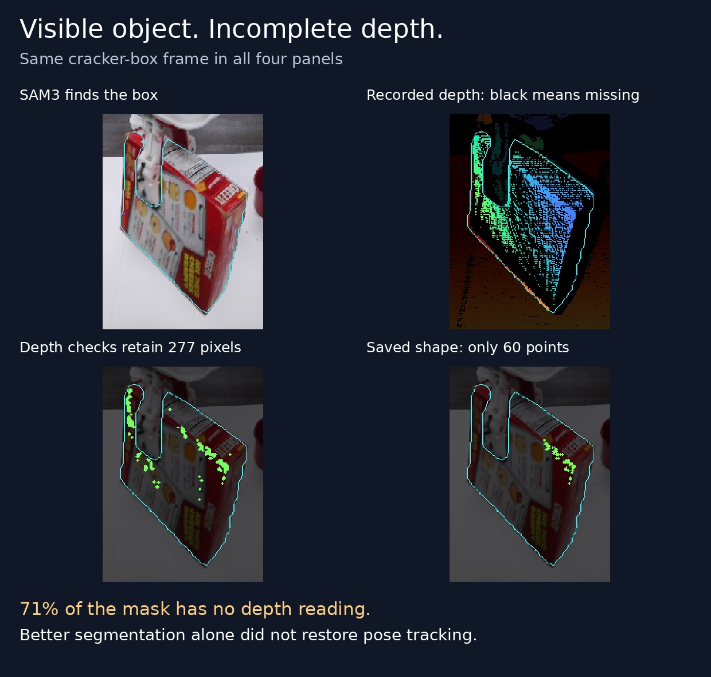

# Broader failure audit — 2026-10-29

**Status: investigation, not a tracker update.** Production code, server settings,
and prepared demonstrations are unchanged. The [failure ledger](../FAILURE_LEDGER.md)
separates confirmed causes from unresolved explanations and missing information.

## What was run

Nine YCBInEOAT recordings, **181 consecutive saved frames each: 1,629 frames**.
Each interval is centered on its recording, chosen before inference from its
length alone. These are longer intervals from sequences used in earlier short
point/P2P benchmarks, **not nine newly discovered datasets**. This pass tests the
current shared surface + scene/group pipeline; it broadens the earlier iPhone
Caryx sweep with another RGB-D source and supplied pose annotations.

The [frozen configuration](config.json) is the same one used for the labeled
clock. No per-object threshold tuning. Source depth and capture timestamps are
read directly, without video re-encoding. The first pass uses supplied masks
on every frame, isolating the text detector from subsequent failures. Those
masks are **not perfect**; the authors describe producing masks using robot
kinematics in the [dataset repository](https://github.com/wenbowen123/BundleTrack#run-predictions-on-your-own-rgbd-data).
No robot actions or gripper attachment are inferred from these recordings.

Pose annotations are loaded only by the scorer, after tracking. Error is relative
to frame 0: median displacement of 256 identical initial measured surface points,
and full 3D rotation difference. Initialization is excluded from error statistics.
The published-pose median includes both direct observations and predictions,
**only while a pose exists**. It is not a full-clip success score.
The supplied masks and poses may share annotation machinery; their agreement
is not independent sensor ground truth. This is an annotation-based audit.

| Sequence; inclusive source indices   | Observed / predicted / lost | Published point error, median / p90 | Published rotation, median |
| ------------------------------------ | --------------------------: | ----------------------------------: | -------------------------: |
| Bleach; 241–421                      |                4 / 66 / 111 |                       0.3 / 12.9 mm |                      0.01° |
| Bleach, hard; 130–310                |                1 / 23 / 157 |                        0.1 / 0.3 mm |                      0.15° |
| Cracker reorientation; 97–277        |                28 / 87 / 66 |                        6.5 / 9.8 mm |                       3.0° |
| Cracker, second recording; 573–753   |                 1 / 0 / 180 |             No later published pose |                          — |
| Mustard; 278–458                     |               19 / 45 / 117 |                      12.0 / 13.0 mm |                       8.1° |
| Mustard, second recording; 254–434   |               22 / 34 / 125 |                        2.7 / 3.0 mm |                       6.8° |
| Sugar box; 363–543                   |                 181 / 0 / 0 |                        0.9 / 2.2 mm |                       1.3° |
| Sugar box, second recording; 410–590 |                8 / 151 / 22 |                        4.7 / 6.6 mm |                       7.9° |
| Tomato can; 563–743                  |                 177 / 4 / 0 |                       8.6 / 12.4 mm |                      13.3° |

Total: 441 observed, 410 predicted, 778 lost. This is availability, not accuracy.
The sugar-box interval is a largely stationary control; it does not demonstrate
successful large rotation. The can's full rotation score also includes rotation
around its approximately symmetric axis. Neither it nor annotation disagreements
alone establish a wrong insertion direction. The source annotations have known
local inconsistencies; see the [earlier reference audit](../../flash-visible-surface-benchmark/REFERENCE_AUDIT.md).

[Compressed results](results.json.gz) retain per-frame errors, accepted/rejected status,
surface checks, failure messages and annotation step changes.
[Input audit](input_audit.json) records what each filter removes and actual time gaps.

## Newly isolated causes

### A correct object mask cannot restore missing depth

The second cracker recording starts at source frame 573. Its supplied mask has
473 separate image components. Boundary erosion removes 3,449 of 3,483 pixels;
only 10 sampled points survive all filters. This is not a name-prompt failure.

A complete additional **181-frame SAM3 pass**, prompted with `red cracker box`,
gives one connected initial mask with 14,286 pixels. But **71.1% have no depth**.
Of 4,122 valid readings, boundary exclusion removes 685 and the local depth-span
rule removes 3,160. The remaining 277 usable pixels become 160 sampled points;
keeping one connected 3D patch leaves **60**. SAM3 gives 1 observed / 6 predicted /
174 lost: better masks alone do not restore tracking. This does not prove failure
is inevitable with RGB cues, improved filtering, or accumulated earlier views.
The cause of the raw depth holes—material, sensor angle, exposure, or source
processing—is not isolated; do not label this cardboard box transparent.

Initialization also bypasses the usual agreement gate. The SAM3 run calls its
first pose “observed” even though the saved 60-point patch disagrees with other
retained measurements by **147.5 mm p90**. The next frame has zero accepted
image/depth motion correspondences. This is a separate confidence/initialization
problem, not a newly proven sensor limitation.

### A time rule can end otherwise usable point tracking

The hard bleach recording has a **5.020 s** jump between local frames 23 and 24
(source 153→154). The object-point fallback is available before the gap and lost
after it. `CausalRigidPointTracker.update` invalidates its tracks whenever the
interval exceeds the configured 0.1 s, before image matching.

[The controlled probe](gap_probe.json) seeds the same initial mask and processes
the same images through that boundary. With the original limit it raises the
gap error. Allowing just this recorded gap, while keeping all image/depth fit
checks, yields **48 inliers, 0.85 mm median fit residual**, and **1.36 mm object-origin /
1.82° error against the supplied annotation**. This isolates the time rule in
this example; it does not justify accepting arbitrary gaps. The scene-wide
point tracker has different behavior and already tries matching across gaps.

There are also 5.981 s and 1.285 s jumps in the second mustard interval. Its
direct vision survives the first one. A gap is therefore a test condition, not
automatic proof of failure. Never replace the source timestamps with invented
30 Hz timestamps to hide it.

### “Observed” still does not certify pose accuracy

Several clips publish poses while disagreeing with annotations. For example,
the mustard clip's 18 later directly observed poses have 12.4 mm median point
displacement error, despite passing the current surface checks. This needs an
image/annotation audit before attributing the entire difference to tracking.
Conversely, the hard bleach's low conditional error covers only 23 predictions
before loss. The ledger retains both concerns rather than turning either into
an accuracy claim.

## Reproduce

Run from the repository root using `PYTHONPATH=src` and the inference Python at
`~/.cache/flash-live-tracking/.venv/bin/python`:

1. `sweep_ycb.py` runs all nine local sequences from `~/.cache/ycbineoat/`.
2. `sweep_ycb.py --sequence cracker_box_yalehand0 --sam3-prompt 'red cracker box'`
   runs the segmentation comparison into a separate directory.
3. `score_ycb.py`, `audit_inputs.py`, `probe_gap.py`, then `render.py` generate the
   reported measurements and figure. `verify.py` checks complete outputs and
   that the gap experiment preserves the original behavior before the gap.

Each run stores input hashes, exact filenames/timestamps, configuration, source
checkout, and the regular per-frame scene evidence under
`~/.cache/flash-failure-sweep-20261029/`. Partial runs never receive a completed
marker. Raw proposals remain recorded when publication rejects them. Runtime in
these files excludes model loading; this pass is **not a live frame-rate benchmark**.
