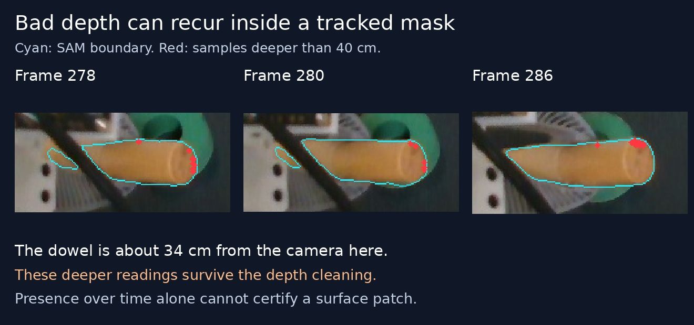
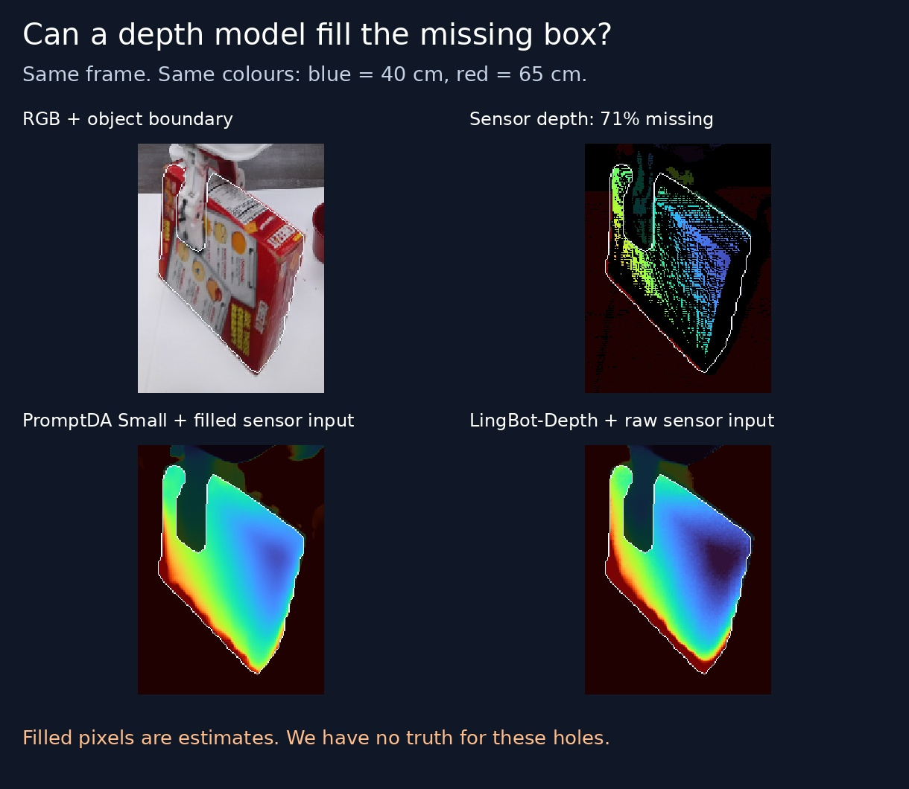

# Mask persistence and depth completion: bounded pilot

2026-10-29. **No production algorithm or default changed.** This tests recurring
contamination and two sensor-conditioned depth models; it does not establish
better pose tracking, temporal model stability, or physical ground truth in holes.

## Temporal evidence



`probe_temporal.py` reads all 61 insertion frames 250–310, their existing SAM3
masks and original depth. It repeats the earlier 3 mm surface sampling and
depth checks, before largest-3D-component removal. The explicit **400 mm split
is only a diagnostic for this previously inspected example**, not a proposed
generic rule. The main dowel surface is approximately 330–345 mm away around
the shown frames; the previously inspected frame-280 background samples lie
at 431–441 mm.

Samples beyond 400 mm occur in 46/61 frames. In frames 278–286 they occur in
all nine frames, with 4–14 such samples, all inside the **main 2D mask component**.
The image shows them at the object's boundary. This measures recurring
contamination, not persistent identities of the same physical points. Other
disconnected mask pieces can be legitimate parts across a gripper occlusion.
It is not an estimate of SAM's false-positive rate or proof of its error cause.

Therefore “wait until present for several frames” cannot certify this surface.
A temporal test should compare motion and new independent observations; simple
mask averaging can retain a consistent mistake and lag a moving boundary.
Our SAM adapter already has temporal memory. It re-detects lost text-selected
objects, but confidently propagated masks are reseeded from themselves.

[SAM3's full video design](https://arxiv.org/html/2511.16719v1), appendix C.3,
uses detection-based correction and delayed confirmation of new object tracks.
Its 15-frame confirmation delay is for track identities, not a guarantee about
every boundary pixel. That full system is not the current FLASH wrapper. A
half-second confirmation delay must not be inserted into the robot command loop.

## Sensor + learned depth



Five frames: the opaque box with missing depth, a sugar-box control, held dowel,
white dish and mug. Same RGB, sensor depth and evaluation mask across variants.
The models receive the whole image and depth; **the SAM mask is not a model input**.

The independent check withholds existing sensor readings: RNG 42 chooses 25%
of 8×8 tiles; pixels must lie inside a one-pixel-eroded object mask and have
positive depth. Those readings are removed **before** prediction or filling.
The comparison is to the withheld sensor readings, not true physical depth.
Small holes favor local interpolation; this check is deliberately a sanity
test, not a broad depth-completion benchmark. Real holes have no truth here.

| Frame       | Nearest measured pixel | PromptDA Small, dense prompt | LingBot v0.5, level 9 | LingBot v0.5, level 0 |
| ----------- | ---------------------: | ---------------------------: | --------------------: | --------------------: |
| Cracker box |              2.0 / 6.0 |                   3.2 / 16.5 |           18.3 / 29.0 |           20.7 / 29.5 |
| Sugar box   |              1.0 / 3.0 |                  19.9 / 85.7 |            7.8 / 15.4 |            5.0 / 17.4 |
| Dowel       |              0.0 / 1.0 |                   3.0 / 14.2 |           12.9 / 34.4 |           11.7 / 43.3 |
| Dish        |             7.0 / 25.0 |                147.2 / 231.7 |         **4.0 / 8.7** |            5.7 / 19.0 |
| Mug         |             2.0 / 24.9 |                  14.6 / 29.3 |            9.4 / 19.2 |           15.2 / 27.8 |

Numbers are median / p90 absolute difference in **millimetres**. No withheld
object pixels had invalid model outputs. LingBot produced a few invalid pixels
elsewhere, recorded in its JSON results rather than silently counted as correct.

- [PromptDA Small](https://github.com/DepthAnything/PromptDA): 25.1M parameters;
  RGB plus depth, trained with low-resolution LiDAR conditioning. Raw zero-filled
  missing input gave very poor results (208–500 mm median holdout differences).
  Nearest-filling the input first materially improves it, but does not make it
  uniformly accurate. Both versions are retained in the results. This is an
  input-conditioning sensitivity, not evidence that all Depth Anything models fail.
- [LingBot-Depth v0.5](https://github.com/Robbyant/lingbot-depth): 321.2M parameters;
  accepts missing raw sensor depth directly. It improves this dish holdout check;
  several other frames favor simple interpolation. Level 9 improves some tails
  over level 0, not every metric. Neither level was tested as a full pose tracker.
- The hybrid output preserves **every positive sensor reading exactly** and fills
  zero readings only. That avoids overwriting valid depth, but also preserves
  nonzero bad depth, including background seen through transparent objects.
  It is an experimental comparison, not the intended final trust policy.

### Cost on this host

RTX 5090, batch one, four CPU threads, three warmups then ten measured forwards.
CUDA synchronization brackets each measurement. Input transfer, CPU hole fill,
resizing and output transfer are excluded: these are **model times**, not total
perception latency or camera FPS. No simultaneous tracker workload was running.

| Model / setting                        | Forward range across five frames | Peak allocated PyTorch memory |
| -------------------------------------- | -------------------------------: | ----------------------------: |
| PromptDA Small, FP32, max RGB side 630 |                       3.7–9.6 ms |                    145–284 MB |
| LingBot v0.5, level 0, BF16 autocast   |                         29–32 ms |                        2.3 GB |
| LingBot v0.5, level 9, BF16 autocast   |                         61–78 ms |                        3.0 GB |

LingBot uses its official native SDPA attention. Its nested-list block requires
xFormers, absent here; the experiment unwraps its one-item list and calls the
original tensor `Block.forward`, preserving missing-depth token removal. This
does not change model weights or the production environment. xFormers numerical
parity has **not** been benchmarked, so this remains a host-adapted pilot.

## Reproduction and interpretation

`probe_depth.py` pins source and weight revisions in each `depth_results*.json`.
Source checkouts: PromptDA `9161547ca7151e14fcc8f490ad3cc02fa9437483` and LingBot
`f3a237e434ae987bc38281476d6cfb5df3e4d739`. Clone these into the `/tmp/flash-…`
paths named in the script and put them on `PYTHONPATH`; no live dependencies
were installed or replaced. Run with the existing inference environment:

```bash
PYTHONPATH=src:/tmp/flash-promptda-20261029:/tmp/flash-lingbot-depth-20261029 \
  /home/feit/.cache/flash-live-tracking/.venv/bin/python \
  docs/proofs/flash-contact-observation/temporal-depth-pilot/probe_depth.py --dense-prompt
```

Omit `--dense-prompt` for raw PromptDA input; use `--model lingbot
--resolution-level 9` or `0` for LingBot. Inputs, predictions, sensor-preserving
hybrids and withheld masks stay under `~/.cache/flash-depth-completion-pilot-20261029`.
The dish/mug source arrays come from the linked [earlier audit](../reference-retest/README.md).

The measured win is a better reconstruction of withheld **dish sensor readings**.
We have not shown that the dish's sensor readings were physically right, repaired
its temporal inconsistency, solved the transparent jar, or improved a full pose
trajectory. Models supply hypotheses where the sensor is incomplete; using those
same inferred depths to certify the resulting pose would be circular validation.
