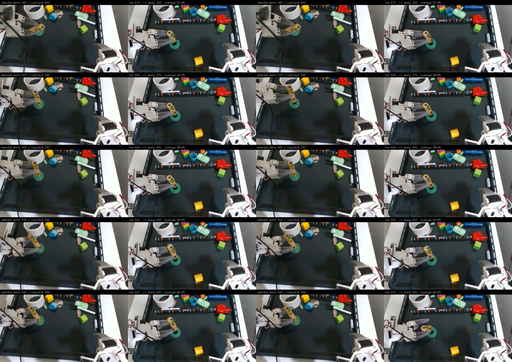
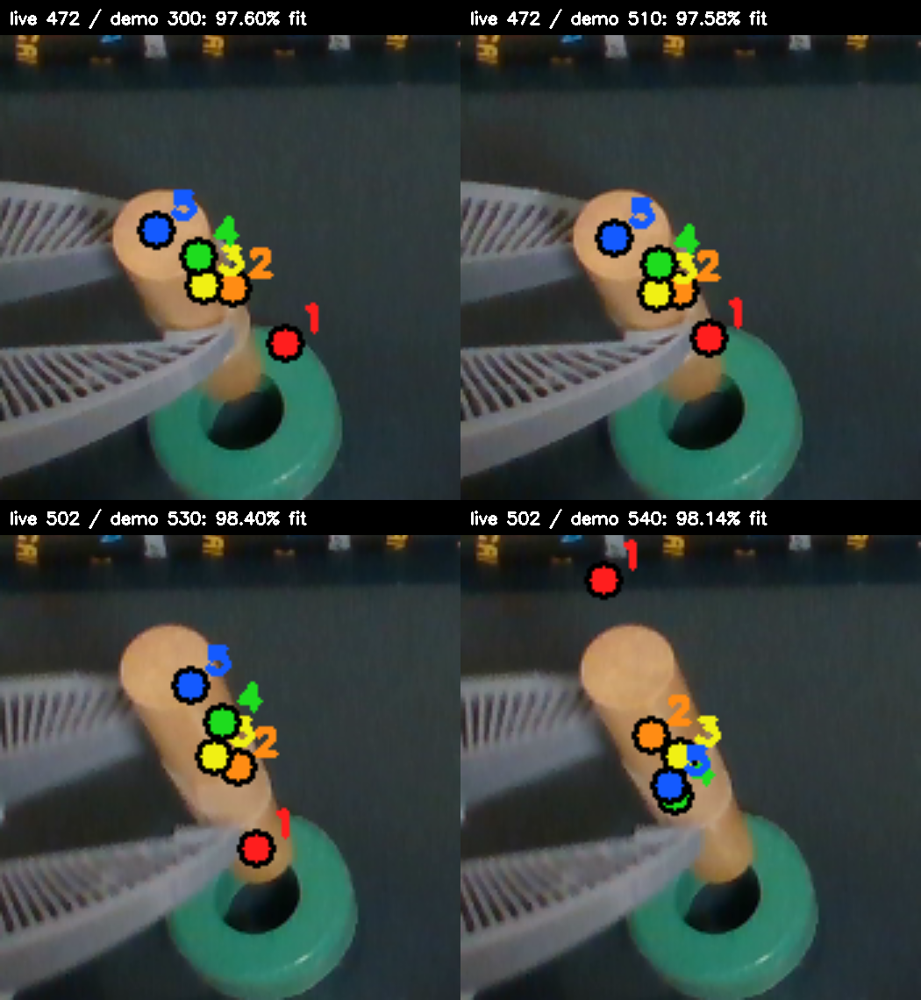
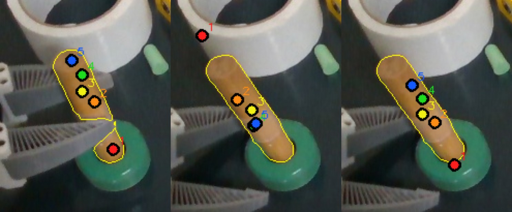

# Best-demo-view transfer on recorded FLASH insertion trials

This is an offline test of the proposed procedure, without symmetry rules or temporal smoothing. Five measured RGB-D surface points on the dowel in demo frame 500 are fixed as a carried reference group. Each live camera frame independently searches a bank of demo views. For every candidate view, the benchmark fits (1) canonical demo frame 500 to that demo view and (2) that demo view to the live masked RGB-D surface, then transfers the same five points through the composed rigid transforms. It selects the view with the highest _demo-view-to-live_ balanced surface coverage within a diagnostic 6 mm distance. The score does **not** assess the canonical-to-demo bridge or prove that a point keeps its physical identity. The 6 mm band is an offline comparison setting, not a robot action threshold.

The main run uses the 20:33:10 trial and all ten distinct camera frames with a saved dowel mask from live rows 472–515. It searched 35 demo views sampled across frames 100–600; frame 200 had no masked depth, leaving 34 candidates. The trial and demo masks are the saved FLASH tracker outputs, not newly annotated masks. The [benchmark script](../../../../benchmarks/flash_best_view_transfer.py) reproduces the experiment. [Paired images](wide-view-pairs.jpg) show the chosen demo view on the left and live camera on the right for each frame. Numbered colors denote the **same five points** carried from demo frame 500. The [per-frame results](wide-view-results.json), [demo bridge scores](wide-view-bridges.json), and [reference points](reference-points.json) retain the measurements.

The best surface matches covered 95.4–99.3% of both measured partial clouds within the diagnostic band. The selected view changed as the dowel moved: demo 300, 470, 370, 450, 530 and 520 all won at different times. Most transferred points remain on the visible dowel in the paired images. This demonstrates that a variable demo view can provide a useful cross-episode mapping; a single fixed view is unnecessary for these frames.

There is also a clear failure of **point transfer despite a good last-link surface fit**. At live frame 502, demo 530 scores 98.40% and maps the five points along the dowel. Demo 540 scores 98.14% yet maps point 1 far above the dowel and reverses the order of the other points. The two candidates differ by at most 0.26 percentage points in surface coverage, but by 113 pixels for point 1. The canonical-500-to-demo-540 bridge itself has only 62.4% balanced surface coverage, and selecting a view based solely on its live fit ignores that weak link. At live frame 472, demo 300 and demo 510 score 97.60% and 97.58%; their transferred point 1 differs by 14 pixels. The selected demo-300 path also places point 1 outside the live dowel mask and point 2 104 mm in front of the recorded depth at its rounded pixel. That depth residual alone is not ground truth for the hidden point, but it is inconsistent with treating the composed point map as verified.

## Follow-up: transfer through every intervening demo frame

The failing frame-500-to-540 bridge above was a **single direct registration**. It did not use the demo's temporal continuity or TrackEverything point trajectories. The [follow-up benchmark](../../../../benchmarks/flash_demo_bridge_comparison.py) instead fits each adjacent pair 500→501→…→540 from the same saved masked RGB-D clouds, initializing each local trimmed-ICP fit with identity rotation and the measured centroid shift, and composes the 40 rigid transforms. It does not give points persistent dense-track identities; the five reference points move by each estimated rigid transform. All 40 adjacent links cover at least 99.4% of both measured surfaces within the diagnostic 6 mm band.

In the direct fit, reference point 1 lands at image pixel `(180, 89)`, far above the dowel in frame 540. In the consecutive path, it lands at `(259, 214)` on the inserted end. The endpoints differ by 148 pixels. The [five sampled frames](sequential-bridge-trace.jpg) show the point group retaining its order while the dowel rotates; the [per-link data](direct-vs-sequential-bridge.json) records every fit. This visual result supports using temporal continuity for the demo map. It is not independent ground truth for the hidden endpoint or proof that a longer chain cannot drift.

The composed path's final balanced frame-500-to-540 surface coverage is only 59.7%, versus 62.4% for the visibly wrong direct fit. Those final numbers compare different partial surfaces after a large rotation and would pick the wrong transfer if used alone. The earlier failed bridge is therefore evidence against **direct distant-frame ICP and final-surface ranking**, not against carrying points through adjacent frames.

A second recorded trial was checked at eight held-object frames with the original eleven-view carried bank. It chose demo frame 500 throughout, so no demo bridge was needed; the other four reference points usually projected inside the dowel mask, while point 1 lay outside the mask as the end approached the ring. The [paired images](second-trial-pairs.jpg) and [results](second-trial-results.json) show this separate case. Its surface scores were 86.6–87.5%; these lower scores reflect partial visibility and do not establish point accuracy.

**Conclusion:** the requested best-view mapping is practical and often visually plausible. In this example, transfer through adjacent demo frames preserves the carried points far better than a direct 40-frame jump. The _whole path_ from the demo reference point to the selected demo view to the live observation still needs validation: a high-scoring final visible-surface match can coexist with a wrong carried-point map. The [TrackEverything demo-map follow-up](../te-demo-map/README.md) makes two formerly conflicting demo routes agree within 2.3 pixels at live frame 502, but finds an unverified point at the dowel/ring depth boundary. Temporal correspondence helps; cross-episode validation remains necessary. Neither experiment altered the live controller.
