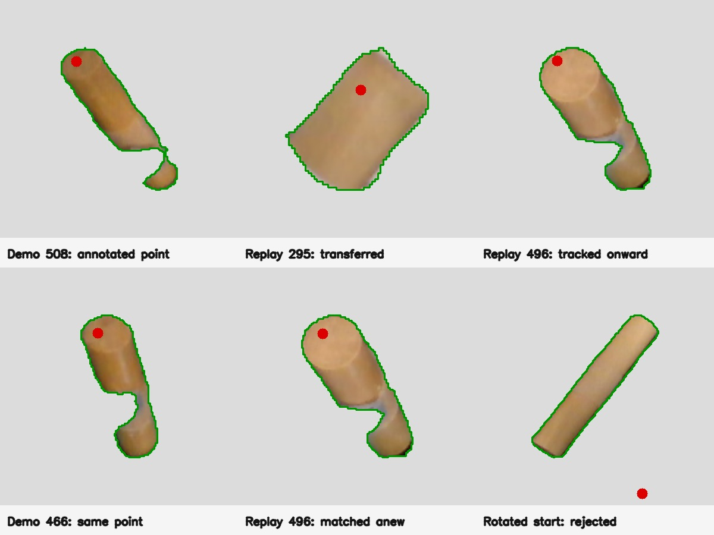

# Retrieving the demo point from the object, then tracking it live

Measured on 2026-10-21 from branch `docs/flash-redesign` at `f5192ea6b`.
The demo is `~/.cache/huggingface/lerobot/demos/insertion/recording` episode
0, with masks from `trackeverything-growth-ui-20261021-a`; the held-object
trial is `flash_insertion_trial_20261020_020-20261020-203310-655401` episode 0. Object-crop retrieval uses the cached `facebook/dinov2-base` checkpoint.

**This worked on a held-object segment of the saved 20:33 rollout, but not on
every object view.** The retrieval uses the segmented dowel only: each RGB
crop is centered and scaled on its mask, with everything outside the mask
replaced by uniform gray. Neither the tray, robot, nor camera-frame location
is an input to the similarity score.

Green is the recorded object-mask boundary; red is the annotated or predicted
point. The two live panels at frame 496 test the same demo point independently:
one follows a match made at frame 295, and the other matches a different demo
view directly at frame 496. The red point in each later demo view is a
TrackEverything prediction from the frame-100 human annotation, not another
human-labeled point; its physical identity across the intervening grasp is
not independently established.

## Offline method

1. Annotate `(218, 300)` on the dowel end at demo frame 100 and track it
   through adjacent demo RGB-D frames with TrackEverything. In the 601-frame
   sequence, 598 frames have a recorded dowel mask; the tracked point has
   mask and measured-depth agreement within the diagnostic 10 mm tolerance
   in 512. It loses this evidence during part of grasp (roughly frames
   180–260) and is observed again later. [Per-frame evidence](demo-tip-evidence.csv)
   keeps the location, visibility, mask, and depth check.
2. Among the 512 supported demo frames, rank object-only RGB crops with the
   cached DINOv2-base embedding. I also ranked centered binary silhouettes
   as a comparison. [The retrieval benchmark](../../../benchmarks/flash_object_view_retrieval.py)
   saves both rankings; a score is a proposal, never a pose verification.
3. Send a retrieved demo frame and a recorded live frame as a two-frame
   TrackEverything query at the demo's tracked point. Check the live prediction
   against that frame's exactly aligned SAM mask and measured depth. Seed
   temporal tracking from a passing live point, and check its future surface
   and rigid-group evidence. No physical act was made for this test.

| Live 20:33 frame             | Object-only DINO top demo frame | Transferred point | On live mask? | Live depth difference |
| ---------------------------- | ------------------------------: | ----------------- | :-----------: | --------------------: |
| 295, held and partly visible |                             508 | `(227.3, 90.5)`   |      yes      |                0.3 mm |
| 496, near insertion          |                             466 | `(270.4, 206.6)`  |      yes      |                7.4 mm |

Following the frame-295 point through 205 adjacent live frames gives mask and
depth support in **41 of 42** frames with exactly aligned recorded masks.
At frame 496 it predicts `(268.4, 203.5)`, about **2.3 pixels** from the
nearest visible mask endpoint. The fresh match from demo frame 466 is
**3.7 pixels** from that propagated prediction and is also on the measured
surface. This is useful cross-view corroboration, though the mask endpoint is
only a visual proxy, not an independent 3D tip measurement.

I tested the proposed co-moving-point check separately with an adjacent demo
view, frame 507. Four other source points had positive, mask-supported
cross-episode predictions at live frame 295. Tracking those four and the
point of interest together to frame 496 produced three rigidly consistent
surface points out of four (median 3D residual **2.0 mm**); the fourth had
a **330 mm** depth contradiction and must be rejected. The consistent group
predicts the point of interest within **3.2 mm** of its direct temporal
track. This is encouraging but sparse support, not a verified full object
pose. Jointly querying many points in the two-frame bridge was unstable in
this case: increasing the query batch changed the endpoint prediction and
could remove all surface-supported points. The independent-point check avoids
assuming that batch result is trustworthy.

The counterexample remains the rotated tray start in
`flash_insertion_trial_20261020_020-20261020-195134-752249`, frame 5. Its
highest-scoring object-only DINO view is demo frame 108, but the transferred
point falls **off the dowel mask** with a **25.5 mm** depth difference.
Silhouette ranking proposes a more similarly oriented demo view, yet its
point prediction also contradicts measured depth. Visual similarity alone
therefore cannot select a valid correspondence; this case should remain
unresolved, or seek another observation, instead of emitting a confident tip.

The viable design is a bank of per-object demo views, each storing its point
location and observation quality. Retrieval proposes several object views;
mask, depth, and distributed co-motion verify or reject their transferred
points. A valid point seeds adjacent-frame live tracking, while new verified
matches can correct or relocalize it after occlusion. The nearly symmetric,
unmarked dowel still prevents independent proof that the same _material end_
was retained across the demo grasp and scene resets. A temporary distinct
mark would test that identity claim without becoming a runtime requirement.
