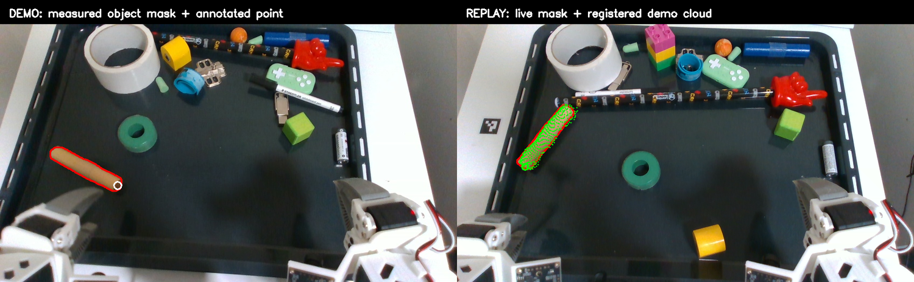
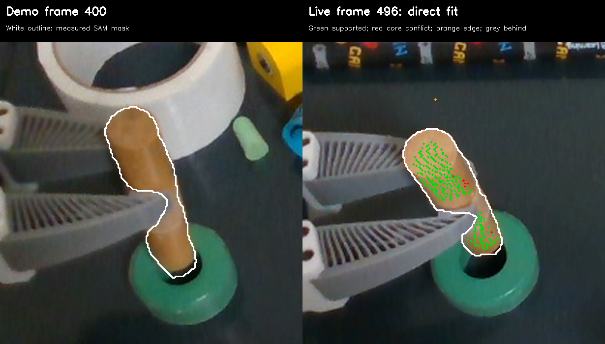
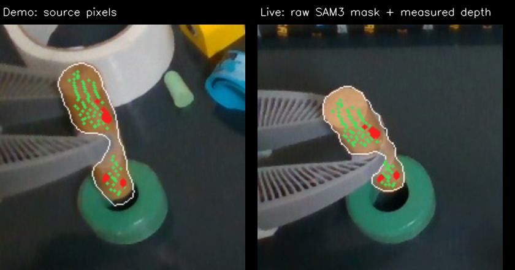
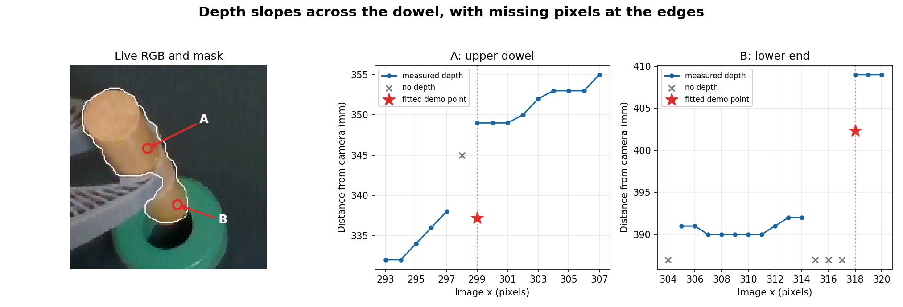
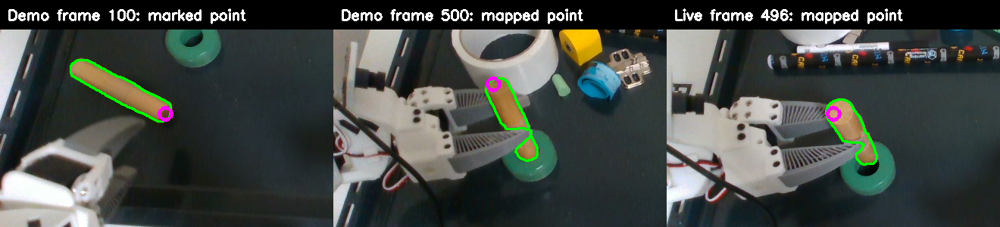
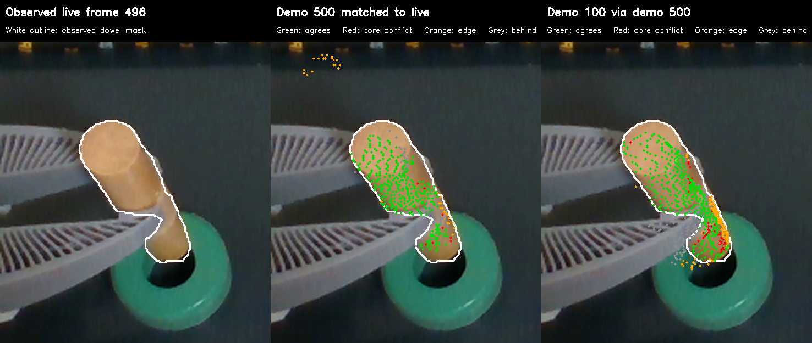

# Direct RGB-D registration across FLASH episodes

This experiment tests a demo-to-rollout object-cloud transform directly. It does **not** treat TrackEverything predictions across the episode cut as point correspondences. The benchmark back-projects every valid pixel inside each saved object mask using the recorded RealSense depth and intrinsics, proposes global rigid alignments, refines them with trimmed point-to-point ICP, and scores both source-to-target and target-to-source surface coverage. The source and target clouds each contain thousands of measured points when the objects are clear.

This fitter proposes **candidates**, not validated object matches. Its ICP step repeatedly assigns each source point to the nearest target point and retains the closest 80% for the next fit. The reported ranking uses nearest-cloud distances; it does not enforce the live object's image outline or free-space depth. A high-scoring candidate can therefore project a visible surface outside the mask or in front of measured depth. Full object maps contain hidden surfaces, so evaluation must render the expected-visible subset and distinguish an occluded point behind foreground depth from a front-of-depth conflict under the assumed camera calibration.

The source is `demos/insertion/recording`, frame 100. The target is `flash_insertion_trial_20261020_020-20261020-195134-752249`, frame 5. Source masks are from `trackeverything-growth-ui-20261021-a`; target masks are the trial's recorded observed masks. The source and target depth images have the same 848×480 shape and use the demo's saved overhead camera intrinsics. `benchmarks/flash_rgbd_registration.py` reproduces the comparisons. The test did not move the robot.

The green dots on the right are **measured demo depth points after rigid alignment**, not point-tracker predictions. The red line is the live mask. The white circle on the left marks a demo point at pixel (218, 300); its projection lands around (126, 265) in the replay. This is a plausible geometric transfer, not independent proof that the same physical end was identified.

| Source → target                     | Best balanced surface coverage within 6 mm | Source→target / target→source median surface distance |
| ----------------------------------- | -----------------------------------------: | ----------------------------------------------------: |
| Dowel → dowel                       |                                      97.2% |                                        1.00 / 0.96 mm |
| Ring → ring                         |                                      97.2% |                                        1.47 / 1.67 mm |
| Dowel → ring (wrong-object control) |                                      57.7% |                                        4.92 / 4.99 mm |
| Ring → dowel (wrong-object control) |                                      59.2% |                                        3.98 / 4.66 mm |

The distance and coverage numbers test agreement with observed surfaces. They are **not** ground-truth transform or material-point errors. The 6 mm neighborhood is a benchmark parameter, not an acceptance threshold for the robot. A wrong-object match can still explain part of a surface, which is why balanced coverage matters more than the nearest patch's residual.

The clear dowel start was also tested in four other saved trials, with the same demo source and a different live object arrangement each time:

| Trial start (Oct 20, 2026) | Live frame | Best balanced coverage | Source→target / target→source median |
| -------------------------- | ---------: | ---------------------: | -----------------------------------: |
| 17:57:33                   |          1 |                  98.4% |                       0.84 / 0.77 mm |
| 18:04:12                   |          1 |                  98.7% |                       0.86 / 0.80 mm |
| 19:11:55                   |          4 |                  98.8% |                       0.89 / 0.90 mm |
| 19:51:34                   |          5 |                  97.2% |                       1.00 / 0.96 mm |
| 20:33:10                   |          0 |                  98.3% |                       0.85 / 0.85 mm |

The `trial-*` reports and overlays in this directory contain each result. They show that the clear-view registration was not peculiar to one replay. They still do not identify an unmarked physical endpoint independently of shape.

## Direct fit of two masked partial surfaces

To isolate object registration from the dowel–ring relationship and from any demo-frame chain, I fitted one masked demo dowel cloud directly to the masked held dowel in live frame 496 of the 20:33 trial. The source points were back-projected from aligned RGB-D pixels _inside_ the saved segmentation mask. The live binary mask was not retained in this trial: the benchmark fills the largest external mask contour saved by telemetry, which can discard disconnected parts or fill holes. This is therefore not a strict raw-SAM-mask-to-raw-SAM-mask test. The figure shows demo frame 400 and one candidate transform into the live frame; green points also pass an independent live mask-and-depth check. Red marks front-of-depth disagreement inside an eroded live mask core, orange marks disagreement near its boundary, and grey marks possible occlusion behind measured depth.

| Demo source | Mask interior used for fitting | Source points | Project inside live mask | Agree with mask and depth within 6 mm | Predict a surface in front of measured depth |
| ----------- | -----------------------------: | ------------: | -----------------------: | ------------------------------------: | -------------------------------------------: |
| Frame 400   |                        1 pixel |         2,655 |                    90.2% |                                 78.9% |                                         6.7% |
| Frame 400   |                       5 pixels |         1,437 |                    99.9% |                                 91.9% |                                         2.2% |
| Frame 500   |                       5 pixels |         1,261 |                   100.0% |                                 92.5% |                                         0.7% |

Each row reports the candidate with the highest mask-and-depth agreement among that run's proposed transforms, rather than the first candidate in nearest-cloud order. The [frame-400 one-pixel report](masked-direct-400-edge1/report.json), [frame-400 five-pixel report](masked-direct-400/report.json), and [frame-500 report](masked-direct-500/report.json) retain every candidate and its separate pixel evidence. The six-millimetre depth band is the benchmark's diagnostic tolerance, not a claimed task accuracy. The five-pixel interior is a _sensitivity check_, not a chosen FLASH constant: it discards nearly half the frame-400 source points, so a later estimator should model depth reliability around boundaries instead of blindly eroding every mask by five pixels. The improvement confirms that direct partial-surface matching is feasible on these frames; it does not establish material-point identity or prove that the unseen object surface is mapped correctly.

For the illustrated frame-400 candidate, the exact-pixel check finds 1,321 of 1,437 transformed source points supported, 64 with no measured live depth, 21 behind live depth (compatible with the source surface becoming hidden), and 31 in front of live depth. Thirty of those front-of-depth points are **inside** the reconstructed live mask, at least five pixels from its boundary; their median excess is 7.9 mm. This is a real residual of the **estimated transform and recorded measurements**, not something explained away by the mask edge. However, 14 of those 30 points have depth support within one neighboring pixel, 26 within two pixels, and all 30 within three pixels. The neighborhood test establishes sensitivity to small image registration shifts; it does not prove whether the cause is ICP alignment, RGB/depth sampling, the reconstructed mask, or a combination. The demo and live camera intrinsics saved for this trial agree exactly. The fitting step currently ignores the projection check and trims 20% of nearest-cloud correspondences, so the reported fit cannot be called conflict-free.

### Raw-mask and depth-objective check

I independently ran the configured SAM3 model at 448-pixel inference resolution on the saved live RGB frame 496 with the existing `wooden dowel` prompt, then repeated the same direct masked RGB-D fit. This is a new binary mask from the same recorded image, **not** the original causal live mask, which the trial did not retain. Its area is 2,693 pixels; the telemetry-outline reconstruction covers 2,753 pixels, with 0.911 intersection-over-union. The [binary mask](live-496-sam3.png) and [candidate report](raw-mask-direct-400-report.json) preserve this comparison.

For the same demo-frame-400 initializer and five-pixel source interior, replacing the reconstructed live outline with the binary SAM3 mask changes mask-and-depth support only from 91.9% to 91.8%, and front-of-depth points from 31 to 32 out of 1,437. The raw-mask candidate still has 31 front points **inside** the live mask. Of these, 28 lie within three pixels of a depth change greater than 20 mm in the source or target image, versus 13% of depth-supported points. This diagnostic cut is not a depth-validity rule: it shows that local discontinuities near the gripper and ring are strongly associated with the remaining disagreement even where the RGB mask itself is interior. A static-ring control comparing demo frames 100 and 110 had no pixels more than five pixels inside both masks differing by over 6 mm, so ordinary frame-to-frame depth noise alone does not explain the dowel residuals.

The red dots in this image are **not a demonstrated pose failure**. They indicate exact-pixel depth residuals of one candidate under the chosen diagnostic band; the visible surfaces otherwise align well. Among the next nine candidates ranked by mask-and-depth support, all project roughly 99% of source points inside the live mask and 90.7–91.3% onto supporting depth. Their transformed measured points differ from the best candidate by less than 0.9 mm on median, but up to 5–7 mm for some points. The observed geometry may resolve the true pose, especially because the dowel is not perfectly round, but this comparison has no independent ground truth for the hidden insertion end. It cannot establish a missed insertion or a task-relevant pose error.

The saved depth around two red clusters is a structured surface with missing pixels, rather than isolated random spikes. Along live image row 233, depth rises from 332 to 353 mm over 15 pixels, with one invalid pixel. At the upper marked point, the transform predicts 337 mm at x=299 where the camera reports 349 mm; the camera reports 338 mm at x=297. Near the dowel–ring contact on row 269, depth varies from about 390 to 409 mm with several invalid pixels. A small projection shift across these slopes or occlusion boundaries can therefore produce an exact-pixel residual. Missing depth and foreground/background steps are camera/occlusion-boundary effects, but this evidence does not distinguish transform error from RGB-D sampling or alignment as the cause of each red point. Trial rows 495–497 reuse the same camera frame ID, so they are not independent temporal confirmations.

The fitting objective matters too. A local refit with a strong one-sided penalty on points in front of measured depth reduced the front fraction to 0.7%, but moved 18.5% of source points behind measured depth and reduced mask-and-depth support to 76.4%. That pose merely hides the disagreement and is **not** a better registration. A symmetric depth refit kept about 92.6% support but still had 2.6% front disagreement. A useful visibility objective must reward explained measured surface, model occlusion and depth uncertainty, and reject such tradeoffs rather than demand zero threshold violations. None of these offline refits has been applied to the FLASH runtime.

## A later demo view bridges to a held live view

The first view of an object need not stay visible throughout a demonstration. I tested a two-link route from the marked dowel end in clear demo frame 100, through later demo frame 500 after the grasp, to held-object frame 496 of the 20:33 live trial. The benchmark now accepts either another RGB-D recording or a saved FLASH trial as its target. Both links use measured masked clouds, not point-tracker correspondences.

| Link                | Balanced surface coverage within 6 mm | Mapped point                                 |
| ------------------- | ------------------------------------: | -------------------------------------------- |
| Demo 100 → demo 500 |                                 82.3% | `(210.5, 111.0)` in demo 500                 |
| Demo 500 → live 496 |                                 87.3% | Composed result `(268.4, 215.3)` in live 496 |

The figure uses the deterministic `pca_11` demo-link candidate. Its demo-frame projection is about two pixels from a separate TrackEverything prediction of the same annotated point. The composed live point lies inside the recorded dowel mask and is 4.4 mm from measured depth at that pixel. A separate TrackEverything demo-to-live transfer landed at `(270.4, 206.6)` in that live frame, about nine pixels away. This is a plausible bridge across a large pose change and grasp, **not** ground truth for the physical endpoint or insertion accuracy. The [demo-link report](demo-100-to-500/report.json) and [live-link report](demo-500-to-live-496/report.json) retain the other candidate transforms. A stochastic FPFH run ranked a different demo-link transform higher by surface coverage, so choosing by surface coverage alone is insufficient.

The following crop checks what happens if the measured surfaces from **both** demo views are combined through those two transforms using the earlier one-pixel mask interior. White is the live dowel mask; green points agree with its mask and depth within the 6 mm diagnostic radius. Grey points lie behind measured depth and may simply be hidden. Orange points predict a surface more than 6 mm **in front of** measured depth near or outside the mask boundary, where depth and segmentation edges are less reliable. Red points make the same prediction at least three pixels inside the mask, a stronger conflict with the saved observation. The three-pixel erosion is only a diagnostic sensitivity check.

Of the 2,488 points measured in demo frame 500 and transferred directly to live frame 496, 1,781 (71.6%) have mask-and-depth support and 228 (9.2%) are in front of measured depth; **48** of the latter are in the eroded mask core. Of the 3,739 points from demo frame 100 transferred through frame 500, 1,829 (48.9%) have support and 824 (22.0%) are in front; **226** are in the core. Thus much of the apparent contradiction is at an uncertain image edge, but the extra demo view also adds interior depth conflicts. The check alone does not identify which transform, segmentation or depth measurement is responsible. It shows why a two-view union must validate its links before treating added points as a reliable object map.

A diagnostic adjacent-frame ICP pass over demo frames 100–700 found 22 consecutive links without usable masked depth at frames 176–197. Surface overlap was high for most other adjacent pairs, yet composing some plausible local links and one cross-gap link moved the marked point tens of pixels away from its later tracked location. Thus, adding every frame can supply alternate routes, but it also adds false or drifting edges. A production map must retain competing transforms, check independent evidence and loop consistency, and relocalize against strong clear views rather than trusting a chain solely because its pairwise surfaces overlap.

On the clear dowel pair, the candidate methods behaved differently:

| Candidate initializer                | Balanced coverage after the same trimmed ICP | Observation                                                                                |
| ------------------------------------ | -------------------------------------------: | ------------------------------------------------------------------------------------------ |
| PCA multistart                       |                                        97.2% | Strong on this elongated object; produces several plausible alignments.                    |
| ORB plus 3D RANSAC                   |                                        97.2% | Only three rigid feature inliers; the independent cloud fit supplies most of the evidence. |
| FPFH plus RANSAC                     |                         94–97% across reruns | Good global initializer; stochastic and sometimes fits a smaller surface subset.           |
| FPFH plus fast global registration   |                         93–97% across reruns | Also plausible, with variable coverage.                                                    |
| DINOv2 patch matching plus 3D RANSAC |                                        76.2% | Six rigid inliers from 13 mutual patch matches; weaker than shape here.                    |
| SIFT plus 3D RANSAC                  |                                 No transform | Only four and six detected object keypoints; no consistent 3D triple.                      |
| Point-to-plane ICP after a good seed |                                           0% | Diverged on this small/noisy surface; cannot be accepted without scoring.                  |
| Colored ICP after a good seed        |                                 No transform | Open3D reported no correspondences during optimization.                                    |

The released [PANY](https://demianhj.github.io/PANY/) checkpoint provides a separate learned RGB-D reference comparison. The [adapter](../../../../benchmarks/flash_pany_registration.py) follows its published single-reference pointmap path and scores the resulting transform against the same raw clouds. It was tested from upstream commit `db2518f86c9315d4d18606cbed7771183472ba91` with the published checkpoint. This is a pretrained general model; no FLASH-specific training was performed.

| PANY source → target | Raw balanced coverage | After the same trimmed ICP |
| -------------------- | --------------------: | -------------------------: |
| Dowel → dowel        |                 88.6% |                      96.3% |
| Ring → ring          |                 97.1% |                      96.2% |
| Dowel → ring         |                  2.0% |                      52.5% |
| Ring → dowel         |                 11.0% |                      48.2% |

PANY gives a useful coarse transform for the dowel and directly distinguishes the wrong-object controls. Blindly refining a bad transform can create a misleading partial fit, so refinement must be conditional on the raw evidence. With the model already loaded, PANY pointmap inference took about 0.23 s, its reference/query fit about 0.07 s, and the diagnostic ICP about 0.07 s on this machine. Loading the 4.74 GB checkpoint took about 4 s; preprocessing the pair took about 0.8 s in the adapter. This is an asynchronous relocalization candidate, not a 30 Hz robot-loop job.

On the 20:33:10 start, PANY scored 77.9% before and 92.2% after ICP, versus 98.3% for the best classical registration. The learned model is viable as another proposal, but was not the best method for this plain dowel in these recordings. Its two good shape alignments can project the annotated source end to different live ends; this experiment does not resolve that identity.

The cloud fit remains consistent over early replay frames. Independently registering demo frame 100 to replay frames 5, 14, 30, and 44 placed the annotated source point within roughly two image pixels of the same live location. As the gripper approaches, depth-backed live points fall from 3,650 at frame 5 to 2,179 at frame 80, 827 at frame 130, and 295 at frame 155. Balanced coverage falls from 97% to 72%, 36%, and 23% respectively. At frame 163 the saved live mask contains **no valid depth**. Direct RGB-D registration cannot make a new measurement from that frame; a live system would need to carry a prior pose and wait for later usable evidence.

PANY also weakens under the same occlusion: raw balanced coverage is 79.8% at live frame 54, 63.8% at frame 80, 8.1% at frame 106, and 1.3% at frame 130. Its point projection at frame 80 moves roughly 33 image pixels from the earlier visible-end estimate while the dowel still appears to lie on the tray. A live system must not let a newly computed but poorly supported relocalization overwrite a previously supported pose.

The demo has the same issue during grasp: frame 100→110 aligns at 0.24 mm median surface distance and frame 100→130 at 0.69 mm; masked depth becomes incomplete around frame 140 and registration degrades. A multiview map can help with changes of viewpoint, but it cannot infer a uniquely labeled point on an untextured object from an ambiguous geometric fit, nor recover measured depth that is absent. The next experiment should connect confident adjacent demo views into an object map, then relocalize live views against that map while retaining multiple candidate transforms and reporting when observations are insufficient.

The complete per-method transforms, scores, settings, and timings are in the four `report.json` files here. The first figure and the corresponding `overlay.png` files show the actual reprojection for review.
