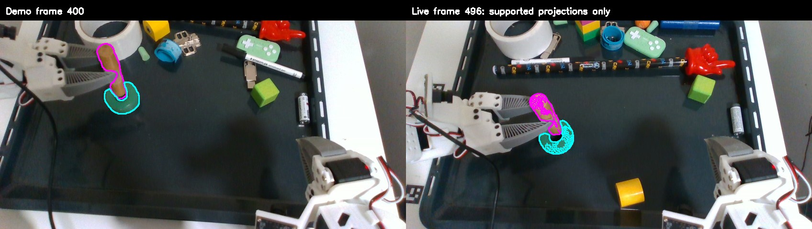
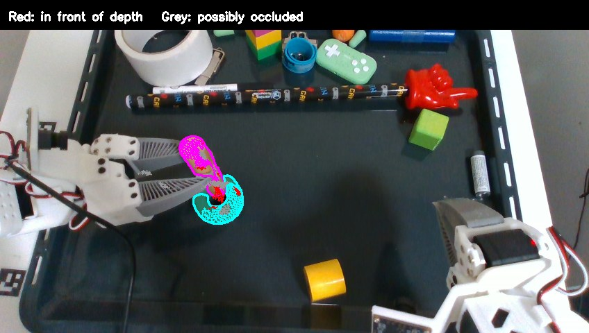

# Labelled object-pair cloud relation, offline insertion test

The [benchmark](../../../../benchmarks/flash_scene_relation.py) searches a saved insertion demonstration for a **pair of measured 3D object surfaces** that jointly matches one live rollout frame. It fits a single global rigid transform to both labelled clouds. It does not require an annotated tip, a manually specified axis or a symmetry setting. Each object must agree in both source-to-target and target-to-source nearest-surface coverage; the reported pair score is the least-supported direction or object.

The left image is demo frame 400 and the right is live frame 496 of `flash_insertion_trial_20261020_020-20261020-203310-655401`. Magenta is the held-object mask and cyan is the target-object mask. Dots on the right are **only** projected demo points that fall within the respective live mask _and_ agree with the live depth at that pixel within the benchmark's 6 mm diagnostic radius. They are not tracked point identities. The source is the saved insertion RGB-D demo, with masks from `trackeverything-growth-ui-20261021-a`. The images are at their recorded camera times; matching did not use equal frame indices or demo/live elapsed time.

| Live frame | Search range               | Best demo frame | Joint coverage within 6 mm | Held / target coverage | Interpretation                                                                                              |
| ---------- | -------------------------- | --------------: | -------------------------: | ---------------------- | ----------------------------------------------------------------------------------------------------------- |
| 496        | 350–550, every fifth frame |             400 |                      82.6% | 82.6% / 83.3%          | Coarse interaction-phase candidate; its pixel projection has material contradictions.                       |
| 295        | 200–550, every fifth frame |             215 |                      55.0% | 55.0% / 63.7%          | The partly visible held object is in a different carry configuration; do not force a demo contact relation. |
| 163        | 350–550, every fifth frame |               — |             no measurement | —                      | No recorded masks for the pair at this live time.                                                           |

The full [frame-496 report](live-496/report.json), [frame-295 report](live-295/report.json) and [frame-163 no-measurement report](live-163/report.json) record point counts, all searched frames and the top transform candidates for each. Frame 496's high-scoring demo region includes 400, 425 and 430, all above 82% joint **nearest-cloud** coverage. Demo frame 500 scores only 40.4%, despite being closer in index to the live frame. For frame 496's best fit, median nearest-surface errors are 2.9 mm for the held cloud and 3.2 mm for the target cloud.

The independent pixel check is much less convincing. Of all 2,655 measured demo held-object points, 1,446 (54.5%) project into the live held mask with agreeing depth; 561 (21.1%) project **in front of** the measured depth by more than 6 mm. For the target, 1,421 of 2,513 (56.5%) have mask and depth support, while 181 (7.2%) predict a surface in front of measured depth. Points behind measured depth could be occluded; a point outside the mask alone is not an error. A point in front of measured depth is a contradiction under the assumed camera calibration and synchronization, though edge pixels, depth error and mask error can contribute. The first image previously drew _all_ transformed source points, including contradictions; it now draws only pixel-supported projections. In the second image red marks front-of-depth contradictions, grey marks possible occlusions, and magenta/cyan retain the supported held/target projections. Even supported projections do not prove that the same physical surface points correspond across episodes.

This is **coarse phase retrieval**, not validated point tracking, a pose estimate fit for control, or a contact-success metric. The nearest-surface score is optimistic for repeated or partial geometry: the high score here coexists with substantial pixel contradictions. Comparing two single-frame clouds also penalizes a correct relation when occlusion hides different surfaces in the demo and live views. A single transform for the held/target pair additionally assumes the live pair has already attained the demonstrated relationship; any real relative error forces a compromise fit. The lower frame-295 score cannot separate view loss from a genuinely different carry configuration on its own. A complete estimator should first register each object independently to its own fused multiview map, then compare their relative configuration. It also needs visibility prediction, free-space checks and temporal/gripper prediction through periods without a direct measurement.

To reproduce, run the benchmark from the repository root with `--demo-recording` pointing at `demos/insertion/recording`, `--held-masks` and `--target-masks` pointing at that demo's respective mask directories, and `--live-root` pointing at the saved trial. Set the live object role names with `--held-role` and `--target-role`, the live frame with `--live-frame`, the search range with `--demo-start`/`--demo-end`, and `--output` to a separate directory. All scoring and sampling quantities are command-line parameters. The benchmark uses the demo's saved overhead camera intrinsics and assumes the saved trial used the same calibration.
