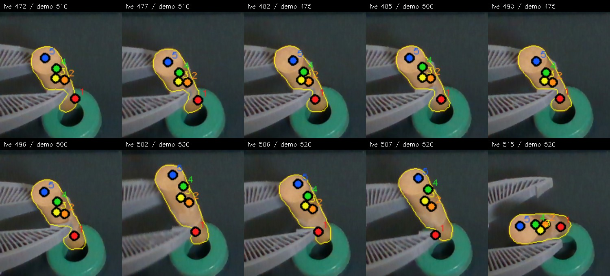
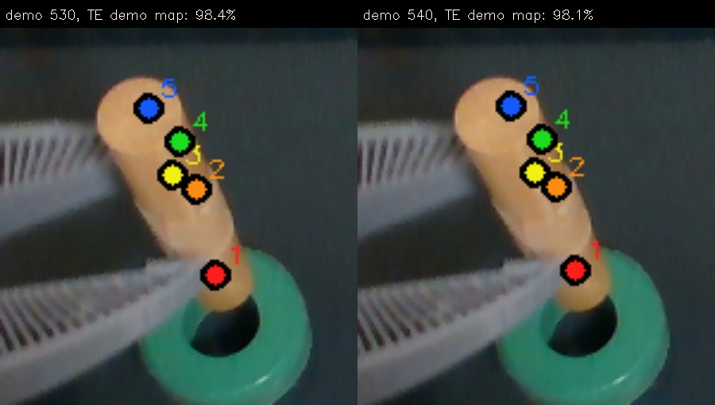
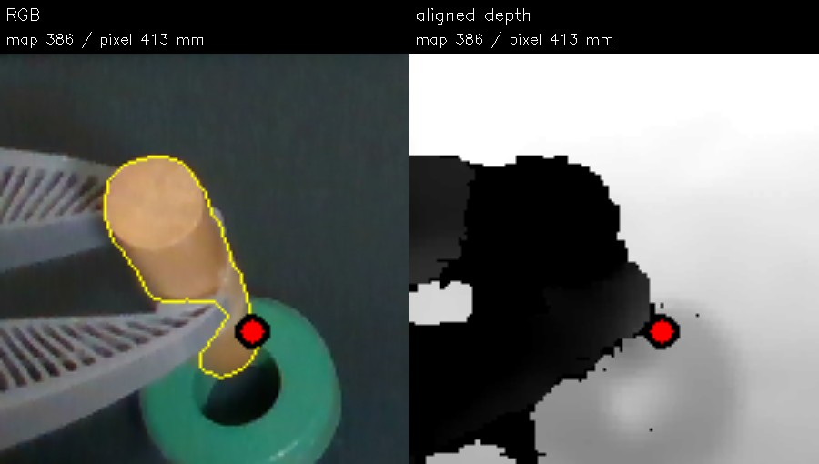

# Growing TrackEverything demo map, then matching a live view

The [frame-by-frame diagram](experiment-pipeline.md) shows exactly which demo
and replay frames were used, what the saved TrackEverything points looked
like, and how this limited experiment differs from a demo-to-live tracker.

This is an offline test of carrying point identity through the demo instead of
independently registering distant demo frames. It uses the saved
`trackeverything-growth-ui-20261021-a` run of the 613-frame insertion demo and
the recorded 20:33 live trial. The [benchmark](../../../../benchmarks/flash_te_demo_map_consistency.py)
and [measurements](results.json) reproduce the ten selected live frames and
seven candidate demo views. This does not change the FLASH controller.

The saved TrackEverything run adds point cohorts when new dowel surface becomes
visible. For this test, a point is usable at a demo view only when its tracked
location projects inside that view's saved SAM mask and agrees with aligned
measured depth. Thus invalid points are **excluded from each fit**, but not
permanently deleted from the model's query bank. Only the cohorts seeded at
demo frames 100 and 361 can contribute to the chosen views 475–540.

Five measured surface points in demo frame 500 are the fixed reference. Shared
TrackEverything IDs supply a robust rigid map from frame 500 to each candidate
demo view. Each candidate's masked RGB-D cloud is then registered independently
to the live cloud. The same five reference points pass through both transforms.
The 5 mm rigid inlier band, 10 mm track/depth support band, and 6 mm cloud
coverage band are offline diagnostics, not runtime acceptance rules.

At demo frame 540, 68 IDs have mask/depth support at both endpoints; 62 agree
with one rigid transform to within 5 mm, with a 2.0 mm median residual across
all 68. Fifty IDs pass the mask and depth check at **every** intervening frame
500–540. Using only those 50 changes the mapped first point at demo frame 540
by about 2.5 image pixels. This supports a useful co-moving subset; it does
not establish material identity through earlier grasp occlusion.

The best-scoring demo view changes across these ten live frames. At live frame
502, independently mapping via demo views 530 and 540 puts reference point 1
only 2.3 pixels apart, on the visible dowel in both cases; their live cloud
surface scores are 98.4% and 98.1%. In the previous [direct distant-frame
ICP comparison](../best-view-transfer/README.md), those same two routes put
that point 113 pixels apart despite nearly identical live surface scores.
Following persistent demo tracks therefore removes that failure **in this
segment**.

There is still an unverified end-near reference point. At live frame 472, the
selected map scores 97.6% on visible cloud coverage and point 1 projects
inside the saved dowel mask, but its predicted depth is 386 mm while the
aligned sensor reports 413 mm at that pixel. Frame 477 has a similar 24 mm
discrepancy. The pixel is at the dowel/ring boundary, where the mask may
include ring pixels. The per-pixel difference therefore does not measure
exact physical point error; it **does** rule out calling that point a verified
visible-surface match. At live frame 515, the demo-540 fit scores 77.7%
and sends point 1 about 67 pixels from the demo-530 route, which scores
79.6%. The best-scoring view there is demo 520 at 98.6%.

The answer to “would this give a consistent mapping?” is **partly**: it makes
nearby demo-view transfers much more internally consistent, but it has not
established a correct demo-to-live map for every frame, nor a stable hidden
tool point. A separate TrackEverything growth run found an 11.1 mm median
change in pairwise separation for one later dowel cohort at frame 500, even among
mask/depth-supported points ([tracker review](../../../../src/lerobot/policies/flash/TRACKER_REVIEW.md)).
Mask and depth say where a point lies now; they do not prove it stayed on the
same material patch.

The next estimator should keep each cohort's identity and uncertainty,
validate co-motion over time, and connect overlapping cohorts with redundant
paths rather than one chained transform. Across episodes, multiple independent
demo-view anchors should agree in 3D and pass mask, depth, and free-space
checks before a precise task point is accepted. Once anchored, tracking the
live episode frame by frame can keep that mapping current and later anchors
can correct drift. This live temporal tracking and cross-episode validation
are **not implemented** in this benchmark. A temporary visual mark on the
dowel would provide an independent identity check during development without
becoming a runtime requirement.
