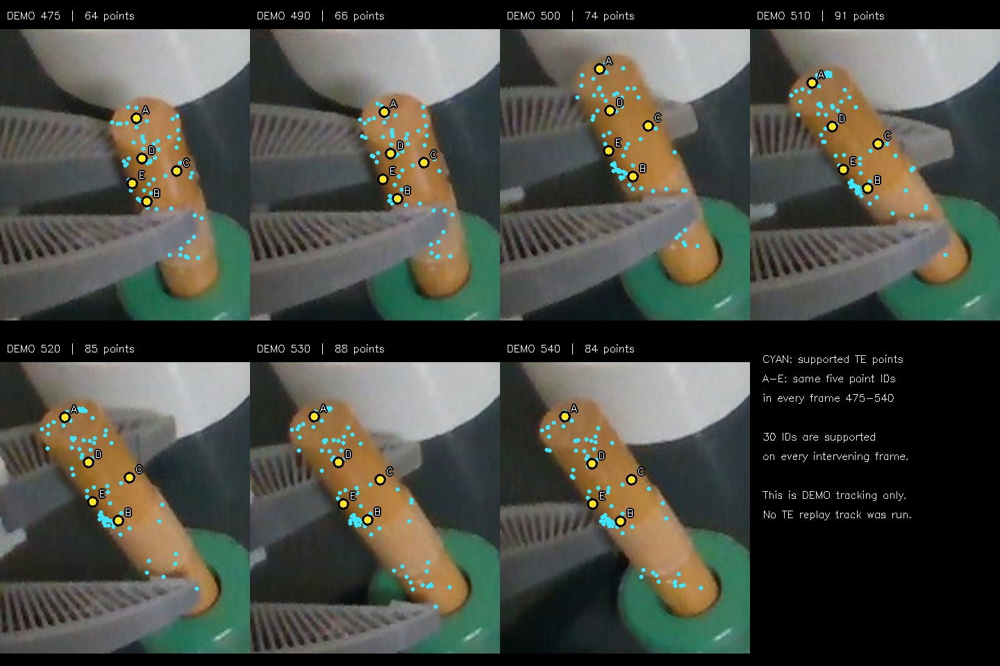
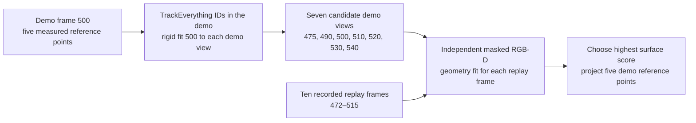
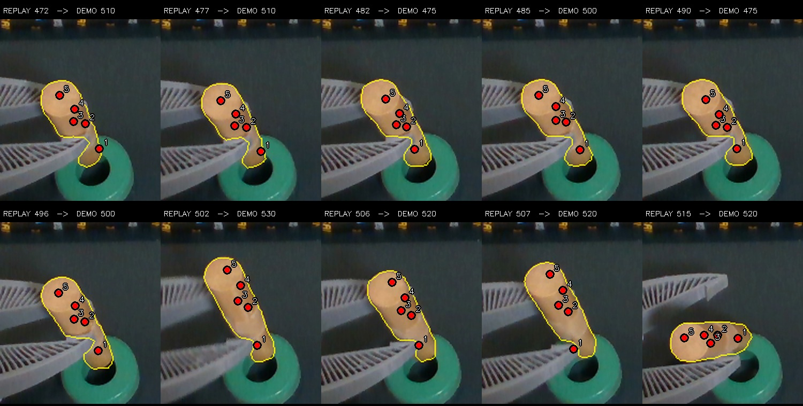
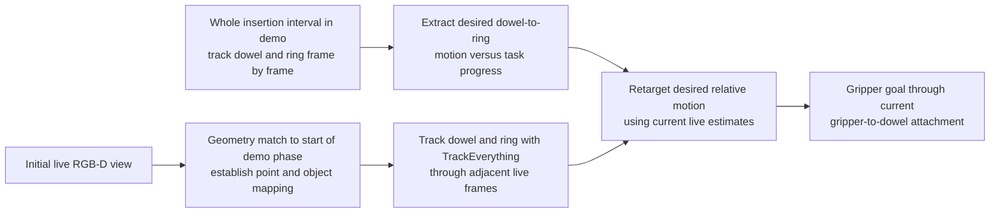

# What the TrackEverything demo-map experiment actually did

The source was `~/.cache/huggingface/lerobot/demos/insertion/recording`, demo
episode 0. The replay was
`~/.cache/huggingface/lerobot/demos/flash_insertion_trial_20261020_020-20261020-203310-655401`,
episode 0. This experiment sampled **seven demo frames, 475–540** (a 2.2-second
span at 30 fps) and **ten replay frames, 472–515** (a 1.4-second span). This
was not a complete five-second insertion phase.

Cyan dots are TrackEverything query predictions that also passed the recorded
dowel mask and measured-depth check at that frame. A–E label five query IDs
that pass those checks at **every frame from 475 through 540**, including the
intervening frames not shown. Thirty query IDs pass this strict check; A–E
highlight five of them on the visible upper dowel. Their letters follow the
same saved IDs. These dots were **not** run on the replay.

Persistent ID does not mean exact rigid tracking: from demo frame 475 to 540,
26 of those 30 continuously supported points agree with one rigid transform
within the experiment's 5 mm diagnostic band. Their median change in pairwise
3D separation is 2.8 mm. The lower insertion end is often hidden while the
visible upper points carry this estimate.

The five **numbered red points below are not A–E**. They are separate measured
surface reference points chosen in demo frame 500. TrackEverything demo IDs
were used to move those reference points to a candidate demo view. Masked
RGB-D registration (PCA candidates refined by trimmed ICP) then moved them
from that view to a replay frame. The yellow line is the saved replay dowel
mask. No replay TrackEverything tracks, object-to-ring motion trajectory, or
robot action was produced.

| Replay frame | Chosen demo frame |
| -----------: | ----------------: |
|          472 |               510 |
|          477 |               510 |
|          482 |               475 |
|          485 |               500 |
|          490 |               475 |
|          496 |               500 |
|          502 |               530 |
|          506 |               520 |
|          507 |               520 |
|          515 |               520 |

**The intended pipeline is a different, fuller experiment:**

That pipeline needs the ring as the moving reference and the current
gripper-to-dowel attachment to turn a desired object motion into a robot
command. The initial live view should first be registered to the beginning
of the relevant demo interval; another clear demo view can also serve as the
anchor if that first view is occluded. A one-time geometry anchor can be
ambiguous or drift later, so new depth observations and independent demo-view
matches should be able to correct or reject it. The live tracker must carry
point identity through adjacent frames. Choosing a fresh demo frame
independently for each replay frame, as done above, does not test temporal
consistency. Robot execution also needs
task progress rather than assuming demo frame number equals live time.
