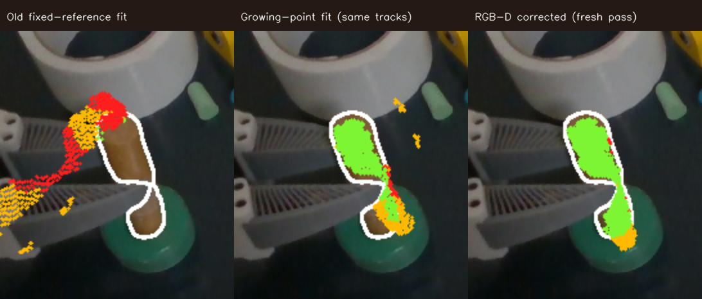
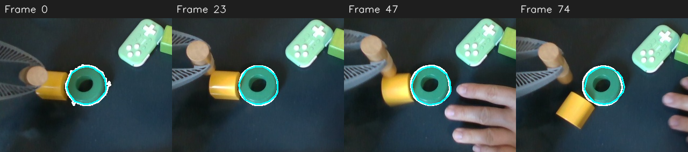

# Visible rigid tracking check — 2026-10-23

This is an offline check on the local insertion demo, not a live controller
result or measured ground-truth 6D pose. The camera recording is aligned RGB-D;
the object masks came from the saved SAM3 pass. TrackEverything's saved query
tracks use future video context. The pose fitting described here processes
those tracks in frame order and adds a new point ID only after a supported
pose has placed it in the same local rigid frame.

## Saved-trace comparison

The saved growing-point run is
`insertion/flash/v1/tracker-runs/trackeverything-growth-ui-20261021-a/scene.npz`
under the local LeRobot demos cache. The old runner fitted poses **before**
growing the point set, leaving later points as display evidence only. Refitting
the same saved tracks with the growing-point estimator changed the dowel's
frame-400 to frame-489 motion as follows. The source is the frame-400 masked
depth surface; every row is checked against the frame-489 mask and depth.

| Pose fit                         | Projected points in mask | In front of measured depth | Median depth difference on mask |
| -------------------------------- | -----------------------: | -------------------------: | ------------------------------: |
| Old fixed-reference output       |                    11.5% |                      48.4% |                         13.6 mm |
| Growing-point refit, same tracks |                    81.7% |                       4.4% |                          3.2 mm |

At frame 489 the saved old fit had 12 rigid inliers; the growing-point refit
had 27. Across saved frames 100–712, the new method returned a pose on 491
dowel frames versus 460 for the old fit. It gained 100 frames and rejected 69
old-fit frames, mostly around the visibly poor/occluded transition. More pose
availability alone does not certify accuracy.

White is the target SAM3 outline. Green projected source points agree with its
measured depth to 10 mm; red points lie more than 10 mm in front of observed
depth; yellow points do not have matching visible surface. The third panel is
from the fresh pass below, so only the first two panels compare the same raw
TrackEverything point tracks.

## Fresh short-run check

The revised runner processed dowel frames 400–489 with a 64-query initial
budget, a 128-query cap, up to 32 new queries per view, a 5 mm rigid inlier
band, 10 mm mask/depth and surface bands, and the configured local ICP limits.
It added 48 new queries over three later views, retained a pose on all 90
frames and accepted an RGB-D correction on 83 frames. The output is saved
locally as `/tmp/flash-visible-fresh-rgbd.npz`. Its frame-489 projection has
90.9% of source points inside the mask, 86.2% agreeing with mask **and** depth,
0.9% implausibly in front of measured depth, and 1.0 mm median depth
difference on the mask. The corresponding point-only pass had 77.6%, 70.6%,
10.4%, and 2.3 mm. The two complete model passes selected different point
queries, so the [same-trace benchmark](../../../../benchmarks/flash_visible_rigid_tracking.py)
is the controlled pose-fit comparison: on the fresh point-only trace it
selected a surface correction on 82/90 frames and reduced median foreground
conflict from 8.8% to 2.9%; at the last frame, 10.4% to 0.9%.

As a stationary visible control, a fresh ring pass on frames 100–200 returned
101/101 poses and accepted no surface corrections. Its inferred surface anchor
moved 1.6 mm over that interval; this is near sensor/calibration scale, not a
claim of exact zero motion. The earlier saved ring trace, with more initial
queries, had a 0.4 mm endpoint anchor displacement. Query choice therefore
still affects sub-millimetre to millimetre consistency.

## Moving, fully visible control

A separate real rollout recording, `insertion/acts/20261016_112149`, contains
a ring moving with the tray without a gripper covering it. The 75 available
aligned RGB-D frames from camera frames 331–422 were copied into a contiguous
offline interval; 17 missing camera frames were **not** interpolated. SAM3
masks were generated for the visible ring and a fresh TrackEverything growth
pass added 15 queries. The revised fitter returned a pose on **75/75** frames.
The ring's mask centroid moved from approximately (293, 290) to (331, 300)
pixels, so this is a motion check rather than another stationary case.

Projecting the initial masked depth surface into each current RGB-D frame gave
97.8% median mask coverage (91.5% worst frame), 96.2% median mask **and** depth
agreement, and 0.3% median projected points implausibly in front of measured
depth (3.5% worst frame). The median on-mask surface discrepancy was 1.7 mm;
at the last frame it was 3.7 mm, with 94.8% mask coverage and 0.5% foreground
conflict. The RGB-D correction rule accepted only 4/75 local proposals, because
the others failed its requirement to improve surface support without adding
foreground-depth conflict or breaking the tracked-point consensus. That
conservative behavior matters for an already well-tracked object.
The projected source surface's median image position differed from the SAM3
mask centroid by 2.6 pixels median and 4.5 pixels at worst across the 75
frames. This is an image-space alignment check, not independent pose truth.

The white outline is the current SAM3 ring mask; cyan is the initial RGB-D
surface projected through the fitted rigid motion. The image is cropped around
the ring in each frame, so use the numbers above for displacement and error.

The temporary benchmark inputs are under `/tmp/flash-ring-motion-recording`,
`/tmp/flash-ring-motion-masks`, and `/tmp/flash-ring-motion-te.npz`; the numeric
per-frame result is `/tmp/flash-ring-motion-eval.json`. The benchmark-only
initial ring mask was manually localized by color and region, while subsequent
masks came from SAM3. No object-specific rule was added to the tracker.

## Limits of this evidence

The moving dowel is visible over the tested interval but partly covered by
the gripper and, near insertion, the ring. There is no independent ground-truth
pose; mask/depth agreement checks the same camera from a denser surface than
the sparse tracked IDs. The refined pose may still have unobservable rotation
about a nearly cylindrical surface. TrackEverything inference remains
windowed and future-aware, so this does not establish real-time causal
tracking or recovery after complete occlusion. The separate moving-ring
control checks ordinary visible motion, but it has no independent measured 6D
ground truth and is not yet a cross-episode transfer or live robot result.
