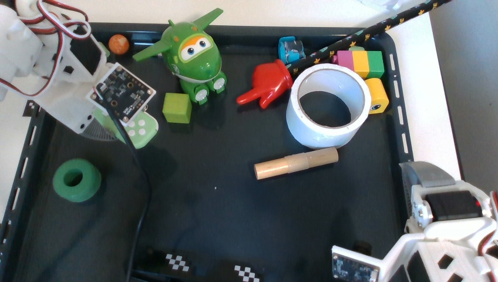

# Automatic rest reset: hosted robot trial, 2026-11-15

The hosted GUI at `http://127.0.0.1:9102/#/flash/editor` was restarted from
`research/flash-tracker-restart` with the automatic-reset change. From its Demo
editor, **Apply → Run robot** started the only saved demo, **Gamepad onto green
ring**, using `white_left`. The source revision and file hashes are in
[source.json](source.json); [source.patch.gz](source.patch.gz) captures the running
working changes, including the pre-existing planner edit.

The real run published **resetting to rest position** with **zero demo commands**
for approximately 3.57 seconds, then began planning and dispatch. The first motor
tick after the reset was within **0.422° of every saved rest joint value**, including
the gripper. [summary.json](summary.json) contains all per-joint errors and the
observed state transitions. The reset uses the existing nominal three-second
rest-position ramp; the observed phase includes reads, motor I/O and status timing.

The world keyframe and all 131 pickup keyframes completed. The controller then
waited at **133 / 343** (next keyframe; 132 completed) for the green ring's pose.
The GUI reported **green ring: lost — Prediction protrudes into measured empty
space**. After approximately 56 seconds without recovery, Stop was pressed in
the hosted GUI. The process exited with code 0 after **193 demo/approach commands**.
The gamepad was picked up, but placement did not complete. The arm was not reset
again on Stop.

Evidence:

- [Execution history](execution-history.jsonl.gz): timestamped GET responses,
  including reset before the first demo command and the clean stop.
- [Motor trace](motor_trace.json.gz): all 1,887 ticks retained, including tick 0
  immediately after reset. Reset waypoints themselves use the shared rest helper
  and are outside this demo MotorLoop trace.
- [Plan](plan.json.gz), [configuration](config.json),
  [waiting state](execution.json), [terminal state](final-execution.json), and
  [tracker status](state.json).
- [Preflight](preflight.json) is the later pickup preflight, not the reset readback;
  the worker overwrites it at each range.

Verification before the physical trial: 56 focused tests passed. The updated
reset-status browser assertions passed through both Apply entry points, and the
motor-shutdown regression passed after preserving its post-reset dispatch check.
Regression tests failed when reset was omitted, reset cancellation was ignored,
or the saved rest pose was dropped before worker construction. Ruff checks and
formatting passed. The tests use synthetic motor I/O; the trial above used the
real robot.
