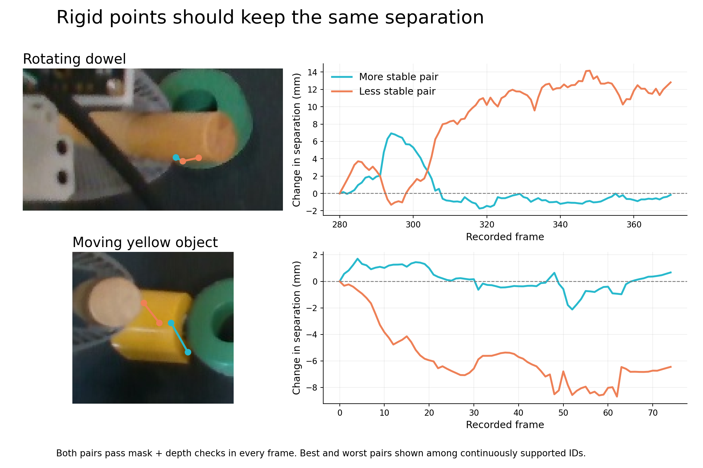

# Drift pattern and feature-selection audit — 2026-10-23

The drift is a mixture of common movement of the point cloud, deformation within
that cloud, and additional discontinuities introduced by choosing a rigid fit.
Appearance matters, but these recordings do not establish smooth texture as the
sole or dominant cause. Choosing stronger image corners did not consistently help.
No production tracking policy was changed in this audit.

The illustration chooses the smallest and largest median separation change among
pairs whose two IDs pass the visibility, SAM mask and depth checks in **every**
frame. These are explicitly selected extremes, not average performance. Even the
more stable dowel pair temporarily changes separation by about 7 mm. A flat line
would be consistent with rigidity, but would not prove correct material identity.

## Original video: do the points drift together?

The saved raw tracks are analyzed before RANSAC, ICP or landmark construction.

- **Dowel, demo frames 280–370:** 13 IDs pass the checks at both endpoints, five
  throughout. Relative to measured gripper motion, their discrepancy points
  mostly in a common direction: one common translation explains 87.9% of squared
  discrepancy. The median direction is 13.3° from that common direction. Median
  point discrepancy is 18.5 mm, while pairwise separations change by 4.73 mm.
  Thus common movement and internal deformation coexist. **The common movement
  is not proven tracker error:** actual grasp slip, calibration and synchronization
  can contribute. The changing pair distances establish non-rigid tracking/depth
  error independently of those gripper assumptions.
- **Yellow object, 75 staged frames:** ten IDs pass every frame. Their per-ID
  median separation-change scores range from 0.98 to 3.12 mm. Some tracks therefore
  stay more consistent with neighbours than others. This score measures deformation,
  not absolute positional error. No independent pose reference establishes the
  yellow object's common drift direction.
- The dramatic yellow gizmo jumps are larger than the adjacent raw-cloud changes.
  The [previous implementation audit](../flash-moving-pose/EVIDENCE.md#implementation-isolation-and-deterministic-fit-correction)
  isolated changing RANSAC consensus and surface corrections; changing the random
  seed alone changed a frozen frame's fitted orientation by up to 61.6°. That
  frame-dependent seed was fixed in `5ebbf9d3c`. This audit does not reintroduce it.

`dowel_original.npz` retains raw coordinates, support and timestamp-interpolated
camera-from-gripper transforms, allowing the common-motion calculation to be
repeated without hardware. `yellow_original.npz` retains the corresponding raw
tracks and support. Both originate from the preceding audit's isolation files;
RGB-D recordings are not duplicated here.

## Equal-budget feature experiment

Run TrackEverything once with all three cohorts, 48 query points each. Divide the
object bounding box into a 4×4 grid and allocate the same quota per occupied cell.
Within each cell select uniformly, by the smaller image-gradient structure-tensor
eigenvalue (corner-biased), or by the difference of its eigenvalues (edge-biased).
Exclude the outer two mask pixels and invalid depth. These are experimental
settings saved in `config.json`, not new runtime constants.

“Corner” means a high image score, not an annotated physical corner. Highlights,
texture and occlusion boundaries can score highly too. The experiment tests this
specific selection method, not every way of tracking physical edges or corners.

All cohorts use the same source frames, camera, depth, pretrained model and
inference call. The existing 10 mm depth-support tolerance is held fixed. None of
the rigidity metrics uses RANSAC/ICP or drops tracks for geometric disagreement.

Median absolute change in point-pair separation from first to last frame (mm;
ideal rigid material tracks: zero):

| Moving interval              | Uniform | Corner-biased | Edge-biased | Endpoint-supported IDs, respectively |
| ---------------------------- | ------: | ------------: | ----------: | ------------------------------------ |
| Dowel rotation, demo 280–370 |    2.48 |          4.19 |        3.15 | 21 / 15 / 15                         |
| Yellow object, staged 0–74   |    2.84 |          3.32 |        2.31 | 34 / 33 / 31                         |
| Gamepad carry, staged 90–145 |    3.36 |          4.49 |        4.01 | 28 / 25 / 27                         |

Uniform sampling also retained a larger fraction of supported points across time
in all three clips. The yellow edge cohort's better median comes with a worse
90th-percentile separation change (9.43 versus 6.73 mm). Counts, continuous-support
results, per-ID scores and all-frame distributions are saved in the JSON reports.
Pairs and successive frames are correlated; these are descriptive measurements,
not independent statistical trials or a benchmark ranking.

Two controls prevent a misleading texture conclusion:

- Reseeding the yellow object at clearer frame 37 still gives about 2.7–2.9 mm
  endpoint separation change across cohorts. It does not resolve the drift.
- Gamepad frames 145–170 look excellent (~0.3 mm), but the cloud moves only about
  1 mm. **This near-stationary interval is not evidence that gamepad texture solves
  moving-object tracking.** The moving 90–145 interval is included above instead.

## Controlled appearance removal

For each frame replace pixels inside the original object mask with one fixed
source-frame median RGB color. Preserve all depth, masks, cameras, query locations
and original RGB outside the object. This synthetic ablation removes texture,
shading and highlights together; it is not a real painted-object trial and can
change the image distribution. Compare only the **same IDs accepted in both
passes at each frame**, using the uniform cohort.

| Interval       | Original, all-frame median separation change | Flat appearance | Original → flat endpoint change |
| -------------- | -------------------------------------------: | --------------: | ------------------------------: |
| Dowel          |                                      1.90 mm |         3.58 mm |   2.10 → 5.67 mm, 15 shared IDs |
| Yellow object  |                                      1.29 mm |         1.80 mm |   3.23 → 2.94 mm, 29 shared IDs |
| Moving gamepad |                                      1.70 mm |         1.64 mm |   1.99 → 2.18 mm, 18 shared IDs |

Appearance removal substantially worsens dowel consistency. Yellow is mixed and
the occluded gamepad shows little change. This supports appearance ambiguity as
one contributor, but does not identify a universal texture explanation. Coherent
wrong tracking remains invisible to pair-distance consistency, including in this
ablation. Original artifacts contain `comparison_points` and `comparison_support`
so these matched comparisons are reproduced by the same analysis function.

## Resolution and implementation limits

The checkpoint defaults to 384×512. The original input is 480×848. The advertised
native-resolution path raises a tensor shape mismatch for that size in the
multiscale encoder. For the resolution experiment only, pad the right edge to
864 pixels with replicated RGB and zero depth, preserving original pixels,
intrinsics and queries. This is explicit in the benchmark, not an upstream fix.

This near-native pass costs about twice as much. Uniform-sampled endpoint
separation change goes from 2.48 to 2.32 mm for dowel, 2.84 to 3.50 mm for yellow,
and 3.36 to 1.49 mm for moving gamepad. Higher resolution helps the moving gamepad
here, but is not a consistent cure. Times are single offline calls, not warmed
live-loop performance: dowel 4.32→8.33 s; yellow 3.61→6.99 s.

The structural limitations are separate from texture:

1. Our SAM/depth check verifies visible-surface membership, **not material-point
   identity**. Sliding along an object's own surface can keep passing.
2. TrackEverything predicts free point trajectories; neither this query API nor
   our wrapper enforces one rigid motion for all points of a segmented object.
   A later rigid fit can select incompatible subsets of a deforming point field.
3. Input geometry matters. Re-lifting earlier tracks at measured sensor depth
   did not eliminate their deformation in the previous audit.
4. Official [TrackEverything limitations](https://arxiv.org/html/2609.30222v1#S5)
   include geometry quality and irreversible spatial merging of scene tracks.
   **Our explicitly queried tracks are exempt from merging**, so their ID merging
   is not an explanation for these results.

Physical corners and distinctive patches remain sensible candidates to test with
spatial separation and persistence checks. A straight edge leaves motion along
that edge ambiguous, and a rounded object's silhouette can correspond to a
changing material point. Image highlights can move independently of the surface.
These distinctions are documented in the [MIT optical-flow chapter](https://visionbook.mit.edu/optical_flow.html)
and motivate the feature-selection and monitoring work in
[Shi–Tomasi](https://publications.ri.cmu.edu/good-features-to-track).
The experiment does not justify replacing all queries with high-scoring corners.

## Reproduction and verification

`benchmarks/flash_track_feature_audit.py` performs inference and analysis. Use the
TrackEverything environment and pretrained checkpoint already installed on the
rig, with `--config` pointing to `config.json` or `appearance_config.json`,
`--repository` to its installed repository, `--checkpoint` to `model.pth`, and
`--output` to a new directory. Original capture/mask paths are recorded in configs;
they are required only to repeat inference. This is offline, future-window-aware
inference, not a demonstrated causal live tracker.

- Installed TrackEverything revision: `f0c18dd`.
- Checkpoint snapshot: `1957810f46ef684154fec91a9b8c0e6a68cd695e`.
- All saved query results can be reanalyzed without a model/GPU by calling
  `benchmarks.flash_track_feature_audit.analyze_saved(path)` on the NPZ files.
- `sha256.json` records hashes of the saved NPZ inputs.
- `render.py` reproduces the figure using saved point arrays and source RGB crops.
- Three metric tests verify invariance under known rigid motion with visibility
  gaps, detection of one deliberately drifting point, and the blind spot where
  coherent wrong motion needs an independent reference.

The next useful measurement is agreement with independently identifiable physical
features while they remain visible. Enforcing rigidity can prevent deformation,
but could conceal a coherent wrong motion; smoothness alone is not the acceptance
criterion. No new live fit weighting, loss threshold or corner preference was
installed based on these offline measurements.
