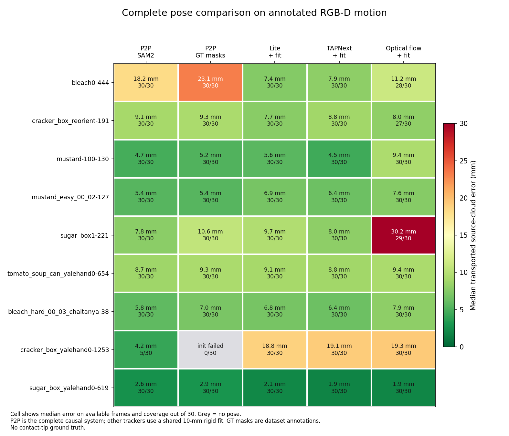
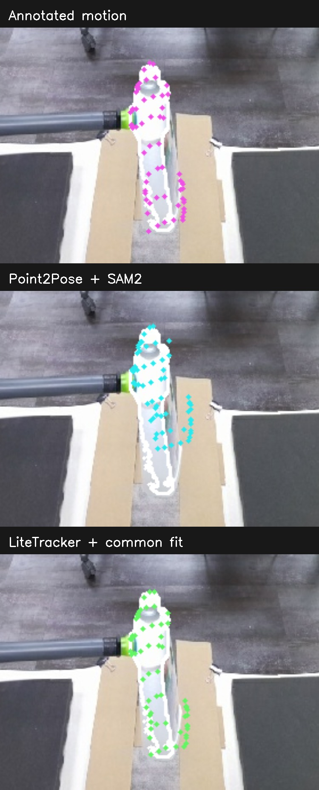

# Full-pose benchmark beyond the dowel

The [earlier dowel rotation](../flash-visible-surface-benchmark/DOWEL_ROTATION.md)
showed Point2Pose tracking that object's _visible shaft_ better than the other
tested pose outputs. It did not establish that Point2Pose is best across
objects. This benchmark runs the **complete causal Point2Pose pose pipeline**
on nine existing YCBInEOAT RGB-D clips: six development clips and three clips
from the previously frozen moving holdout. Each has an annotated object pose
and 31 aligned RGB-D frames; frame 0 initializes every method, so 30 frames
per clip are scored. The source videos, measured depth, masks, first-frame
query points and fit traces remain in the local benchmark cache.

Each cell shows the median **3D displacement of identical first-frame measured
surface points** when carried by the estimated versus annotated _relative_
transform, plus the number of frames with a pose. Grey is no pose. The score
uses 64 source points and does not need a CAD model. Rotation errors, per-frame
values and motion size are in [the saved results](labelled_scores.json).

The two Point2Pose conditions use the same pinned fork, bridge, configuration,
RGB-D and initial annotation. **P2P + SAM2** lets Point2Pose produce its own
first and later masks. **P2P + GT masks** supplies the exact annotated mask at
initialization and every later frame, isolating pose registration from
segmentation errors; it is an _oracle segmentation ablation_, not deployable
live. LiteTracker, TAPNext, optical flow and other saved point frontends use
their own causal point outputs, then the same 10 mm RANSAC rigid fitter with
no mask or annotated pose as fit input. They are complete point-to-pose
baselines, but **not** the other trackers' own full pose systems. The
10 mm fit residual is the pre-existing benchmark setting, not a FLASH planner
acceptance rule. Full-clip CoTracker3 and TrackEverything fits are also in the
JSON, but are omitted from the causal heatmap because those saved predictions
may use future frames.

This uses the [rig configuration](p2p_rig_config_used.yaml) unchanged on the
external 640×480 clips, with pinned Point2Pose checkout
`95bd7a8808fc1aaf015d510dffcccaa3c6971a9c`. It evaluates our current
configuration, not an author-tuned YCBInEOAT submission. The
[run provenance](run_provenance.json) records the config, bridge, input hashes,
exit status and wall time for every labelled and local run.

| Clip                        |           P2P + SAM2 |                P2P + GT masks |         Lite + fit |      TAPNext + fit |
| --------------------------- | -------------------: | ----------------------------: | -----------------: | -----------------: |
| Bleach                      | 18.2 mm / 17.4° (30) |          23.1 mm / 22.9° (30) | 7.4 mm / 4.7° (30) | 7.9 mm / 4.4° (30) |
| Cracker reorientation       |       9.1 / 2.8 (30) |                9.3 / 2.9 (30) |     7.7 / 3.7 (30) |     8.8 / 3.0 (30) |
| Mustard                     |       4.7 / 5.6 (30) |                5.2 / 5.4 (30) |     5.6 / 5.2 (30) |     4.5 / 4.3 (30) |
| Mustard, second view        |       5.4 / 5.9 (30) |                5.4 / 4.8 (30) |     6.9 / 9.1 (30) |     6.4 / 9.0 (30) |
| Sugar-box reorientation     |       7.8 / 3.6 (30) |              10.6 / 10.1 (30) |     9.7 / 5.6 (30) |     8.0 / 3.6 (30) |
| Tomato soup can             |       8.7 / 5.1 (30) |                9.3 / 5.9 (30) |     9.1 / 4.4 (30) |     8.8 / 5.0 (30) |
| Hard bleach, motion holdout |       5.8 / 4.2 (30) |                7.0 / 7.4 (30) |     6.8 / 4.4 (30) |     6.4 / 4.4 (30) |
| Cracker box, motion holdout |    4.2 / 2.6 (**5**) | **initialization failed (0)** |    18.8 / 8.3 (30) |    19.1 / 8.8 (30) |
| Sugar box, motion holdout   |       2.6 / 1.3 (30) |                2.9 / 1.6 (30) |     2.1 / 1.1 (30) |     1.9 / 1.4 (30) |

Values are median point-displacement **mm / full rotation degrees** on
available frames; parentheses give available frames out of 30. The held-out
cracker row is a reminder that a low conditional error on **five** frames
does not mean good tracking over the clip. Its GT-mask Point2Pose run fails on
the initial frame after SAM2 seeds only five points and its object track map
has no entry for object 0. The internal-SAM2 run initializes but reports lost
for 25/30 frames. The other point-fit methods retain poses on that clip, but
their 19 mm median surface-point displacement is also poor. The failure logs
and full traces are preserved outside git under
`/home/feit/.cache/flash-full-pose-benchmark/`.

The moving bleach clip gives a visible failure, not just an annotation score.
At frame 30 the Point2Pose-transported first-frame points spread beside the
currently segmented bottle while the annotated and LiteTracker-propagated
points follow it more closely. White is the current object mask; colored dots
are the **same 64 measured source points** under each proposed transform.
Some dots legitimately fall off the current visible mask as their source
surface rotates away, so their exact overlap is a diagnostic, not a material
point label.

Point2Pose's median reported step time across these clips was about **35 ms**
with its own SAM2 and **12 ms** with masks supplied. The latter excludes the
work needed to obtain masks. Neither number includes the FLASH robot loop;
the point-frontends' isolated timing is recorded in the
[visible-surface benchmark](../flash-visible-surface-benchmark/README.md).

I also ran full Point2Pose on the local moving [gamepad and yellow-block
clips](local_diagnostics.json). There is **no independent 6D pose label** on
those clips, so the saved comparison only measures how the same first-frame
surface projects onto the current saved mask and depth. Point2Pose emits poses
on all 55 gamepad and 74 yellow-block scored frames, but that availability
does not certify their orientations or hidden contact points. The gamepad is
partly occluded, and first-view surface support is low for every method. On
the more visible yellow block, the LiteTracker/common-fit branch has higher
median current-surface support than either Point2Pose branch (0.71 versus
0.56 with supplied SAM3 and 0.63 with internal SAM2); this is a local
consistency diagnostic, not an accuracy ranking.

**Conclusion:** Point2Pose remains a strong complete causal baseline and was
particularly good on the dowel's visible rotation. It is **not a reliable
winner across these objects**. Some causal point frontends plus a common
rigid fit match or beat its annotated pose error, and Point2Pose can initialize
or recover on the wrong branch. Better masks do not automatically fix its
registration: in several clips its exact annotated-mask run is worse than its
own SAM2 run. FLASH should compare pose proposals against measured
mask/depth and temporal evidence instead of choosing a backend by name.

These are short clips from **one external dataset** plus two unlabelled local
clips. YCBInEOAT's object-pose annotations can themselves have registration
jumps; the [reference audit](../flash-visible-surface-benchmark/REFERENCE_AUDIT.md)
found suspicious transitions elsewhere in it. The full 3D rotation score can
also penalize an object's physically equivalent symmetry. The benchmark does
not measure contact-tip accuracy, long-term drift across those external
sequences, multi-object identity, or live control success. Extending this
protocol to a second annotated RGB-D source and longer intervals is needed
before naming a generally best pose tracker.

To reproduce, run [`flash_full_pose_run.py`](../../../benchmarks/flash_full_pose_run.py)
with the saved case directories and explicit pinned Point2Pose paths, then
[`flash_full_pose_score.py`](../../../benchmarks/flash_full_pose_score.py),
[`flash_full_pose_local.py`](../../../benchmarks/flash_full_pose_local.py) and
[`flash_full_pose_report.py`](../../../benchmarks/flash_full_pose_report.py).
Each P2P trace has a provenance JSON with checkout, config and input hashes.
