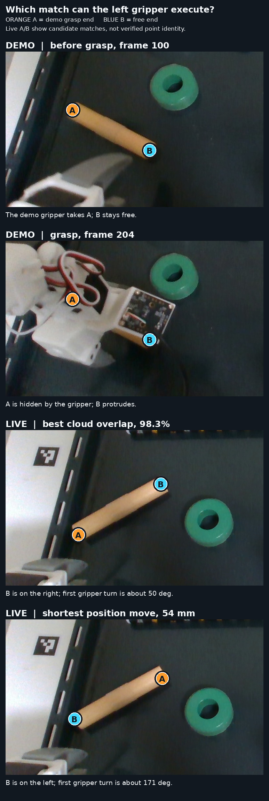
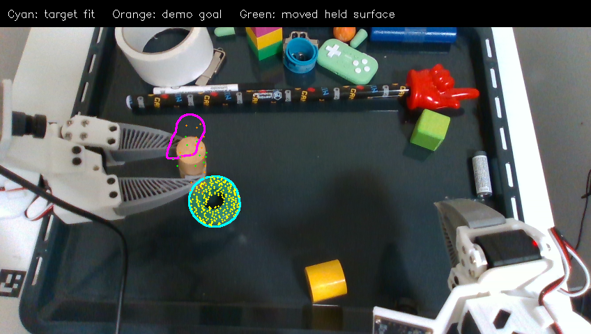

# Ordered geometry transfer: insertion demo

Measured on 2026-10-26 on branch `docs/flash-redesign`, starting from commit
`8950c97a3`. This is an offline audit and camera-only live capture. The arm was
not commanded. The live dowel and ring were separate on the tray after the
user's reset.

The prepared skill
`insertion-migrated-v10-preferred-hover` has 10 keyframes and 11 ordered
intervals. Approach and grasp reference the dowel; lift uses the starting
gripper frame; carry and insertion reference the ring; release and retreat
follow. Its insertion interval alone contains 137 demonstrated samples (frames
377–513). A reset-to-insertion registration skips the action and cannot
validate execution.

## Does a cross-run surface match choose a feasible gripper path?

I checked this directly on four saved trial starts. For each trial, the existing
RGB-D benchmark supplied several alignments of the clear demo dowel (frame 100)
to the live dowel. I applied each alignment to **the next ordered demo
keyframe**, the approach at frame 179, then compared its gripper goal with the
trial's observed initial motor state using calibrated forward kinematics.
The dowel remains on the tray between demo frames 100 and 179, so this
reference-to-approach transfer does not skip a demonstrated object motion.
The [reproducible audit](../../../benchmarks/flash_cross_run_goal_choice.py) and
[candidate-by-candidate data](min-motion-audit.json) retain the measurements.

| Trial start | Best surface fit: coverage, position move, turn | Shortest position move: coverage, move, turn |
| ----------- | ----------------------------------------------- | -------------------------------------------- |
| 17:57       | 98.4%, 105.5 mm, 33.4°                          | 85.0%, 75.3 mm, 168.5°                       |
| 18:04       | 98.7%, 105.8 mm, 39.8°                          | 87.2%, 73.9 mm, 168.4°                       |
| 19:11       | 98.8%, 98.8 mm, 38.9°                           | 83.9%, 60.5 mm, 166.3°                       |
| 20:33       | 98.3%, 118.9 mm, 50.3°                          | 74.7%, 54.2 mm, 170.8°                       |

The shortest **position-only** goal in these candidate sets has lower two-way
nearest-cloud coverage and needs almost a half-turn of the gripper. The
registration supplies alternative alignments; it does not select the shortest
useful action. The earlier version of the figure colored every unconfirmed
projected point red and called it a mismatch. That was misleading. **Every dot
is a measured demo/source surface point projected into the live image**, not a
point sampled from the live/target surface. The revised figure separates the
reasons that a projected source point fails the exact-pixel observation check:

| 20:33 candidate          | Agrees with live depth and outline | Nearer than live depth, inside outline | Behind live depth, inside outline | Outside logged outline | No live depth, inside outline |
| ------------------------ | ---------------------------------: | -------------------------------------: | --------------------------------: | ---------------------: | ----------------------------: |
| Best cloud overlap       |                              3,160 |                                     65 |                                69 |                    388 |                            57 |
| Shorter, similar overlap |                              3,270 |                                     43 |                                15 |                    350 |                            61 |
| Shortest position        |                              2,583 |                                     46 |                               774 |                    307 |                            29 |

Each candidate projects 3,739 demo points. Green points agree within the
diagnostic 6 mm depth band. Red points project **in front of** measured live
depth, so they are potential direct conflicts. Gray points are behind measured
live depth and might be hidden surfaces; orange points fall outside the saved
live outline; purple points have no live depth. The old trial stores a polygon
for the live outline, not the original binary SAM mask, so boundary counts are
approximate. None of the non-green categories alone proves an impossible fit.
In particular, 69.1% green support for the shortest-position candidate does
**not** imply 30.9% conflicting geometry. Whether it is acceptable requires a
visibility-aware check, not just this plotted fraction.

The demo gripper covers end A of the dowel at frame 204, leaving end B exposed.
The candidate registrations below map A to **opposite** ends of the live dowel.
The ring is visible only as scene context; its position does **not** choose
the grasp. What matters for this choice is whether the left gripper can follow
the transformed demo approach and grasp without excessive joint travel. These
are candidate cross-run correspondences, not verified identities of material
points. If either physical end can be used, the later insertion motion must
remain consistent with whichever correspondence is chosen.

I then tested the transformed gripper path for the 20:33 trial from the
recorded **left-arm joint state**. This check interpolated 16 gripper poses for
each of the two approach connections and then followed the 25 demonstrated
grasp samples, seeding each IK solve from the preceding joint solution. It used
the trial's 3 mm and 3° goal tolerances and 10 IK refinements. The 57 poses
were geometric checks only; they were not executed on the robot.
The [gripper-path audit](../../../benchmarks/flash_cross_run_gripper_path.py)
and its [results for all 28 saved matches](gripper-path-all-203310.json)
preserve the inputs, settings and per-candidate failures. Fifteen matches
solved all 57 sampled goals; that says nothing yet about collision safety or
whether each underlying surface fit is valid.

| Candidate                    | Two-way cloud coverage | First goal: position / rotation change | Approach and grasp IK                                      | Largest cumulative motion of one joint |
| ---------------------------- | ---------------------: | -------------------------------------: | ---------------------------------------------------------- | -------------------------------------: |
| Best cloud overlap (`orb`)   |                  98.3% |                           119 mm / 50° | All 57 poses solved                                        |                                   172° |
| `fpfh_ransac`                |                  98.2% |                           116 mm / 47° | All 57 poses solved                                        |                                   127° |
| `fpfh_fgr`                   |                  96.9% |                           114 mm / 48° | All 57 poses solved                                        |                                   115° |
| Shortest position (`pca_23`) |                  74.7% |                           54 mm / 171° | Failed at approach sample 11 of 16; 24.7 mm position error |                         Not applicable |

The three higher-coverage examples put B on the camera-right end of the live
dowel. The maximum-coverage match is **not** the least costly gripper path:
`fpfh_ransac` fits almost as well and cuts the largest joint's cumulative
motion from 172° to 127°. `fpfh_fgr` cuts it to 115° with lower measured cloud
coverage; no calibrated validity rule yet says whether that trade is acceptable.
The 54 mm option puts B on the left and is shorter only in Cartesian position
for the first goal. It asks for about 171° of gripper reorientation, and this
sampled approach could not be solved. A different path or IK seed might change
that result, so this is not a proof of global unreachability. None of these
checks includes collisions, motor tracking or the later insertion.

The general selection rule is therefore: retain plausible geometry matches,
transform the **ordered demo gripper trajectory** under each match, reject
paths that fail IK or clearance, then rank the surviving gripper paths by
execution cost such as travel and duration. The ring's pose becomes relevant
when planning the later insertion, not when deciding which end the left hand
can grasp. The earlier four-start table measures only first-goal Cartesian
differences; it is not a ranking of executable gripper trajectories. Exact-
pixel mask-and-depth support was 87.5% for `fpfh_ransac` and 84.5% for `orb`,
but that fraction is diagnostic, not a calibrated fit-validity score.

At the first approach frame the dowel mask is absent under the gripper; that
does not make the dowel disappear from the task state.

`benchmarks/flash_geometry_sequence.py` reads the ordered skill, transfers the
reference surfaces from demo frame 100 to one freshly captured live RGB-D frame,
and inspects the demonstration's held-object motion between **every adjacent
recorded frame**, including frames inside the two connection intervals. It
does not infer that a future live keyframe has already been reached. The first
approach keyframe (demo frame 179) has no measured dowel surface in the saved
mask, so its geometry reference must come from an earlier clear view. The
reference fit at the reset scene covered 97.9% of the dowel and 99.5% of the
ring within the diagnostic 6 mm radius. These are surface-agreement scores,
not proof of material-point correspondence or a verified gripper goal.

| Held interval  | Demo frames | Adjacent pairs | Median encoder-predicted surface coverage | End-of-interval error after chaining independent surface fits against encoder motion |
| -------------- | ----------: | -------------: | ----------------------------------------: | -----------------------------------------------------------------------------------: |
| Carry turn     |     290–342 |             52 |                                     93.6% |                                                                              27.3 mm |
| Carry approach |     342–377 |             35 |                                     97.3% |                                                                              35.8 mm |
| Insertion      |     377–513 |            136 |                                     98.8% |                                                                              70.8 mm |

Each local fit can look convincing while accumulated transforms diverge from
the rigid-grasp prediction. The
encoder comparison is a **rigid-grasp proxy**, not object ground truth: the
object can slip, especially when the gripper starts opening near release.
Still, this measurement rules out blindly integrating adjacent geometric
corrections as the live object's motion.

`benchmarks/flash_geometry_bank.py` compares held surfaces from earlier demo
frames with later frames. It starts from the recorded end-effector motion plus
an injected 10 mm position and 10° tilt error. Among ten sampled later views,
five were corrected to 1.1–2.2 mm surface displacement from the encoder proxy;
four retained 6–12 mm. With **zero** injected error, fitting still shifted the
surface 8.5 mm at frame 300, 10.9 mm at frame 320, and 8.4 mm at frame 510.
Frame 510 is already in gripper opening; frames 300 and 320 have a closed
gripper. The measurements alone cannot distinguish slip, mask/depth bias, and
camera/encoder timing error in those frames. A high surface-coverage score can
therefore coexist with a harmful correction.

## Saved rollout at a carry keyframe

I also used the previously recorded rollout
`flash_insertion_trial_20261020_020-20261020-203310-655401`. At the end of its
first carry interval (camera frame 456), the demo's ring frame 100 fit the live
ring with 96.3% balanced surface coverage. The **demo dowel at the matching
carry keyframe 342**, however, had only 87 interior depth points. Directly
fitting the more visible live dowel to those points gave 36.8% coverage and a
183 mm, 178° displacement. This is not a plausible motion command.

The saved live masks here were reconstructed from recorded polygon boundaries,
and the rollout's time within an interval need not match the demonstration's
exact endpoint time. This result shows that **one keyframe's partial surface
cannot safely stand in for the whole object**; it does not show that a
multiview geometric map is impossible. Pooling six demo held views after
moving them by the recorded gripper transforms covered only 46.6% of the
endpoint's measured surface within 6 mm. Different visible sides and possible
slip make naive pooling untrustworthy as a complete model. Using the demo's
gripper-to-object attachment unchanged in the rollout also left a 25.4 mm
median surface mismatch at this stage. The live grasp needs its own attachment
estimate.

The live scene and complete per-frame results are retained locally at:

- `/home/feit/.cache/huggingface/lerobot/flash_debug_traces/trace-20261025-235050-224902635`
- `/tmp/flash_geometry_sequence_fresh.json`
- `/tmp/flash_geometry_bank_10mm10deg.json`
- `/tmp/flash_geometry_bank_zero.json`

The measured obstacle to a physical Solution 2 trial is an online stage-aware
goal provider. It must use the next keyframe or demonstrated sample, consume an
RGB-D observation made **after** the preceding move, and keep the target
registration fresh (including a group-motion fallback if the target is
occluded). During rigid grasp, gripper motion is the prediction and vision is a
possible correction; the correction needs evidence beyond a single
surface-coverage score. The camera-only registration scripts do not supply
collision checks, a verified attachment, or the live progression contract,
so their endpoint transforms are not robot commands.
