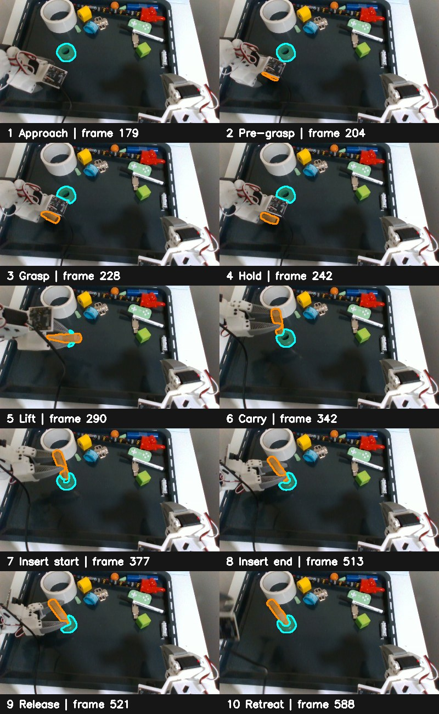

# Ordered geometry transfer: insertion demo

Measured on 2026-10-26 on branch `docs/flash-redesign`, starting from commit
`8950c97a3`. This is an offline audit and camera-only live capture. The arm was
not commanded. The live dowel and ring were separate on the tray after the
user's reset.

The prepared skill
`insertion-migrated-v10-preferred-hover` has 10 keyframes and 11 ordered
intervals. Approach and grasp reference the dowel; lift uses the starting
gripper frame; carry and insertion reference the ring; release and retreat
follow. Its insertion interval alone contains 137 demonstrated samples (frames
377–513). A reset-to-insertion registration skips the action and cannot
validate execution.

At the first approach frame the dowel mask is absent under the gripper; that
does not make the dowel disappear from the task state.

`benchmarks/flash_geometry_sequence.py` reads the ordered skill, transfers the
reference surfaces from demo frame 100 to one freshly captured live RGB-D frame,
and inspects the demonstration's held-object motion between **every adjacent
recorded frame**, including frames inside the two connection intervals. It
does not infer that a future live keyframe has already been reached. The first
approach keyframe (demo frame 179) has no measured dowel surface in the saved
mask, so its geometry reference must come from an earlier clear view. The
reference fit at the reset scene covered 97.9% of the dowel and 99.5% of the
ring within the diagnostic 6 mm radius. These are surface-agreement scores,
not proof of material-point correspondence or a verified gripper goal.

| Held interval  | Demo frames | Adjacent pairs | Median encoder-predicted surface coverage | End-of-interval error after chaining independent surface fits against encoder motion |
| -------------- | ----------: | -------------: | ----------------------------------------: | -----------------------------------------------------------------------------------: |
| Carry turn     |     290–342 |             52 |                                     93.6% |                                                                              27.3 mm |
| Carry approach |     342–377 |             35 |                                     97.3% |                                                                              35.8 mm |
| Insertion      |     377–513 |            136 |                                     98.8% |                                                                              70.8 mm |

Each local fit can look convincing while accumulated transforms diverge from
the rigid-grasp prediction. The
encoder comparison is a **rigid-grasp proxy**, not object ground truth: the
object can slip, especially when the gripper starts opening near release.
Still, this measurement rules out blindly integrating adjacent geometric
corrections as the live object's motion.

`benchmarks/flash_geometry_bank.py` compares held surfaces from earlier demo
frames with later frames. It starts from the recorded end-effector motion plus
an injected 10 mm position and 10° tilt error. Among ten sampled later views,
five were corrected to 1.1–2.2 mm surface displacement from the encoder proxy;
four retained 6–12 mm. With **zero** injected error, fitting still shifted the
surface 8.5 mm at frame 300, 10.9 mm at frame 320, and 8.4 mm at frame 510.
Frame 510 is already in gripper opening; frames 300 and 320 have a closed
gripper. The measurements alone cannot distinguish slip, mask/depth bias, and
camera/encoder timing error in those frames. A high surface-coverage score can
therefore coexist with a harmful correction.

The live scene and complete per-frame results are retained locally at:

- `/home/feit/.cache/huggingface/lerobot/flash_debug_traces/trace-20261025-235050-224902635`
- `/tmp/flash_geometry_sequence_fresh.json`
- `/tmp/flash_geometry_bank_10mm10deg.json`
- `/tmp/flash_geometry_bank_zero.json`

The measured obstacle to a physical Solution 2 trial is an online stage-aware
goal provider. It must use the next keyframe or demonstrated sample, consume an
RGB-D observation made **after** the preceding move, and keep the target
registration fresh (including a group-motion fallback if the target is
occluded). During rigid grasp, gripper motion is the prediction and vision is a
possible correction; the correction needs evidence beyond a single
surface-coverage score. The camera-only registration scripts do not supply
collision checks, a verified attachment, or the live progression contract,
so their endpoint transforms are not robot commands.
