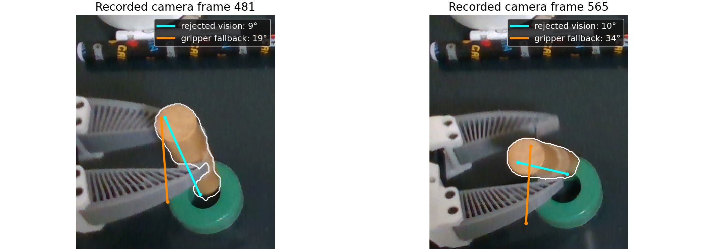

# Held-object pose: independent recorded-trial check

The newer dowel preparation does **not** establish that held-object estimation is solved. Replaying the current FLASH surface backend and gripper attachment updater on a separate, unverified 20 October insertion trial exposes a real failure: later in the carry, a visible, plausible dowel direction is rejected as a _full rigid pose_, leaving a less accurate gripper prediction in control. This is an offline counterfactual, not a physical retest or ground-truth 6D pose measurement. The current runtime policy is unchanged.



At recorded camera frame 481, the rejected vision candidate's long axis differs from the tracked visible surface's dominant 3D direction by 9.3°, versus 18.7° for the gripper prediction. At frame 565, those differences are 9.7° and 33.6°. The white outline is the recorded SAM mask. The measured surface uses the tracker's cleaned, spatially sampled, connected depth points. This checks the object's **direction**, not which end is which, its roll, its tip position, or its full pose. The 2D image overlay alone is not the 3D measurement.

## Reproduction and scope

- Trial: `~/.cache/huggingface/lerobot/demos/flash_insertion_trial_20261020_020-20261020-203310-655401`, episode 0 (646 motor rows, 553 unique RGB-D frames). Its saved outcome is `unknown / unverified outcome`.
- Independent second attempt: `~/.cache/huggingface/lerobot/demos/flash_insertion_trial_20261020_020-20261020-201838-054325`, episode 0 (534 unique RGB-D frames). Its compressed results, masks and axis audit are in `second-trial/`.
- Current prepared bundle: `~/.cache/huggingface/lerobot/demos/insertion/flash/v1/prepared/flash-dowel-ring-20261028-depth-audit-v11/bundle.json`. No recorded trial pose proposals were fed to the backend.
- `replay_trial.py` deduplicates aligned RGB-D frames, re-runs current segmentation and surface fitting, and seeds/updates the gripper attachment using source-time-aligned saved joint states. `result.json.gz` retains accepted estimates **and rejected raw candidates**; `masks.npz` retains the per-frame masks. `audit_axis.py` compares both hypotheses with the principal direction of the tracker's measured surface, and separately with all clean mask-depth pixels. `axis_audit_all_held.json.gz` contains this comparison for the entire held interval. Reproduction needs the local trial, bundle, calibration, and model weights; these are not copied into git.
- The trial's original tracker and inference scheduling are not reproduced. The group tracker was not rerun; this checks the current vision and gripper branches, not the full live engine. Replaying 553 frames took about 109 seconds, so this run says nothing about live frame rate.

From the repository root, with the FLASH native benchmark environment installed:

```bash
PYTHONPATH=src /tmp/flash-native-benchmark-venv/bin/python docs/proofs/flash-held-trial-holdout/replay_trial.py \
  --trial ~/.cache/huggingface/lerobot/demos/flash_insertion_trial_20261020_020-20261020-203310-655401 \
  --bundle ~/.cache/huggingface/lerobot/demos/insertion/flash/v1/prepared/flash-dowel-ring-20261028-depth-audit-v11/bundle.json \
  --held-role dowel --output-dir docs/proofs/flash-held-trial-holdout \
  --sample-row 340 --sample-row 417 --sample-row 511
PYTHONPATH=src /tmp/flash-native-benchmark-venv/bin/python docs/proofs/flash-held-trial-holdout/audit_axis.py \
  --result docs/proofs/flash-held-trial-holdout/result.json.gz --all-held \
  --output docs/proofs/flash-held-trial-holdout/axis_audit_all_held.json.gz
.venv/bin/python docs/proofs/flash-held-trial-holdout/audit_future_axis.py \
  --result docs/proofs/flash-held-trial-holdout/result.json.gz \
  --axis-audit docs/proofs/flash-held-trial-holdout/axis_audit_all_held.json.gz \
  --horizon-s 0.3 --horizon-s 0.6 --horizon-s 1.0 \
  --output docs/proofs/flash-held-trial-holdout/future_axis_comparison.json.gz
```

For the second attempt, substitute its trial path above and use `docs/proofs/flash-held-trial-holdout/second-trial` for the replay output directory and axis-audit paths.

The [future-axis check](audit_future_axis.py) compares each proposal's direction in the measured gripper frame at one camera time with the visible direction in a later camera frame. It is a check of a rigid-carry prediction, not an in-sample fit. The configured horizons below are evaluation probes, not runtime thresholds; the script accepts any positive horizon. At each probe it selects the first camera frame at or after the requested delay. The full per-frame results are saved for [20:33:10](future_axis_comparison.json.gz) and [20:18:38](second-trial/future_axis_comparison.json.gz).

| Attempt  | Future delay | Compared frames | Vision predicts later direction better | Median vision gap | Median gripper gap |
| -------- | -----------: | --------------: | -------------------------------------: | ----------------: | -----------------: |
| 20:33:10 |        0.3 s |             100 |                                     90 |             11.5° |              18.2° |
| 20:33:10 |        0.6 s |              99 |                                     84 |             11.2° |              18.2° |
| 20:33:10 |        1.0 s |              94 |                                     75 |             11.2° |              17.8° |
| 20:18:38 |        0.3 s |             147 |                                     76 |             13.7° |              14.0° |
| 20:18:38 |        0.6 s |             145 |                                     69 |             14.1° |              13.7° |
| 20:18:38 |        1.0 s |             138 |                                     64 |             14.9° |              14.1° |

This strengthens the case that the first attempt's rejected direction is useful beyond its source image, while the second still supplies no general rule to favor vision. Adjacent masks and depth errors can be correlated; the check does not validate position, end identity, contact-tip accuracy, or physical outcome.

The same future check can carry only the **direction measured from the visible
surface** at the source frame into the measured gripper frame. It makes no
claim about the dowel's center, either end, or rotation about that direction.
At a 0.6-second look-ahead it was closer to the later visible direction than
the saved gripper prediction in 93/99 and 142/145 source frames, respectively:

| Attempt  | Source frames | Median partial-direction gap | Median gripper-prediction gap |
| -------- | ------------: | ---------------------------: | ----------------------------: |
| 20:33:10 |            99 |                         7.3° |                         18.2° |
| 20:18:38 |           145 |                         5.2° |                         13.7° |

The source frames overlap heavily. Grouping them into non-overlapping
0.6-second source-time blocks gives a positive median directional improvement
in 11/11 and 13/13 blocks. These are still only two trials of the same object,
and the source and future directions share a camera, mask and depth pipeline.
This is evidence to test a **partial orientation constraint** separately from
full-pose correction; it does not establish a calibrated error bound or justify
moving the hidden insertion tip in control.

The surface pipeline already divides its spatial samples into interleaved fit and validation tiles. For each source image, we also compare candidate and gripper directions with the principal direction measured from **each half separately**. A proposal gets a shadow vote only when it is closer in both halves; otherwise the vote is ambiguous. At the 0.6-second future check:

| Attempt  | Both halves favor | Source frames | Voted source predicts the later direction better |
| -------- | ----------------- | ------------: | -----------------------------------------------: |
| 20:33:10 | Vision            |            86 |                                               81 |
| 20:33:10 | Gripper           |             5 |                                                4 |
| 20:18:38 | Vision            |            75 |                                               64 |
| 20:18:38 | Gripper           |            64 |                                               59 |

The remaining 8 and 6 source frames respectively gave split disagreement. The vote uses no scene-specific angle cutoff, but the halves share a camera, mask and depth biases; their agreement is not a calibrated confidence probability. These are correlated frames of only two attempts with one physical object. The result supports carrying split directional evidence into source-frame proposals and testing a partial held-pose update in shadow; it does **not** yet justify changing control.

Both held intervals contain frames with visible masks but no accepted full pose. The table compares each proposal with the tracker's connected visible-surface direction **after the last accepted direct pose** in that attempt:

| Recorded attempt | Held RGB-D frames | Direct poses / `LOST` | Later frames | Vision closer to visible direction | Median vision gap | Median gripper gap |
| ---------------- | ----------------: | --------------------: | -----------: | ---------------------------------: | ----------------: | -----------------: |
| 20:33:10         |               284 |             115 / 169 |          103 |                           94 / 103 |             10.5° |              17.9° |
| 20:18:38         |               339 |             149 / 190 |          149 |                           81 / 149 |             13.4° |              13.3° |

This is a diagnostic comparison, **not** a measured controller success rate or full-pose ground truth. The first attempt has a strong late directional discrepancy, while the second does not justify preferring vision overall. Even in the first, some frames favor the gripper. At row 340, the tracker's visible surface favors the gripper direction (4.1° versus 10.2°); a rule that blindly accepts every vision candidate would fail there. A separate PCA of all clean mask pixels gives different angles for that weak view, demonstrating why one surface direction cannot be treated as ground truth.

## What failed

The current backend requires enough spread in _two_ visible directions to accept a complete 6D pose. It also checks the latest depth against a fixed first-view reference surface. As the dowel rotates and a different surface becomes visible, that reverse reference check rises above its acceptance limit even when the candidate follows the visible long axis. At frame 565, the visible surface-fit residual is 5.58 mm, the reverse first-view residual is 14.59 mm, and the two-direction spread check also fails. The recorded failure label mentions only the spread check; multiple gates failed. The later vision candidate has a larger fraction of its projected model points supported inside the mask than the gripper fallback (19% versus 1% at frame 565), while the fallback's small supported patch has a lower depth residual. Neither one scalar score nor the plotted axis proves a full pose.

The inference is that full-pose acceptance is conflating _directional_ evidence with all six pose coordinates, while the frozen partial reference is a poor reverse-depth comparator after rotation. A generic fix should represent supported degrees of freedom and uncertainty explicitly, test current measured geometry against each hypothesis, preserve ambiguity where the surface does not constrain a direction, and then use gripper/group priors only for the unsupported degrees of freedom. It must be checked on multiple objects and trials before changing execution. The older preparation/UI selection issue is separate: opening the newest preparation would make the display less misleading but would not remove this algorithmic failure.

The shared surface backend now records the visible patch's direction, three 3D spreads, point count, and both spatial-split directions in every source-frame proposal, including rejected full poses. This adds evidence for demo preparation, live testing and replay without altering the selected pose. Rerunning the first trial before the split addition gave identical observed/lost labels, candidate poses, accepted attachment updates and fallback states on all 553 frames. The only existing diagnostic that changed was its lateral spread at under 3 × 10⁻¹⁴ mm, numerical roundoff from requesting eigenvectors alongside eigenvalues. These fields are partial **measurements**, not yet accepted pose corrections.
