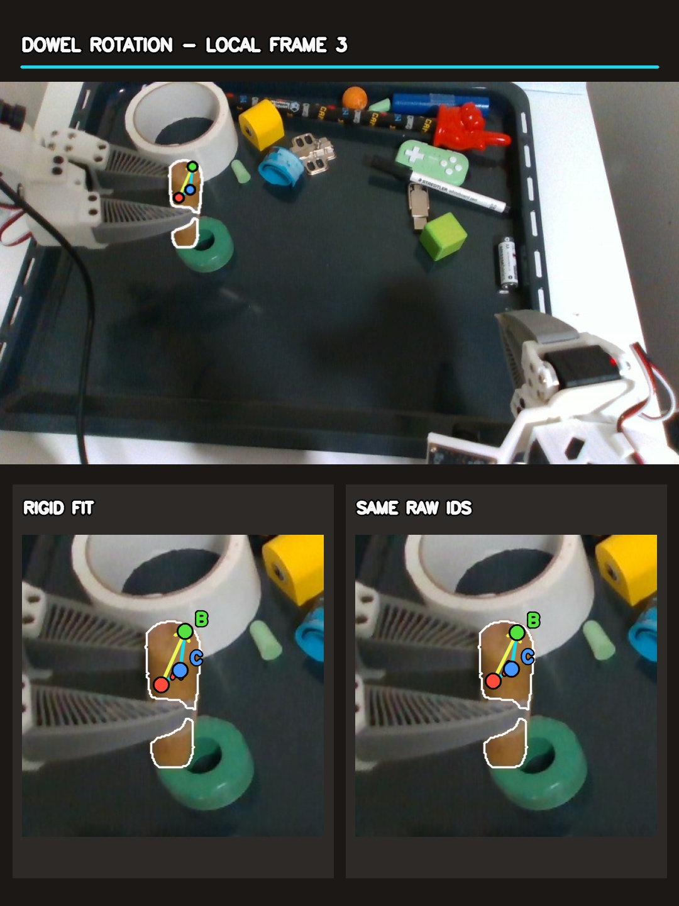

# Moving-object pose check — 2026-10-23

[Watch the phone-friendly video](https://github.com/TheWisp/lerobot/releases/download/flash-moving-pose-20261023/FLASH_moving_objects_pose_check.mp4) · 27 s, 1080 × 1440, H.264.

This follow-up deliberately shows objects that move: the dowel during a continuous
gripper-rotation sequence in the insertion demo, the yellow block pushed on the
tray, and a gamepad carried by the gripper. The earlier
[montage](../flash-visible-multiscene/EVIDENCE.md) included easier, nearly
stationary objects and excluded the yellow block because its depth check was
weaker. That selection made the tracker look more reliable than the evidence
supports.

In the video, the **left triangle** is an inferred rigid frame carried by a fit
to other depth-backed TrackEverything tracks; the **right triangle** follows
the same three raw point IDs. The white outline is the current SAM3 mask.
Hollow markers are raw IDs that no longer pass the mask/depth support check.
A→B is a fixed direction only _within one local frame_. After a reseed, A/B/C
are newly chosen points and their physical identity is **not** transferred.
The headings show lost tracking, unverified fits and unlinked reseeds rather
than silently filling those intervals. Each source frame is shown twice at
30 fps; this is half-speed playback, not measured live tracking speed.

| Moving object                            | Source and interval                                                                | Observation                                                                                                                                                                                                                                                                                                                                                                                                                                                                                                                                                           |
| ---------------------------------------- | ---------------------------------------------------------------------------------- | --------------------------------------------------------------------------------------------------------------------------------------------------------------------------------------------------------------------------------------------------------------------------------------------------------------------------------------------------------------------------------------------------------------------------------------------------------------------------------------------------------------------------------------------------------------------- |
| Dowel during gripper rotation            | Insertion demo frames 120–370, shown without cuts                                  | Three local fits cover 120–172, 217–259 and 267–370. No pose is available for 173–216 or 260–266. At the end of the first interval and start of the third, all three selected raw anchors lack visible-surface support, so those fits are marked unverified. After visibility returns, the third fit follows the rotating dowel locally; this does not connect its material frame to the first two intervals.                                                                                                                                                         |
| Yellow Lego block moving beside the ring | Insertion rollout `20261016_112149`, 75 available frames                           | A fit exists in all 75 frames and follows the moving block in the image. The projected source surface agrees with both mask and depth for 87.7% of its samples in the median frame, falling to 57.3% in the worst frame. The fraction projected implausibly in front of depth reaches 22.8%. Some raw IDs leave the block for the gripper; the fitted pose remaining near the block is not proof of exact orientation or material identity.                                                                                                                           |
| Held gamepad                             | Pick-and-place rollout `20261012_194250`, source frames 160–240 (staged as 90–170) | One pass seeded before the carry loses usable tracking through occlusion. Three separate local passes in staged frames 90–119, 120–144 and 145–170 show recovery when surface becomes visible. They do **not** establish one continuous object frame. In the 120–145 overlap of two passes, the transform between their frames changes by 41.3 mm median (77.5 mm maximum) and 10° median (23.5° maximum) relative to its initial value. In the later 145–170 overlap, the corresponding changes are 27.9 mm median (33.2 mm maximum) and 4.5° median (5.9° maximum). |

The yellow-block figures measure rendered source-surface consistency, **not**
independently measured 6D pose error. The depth conflict can arise from a bad
fit, a changed visible face, or measurement artifacts; these data do not yet
separate them. The gamepad overlap test is stronger evidence that the current
reseeding procedure does not preserve a stable frame: correctly registered
rigid fits would have an approximately constant transform between their local
frames during overlap. The video shows reseeding as it currently works—start a
new local frame—rather than suggesting that the transition is solved.

TrackEverything is evaluated offline and may use future frames within its
inference window. This experiment does not establish a causal or real-time
tracker. The script that renders the saved results is
[`benchmarks/flash_moving_pose_video.py`](../../../benchmarks/flash_moving_pose_video.py).
Its inputs are local recordings and saved tracker outputs on the rig; they are
not committed to git. The dowel local-fit result is
`/tmp/flash-moving-check/dowel_rotation_segments.npz`; its segment boundaries
are in the adjacent JSON. The yellow scene is
`/tmp/flash-multivisible/ring_yellow/scene.npz`, and the gamepad local runs are
`/tmp/flash-moving-check/held_gamepad/reseed{090,120,145}.npz`.
