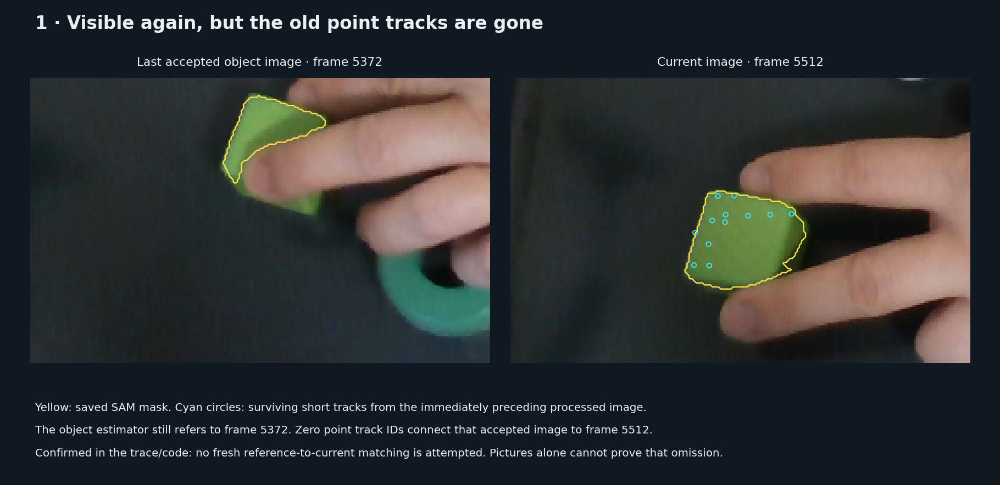
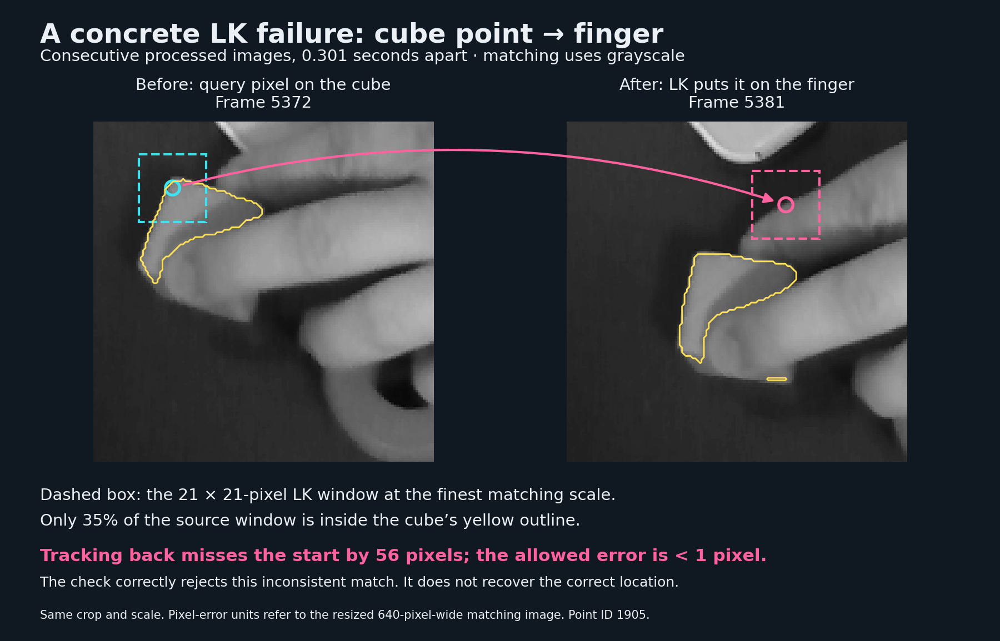
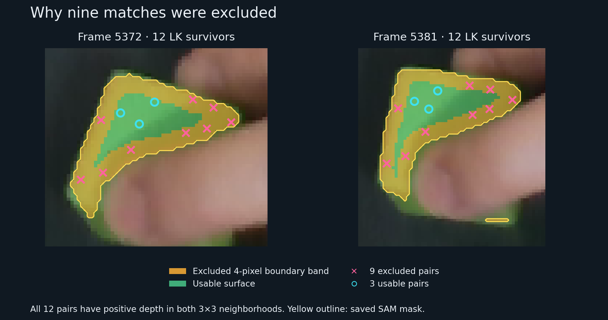
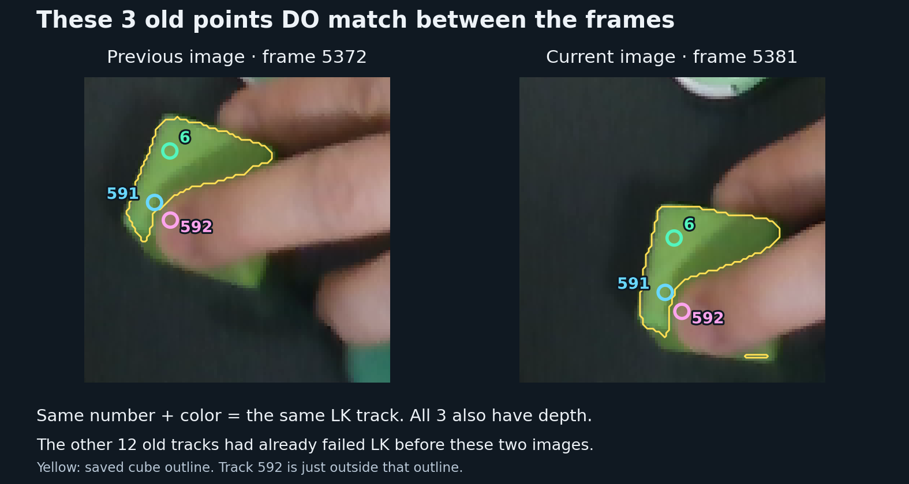
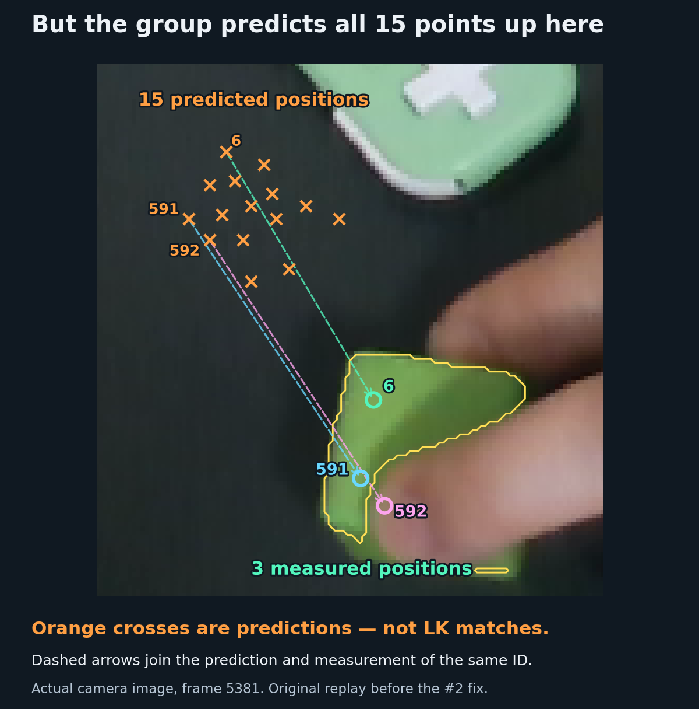

# Recovery regression and first experiments

**2026-11-21 — accepted Kalman fallback:** the checked fit becomes the returned
pose and next internal pose; predicted covariance, previous matching image and
stored surface are retained. Production replay exactly reproduces the selected
experiment on nine recordings and 54 known-pose cases.
[Landing behavior, verification and known limitation](kalman-fallback-landing.md).

This regression checks [tracking loss and recovery](../../../src/lerobot/policies/flash/docs/glossary.md#tracking-loss-and-recovery):
obtaining a new accepted object observation after tracking fails. A carried
[pose prediction](../../../src/lerobot/policies/flash/docs/glossary.md#pose-prediction--prior)
does not count as recovery. Definitions and code citations live in the
[Markdown glossary](../../../src/lerobot/policies/flash/docs/glossary.md).

The compact regression replays eleven real RGB-D observations through
`LiveSurfaceSession`: real [image matching](../../../src/lerobot/policies/flash/docs/glossary.md#image-match--2d-correspondence),
[motion groups](../../../src/lerobot/policies/flash/docs/glossary.md#motion-group),
[local surface fitting](../../../src/lerobot/policies/flash/docs/glossary.md#local-surface-fitting),
[Kalman pose updates](../../../src/lerobot/policies/flash/docs/glossary.md#kalman-pose-update),
[accepted-observation](../../../src/lerobot/policies/flash/docs/glossary.md#accepted-observation--reference-image)
changes and [surface-map](../../../src/lerobot/policies/flash/docs/glossary.md#stored-surface--surface-map) updates. SAM and
learned depth are frozen at their recorded outputs. The test archive is 6.4 MiB;
it requires neither the original video nor the camera.

Open [the visual explanation](index.html) for five annotated camera screenshots.
All overlays come from actual replay coordinates. Alternative poses are labeled
as diagnostic alternatives. The ring's rejection involves depth in a retained
view and cannot be established from RGB appearance alone.

The screenshots use the original full history. The short regression starts
fresh and reproduces the corresponding surface-fitting and Kalman-update failures;
it does not restore or fake the original accumulated map/group state.

## Current regression cases

| Case                                                              | Required behavior                                                                                                                                                            | Result at `41e1ff35c`                                                           |
| ----------------------------------------------------------------- | ---------------------------------------------------------------------------------------------------------------------------------------------------------------------------- | ------------------------------------------------------------------------------- |
| Cube, frame 2741; pointer, frame 3000                             | Accept the moved object's observation and continue tracking subsequent frames                                                                                                | Pass                                                                            |
| Cube, frame 2747; pointer, frame 3008 after a missing observation | Recover without surviving [point track IDs](../../../src/lerobot/policies/flash/docs/glossary.md#point-track-id), the integer labels connecting tracked pixels across frames | Pass                                                                            |
| Cube followed by actual ring observations                         | Reject the wrong object and leave the accepted image and surface map unchanged                                                                                               | Pass                                                                            |
| Ring, frame 4759                                                  | Keep a geometry-compatible result through the Kalman pose update                                                                                                             | Known failure: the fitted pose passes, but the fused pose fails the depth check |

The recovery assertions check the published location against independently reviewed RGB regions,
check its depth, require a newly accepted observation, and require the surface map to advance.
The missing observation must leave the accepted image and map unchanged. These checks establish
visible location and state updates, not exact 6D pose accuracy.

The five [camera comparisons](index.html) retain the original pre-fix evidence. Their explanations
link the same definitions: point track IDs, local surface fitting,
[object point anchors](../../../src/lerobot/policies/flash/docs/glossary.md#object-point-anchor)
and motion groups, Kalman pose updates, and
[usable 3D pairs](../../../src/lerobot/policies/flash/docs/glossary.md#usable-and-validated-3d-pairs).

## Viewing the Markdown

The glossary remains Markdown in the repository. To render it and the report links in a browser,
run `uv run scripts/preview_markdown.py --port 18935` from the repository root, then open
`http://127.0.0.1:18935/docs/proofs/flash-recovery-20261119/index.html` on that machine.
The preview reads each Markdown file on request, renders headings, tables and links, and offers
“View source.” It does not maintain a second glossary or change the tracking server.

## How the five panels relate

| Panel                         | Mechanism                                                                                                                                 | Relationship                                                                                                              |
| ----------------------------- | ----------------------------------------------------------------------------------------------------------------------------------------- | ------------------------------------------------------------------------------------------------------------------------- |
| 1: Too few old point tracks   | Only one usable pair connects frames 5372 and 5512; six are required, and the shared path does not attempt fresh matching                 | One way to lose an image-derived motion estimate. Loss of tracks itself must be tolerated.                                |
| 5: Too few usable pairs       | Some IDs survive, but sparse queries and object-surface filters leave fewer than six 3D pairs                                             | Another way to lose the motion estimate; different immediate cause from panel 1.                                          |
| 3: Stale group pose           | Old object membership survives missing or contradictory measurements; measured background motion still supplies an object-pose suggestion | Can supply the wrong fallback when image motion is unavailable.                                                           |
| 2: Translation initialization | The original fitter starts from that suggestion without comparing translation against current object geometry                             | Turns a bad starting position into a failed local fit. The committed centre-translation comparison addresses this defect. |
| 4: Kalman pose update         | A surface fit passes geometry checks, but combining it with the prediction creates a pose that fails them                                 | A distinct downstream failure, still present in the ring case.                                                            |

Panels 5 and 3 show the same frame, 5381: three usable pairs cannot supply image motion,
so the stale group pose becomes the fit's starting estimate. The original fitter then fails;
fitting from the previous pose succeeds in the recorded comparison. Panel 2 separately isolates
missing centre-translation initialization on cube frame 2741. Thus these are interacting causes,
not proof that every panel is a separate bug or that fixing translation fixes all five mechanisms.

## Why panel 1 loses image-derived motion



All markers show **2D pixel positions** inside the saved SAM mask. Pink crosses
mark the 16 old points whose tracks fail during the intervening frames; cyan
circles mark 28 newer points with no recorded match back to frame 5372. The green
arrow joins the one surviving [point track ID](../../../src/lerobot/policies/flash/docs/glossary.md#point-track-id),
ID 6: an integer label for a hypothesized match, not proof of physical correctness.
The audit stores each displayed ID and pixel coordinate in `object_image_points`.

**Correction to the original panel:** zero validated image-motion inliers did not
mean zero surviving point track IDs. A [shared-tracker replay](point-reacquisition-audit.json)
from frame 5118 finds 17 object tracks at frame 5372. Sixteen fail LK before
frame 5512; all sixteen exceed the configured one-pixel forward/backward error
limit in the resized matching image. ID 6 survives and passes the object/depth
filters, giving **one usable 3D pair**, below the six required for rigid-motion
fitting. Frame 5512 has 29 current object tracks, but the new IDs cannot connect
to the old image at frame 5372. This audit identifies the rejection condition,
not the physical cause of each inconsistent LK match.

The missing recovery operation is fresh matching between the last accepted image
and the current image. `SharedFrameTracker.pairs` only joins surviving IDs; it
does not run the image matcher again when too few survive. Panel 1 therefore
shows match attrition plus missing reacquisition, while panel 5 shows additional
loss of usable pairs through object-surface filtering. Both can leave the motion
fit without enough pairs. Neither is the incorrect 3D membership retention in
panel 3. The separate complete-loss regression deliberately removes every old
track and remains distinct from this recorded panel.

## What LK returns when these tracks fail



The [endpoint replay](lk-failure-detail.json) records what the matcher actually
returns. At frame 5372 → 5381 (301 ms), point ID 1905 starts inside the cube mask
at pixel (292.63, 252.28), but LK puts it on a finger at (350.24, 259.21).
Only 35% of its finest-scale 21×21 matching window lies inside the source SAM mask.
The backend uses grayscale patches without the mask; query membership does not
restrict the pixels used for matching. Tracking backward misses the starting
pixel by 56.2 pixels in the resized matching image, exceeding the one-pixel limit.
The rejection is appropriate; it does not find the correct correspondence.
Point ID 1908 also lands on a finger. Across all 16 losses, four forward endpoints
are outside the current mask; all 16 fail the forward/backward check even though
both OpenCV status flags report success. The remaining endpoints being inside
the mask does not establish that they are the same physical surface points.

The two images in panel 1 are **4.670 seconds and 19 processed transitions apart**.
Old-track counts decline 17 → 12 → 11 → 6 → 3 → 2 → 1. In the original recording,
all 19 object updates retain accepted image 5372. The first update already has
only three usable pairs after surface filtering (panel 5) and rejects the fit
started from the stale group suggestion (panel 3). Subsequent tracking losses
therefore accumulate against the same accepted image. This connects the failures;
it does not establish that correcting one mechanism resolves every later update.

The image demonstrates a wrong match and a window containing multiple surfaces.
Weak texture, changing occlusion, motion between processed images, and the window
configuration are plausible contributors; no controlled experiment here isolates
their individual contributions. This evidence does not justify loosening the
consistency check or claiming a higher frame rate is the required fix.

## Why the pairs are rejected and sparse

The [endpoint audit](pair-filter-audit.json) evaluates the saved SAM masks and model depth for
frames 5372 and 5381. Of 17 object queries, 12 survive LK and target-mask membership; 3 become
[usable 3D pairs](../../../src/lerobot/policies/flash/docs/glossary.md#usable-and-validated-3d-pairs).
All 12 have finite positive depth in both 3×3 neighborhoods. **All nine excluded pairs fail the
4-pixel inner mask-margin requirement at both endpoints.** Four also exceed the 10 mm local
depth-span limit in the source; one of those also exceeds it in the target and fails the source
robust depth-range check. These reasons overlap. “Failed depth support” was an incomplete diagnosis.



The source SAM mask contains 913 pixels in a 50×43-pixel bounding box; erosion leaves 288 pixels,
of which 287 pass surface cleaning. The target has 1034 mask pixels and 368 clean pixels.
The image tracker seeds from the full mask with positive neighborhood depth, while object matching
later requires the stricter cleaned surface. Therefore it can spend queries on boundary locations
that the object matcher will exclude. See [query selection](../../../src/lerobot/policies/flash/shared_image_tracking.py#L93),
[surface preparation](../../../src/lerobot/policies/flash/surface_tracking.py#L207), and
[pair filtering](../../../src/lerobot/policies/flash/shared_image_tracking.py#L223).

The recorded configuration permits 256 points per object and 800 background points, with 5-pixel
spacing in a 640-pixel-wide matching image. For this 848-pixel-wide recording, that spacing is about
6.6 original-image pixels. The object is only about 38×32 matching-image pixels. The ceiling is not
filled: the tracker already replenishes points each frame, subject to available space. Frame 5372
has 17 object tracks; frame 5381 has 17 after adding 3 new object tracks. New IDs cannot contribute
to a pair with an older image in which they did not exist.

Replaying the shared tracker from frame 5118 gives:

| Spacing in matching image | Object-point ceiling | Source object tracks | Usable pairs at 5381 | Shared-update time |
| ------------------------- | -------------------- | -------------------- | -------------------- | ------------------ |
| 5 px                      | 256                  | 17                   | 3                    | 14.3 ms            |
| 5 px                      | 512                  | 17                   | 3                    | 14.3 ms            |
| 3 px                      | 256                  | 44                   | 13                   | 13.9 ms            |
| 2 px                      | 256                  | 82                   | 24                   | 15.4 ms            |

Times are medians of 12 repeats of frame 5381 on this machine, with OpenCV using one CPU thread.
They include LK, query replenishment and depth lifting, but exclude groups, surface fitting, SAM,
and depth inference. The small 5-versus-3-pixel timing difference is not evidence that denser points
are faster. These measurements do not establish overall frame rate, UFM cost, or pose accuracy.
Only diagnostic configurations changed; production settings remain unchanged.
The point ceiling is exposed as “Point budget per object” in the GUI; spacing is configurable as
`shared_matching.spacing_px`, but is not currently exposed by the GUI settings form.

Reproduce the filter and density audit with the original recording:

```sh
PYTHONPATH=src:. python -m benchmarks.flash_recovery_pair_audit /path/to/saved-recording /tmp/pair-filter-audit.json \
  --figure /tmp/pair-filter-detail.png
```

## Why the object remains attached to the background group

This section describes the original failure. The [depth rejection result](#depth-rejection-of-carried-group-points) below tests its correction.

[Group-state replay](group-membership-audit.json) separates missing measurements from rejected
measurements at frame 5381. Group 0 has 425 accepted environment measurements. Of the 15 retained
object members, 12 have no current scene measurement; IDs 6, 591 and 592 do have current 3D
measurements, but all three disagree with the group's fitted motion. Consequently none of the
15 has `GroupView.measured=True`. This flag means an accepted group inlier, not merely that a
measurement exists. The earlier statement that all 15 lacked measurements was wrong.

The [LK loss audit](old-point-loss-audit.json) traces these exact 15 IDs through the
shared image tracker. All originated inside the cube mask. Twelve tracks failed LK's
forward/backward consistency check: one at frame 5235, seven at 5345, one at 5352,
two at 5359, and one at 5365. Their absence is not a depth-support failure.
IDs 6, 591 and 592 survive through frames 5372 and 5381 with accepted LK matches
and scene depth support. Track 592 lies just outside the current cube mask.
These are 15 remembered IDs, not the complete set of current cube samples.



The following picture separates the three actual measured locations from all
15 locations predicted by group 0. Dashed arrows connect the same ID's prediction
and measurement; they are not estimated trajectories. The orange crosses come
from the original saved group output, not from LK.



Rebuild these pictures from the saved recording and the compact point audit:

```sh
PYTHONPATH=src:. python -m benchmarks.flash_recovery_point_figures /path/to/saved-recording \
  docs/proofs/flash-recovery-20261119/old-point-loss-audit.json /tmp/group-pictures
```

The mechanism spans two stages:

1. [Scene groups](../../../src/lerobot/policies/flash/motion_groups.py#L400) retain an inconsistent
   member until a coherent measured split is established. A split requires at least 12 points in
   this configuration. Missing members have no time-based expiry; memory capacity can evict them.
   The three measured old object members cannot establish that split by themselves.
2. [Object association](../../../src/lerobot/policies/flash/object_group_association.py#L85) counts
   remembered members, including those without accepted group measurements, when selecting a
   group. An established relation does not require current object inliers. Once the group is
   supported and confirmed by background measurements, it can still return an object-pose hint.

Retaining a membership hypothesis through occlusion is useful. Continuing to let it supply the
object's pose despite contradictory measurements is the failure here. “No confirmed split” does
not establish that the object still follows the background. The final geometry checks reject this
bad pose in the recorded frame; the result is tracking loss, not an accepted correct pose. Fixing
this needs a distinction between remembering possible membership and trusting it for object motion.
The group and association logic has not been changed by the translation-initialization fix.

Reproduce the group inspection in an isolated replay process (the script loads only the original
`fit_once` method from local commit `9ff25cf80`; it does not edit production code):

```sh
PYTHONPATH=src:. python -m benchmarks.flash_recovery_group_audit /path/to/saved-recording /tmp/group-membership-audit.json
```

## Implemented translation initialization

The production `WholeSurfaceFit.fit_once` now compares the motion proposal with
a translation aligning the means of the stored and current 3D object surfaces.
It preserves the proposed rotation and runs one bounded solve from the lower
geometry-cost start. The comparison matters: a newly visible side can move a
surface's measured centre even when the object centre has not moved. The
geometry checks, Kalman settings, and map-update rules are unchanged.

The sparse cube and pointer regressions now pass with ordinary recorded settings,
including reacquisition after all image tracks are lost. The wrong-object control
also passes on the production path. Restoring the original `fit_once` in a
subprocess makes all four recovery tests fail again, at frames 2741, 3000, 2747,
and 3008. No video or expected pose is an estimator input.

The separate ring Kalman-fusion regression remains a strict expected failure.
The live server was not changed or restarted. The screenshots and original
experiment tables below describe the pre-fix implementation at `9ff25cf80`.

The new full-history replay publishes 315 observed updates, 84 lost updates and
one prediction, compared with 216/182/2 before the fix. These are availability
counts, **not pose-accuracy scores**. The compact regression additionally checks
visible location and depth; full-history exact 6D accuracy remains unlabelled.
See [implementation verification](translation-initialization-results.json).

Verification: the recorded suite, including actual cached UFM inference, passes
20 tests with the one ring expected failure. A broader selection of fitting,
publication, live tracking, shared matching and Kalman tests passes 264 tests,
with 4 optional skips, 3 expected failures and 11 ordinary failures. All 11 also
reproduce with the original `fit_once`: one image-assisted partial-view fit,
six wrong-image/rotation cases, and four gamepad placements. They remain visible
failures rather than being reclassified or relaxed for this fix.

## Original experiments

### What each matching step receives

The shared LK/UFM pass receives the previous and current full RGB images resized
to 640 × 362 in this recording. Its caller uses masks to allocate queries and
filter object matches, but it does not create separate object crops for the two
images. Depth is used after image matching to form 3D point pairs.

The small_gicp surface fit receives stored object points and current points lifted
from usable depth inside the SAM mask. Projecting its saved target points back
into the recorded mask verifies 915/915 inside for frame 2741 and 207/207 inside
for frame 5381; neither target cloud includes points outside that mask. This checks
mask inclusion, not whether SAM labelled every pixel correctly. Full scene depth
remains available separately for rejecting incompatible placements.

The relevant code paths are `SharedFrameTracker.update`/`pairs`,
`SurfaceTrackingSession.prepare`, `surface_observation.observation`, and
`LibraryMatcher.prepare`. Selecting only object pixels is distinct from aligning
their centres: their 3D coordinates still retain the object's camera-space
position. The original missing translation initialization below occurred despite the object
surface already being selected.

### Missing initialization from the current surface centre

**Corrected above; historical diagnosis.** The path at `9ff25cf80` chose one starting pose from image-tracked motion, a group
prediction, or the previous estimate. It did not first align the stored surface
centre with the current measured surface centre. The centring in
`LibraryMatcher.prepare` changes coordinates for numerical computation;
`LibraryMatcher.refine` converts the initial transform into those coordinates,
preserving its original displacement. This is not the centre-alignment step.

A separate controlled replay of cube frame 2741 kept the original starting
rotation, previous pose, images, masks, depth and fit checks unchanged. Only the
initial translation changed:

| Initial translation   | Starting centre gap | Starting rotation change | Surface fit |
| --------------------- | ------------------: | -----------------------: | ----------- |
| Original              |             43.4 mm |                       0° | Rejected    |
| Align surface means   |              0.0 mm |                       0° | Accepted    |
| Align surface medians |              1.1 mm |                       0° | Accepted    |

This identifies missing initialization from current geometry as a fixable
implementation defect in this case. The old object's displacement is not an
inherent barrier to recovery. Partial visibility can bias the visible surface
centre, so a centred starting estimate still needs the normal fitting and checks.
The controlled trials measure surface-fit acceptance before downstream filtering;
they do not supply independent pose ground truth or establish all-case recovery.

[Recorded trial inputs, outputs and exact translation formulas](center-initialization-ablation.json)
retain this evidence separately from the earlier comparison of two fitted poses.

### Recovery policies

These policy interventions exist only in the benchmark runner. This original
experiment did not change production source or live-server configuration. The
subsequent production translation fix is documented above; running `baseline`
now uses that updated fitter with the recorded settings.

- `baseline`: recorded settings.
- `recover`: if the ordinary local surface fit fails, try the predicted pose and then a
  translation aligning surface medians. All existing geometry checks remain.
  This is a diagnostic recovery proposal, not evidence of object identity.
- `baseline_reset`: enable the existing Kalman reset-on-geometry-conflict option.
- `recover_reset`: combine those two interventions.
- `rematch`: when fewer than the configured minimum 3D pairs remain, perform
  fresh matching directly from the accepted image to the current image. Sample
  depth-supported source pixels without requiring surviving point track IDs;
  retain mask, endpoint-depth, robust-fit and geometry checks. This experiment
  does not resurrect lost scene-group IDs.
- `rematch_reset`: combine fresh matching and the existing filter-reset option.

The ordinary UFM path recovers the sparse cube and pointer sequences, but both
still fail after all old point tracks are lost. Fresh reference-to-current UFM matching
recovers them with 145 and 108 validated 3D pairs respectively. The ring still
needs the separate filter change. Actual UFM inference uses cached checkpoint
`980825b59331413bb51e5773f9272bfce525bce2`; it is not a fake flow field.

The LK surface-recovery experiment also recovers the cube and pointer without
temporal pairs; the combined filter intervention recovers the ring. Subsequent
frames run from the changed accepted image/map, rather than branching each
frame from the failing baseline state.

The complete-loss tests keep the map/reference unchanged during missing
measurements. A wrong-object control supplies the green ring after initializing
the cube and checks rejection. Visible-location assertions use reviewed image
regions. These checks do not provide exact 6D ground truth or a general
lookalike-object guarantee.

## Measured LK and UFM latency

Measured on the current code path with a Ryzen 9 9950X and RTX 5090. Both
[image-matching backends](../../../src/lerobot/policies/flash/docs/glossary.md#image-match--2d-correspondence)
receive identical recorded image pairs and 812–833 query pixels. The shared
matching image is 640×362; the UFM checkpoint internally resizes to 560×420.
LK uses one OpenCV CPU thread. UFM uses the cached DINOv2-L checkpoint at revision
`980825b59331413bb51e5773f9272bfce525bce2`, with its default inference settings.

| Timed work                                                         |  LK median / p95 | UFM median / p95 |
| ------------------------------------------------------------------ | ---------------: | ---------------: |
| Image matching                                                     |   8.39 / 9.55 ms | 33.09 / 33.50 ms |
| Shared image tracking, including point selection and depth lifting | 13.65 / 15.07 ms | 38.20 / 38.88 ms |

In this workload UFM matching takes **3.95× as long**, adding about **24.6 ms**
to the complete shared update. Its 38.2 ms shared update already exceeds a
33.3 ms budget for serial 30 Hz updates. These measurements exclude SAM, depth
inference, scene motion groups, object fitting, camera IO, and model startup;
they do not establish full-pipeline frame rate or comparative tracking quality.
An extra fresh UFM match during recovery would require another model call and
is not included here. LK performs sparse point queries; UFM computes a dense
field and then samples the query points.

Method: eight recorded transitions from the cube sequence, with source states
obtained by replaying the shared LK tracker from frame 5118. Restore the same
source state before each backend call. Alternate backend order per pair and
round. Discard two full warmup rounds and measure twelve rounds, giving 96
updates per backend. State copies and file reads are outside the timed region;
CUDA is synchronized before and after the shared update. GPU transfers and
CPU output conversion are included. Other processes were not stopped, so these
are local measurements rather than an isolated hardware benchmark.

[Timing summary and per-pair results](image-matching-latency.json) ·
[Individual timing samples](image-matching-latency.samples.jsonl).

Reproduce with an environment containing the cached UFM dependencies:

```sh
HF_HUB_OFFLINE=1 PYTHONPATH=src:. python -m benchmarks.flash_matching_latency \
  /path/to/saved-recording /tmp/image-matching-latency.json
```

## Original longer-history check

All 404 retained results from the four selections were replayed from their
actual initialization frames. The baseline reproduces all 404 recorded statuses.
There are 400 subsequent updates:

| Policy                       | Observed updates | Lost | Predicted |
| ---------------------------- | ---------------: | ---: | --------: |
| Existing LK                  |              216 |  182 |         2 |
| LK surface-recovery + reset  |              400 |    0 |         0 |
| UFM fresh rematching + reset |              399 |    0 |         1 |

These are availability counts, **not accuracy scores**. The remaining UFM
prediction is pointer frame 3491: the fused candidate is rejected and the
compatible prior is retained. This shows that reset-on-prior-contradiction does
not resolve every fusion failure. Full-history exact orientation and map
correctness remain unlabelled. Do not promote either experiment solely because
more poses are published.

## Original experiment verification

The baseline defects are strict expected failures, not hidden passing tests.
The opt-in experiments must satisfy the same recovery assertions. Reintroducing
the defects produced the intended failures:

- Removing alternative starting poses fails cube 2741 and pointer 3000.
- Disabling the filter reset fails ring 4759 with the original fusion rejection.
- Removing fresh matching fails UFM reacquisition after complete loss.

See [the fixture documentation](../../../tests/policies/flash/fixtures/motion_recovery_20261117/README.md)
for scope, provenance and test commands. `experiment-results.json` records the
experiment counts; `experiment-trace.jsonl` contains individual outcomes and
compact full-history pose traces.

Reproduce a compact experiment:

```sh
PYTHONPATH=src:. python -m benchmarks.flash_motion_recovery --output /tmp/recovery-lk.json
HF_HUB_OFFLINE=1 PYTHONPATH=src:. python -m benchmarks.flash_motion_recovery \
  --backend ufm --policies baseline rematch rematch_reset --output /tmp/recovery-ufm.json
```

For the longer check, add `--full-recording /path/to/saved-recording`. To rebuild
the explanatory images from the original full history:

```sh
PYTHONPATH=src:. python -m benchmarks.flash_recovery_screenshots \
  /path/to/saved-recording /tmp/recovery-figure-data
PYTHONPATH=src:. python -m benchmarks.flash_recovery_figures \
  /path/to/saved-recording /tmp/recovery-figure-data docs/proofs/flash-recovery-20261119
```

## Depth rejection of carried group points

[Compute-path diagram, query scope and reuse measurements](depth-compute-path.md).

Measured on 2026-11-19 against `44fc18138`, with the group-depth change in this
branch. A [motion group](../../../src/lerobot/policies/flash/docs/glossary.md#motion-group)
predicts a missing or rejected member's 3D position from the current group motion.
The new check converts that position into current camera coordinates, projects
it into the current image, and rejects the membership when reliable current
depth is farther than its current camera Z by over 5 mm. A two-pixel conservative
neighborhood preserves holes, depth boundaries and possible nearer occluders.
No object mask or fitted object pose participates. The comparison function is
shared with object-surface validation, while mask-dependent depth preparation
remains separate.

The full 38-frame replay (5118–5381) retains all 15 stale cube members with the
check disabled and none with it enabled. IDs 6, 591 and 592 still have current LK
and depth measurements elsewhere; rejection removes their group placement, not
their image tracks. At frame 5381 the unsupported background-group object hint
is absent. Both versions accept all 37 post-initialization object observations:
the translation fix already recovers this sequence, so this change improves the
group state without increasing that recovery count. Exact 6D pose accuracy is
not independently labelled.

The original measurement used three paired runs alternating enabled/disabled order on an AMD Ryzen 9 9950X,
OpenCV one thread. SAM and Foundation Stereo outputs are frozen; file decoding
and model inference are excluded. The first frame is excluded from timing summaries.

| Measurement                                                        |    Median | 95th percentile |
| ------------------------------------------------------------------ | --------: | --------------: |
| Added depth preparation + membership check                         |  0.660 ms |        0.953 ms |
| Group update, disabled                                             |  8.843 ms |       17.844 ms |
| Group update, enabled (includes check, excludes depth preparation) | 10.443 ms |       18.333 ms |
| Full frame processing, disabled                                    | 66.025 ms |       82.218 ms |
| Full frame processing, enabled                                     | 60.050 ms |       78.766 ms |

**The apparent 6 ms reduction in full processing time did not reproduce in the
closer comparison below.** It must not be attributed to the depth check. The
original complete-run comparison did not control timing variation sufficiently
to establish that saving. These figures exclude camera/model throughput.
[Original timing summaries](group-depth-results.json) · [Original per-frame measurements](group-depth-results.frames.jsonl).

### Follow-up timing comparison

Six pairs of independent tracking sessions alternate enabled/disabled processing
for each recorded frame, reversing order on successive frames and repetitions.
One complete pair is discarded for warmup. Hardware, model outputs and timing
scope are unchanged. This places each comparison close in time while preserving
each session's own tracking history.

| Measurement                                                            |  Disabled |   Enabled |
| ---------------------------------------------------------------------- | --------: | --------: |
| Full processing median                                                 | 61.114 ms | 61.901 ms |
| Full processing 95th percentile                                        | 78.597 ms | 80.766 ms |
| Group update median, excluding depth preparation                       |  8.747 ms | 10.416 ms |
| Object update stage median, including geometry preparation and fitting | 28.963 ms | 28.408 ms |
| Fitting evaluations per replay                                         |     1,279 |     1,291 |

For each matching frame and repetition, subtracting disabled time from enabled
time gives **+0.603 ms median** and +1.204 ms mean over 222 pairs. Each repetition's
median is positive, ranging from +0.232 to +1.034 ms. The direct depth preparation
and membership check take **0.661 ms median / 0.944 ms p95**. Individual frame
differences remain noisy; stage medians are not additive.

There is no consistent fitting saving that explains the original 6 ms difference:
the enabled version performs slightly more fitting evaluations. Some downstream
work changes with the group state, but these measurements support a small added
processing cost for this correctness fix, not a demonstrated speedup. All six
pairs still remove all 15 stale memberships only with the check enabled; both
versions accept all 37 post-initialization observations.
[Follow-up timing summaries](group-depth-interleaved.json) · [Follow-up per-frame measurements](group-depth-interleaved.frames.jsonl).

The [813 KiB fixture](../../../tests/policies/flash/fixtures/group_depth_20261119/README.md)
reconstructs stale group membership from 38 measured point snapshots and stores
only one depth image. The production frame owner supplies the endpoint depth;
metre and millimetre input cases both remove all 15 stale members while retaining
at least 400 measured scene points. Synthetic cases check moved group and camera
coordinates, missing/nearer/equal depth, boundaries, offscreen points and the
object-side connection. Reintroducing missing depth wiring fails the recorded
regression; restoring the original object query fails the connection regression.
The targeted group, shared tracking, live frame, surface validation/refresh and
recorded recovery suites pass: **206 passed, 5 skipped, 1 expected failure**
(the existing ring Kalman-fusion case). The moved depth-comparison functions
are unchanged; syntax-tree comparison against `44fc18138` verifies equivalence.

Reproduce the full processing comparison:

```sh
PYTHONPATH=src:. python -m benchmarks.flash_group_depth /path/to/saved-recording \
  --output /tmp/group-depth-results.json --repeats 3
PYTHONPATH=src:. python -m benchmarks.flash_group_depth /path/to/saved-recording \
  --interleave --output /tmp/group-depth-interleaved.json --repeats 6
PYTHONPATH=src:. python -m pytest tests/policies/flash/test_group_depth_rejection.py -q
```
