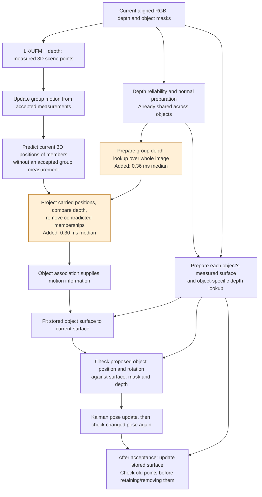

# Depth computation and reuse

Inspected at `04f67348e` on 2026-11-19. The diagram describes the running
`LiveSurfaceSession` path after aligned RGB, selected depth and masks are ready.
Arrows show dependencies; the frame owner updates groups before processing objects.

A [motion group](../../../src/lerobot/policies/flash/docs/glossary.md#motion-group)
is a collection of 3D points assumed to share one rigid motion. Its added depth
check tests remembered members without an accepted group measurement this frame:
missing usable 3D measurements, or measured points rejected by the group's motion
fit. Accepted measured members are not rechecked by this operation. Group-local
positions are carried by the current group transform, converted from robot-base
to current camera coordinates, and projected into the current image.



The object portion shows the successful update path. Failed candidates may
instead produce a checked prediction or a lost result. See the maintained
[full architecture](../../../src/lerobot/gui/static/flash_architecture.html#surface-fit)
and definitions of [local surface fitting](../../../src/lerobot/policies/flash/docs/glossary.md#local-surface-fitting),
[Kalman pose update](../../../src/lerobot/policies/flash/docs/glossary.md#kalman-pose-update),
and [stored surface](../../../src/lerobot/policies/flash/docs/glossary.md#stored-surface--surface-map).

## Why depth already existing does not make the operation free

The selected metric depth image is reused. There is no extra depth-model run.
The shared reliability and normal preparation is also pre-existing work.
The added group lookup replaces invalid/unreliable depth with unknown values and
takes the nearest depth in a five-by-five-pixel neighborhood. This protects points
near holes, depth boundaries and possible occluders. It costs 0.364 ms median in
the interleaved replay; querying carried members and updating membership costs
0.299 ms median. Their combined median is 0.661 ms (separate medians need not add).

For each query, the relevant pixel and camera Z depend on the point's predicted
**current** 3D position. The rule is reliable depth farther than that Z by over
5 mm. A depth image does not contain this prediction or its comparison result.
Object fitting subsequently tests different surface points at candidate object
poses, and Kalman fusion can change the pose again. Those answers cannot be
substituted for the earlier group-membership decisions.

## What is already shared, and what is not

| Work                                     | Current reuse and limits                                                                                                                                                                                                                                                                                                                                               |
| ---------------------------------------- | ---------------------------------------------------------------------------------------------------------------------------------------------------------------------------------------------------------------------------------------------------------------------------------------------------------------------------------------------------------------------- |
| Selected depth image                     | Shared across the frame; no repeated inference.                                                                                                                                                                                                                                                                                                                        |
| Depth reliability and normal preparation | Computed once by the frame owner and passed to object preparation and the group depth lookup.                                                                                                                                                                                                                                                                          |
| Depth comparison arithmetic              | Shared NumPy function for groups, surface validation and surface cleanup; the fitter also supports an optional compiled equivalent.                                                                                                                                                                                                                                    |
| Prepared object geometry                 | Reused between geometry-only and image-conditioned objectives, including prepared reverse fits.                                                                                                                                                                                                                                                                        |
| Conservative depth lookups               | Group preparation is independent of objects. Object preparation additionally withholds pixels based on the object's usable surface and optional depth-range filtering. These arrays cannot be assumed identical. `PreparedTargetSurface.build` and `SurfaceView.from_observation` repeat similar preparation; reuse for the same observation and settings is possible. |
| Rejection results                        | Apply to particular points, transforms and depth evidence. Group predictions, fitted poses, fused poses and stored surface updates generally have different inputs.                                                                                                                                                                                                    |

Code: [`SurfaceFrameSession.step`](../../../src/lerobot/policies/flash/surface_frame_session.py#L332),
[`SceneDepth`](../../../src/lerobot/policies/flash/scene_depth.py),
[`SceneMotionGroups._reject_depth`](../../../src/lerobot/policies/flash/motion_groups.py#L548),
[`reliable_observation_depth`](../../../src/lerobot/policies/flash/surface_observation.py#L53),
[`PreparedTargetSurface`](../../../src/lerobot/policies/flash/surface_grounding.py#L104),
[`WholeSurfaceFit`](../../../src/lerobot/policies/flash/surface_grounding.py#L178),
and [`SurfaceView`](../../../src/lerobot/policies/flash/experimental_surface_session.py#L216).

## Isolated query experiment

The 38-frame replay captures the exact group query inputs before benchmarking.
Across the 37 post-initialization frames, the image is 848 × 480 (407,040 pixels),
but the group check queries **290 points median**, ranging from 0 to 659.
At frame 5381 it queries 526 points across four groups. These counts include
all carried group members, not just the 15 stale cube members discussed in the
regression. Whole-image lookup preparation and sparse point queries are different
amounts of work.

Combining all groups' queries into one NumPy call preserves every captured
rejection flag and reduces the median isolated query time from **0.149 ms to
0.068 ms**. This includes camera transformation, projection and querying, but
excludes full-image lookup preparation, group bookkeeping, and the rest of frame
processing. Inputs are warm and each frame is repeated 101 times with alternating
variant order. This is evidence of roughly 0.08 ms query savings on this case,
not a measured end-to-end speedup. No runtime implementation changed.

The optional compiled routine could be shared too, but Numba is absent from this
environment. It was not measured. Further savings from sharing prepared lookups
have not been measured; retaining the different group/object validity rules is
necessary. The new check's entire measured cost is only about 1% of processing
time in this replay, so small batching or exact-data reuse is proportionate;
a larger cache or cross-layer coupling is not justified by this measurement.

[Captured counts and timings](depth-query-results.json) ·
[Full interleaved processing comparison](group-depth-interleaved.json).

```sh
PYTHONPATH=src:. python -m benchmarks.flash_depth_queries /path/to/saved-recording \
  --output /tmp/depth-query-results.json
```
