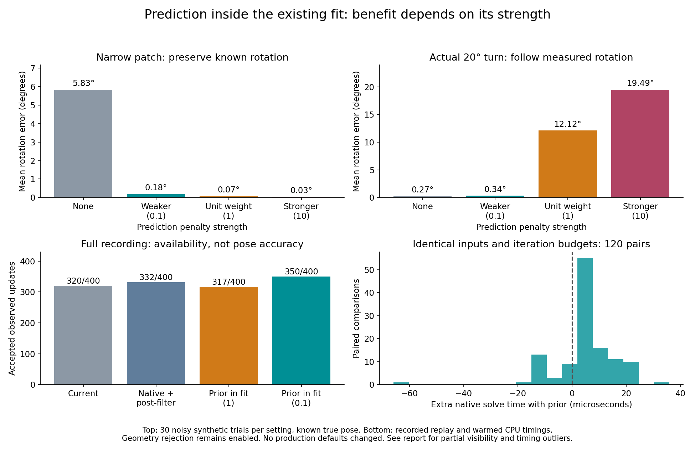
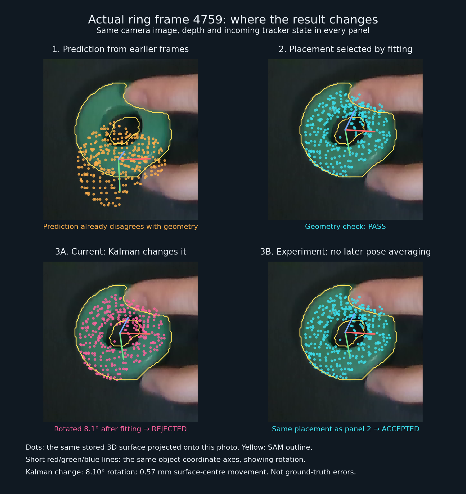
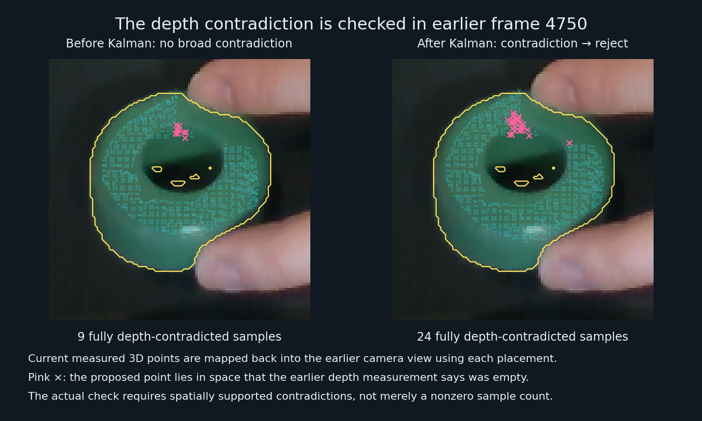

# Prediction inside the surface fit — measured experiment, 2026-11-20

The experimental combined fit recovers ring frame 4759, preserves rotation on a
narrow noisy patch, and adds very little native computation. It is **not ready
to become the default**: the balance between previous knowledge and current
measurements remains sensitive, and a partially visible broad surface still
has appreciable position error. No live configuration or production tracking
code was changed.

Here a [pose prediction](../../../../src/lerobot/policies/flash/docs/glossary.md#pose-prediction--prior)
is the current position and rotation estimated from earlier frames and any
measured group motion. [Local surface fitting](../../../../src/lerobot/policies/flash/docs/glossary.md#local-surface-fitting)
moves and rotates stored object points to agree with current measured object
points. The normal [Kalman pose update](../../../../src/lerobot/policies/flash/docs/glossary.md#kalman-pose-update)
combines the fitted pose with the prediction afterward. This experiment instead
uses the prediction during fitting and does not subsequently change the fitted
pose by averaging. Geometry rejection and map-publication checks still run.



## What was implemented

[Native experiment](../../../../benchmarks/flash_prior_registration.cpp) and
[runner](../../../../benchmarks/flash_prior_registration.py) use pinned
`small_gicp` headers at `57c1106daf83c2c79ee0c58a9c7ed0032298ff4e`.
The native loop adds a position/rotation prior to the point-factor equations.
Its residual uses camera-axis rotation in radians and the position, in metres,
of the filter's fixed object point. It compensates for the existing source and
target cloud centering. A coordinate-origin invariance test checks this boundary.

One pipeline fit retains the existing two resolutions, each with a point-to-point
warm start and a GICP stage. Each resolution has a 20-iteration budget, also
bounded by the existing 50-iteration global limit. The measured compact runs use
at most 40 iterations. There is no failed-frame retry or extra registration
start. The prior derivative uses twelve small pose evaluations per iteration;
these evaluate no images or nearest-neighbour queries.

The native experiment uses Gauss–Newton, whereas the current library call uses
Levenberg–Marquardt. Therefore the comparison includes **native + post-filter**:
the same new native loop, with its prior disabled, followed by the normal Kalman
pose update. That control still reproduces ring 4759's fusion rejection. A
**native fit only** control removes the final averaging without adding a prior;
it recovers the short ring sequence too. The ring alone cannot demonstrate the
benefit of preserving previous information.

The geometric objective is scaled using the configured depth-error assumptions
and a cap of 32 effective independent samples. The upstream regularized GICP
normal variance is 0.001 per endpoint. A prior-strength multiplier of 0.1, 1,
or 10 explores sensitivity; 1 is an experimental unit weight, not a calibrated
equivalent of the production filter. The multiplier also applies to prior
precision in the covariance update. In particular, 0.1 repeatedly broadens the
prior before incorporating a frame: this is an experimental confidence change,
not a validated physical motion model.

For state propagation, measurement-only information is still computed by the
existing depth-normal estimator. The prior is added once; the GICP Hessian is
not substituted for calibrated measurement confidence. This retains limitations:
outline constraints, correspondence uncertainty and temporal correlations are
not fully represented. Candidate selection among the bounded fit's returned
poses still uses the existing geometry score and checks; this prototype is not
a complete constrained probabilistic optimizer.

All integration is through a scoped benchmark context. Tests verify that its
method replacements are restored even after exceptions. The live server was
not restarted, and LK/group tracking receive no object-specific feedback.

## Measured results

### Actual camera example with the same incoming state



The [camera example runner](../../../../benchmarks/flash_prior_example.py) replays
the production path through frame 4750, then switches methods only for frame 4759. Assertions verify identical incoming prediction, covariance, starting
placement and stored surface. These are the recorded RGB images and saved model
depth; the overlays are computed 3D surface projections, not generated imagery.

On this controlled frame, production, the matched native post-filter control,
and the integrated prior all select **the same initial geometry-compatible
placement**. The normal Kalman correction then changes its rotation by 8.10°
and moves the stored surface centre by 0.57 mm. The corrected placement fails
the depth check. The integrated experiment leaves the selected placement
unchanged and accepts it. This example therefore demonstrates the benefit of
avoiding a later conflicting pose correction; it **does not establish that the
prior term improved the numerical fit**. The separate known-pose strip controls
test that claim. The 8.10° here differs from the older full-history illustration's
8.42° because the compact replay initializes at frame 4740.



The displayed pink crosses are current 3D measurements mapped back into camera
frame 4750 using each proposed object placement. They are captured from the real
depth-check code after its retained-surface exceptions. Fully contradicted
samples increase from 9 to 24; only the latter distribution triggers the spatial
support requirement for rejection. A nonzero sample count alone is not the rule.
The current frame's own depth direction has no contradiction for either of these
two placements. The actual veto is in the earlier camera view, so RGB overlap
alone cannot explain the rejection.

[Captured checks and outcomes](ring-real-example.json) and
[numeric projections](ring-real-example.npz) retain the evidence. Reproduce with:

```bash
PYTHONPATH=src:. python -m benchmarks.flash_prior_example \
  --native-dir /tmp/flash-prior-native \
  --output docs/proofs/flash-recovery-20261119/prior-in-fit
```

### Compact recorded regression

The original 11 lossless observations produce eight post-initialization updates
across cube, pointer and ring. After a warmup, eight alternating-order rounds
give 64 measured updates per method. The current pipeline and matched native
post-filter control each accept seven of the eight distinct updates: ring 4759
is lost. All three integrated-prior strengths accept all eight.

The accepted positions pass the independently reviewed RGB regions and broad
depth bounds in the fixture; see [visible-location checks](visible-location-checks.json).
These checks do not establish exact rotation. All strengths reject the actual
ring observations when initialized as the cube. Missing observations preserve
the accepted image and surface. Strengths 0.1 and 1 also recover the tested
returns with no surviving image pairs; strength 10 misses the first ring return.

### Full chronological history

Each selection starts from its actual initialization frame. There are 400
updates after four initializations. This is a fresh replay on the current
branch, not the earlier translation-only experiment's counts.

| Method                           | Cube / 48 | Pointer / 140 | Ring / 114 | Cube again / 98 | Total observed / 400 |
| -------------------------------- | --------: | ------------: | ---------: | --------------: | -------------------: |
| Current pipeline                 |        48 |            75 |         99 |              98 |                  320 |
| Same native solver + post-filter |        48 |            79 |        107 |              98 |                  332 |
| Prior inside fit, strength 1     |        48 |            70 |        101 |              98 |                  317 |
| Prior inside fit, strength 0.1   |        48 |            90 |        114 |              98 |                  350 |

These are **availability counts, not pose-accuracy scores**. The stronger
configuration helps the compact regression but is worse overall than the
current pipeline. The weaker configuration improves this replay, but the
recording has no independent full 6D ground truth. It still leaves 50 updates
without accepted object observations.

### Known-pose controls

Thirty deterministic noisy trials per case use 0.5 mm point noise and perturbed
surface normals. True transforms and generated point identities are available
only to the evaluator; matching still uses nearest neighbours. The prior has
3° rotation and 10 mm position standard deviations before scaling. All cases
include a real 4 mm depth change. These controls exercise the native solver,
not segmentation, learned depth or end-to-end RGB-D visibility validation.

| GICP control                                                        | No prior | Strength 0.1 | Strength 1 | Strength 10 |
| ------------------------------------------------------------------- | -------: | -----------: | ---------: | ----------: |
| 100 × 2 mm narrow patch: mean rotation error                        |    5.83° |        0.18° |      0.07° |       0.03° |
| 100 × 60 mm surface rotated 20°: mean rotation error                |    0.27° |        0.34° |     12.12° |      19.49° |
| Broad stored surface, only 2 mm strip observed: mean position error |  5.78 mm |      2.89 mm |    0.51 mm |     0.12 mm |

The last case is stricter than storing only the narrow patch. At strength 0.1
its position-error p95 is **6.23 mm**, maximum **9.29 mm**; rotation-error p95 is
1.08°. A single scalar that works for a clear rotation need not preserve enough
previous knowledge under partial visibility. The source-to-target GICP solve
also includes stored points that are not currently visible; these synthetic
results do not validate that correspondence policy under real occlusion.

Both point-to-plane and GICP controls are retained in the raw data. Removing
the native prior term makes the narrow-patch regression fail its independent
rotation bound. Keeping a pose fixed cannot pass the control, because it also
requires following the real depth change and a separate actual 20° turn.

## Timing and the slow frames

Host: Ryzen 9 9950X, one OpenCV thread, two native registration threads. SAM and
depth inference are frozen; file decoding is outside timed `LiveSurfaceSession.step`.
Other applications were not stopped. Numba is unavailable in this environment;
the existing NumPy fallback runs for both methods. Package versions and source
hashes are in [summary.json](summary.json).

The native comparison captures six actual ring fitting inputs, reuses each
prepared cloud/tree, and alternates prior on/off. Two warmup rounds precede 20
measured rounds: **120 pairs**. Both sides execute exactly the same iteration
budgets. The added time is **0.005 ms median**, **0.021 ms p95**, maximum 0.036 ms
per captured GICP stage. This excludes cloud preparation and is not the cost of
the entire tracking frame. Pose-dependent searches and scheduling can make an
individual difference negative.

| Compact whole update, raw time |   Median |      p95 |   Maximum |
| ------------------------------ | -------: | -------: | --------: |
| Current pipeline               | 66.31 ms | 87.51 ms |  88.90 ms |
| Native + post-filter           | 66.53 ms | 87.97 ms |  89.42 ms |
| Prior inside fit, strength 0.1 | 65.31 ms | 85.16 ms | 239.07 ms |

Do not interpret these medians as a speedup: the methods take different paths
and build different surfaces. Earlier five- and eight-round trials are also
retained because they exposed slow updates around 215 ms. Instrumenting Python's
garbage-collection callbacks without disabling collection measured 142–155 ms
of collection in the four slow updates of the final run. Spikes occurred with
and without a prior, at 23–40 fit iterations; there was no extra solve. The
raw times remain in the report. Replay-harness object churn may differ from
continuous live use, and bounded fitting is not a wall-clock guarantee.

## Research informing the experiment

- [Bonnabel, Barczyk and Goulette, _On the Covariance of ICP-based Scan-matching Techniques_](https://arxiv.org/abs/1410.7632):
  rematching matters for uncertainty; blindly interpreting point-to-point
  curvature as covariance can be wrong. Their point-to-plane analysis motivates
  retaining a directional measurement model instead of declaring the GICP
  solver matrix to be calibrated confidence.
- [Tuna et al., _Informed, Constrained, Aligned_](https://arxiv.org/html/2408.11809v2):
  compares regularization, constraints and other responses to poorly determined
  registration. Their field results show sensitivity to prior quality and
  regularization strength, and a computational cost for additional nonlinear
  optimization. This motivated the strength sweep, matched native control and
  fixed fitting budget. Their LiDAR timings do not predict FLASH timings.
- [Hatleskog and Alexis, _Probabilistic Degeneracy Detection for Point-to-Plane Error Minimization_](https://arxiv.org/html/2410.10784v2):
  point and normal noise can create apparent information in movements the shape
  cannot reliably constrain. This motivated noisy-normal controls. Their
  noise-aware attenuation is a research direction, not implemented or claimed
  reproduced here; its sensor assumptions cannot be copied unchanged to learned
  stereo depth.

The evidence favours retaining previous knowledge differently for different
movements over globally weakening it. It does not yet select a general rule.
The partial-visibility position errors, misleading GICP confidence, and missing
calibration need to be resolved before changing the running estimator.

## Reproduction and verification

From the repository root, using an environment with the normal FLASH replay
dependencies, a C++17 compiler with OpenMP, Eigen 3.4 headers and Torch's bundled
pybind11 headers:

```bash
git clone https://github.com/koide3/small_gicp /tmp/flash-prior-small-gicp
git -C /tmp/flash-prior-small-gicp checkout 57c1106daf83c2c79ee0c58a9c7ed0032298ff4e
PYTHONPATH=src:. python -m benchmarks.flash_prior_registration --build \
  --native-dir /tmp/flash-prior-native --upstream /tmp/flash-prior-small-gicp \
  --eigen /usr/include/eigen3
PYTHONPATH=src:. python -m benchmarks.flash_prior_registration \
  --native-dir /tmp/flash-prior-native --rounds 8 --controls 30 \
  --output /tmp/prior-results/compact-and-controls.json
PYTHONPATH=src:. python -m benchmarks.flash_prior_registration \
  --native-dir /tmp/flash-prior-native --full-recording /path/to/saved-recording \
  --output /tmp/prior-results/full-history.json
PYTHONPATH=src:. python -m benchmarks.flash_prior_report /tmp/prior-results
PYTHONPATH=src:. FLASH_PRIOR_NATIVE_DIR=/tmp/flash-prior-native python -m pytest -q \
  tests/policies/flash/test_prior_registration_experiment.py \
  tests/policies/flash/test_recorded_motion_recovery.py \
  tests/policies/flash/test_surface_kalman.py
```

The compact experiment needs only the existing 6.4 MiB fixture, not the video.
The full-history comparison additionally needs the original local saved record.
The compiler build is explicit, pinned, outside the repository, and does not
install or replace `small_gicp`. No binary is committed.

Verification: 37 tests passed, four optional UFM tests skipped, and the existing
production ring failure remained a strict expected failure. The native-prior
removal mutation fails the narrow-patch rotation assertion. The production
method-restoration, known-coordinate-origin, wrong-object, missing-observation,
single-fit-budget and visible-location controls pass. See
[verification.json](verification.json) for the measured test outcomes.
