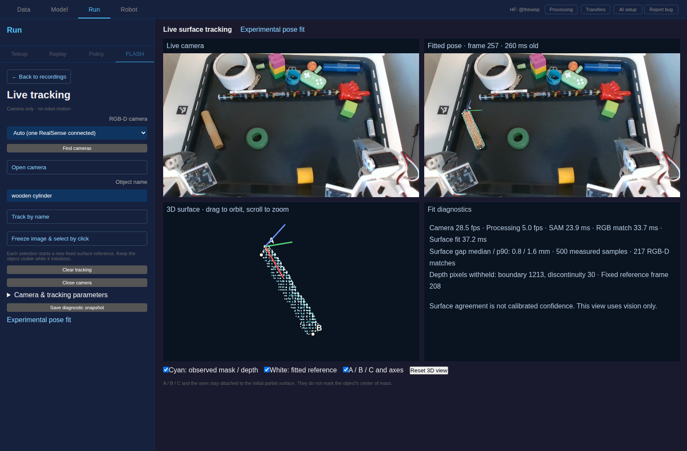
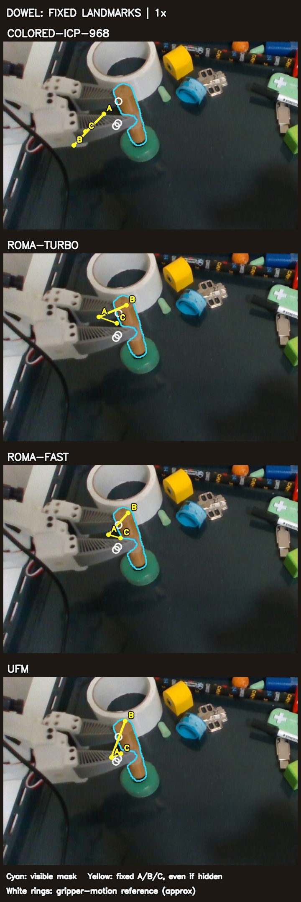
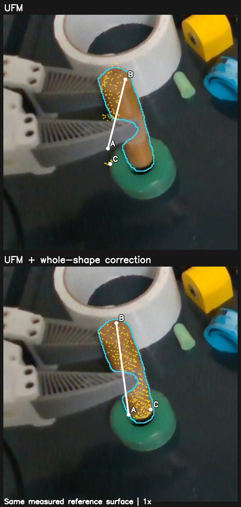
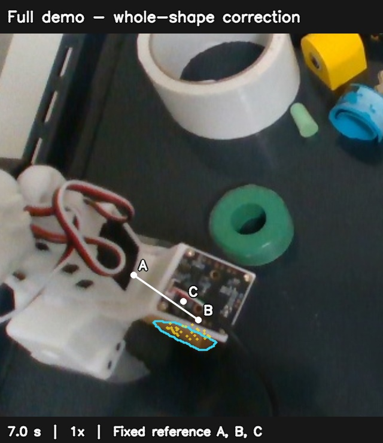
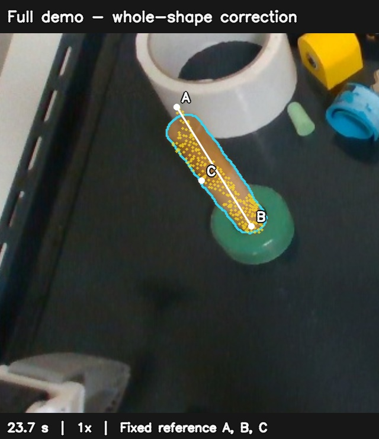

# RGB-D registration of the held dowel

## Live surface debugger (2026-10-25)

Run → FLASH → **Live tracking · camera only** uses the same UFM proposal,
filtered measured surface and whole-surface correction as this experiment.
The common implementation is in
`src/lerobot/policies/flash/surface_{observation,correspondence,grounding,tracking}.py`;
the original experiment scripts import it.

Open the RGB-D camera, then enter an object name or freeze an image and click
the object. Each selection creates a new fixed partial reference. Inspect the
SAM outline first: one click may select only part of an object. Reselect or
use a description if that is not the intended region.

The live camera and processed source image are separate, with frame IDs and
estimate age. Geometry is drawn only on its own source image. A/B/C and the
axes retain their initial coordinates; the rotatable 3D panel compares measured
surface and fitted reference. This does **not** reconstruct the whole object.
The origin is not its center of mass or a newly computed visible centroid.
Missing mask/depth produces no current displayed pose. Fit agreement is not
calibrated confidence or proof of accuracy.

Capture has one latest-frame slot, independent of inference. SAM, UFM and
fitting run sequentially in a separate process managed by the existing Run
owner. This view tracks one selected object. No robot is connected or commanded;
group/gripper fallback and the robot execution pipeline are unchanged.

The parameter editor exposes camera, SAM resolution, depth filtering, RGB
matching and fitting settings, applied on opening the camera. Snapshot downloads
contain the applied configuration, source RGB, frame identities/times, clouds
and transforms. These are diagnostic snapshots, not new episode recordings.

The worker requires the SAM3 adapter dependencies plus UFM and UniCeption.
Set `LEROBOT_FLASH_TRACKING_PYTHON` before starting the GUI to choose its Python;
otherwise it uses the server interpreter. The rig has an isolated environment
at `~/.cache/flash-live-tracking/.venv`, based on its existing LeRobot/SAM
environment with the previously checked-out UFM and UniCeption sources.
Start the GUI with this checkout's `src` on `PYTHONPATH` to avoid selecting
another editable LeRobot installation.

Validation: extracting the shared observation/fitter produced identical arrays,
poses and costs on demo frames 0, 234, 279, 360, 435 and 514. Browser-driven live
checks covered text selection, click selection, switching objects, orbiting,
snapshot download and stopping the camera. Switching objects exposed a SAM
reset/event-sequence bug: a new selection must clear the old clicked instance
and advance its event IDs, while retaining model weights. Its regression test
fails when that clearing is removed.

The stationary live scene captured around 30 fps and processed around 4–5 fps
(23 ms SAM, 34–40 ms UFM, 25–42 ms fitting, 90–104 ms surface preparation at
1280×720). This verifies the debugging flow, **not** accuracy under new object
motions or occlusions. No robot motion was used.



## Earlier offline audit

**Vision-only held-interval audit, 2026-10-24:** the cached UFM + mask/depth
trajectory is not uniformly stable while the fingers are closed. This audit
reads the existing vision-only result; it does not feed gripper poses into it,
rerun a tracker, change confidence rules, or change the live backend.
[Uncut 7.67–17.14 s video](results/held-vision-audit/held_vision.mp4),
[six scene views](results/held-vision-audit/held_vision.jpg),
[measurements](results/held-vision-audit/summary.json),
[every frame](results/held-vision-audit/trace.csv).
White is the projected reference surface and its fixed A/B/C landmarks; cyan
is SAM. White can extend into occluded regions because it includes the entire
reference patch. It is not a reconstructed complete mesh.

| Reviewed period                                    | Vision-only result                                                                                                                                                                                 |
| -------------------------------------------------- | -------------------------------------------------------------------------------------------------------------------------------------------------------------------------------------------------- |
| Closed fingers, pickup/early rotation, 7.80–9.30 s | Estimated center jumps 98.8 mm at frame 260; the long-axis line changes 77.4° at frame 279. These include re-localization from previously wrong estimates.                                         |
| Rotation/carry, 9.34–11.97 s                       | Estimated center changes up to 18.7 mm relative to the gripper over the interval. This is disagreement with a rigid-grasp proxy, not measured ground-truth slip or drift.                          |
| Previously reviewed clear view, 12.00–13.31 s      | Long-axis agreement with connected measured depth: median 1.85°, maximum 3.88°. Median visible-surface distance: 2.48 mm. Full rotation still jumps 17.6° in a frame, with only 1.4° of axis tilt. |
| Insertion before opening starts, 13.34–16.24 s     | Axis changes at most 1.81° per frame, but full rotation jumps 20.6° while the axis changes 1.69°. Axis agreement with the partial depth patch ranges up to 15.5°.                                  |

The later large rotations are mostly around the long axis; the early failures
also change its tilt and position. Low surface distance alone does not establish
stable landmarks. The current fused trace applies only one visual correction
during the annotated held interval (frame 366); its smooth gripper-driven output
is not evidence that the visual estimator is stable.

**Do not treat the annotated held interval as physical contact truth.** The
motor trace settles at a closed finger position around frame 234 (7.80 s).
Opening is commanded at frame 488 (16.27 s), measured finger opening appears
around frame 490 (16.34 s), but the annotation keeps `held` active through
frame 514 (17.14 s). The audit separates that opening interval from the closed
finger analysis. These are motor events, not a new grasp detector or proof of
the exact moments of physical contact/separation. The late 41.4° visual jump
at frame 500 is therefore not reported as a confirmed held-object failure.

Depth agreement reuses the same sensor that supplies the fit. A partial depth
patch's principal axis is not necessarily the full object's axis. Gripper
comparisons also inherit synchronization/calibration uncertainty and possible
slip. None of these numbers is an independent 6D ground-truth accuracy score.

```bash
uv run --no-sync python docs/proofs/flash-rgbd-registration/audit_held_vision.py \
  --vision docs/proofs/flash-rgbd-registration/results/shape/full-demo \
  --fusion docs/proofs/flash-rgbd-registration/results/bridges/bridge-release-refreshed \
  --output /tmp/held-vision-audit
```

**Pickup/release audit, 2026-10-24:** release no longer drops the estimate,
but the held pose is still inaccurate. [Full-scene replay, all 713 frames](full_scene_release_handoff.mp4)
shows both. This is an offline experiment, not a live-backend change.

- **Pickup, 7.5–8.5 s:** no visual correction or reseeding changes the accepted
  pose in this interval. The group-to-gripper switch at frame 230 introduces
  zero pose jump. Subsequent motion follows the recorded gripper exactly, but
  those recorded transforms do not align with the camera image. Tracking 49
  features on the gripper housing itself gives a 14.5-pixel median projection
  discrepancy at frame 250. Their adjacent-frame forward/backward flow check
  is 0.004 pixels median; this does not establish physical ground truth but
  checks the image correspondences independently of the dowel tracker.
  [Image comparison](results/gripper-image-audit/gripper_disagreement.jpg),
  [per-frame measurements and timing sweep](results/gripper-image-audit/audit.json).
- **Timing is a contributor hypothesis, not a complete diagnosis:** looking up
  motor samples 100 ms earlier reduces the median image discrepancy over frames
  230–280 from 13.5 to 6.5 pixels. No offset is applied. The sealed recorder
  (`80d90b783`, `src/lerobot/gui/api/manipulation/recording.py`, `_record_stream`)
  timestamps `read_color_and_aligned_depth()` completion with `time.time()`;
  that camera API returns the latest processed cached image, without exposure
  time. The archive has no sensor timestamps with which to prove synchronization.
  Calibration/kinematic error remains possible. Exact gripper algebra does not
  prove an accurate pose in the image.
- **Annotated release, 17.175 s (not established physical release):** the old fusion stopped the gripper relationship without
  a usable current object-point anchor. Its only alternative demanded enough
  visible extent to solve a fresh full pose; the partly inserted object could
  not pass. The fix keeps current masked RGB-D point tracks anchored to the
  accepted pose during the grasp, then uses their measured motion after release.
  It does not require an independent full-pose solution merely to continue a
  partial-view motion track. Current-mask/depth checks happen before the rigid
  fit. New visible points refresh the anchor after accepted motion, retaining
  the original pose's uncertainty rather than counting it as a new observation.

The fixed run has **zero missing output frames**; all 198 post-release frames
have a pose, with 38 minimum / 51 median rigid-fit inliers. Everything before
release is numerically unchanged. Post-release first-to-last motion is 3.0 mm
and 1.25°, which is a motion measurement, **not an accuracy bound**. In frame
540 the estimated axis is still 19.6° from the visible depth axis: the handoff
preserves the inherited held-pose error. Do not use this result as a claim that
the tracking is solved. [Continuity audit](results/bridges/release_handoff_audit.json).
The initial handoff without point refresh is also retained: it lost tracking
after 38 post-release frames, rather than improving the absolute pose.

Regression coverage executes the actual runner with a new partial surface
appearing during the grasp and an independently moving object at release.
Removing the handoff makes that test fail; removing current-mask rejection
makes its separate test fail. Both include positive measured motion, so a
stationary held-last-pose implementation cannot pass.
The added point update/refresh costs 11.6 ms median during grasp and afterward
on this replay; it is logged separately from the existing service and shape-fit
timers. This excludes segmentation and is not a claim about live frame rate.

Reproduce the gripper diagnostic with:

```bash
uv run --no-sync python docs/proofs/flash-rgbd-registration/audit_gripper_image_motion.py \
  --config docs/proofs/flash-rgbd-registration/gripper_image_audit_config.json \
  --output /tmp/flash-gripper-image-audit
```

**Full-scene view:** [watch all 713 frames from pickup through retreat](full_scene_bridges.mp4),
with the gripper, ring, current dowel landmarks and separate motion predictions
visible together. This reruns the current 5 mm filtered-state experiment from
frame zero, preserving its frame-zero reference throughout. It is a different
initialization from the frame-280 ablations below. The ring's Point2Pose/group
overlays are explicitly labelled **previous tracking**; the new method has only
been evaluated on the dowel. No missing estimates or transition frames are cut.
The renderer follows the earlier `full_demo_fusion_evidence.mp4` scene/evidence
layout. [Full-run evidence](results/bridges/bridge-filtered-full/) and
[video provenance](full_scene_bridges.json) retain that distinction.

**Latest bridge experiment: steadier held motion, still not stable full-pose
tracking.** The same visible interval now uses recorded gripper motion and the
production environment-group service. Predicting the last corrected pose with
the gripper, then fitting current mask/depth with an explicit motion constraint,
reduces the largest held-phase twist step from 17.8° to 5.0°. Clear-view shaft
agreement stays at about 2.4°. Slow twist drift and a post-release fallback jump
remain. [Watch the uninterrupted comparison candidate](shape_motion.mp4);
see [bridge ablations](#bridge-ablations). This is offline research, not a change
to the live estimator or proof of accurate hidden landmarks.

**Visible-phase result: the shaft is better aligned, but estimated twist around
it still jumps.** [Watch the fresh start at frame 280](visible_phase_shape.mp4),
continued through insertion and release with no further restarts. The long axis
agrees with clear measured depth to about 2–3°, but some estimated twist changes
are 15–18° in a frame while the gripper barely rotates. See
[visible-phase stability](#visible-phase-stability).

[The full 713-frame recording at 1×](full_demo_shape.mp4) also includes the pickup
observation gap. That uninterrupted run keeps the first-frame reference and
landmarks throughout; it does not restart at the clear held-object view. The
user's present criterion is stability while mostly visible; discontinuities
across occlusion are not counted against that criterion.

**Earlier short-interval result: adding a fixed earlier surface and whole-mask/depth correction
removes the obvious tilt in that initialized clear-view interval.** The corrected
reference axis agrees with the measured visible surface direction to 2.3°
median over frames 360–399, versus 15.5° for UFM transporting the same initialized
reference without correction. This is same-sensor geometric consistency, not
independent pose ground truth or verified hidden-point accuracy.
[Watch the full 120-frame before/after](shape_correction.mp4); see the
[whole-shape experiment](#whole-shape-correction) for its limits.

**Earlier result: none of the tested pairwise methods kept a sufficiently stable object
frame.** RoMa v2 `fast` was the best of that controlled comparison, but the
three landmarks chosen on the dowel at frame 280 differed from a rigid-grasp
reference by 19.3 mm median and its long-axis direction differed by 17.6°
median over frames 281–399. The latter is visible in the camera image. A
10-frame recent-view re-anchor improved the numbers slightly; a single distant
anchor stopped matching. This is evidence for maintaining several object views,
not a validated live tracker or a robot test.

[Watch the synchronized 1× video](registration_comparison.mp4). It shows all
120 frames, including the missed color-ICP matches. Cyan is the _same_ SAM3
mask on every panel. Yellow A/B/C are three fixed 3D points transported from
frame 280; their connecting lines show direction. White hollow circles are
where a rigid attachment to the recorded gripper would have moved those same
points. The renderer draws a landmark even when it is hidden. The gripper
reference is approximate, not pose ground truth.

In particular, A begins near the grasped end. UFM projects A outside the
_visible_ dowel mask in 103/120 frames; even the independent rigid-gripper
prediction does so in 107/120. In the final frame, depth at UFM's projected A
is about 24 mm **nearer** than the point, consistent with a foreground
occluder. Thus A outside the outline does not alone show a tracking error.
The outside-mask projection is inconclusive, but UFM's **22.9° final
long-axis difference** from the rigid-grasp reference is a serious failure for
insertion, not a harmless rotation around the dowel. A–B spans 58.6 mm and is
within 4.1° of the measured surface's principal axis at frame 280. This
benchmark does not establish which portion of the difference comes from
tracking versus actual grasp slip or calibration/timing error; it does establish
that the estimated pose is not validated for insertion control.



## Controlled comparison

The input is the recorded, aligned RealSense RGB and depth for the insertion
demo at `~/.cache/huggingface/lerobot/demos/insertion/recording`, with the same
cached causal SAM3 dowel masks as the [earlier mask/depth experiment](../flash-mask-depth-tracker/README.md).
Every frame uses the earlier depth cleanup: reject missing depth, an inner
2-pixel mask boundary, a local depth span above 10 mm, and disconnected
surface fragments; sample the retained surface at 3 mm. RGB match endpoints
must land on this measured surface in **both** frames. No gripper pose, later
frame, CAD model, dowel shape or task landmark enters registration.

For the learned matchers, the union of the two current masks defines one 320px
RGB crop. UFM uses its published `UFM-Base-DINOv2L-init` checkpoint and
source-to-target flow/covisibility. RoMa v2 uses its published v2.0.1 checkpoint
in `turbo` (320px) or `fast` (512px) mode. We keep endpoint matches with
covisibility/overlap at least 0.5, lift both pixels using their **own** aligned
depth, reject 3D outliers with a 6 mm RANSAC threshold, and fit one rigid
transform to the surviving 3D pairs. Colored ICP instead directly aligns the
same retained colored 3D samples and normals; three geometric/color weight
settings were tried. These are declared study settings, not calibrated safety
thresholds, and were not tuned against ground-truth object poses.

We compared each result _after estimation_ with the recorded gripper's relative
motion from frame 280. This assumes a rigid, non-slipping grasp, reasonably
correct camera calibration and frame synchronization. Violations can contribute
to these errors. Video/mask agreement is a second visual check, but cannot tell
us the exact hidden surface pose. The axis error uses the directed vector from
landmark A to B; no symmetry minimization was applied.

| Adjacent-frame method              | Valid pairs / 119 | Median one-step landmark difference | Median accumulated landmark difference | Median axis difference | Median registration time |
| ---------------------------------- | ----------------: | ----------------------------------: | -------------------------------------: | ---------------------: | -----------------------: |
| Colored ICP, geometric weight .968 |               109 |                              3.2 mm |                                48.3 mm |                  46.0° |               1.0 ms CPU |
| RoMa v2 turbo                      |               119 |                              1.6 mm |                                22.5 mm |                  27.8° |              32.4 ms GPU |
| RoMa v2 fast                       |               119 |                              1.7 mm |                            **19.3 mm** |              **17.6°** |              51.9 ms GPU |
| UFM Base                           |               119 |                              1.7 mm |                                20.6 mm |                  21.4° |              32.1 ms GPU |

The best color ICP weight missed frames 306–311, 313, 315–316 and 318.
Weights .7 and .3 had only 53/119 and 41/119 valid pairs, respectively; they
did not improve coverage. The learned matchers returned an accepted transform
for every adjacent pair, but that acceptance does **not** mean the object frame
stayed correct. In particular, a small one-step error can accumulate or rotate
the same chosen landmarks away from the dowel.

### Failure pattern and likely mechanism

The axis difference grows gradually while the gripper occludes the rotating
dowel. For UFM it first exceeds 10° at frame 309 and 20° at frame 331. The
clean, connected visible surface shrinks from 224 sampled points at frame 290
to 96 at frame 310. Yet UFM accepts 192/197 candidate pairs at frame 310 with
a 0.8 mm median fit residual; RoMa `fast` accepts 780/780 with the same 0.8 mm
residual. These local fit scores do not test whether the matches preserved the
_same material points_ or the global object direction. On a smooth, partially
hidden dowel, different local correspondences can fit the same visible patch.
Each estimated frame-to-frame transform is then multiplied into the previous
pose, so a directional bias accumulates.

The surface becomes much more visible again (270 clean samples at frame 399),
but UFM still differs by 22.9° from the rigid-grasp axis. This pipeline only
matches adjacent frames; it has no persistent object map or old-view
relocalization to correct a drifted pose. At frame 399, the measured surface's
principal 3D axis differs from UFM's transported axis by about 29° and from
the gripper prediction by about 16°. That independent surface check supports
rejecting the UFM pose, but the visible patch is incomplete and is not exact
pose ground truth. The data does not isolate how much of the gripper-reference
difference came from correspondence bias, true grasp slip, or timing/calibration.

The time column covers crop, matching, outlier rejection and rigid fitting. It
excludes loading the model and the input preparation, which separately took
about 36–40 ms median per frame for disk reads and full-image depth cleanup.
SAM3 inference was already cached and is also excluded. These numbers are
single-process offline measurements on an RTX 5090, not a measured live frame
rate or a guarantee that all work can be overlapped with the 30 Hz robot loop.

## Re-anchoring ablation

Using RoMa `fast`, each frame was instead matched directly to a recent
keyframe. The keyframe is replaced after a fixed number of frames;
the new global transform comes only from earlier estimated transforms, never
from the gripper reference. This is a controlled interval test, not a proposed
fixed live reseed rule.

| Maximum keyframe age | Valid / 119 | Median landmark difference | Median axis difference | Last landmark difference |
| -------------------- | ----------: | -------------------------: | ---------------------: | -----------------------: |
| 10 frames            |         119 |                    18.1 mm |                  13.5° |                  19.7 mm |
| 20 frames            |         119 |                    18.2 mm |                  14.1° |                  18.1 mm |
| 40 frames            |         106 |                    21.2 mm |                  13.7° |                  23.2 mm |
| Single anchor at 280 |          31 |                    22.3 mm |                  23.3° |                  33.5 mm |

The lower 40-frame axis number is **not** a success: 13 transforms were
withheld. A more distant image can lack enough correct shared visible surface
even when it is the same object. The improvement at 10–20 frames is too small
to solve drift; it suggests testing a multi-view object map that preserves
coordinates, identifies genuinely new surface, and relocalizes when overlap
returns. The one-step matcher should provide candidate correspondences to
that map, rather than define the object frame by chaining alone. This proposed
map was **not implemented** here.

### Four-history ablation

We also tested matching each new frame to frames N−1, N−2, N−4 and the frame
with the most clean surface samples between N−5 and N−20. All four source
poses came from the estimator's own past; gripper poses were used only for
evaluation. One variant selected the candidate whose transported A/B/C points
best agreed with the other candidates. A second jointly fitted balanced 3D
matches from the closest agreeing candidates. The latter subsampled at most
256 matches per source to prevent one image from dominating the fit. These are
simple causal study rules, not a validated runtime fusion policy.

| Method                                 | Valid / 119 | Median landmark difference vs gripper | Median long-axis difference vs gripper | Median matcher time |
| -------------------------------------- | ----------: | ------------------------------------: | -------------------------------------: | ------------------: |
| Adjacent RoMa `fast`                   |         119 |                               19.3 mm |                                  17.6° |               52 ms |
| Four-history candidate medoid          |         119 |                               19.7 mm |                                  16.9° |              205 ms |
| Four-history joint fit                 |         119 |                               19.8 mm |                                  17.1° |              205 ms |
| One recent anchor, up to 10 frames old |         119 |                               18.1 mm |                                  13.5° |         about 52 ms |

The four-history variants did not meaningfully fix drift. Over the clearer
frames 360–399, the median difference from the visible depth surface's
principal axis was 34.0° for adjacent matching, 32.0° for four-history
candidate selection, 31.1° for its joint fit and 22.7° for the recent anchor.
This surface axis is an incomplete-view diagnostic, not ground truth. In the
candidate-selection run, the chosen source was N−1 or N−2 on 88/119 frames;
the older clear frame was rarely chosen. Four estimated deltas are correlated:
their source poses already share earlier drift, and an old clear image may no
longer overlap the rotated current surface. Adding deltas by vote or average
does not make an absolute object anchor. A proper multi-view map or windowed
pose graph would need persistent object coordinates and direct consistency
checks against the current mask and depth; this experiment does not rule out
that design. See `multi_history_ablation.py` and
[`results/keyframe/multi_history_20.json`](results/keyframe/multi_history_20.json)
for the exact study settings and per-frame traces.

## Whole-shape correction

`shape_grounding.py` adds a correction after each matched frame-to-frame delta.
The next proposal starts from the previously **corrected** pose. The reference
is the fixed measured surface from an earlier clear frame (100 in the main
test, 0 in the repeat), not a cylinder, CAD mesh, gripper pose or future image.
This matters: the earlier frame-280 reference contained only about 58 mm of
visible shaft, whereas frame 100 contained about 106 mm. A surface that lacks
an end cannot enforce that end's position.

The correction minimizes distances between the whole reference and current
cleaned surface in both directions. Reference points hidden behind nearer
measured foreground are not pulled onto that foreground. Missing depth provides
no surface evidence. Visibility is interpolated between rays without blending
their depth values across holes or object boundaries. The mask additionally
penalizes exposed reference points outside the object and observed outer mask
extent outside the projected reference's convex envelope. That envelope is a
conservative containment constraint, not a reconstructed mesh or an exact model
of concavities.

For the current frame, this uses **all** cleaned surface components, with bounded
influence from distant 3D samples. Keeping only the largest component had thrown
away the lower end when the gripper separated the visible dowel into two pieces.
The earlier reference still uses its largest connected clean surface. A generic
PCA initialization can escape an incorrect local fit; it is refined only if its
whole-shape score already beats the local result, and the orientation branch
closest to the proposed motion is chosen. PCA itself is not the published pose.

| Matcher / reference   | Before: median axis difference from current depth, frames 360–399 | After | Median correction optimization time |
| --------------------- | ----------------------------------------------------------------: | ----: | ----------------------------------: |
| UFM / frame 100       |                                                             15.5° |  2.3° |                               29 ms |
| UFM / frame 0         |                                                             15.0° |  2.4° |                               31 ms |
| RoMa fast / frame 100 |                                                             29.8° |  2.3° |                               29 ms |

Each before/after pair transports the **same** reference principal axis and uses
the same initial surface alignment, so these values differ from the earlier
A–B/gripper metrics. The correction's whole-interval median current-surface
axis difference is 5.1° for UFM/frame 100; at the partly occluded frame 320 it
is still 20.6°. Current visible-patch PCA also becomes a poor axis reference
during occlusion. The gripper-based checks remain discrepant; they cannot
establish ground truth here. The data establishes better clear-view alignment,
not fully solved six-dimensional pose or material-point transport through
occlusion. Axial rotation and end identity are not independently validated.



The new video shows the same fixed reference surface in yellow and the same
three reference landmarks in white in both panels. Cyan is the current SAM3
mask. Points hidden by foreground are not drawn, while landmarks remain visible
through occlusion. These landmarks are selected from the new complete-length
reference; they are not the earlier frame-280 A/B/C. Every frame from 280 to
399 is included at recorded speed, including partial-view failures.

All knobs are in `ShapeConfig`: 5 mm depth tolerance and 2 px mask margin reuse
the earlier observation settings; 30 mm caps distant-sample influence, inherited
from the earlier coarse association radius. The 3 mm sample spacing controls
compute; 50 evaluations and 1e−5 convergence tolerance bound the optimizer.
They are study settings, not calibrated robot safety limits. The reported time
measures `correct()` only; it excludes fitter setup, the cached matcher, SAM3,
input loading and depth preprocessing.

**This correction is implemented in the offline experimental path only.** It
does not change FLASH's live tracker, dataset poses or robot commands. A single
earlier view still lacks unseen geometry; an incomplete or contaminated
reference can bias a valid new view. Automatic reference selection, a complete
multi-view surface, and calibrated acceptance/uncertainty remain unimplemented.

`run_shape_grounding.py` reproduces the causal sequence from cached deltas;
`render_shape_grounding.py` renders the comparison. Exact configurations, pose
traces and per-frame measurements are under `results/shape/`. Six focused tests
pass, including recovery from a known 23° synthetic tilt, missing depth,
foreground occlusion and a pose that tries to hide behind observed depth.
Disabling `WholeSurfaceFit.correct` makes the known-tilt test fail. The exported
H.264/yuv420p video decodes all 120 frames successfully.

## Full-demo evaluation

The full 23.75-second recording uses the same correction, default settings and
causal UFM deltas. Reference geometry and A/B/C are selected in frame 0 and never
replaced. The former 280–399 experiment initialized its alignment at frame 280;
this full run must survive the earlier pickup. These are different tests, and
the successful short interval did not establish full-demo tracking.

The video has one panel: cyan is the current SAM3 outline, yellow is the moved
reference surface, and white A/B/C are fixed reference landmarks. The same crop
and recorded speed are used for every frame. During absent observations the
overlay is hidden and a large warning replaces it; internally the last estimate
is held, with its missing-observation status recorded. Model samples hidden by
closer foreground are omitted from the drawing, while A/B/C remain visible
when an estimate is shown. The crop is chosen from all masks for presentation
only; no future observations enter the tracker.

What the full run shows:

- Before pickup, the estimate remains stable: maximum estimated reference-center
  movement over frames 0–130 is 0.34 mm while the object lies still.
- Frames 172–198 (5.7–6.6 s) provide no usable observation: 25 empty masks and
  two frames without enough depth geometry. This is explicitly a gap, not
  successful occluded tracking.
- During approximately 6.6–9.3 s, the recovered landmarks jump. The coarse
  correction branch is used at frames 200, 260, 270 and 279. At frame 200 the
  estimate turns 163.7° in one frame while the recorded gripper turns 0.09°.
  Shape agreement therefore does not establish preserved material-point identity.
- The later shape looks closer to the visible dowel, but this uninterrupted run
  does not reproduce the earlier short-interval alignment. There is no verified
  recovery of the original landmark mapping. A landmark outside the mask is
  not, by itself, proof of error: it may be hidden by the gripper or ring.




685 frames had sufficient observed geometry to attempt correction. Of those,
678 optimizations converged; **convergence is not tracking correctness**. Median
optimization time is 29.0 ms and p95 is 64.1 ms, excluding fitter setup and input
preparation. UFM matching separately takes 32.3 ms median. Masks were already
computed; this is an offline experiment, not an end-to-end real-time result.

The current correction still forces one incomplete reference surface onto each
new view, with no established uncertainty or landmark-identity recovery after
occlusion. The evidence supports better alignment under suitable initialization,
not a reliable full-demo tracker. No FLASH live policy or dataset poses were
changed by this evaluation.

The full run exposed two evaluation-harness failures: empty masks crashed the
crop builder, and the held-only gripper evaluator indexed beyond its 711-sample
pose array at camera frame 711. Empty observations now yield no measured delta,
and `--pose-only` omits the gripper evaluation entirely. This also avoids treating
the freely moving gripper as object ground truth before grasp or after release.
Nine focused tests pass; restoring each defect makes its respective test fail.
The old short-benchmark gripper metrics also match every saved value after the
evaluation refactor.

Reproduce using the existing local model environment:

```bash
~/.cache/flash-rgbd-registration/.venv/bin/python docs/proofs/flash-rgbd-registration/compare.py \
  --method ufm --start 0 --stop 712 --pose-only \
  --output ~/.cache/flash-rgbd-registration/results/ufm-full-demo
python docs/proofs/flash-rgbd-registration/full_demo_shape.py \
  --baseline ~/.cache/flash-rgbd-registration/results/ufm-full-demo \
  --output ~/.cache/flash-rgbd-registration/results/shape-full-demo
python docs/proofs/flash-rgbd-registration/render_full_shape.py \
  --result ~/.cache/flash-rgbd-registration/results/shape-full-demo \
  --output ~/.cache/flash-rgbd-registration/results/shape-full-demo/full_demo_shape.mp4 --crf 29
```

Matcher evidence is saved under `results/ufm-full-demo/`; corrected poses,
observation statuses and measurements are under `results/shape/full-demo/`.

## Visible-phase stability

To exclude inheritance of the pickup failure, a separate pass initializes at
frame 280 (9.3 s), using the same measured reference from earlier frame 100 as
the successful short experiment. It then runs to frame 712 without another
reset, reference replacement, gripper input or changed correction setting.
The video contains all 433 frames of that interval. These A/B/C belong to the
frame-100 reference; they are not the frame-0 landmarks in the uninterrupted
full video.

The mostly visible insertion and released-object views look substantially
better aligned. For frames 360–399, median axis difference from the largest
clean connected depth patch is 2.32°. For frames 530–712 it is 2.98°. The
stationary released object over frames 560–712 has at most 0.50 mm estimated
reference-center movement and 0.81° long-axis change relative to frame 560.
Those last two are stability measurements, not absolute accuracy.

Twist about the shaft is still unstable. At frame 387, the estimate changes
17.8° around the shaft while its long axis changes only 1.2° and the gripper
rotates 0.53°. Similar steps occur at frames 401, 416, 419 and 511. This is a
remaining concern for material-point tracking during visible phases. The
gripper is a proxy rather than ground truth; the weakly textured, near-round
surface does not independently establish the correct axial angle. Pose
alignment, twist stability and physical landmark identity must remain distinct
claims.

The rotating interval 280–349 is only partially visible and has a much weaker
axis diagnostic (11.8° median difference from the visible patch). Its A/C
landmarks are often hidden behind the gripper. It is included in the video,
not classified as a fully verified interval. Even the mostly visible intervals
are evidence of improvement, not a general accuracy guarantee.

`analyze_visible_shape.py` writes `visible_review.json` with these separate
checks. It uses the largest connected depth patch for comparison with the
earlier short benchmark. The raw full-run trace's `axis_vs_current_patch_deg`
uses all cleaned surface components instead; distant detached samples can
strongly change that PCA direction. Neither PCA direction is independent
ground truth.

```bash
python docs/proofs/flash-rgbd-registration/full_demo_shape.py \
  --baseline ~/.cache/flash-rgbd-registration/results/ufm-full-demo \
  --reference-frame 100 --start 280 \
  --output ~/.cache/flash-rgbd-registration/results/shape-visible-280
python docs/proofs/flash-rgbd-registration/render_full_shape.py \
  --result ~/.cache/flash-rgbd-registration/results/shape-visible-280 \
  --output ~/.cache/flash-rgbd-registration/results/shape-visible-280/visible_phase_shape.mp4 \
  --title 'Visible phase - fresh start at 9.3 s' --crf 29
python docs/proofs/flash-rgbd-registration/analyze_visible_shape.py \
  --result ~/.cache/flash-rgbd-registration/results/shape-visible-280 \
  --output ~/.cache/flash-rgbd-registration/results/shape-visible-280/visible_review.json
```

Results are saved under `results/shape/visible-280/`.

## Reproduce

The local benchmark source is `compare.py`; `keyframe_ablation.py` and
`render.py` create the ablation and video. CSV, summaries and complete pose
traces are in `results/`. Inputs and pretrained checkpoints are local cache
files; they are not committed. Reuse the earlier experiment's mask-generation
instructions to regenerate SAM3 masks. The UFM and RoMa source revisions used
here were `ff78d6c3db807c91578acccb58ee67d4394d5e5f` and
`95c9968145c8906b7b59383258e9f73b02853d89`, respectively. The isolated
benchmark environment used PyTorch 2.8.0+cu128, OpenCV 4.12.0, and an RTX 5090. Colored ICP used the repository Open3D 0.20 environment.

UFM's constructor normally downloads a separate DINOv2 backbone before
replacing it with its full checkpoint; the benchmark skips that redundant
pretrained initialization. It does **not** omit the UFM checkpoint's encoder
weights. The UFM convenience API normalizes RGB to float32 on the input
device, so the benchmark passes GPU tensors and casts the complete checkpoint
to float32 before prediction.

Validation: two focused tests verify known 3D rigid motion with outliers and
require measured, valid depth on both match endpoints; both passed. All 119 real
transitions were scored, and the encoded
H.264/yuv420p video has 120 frames at recorded speed with fast-start metadata.
Frames 340 and 399 were inspected at full resolution. No FLASH runtime,
dataset, tracker default, GUI, or robot setting was changed.

## Bridge ablations

All five new variants process the same frames 280–712, at recorded times, with
the fixed frame-100 surface and the same A/B/C. The evaluated interval begins
after pickup; it does not prove grasp initialization or recovery across the
earlier missing observations. No symmetry or cylinder rule enters the fit.

The actual `CausalPoseService.process_offline` receives independent, cached
visual-only shape proposals and RGB-D frames. It publishes verified group
predictions on 194 frames after release; the gripper supplies 235 held-frame
predictions. Four frames have neither selected bridge (515–517 and 577).
The existing service itself accepts 333 direct proposals, retains object-point
motion on 52 and environment-group motion on 48. This ablation records that
arbitrated output separately; the experimental shape refit does not pretend to
be the shipped arbitration rule.

`AttachmentEstimate` seeds the gripper relationship once at frame 280. The
recorded skill supplies attachment/release events. The 711 measured EE poses
are interpolated to the 713 camera timestamps with `TimedEndEffectorHistory`,
using their original clocks; equal array indices would misalign them. The
camera frame is the fixed world frame for this offline comparison. The group
service receives object-centered reference geometry and uses the same config
as `trial_config.example.json`.

The variants distinguish three different uses of a bridge:

1. **Initialization only:** start each visual optimization from the predicted
   pose. It can still rotate freely during fitting; this makes twist much worse.
2. **Fixed attachment constraint:** add mean squared displacement of the saved
   surface from its predicted location to the mask/depth objective. This steadies
   motion but preserves the initial pose error.
3. **Filtered-state constraint:** propagate the previous corrected pose by the
   recorded gripper delta, then use that as the motion constraint. This lets
   repeated image evidence repair the initial error, but can accumulate drift.
   Predictions are never fed back as independent attachment observations.

The configurable `--motion-tolerance-m` scales the displacement term. We test
2.5, 5 and 10 mm for fixed attachment: half, equal to and twice the inherited
5 mm depth-fit scale. These are **sensitivity settings**, not calibrated sensor
uncertainties or acceptance thresholds. A smaller value trusts the motion more.
The filtered-state trial uses the same 5 mm setting. The term is defined on the
whole saved surface and is invariant to the arbitrary object-frame origin.

| Variant                                  | Largest held twist step | Clear-view shaft/depth angle, median | Observed depth to saved surface, median |
| ---------------------------------------- | ----------------------: | -----------------------------------: | --------------------------------------: |
| Visual-only baseline                     |                   17.8° |                                 2.3° |                                 1.77 mm |
| Existing production arbitration          |                   26.8° |                                 2.3° |                                 1.77 mm |
| Motion prediction alone                  |                    0.7° |                                13.2° |                                 9.86 mm |
| Prediction initializes unconstrained fit |                  167.4° |                                 2.3° |                                 1.81 mm |
| Fixed attachment, 2.5 mm                 |                    4.3° |                                10.2° |                                 7.37 mm |
| Fixed attachment, 5 mm                   |                   15.9° |                                 7.1° |                                 5.59 mm |
| Fixed attachment, 10 mm                  |                   31.1° |                                 4.0° |                                 4.16 mm |
| Filtered state, 5 mm                     |                    5.0° |                                 2.4° |                                 1.83 mm |

Held steps cover frames 350–514; clear alignment uses frames 360–399 as in the
earlier study. The filtered variant's 95th-percentile twist step is 2.8° versus
11.0° baseline. These describe smoothness and **same-sensor consistency**, not
independent pose accuracy. Axial twist is distinct from shaft tilt. The current
fit remains biased by partial reference geometry, depth noise and segmentation.

Remaining failures are saved, not cut out of the video:

- Over frames 350–514, the filtered pose's net twist relative to a rigid-grasp
  prediction changes by about 44° (baseline 48°). Near the partly hidden end of
  insertion, the nonaxial difference also changes by about 20°. Kinematics are
  an assumption-dependent proxy, not independent ground truth; smoothness alone
  has not repaired the full attachment estimate.
- At frame 577 the verified group prediction is absent for one frame. Returning
  directly to the cached visual pose produces a 10.3° rotation step. The motion
  prior must not simply vanish without carrying its uncertainty/state forward.
- After release, frames 560–712 have up to 1.28 mm center displacement and 2.13°
  shaft variation, worse than visual-only 0.50 mm and 0.81°. This recording does
  not establish that adding the group path improves an already clear stationary
  object. It also does not test a moving support hidden by an occluder.

The measured medians were 13 ms for the existing causal service and 21 ms for
the filtered shape correction. Cached SAM masks and visual proposals are
excluded, so these are not end-to-end FPS measurements. Some ablations shared
CPU resources; timing is descriptive, not a fair speed ranking.

Reproduce with `bridge_shape.py --baseline <shape-visible-280> --output <dir>
--skill <prepared-skill.json> --trial-config
src/lerobot/policies/flash/docs/trial_config.example.json --role dowel`.
Add `--motion-tolerance-m .005` for the fixed constraint, and
`--propagate-filtered-held` for the sequential variant. Compare the saved traces
using `analyze_bridges.py`; `--motion-reference` takes the initialization-only
result containing the fixed gripper/group predictions. The saved comparison is
[bridge_comparison.json](results/bridges/bridge_comparison.json), with every
variant's poses, per-frame decisions, settings and timing under
[results/bridges](results/bridges/).

Verification: 13 proof tests pass. New tests exercise correction of an inaccurate
motion prior, a visually ambiguous rotation without a symmetry rule, invariance
to object-frame coordinates, and release-event withdrawal. Removing the motion
term makes the ambiguity test fail. No production estimator, robot control or
server was modified.

## Guarded motion state: implemented, tracking still incomplete

The previous refit could overwrite the gripper/group prediction with a weak
six-axis visual solution. It also admitted partial visual fits _before grasp_,
allowing a bad view to become the initial attachment and to seed group tracking.
`bridge_shape.py --guarded` now has one authoritative pose owner, implemented in
`lerobot.policies.flash.surface_motion`. It is wired into this offline experiment;
**it is not the default live estimator and has not changed the robot server**.

The final path does the following:

- Transports the accepted pose with timestamp-aligned gripper motion while held.
  A verified environmental group transports the accepted pose at its anchor
  time, rather than substituting the group's independent visual pose. Unverified
  support hypotheses are excluded.
- Applies visual admission before initialization, before the causal service can
  seed a group, and before a later attachment correction. The visible connected
  surface must span the reference surface's extent in its three principal
  directions, allowing the existing depth-error budget at both ends. No named
  object axis or cylinder/symmetry rule is used. Disconnected depth patches cannot
  manufacture this coverage. This is a conservative completeness check, **not**
  proof of correspondence or six-axis observability.
- Keeps a held-object repair separate from the accepted pose until the next
  camera frame. Recorded gripper motion transports the candidate to that frame;
  it must still cover the saved extent and improve the depth/mask objective by
  more than the configured observation-error budget. Prediction continues while
  this check is pending. Small residuals inside the depth-error band do not
  repeatedly change the attachment.
- Withdraws gripper motion on release. Existing object-point motion is eligible
  only if enough surviving points remain in the current cleaned object mask and
  depth, using the causal tracker's existing minimum-inlier configuration. The
  state for an active point anchor remains retained beyond the short replay
  buffer. This recording supplies no qualifying point bridge after release.
- Records predictions, admitted corrections, pending proposals, missing output,
  and last visual-update time separately. Missing output is represented by NaNs
  and is not rendered as a current estimate. A seed from an older pregrasp view
  remains a prediction; carrying it does not turn it into an observation.

The alternative `--correction-mode observable` uses local point-to-plane
sensitivity to restrict correction directions. It passed the synthetic geometry
checks but was too conservative on this recording, retaining a bad seed. Its
failed full trace is retained as `bridge-guarded-confirmed-full`; it is not the
selected correction mode. `bridge-extent-final` preserves the intermediate
experiment which checked later repairs but still admitted bad views before grasp.
The old ablations remain runnable without `--guarded`.

All 713 frames were processed from the fixed frame-zero reference. The held
interval is frames 230–514, from the recorded skill; no event time was manually
changed. The comparison uses the earlier benchmark's clear interval 360–399.

| Measurement                                                        | Previous filtered refit | Failed local-direction correction | Final guarded state |
| ------------------------------------------------------------------ | ----------------------: | --------------------------------: | ------------------: |
| Median shaft angle versus connected measured depth, clear interval |                   1.98° |                            14.02° |               2.15° |
| Median observed-surface distance to reference, clear interval      |                 2.52 mm |                           4.89 mm |             2.13 mm |
| Visual rotation added beyond gripper motion at frame 300           |                  20.13° |                                0° |                  0° |
| Largest held visual correction                                     |                  23.23° |                            40.71° |             104.67° |

The final column **does not establish accurate tracking throughout the demo**:

- There is exactly one held visual repair, at frame 366 (12.2 s). It changes shaft
  direction by 14.61°, surface centre by 30.52 mm, and full orientation by 104.67°.
  Much of that rotation is axial ambiguity, but the shaft/centre correction is
  substantial. The earlier grasp seed was inaccurate and is visibly offset
  during rotation. This is a repair of an estimate, not measured physical motion.
- At the other 284 held frames, output equals the gripper prediction. The audit
  independently reconstructs all 284 successive held motion steps from the
  recorded end-effector transforms and the preceding accepted output. Smoothness
  here demonstrates correct transport under the no-slip assumption, not correct
  initial attachment or detection of slip.
- After release, frames 515–712 have no accepted pose: the visible part does not
  pass the whole-extent reacquisition test and neither a verified group nor a
  supported object-point bridge is available. This is a **coverage regression**
  relative to the permissive old refit, and the reason not to promote this path
  to the live backend. Partial-view reacquisition remains unresolved.
- The agreement numbers reuse the fitting sensor; there is no independent pose
  ground truth. The ring overlays are the archived earlier tracking, not a new
  evaluation of this method on a second object.

Final measured medians: causal service 5.43 ms, correction 30.95 ms; correction
p95 115.98 ms. Masks and baseline visual proposals are cached and excluded. These
are offline component timings, **not live FPS**. The video plays all original
frames at their recorded rate (29.98 fps), including the offset and lost interval.

Settings are serialized in each `summary.json`. `--fusion-config` overrides
`SurfaceMotionConfig`: depth error 5 mm; correction uncertainty 10 mm; normal
radius 12 mm (four 3 mm surface voxels); correspondence distance 30 mm. The latter
three concern the alternative local-direction experiment. The selected method
uses the existing `ShapeConfig` depth and mask scales for extent and image checks,
and the configured depth error for the independent-frame improvement test.
These scales are explicit experimental assumptions, not calibrated covariances.

Reproduce the final path with the earlier `bridge_shape.py` command, using
`shape-full-demo` as baseline and adding `--guarded`. Run `audit_motion_fusion.py
--results <old-result> <new-result> --output <json>` to check the recorded consumer
and compare like intervals. The complete inputs/outputs are under
[results/bridges/bridge-guarded-final](results/bridges/bridge-guarded-final), with
[the comparison](results/bridges/fusion_audit.json) and
[the full-scene video](full_scene_guarded.mp4).

Verification includes synthetic correction/rejection pairs, missing motor
samples, release, group re-anchoring, recorded partial-view admission fixtures,
and an audit of the saved replay consumer. Restoring unconditional visual
admission, allowing unsupported directions, bypassing the second-frame check,
or freezing gripper propagation each causes a regression test to fail. The
recorded-output test also restores the original bypass by replacing frame 300
with its raw visual candidate and confirms the consumer audit rejects it.

### Shared perception pipeline verification — 2026-10-25

`PerceptionPipeline` now serves recorded extraction, the spawned live pose
worker, and the camera debugger. The unchanged `SurfaceTrackingSession` fitter
is a backend component rather than a second debugger implementation. Prepared
bundles carry their `VisionPipelineConfig`, including SAM resolution, for the
live factory to reuse. Existing appearance bundles retain a compatibility path.

Using the local insertion recording, cached SAM masks and the actual published
UFM weights, compared the raw session with the shared pipeline on frames
234–238, 270–274 and 435–439, explicitly seeding each five-frame segment.
All 15 camera transforms, landmarks, measured points and fitted surface points
matched exactly. This is refactor parity, **not** a ground-truth accuracy test.
The shared acceptance policy rejected four continued fits in the 270 segment;
they remain visible as candidates, not accepted robot evidence. The initial
reference is a coordinate choice, not independent evidence of pose accuracy.

[Per-frame timings and decisions](shared_pipeline_parity.json) record the check.
Median fitting time over the continued frames was 87.0 ms for the raw session
and 88.2 ms through the shared pipeline. SAM is excluded because both sides used
recorded masks; the first neural call includes warm-up, so these are diagnostic
timings rather than a controlled throughput benchmark.

Also drove the real Run → FLASH camera debugger through object-name selection:
no browser errors, aligned overlay and 3D geometry present, camera about 30 fps,
steady processing about 4–5 fps. This was a stationary camera-only check, with
no robot connection or motion. It does not validate a physical manipulation run.

Automated checks cover identical results through all three consumer entry
points, registered object-frame transport (without recentering), missing initial
registration, loss and reacquisition, single segmentation per image, candidate
rejection, saved configuration round trips, GUI selection and subprocess
configuration. Existing group-fallback and motor-loop tests remain in the FLASH
suite. The whole FLASH suite passed (229 tests, one skipped); the GUI checks
passed 22 tests, including the real-browser editor/debugger interactions.
Affected configuration and static-asset checks were rerun after final edits.

### Object scale and inspection — 2026-10-25

The camera-only tray test exposed an unbounded surface-fit workload. At
baseline `8a394de5a`, about 16,000 voxel samples participated in every solver
evaluation. Six stationary live updates had median preprocessing 329 ms,
surface fitting 1,264 ms, and total processing 1,681 ms. SAM and RGB matching
were about 25 and 40 ms. CPU profiling located the dominant cost in repeated
nearest-neighbour residuals and finite-difference solver evaluations; sorting
XYZ voxel records was another avoidable preprocessing cost.

The revised shared pipeline bounds residual queries to 2,048 per surface,
spatially sampled, while retaining dense voxel clouds for distance lookup and
the complete convex envelope for outline coverage. Integer voxel IDs preserve
the previous selected measurements while avoiding structured-record sorting.
Small objects use extent / 64 spacing, clamped to 1–3 mm; these choices are
exposed configurations, not estimates of sensor precision. Large RGB crops now
include the whole selected mask rather than clipping it to 480 pixels.

Five stationary tray updates after restarting the camera had median
preprocessing 158 ms, fitting 78 ms, and total processing 317 ms (about 3.2
updates/s). Capture stayed about 30 fps. Median depth-gap p90 was 3.27 mm before
and 4.21 mm after. These are separate live samples with different segmentation
and depth noise, not an identical-input accuracy comparison. Processing time
excludes JSON publication; model warm-up and camera startup are excluded.
[Measurements and configuration-sensitive recorded comparisons](surface_sampling_scaling.json)
preserve the individual diagnostics.

Also compared the actual UFM on insertion frames 234–238, 270–274 and 435–439,
seeding each segment independently. Finer sampling changes fitted orientations;
it is not a pose-identical optimization. Most of those depth gaps improved,
but frame 439 worsened slightly and the difficult 270 segment remained
unreliable. There is no pose ground truth here. The user's small figurine
head/feet swap was not reproduced: density alone is not established as its
cause or cure. New RGB-proposal / surface-correction / final rotation readouts
allow those stages to be distinguished in a diagnostic snapshot.

Real-browser checks exercised the density controls, camera launch, scene-pose
toggle and orbit on the live tray. The object inspection view removes current
pose and retains initial framing; the source-image overlay is unchanged.
Automated tests check that a transformed scene renders identically in object
view, visibly moves in scene view, and remains user-orbitable. They also check
minimum-budget termination, voxel selection equivalence, tiny-object sampling,
dense grounding under a bounded query budget, known translation correction,
and complete large-object crop coverage. Restoring the old viewer, crop,
unbounded fit queries or fixed small-object density separately makes the
corresponding regression test fail.

A later live tray snapshot was rejected by the shared acceptance check as its
depth gap grew; the later diagnostics are also preserved in the JSON. The cause
of that longer-term mismatch was not established here. Bounded computation is
not a claim that the fixed partial reference remains valid through arbitrary
segmentation changes or newly visible surfaces. The debugger was left in camera
preview after profiling, ready for a new user selection.

### Operator feedback and mechanism reference — 2026-10-25

After trying the camera debugger on the tray and a small figurine, the operator
reported this was the best tracker they had used. This is qualitative live-use
feedback, alongside the slowdown and head/feet-swap observations above; it is
not a controlled ranking or a pose-accuracy measurement.

The [implementation reference](../../../src/lerobot/policies/flash/docs/surface_tracking.md)
records the mechanism behind this result: one fixed partial reference,
frame-to-frame RGB-D motion proposals, whole-surface depth/outline correction,
shared publication checks, and independent inspection coordinates. It also
separates the vision backend from group/gripper prediction and from the broader
architecture's proposed capabilities.
