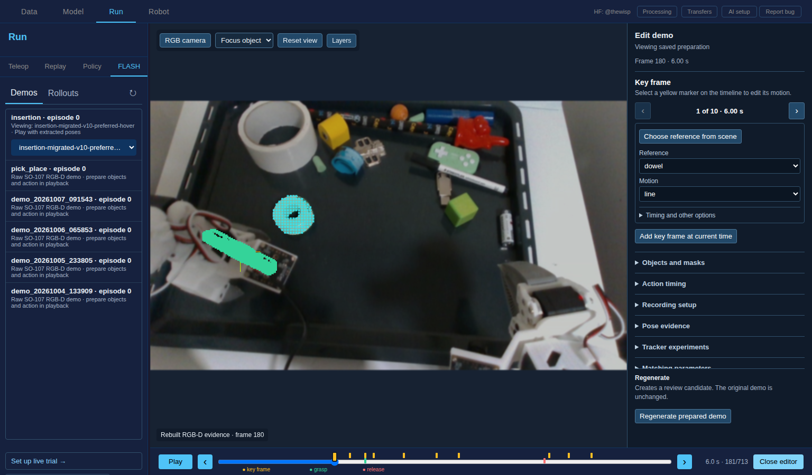
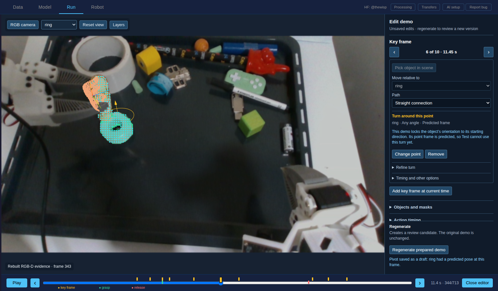

# FLASH scene editor, insertion demo

Captured 2026-10-28 from insertion episode 0, prepared version
`insertion-migrated-v10-preferred-hover`, in the Run → FLASH demo viewer.

The editor shows one selected key frame beside playback. Yellow timeline markers
select key frames, arrows move between them, and clicking a measured object opens
its mask controls. Other settings stay closed until requested.

In the camera-aligned 3D view, measured points from the saved masks and aligned
depth projected back to their RGB pixel locations. At frames 180, 291, and 450,
the maximum discrepancy across 85, 64, and 174 sampled masked depth pixels was
below `3e-13` display pixels. The browser reported no page errors. This checks
the renderer's camera projection and frame synchronization; it does not certify
the saved object pose, segmentation, or depth accuracy.

The GUI regression test in `tests/gui/test_flash_inspect.py` also exercises
clicking a measured 3D surface, changing a key frame's reference, and sending
that edit for preparation. The legacy importer tests check that the authored
reference changes the generated relation except in an explicit start-anchored
interval.

## Turn editor check, 2026-10-28

The browser interaction selected key frame 6, picked a point from the surface
labeled ring, and displayed the turn in the scene. The recording list disappears
while editing; angle limits and span are under **Refine turn**. A plain click did
not switch the camera into orbit mode, and the browser reported no page errors.

This is an editor preview, not a validated robot motion. The saved insertion
demo locks ring orientation to its baseline, so its accepted ring pose is marked
predicted at every frame. The preview warns that Test cannot use this point frame
yet. The cyan measured patch is on the green ring beneath the dowel; the blue
object farther right is a different object. This screenshot does not establish
the accuracy of the ring's predicted orientation.
