# Causal tracker comparison on the insertion demo

Captured 2026-10-21 on the local RTX 5090 rig, using frames 100–550 of episode 0 in `/home/feit/.cache/huggingface/lerobot/demos/insertion/recording/` (aligned 848×480 RGB-D at 30 Hz). The dataset and depth images remain local; the measurements and diagnostic images below are preserved here. No robot motion was commanded for this comparison.

## Inputs and scoring

The Point2Pose run used the pinned local fork `95bd7a8808fc1aaf015d510dffcccaa3c6971a9c` through the sealed bridge at `80d90b783`, initialized with the dowel or ring mask at frame 100. The prepared FLASH trace is `insertion-migrated-v7-02262e7ed866.npz`, made by the branch's causal SAM3 + DINO + RGB-D preparation. BundleSDF started from NVIDIA's `ffa67d425240b5b76d2e387a7dd3d3735a7cf1a1` checkout and received the sealed per-frame masks from `objects.npz`; a second dowel run received masks freshly emitted by this branch's SAM3 adapter. All methods read the same recorded RGB and metric depth, but their pose-fitting inputs differ. BundleSDF's final global NeRF pass was disabled; only pose files written during its online frame loop were scored.

The surface score is the 90th percentile distance from _currently segmented, depth-backed pixels_ to the frame-100 depth point cloud transformed by each pose. The same saved segmentation is used to score every method. It is a useful check for large pose drift, but it is **not 6D ground truth**: a single reference view lacks newly exposed surfaces, and a partial mask can hide an error. A lost pose has no score. The prepared trace stores an identity placeholder for lost poses; scoring that matrix would falsely report a large estimation error. BundleSDF frames logged as `FAIL` are likewise excluded even though its recorder writes a pose file for them.

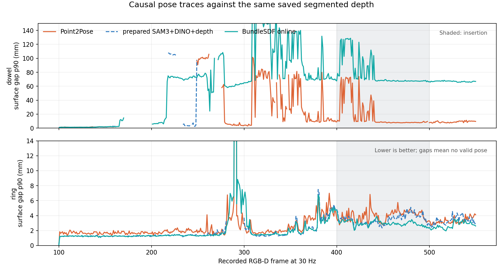

| Object and interval      | Point2Pose                             | BundleSDF online | Prepared SAM3 + DINO + depth |
| ------------------------ | -------------------------------------- | ---------------- | ---------------------------- |
| Dowel, pregrasp 100–149  | 50/50 poses; 1.4 mm median surface p90 | 50/50; 1.3 mm    | 50/50 observed; 1.3 mm       |
| Dowel, carry 300–399     | 97/100; 23.4 mm                        | 100/100; 89.3 mm | 0/100 observed               |
| Dowel, insertion 400–500 | 100/101; 8.6 mm                        | 101/101; 68.2 mm | 0/101 observed               |
| Ring, insertion 400–500  | 101/101; 4.1 mm                        | 101/101; 3.0 mm  | 101/101 predicted; 3.5 mm    |

The BundleSDF dowel trace loses the correct object pose after the grasp occlusion, then continues issuing poses with a large surface disagreement. Projecting the _same frame-100 points_ shows the divergence directly: cyan is BundleSDF, orange is Point2Pose, and green is the scoring mask.

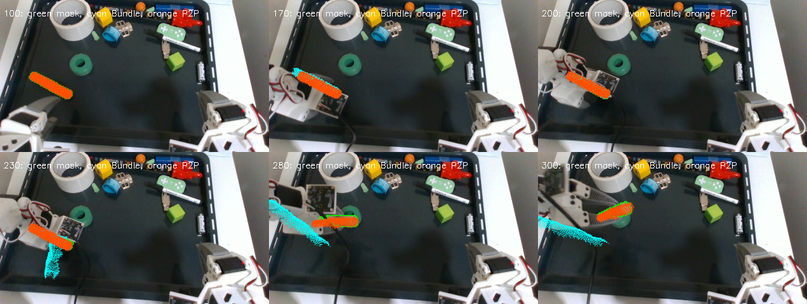

For the ring, Point2Pose and BundleSDF agree on the transformed reference-cloud center to a median 2.5 mm and on the ring's unoriented normal to 4.5° during insertion. The ring moves in the recording, so this is stronger than agreement on a stationary target. The prepared trace's ring poses are marked **predicted**; its surface fit does not establish direct ring observation.

A full 6D orientation difference is not automatically an insertion error: rotation around a cylindrical dowel's shaft is immaterial to fitting it through a round hole. To check the dimensions that matter, I estimated the dowel's shaft from the first-view depth cloud's principal axis and a candidate end from its 97th-percentile extent, then propagated that same point and axis with each tracker's online pose. On frames 400–500 where both emitted a pose, the trackers' candidate-end positions differ by a median **65.9 mm** and their _unoriented shaft axes_ by **72.5°**. This disagreement is not an axial-roll ambiguity. The point is a first-view geometric proxy, not a calibrated tip or independent ground truth; the image projection and surface score above supply the evidence that BundleSDF's branch is wrong in this interval.

## Segmentation and recovery checks

The current SAM3 adapter processed the 451 frames causally at 21.8 ms median and 23.5 ms p95 per frame after its first-frame load. Its dowel mask and the sealed Point2Pose mask have median intersection-over-union 0.88 during insertion. During grasp, the sealed mask is empty for 25 frames and SAM3's for 21. Both lose the dowel in the deepest occlusion; both outline it again during carry and insertion.

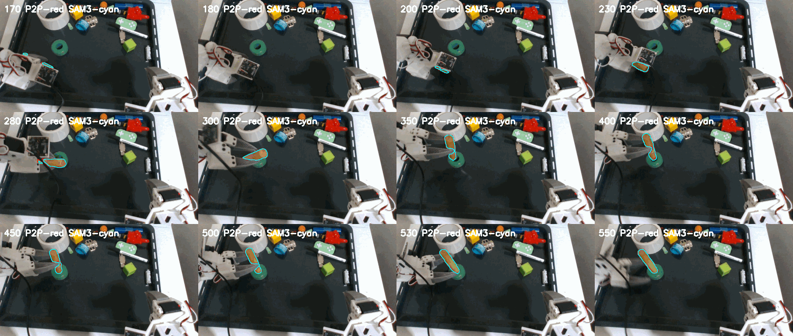

Changing BundleSDF's input to the current SAM3 masks did **not** recover the dowel in a causal frames-100–300 rerun. Against the same saved scoring mask, its surface gap was 106.7 mm at frame 230, 62.7 mm at frame 280, and 71.5 mm at frame 300. The sealed-mask run scored 71.7, 60.1 and 65.1 mm at those frames. This isolates the dominant failure to pose recovery after missing correspondence, rather than the small difference between these two masks.

A simple depth-PCA axis override was also tested and rejected. It reduced an apparent 23° visible-axis disagreement by construction but worsened held-out insertion surface p90 from 8.6 to 16.0 mm. The raw depth PCA included end caps and partial occlusion, so it was a biased axis proxy; forcing a full pose to match it was not justified.

## What the visible shaft still measures

The 23° figure above was **not** a measured Point2Pose orientation error. I re-estimated the dowel's 3D long axis from aligned depth under both saved mask streams, excluding the two axial ends before the final PCA. During frames 400–500, the median unoriented angle to Point2Pose's shaft changed from 19.2° using all SAM3-masked depth points to **2.5°** using the central 60% of points. Central 80% and 50% selections gave 2.9° and 3.3°. The sealed mask gave the same pattern (22.8° raw, 2.0° central 60%). These trims are diagnostic choices, not calibrated pose uncertainty; their agreement identifies the end-cap/occlusion bias in the original full-mask PCA.

An independent 2D check projects each proposed reference shaft into the image and compares its direction with the SAM3 mask's long direction, modulo 180°. Across insertion, the medians were **3.3° for Point2Pose**, **10.4° for a rigid-grasp prediction**, and **87.4° for BundleSDF**. The dowel mask is elongated here (median covariance eigenvalue ratio 11.6), so its long direction is a meaningful image constraint; this test would not carry the same weight for a nearly round silhouette. The rigid-grasp prediction was reconstructed from the frame-130 object pose and the dataset's frame-228 gripper pose, then propagated by recorded end-effector poses. The dataset camera/motor streams were associated by their nominal 30 Hz frame indices; shifting this association by up to three frames changed the median gripper-versus-Point2Pose task-end difference by under 0.5 mm and shaft difference by under 0.5°.

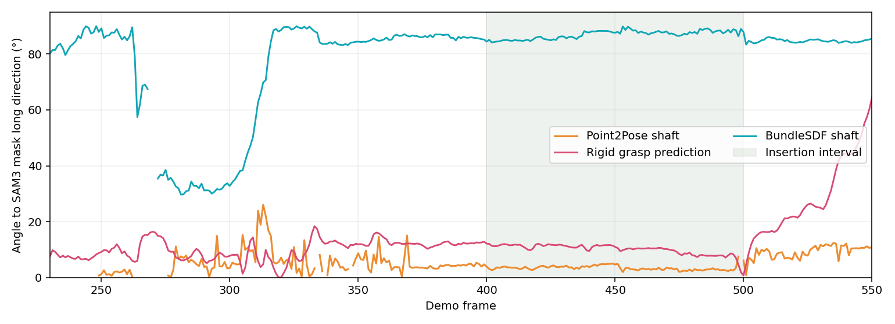

The insertion end is partly occluded at the ring, but the opposite end remains exposed. Using the visible SAM3-masked depth projected onto each pose's shaft, its 5th-percentile axial position differs from the corresponding first-view end by a median **0.7 mm for Point2Pose**, **17.2 mm for the rigid-grasp prediction**, and **78.6 mm for BundleSDF** during frames 400–500. This is a **one-dimensional consistency check**, not a 3D measurement of the hidden insertion tip. Inferring that tip still needs the learned end-to-end length, a centerline estimate, the chosen end identity and their uncertainty. The picture shows why keeping a pose state matters: the same learned dowel geometry projects to different insertion-end hypotheses under the two tracked attachments.

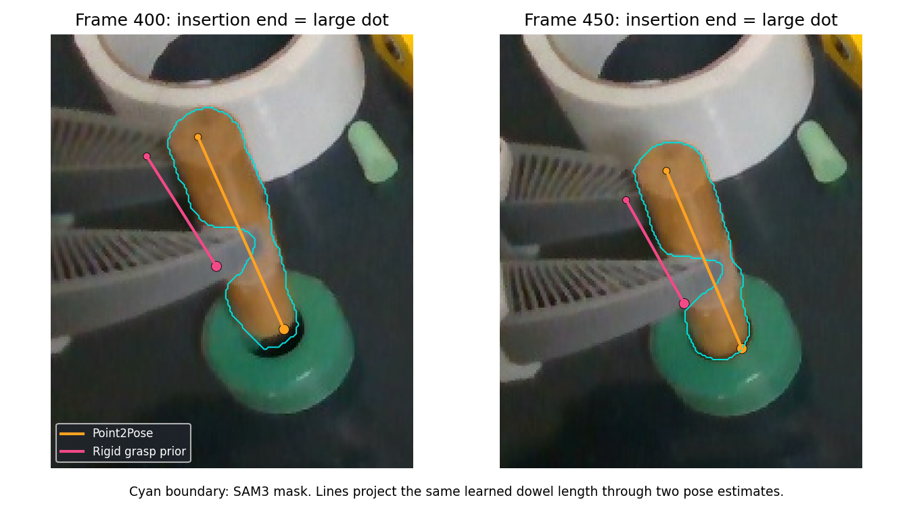

These checks reuse the recording's RGB-D and masks, so they are correlated with the trackers' inputs. They distinguish a catastrophic pose branch and show which parts of the carried object remain observable; they do not replace independent 3D tip labels or a physical insertion test.

## Earlier views and contact-depth quality

I tested whether the missing backside of the frame-100 reference, rather than pose drift, inflated the insertion surface score. The [reproducible analysis](analyze_multiview.py) unprojects SAM3-masked depth at frames 100, 300, 340 and 380 into the frame-100 object coordinates using the **causal Point2Pose poses at those earlier frames**. Frame-100 points are retained. A new point from the other three frames is retained only when it lies within 3 mm of a point from another source view. This two-view agreement check matters: concatenating all masked depths without verification included contact/background points and expanded the dowel model to roughly 126 × 154 × 139 mm. The checked model's bounding box is 96 × 58 × 44 mm, close to the first view's 94 × 55 × 39 mm. The 3 mm support radius is an ablation setting, **not** an object property or a calibrated acceptance rule.

Only frames **400–500** are scored, after every model-building view. This is causally held out in time, but not independent of Point2Pose: that tracker supplied the source-view registrations. Every candidate is scored against the same model and current SAM3-masked metric depth. As in the first comparison, this is a visible-surface consistency proxy, not a hidden-tip or full-pose label.

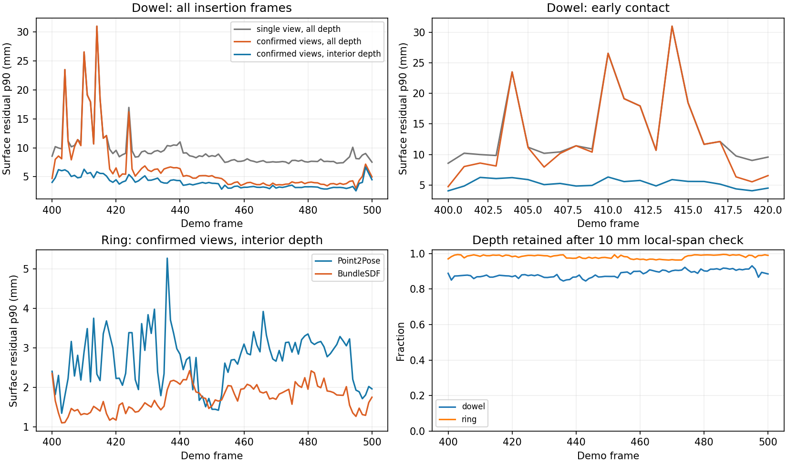

| Candidate, insertion frames            | Frame-100 model; all mask depth | Confirmed earlier-view model; all mask depth | Confirmed model; interior depth |
| -------------------------------------- | ------------------------------: | -------------------------------------------: | ------------------------------: |
| Dowel Point2Pose, 100 observed frames  |                          8.5 mm |                                       5.0 mm |                      **3.8 mm** |
| Dowel BundleSDF, 100 non-failed frames |                         68.0 mm |                                      68.0 mm |                     **66.5 mm** |
| Ring Point2Pose, 101 frames            |                          3.8 mm |                                       2.9 mm |                      **2.8 mm** |
| Ring BundleSDF, 101 frames             |                          2.4 mm |                                       1.8 mm |                      **1.7 mm** |

Values are medians of each frame's one-way 90th-percentile point-to-surface distance, in millimetres. BundleSDF fits the ring surface better in this replay; a source-name priority would miss that. The dowel's candidate from BundleSDF stays grossly inconsistent even with the richer map. The later-view map improves coverage, but it **does not** by itself correct a pose or prove that Point2Pose's hidden insertion end is accurate.

The sharp early-contact spikes were largely invalid depth at an RGB-mask/occluder boundary. A 3 × 3 neighborhood check rejects a pixel when local metric depth spans more than the stated threshold or includes missing depth. It changes Point2Pose's frame-414 dowel score from 31.0 mm with all depth to 5.9 mm with the confirmed map and a 10 mm local-span threshold; the confirmed map alone still scores 31.0 mm there. The 10 mm setting retains a median 87.9% of the dowel's and 98.7% of the ring's already mask-eroded depth pixels. Sensitivity on the same frames:

| Local depth-span limit | Dowel pixels retained | Dowel median surface p90 | Across-frame p90 of surface p90 |
| ---------------------- | --------------------: | -----------------------: | ------------------------------: |
| 5 mm                   |                 82.4% |                   3.7 mm |                          5.5 mm |
| 10 mm                  |                 87.9% |                   3.8 mm |                          5.6 mm |
| 20 mm                  |                 89.1% |                   3.9 mm |                          5.6 mm |

The smoother scores are not proof that the underlying pose improved: filtering changed the measurement, not the tracker. These settings have **not** been put into the live backend. A production depth-quality rule needs a sensor-noise basis, declared parameters, and tests that it does not discard essential thin contact surfaces. The current FLASH visible-surface check accepts every positive masked depth pixel, so this recording also shows why a single unqualified surface residual should not decide whether a partial pose is valid.

The first-view pose and its propagated object geometry remain necessary when the contact tip is hidden. The camera can correct the visible shaft and opposite end, but cannot directly observe the tip or assume the grasp did not slip. The next estimator should represent those constraints and their uncertainty separately; insertion should be judged at the predicted tip and shaft relative to the opening, ignoring physically irrelevant axial roll. Independent task-feature labels or a controlled physical trial are still required to certify the actual tip error.

## Reacquisition is evidence, not an instant full-pose reset

The fresh Point2Pose dowel run reports `lost` for frames **161–248** (88 frames) and again for **263–275** (13 frames). It resumes emitting a pose at frame 249. To see when that pose becomes useful, the [reacquisition analysis](analyze_reacquisition.py) compares its projected first-view surface with the aligned SAM3 mask/depth and with a rigid-grasp prediction from the recorded end-effector. The gripper prediction attaches the frame-130 object pose at the recorded frame-228 gripper pose; it is a prior, not an observed settled grasp.

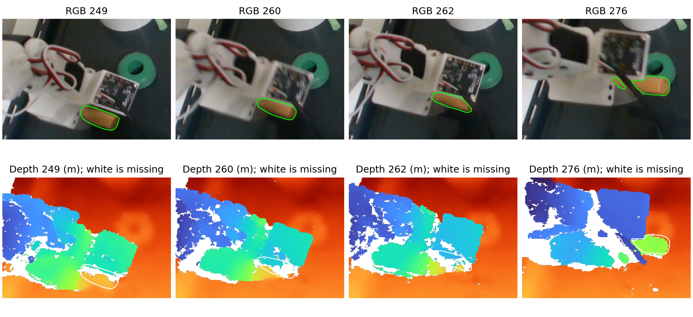

|   Frame | Mask pixels with valid depth | Point2Pose surface p90 | Rigid-grasp surface p90 | Interpretation                                                                                                                                                         |
| ------: | ---------------------------: | ---------------------: | ----------------------: | ---------------------------------------------------------------------------------------------------------------------------------------------------------------------- |
|     249 |                          64% |                 8.5 mm |                 24.6 mm | Partial depth favors Point2Pose, but the full pose remains incompletely observed.                                                                                      |
| 260–262 |                       48–40% |             100–110 mm |               92–104 mm | The mask still follows the RGB dowel, but much of its depth is missing and some remaining pixels lie on nearby gripper surfaces. Neither residual can validate a pose. |
|     276 |                          88% |                 3.8 mm |                 20.2 mm | Depth again supports the Point2Pose branch; even shifting camera/motor association by ±3 frames gives the gripper prior no better than 14.2 mm.                        |
|     280 |                          97% |                 4.5 mm |                 15.6 mm | The better supported branch persists.                                                                                                                                  |

The two candidate poses differ on the transformed first-view surface centre by 29.2 mm at frame 276. Applying the difference to the hidden contact end could substantially alter insertion; merely remembering the grasp-time attachment would not. But a mask alone does not supply metric depth, and one visible surface does not certify the hidden tip or axial end identity. The scene estimator needs to retain a pose **prediction** through the lost interval, then admit the observable components of the direct pose as depth and silhouette evidence return. It should record low depth coverage and disagreement instead of equating `observed` with fully verified.

I also tested a direct pose correction, rather than just a score change. The [partial-refit ablation](analyze_partial_refit.py) starts from Point2Pose on the 100 insertion frames with a pose, matches a confirmed earlier-view map to the **central 60%** of current depth points along its shaft, and withholds the two visible axial ends for validation. The trial uses 12 local ICP iterations, a 15 mm correspondence gate and the best 80% of gated matches; these are explicit experiment parameters, not deployed tuning. The middle-section residual improved in 59/100 frames, but the withheld ends improved in only **48/100**. The median paired change in their p90 residual was essentially zero (+0.007 mm), while the predicted insertion end moved a median 1.6 mm and as much as **13.0 mm**. The withheld ends are themselves sometimes occluded or depth-contaminated, so this is not a ground-truth tip-error test. It gives no basis to promote this naive full-pose refit over Point2Pose; a partial measurement update needs an observability model and stronger validation.

## Swapping masks inside Point2Pose can change the pose branch

I replayed the same 451 RGB-D frames and unchanged pinned Point2Pose fitter with its internal SAM2 masks or the current causal SAM3 masks. Both runs use the sealed mask at frame 100 for initialization; only masks at subsequent frames differ. The [replay-only adapter](p2p_external_mask_bridge.py) leaves the Point2Pose checkout and sealed bridge untouched. As a control, feeding the adapter **every mask saved from an internal SAM2 run** reproduced all 451 poses, loss flags, mask sizes and fit counts exactly. The outcome below is therefore a mask-history sensitivity of the tracker, not an adapter format or scheduling artifact.

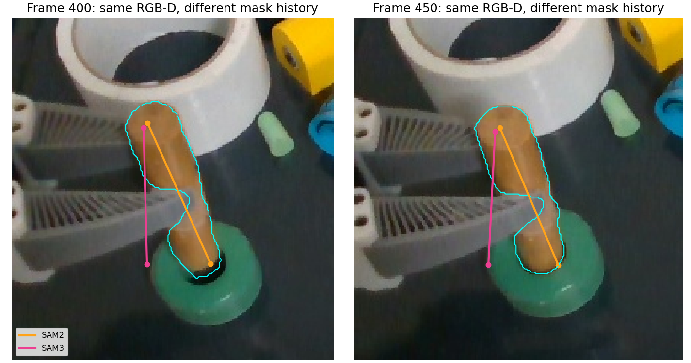

The cyan contour is the same SAM3 mask in both panels. The orange shaft is the SAM2-fed Point2Pose pose; the magenta shaft is its SAM3-fed pose, each projected from the same frame-100 reference geometry. At frame 249 the two poses coincide. By frame 250, with mask intersection-over-union **0.93**, their propagated reference-surface centres differ by **3.1 mm** and candidate ends by **8.6 mm**. Their pose histories later separate more: at insertion frames 400–500 the candidate-end gap grows from roughly **28 to 33 mm**, excluding an axial-roll explanation. The mask IoU is still 0.90 at frame 400 and 0.93 at frame 450.

| Input masks to Point2Pose | Dowel insertion surface p90 against frame-100 cloud | Dowel projected-axis error against SAM3 mask | Dowel lost frames, full replay | Ring insertion surface p90 | Ring lost frames |
| ------------------------- | --------------------------------------------------: | -------------------------------------------: | -----------------------------: | -------------------------: | ---------------: |
| Internal SAM2             |                                             7.50 mm |                                        3.30° |                            105 |                    3.76 mm |                0 |
| Causal SAM3               |                                            21.52 mm |                                       20.64° |                            101 |                    5.62 mm |                4 |

The insertion values are medians over frames 400–500 using the same SAM3-segmented RGB-D and a **10 mm local depth-span diagnostic filter**, with lost poses excluded. More fit correspondences did not mean a better pose. A diagnostic rerun preserving the fit pixels at the first divergence showed that frame 249 has **the same eight fitted image coordinates and pose** in both streams, although the tracked-point pools already contain 50 versus 47 points. At frame 250, only **11 of 16 fitted coordinates match** between streams; Point2Pose's mask-gated point selection then feeds different correspondence sets into its frame-to-map RANSAC/SVD registration. This identifies the immediate route from mask history to pose divergence. It does not identify which earlier changed point or later map update makes the wrong branch persist.

At frame 272 the SAM3-fed dowel had 13 fit inliers versus six for the SAM2-fed run and returned a pose four frames earlier after the second loss. The saved fitted pixels had valid and locally smooth depth, yet the resulting orientation later contradicted the visible shaft. A feature-poor cylindrical surface admits ambiguous solutions, and a small change in mask history can alter data association, keyframes or recovery. Setting the existing Point2Pose `map_growth_gate` to `true` produced a bit-identical SAM3-fed trajectory in this replay, so that switch is not an observed remedy.

An alternative branch should not certify itself through an object map made with the same erroneous poses. Here it does **not** even pass that weak self-consistency test. Using SAM3-masked views at frames 100, 300, 340 and 380, independently building a two-view-confirmed map under each candidate history, then scoring the later frames against identical current depth gives:

| Earlier-view map built with | SAM2-fed pose, insertion median surface p90 | SAM3-fed pose, insertion median surface p90 |
| --------------------------- | ------------------------------------------: | ------------------------------------------: |
| SAM2-fed poses              |                                     3.83 mm |                                    19.51 mm |
| SAM3-fed poses              |                                     5.96 mm |                                    21.52 mm |

These scores are visible-surface consistency checks, not independent hidden-tip labels. The [ablation script](analyze_p2p_mask_ablation.py) reproduces the scores and figure from the saved [frame-level traces](p2p_dowel_sam3_100_550.npz) and local RGB-D/masks; [frame-level scores](p2p_mask_ablation.csv) retain the rejected branch. The Point2Pose times measured inside its step were about 60 ms median with SAM2 and 45 ms with supplied SAM3 masks; the latter **excludes** SAM3 inference and transfer, so this is not an end-to-end speed comparison. No mask source should be promoted on segmentation IoU or fit-inlier count alone. Keep multiple candidate poses, reject those inconsistent with the current measured silhouette/depth, and carry uncertainty through full occlusion. Because the contact tip can be hidden, keep its pose as a propagated hypothesis from object geometry and the gripper relationship; never label it directly observed on these frames.

The current silhouette and depth can already resolve the large insertion divergence **without a source-name preference**. On all 100 insertion frames where both dowel candidates emitted a pose, the SAM2-fed candidate had both a smaller depth-surface residual and a smaller projected-shaft angle error against the same current SAM3 mask. The median margins were **13.6 mm** and **17.0°**; even the smallest paired margins were **9.7 mm** and **10.8°**. The mask is elongated here, so its major axis is meaningful. Repeating the score with the internal SAM2 masks also favors the SAM2-fed pose on **all 100 shared insertion frames**: median surface p90 is 7.74 versus 22.05 mm, and median projected-axis error is 3.21° versus 20.85°. This result is not an artifact of choosing SAM3 as the scoring outline. The internal masks can be regenerated by running the [replay script](run_p2p_external_mask.py) with `--mask-source internal --save-masks`; they remain local with the RGB-D recording.

A two-criterion Pareto comparison therefore favors that pose on these frames. Around reacquisition, the evidence is less conclusive: on frames 249–280 with both candidates, eight favor SAM2, two favor SAM3, and six trade depth against shaft alignment; sixteen lack one candidate. The estimator must preserve that ambiguity rather than force an early full-pose switch. These are offline comparisons of already generated proposals. The present live scene estimator does **not** perform this arbitration, and the measurements remain correlated with the candidates' input images rather than independent pose ground truth.

I also passed the saved poses through FLASH's existing [`surface_support`](../../../src/lerobot/policies/flash/pose_disagreement.py) diagnostic, without changing it. It projects the frame-100 point cloud into the current camera and reports mask coverage and depth residual at supported projected points. On the 100 shared insertion frames, the SAM2-fed pose dominates on **both existing fields** every time: median projected mask fraction **0.706 versus 0.223**, median projected-point depth p90 **19.5 versus 28.7 mm**. That depth residual includes partially occluded and back-side model points, so it is a relative diagnostic, not a claim of 19.5 mm tip error. Across frames 249–280, the same check gives five SAM2-dominant, one SAM3-dominant, ten tradeoffs and sixteen missing-candidate frames. The [replay check](check_live_pose_support.py) and [frame-level results](live_pose_support.csv) preserve this result. In the current service this diagnostic is invoked only for a direct pose conflicting with an already verified group prediction; it is **not** a general scene-estimator decision over multiple tracker candidates. The work needed is candidate ownership and event-time arbitration, then validation against independent task-feature labels, rather than a dowel-specific scoring constant.

## A lone reported pose can be contradicted by free space

The [causal ray-consistency replay](analyze_ray_consistency.py) z-buffers the same first-view object points under each candidate pose. A valid measured depth **farther** than the predicted front surface contradicts that pose at the pixel; a closer measurement may simply be an occluder. A 3 × 3 depth-neighborhood check excludes missing or discontinuous measurements. The following diagnostics use a 5 mm depth difference and a 10 mm local depth-span setting, both stated experiment choices rather than deployed thresholds.

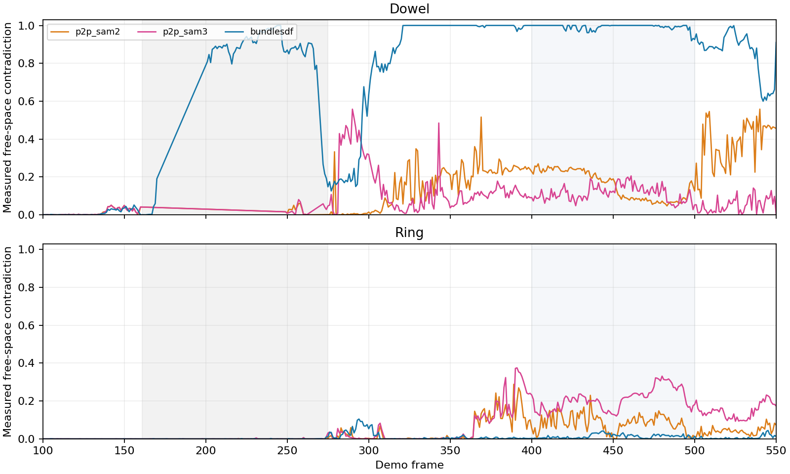

The gray span marks grasp occlusion and early reacquisition; pale blue marks insertion.

| Object and phase             | Point2Pose with SAM2 masks | Point2Pose with SAM3 masks | BundleSDF |
| ---------------------------- | -------------------------: | -------------------------: | --------: |
| Dowel, reacquisition 249–280 |                       2.7% |                       2.5% | **85.8%** |
| Dowel, insertion 400–500     |                      17.3% |                      11.4% |  **100%** |
| Ring, insertion 400–500      |                       8.2% |                      21.1% |  **1.2%** |

Values are median fractions of valid projected pixels over frames where each source emitted a pose, **not** pose-error rates. The BundleSDF dowel branch exceeds 50% contradiction by frame 201 and does so in 323 scored frames with at least 100 valid projected pixels; at frame 263 it reports the only dowel pose, but **90.8% of 1,802** depth-quality-checked projected pixels contradict it. With 3, 5 or 10 mm depth differences, its median reacquisition contradiction stays between **85.0% and 86.0%**. An estimator should not promote a lone candidate merely because it is the only backend to return a transform. When both Point2Pose branches are lost, it needs a labeled prediction or unknown state, not false direct evidence from BundleSDF.

The ring result goes the other way: BundleSDF's insertion pose has the lowest free-space contradiction and, as measured above, slightly better visible-surface fit. Yet free-space alone is **not** a sufficient dowel selector. During insertion the SAM3-fed Point2Pose branch has fewer contradicted projected pixels even though its shaft projection and current segmented-surface fit are much worse. The first-view cloud is incomplete, and a pose can reduce contradictions by projecting fewer points into the visible object. Its low contradiction rate therefore cannot validate the hidden tip. The [frame-level ray scores](ray_consistency.csv) retain all three tolerance settings and the valid pixel counts; none of these sources has independent full-pose or contact-tip ground truth in this recording.

## Full-resolution point seeding restores the fast motion path, with limits

I replayed FLASH's [causal RGB-D rigid point tracker](../../../src/lerobot/policies/flash/causal_points.py) on every frame, seeding from a SAM3 mask and then tracking without new masks. Before the [small-object seed fix](../../../tests/policies/flash/test_flash_causal_points.py), its configured half-resolution path detected corners **after** shrinking the image. On this recording that left too few points for a rigid pose. The code now detects seed corners at camera resolution and maps them into the configured tracking resolution; the registration and inlier rule are unchanged. A synthetic small-object test fails under the old seeding path and passes with the new one.

| Mask seed and interval | Old half-resolution seed | Full-resolution seed, half-resolution tracking | Full-resolution seed and tracking |
| ---------------------- | -----------------------: | ---------------------------------------------: | --------------------------------: |
| Dowel, 100→170         |     12 points; 1/70 fits |                          81 points; 63/70 fits |             81 points; 59/70 fits |
| Dowel, 380→500         |                Not saved |                    52 points; **120/120 fits** |           52 points; 119/120 fits |
| Ring, 300→500          |     7 points; 0/200 fits |                    29 points; **200/200 fits** |       29 points; **200/200 fits** |

The `downsampledseed` control traces were generated with the prior tracker code at `ebe836b82`; the other traces use the full-resolution seed change.

Fit availability is not pose accuracy. The [scored traces](analyze_causal_points.py) carry each seed's independently estimated pose forward using only point motion from consecutive frames. During insertion, a dowel point track seeded at frame 380 from Point2Pose has median visible-surface p90 **7.69 mm** at full tracking resolution and **7.86 mm** at half, versus **7.50 mm** for direct Point2Pose. Its projected-shaft error is **3.4°** at full resolution versus Point2Pose's **3.3°**, and their propagated candidate contact ends differ by **2.3 mm median**. These are correlations with another candidate and the current image, not true hidden-tip accuracy. The full-resolution object-tracker update took **8.4 ms median** after RGB-D was read. A separate scene-point-only replay with 800 points took **4.3 ms median** at full resolution versus **2.2 ms** at half; this is not a whole-system 30 Hz benchmark.

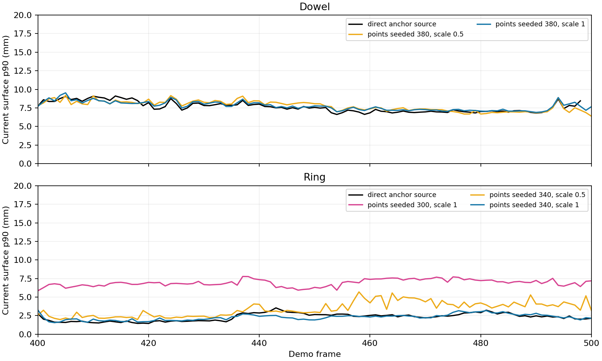

For the ring, a full-resolution point track seeded from BundleSDF at frame **340** fits on all 160 later frames and scores **2.29 mm** median surface p90 during insertion, close to BundleSDF's direct **2.38 mm**. A frame-**300** seed also fits on all 200 later frames, yet scores **6.94 mm** during insertion. Its initial BundleSDF pose already scores **6.2 mm** at frame 300; a good relative-motion fit cannot correct that absolute anchor. Half-resolution tracking from the frame-340 seed remains available but scores **3.21 mm**. This supports re-anchoring the fast path from validated direct poses without making a source name permanently authoritative.

The dowel point track also shows why a long series of fits cannot certify an occluded contact end. At frame 500, its full-resolution visible opposite-end axial residual is about **−6.3 mm**, versus **+0.9 mm** for the freshly observed Point2Pose pose, despite 12 point-fit inliers and a better-looking image-axis angle. Point2Pose is **lost at frame 499**, so its stored matrix there is not an observed comparison. These visible-end scores are imperfect under contact occlusion, but they reveal a late discrepancy that median insertion surface fit hides. The estimator must continually test the attachment and task-end geometry, not freeze either source's pose after seeding. The [per-frame scores](causal_points_score.csv) and [causal point traces](points_dowel_380_500_scale1.npz) preserve the comparison; other seed/scale traces in this directory show the failure and recovery cases. The current insertion rig configuration and example now select full-resolution tracking for the next live evaluation; no physical act was run for this change.

## A visible shaft constrains a hidden end, but does not replace pose

I tested a causal **RGB-D-only end hypothesis** on the partly occluded insertion views. It takes the current SAM3-masked depth, estimates the long axis from the middle 60% of visible points, chooses its sign using the prior gripper orientation, locates the exposed axial end, then extends it by the dowel length learned from the first view. Point2Pose plays no part in that hypothesis; its emitted pose is used only as a comparison. The 10 mm depth-neighborhood limit and 5th-percentile exposed-end choice are diagnostic settings, not deployed object rules. The [script](analyze_hidden_tip_observability.py) and [frame-level data](hidden_tip_observability.csv) preserve the experiment.

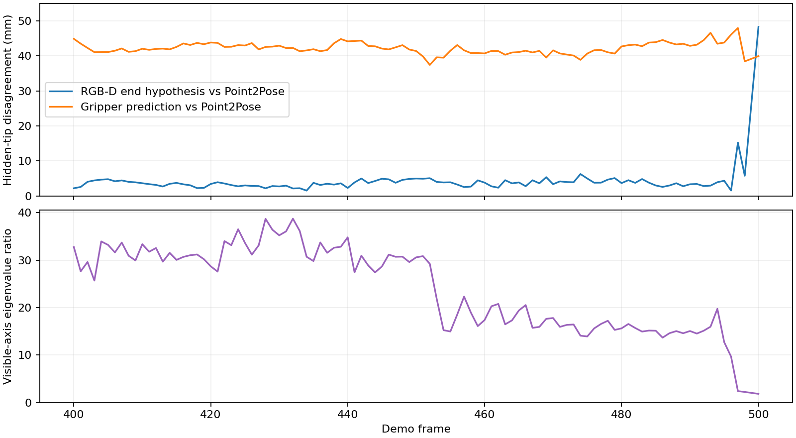

On the 100 insertion frames where Point2Pose emitted a pose, the current-depth long axis differs from its axis by **2.65° median**. The extended hidden-end hypothesis differs from Point2Pose's hidden end by **3.70 mm median, 4.95 mm p90**. By comparison, a fixed grasp-time gripper attachment differs by **42.08 mm median** in 3D on these frames. These are **hypothesis disagreements, not errors against a labeled tip**. In particular, the current depth points lie on the front surface rather than the centerline: the inferred exposed 3D end itself differs from Point2Pose's end by **6.41 mm median**, despite the earlier one-dimensional axial check agreeing much better. The smaller hidden-end gap partly reflects error cancellation and cannot certify the inferred contact point.

The depth fit loses a clear long axis near the end of insertion. Its middle-section principal-eigenvalue ratio drops from roughly 15–35 over most frames to **2.41 at frame 497** and **1.84 at frame 500**; the corresponding hidden-end disagreement rises to **15.3 and 48.3 mm**. Point2Pose was lost at frame 499, which is excluded rather than scoring its placeholder transform. This is why retaining a pose and end identity through occlusion matters. Current pixels should constrain the observable shaft or end when the shape is informative; a weak or absent view must leave the hidden end as a propagated hypothesis with wider uncertainty, not a newly measured tip.

## Runtime and compatibility boundaries

The Point2Pose bridge reported roughly 60 ms median frame time in this recording. The compatible BundleSDF dowel pass took about 190 s for 451 frames, including online reconstruction and debug output; the ring pass took about 88 s. These are observed experiment times, **not** matched implementation speed benchmarks. To run the old BundleSDF source on this CUDA 12.8 / Python 3.11 / PCL 1.12 machine, the isolated checkout changed CUDA architecture and binding compatibility, used OpenCV's CPU brute-force L2 descriptor matcher instead of its unavailable CUDA module, removed an upstream `pdb.set_trace()`, and guarded percentile denoising on empty masks. None of those changes was made in FLASH or the GUI server.

[TrackEverything](https://github.com/ayushjain1144/trackeverything) now has released code and an API for supplied RGB-D/camera geometry, but it produces point trajectories rather than object poses. Its default 16-frame window sees future frames within each window; the [authors' FAQ](https://github.com/ayushjain1144/trackeverything/blob/main/docs/faq.md) describes shorter four-frame windows and an experimental growing-buffer mode. Its published checkpoint returned `GatedRepo` to this machine's authenticated Hugging Face account on 2026-10-21, so no TrackEverything accuracy or speed result is claimed here.

The CSV files in this directory hold the frame-level measurements, including [image-axis residuals](mask_projected_axis.csv), [depth-axis ablations](depth_axis_trim.csv), [visible-end axial residuals](observed_end_axial_residual.csv), the [multiview/depth-quality ablation](multiview_depth_ablation.csv), [reacquisition scores](reacquisition_score.csv) and [partial-refit scores](partial_refit_score.csv). Re-run the latter three scripts with `--dataset /home/feit/.cache/huggingface/lerobot/demos/insertion/recording --masks /home/feit/.cache/flash-tracker-compare/sam3_masks --output /tmp/flash-analysis`; the source dataset and generated SAM3 masks are local, not committed. [pose_traces.npz](pose_traces.npz) preserves the per-frame transforms, evidence flags, camera intrinsics, calibration transform, recorded gripper poses and first-view dowel features used for these projections. No tested tracker was checked against independent 6D pose labels, and no new physical insertion was attempted. The visible drift establishes a failure case; it does not establish that any remaining tracker is accurate enough for unattended insertion.
