# Causal tracker comparison on the insertion demo

Captured 2026-10-21 on the local RTX 5090 rig, using frames 100–550 of episode 0 in `/home/feit/.cache/huggingface/lerobot/demos/insertion/recording/` (aligned 848×480 RGB-D at 30 Hz). The dataset and depth images remain local; the measurements and diagnostic images below are preserved here. No robot motion was commanded for this comparison.

## Inputs and scoring

The Point2Pose run used the pinned local fork `95bd7a8808fc1aaf015d510dffcccaa3c6971a9c` through the sealed bridge at `80d90b783`, initialized with the dowel or ring mask at frame 100. The prepared FLASH trace is `insertion-migrated-v7-02262e7ed866.npz`, made by the branch's causal SAM3 + DINO + RGB-D preparation. BundleSDF started from NVIDIA's `ffa67d425240b5b76d2e387a7dd3d3735a7cf1a1` checkout and received the sealed per-frame masks from `objects.npz`; a second dowel run received masks freshly emitted by this branch's SAM3 adapter. All methods read the same recorded RGB and metric depth, but their pose-fitting inputs differ. BundleSDF's final global NeRF pass was disabled; only pose files written during its online frame loop were scored.

The surface score is the 90th percentile distance from _currently segmented, depth-backed pixels_ to the frame-100 depth point cloud transformed by each pose. The same saved segmentation is used to score every method. It is a useful check for large pose drift, but it is **not 6D ground truth**: a single reference view lacks newly exposed surfaces, and a partial mask can hide an error. A lost pose has no score. The prepared trace stores an identity placeholder for lost poses; scoring that matrix would falsely report a large estimation error. BundleSDF frames logged as `FAIL` are likewise excluded even though its recorder writes a pose file for them.

| Object and interval      | Point2Pose                             | BundleSDF online | Prepared SAM3 + DINO + depth |
| ------------------------ | -------------------------------------- | ---------------- | ---------------------------- |
| Dowel, pregrasp 100–149  | 50/50 poses; 1.4 mm median surface p90 | 50/50; 1.3 mm    | 50/50 observed; 1.3 mm       |
| Dowel, carry 300–399     | 97/100; 23.4 mm                        | 100/100; 89.3 mm | 0/100 observed               |
| Dowel, insertion 400–500 | 100/101; 8.6 mm                        | 101/101; 68.2 mm | 0/101 observed               |
| Ring, insertion 400–500  | 101/101; 4.1 mm                        | 101/101; 3.0 mm  | 101/101 predicted; 3.5 mm    |

The BundleSDF dowel trace loses the correct object pose after the grasp occlusion, then continues issuing poses with a large surface disagreement. Projecting the _same frame-100 points_ shows the divergence directly: cyan is BundleSDF, orange is Point2Pose, and green is the scoring mask.

For the ring, Point2Pose and BundleSDF agree on the transformed reference-cloud center to a median 2.5 mm and on the ring's unoriented normal to 4.5° during insertion. The ring moves in the recording, so this is stronger than agreement on a stationary target. The prepared trace's ring poses are marked **predicted**; its surface fit does not establish direct ring observation.

A full 6D orientation difference is not automatically an insertion error: rotation around a cylindrical dowel's shaft is immaterial to fitting it through a round hole. To check the dimensions that matter, I estimated the dowel's shaft from the first-view depth cloud's principal axis and a candidate end from its 97th-percentile extent, then propagated that same point and axis with each tracker's online pose. On frames 400–500 where both emitted a pose, the trackers' candidate-end positions differ by a median **65.9 mm** and their _unoriented shaft axes_ by **72.5°**. This disagreement is not an axial-roll ambiguity. The point is a first-view geometric proxy, not a calibrated tip or independent ground truth; the image projection and surface score above supply the evidence that BundleSDF's branch is wrong in this interval.

## Segmentation and recovery checks

The current SAM3 adapter processed the 451 frames causally at 21.8 ms median and 23.5 ms p95 per frame after its first-frame load. Its dowel mask and the sealed Point2Pose mask have median intersection-over-union 0.88 during insertion. During grasp, the sealed mask is empty for 25 frames and SAM3's for 21. Both lose the dowel in the deepest occlusion; both outline it again during carry and insertion.

Changing BundleSDF's input to the current SAM3 masks did **not** recover the dowel in a causal frames-100–300 rerun. Against the same saved scoring mask, its surface gap was 106.7 mm at frame 230, 62.7 mm at frame 280, and 71.5 mm at frame 300. The sealed-mask run scored 71.7, 60.1 and 65.1 mm at those frames. This isolates the dominant failure to pose recovery after missing correspondence, rather than the small difference between these two masks.

A simple depth-PCA axis override was also tested and rejected. It reduced an apparent 23° visible-axis disagreement by construction but worsened held-out insertion surface p90 from 8.6 to 16.0 mm. The raw depth PCA included end caps and partial occlusion, so it was a biased axis proxy; forcing a full pose to match it was not justified.

## What the visible shaft still measures

The 23° figure above was **not** a measured Point2Pose orientation error. I re-estimated the dowel's 3D long axis from aligned depth under both saved mask streams, excluding the two axial ends before the final PCA. During frames 400–500, the median unoriented angle to Point2Pose's shaft changed from 19.2° using all SAM3-masked depth points to **2.5°** using the central 60% of points. Central 80% and 50% selections gave 2.9° and 3.3°. The sealed mask gave the same pattern (22.8° raw, 2.0° central 60%). These trims are diagnostic choices, not calibrated pose uncertainty; their agreement identifies the end-cap/occlusion bias in the original full-mask PCA.

An independent 2D check projects each proposed reference shaft into the image and compares its direction with the SAM3 mask's long direction, modulo 180°. Across insertion, the medians were **3.3° for Point2Pose**, **10.4° for a rigid-grasp prediction**, and **87.4° for BundleSDF**. The dowel mask is elongated here (median covariance eigenvalue ratio 11.6), so its long direction is a meaningful image constraint; this test would not carry the same weight for a nearly round silhouette. The rigid-grasp prediction was reconstructed from the frame-130 object pose and the dataset's frame-228 gripper pose, then propagated by recorded end-effector poses. The dataset camera/motor streams were associated by their nominal 30 Hz frame indices; shifting this association by up to three frames changed the median gripper-versus-Point2Pose task-end difference by under 0.5 mm and shaft difference by under 0.5°.

The insertion end is partly occluded at the ring, but the opposite end remains exposed. Using the visible SAM3-masked depth projected onto each pose's shaft, its 5th-percentile axial position differs from the corresponding first-view end by a median **0.7 mm for Point2Pose**, **17.2 mm for the rigid-grasp prediction**, and **78.6 mm for BundleSDF** during frames 400–500. This is a **one-dimensional consistency check**, not a 3D measurement of the hidden insertion tip. Inferring that tip still needs the learned end-to-end length, a centerline estimate, the chosen end identity and their uncertainty. The picture shows why keeping a pose state matters: the same learned dowel geometry projects to different insertion-end hypotheses under the two tracked attachments.

These checks reuse the recording's RGB-D and masks, so they are correlated with the trackers' inputs. They distinguish a catastrophic pose branch and show which parts of the carried object remain observable; they do not replace independent 3D tip labels or a physical insertion test.

## Earlier views and contact-depth quality

I tested whether the missing backside of the frame-100 reference, rather than pose drift, inflated the insertion surface score. The [reproducible analysis](analyze_multiview.py) unprojects SAM3-masked depth at frames 100, 300, 340 and 380 into the frame-100 object coordinates using the **causal Point2Pose poses at those earlier frames**. Frame-100 points are retained. A new point from the other three frames is retained only when it lies within 3 mm of a point from another source view. This two-view agreement check matters: concatenating all masked depths without verification included contact/background points and expanded the dowel model to roughly 126 × 154 × 139 mm. The checked model's bounding box is 96 × 58 × 44 mm, close to the first view's 94 × 55 × 39 mm. The 3 mm support radius is an ablation setting, **not** an object property or a calibrated acceptance rule.

Only frames **400–500** are scored, after every model-building view. This is causally held out in time, but not independent of Point2Pose: that tracker supplied the source-view registrations. Every candidate is scored against the same model and current SAM3-masked metric depth. As in the first comparison, this is a visible-surface consistency proxy, not a hidden-tip or full-pose label.

| Candidate, insertion frames            | Frame-100 model; all mask depth | Confirmed earlier-view model; all mask depth | Confirmed model; interior depth |
| -------------------------------------- | ------------------------------: | -------------------------------------------: | ------------------------------: |
| Dowel Point2Pose, 100 observed frames  |                          8.5 mm |                                       5.0 mm |                      **3.8 mm** |
| Dowel BundleSDF, 100 non-failed frames |                         68.0 mm |                                      68.0 mm |                     **66.5 mm** |
| Ring Point2Pose, 101 frames            |                          3.8 mm |                                       2.9 mm |                      **2.8 mm** |
| Ring BundleSDF, 101 frames             |                          2.4 mm |                                       1.8 mm |                      **1.7 mm** |

Values are medians of each frame's one-way 90th-percentile point-to-surface distance, in millimetres. BundleSDF fits the ring surface better in this replay; a source-name priority would miss that. The dowel's candidate from BundleSDF stays grossly inconsistent even with the richer map. The later-view map improves coverage, but it **does not** by itself correct a pose or prove that Point2Pose's hidden insertion end is accurate.

The sharp early-contact spikes were largely invalid depth at an RGB-mask/occluder boundary. A 3 × 3 neighborhood check rejects a pixel when local metric depth spans more than the stated threshold or includes missing depth. It changes Point2Pose's frame-414 dowel score from 31.0 mm with all depth to 5.9 mm with the confirmed map and a 10 mm local-span threshold; the confirmed map alone still scores 31.0 mm there. The 10 mm setting retains a median 87.9% of the dowel's and 98.7% of the ring's already mask-eroded depth pixels. Sensitivity on the same frames:

| Local depth-span limit | Dowel pixels retained | Dowel median surface p90 | Across-frame p90 of surface p90 |
| ---------------------- | --------------------: | -----------------------: | ------------------------------: |
| 5 mm                   |                 82.4% |                   3.7 mm |                          5.5 mm |
| 10 mm                  |                 87.9% |                   3.8 mm |                          5.6 mm |
| 20 mm                  |                 89.1% |                   3.9 mm |                          5.6 mm |

The smoother scores are not proof that the underlying pose improved: filtering changed the measurement, not the tracker. These settings have **not** been put into the live backend. A production depth-quality rule needs a sensor-noise basis, declared parameters, and tests that it does not discard essential thin contact surfaces. The current FLASH visible-surface check accepts every positive masked depth pixel, so this recording also shows why a single unqualified surface residual should not decide whether a partial pose is valid.

The first-view pose and its propagated object geometry remain necessary when the contact tip is hidden. The camera can correct the visible shaft and opposite end, but cannot directly observe the tip or assume the grasp did not slip. The next estimator should represent those constraints and their uncertainty separately; insertion should be judged at the predicted tip and shaft relative to the opening, ignoring physically irrelevant axial roll. Independent task-feature labels or a controlled physical trial are still required to certify the actual tip error.

## Reacquisition is evidence, not an instant full-pose reset

The fresh Point2Pose dowel run reports `lost` for frames **161–248** (88 frames) and again for **263–275** (13 frames). It resumes emitting a pose at frame 249. To see when that pose becomes useful, the [reacquisition analysis](analyze_reacquisition.py) compares its projected first-view surface with the aligned SAM3 mask/depth and with a rigid-grasp prediction from the recorded end-effector. The gripper prediction attaches the frame-130 object pose at the recorded frame-228 gripper pose; it is a prior, not an observed settled grasp.

|   Frame | Mask pixels with valid depth | Point2Pose surface p90 | Rigid-grasp surface p90 | Interpretation                                                                                                                                                         |
| ------: | ---------------------------: | ---------------------: | ----------------------: | ---------------------------------------------------------------------------------------------------------------------------------------------------------------------- |
|     249 |                          64% |                 8.5 mm |                 24.6 mm | Partial depth favors Point2Pose, but the full pose remains incompletely observed.                                                                                      |
| 260–262 |                       48–40% |             100–110 mm |               92–104 mm | The mask still follows the RGB dowel, but much of its depth is missing and some remaining pixels lie on nearby gripper surfaces. Neither residual can validate a pose. |
|     276 |                          88% |                 3.8 mm |                 20.2 mm | Depth again supports the Point2Pose branch; even shifting camera/motor association by ±3 frames gives the gripper prior no better than 14.2 mm.                        |
|     280 |                          97% |                 4.5 mm |                 15.6 mm | The better supported branch persists.                                                                                                                                  |

The two candidate poses differ on the transformed first-view surface centre by 29.2 mm at frame 276. Applying the difference to the hidden contact end could substantially alter insertion; merely remembering the grasp-time attachment would not. But a mask alone does not supply metric depth, and one visible surface does not certify the hidden tip or axial end identity. The scene estimator needs to retain a pose **prediction** through the lost interval, then admit the observable components of the direct pose as depth and silhouette evidence return. It should record low depth coverage and disagreement instead of equating `observed` with fully verified.

I also tested a direct pose correction, rather than just a score change. The [partial-refit ablation](analyze_partial_refit.py) starts from Point2Pose on the 100 insertion frames with a pose, matches a confirmed earlier-view map to the **central 60%** of current depth points along its shaft, and withholds the two visible axial ends for validation. The trial uses 12 local ICP iterations, a 15 mm correspondence gate and the best 80% of gated matches; these are explicit experiment parameters, not deployed tuning. The middle-section residual improved in 59/100 frames, but the withheld ends improved in only **48/100**. The median paired change in their p90 residual was essentially zero (+0.007 mm), while the predicted insertion end moved a median 1.6 mm and as much as **13.0 mm**. The withheld ends are themselves sometimes occluded or depth-contaminated, so this is not a ground-truth tip-error test. It gives no basis to promote this naive full-pose refit over Point2Pose; a partial measurement update needs an observability model and stronger validation.

## Swapping masks inside Point2Pose can change the pose branch

I replayed the same 451 RGB-D frames and unchanged pinned Point2Pose fitter with its internal SAM2 masks or the current causal SAM3 masks. Both runs use the sealed mask at frame 100 for initialization; only masks at subsequent frames differ. The [replay-only adapter](p2p_external_mask_bridge.py) leaves the Point2Pose checkout and sealed bridge untouched. As a control, feeding the adapter **every mask saved from an internal SAM2 run** reproduced all 451 poses, loss flags, mask sizes and fit counts exactly. The outcome below is therefore a mask-history sensitivity of the tracker, not an adapter format or scheduling artifact.

The cyan contour is the same SAM3 mask in both panels. The orange shaft is the SAM2-fed Point2Pose pose; the magenta shaft is its SAM3-fed pose, each projected from the same frame-100 reference geometry. At frame 249 the two poses coincide. By frame 250, with mask intersection-over-union **0.93**, their propagated reference-surface centres differ by **3.1 mm** and candidate ends by **8.6 mm**. Their pose histories later separate more: at insertion frames 400–500 the candidate-end gap grows from roughly **28 to 33 mm**, excluding an axial-roll explanation. The mask IoU is still 0.90 at frame 400 and 0.93 at frame 450.

| Input masks to Point2Pose | Dowel insertion surface p90 against frame-100 cloud | Dowel projected-axis error against SAM3 mask | Dowel lost frames, full replay | Ring insertion surface p90 | Ring lost frames |
| ------------------------- | --------------------------------------------------: | -------------------------------------------: | -----------------------------: | -------------------------: | ---------------: |
| Internal SAM2             |                                             7.50 mm |                                        3.30° |                            105 |                    3.76 mm |                0 |
| Causal SAM3               |                                            21.52 mm |                                       20.64° |                            101 |                    5.62 mm |                4 |

The insertion values are medians over frames 400–500 using the same SAM3-segmented RGB-D and a **10 mm local depth-span diagnostic filter**, with lost poses excluded. More fit correspondences did not mean a better pose. A diagnostic rerun preserving the fit pixels at the first divergence showed that frame 249 has **the same eight fitted image coordinates and pose** in both streams, although the tracked-point pools already contain 50 versus 47 points. At frame 250, only **11 of 16 fitted coordinates match** between streams; Point2Pose's mask-gated point selection then feeds different correspondence sets into its frame-to-map RANSAC/SVD registration. This identifies the immediate route from mask history to pose divergence. It does not identify which earlier changed point or later map update makes the wrong branch persist.

At frame 272 the SAM3-fed dowel had 13 fit inliers versus six for the SAM2-fed run and returned a pose four frames earlier after the second loss. The saved fitted pixels had valid and locally smooth depth, yet the resulting orientation later contradicted the visible shaft. A feature-poor cylindrical surface admits ambiguous solutions, and a small change in mask history can alter data association, keyframes or recovery. Setting the existing Point2Pose `map_growth_gate` to `true` produced a bit-identical SAM3-fed trajectory in this replay, so that switch is not an observed remedy.

An alternative branch should not certify itself through an object map made with the same erroneous poses. Here it does **not** even pass that weak self-consistency test. Using SAM3-masked views at frames 100, 300, 340 and 380, independently building a two-view-confirmed map under each candidate history, then scoring the later frames against identical current depth gives:

| Earlier-view map built with | SAM2-fed pose, insertion median surface p90 | SAM3-fed pose, insertion median surface p90 |
| --------------------------- | ------------------------------------------: | ------------------------------------------: |
| SAM2-fed poses              |                                     3.83 mm |                                    19.51 mm |
| SAM3-fed poses              |                                     5.96 mm |                                    21.52 mm |

These scores are visible-surface consistency checks, not independent hidden-tip labels. The [ablation script](analyze_p2p_mask_ablation.py) reproduces the scores and figure from the saved [frame-level traces](p2p_dowel_sam3_100_550.npz) and local RGB-D/masks; [frame-level scores](p2p_mask_ablation.csv) retain the rejected branch. The Point2Pose times measured inside its step were about 60 ms median with SAM2 and 45 ms with supplied SAM3 masks; the latter **excludes** SAM3 inference and transfer, so this is not an end-to-end speed comparison. No mask source should be promoted on segmentation IoU or fit-inlier count alone. Keep multiple candidate poses, reject those inconsistent with the current measured silhouette/depth, and carry uncertainty through full occlusion. Because the contact tip can be hidden, keep its pose as a propagated hypothesis from object geometry and the gripper relationship; never label it directly observed on these frames.

The current silhouette and depth can already resolve the large insertion divergence **without a source-name preference**. On all 100 insertion frames where both dowel candidates emitted a pose, the SAM2-fed candidate had both a smaller depth-surface residual and a smaller projected-shaft angle error against the same current SAM3 mask. The median margins were **13.6 mm** and **17.0°**; even the smallest paired margins were **9.7 mm** and **10.8°**. The mask is elongated here, so its major axis is meaningful. Repeating the score with the internal SAM2 masks also favors the SAM2-fed pose on **all 100 shared insertion frames**: median surface p90 is 7.74 versus 22.05 mm, and median projected-axis error is 3.21° versus 20.85°. This result is not an artifact of choosing SAM3 as the scoring outline. The internal masks can be regenerated by running the [replay script](run_p2p_external_mask.py) with `--mask-source internal --save-masks`; they remain local with the RGB-D recording.

A two-criterion Pareto comparison therefore favors that pose on these frames. Around reacquisition, the evidence is less conclusive: on frames 249–280 with both candidates, eight favor SAM2, two favor SAM3, and six trade depth against shaft alignment; sixteen lack one candidate. The estimator must preserve that ambiguity rather than force an early full-pose switch. These are offline comparisons of already generated proposals. The present live scene estimator does **not** perform this arbitration, and the measurements remain correlated with the candidates' input images rather than independent pose ground truth.

I also passed the saved poses through FLASH's existing [`surface_support`](../../../src/lerobot/policies/flash/pose_disagreement.py) diagnostic, without changing it. It projects the frame-100 point cloud into the current camera and reports mask coverage and depth residual at supported projected points. On the 100 shared insertion frames, the SAM2-fed pose dominates on **both existing fields** every time: median projected mask fraction **0.706 versus 0.223**, median projected-point depth p90 **19.5 versus 28.7 mm**. That depth residual includes partially occluded and back-side model points, so it is a relative diagnostic, not a claim of 19.5 mm tip error. Across frames 249–280, the same check gives five SAM2-dominant, one SAM3-dominant, ten tradeoffs and sixteen missing-candidate frames. The [replay check](check_live_pose_support.py) and [frame-level results](live_pose_support.csv) preserve this result. The service now uses this diagnostic for both direct/group and supported direct/point conflicts, but it still lacks general ownership and event-time arbitration over **multiple independent direct backends**. That is the remaining integration work, followed by validation against independent task-feature labels rather than a dowel-specific scoring constant.

The **initial mask alone** is also enough to choose a very different Point2Pose branch. I replayed Point2Pose twice with the exact sealed configuration from `80d90b783`, its internal SAM2 mask propagation and identical RGB-D, changing only the frame-100 initializer from the sealed mask to this branch's SAM3 mask. Those initial masks overlap at **0.917 IoU**. The sealed-mask rerun matched the saved 100–300 control poses, loss flags, mask sizes and inlier counts **exactly**; repeating the SAM3-initialized run also reproduced its first 201 frames exactly. Both then used Point2Pose's own causal SAM2 updates, so their later mask histories are consequences of that first-frame change.

The [SAM3-initialized trace](p2p_dowel_sam3_initial_100_550.npz) and [same-frame scoring script](analyze_p2p_initial_mask.py) show the effect. On the 100 insertion frames where both branches emitted a pose, the sealed initializer had **7.50 mm median** visible-surface p90 versus **75.71 mm** for the SAM3 initializer, scored against the same current SAM3-masked depth. The latter projected into measured free space on a median **84%** of reliable model rays versus **17%** for the sealed initializer. The candidate-end proxies were **130.93 mm apart** on median. The sealed initializer dominated the alternative on surface fit, projected shaft and free-space checks in 93/100 shared insertion frames; seven were tradeoffs. The [frame-level scores](p2p_initial_mask_comparison.csv) preserve every comparison. These are strong visible contradictions of the alternative, but the hidden end still lacks independent truth. They show why adding a nominally good tracker is insufficient without validated initialization and multiple pose hypotheses.

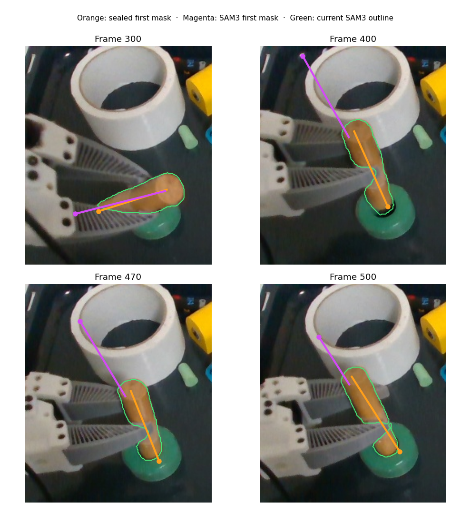

The ring's two initial masks overlap at **0.912 IoU**. Its sealed-mask control also reproduced the saved trace exactly through frame 300. With only the ring's initial mask changed, insertion median surface p90 rose from **3.76 to 7.42 mm**, median free-space contradiction from **8.2% to 26.9%**, and the proposed reference center differed by **5.05 mm**. The sealed initializer dominated the [alternative trace](p2p_ring_sam3_initial_100_550.npz) on both visible checks in **all 101 insertion frames**; [frame-level ring scores](p2p_ring_initial_mask_comparison.csv) are saved. The ring remains tracked, but the first mask still affects metric accuracy.

The service's current two-field [`compare_pose_proposals`](../../../src/lerobot/policies/flash/pose_disagreement.py) would **not** reliably resolve the dowel initializer branches: using the same first-view point cloud, it marks 98/100 shared insertion frames ambiguous. The sealed branch projects a median 71% of its model pixels onto masked depth versus 9% for the alternative, but its depth residual conditional on those supported projections is 19.5 mm versus the alternative's 12.7 mm on a much smaller subset. This conditional residual rewards a bad branch for explaining only a sliver of the object. The opposite-direction observed-depth-to-model score and the one-sided free-space check expose that failure. A multi-candidate estimator needs those visible checks with explicit depth/model validity, while retaining ambiguity where they disagree; simply plugging Point2Pose into the current two-field arbitration would not solve initialization. The [comparison CSV](p2p_initial_mask_comparison.csv) includes both the extended visible checks and this existing service verdict for every frame.

## A lone reported pose can be contradicted by free space

The [causal ray-consistency replay](analyze_ray_consistency.py) z-buffers the same first-view object points under each candidate pose. A valid measured depth **farther** than the predicted front surface contradicts that pose at the pixel; a closer measurement may simply be an occluder. A 3 × 3 depth-neighborhood check excludes missing or discontinuous measurements. The following diagnostics use a 5 mm depth difference and a 10 mm local depth-span setting, both stated experiment choices rather than deployed thresholds.

The gray span marks grasp occlusion and early reacquisition; pale blue marks insertion.

| Object and phase             | Point2Pose with SAM2 masks | Point2Pose with SAM3 masks | BundleSDF |
| ---------------------------- | -------------------------: | -------------------------: | --------: |
| Dowel, reacquisition 249–280 |                       2.7% |                       2.5% | **85.8%** |
| Dowel, insertion 400–500     |                      17.3% |                      11.4% |  **100%** |
| Ring, insertion 400–500      |                       8.2% |                      21.1% |  **1.2%** |

Values are median fractions of valid projected pixels over frames where each source emitted a pose, **not** pose-error rates. The BundleSDF dowel branch exceeds 50% contradiction by frame 201 and does so in 323 scored frames with at least 100 valid projected pixels; at frame 263 it reports the only dowel pose, but **90.8% of 1,802** depth-quality-checked projected pixels contradict it. With 3, 5 or 10 mm depth differences, its median reacquisition contradiction stays between **85.0% and 86.0%**. An estimator should not promote a lone candidate merely because it is the only backend to return a transform. When both Point2Pose branches are lost, it needs a labeled prediction or unknown state, not false direct evidence from BundleSDF.

The ring result goes the other way: BundleSDF's insertion pose has the lowest free-space contradiction and, as measured above, slightly better visible-surface fit. Yet free-space alone is **not** a sufficient dowel selector. During insertion the SAM3-fed Point2Pose branch has fewer contradicted projected pixels even though its shaft projection and current segmented-surface fit are much worse. The first-view cloud is incomplete, and a pose can reduce contradictions by projecting fewer points into the visible object. Its low contradiction rate therefore cannot validate the hidden tip. The [frame-level ray scores](ray_consistency.csv) retain all three tolerance settings and the valid pixel counts; none of these sources has independent full-pose or contact-tip ground truth in this recording.

## Full-resolution point seeding restores the fast motion path, with limits

I replayed FLASH's [causal RGB-D rigid point tracker](../../../src/lerobot/policies/flash/causal_points.py) on every frame, seeding from a SAM3 mask and then tracking without new masks. Before the [small-object seed fix](../../../tests/policies/flash/test_flash_causal_points.py), its configured half-resolution path detected corners **after** shrinking the image. On this recording that left too few points for a rigid pose. The code now detects seed corners at camera resolution and maps them into the configured tracking resolution; the registration and inlier rule are unchanged. A synthetic small-object test fails under the old seeding path and passes with the new one.

| Mask seed and interval | Old half-resolution seed | Full-resolution seed, half-resolution tracking | Full-resolution seed and tracking |
| ---------------------- | -----------------------: | ---------------------------------------------: | --------------------------------: |
| Dowel, 100→170         |     12 points; 1/70 fits |                          81 points; 63/70 fits |             81 points; 59/70 fits |
| Dowel, 380→500         |                Not saved |                    52 points; **120/120 fits** |           52 points; 119/120 fits |
| Ring, 300→500          |     7 points; 0/200 fits |                    29 points; **200/200 fits** |       29 points; **200/200 fits** |

The `downsampledseed` control traces were generated with the prior tracker code at `ebe836b82`; the other traces use the full-resolution seed change.

Fit availability is not pose accuracy. The [scored traces](analyze_causal_points.py) carry each seed's independently estimated pose forward using only point motion from consecutive frames. During insertion, a dowel point track seeded at frame 380 from Point2Pose has median visible-surface p90 **7.69 mm** at full tracking resolution and **7.86 mm** at half, versus **7.50 mm** for direct Point2Pose. Its projected-shaft error is **3.4°** at full resolution versus Point2Pose's **3.3°**, and their propagated candidate contact ends differ by **2.3 mm median**. These are correlations with another candidate and the current image, not true hidden-tip accuracy. The full-resolution object-tracker update took **8.4 ms median** after RGB-D was read. A separate scene-point-only replay with 800 points took **4.3 ms median** at full resolution versus **2.2 ms** at half; this is not a whole-system 30 Hz benchmark.

For the ring, a full-resolution point track seeded from BundleSDF at frame **340** fits on all 160 later frames and scores **2.29 mm** median surface p90 during insertion, close to BundleSDF's direct **2.38 mm**. A frame-**300** seed also fits on all 200 later frames, yet scores **6.94 mm** during insertion. Its initial BundleSDF pose already scores **6.2 mm** at frame 300; a good relative-motion fit cannot correct that absolute anchor. Half-resolution tracking from the frame-340 seed remains available but scores **3.21 mm**. This supports re-anchoring the fast path from validated direct poses without making a source name permanently authoritative.

The dowel point track also shows why a long series of fits cannot certify an occluded contact end. At frame 500, its full-resolution visible opposite-end axial residual is about **−6.3 mm**, versus **+0.9 mm** for the freshly observed Point2Pose pose, despite 12 point-fit inliers and a better-looking image-axis angle. Point2Pose is **lost at frame 499**, so its stored matrix there is not an observed comparison. These visible-end scores are imperfect under contact occlusion, but they reveal a late discrepancy that median insertion surface fit hides. The estimator must continually test the attachment and task-end geometry, not freeze either source's pose after seeding. The [per-frame scores](causal_points_score.csv) and [causal point traces](points_dowel_380_500_scale1.npz) preserve the comparison; other seed/scale traces in this directory show the failure and recovery cases. The current insertion rig configuration and example now select full-resolution tracking for the next live evaluation; no physical act was run for this change.

## How long the fast motion path can carry a pose

To measure a useful correction interval, I seeded an independent full-resolution point track **every five frames** during insertion. Each track then consumed only consecutive RGB-D frames; its future direct poses were withheld until scoring. The [replay script](analyze_reanchor_horizon.py) and [per-seed measurements](reanchor_horizon.csv) include the failures, not just successful tracks. For the dowel, the task point is the same learned first-view candidate end used above; for the ring, it is the first-view surface center. A normal/shaft comparison ignores the physically irrelevant sign of each principal axis.

| Object | Future interval | Tracks with a rigid fit | Median task-point disagreement with withheld direct pose | 90th percentile |
| ------ | --------------: | ----------------------: | -------------------------------------------------------: | --------------: |
| Dowel  |        5 frames |                   20/20 |                                                  1.14 mm |         2.08 mm |
| Dowel  |       20 frames |                   17/17 |                                                  1.77 mm |         2.72 mm |
| Dowel  |       60 frames |                     9/9 |                                                  2.21 mm |         4.28 mm |
| Ring   |        5 frames |                   20/20 |                                                  0.62 mm |         1.30 mm |
| Ring   |       20 frames |                   17/17 |                                                  0.93 mm |         2.01 mm |
| Ring   |       60 frames |                     9/9 |                                                  0.93 mm |         1.51 mm |

These are **agreements with Point2Pose for the dowel and BundleSDF for the ring**, not ground-truth pose errors. The sample count falls at longer horizons because fewer seeds have that many subsequent frames. A fresh direct pose can itself be wrong, so a large difference is a conflict to investigate rather than automatic proof that point motion drifted.

That distinction matters near the end of insertion. Point2Pose's candidate dowel end moves **16.2 mm from frame 497 to 498**, then **23.8 and 24.6 mm** on the 500→501 and 501→502 steps. The recorded end effector has no translation on 497→498, and the current SAM3-masked depth median shifts only **2.6 mm**; a physical slip is possible at contact, so these alone do not establish truth. The [same-frame overlay](late_pose_jump.png) shows the direct shaft jumping between pose branches while a frame-430 point track stays visually continuous. Orange is Point2Pose, cyan is point motion, and green is the current SAM3 mask. Point2Pose is lost at frame 499, so no orange line is drawn there.

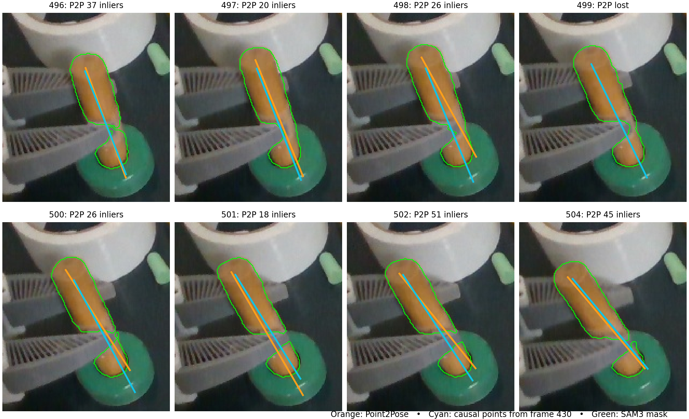

The [current RGB-D comparison](analyze_temporal_pose_conflict.py) scores both candidates using depth-backed surface p90, the projected visible shaft angle and a free-space contradiction fraction. The point-motion branch is better on **all three** at frame 498 (8.18 versus 8.45 mm, 1.43° versus 7.51°, 7.6% versus 18.0%), and also at frames 502–503. Earlier, direct Point2Pose dominates 34 of 66 frames while 32 are tradeoffs. At frames 500–501 the checks trade off; they do not independently label the hidden tip. The [scores](temporal_pose_conflict.csv) and [point trace](points_dowel_430_510_scale1.npz) make these comparisons reproducible. More Point2Pose fit inliers at frame 498 did **not** protect it from this pose-branch jump.

A strict three-score Pareto acceptance rule is **not** enough for a running estimator. In a [causal arbitration replay](simulate_causal_arbitration.py), accepting a direct update only when it dominates all three checks reanchors just **3 of 66** stable pre-contact updates. The unreanchored point path then drifts about 9–10 mm from the direct branch by frame 496. A 5 mm task-end agreement gate accepts the stable updates and holds the disputed late branch, but a 10 mm gate accepts a questionable frame-502 correction. Those are ablation settings, **not** a calibrated production rule or evidence to hardcode either number.

FLASH already has a [surface comparison](../../../src/lerobot/policies/flash/pose_disagreement.py) for a direct pose versus a verified group prediction. I first replayed **that exact rule** against a direct pose and the causal point-motion prediction, using the existing 5 mm point-fit threshold and the object cloud's measured radius to define angular agreement. It accepts **65/66** dowel updates through frame 496, then marks the 497–503 direct updates ambiguous or prior-favored and accepts the close-agreement frame 504. On the ring, it accepts **all 74** tested updates and therefore does not replace BundleSDF's stronger absolute anchor. The [ablation code](simulate_existing_surface_policy.py), [dowel decisions](existing_surface_policy_dowel.csv) and [ring decisions](existing_surface_policy_ring.csv) preserve that controlled result.

The rule is now also applied at the causal service's **source-frame direct/point reanchor**, after its existing direct/group check. A point prediction may dispute a direct pose only when its tracked source pixels still overlap the object's same-frame mask and its motion fit succeeded. If the subsequent surface comparison has too little depth support, the conflict remains unresolved rather than silently choosing either pose. Annotated axial symmetry is canonicalized before comparing or publishing. Ambiguous and prior-favored direct fits remain recorded as proposals; they do not reset a supported point track. Accepted delayed direct observations are delivered to the held-attachment updater at their original image time, even if the latest published pose is already a newer point prediction. This is a general evidence rule, with no object-name branch in the runtime.

The [causal service replay](replay_causal_service_insertion.py) fed recorded Point2Pose dowel and BundleSDF ring proposals into the **actual FLASH causal service** for every RGB-D frame 430–504. Its [per-frame state](causal_service_every_frame.csv) and [direct/point decisions](causal_service_every_frame_decisions.csv) show 66 agreeing dowel corrections, six ambiguous and one prior-favored late correction, and direct reacquisition at frame 504; the ring retained all 75 received direct observations and its verified group relation. With proposals every other frame arriving three camera frames late, the [delayed replay](causal_service_delay3_stride2.csv) accepted 34/38 dowel proposals, withheld four ambiguous ones, and accepted all 38 ring proposals. Causal frame processing took 13.45 ms median / 14.82 ms p95 in the every-frame replay, excluding recorded-video reads, direct pose generation and the robot loop. These are service timings, **not** complete live-loop FPS. A real RGB-D contact-frame test protects the dowel rejection and ring acceptance, and the full FLASH test suite passed. These results do not verify the present live SAM3+DINO backend, independent hidden-tip accuracy, or physical insertion; those remain the next validation boundaries.

### The full demo exposes a correlated-pose failure

The short replay starts after the dowel has been reacquired. Replaying **all frames 100–550** through the same service changes the outcome. With the sealed Point2Pose initializer, the dowel has 255 accepted direct proposals and 91 unresolved direct/point conflicts; the ring retains 451 direct proposals. At frame 498, where the short replay had a point prediction to dispute Point2Pose's late jump, the full replay has **no source-frame point-motion record**. It accepts the direct jump. The point path's protection thus depends on its earlier seed and survival, and the short replay did not establish full-sequence robustness. The [full state](causal_service_full_sealed_init.csv), [decisions](causal_service_full_sealed_init_decisions.csv), [point support](causal_service_full_sealed_init_point_support.csv) and [accepted poses](causal_service_full_sealed_init.npz) preserve the event history.

Changing only Point2Pose's first mask to SAM3 produces a more serious case. The [alternative full replay](causal_service_full_sam3_init.csv) carries the wrong dowel pose into insertion: direct and point-motion paths can agree because the point track inherited the same bad anchor. The accepted pose is not made accurate by two correlated votes. The alternative direct trace's insertion visible-surface p90 is **75.71 mm median**, versus **7.50 mm** with the sealed initializer, and their candidate contact ends are **130.93 mm apart**. Neither end is independently labeled, but the visible evidence strongly contradicts the alternative. Its [decisions](causal_service_full_sam3_init_decisions.csv), [point support](causal_service_full_sam3_init_point_support.csv) and [accepted poses](causal_service_full_sam3_init.npz) are retained separately.

I added a **diagnostic-only** one-sided check in the causal service. It z-buffers the measured first-view object points under each source-frame direct pose and compares them with the aligned depth at the same pixels. A farther measured surface means the proposed object surface occupies measured free space; a nearer surface may be an occluder and does not convict the pose. Missing depth and local depth discontinuities are excluded. The [scoring script](analyze_signed_free_space.py) uses the existing rig's 5 mm fit tolerance, 10 mm local-depth span and 10 mm pose-disagreement tolerance; reusing these values makes the replay reproducible but **does not calibrate a final acceptance policy**. On insertion frames 400–500 it flags **101/101** SAM3-initialized dowel proposals, **0/100** sealed-initialized dowel proposals, and neither ring branch. The [dowel](dowel_signed_free_space.csv) and [ring](ring_signed_free_space.csv) frame scores expose both the useful rejection and the cases with insufficient depth. The live tracker panel and saved replay now record this contradiction without changing pose ownership. A real RGB-D fixture protects the diagnostic against this dowel failure and against treating an ordinary nearer occluder as contradiction.

This check is not a full pose verifier: the separately tested Point2Pose path driven by successive SAM3 masks can be wrong while its projected model mostly falls behind measured surfaces, so a **one-sided** test misses it. Nor would rejecting the wrong direct pose automatically repair a point track descended from that pose. The next estimator needs alternative pose lineages with their own provenance, measured-surface and silhouette support, and explicit invalidation or recovery when an anchor is contradicted. It should surface unresolved contact-end uncertainty instead of publishing a confidently wrong transform. No physical act was run for these full-sequence diagnostics.

### Same-frame evidence across a causal pose bank

I scored four saved **causal** complete-pose candidates for each object against the **same current** SAM3 mask and aligned depth: Point2Pose with its sealed initializer and internal SAM2 masks, Point2Pose with only its initializer changed to SAM3, Point2Pose fed SAM3 masks every frame, and BundleSDF's online pose. Every candidate uses the same frame-100 depth cloud for scoring; neither a candidate's own learned map nor later frames can score it. These candidates are not independent votes: they share RGB-D, some masks and sometimes initialization. The [bank replay](analyze_pose_hypothesis_bank.py) and [frame-level dowel](dowel_pose_hypothesis_bank.csv) and [ring](ring_pose_hypothesis_bank.csv) scores record the full comparison. All figures below measure **visible consistency**, not independent 6D or hidden-tip ground truth.

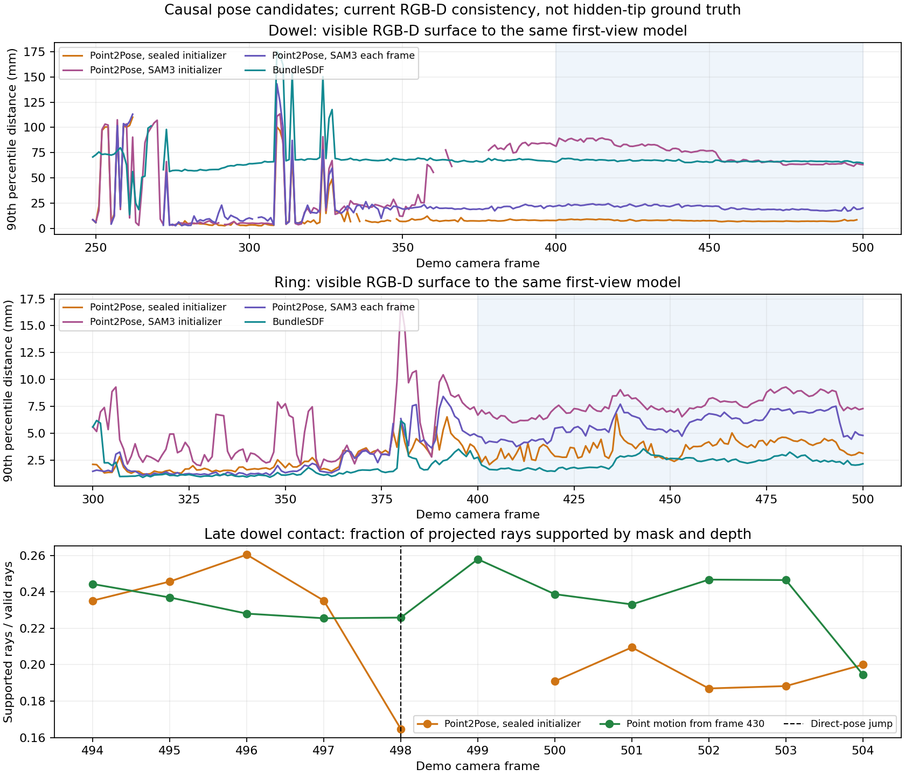

For the dowel's insertion frames 400–500, the sealed Point2Pose branch has the lower observed-depth-to-model 90th-percentile distance **and** the higher projected mask coverage on every one of the **100 frames** where it and each alternative are both available. Median visible-surface scores are **7.50 mm** sealed, **21.52 mm** with SAM3 each frame, **75.59 mm** with only the SAM3 initializer changed, and **66.51 mm** for BundleSDF. The first two criteria therefore separate all three wrong-looking alternatives here without a dowel-specific score or arbitrary weighted sum. During reacquisition the candidates frequently trade criteria or disappear; the same evidence cannot safely claim a fully observed pose then.

For the ring, BundleSDF has the lowest median visible-surface score in insertion, **2.38 mm**, versus **3.76 mm** for sealed Point2Pose, but surface-plus-mask Pareto comparison is undecided on **48/101** shared frames. A second shape-neutral check counts projected model rays whose current mask and metric depth support the proposed surface, and rays contradicted by measured free space. Comparing observed-surface distance, supported-ray fraction and contradicted-ray fraction favors BundleSDF on **88/101** frames, favors sealed Point2Pose on **5**, and leaves **8** tradeoffs. This supports source-neutral selection for the ring while retaining uncertainty on the remaining frames. Because those fractions divide by valid projected rays, a candidate projecting little geometry can still look deceptively good; the pixel counts are recorded alongside them and no probability of pose correctness is inferred.

I added the independent frame-430 dowel point track as a **fifth** candidate only for frames 431–504. Its [derived pose trace](point_dowel_430_510_pose_trace.npz) is the saved point motion multiplied by Point2Pose's frame-430 pose; it is therefore **correlated with that anchor**. At the direct-pose jump on frame **498**, the point branch has a smaller visible-surface residual (**8.18 versus 8.45 mm**), more supported rays (**22.6% versus 16.5%**) and fewer contradicted rays (**7.6% versus 18.0%**). The three-field ray comparison favors point motion. Projected mask coverage alone misleadingly favors the jumping direct pose (**74.4% versus 64.4%**), because overlap does not verify depth or object ownership. At frames 500 and 504 the ray evidence trades off, so it does not license freezing the point branch indefinitely. The [contact-frame bank](dowel_pose_hypothesis_bank_contact.csv) records all five proposals, including the direct tracker being lost on frame 499.

That frame-498 **surface ranking is sensitive to the reference-cloud construction**. The bank uses a one-pixel-eroded, 3,739-point first view. FLASH's recorded service fixture instead has all 4,164 first-view mask points. On the same current depth and the same two poses, the service cloud scores direct **8.056 mm** and point motion **8.075 mm**: direct appears better by just **0.020 mm** and has greater projected-mask coverage. Under the eroded cloud, point motion is better by **0.270 mm**. Of 100 deterministic random 90%-size subsamples of the service cloud, three reverse the full-cloud ranking; at 25% size, 62 favor point motion. The [sampling check](analyze_reference_sampling_sensitivity.py) and [all scores](reference_sampling_sensitivity.csv) preserve the variants. The full-cloud conditional projected-depth residual still favors point motion (**13.58 versus 21.82 mm**), and its measured free-space contradiction is lower (**12.2% versus 23.3%**). Thus the visible checks conflict; the surface difference alone cannot justify replacing the current unresolved verdict with a direct-pose acceptance. This does not prove the point branch's hidden tip is correct. The extra nearest-surface check took about **8.5 ms per two-pose comparison** on the recorded fixture, so it remains an offline diagnostic rather than new work in the live perception path.

Using a **causal, two-view-confirmed map** built from frames 100, 300, 340 and 380 reduces both candidates' current-surface residuals: direct **6.66 mm**, point motion **5.77 mm**. But its ray contradiction changes direction, now **14.1%** for direct versus **20.3%** for point motion, while projected-mask coverage still favors direct (**87.5% versus 80.3%**). The 9,845-point map contains more real sides of the object and also depends on the earlier Point2Pose registrations. A single-view cloud is incomplete; a larger map is not an independent 6D label and can project points that are occluded or slightly misregistered. These conflicting factors call for a visibility-aware likelihood with model uncertainty, then a task-point uncertainty check before insertion, not an uncalibrated sum of three scores.

Retaining **both** frame-498 pose branches reveals evidence that a one-frame decision would miss. I propagated each candidate with the same saved causal point motion and scored frames 499–504 against their own current RGB-D, without using a future frame to make an earlier estimate. Under the service's first-view model, all three surface/ray/mask fields jointly favor point motion by frame **504**; earlier frames trade fields. Under the confirmed prior-view map, they already jointly favor point motion at **499** and at **501–504**. This [delayed-evidence replay](analyze_delayed_branch_evidence.py) and its [per-frame scores](delayed_branch_evidence.csv) support keeping unresolved lineages available for later verification, rather than irrevocably collapsing a contact-time conflict. They still cannot establish which branch puts the hidden dowel end in the hole, because the same point-motion source transports both and no independent tip label exists.

This experiment identifies usable observation factors, **not a deployed multi-hypothesis estimator**. A runtime implementation still has to preserve candidate lineage through occlusion, handle asynchronous source-frame arrivals, avoid double-counting shared anchors, determine when a solitary candidate is contradicted rather than merely unmatched, and propagate each surviving pose into a distribution over the hidden contact end. The 30 Hz robot loop must remain separate from these slower proposal and scoring jobs. No new physical run was attempted for this comparison.

## A visible shaft constrains a hidden end, but does not replace pose

I tested a causal **RGB-D-only end hypothesis** on the partly occluded insertion views. It takes the current SAM3-masked depth, estimates the long axis from the middle 60% of visible points, chooses its sign using the prior gripper orientation, locates the exposed axial end, then extends it by the dowel length learned from the first view. Point2Pose plays no part in that hypothesis; its emitted pose is used only as a comparison. The 10 mm depth-neighborhood limit and 5th-percentile exposed-end choice are diagnostic settings, not deployed object rules. The [script](analyze_hidden_tip_observability.py) and [frame-level data](hidden_tip_observability.csv) preserve the experiment.

On the 100 insertion frames where Point2Pose emitted a pose, the current-depth long axis differs from its axis by **2.65° median**. The extended hidden-end hypothesis differs from Point2Pose's hidden end by **3.70 mm median, 4.95 mm p90**. By comparison, a fixed grasp-time gripper attachment differs by **42.08 mm median** in 3D on these frames. These are **hypothesis disagreements, not errors against a labeled tip**. In particular, the current depth points lie on the front surface rather than the centerline: the inferred exposed 3D end itself differs from Point2Pose's end by **6.41 mm median**, despite the earlier one-dimensional axial check agreeing much better. The smaller hidden-end gap partly reflects error cancellation and cannot certify the inferred contact point.

The depth fit loses a clear long axis near the end of insertion. Its middle-section principal-eigenvalue ratio drops from roughly 15–35 over most frames to **2.41 at frame 497** and **1.84 at frame 500**; the corresponding hidden-end disagreement rises to **15.3 and 48.3 mm**. Point2Pose was lost at frame 499, which is excluded rather than scoring its placeholder transform. This is why retaining a pose and end identity through occlusion matters. Current pixels should constrain the observable shaft or end when the shape is informative; a weak or absent view must leave the hidden end as a propagated hypothesis with wider uncertainty, not a newly measured tip.

The task representation therefore needs a pose **state**, even if the controller ultimately cares most about a small set of object-frame landmarks. The learned tip position in object coordinates is transformed by the current object pose to predict its world position. A visible shaft can update the supported position and axis components of that pose; the hidden end is propagated from those components, the learned geometry and the end-identity hypothesis. Axial roll may be unobservable and irrelevant for this symmetric dowel, whereas shaft direction and the choice of which end enters the ring are essential. A single 3D tip point would also omit the shaft angle required to pass through the hole. An unresolved pose branch must produce an uncertain or multimodal tip, rather than a precise point inferred from an arbitrary full 6D transform.

## Runtime and compatibility boundaries

### TAPNext++ tests separate correspondence quality from pose-pipeline behavior

I downloaded Google's public [TAPNext++ checkpoint](https://huggingface.co/google/tapnet) and ran it causally on the same frames and masks. First I changed **only Point2Pose's point tracker** from the sealed BootsTAPIR configuration to TAPNext++ at 256-pixel model resolution; the depth, sampler, fitting, initialization and internal SAM2 path stayed fixed. Repeating the BootsTAPIR control produced bit-identical poses and diagnostics. In the full pipeline, TAPNext++ was **worse**: insertion median visible-surface p90 rose from **7.50 to 26.82 mm** for the dowel and **3.76 to 5.57 mm** for the ring, against the common frame-100 reference and current SAM3-masked depth. Dowel projected-mask coverage fell from **0.71 to 0.27**. These are visible-surface tests, not hidden-end ground truth or a fair benchmark of TAPNext++ as a standalone point tracker. The [dowel](dowel_tapir_tapnext_bank.csv) and [ring](ring_tapir_tapnext_bank.csv) frame scores are preserved.

To isolate the frontend, I seeded image corners once under each aligned SAM3 mask and ran the same TAPNext++ adapter strictly forward, without Point2Pose's later point sampling or map updates. I lifted the tracked pixels with each frame's aligned depth and registered them using FLASH's existing rigid-point fitter. The [runner](run_tapnext_fixed_seed.py), [fitter](analyze_tapnext_fixed_seed.py), raw [dowel](tapnext_fixed_dowel_100_550_tracks.npz)/[ring](tapnext_fixed_ring_100_550_tracks.npz) tracks and fitted pose traces preserve this component ablation. With frame-100 seeds, the dowel yielded **378/450** valid rigid fits after initialization; its insertion visible-surface p90 was **9.25 mm**. The ring yielded **446/450** valid fits and **2.25 mm** insertion p90. For the ring, the fixed-seed candidate jointly improves observed-surface distance and projected-mask coverage over BootsTAPIR on **99/101** insertion frames, with two tradeoffs; the three-field surface/ray-support/free-space comparison favors it on **92/101**, with nine tradeoffs. It is competitive with BundleSDF's **2.38 mm** ring p90, but those two trade many factors rather than one consistently dominating. For the dowel, BootsTAPIR still has a better median surface score and jointly better surface/coverage on **77/100** shared insertion frames, with 23 tradeoffs. This is why the TAPNext++ frontend should be **retained as a candidate, not promoted as the new sole pose source**. The [dowel](dowel_tapnext_fixed_hypothesis_bank.csv) and [ring](ring_tapnext_fixed_hypothesis_bank.csv) candidate banks contain all same-frame scores.

The ambiguous ring score is less consequential when expressed in the task's geometry. I transported a frame-100 RGB-D ring center and least-variance plane normal through each candidate pose, comparing the normal without sign. Across insertion, the fixed-seed TAPNext++ and BundleSDF candidates differ by **0.94 mm median at the center** and **3.02° median at the normal**; fixed-seed TAPNext++ and BootsTAPIR differ by **2.50 mm** and **4.23°**. The [calculation](analyze_ring_plane_disagreement.py) and [frame rows](ring_plane_candidate_disagreement.csv) use a first-view depth-PCA plane as a **proxy**, not a measured hole center or independent pose label. They show why keeping both close branches can be preferable to inventing an arbitrary score tie-break, especially when ring yaw about its normal is task-irrelevant.

The dowel does **not** admit the same equivalence. Transporting its saved frame-100 shaft and two candidate ends through the BootsTAPIR and fixed-seed TAPNext++ poses yields **7.09 mm median center separation**, **7.16° median unoriented shaft separation**, and **13.35 mm median separation at the same candidate insertion end** on their 100 shared insertion frames. Even optimally swapping the two geometrically similar ends leaves an **8.27 mm median mean end-pair gap**. The [task-feature calculation](analyze_dowel_task_disagreement.py) and [frame rows](dowel_task_candidate_disagreement.csv) quantify candidate disagreement, **not** which end is correct. Axial roll can be ignored for this symmetric shaft, but its center, long-axis direction and hidden contact-end hypothesis cannot be inferred from one visible tip pixel alone.

The later-view seed check makes the integration discrepancy sharper. Starting at frame 380, 52 dowel points gave **120/120** rigid fits through frame 500, **7.53 mm** insertion p90 and **2.85°** projected shaft-axis mismatch; starting the ring at frame 340 gave **160/160** fits and **2.39 mm** insertion p90. Per-frame point inference was **8.43 ms median** for the dowel and **8.15 ms** for the ring in those fixed-seed runs, excluding RGB-D loading, registration and other pose-pipeline work. These partial-window successes do not prove recovery from the initial grasp or hidden-tip accuracy.

There is a confirmed **point-admission time mismatch**: Point2Pose admits new keypoints **after** running the point tracker on a camera frame, while the current TAPNext++ adapter commits pending query pixels on the **next** frame. Thus the query is interpreted at a different time from the depth point that initialized its 3D map entry. The keyframe manager explicitly skips noncurrent anchor frames in its active path, so a historical-anchor explanation is **not** established here. A replay-only [correction probe](p2p_tapnext_temporal_bridge.py) advanced only those pending pixels by one-step optical flow before TAPNext++ committed them; it did not modify the pinned Point2Pose checkout. All **20 dowel** and **8 ring** affected batches were exactly one camera frame old. Their median batch shifts were **2.37 and 0.88 pixels**, respectively. The dowel insertion surface p90 improved from **26.82 to 14.99 mm**, but stayed worse than BootsTAPIR's **7.50 mm**. The ring **worsened** from **5.57 to 7.01 mm**, versus BootsTAPIR's **3.76 mm**. The [dowel](dowel_tapnext_temporal_bank.csv) and [ring](ring_tapnext_temporal_bank.csv) comparison rows, plus original [dowel](p2p_dowel_tapnext256_100_550.npz)/[ring](p2p_ring_tapnext256_100_550.npz) and temporally corrected [dowel](p2p_dowel_tapnext_temporal_100_550.npz)/[ring](p2p_ring_tapnext_temporal_100_550.npz) traces preserve both outcomes. Optical flow is **not** a general correction here; changing query locations alone changes which map points survive and can amplify other registration errors. More points and inliers in the bad output did not guarantee a better pose. Any eventual integration must give each admitted point a consistent source timestamp, 2D query location, depth and map transform, then compare the corrected full pipeline against the bit-identical control before deployment. The [configuration recipe](make_tapnext_config.py) keeps the sealed YAML unchanged except for the chosen point frontend.

Disabling later point sampling is not a cure for the map problem. I changed only Point2Pose's sampling criterion to its built-in iteration criterion with a period longer than this 451-frame replay, leaving the initial 25 points and all other settings alone. The [dowel trace](p2p_dowel_tapnext_no_admission_100_550.npz) has **no accepted pose on any of the 101 insertion frames**. The [ring trace](p2p_ring_tapnext_no_admission_100_550.npz) loses **33/101** insertion frames and has **6.22 mm** median surface p90 on the 68 accepted ones, compared with **5.57 mm** for the ordinary TAPNext++ pipeline. The [ring frame comparison](ring_tapnext_no_admission_bank.csv) records the availability tradeoff. The result establishes that ongoing evidence is necessary; it does not validate every newly admitted point or explain all remaining error. The same [configuration recipe](make_tapnext_config.py) exposes the iteration period for reproducing this ablation rather than embedding that experiment setting in production code.

The authors' [512-pixel fine-tuned checkpoint](https://github.com/google-deepmind/tapnet/blob/main/tapnet/tapnextpp/votsp2026/README.md) was also tested with the **same first-frame query pixels, masks, depth, registration and candidate scoring** as the 256-pixel fixed-seed run. The checkpoint came from the official Google download (SHA-256 `6cd0e793fdcface3063d63f8ed3819bcf74c2c0468fe1fef85acee4de2f3609f`). The model and input resolution changed together, so this is a checkpoint/resolution comparison, not a resolution-only causal claim. The official VOT challenge wrapper's additional local support queries were **not** used; the test compares one fixed set of object points under both checkpoints. On the complete frames-100–550 replay, 512 pixels gave **384/450** valid post-seed dowel rigid fits versus **378/450** at 256, but insertion visible-surface p90 worsened from **9.25 to 10.39 mm**, with lower projected mask coverage (**0.61 versus 0.67**). For the ring it yielded **445/450** valid fits versus **446/450**, and p90 worsened from **2.25 to 2.33 mm**. Median point inference rose from roughly **8.3 to 25.9 ms** per frame for either object, excluding pose fitting and segmentation. Starting the dowel afresh at frame 380 let 512 pixels modestly improve p90 from **7.53 to 7.46 mm**, but that short, easier interval did not transfer to the full grasp-occlusion replay. The [full dowel](dowel_tapnext512_full_bank.csv), [full ring](ring_tapnext512_full_bank.csv) and [late-seed dowel](dowel_tapnext512_late_bank.csv) frame scores, plus raw [dowel](tapnext512_fixed_dowel_100_550_tracks.npz)/[ring](tapnext512_fixed_ring_100_550_tracks.npz) point tracks, preserve the comparison. This local case gives no reason to pay the higher runtime cost for the 512-pixel fixed-seed path; it does not reject the authors' full VOT method or establish 6D ground truth.

### Local point supports do not help this rigid-object replay

I tested the [official VOT wrapper's local support-query pattern](https://github.com/google-deepmind/tapnet/blob/main/tapnet/tapnextpp/votsp2026/tracker.py) in the same fixed-seed harness: a grid within a 32-pixel radius in model-input coordinates around **each** real object query. The extra points are co-tracked but never lifted with depth or used in the rigid fit. Only the support count changed between each pair; checkpoint, 512-pixel input, real seed corners, causal frames, depth fitter and current-mask scorer stayed fixed. The [replay runner](run_tapnext_fixed_seed.py) now exposes both the real-query count and local-support settings. Eight supports per query are a smaller diagnostic dose; **64** matches the official wrapper setting. Its VOT use case differs from our rigid-object fit, so this is a local component ablation, not a VOT benchmark.

| Object and real queries | Local supports per query | Full-sequence rigid fits | Insertion frames with a pose | Insertion surface p90 median | Point-inference median |
| ----------------------- | -----------------------: | -----------------------: | ---------------------------: | ---------------------------: | ---------------------: |
| Dowel, 81               |                        0 |                  384/450 |                      101/101 |                     10.39 mm |                25.9 ms |
| Dowel, 81               |                        8 |                  355/450 |                       99/101 |                     14.12 mm |                29.3 ms |
| Dowel, 81               |                       64 |                   77/450 |                        0/101 |                            — |                62.7 ms |
| Ring, 32                |                        0 |                  434/450 |                      101/101 |                      2.50 mm |                25.7 ms |
| Ring, 32                |                        8 |                  428/450 |                       95/101 |                      2.47 mm |                27.1 ms |
| Ring, 32                |                       64 |                  415/450 |                       92/101 |                      2.48 mm |                37.9 ms |

The [dowel](tapnext512_support_full_dowel.csv) and [ring](tapnext512_support_dose_ring.csv) same-frame scores, plus raw [dowel 8](tapnext512_dowel_81_support8_tracks.npz)/[dowel 64](tapnext512_dowel_81_support64_tracks.npz) and [ring 0](tapnext512_ring_32_control_tracks.npz)/[ring 8](tapnext512_ring_32_support8_tracks.npz)/[ring 64](tapnext512_ring_32_support64_tracks.npz) tracks and their matching pose files, preserve the ablation. With 64 supports the dowel's real queries all become invisible by frame 250 and do not reacquire through frame 550, including insertion. A smaller eight-support dose avoids that total collapse but does not improve dowel availability or visible accuracy. The ring's few hundredths of a millimetre median surface difference do not compensate for six or nine missing insertion poses and extra compute. This is evidence **against adding these local supports to our current multi-query object frontend**. It does not explain whether attention to gripper/background supports caused the loss, and it does not rule out the authors' intended single-point VOT use or a different support design.

### CoTracker3 online needs a trustworthy recent anchor for the held dowel

I tested Meta's [CoTracker3 online implementation](https://github.com/facebookresearch/co-tracker/tree/82e02e8029753ad4ef13cf06be7f4fc5facdda4d) at that pinned commit with its released `scaled_online.pth` checkpoint (SHA-256 `205d34789f19699d64b22cf93f9b697f15f28d4025240e31532e504109837218`). The [runner](run_cotracker3_online_endpoints.py) seeded the **same** frame-100 SAM3-mask/depth-backed corners as the TAPNext++ comparison: 81 dowel and 79 ring queries. CoTracker3 receives only RGB; the [common fitter](analyze_sparse_point_endpoints.py) lifts its emitted pixels with aligned RGB-D and registers them to those seed points with the same 5 mm/12-inlier FLASH rule. No later mask or frame enters point inference.

The released online model processes overlapping **16-frame** windows with an **eight-frame** stride. I kept only the **latest frame** of each completed window, so every scored pose is causal at its own image time. This yields 55 actual output frames, 115, 123, …, 547; it does **not** yield a pose for the intervening seven frames. The warmed point-model call took **57.7 ms median** per window for either object on this host, excluding RGB loading, rigid fitting and other perception jobs. The first call took about **236 ms**. A robot running at 30 Hz would need an independent fast motion/relationship prediction between these updates; it cannot treat the tracker's retrospective window outputs as if they had been available on every camera frame.

With the common 5 mm fitter, the ring produced **54/55** valid endpoint poses and **13/13** during insertion. On those 13 endpoints, its median visible-surface p90 was **2.49 mm**, compared on the same frames with **2.34 mm BundleSDF**, **2.33 mm fixed-seed TAPNext++ 512** and **3.79 mm Point2Pose**. The [ring candidate rows](cotracker3_ring_endpoint_bank.csv) show the mask and ray evidence too. CoTracker3 is therefore a plausible slower ring correction, not a measured improvement over the best existing ring candidates or an independent hole-center label.

The dowel produced only **19/55** valid endpoint fits and **0/13** during insertion. During those insertion endpoints, a median **70/70** points marked visible by CoTracker3 still lay inside the current SAM3 dowel mask: the segmentation identity looked plausible, but the 3D point identities did not support one rigid transform at 5 mm. Loosening the diagnostic fit to **10 mm** makes all 13 insertion endpoints return a pose, yet their median current-surface p90 is **45.94 mm** and **11/13** are marked contradicted by measured free space. At **20 mm**, p90 is **34.80 mm** and **8/13** are contradicted. This cannot be repaired by simply weakening the registration gate. The [dowel candidate rows](cotracker3_dowel_endpoint_bank.csv) record all three thresholds alongside Point2Pose and TAPNext++. At frames 523–547, after this insertion interval, the strict fit returns four poses with 4.4–4.9 mm visible-surface p90; the [post-contact rows](cotracker3_dowel_postcontact_bank.csv) show that later recovery, not a contact-time correction.

The raw [dowel](cotracker3_dowel_100_550_endpoints.npz)/[ring](cotracker3_ring_100_550_endpoints.npz) tracks and fitted [dowel](cotracker3_dowel_100_550_pose.npz)/[ring](cotracker3_ring_100_550_pose.npz) endpoint poses are retained, along with the diagnostic [10 mm](cotracker3_dowel_10mm_pose.npz) and [20 mm](cotracker3_dowel_20mm_pose.npz) dowel fits. The [candidate-bank scorer](analyze_pose_hypothesis_bank.py) now accepts sparse, strictly increasing frame traces instead of silently assuming every candidate emitted every frame. These comparisons support a source-neutral multi-candidate design: CoTracker3 contributes useful ring evidence, while its dowel mask overlap must not be mistaken for a valid held-object pose. No independently labeled 6D pose or hidden insertion tip was available in this demo.

I then gave CoTracker3 both objects' point queries in **one shared RGB window** rather than one model call per object. The [frame-100 shared run](cotracker3_shared_dowel_ring_100_550_all.npz) queried 81 dowel and 79 ring points. Its warmed model call took **63.42 ms median** per eight-frame update, versus **57.70 + 57.52 ms** for two separate object calls (all exclude image loading and rigid fitting). Splitting that one call by [role](extract_cotracker_role.py) and using the same 5 mm fitter gave **18/55** dowel and **54/55** ring endpoint poses. During insertion it still gave **0/13** dowel and **13/13** ring poses; ring median visible-surface p90 was **2.51 mm** versus **2.49 mm** from its separate call. The [dowel](cotracker3_shared_dowel_endpoint_bank.csv) and [ring](cotracker3_shared_ring_endpoint_bank.csv) scores, plus their fitted [dowel](cotracker3_shared_dowel_100_550_pose.npz)/[ring](cotracker3_shared_ring_100_550_pose.npz) poses, preserve the comparison. Shared inference nearly halves this measured model workload but does not repair the long-occlusion correspondence failure.

To distinguish that failure from inability to follow the visible shaft, I **reseeded both objects at frame 380**, before scoring insertion frames 400–500. The [shared later-seed run](cotracker3_shared_dowel_ring_380_550_all.npz) had 52 dowel and 49 ring queries and took **58.76 ms median** per model call. Both objects yielded a strict rigid fit at **20/20** emitted endpoints, including **13/13** insertion endpoints. A [causal rebase](rebase_sparse_pose.py) attaches the dowel's relative track to Point2Pose's valid frame-380 pose and the ring's to BundleSDF's valid frame-380 pose; it uses neither source's later pose. On the 13 insertion endpoints, the [dowel](cotracker3_reseed380_dowel_bank.csv) median visible-surface p90 is **7.57 mm** and the [ring](cotracker3_reseed380_ring_bank.csv) is **2.62 mm** (BundleSDF **2.34 mm**). On the 12 endpoints where Point2Pose also reports a dowel pose, CoTracker3 scores **7.60 mm** versus Point2Pose **7.49 mm**. The rebased [dowel](cotracker3_shared_dowel_380_550_rebased_pose.npz) and [ring](cotracker3_shared_ring_380_550_rebased_pose.npz) traces preserve the poses actually scored. This is evidence that a recent visible reseed can restore coherent **relative motion**, conditional on a good initial pose; it does not show independent recovery of an absolute pose after occlusion.

On the 12 insertion endpoints where both later-seeded CoTracker3 and direct Point2Pose report a dowel pose, their propagated candidate hidden ends differ by **1.37 mm median** (3.89 mm maximum), and their unoriented shaft axes by **0.83° median**. Their evidence is correlated through RGB-D and the frame-380 Point2Pose anchor. The [current-depth end diagnostic](candidate_depth_ends_cotracker.csv) gives the later-seeded branch a **3.67 mm median** disagreement with an _inferred_ hidden end, comparable to direct Point2Pose, but that inference becomes weak at contact: at frame **499**, Point2Pose is lost, CoTracker3 still scores **7.31 mm** on the visible surface, and the depth-axis eigenratio falls to **2.32** while its inferred-end disagreement rises to **12.95 mm**. Thus a complete pose can be propagated through partial visibility, but the contact tip is still not directly verified. The eight-frame output cadence and initial frame-380 pose dependence must be explicit in any runtime fusion design.

I swept four more **causal** shared seeds to check whether frame 380 was special. Each seed uses only its own and subsequent RGB frames; its absolute dowel/ring anchor is the valid Point2Pose/BundleSDF pose at that seed. The two sets of endpoint grids differ by four frames, so compare availability within a row and treat cross-row medians as a diagnostic, not a paired accuracy contest. The [dowel](cotracker3_shared_reseed_sweep_dowel.csv) and [ring](cotracker3_shared_reseed_sweep_ring.csv) current-frame scores, [end check](candidate_depth_ends_cotracker_sweep.csv), and saved shared query traces and rebased poses for every seed make each row reproducible. For example, the frame-340 [shared points](cotracker3_shared_dowel_ring_340_550_all.npz) and [dowel pose](cotracker3_shared_dowel_340_550_rebased_pose.npz) are preserved.

| Seed frame | Dowel valid insertion endpoints | Dowel surface p90 | Inferred hidden-end disagreement | Ring valid insertion endpoints | Ring surface p90 |
| ---------: | ------------------------------: | ----------------: | -------------------------------: | -----------------------------: | ---------------: |
|        100 |                            0/13 |                 — |                                — |                          13/13 |          2.51 mm |
|        280 |                            9/12 |          13.10 mm |                         18.91 mm |                           6/12 |          9.46 mm |
|        320 |                           11/12 |           6.33 mm |                          7.90 mm |                          12/12 |          2.51 mm |
|        340 |                           13/13 |           6.05 mm |                         11.92 mm |                          13/13 |          2.40 mm |
|        360 |                           12/12 |           7.27 mm |                         16.90 mm |                          12/12 |          2.66 mm |
|        380 |                           13/13 |           7.57 mm |                          3.67 mm |                          13/13 |          2.62 mm |

The frame-340 dowel track has the **best visible-surface and free-space scores** of these seeds, but frame 380 agrees much better with the current-depth extrapolation of the contact end. On the 13 same insertion endpoints, their [candidate contact ends](cotracker3_seed340_vs380_task_features.csv) differ by **9.45 mm median** and their unoriented shaft axes by **5.68° median**. Both pose traces are valid rigid fits. At their seed frames, the [current-depth inferred-end disagreement](candidate_depth_ends_anchor_window.csv) with the direct anchor is already **11.23 mm at 340** versus **2.94 mm at 380**, although both masks contain thousands of depth-backed pixels. The depth extrapolation is itself uncertain, and neither source supplies a hidden-tip label. The evidence therefore does **not** justify choosing frame 340 simply for its better surface score or declaring frame 380 correct. A runtime estimator should retain these pose lineages, score visible surfaces and task-end constraints separately, and expose the unresolved contact-end spread to the planner. A fresh seed can repair relative tracking while leaving an absolute anchor error intact.

The [replay projection](plot_cotracker_seed_pose_fork.py) shows how similar the two candidate shafts look in the image while their 3D contact-end predictions diverge. Cyan and yellow boundaries are the saved dowel and ring masks; each colored line transports the same first-view shaft proxy with a different causal pose. The large ring-side circles are **predictions behind the occlusion**, not measured tip pixels.

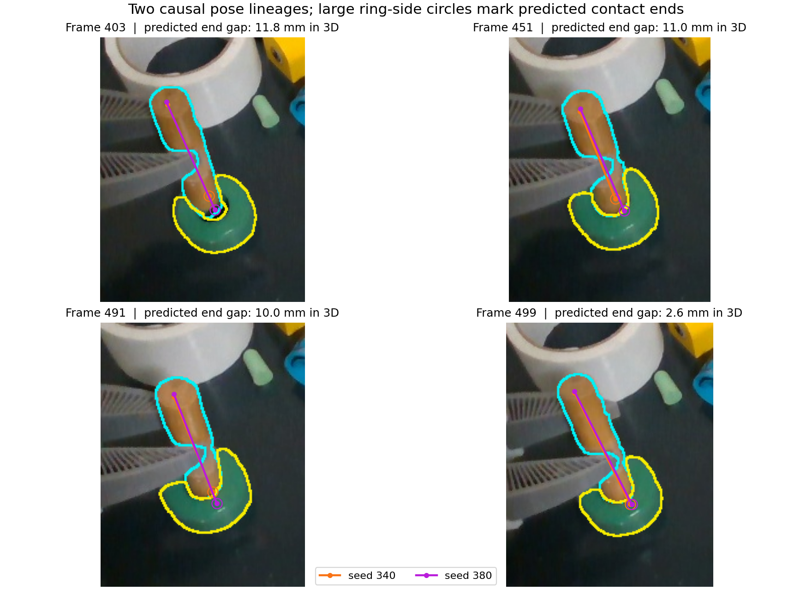

### Late Point2Pose restarts expose mask ownership and anchor error

I restarted the **unchanged sealed Point2Pose bridge** and pinned Point2Pose checkout from SAM3 masks at frames 340 and 380. Each restart sees only that seed and later RGB-D; its relative poses are [rebased](rebase_sparse_pose.py) through the original Point2Pose pose at the seed, not through future poses. The [replay runner](run_p2p_external_mask.py) tested its usual internal SAM2 masks, external causal SAM3 masks on later frames, and a controlled [exact-initial-mask switch](p2p_external_mask_bridge.py) that prevents SAM2's first mask output from replacing the supplied seed mask. The latter two are replay-only ablations; neither edits upstream Point2Pose or FLASH's live backend. Every branch is scored against the **same** current SAM3/depth and frame-100 reference model in the [candidate bank](p2p_late_reseed_all_bank.csv).

| Dowel pose branch                         | Insertion frames scored | Visible-surface p90 | Current-depth inferred-end disagreement |
| ----------------------------------------- | ----------------------: | ------------------: | --------------------------------------: |
| Original continuous Point2Pose            |                 100/101 |             7.50 mm |                                 3.70 mm |
| Restart 340, internal SAM2                |                 100/101 |             6.40 mm |                                11.73 mm |
| Restart 340, exact initial and later SAM3 |                   0/101 |                   — |                                       — |
| Restart 380, internal SAM2                |                 101/101 |            16.63 mm |                                19.71 mm |
| Restart 380, SAM3 on later frames only    |                 101/101 |             7.43 mm |                                 3.47 mm |
| Restart 380, exact initial and later SAM3 |                 101/101 |             8.21 mm |                                 5.54 mm |

The [frame-level end checks](candidate_depth_ends_p2p_reseed_sweep.csv) infer a hidden end by extending the observed shaft using first-view length and a gripper-based direction prior; these values are **not hidden-tip ground truth**. They show why the frame-340 restart's better visible-surface score cannot by itself replace the original pose. Restarting at 380 with exact masks preserves a pose at the original tracker's lost frame 499, but it is not more accurate on every visible or inferred-end check. Different branches can fill one another's missing frames without resolving their absolute contact-end disagreement.

The mask and point ownership [measurements](p2p_reseed_mask_ownership.csv) explain the severe frame-380 internal failure. Point2Pose's `FrontEnd.initialize` feeds the supplied first mask to SAM2, then **replaces** it with SAM2's first output before seeding its point map. At frame 380, the supplied SAM3 dowel mask has 3,317 pixels and overlaps the SAM3 ring by only 16 pixels. SAM2's returned mask has 5,934 pixels, including **2,584 ring pixels**; at frame 381, **11 of 18** pose-fit pixels lie in the ring mask. Internal Point2Pose keeps emitting confident-looking poses while fitting the wrong rigid object. External SAM3 masks on later frames remove those ring pixels but leave just **seven** dowel fit points from the contaminated initial map. Keeping the seed mask exact gives **18 dowel fit points** at frame 381 and no ring fit points, yet its median insertion surface fit remains worse than the original branch. The [first 40 frame scores](p2p_reseed380_early_bank.csv) show the internal branch drifting immediately after its shared frame-380 anchor.

The opposite problem appears at frame 340: SAM2 expands the mask only modestly (3,151 pixels, 0.924 IoU with SAM3) and seeds **eight** valid tracks. Forcing the exact 2,945-pixel SAM3 mask leaves only **two** valid tracks, so the pose is lost through insertion. A small mask change around a texture-poor object can radically change sparse point admission even when both outlines look plausible. The figure shows the actual recorded RGB, mask boundaries and fit pixels; red points land in the ring's SAM3 mask.

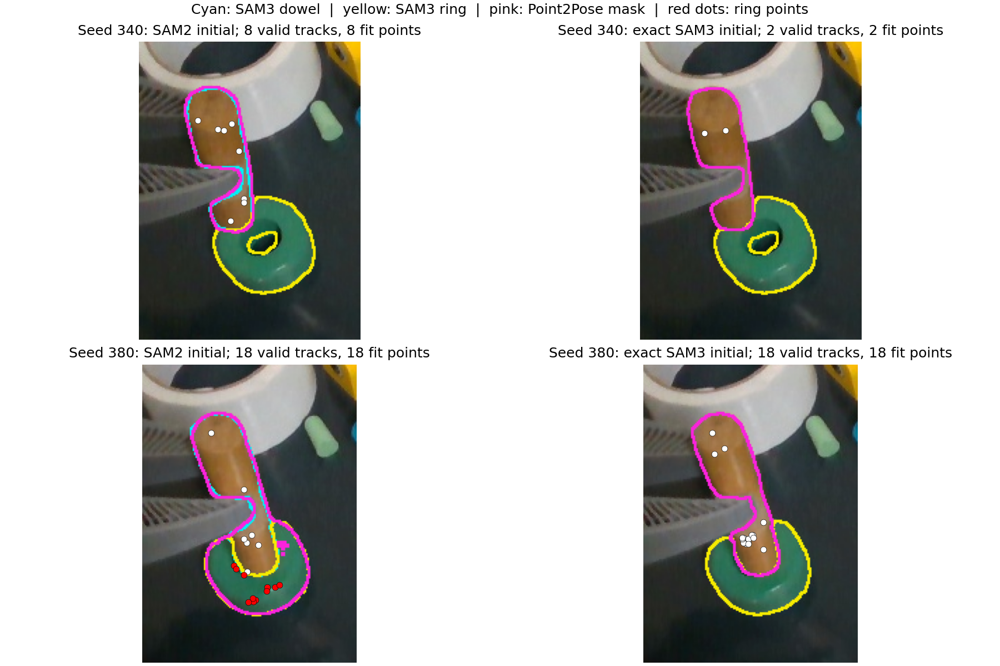

The retained [340 internal](p2p_dowel_reseed340_internal_340_550.npz), [340 exact](p2p_dowel_reseed340_exact_340_550.npz), [380 internal](p2p_dowel_reseed380_internal_380_550.npz), [380 later-only external](p2p_dowel_reseed380_external_380_550.npz) and [380 exact](p2p_dowel_reseed380_exact_380_550.npz) traces include per-frame lost flags, fit counts and timing; their rebased pose files are saved beside them. These experiments argue for **verified ownership and spatial distribution of point support** at each seed, plus multiple pose lineages when current depth supports conflicting task ends. Mask IoU, fit count or one candidate's surface residual alone cannot certify the partly hidden tip.

### Point2Pose's seed margin controls both point admission and the feature crop

The [pinned sampler](https://github.com/TheWisp/point-to-pose/blob/95bd7a8808fc1aaf015d510dffcccaa3c6971a9c/point2pose/modules/sampler/super_point_balanced_sampler.py) first erodes the object mask by `edge_margin_px`, then derives the RGB crop from that eroded mask, runs SuperPoint on the crop, and finally keeps keypoints inside the eroded mask. The [rig configuration used here](p2p_sampler_base.yaml) sets the margin to **5 pixels** and the crop padding to **3 pixels**. Thus changing the mask or margin changes the pixels and scale presented to SuperPoint as well as the final inside-mask test. Four of the eight frame-340 points seeded with internal SAM2 lie inside the _five-pixel-eroded_ SAM3 dowel mask, yet using that exact SAM3 mask with the default crop yields only two points. Removing cropping entirely yields just one. This is not explained by four points crossing a mask boundary; feature extraction and mask filtering are coupled.

I kept the exact causal SAM3 mask at seed frame 340 and on all later frames, changed **only** `edge_margin_px` in the Point2Pose configuration, and ran the same sealed bridge and pinned checkout through frame 550. Each relative pose was rebased through the **same original Point2Pose pose at its seed**, with no future anchor. The [summary](p2p_sampler_margin_summary.csv), [same-frame visible scores](p2p_sampler_margin_surface.csv), [current-depth end diagnostic](p2p_sampler_margin_depth_ends.csv), raw and rebased traces, and saved seed-point coordinates retain the sweep. The visible score uses one common frame-100 depth reference and current SAM3-masked RGB-D; the hidden-end score extends current visible depth using first-view length and a gripper-based direction prior. It is a **proxy**, not a measured contact tip.

| Seed | Margin | Valid seed points | Insertion poses | Visible-surface p90 median | Inferred hidden-end gap median |
| ---: | -----: | ----------------: | --------------: | -------------------------: | -----------------------------: |
|  340 |   0 px |                17 |         101/101 |                   13.31 mm |                       17.38 mm |
|  340 |   1 px |                18 |         101/101 |                    6.46 mm |                       12.92 mm |
|  340 |   2 px |                18 |         101/101 |                    6.33 mm |                       10.35 mm |
|  340 |   3 px |                20 |         101/101 |                    6.66 mm |                       11.19 mm |
|  340 |   4 px |                12 |         100/101 |                    6.28 mm |                       12.69 mm |
|  340 |   5 px |                 2 |           0/101 |                          — |                              — |
|  380 |   2 px |                19 |         101/101 |                    7.56 mm |                        3.26 mm |
|  380 |   5 px |                18 |         101/101 |                    8.21 mm |                        5.54 mm |

At frame 340, zero margin keeps the most permissive points and never loses a pose, but its visible fit is about **twice as bad** as the moderate-margin branches. More points are not automatically better points. Margins 1–4 keep nearly complete pose availability without a clear winner on both visible and inferred-end evidence. The frame-380 two-pixel branch retains insertion poses and improves both diagnostics over its five-pixel counterpart, but both still inherit the original frame-380 absolute pose. The earlier current-depth end proxy disagreed with the original seed pose by **11.23 mm at 340** and **2.94 mm at 380**; the proxy may itself be biased. A better relative track from frame 340 cannot resolve that initial ambiguity by adding seed points. No margin is promoted to a live default from this recording.

The [frame-340 two-pixel trace](p2p_dowel_reseed340_margin2_340_550.npz), its [rebased poses](p2p_dowel_reseed340_margin2_rebased_pose.npz), [seed points](p2p_margin2_seed340_points.npz), and the corresponding [frame-380 trace](p2p_dowel_reseed380_margin2_380_550.npz) illustrate the retained artifacts; the other sweep cases use the same filenames with their margin substituted. Reproduce a case with [the replay runner](run_p2p_external_mask.py), `--honor-initial-mask`, the base configuration with only `edge_margin_px` edited, and `--first-frame 340 --last-frame 550` (or seed 380). [The pose rebaser](rebase_sparse_pose.py), [visible scorer](analyze_p2p_initial_mask.py), and [end diagnostic](analyze_candidate_depth_ends.py) produce the two score families. The checkpoint and recorded RGB-D/masks remain local to this machine.

### Decoupling the feature crop does not by itself recover a good pose

I added a **replay-only** `--crop-from-uneroded-mask` option to [the external-mask bridge](p2p_external_mask_bridge.py). It changes only the RGB box presented to SuperPoint: the sampler still applies its configured erosion and inside-mask/depth filtering before admitting points. This holds the crop definition constant while the erosion margin changes, without editing Point2Pose itself. The [two-frame probe](p2p_crop_filter_probe.csv) compares both crop definitions at frame 340. With the configured five-pixel margin, an uneroded crop raises seed support from **two to four** points, but the full [five-pixel trace](p2p_dowel_reseed340_rawcrop_m5_340_550.npz) has only frames 340–341 valid and **0/101** insertion poses. At two pixels, using the uneroded crop raises initial support from **18 to 20** and keeps **101/101** insertion poses. Thus the crop contributes to the sharp seed-count discontinuity, while the five-pixel membership filter remains too restrictive for this partly visible dowel.

The additional points do not settle pose quality. With identical exact SAM3 masks, original Point2Pose seed anchors, and a two-pixel margin, the [normal-crop](p2p_dowel_reseed340_margin2_340_550.npz) and [uneroded-crop](p2p_dowel_reseed340_rawcrop_m2_340_550.npz) branches both emit all insertion poses. The [paired frame scores](p2p_rawcrop_m2_vs_normal_m2.csv) give **6.33 versus 6.29 mm** median visible-surface p90, while their inferred hidden-end gaps are **10.35 versus 11.79 mm**. Their predicted contact ends differ by **1.72 mm median** on the same insertion frames. The tiny visible improvement is a tradeoff, not evidence that the hidden tip improved.

I also substituted Point2Pose's existing **uniform farthest-point sampler**, asking for 20 depth-backed mask points with the same two-pixel margin. This avoids SuperPoint's texture preference while leaving BootsTAPIR, masks, registration and pose history unchanged. The [saved configuration](p2p_uniform20_margin2.yaml), [frame-340](p2p_dowel_reseed340_uniform20_m2_340_550.npz) and [frame-380](p2p_dowel_reseed380_uniform20_m2_380_550.npz) traces, [paired 340](p2p_uniform340_vs_superpoint340.csv)/[380](p2p_uniform380_vs_superpoint380.csv) visible scores, and [end rows](p2p_crop_uniform_hidden_end.csv) preserve the experiment. Both uniform branches emit **101/101** insertion poses, but do not improve the two-pixel SuperPoint branches on the measured criteria: visible-surface p90 is **6.52 versus 6.33 mm** from seed 340 and **7.75 versus 7.56 mm** from seed 380; inferred hidden-end gaps are **12.57 versus 10.35 mm** and **3.46 versus 3.26 mm** respectively. The closest visible-fit differences are small, and the hidden-end comparator is inferred, not an independent label. These ablations rule out two easy explanations—crop coupling alone and too few texture-free seed pixels—as complete fixes for this recording. They leave the absolute anchor and contact-time observability unresolved.

### Dense depth can improve visible fit while preserving hidden-end ambiguity

I tested a **causal, object-agnostic depth refit** of the frame-340 and frame-380 Point2Pose anchors. The [reproduction script](analyze_dense_anchor_icp.py) takes the frame-100 SAM3-masked RGB-D cloud as an incomplete reference surface, matches the seed frame's masked depth to it with nearest-neighbor rigid ICP, and trims correspondences using the median and median absolute deviation. It starts from the original Point2Pose pose at that seed, uses no later frame in fitting, and transports the existing two-pixel Point2Pose relative track from the corrected anchor. The diagnostic uses 2,000 points, 20 iterations and a 2.5-MAD trimming multiplier; these are exposed study parameters, **not proposed live defaults**. The [frame-340](p2p_dowel_reseed340_margin2_icp_anchor_pose.npz) and [frame-380](p2p_dowel_reseed380_margin2_icp_anchor_pose.npz) causal traces, their matching `*_icp_fit.npz` seed diagnostics, and the [paired 340](p2p_dense_icp340_vs_original.csv)/[380](p2p_dense_icp380_vs_original.csv) later-frame scores are retained.

| Seed | Insertion surface p90, before → after | Inferred hidden-end gap, before → after | Predicted contact-end shift |
| ---: | ------------------------------------: | --------------------------------------: | --------------------------: |
|  340 |                        6.33 → 4.23 mm |                        10.35 → 10.41 mm |                     9.04 mm |
|  380 |                        7.56 → 5.58 mm |                          3.26 → 3.33 mm |                     2.00 mm |

These visible-surface medians use **101 later insertion frames (400–500)**, not the seed frame that ICP optimized. Nevertheless, those frames use the same camera and reference object cloud, so they are not independent 6D labels. The refit improves the visible surface in both cases but does **not** improve the inferred hidden end; the [frame-level end diagnostic](p2p_dense_icp_hidden_end.csv) uses the same extrapolated proxy as the preceding experiments. Other evidence trades off: at seed 340, median free-space contradiction falls from **0.0735 to 0.0061** while projected-mask support falls from **0.7555 to 0.7277**; at seed 380, projected-mask support rises from **0.6946 to 0.7601** while free-space contradiction rises slightly from **0.1914 to 0.1980**. After both corrections, the two causal branches still predict contact ends **10.54 mm apart median**, scarcely changed from **10.64 mm** before refitting; [the frame-level fork](p2p_dense_icp_task_end_fork.csv) preserves that result. In an [iteration sweep](p2p_dense_icp_iteration_sweep.csv), further fitting lowers the **seed-frame** visible-surface residual while moving the frame-340 predicted end farther from its initial position. Dense alignment therefore supplies useful partial-pose evidence, but cannot be promoted to a unique hidden-tip correction merely because its surface score improves.

The [projection](plot_cotracker_seed_pose_fork.py) overlays those two corrected pose histories on four later RGB frames. Cyan and yellow are the saved object masks. The orange and purple circles inside the ring are **different predicted positions of the hidden end**, not observed tip pixels; the 3D gap cannot be read directly from their 2D separation.

At the last contact checkpoint, the [recorded-gripper comparison](gripper_tip_conflict_491_499.csv) transports each frame-491 pose rigidly with the arm to frame 499. The same first-view contact-end proxy would move about **1.3 mm** under that relationship. The CoTracker3 frame-340 and frame-380 branches instead move their predicted ends **3.15 and 8.08 mm**, with **3.49 and 7.16 mm** gaps from the gripper prediction; the Point2Pose restarts have **5.87–12.52 mm** gaps. This is a consistency signal, **not** proof that the visual branches are wrong: object contact can cause real slip, the initial gripper attachment can be biased, and the frame-499 depth-axis measurement is weak. It identifies a contact-time uncertainty that a single chosen pose would hide. A controller should not silently replace observed object motion with a rigid-grasp assumption or treat the gripper's path as a hidden-tip label.

### Current silhouette and self-built maps are different kinds of evidence

The [shaft overlay](dowel_candidate_axes.jpg) projects the same frame-100 depth-cloud shaft proxy through the three causal dowel traces onto recorded insertion frames. Cyan is the **current** SAM3 mask boundary; orange is Point2Pose, pink is fixed-seed TAPNext++ 256 and green is fixed-seed TAPNext++ 512. The projected endpoint inside the ring is a **predicted** contact-end location, not an observed tip. The [projection script](plot_dowel_candidate_axes.py) reproduces the image.

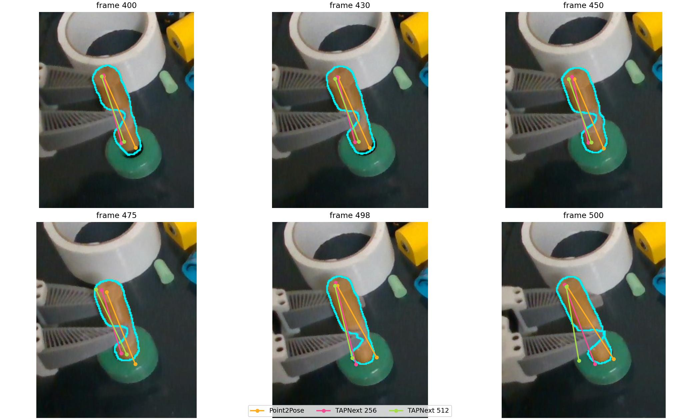

As a same-frame image constraint, I measured the central 60% of the elongated SAM3 mask and the perpendicular distance from its 2D center to each projected first-view shaft. Across insertion frames 400–500, the median offsets were **1.40 pixels for Point2Pose** (100 accepted frames), **8.25 for TAPNext++ 256** and **8.84 for TAPNext++ 512** (101 each). Point2Pose had the smaller offset on **all 100 shared frames**. The mask's median major/minor covariance-eigenvalue ratio was about **13.3**, making its image axis informative; changing the central interval to 10–90% or 30–70% kept the ranking. The [calculation](analyze_visible_shaft_centerline.py) and [frame scores](visible_shaft_centerline.csv) retain the measured offsets. This is independent of the candidate's _current_ pose, but the reference shaft came from the front-facing first-view depth cloud, not a labeled physical cylinder centerline. It constrains projected placement, not depth, hidden-tip location or axial roll.

I also rebuilt a **separate object map for each candidate** from the same earlier RGB-D views (frames 100, 300, 340 and 380), using the same two-view 3 mm confirmation rule, and scored only later insertion frames against current masked depth. The [analysis](analyze_candidate_own_map.py) and [per-frame scores](candidate_own_map.csv) show a trap: BundleSDF's dowel map scores **3.80 mm** median visible-surface p90, essentially tied with Point2Pose's **3.83 mm**, although the BundleSDF dowel branch was grossly wrong under the common reference and its map's projected shaft differs by **50.0°** median from the current mask axis. Its reconstructed dowel bounding box is **94 × 127 × 173 mm**, compared with Point2Pose's **96 × 58 × 44 mm**. The two-view check cannot reject mutually consistent errors inherited from one candidate's own pose history. Fixed-seed TAPNext++ 256 and 512 own-map p90 values were **4.53 and 5.07 mm**. For the ring, the corresponding values were **1.40 mm BundleSDF**, **2.82 Point2Pose**, **1.67 TAPNext++ 256** and **1.69 TAPNext++ 512**.

A candidate's own-map fit is therefore **not an independent vote for that candidate**. An estimator needs map provenance, common-reference comparisons where a reference is trusted, current mask/depth constraints, physically plausible geometry and surviving pose alternatives. Near insertion, it must project those alternatives into uncertainty at the hidden contact end. Neither this comparison nor the earlier direct-depth checks independently labels that end; the current evidence favors Point2Pose's _visible_ dowel shaft in this recording but cannot certify its complete pose or call tracking solved.

To compare the end hypotheses more directly, I applied the earlier **current RGB-D geometry plus first-view length and gripper-orientation prior** to each candidate's pose without changing its visible depth input or end identity. The sign prior uses Point2Pose's pregrasp pose transported by the recorded gripper, so this test is not independent of that source for **which** end is selected; it does not use its insertion pose to fit the current depth axis or end. Across insertion, the median disagreement between the extrapolated hidden end and the candidate end was **3.70 mm for Point2Pose** (100 frames), **14.06 mm for TAPNext++ 256** and **13.25 mm for TAPNext++ 512** (101 each). On the 96 shared frames where the visible middle section had an axis eigenvalue ratio above 10, Point2Pose was closest on all 96. The [comparison script](analyze_candidate_depth_ends.py) and [per-frame data](candidate_depth_ends.csv) retain the visible-end and axis residuals too. This is a check against an **inferred** end, not a measured hidden tip: the current depth samples the front surface, and the extrapolation can share geometric bias with a pose candidate. Its axis evidence collapses at final contact (ratio **2.41 at frame 497, 1.84 at 500**); at frame 500 the inferred end differs from Point2Pose by **48.3 mm**. The controller must propagate a pose/end hypothesis through that weak view, with uncertainty, rather than force a new tip measurement from it.

The Point2Pose bridge reported roughly 60 ms median frame time in this recording. The compatible BundleSDF dowel pass took about 190 s for 451 frames, including online reconstruction and debug output; the ring pass took about 88 s. These are observed experiment times, **not** matched implementation speed benchmarks. To run the old BundleSDF source on this CUDA 12.8 / Python 3.11 / PCL 1.12 machine, the isolated checkout changed CUDA architecture and binding compatibility, used OpenCV's CPU brute-force L2 descriptor matcher instead of its unavailable CUDA module, removed an upstream `pdb.set_trace()`, and guarded percentile denoising on empty masks. None of those changes was made in FLASH or the GUI server.

[TrackEverything](https://github.com/ayushjain1144/trackeverything) now has released code and an API for supplied RGB-D/camera geometry, but it produces point trajectories rather than object poses. Its default 16-frame window sees future frames within each window; the [authors' FAQ](https://github.com/ayushjain1144/trackeverything/blob/main/docs/faq.md) describes shorter four-frame windows and an experimental growing-buffer mode. Its published checkpoint returned `GatedRepo` to this machine's authenticated Hugging Face account on 2026-10-21, so no TrackEverything accuracy or speed result is claimed here.

### A faster causal tracker does not remove the hidden-end ambiguity

I also tested [LiteTracker](https://github.com/ImFusionGmbH/lite-tracker) through the pinned Point2Pose checkout's `litetracker` adapter (Point2Pose `95bd7a8808fc1aaf015d510dffcccaa3c6971a9c`, LiteTracker submodule `8ffe2492b50c3402f6a3e64d9010a31f6f3d4d13`). This adapter consumes one frame at a time; it uses the cached CoTracker3 scaled-online weights, a 16-frame memory and one update iteration. The controlled comparison changed only the point tracker from causal BootsTAPIR to LiteTracker ([configurations](p2p_rig_bootstapir_margin2.yaml), [LiteTracker configuration](p2p_rig_litetracker_margin2.yaml)). Both received the same recorded aligned RGB-D, causal SAM3 masks, Point2Pose registration and two-pixel seed-mask margin. Dowel runs began separately at frames 340 and 380, and their relative poses were causally attached to the same original Point2Pose pose at each seed; neither received future frames. The ring control and alternative both began at frame 100 from the same SAM3 mask. The [bridge runner](run_p2p_external_mask.py), [rebase script](rebase_sparse_pose.py), [comparison scorer](analyze_p2p_initial_mask.py) and [pose-fork scorer](compare_pose_end_hypotheses.py) reproduce the protocol with the local recording, masks and model checkpoints. The source traces are [dowel seed 340](p2p_dowel_reseed340_litetracker_m2_rebased_pose.npz), [dowel seed 380](p2p_dowel_reseed380_litetracker_m2_rebased_pose.npz), [ring LiteTracker](p2p_ring_litetracker_m2_100_550.npz) and [ring BootsTAPIR](p2p_ring_bootstapir_m2_control_100_550.npz).

| Insertion frames 400–500                                       |       BootsTAPIR |      LiteTracker |
| -------------------------------------------------------------- | ---------------: | ---------------: |
| Dowel, frame-340 seed: valid poses; median visible-surface p90 | 101/101; 6.33 mm | 101/101; 6.41 mm |
| Dowel, frame-380 seed: valid poses; median visible-surface p90 | 101/101; 7.56 mm | 101/101; 7.44 mm |
| Ring, frame-100 seed: valid poses; median visible-surface p90  | 101/101; 4.86 mm | 101/101; 6.84 mm |

The paired [dowel 340](p2p_litetracker340_vs_bootstapir340.csv), [dowel 380](p2p_litetracker380_vs_bootstapir380.csv) and [ring](p2p_ring_litetracker_vs_bootstapir.csv) rows retain all visible scores. The Point2Pose step time during insertion, **excluding** SAM3 inference, frame loading and the robot loop, was 7.0 ms median / 7.4 ms p95 for the LiteTracker dowel runs versus 11.3–11.9 ms median / 15.4–16.8 ms p95 for BootsTAPIR. The ring medians were 7.7 versus 17.0 ms. LiteTracker is a promising faster point-motion source here, but its ring pose has worse visible fit, so the data do not justify replacing the existing source wholesale.

Changing the point-motion backend did not resolve the dowel's absolute pose lineage. The two LiteTracker dowel starts predict the **same first-view contact-end proxy 13.42 mm apart on median** during 101 insertion frames, even though both keep a valid pose and have similar visible-surface scores. The BootsTAPIR starts disagree by 10.64 mm. The [pairwise frame data](p2p_litetracker_contact_end_fork.csv) also give unoriented shaft-axis gaps; axial roll is ignored. Against a contact-end position **inferred** from current visible middle-shaft depth, gripper end-identity prior and first-view length, the LiteTracker frame-340 and frame-380 branches disagree by 12.93 and 2.70 mm median respectively ([frame scores](p2p_litetracker_hidden_end.csv)). This inference is not an independent measurement of the hidden tip and becomes weak at final contact. The image below marks two alternative predictions, not two observed tip locations.

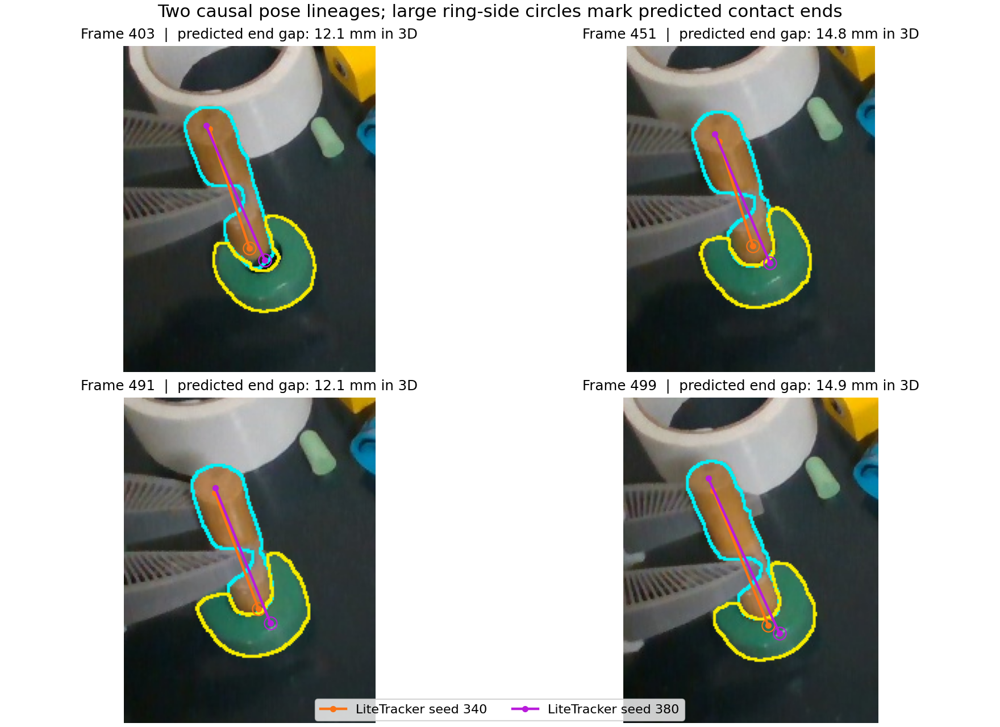

For the task, a visible end may be measured from RGB-D when available, but once it enters the ring its location must be propagated from an object pose and learned object geometry: `p_contact = T_camera_object · p_contact_object`. A cylindrical dowel's useful state can be expressed as a **signed shaft axis, position, length and contact-end identity**; its spin about the shaft is normally irrelevant to insertion. The ring contributes a hole location and normal. A grasp gives an additional, fallible gripper-to-object motion prior; slip can invalidate it. The estimator should retain competing pose/end hypotheses with uncertainty through occlusion, update only observable components when depth returns, and expose the resulting contact-end spread to the planner. Treating the tracked tip pixel as the whole state would fail exactly when that pixel is hidden. This replay has no independently labeled 3D tip or 6D pose at insertion, so it cannot certify which of these histories is correct.

### The ring opening supplies a separate task constraint

The ring's opening is directly visible in the SAM3 mask at frames 100 and 340. The [opening analysis](analyze_ring_hole_contact.py) fits an ellipse to the **inner mask contour**, a robust plane to the ring's own aligned depth, and intersects the ellipse-center camera ray with that plane. It uses a declared 2.5 mm plane tolerance and 1,000 deterministic RANSAC trials for this diagnostic; these are not live policy constants. The frame-100 opening propagated by Point2Pose's ring pose lands **0.81 mm** from the independently extracted frame-340 opening, and the BundleSDF propagation lands **1.43 mm** away. This checks that the reference hole feature is substantially more stable than the dowel end fork at those two unobstructed views. Both extractions share the same camera and segmentation model, so it is not an independent metrology label.

For every later frame, the analysis transports that frame-100 hole center and plane normal with each ring tracker and compares each dowel pose's _predicted_ contact end and shaft with the opening. [Frame-level results](ring_hole_contact_consistency.csv) contain tip-to-hole lateral and axial offsets, shaft intersection with the hole plane, and shaft-to-normal angle. These criteria do **not** rank the dowel candidates identically. At frame 499 against the Point2Pose ring, the BootsTAPIR frame-340 and frame-380 histories put their predicted ends **3.3 and 8.6 mm** laterally from the opening, while the shaft-line intersections are **5.6 and 4.4 mm** away and their unoriented shaft-to-ring angles are **11.7° and 17.7°**. Earlier at frame 491, frame 380 has the smaller predicted-end lateral offset but frame 340 has the smaller axis angle. The geometry supplies useful evidence when insertion contact is known, yet no fixed winner follows from one frame or one metric. The first-view contact-end proxy, actual peg/hole radii, inserted depth, ring pose uncertainty and contact state all matter. A causal estimator should combine this as a conditional constraint with visible shaft, depth, temporal motion and gripper evidence, and retain uncertainty when they conflict.

The CSV files in this directory hold the frame-level measurements, including [image-axis residuals](mask_projected_axis.csv), [depth-axis ablations](depth_axis_trim.csv), [visible-end axial residuals](observed_end_axial_residual.csv), the [multiview/depth-quality ablation](multiview_depth_ablation.csv), [reacquisition scores](reacquisition_score.csv) and [partial-refit scores](partial_refit_score.csv). Re-run the latter three scripts with `--dataset /home/feit/.cache/huggingface/lerobot/demos/insertion/recording --masks /home/feit/.cache/flash-tracker-compare/sam3_masks --output /tmp/flash-analysis`; the source dataset and generated SAM3 masks are local, not committed. [pose_traces.npz](pose_traces.npz) preserves the per-frame transforms, evidence flags, camera intrinsics, calibration transform, recorded gripper poses and first-view dowel features used for these projections. No tested tracker was checked against independent 6D pose labels, and no new physical insertion was attempted. The visible drift establishes a failure case; it does not establish that any remaining tracker is accurate enough for unattended insertion.

### Single-reference PANY helps the ring but not the held dowel

I tested the released [PANY: Pose Anything, Anywhere](https://github.com/demianhj/Pose-Anything-Anywhere) RGB-D single-reference method (checkout `db2518f86c9315d4d18606cbed7771183472ba91`, checkpoint SHA-256 `85f82314045b0907e98151a1abacfd2bf0b252d0b250562cc3861aa295aca09e`). It predicts two point maps jointly, aligns the first to the depth-backed reference mask with similarity Umeyama, then aligns the second to the query depth-backed mask with rigid Umeyama. The [adapter](run_pany_single_reference.py) follows the released inference operations and strictly loads every used aggregator and point-head weight; it skips only the unused training matcher that requires an incompatible custom PointNet2 extension. This is an **offline, causal pairwise replay**: every query uses its own frame and a reference no later than the query, with no future frames. The same SAM3 masks, aligned RGB-D and frame-100 camera reference are used for scoring. The checkpoint is local and not committed.

The frame-100 PANY self-query returned a small nonidentity transform (ring translation **6.2 mm** in norm). I preserved the raw [ring trace](pany_ring_sparse_100_500.npz) and also removed that self-pose by composing every query with its inverse, then anchored to the same frame-100 identity as Point2Pose. The [normalized trace](pany_ring_sparse_100_500_normalized.npz) and [raw-versus-normalized frame scores](pany_ring_normalization_bank.csv) make that correction explicit; it is a coordinate consistency correction, not a fit to later ground truth. During all **101** insertion frames 400–500, the normalized PANY ring has median observed-surface p90 **3.89 mm**, versus **4.86 mm** for the matched Point2Pose ring; projected-mask fractions are **0.691** versus **0.647**, and depth-ray contradiction fractions **0.022** versus **0.133**. The normalized branch is favored on **83/101** frames by the same-frame mask Pareto check and **82/101** by the ray check. These checks reuse SAM3 and depth as both input and evidence, so they are internal consistency measurements, not independent pose accuracy. Raw PANY is also better than this Point2Pose control on most frames ([raw comparison](pany_ring_vs_p2p_bank.csv)).

The directly visible ring hole supplies a less circular feature check. On 14 selected frames spanning 100–362 where the inner contour was present, I re-extracted its center independently from each frame's mask and depth plane and compared it with the first-view center carried by each pose. Median center discrepancy was **0.59 mm** for normalized PANY, **0.77 mm** for Point2Pose and **1.20 mm** for BundleSDF ([per-frame values](pany_ring_visible_hole_validation.csv), [analysis](analyze_ring_hole_contact.py)). At frames 320/340 specifically, PANY gaps were **0.52/1.06 mm** versus Point2Pose **0.63/0.81 mm**: no source wins every frame. The hole is not visibly measurable during the insertion interval, and all three methods share the same camera calibration and segmentation. This supports PANY as a ring candidate, not as a certified hidden-hole pose. Its measured model-and-alignment step was **238 ms median / 241 ms p95** for those 101 ring queries, excluding frame loading, crop and SAM3: much slower than the current Point2Pose step and suitable only for an asynchronous perception job without further optimization.

The held dowel is the opposite result. With the original frame-100 reference, PANY gives a pose at all 101 insertion frames but its median observed-surface p90 is **16.01 mm**, versus Point2Pose **7.50 mm**; median projected-mask fraction is **0.450** versus **0.706**, and ray-support fraction **0.057** versus **0.257** ([frame scores](pany_dowel_vs_p2p_bank.csv), [PANY trace](pany_dowel_100_400_500.npz)). Six PANY frames are directly marked free-space-contradicted. At frame 499, when Point2Pose is lost, PANY still emits a transform, but only **0.344** of its projected model points fall in the current mask and **0.357** of depth rays contradict it; its mere availability is not evidence of correct hidden-tip tracking. I repeated the test with causal single-view references at frames **340** and **380**, normalized each method's seed self-pose and rebased through Point2Pose's pose at that seed. Both later-reference branches are worse than Point2Pose on the six or seven shared views where Point2Pose has a pose, with some frames heavily contradicted by free space ([recent-reference scores](pany_dowel_recent_reference_bank.csv), [raw 340](pany_dowel_seed340_raw.npz), [raw 380](pany_dowel_seed380_raw.npz), [rebased 340](pany_dowel_seed340_rebased.npz), [rebased 380](pany_dowel_seed380_rebased.npz)). A recent single view did not repair the featureless, occluded dowel for this model.

In the [contact-geometry comparison](pany_ring_hole_contact_consistency.csv), the single-reference PANY dowel branches also disagree more with the transported ring opening than the Point2Pose dowel branch, regardless of whether the ring came from Point2Pose, BundleSDF or PANY. That comparison is a task constraint, not ground truth: it assumes the predicted dowel end should approach the measured hole and uses a proxy dowel length. The result does **not** justify switching both objects to one model. It motivates source selection per object and per frame, preserving the gripper attachment and competing hidden-end hypotheses when the dowel itself is unobservable. This experiment exercised only PANY's released single-reference RGB-D path. Even a better visible-surface tracker would need an independently checked end or contact constraint before calling the hidden insertion pose accurate.

### Earlier posed views repair the dowel's visible fit, but the end remains uncertain

I next ran a [known-pose multi-reference ablation](run_pany_known_pose_references.py) using PANY's released aggregator and point head. For each query, it jointly processes that frame and dowel reference views from **100, 340 and 380**; it aligns all three predicted reference point maps to their measured RGB-D points in the frame-100 coordinate system, then aligns the query point map to current depth. The reference transforms come from the **causal Point2Pose trace at each reference frame**. All three views precede insertion frames 400–500; the held-view masks come from the same SAM3 replay. This is **not** the released unposed multi-view pipeline: I did not run its learned reference matcher or offline pose graph, and the result remains dependent on Point2Pose's reference-pose errors. The method's raw result is the main [saved trace](pany_dowel_known_refs_100_340_380_400_500.npz). For diagnosis, that file also preserves a transform that forces the frame-380 self-query to equal Point2Pose, and a corresponding `poses_seed_normalized` trace. It uses no future frames or labeled insertion poses.

| Insertion frames 400–500                              | Three-reference PANY, raw |    Point2Pose |
| ----------------------------------------------------- | ------------------------: | ------------: |
| Pose available                                        |                   101/101 |       100/101 |
| Median visible-surface p90                            |                   6.43 mm |       7.50 mm |
| Median projected-mask fraction                        |                     0.761 |         0.706 |
| Median depth-ray support / contradiction fraction     |             0.340 / 0.094 | 0.257 / 0.173 |
| Consecutive held-end jump in gripper coordinates, p90 |                   9.24 mm |       3.14 mm |

The [paired frame scores](pany_dowel_known_refs_vs_p2p_bank.csv) favor raw three-reference PANY on **94/100** mutually available frames by the mask Pareto check and **79/100** by the ray check. It emits a pose at frame **499**, when Point2Pose is lost, with **6.64 mm** surface p90, **0.754** projected-mask fraction and **0.123** ray-contradiction fraction. At frame 380, its raw self-query already fits the visible dowel better than the Point2Pose reference: **6.31 versus 7.69 mm** surface p90. Forcing it back to Point2Pose at that seed worsens the insertion median to **7.70 mm** p90 ([raw/normalized comparison](pany_dowel_known_refs_normalization_bank.csv)). The model-and-alignment step was **282 ms median / 284 ms p95** per query, excluding RGB-D loading, crop and SAM3. That is an offline proof, not a 30 Hz perception backend; a live version would need asynchronous execution and freshness checks.

The number and choice of reference views matter. In seven sampled insertion frames, two-view **100+340** and **100+380** had median surface p90 **7.14** and **7.94 mm**; three-view **100+340+380** scored **6.50 mm** and had lower median ray contradiction (**0.112**) than either two-view branch (**0.199** and **0.272**). The [ablation scores](pany_dowel_known_ref_count_ablation.csv), [two-view 100+340](pany_dowel_known_refs_100_340_sample.npz), [two-view 100+380](pany_dowel_known_refs_100_380_sample.npz) and [end-prediction fork](pany_dowel_known_ref_count_contact_fork.csv) preserve that controlled check. These are seven selected frames, not a speed/quality guarantee on every possible view bank. A reference bank should be chosen for view coverage and pose confidence, not simply grown without bound.

The hidden contact end is still **not verified**. Raw three-reference PANY and Point2Pose predict the same first-view end **6.79 mm apart on median** across their 100 shared insertion frames, and their unoriented shaft axes differ by **4.44°** ([pairwise rows](pany_dowel_known_refs_contact_fork.csv)). A current-depth middle-shaft extrapolation favors Point2Pose's hidden end (**3.70 mm** median discrepancy) over PANY (**9.02 mm**), while PANY fits the visible near end slightly better (**5.96 versus 6.41 mm**); that extrapolation is not a hidden-tip label and its axis evidence collapses at final contact ([depth/end rows](pany_dowel_known_refs_depth_end.csv)). Against the transported ring opening, PANY's median predicted tip lateral offset is **5.02 mm** with the Point2Pose ring and **4.53 mm** with BundleSDF, comparable to Point2Pose's **4.42/4.93 mm**, but the ranking changes with the ring source and frame ([contact rows](pany_dowel_known_refs_hole_contact.csv)).

The [gripper-coordinate continuity check](analyze_attachment_consistency.py) transforms each predicted dowel end and shaft into the recorded gripper frame, where they should stay nearly fixed if the grasp is rigid. PANY's median distance from its own held-end median is **4.68 mm**, versus Point2Pose's **1.84 mm**; its p90 consecutive-frame end jump is **9.24 mm** versus **3.14 mm**, and p90 shaft-angle jump is **6.81°** versus **1.28°** ([per-frame rows](pany_dowel_attachment_continuity.csv)). This is significant motion-goal jitter even though PANY's individual frames fit the surface well. Actual slip and camera/robot timing error can also change this relative pose, so the check is not a truth label. The contrast indicates that this pairwise multi-view estimator should provide **asynchronous pose evidence**, while a temporal filter or rigid-grasp motion prior maintains the high-rate action state; a controller should not jump directly to each independent PANY pose. The result is a substantially better **visible** dowel hypothesis and a useful fallback at a Point2Pose dropout, yet it does not establish which hidden tip position is correct. The released **unposed** multi-view matcher/pose graph and an independently measured tip or contact outcome remain to be tested.

### The gripper-motion fallback depends on which pose it anchors

I also propagated Point2Pose's dowel pose from each of frames **340, 360, 380 and 400** with the recorded end-effector motion, holding its gripper-to-object transform fixed ([causal propagation](propagate_gripper_attachment.py), [saved seed traces](gripper_dowel_seed340_400_500.npz), [360](gripper_dowel_seed360_400_500.npz), [380](gripper_dowel_seed380_400_500.npz), [400](gripper_dowel_seed400_400_500.npz)). This is the rigid attachment/group fallback in isolation: it gives a pose every frame without asking vision to reacquire the dowel, but assumes there was no later slip. Its results vary with the chosen observation:

| Seed / source                   | Visible-surface p90, median | Ray contradiction, median | Inferred hidden-end discrepancy, median |
| ------------------------------- | --------------------------: | ------------------------: | --------------------------------------: |
| Gripper propagation from 340    |                     7.86 mm |                     0.032 |                                 8.68 mm |
| Gripper propagation from 380    |                     7.60 mm |                     0.255 |                                 3.67 mm |
| Three-reference PANY, per frame |                     6.43 mm |                     0.094 |                                 9.02 mm |
| Point2Pose, per frame           |                     7.50 mm |                     0.173 |                                 3.70 mm |

The [surface/ray rows](gripper_dowel_seed_sweep_bank.csv), [depth-end rows](gripper_dowel_seed_sweep_depth_end.csv) and [contact-end forks](gripper_dowel_seed_sweep_end.csv) show that a smooth fallback can remain visibly plausible while two anchors predict the contact end **10.63 mm apart**. At frame **499**, where Point2Pose emits no pose, three-reference PANY fits the current surface better than the frame-340 group branch (**6.64 versus 12.04 mm** p90). Yet the group-340 shaft intersects the Point2Pose ring's estimated opening plane **1.68 mm** from its center, versus **5.49 mm** for PANY and **7.82 mm** for group-380 ([contact geometry](gripper_dowel_seed_sweep_hole.csv)). If the dowel is actually entering that opening, this favors group-340's task relation at that instant. It is not conclusive because the hole radius, dowel cross-section at contact, end proxy and actual contact state are not independently labeled; the current surface and opening analyses also share masks/calibration. The fallback should therefore persist as a separate pose hypothesis with attachment uncertainty, then be corrected by fresh visual and contact evidence when those are informative. Replacing it at each frame with the sharpest-looking pose would reintroduce jitter and can move an unseen tip the wrong way.

I checked two earlier anchors because the RGB frames show the lower end approaching the ring around **320–340** and largely hidden by **380**. The frame-300, -320 and -340 gripper branches have insertion median visible-surface p90 **14.40, 10.80 and 7.86 mm**; their predicted shaft intersections with the Point2Pose ring opening are **12.47, 3.51 and 1.68 mm** from its center at frame 499 ([pre-contact surface scores](gripper_dowel_precontact_seed_bank.csv), [opening checks](gripper_dowel_precontact_seed_hole.csv), [depth-end diagnostics](gripper_dowel_precontact_seed_depth_end.csv), [seed 300](gripper_dowel_seed300_400_500.npz), [seed 320](gripper_dowel_seed320_400_500.npz)). Thus “earlier, more visible end” is not by itself a sufficient anchor-selection rule: frame 340 is better on both checks here, but these checks do not independently reveal the buried end. A runtime view bank should record which task features are actually visible and keep the attachment uncertainty from each candidate anchor.

I then tested whether a PANY view bank containing **only pre-contact views** would preserve the contact end better than the original 100+340+380 bank. The [three sampled banks](pany_dowel_precontact_100_320_340_sample.npz), [100+300+320+340](pany_dowel_precontact_100_300_320_340_sample.npz) and [100+320+340+360](pany_dowel_precontact_100_320_340_360_sample.npz) all use Point2Pose's causal pose at each reference. On seven sampled insertion frames, their median visible-surface p90 values were **8.38, 7.34 and 7.32 mm**, versus **6.50 mm** for 100+340+380 ([same-frame scores](pany_dowel_precontact_reference_bank.csv)). Their median predicted-end offsets from the frame-340 rigid-grasp branch were **12.27, 9.06 and 12.28 mm**, versus **5.65 mm** for 100+340+380 ([end forks](pany_dowel_precontact_reference_end.csv)); none gives an unambiguous improvement against the ring-opening constraint ([contact rows](pany_dowel_precontact_reference_hole.csv)). The conclusion is limited to this small causal sample: adding a partially occluded later view improves visible fitting here, while selecting only earlier views does not by itself solve the hidden-end lineage. Reference admission needs geometric and task-feature evidence, not a blanket rule to include or exclude all post-contact images.

To test whether the **340→380 attachment change** could simply be real slip, I fitted the exposed dowel end and visible middle-shaft axis from each frame's SAM3-masked depth, oriented them with the frame-340 gripper prior, and expressed both in gripper coordinates ([reproducible analysis](analyze_visible_end_in_gripper.py), [frame rows](gripper_visible_end_300_500.csv), [extended group trace](gripper_dowel_seed340_340_500.npz)). At frame **380**, the measured exposed end is only **2.74 mm** from its frame-340 gripper-coordinate position and the depth-fitted shaft axis differs by **1.32°**; its axis eigenratio is **28.49**. The two Point2Pose seed poses, in contrast, yield a **10.63 mm** contact-end difference and a **4.92°** shaft-axis difference when propagated by the same gripper motion. At frame 380, the frame-340 group branch has slightly worse visible-surface p90 (**7.90 versus 7.69 mm**) but far less reliable-depth ray contradiction (**0.076 versus 0.295**) than direct Point2Pose ([transition rows](gripper_transition_340_400_bank.csv)). These separate checks are consistent with a Point2Pose attachment/axis change caused by partial occlusion rather than a 10 mm physical slip before frame 380. They do not prove the dowel did not slip: the exposed-end estimator uses a depth percentile, and it becomes weak at later contact (axis eigenratio **2.32 at frame 499**). A runtime estimator should hold the gripper attachment through unobservable end motion and update only components supported by exposed geometry; later contact or slip must remain eligible to change that attachment when supported by new evidence.

### A fixed symmetry reference falsely exchanges ends during the carry

The [branch replay](analyze_symmetry_branch.py) applies the runtime's declared end-interchangeable axial symmetry to the recorded Point2Pose poses at frames 300–400 ([per-frame values](symmetry_branch_300_400.csv)). The old canonicalizer chose the dowel-axis sign against the **fixed frame-100 axis** independently on each image. As the dowel turned upright, the axis dot product crossed zero near frame 370; its fixed-reference canonical pose changed **173.79° in one frame**, whereas the raw tracker changed **9.40°**. The largest fixed-reference step in this interval is **179.73°**. Choosing the equivalent axis against the **preceding canonical pose** removes that artificial exchange; the corresponding frame-370 step is **8.27°**, and the largest step across the interval is **15.38°**. This retains the same physical center and continuous identity of the contact end. It is a representation correction, not evidence that the hidden end itself was observed.

The same replay exposed a separate gate error. Between frames 340 and 380, the raw gripper-relative pose moved the arbitrary **frame-100 camera origin** by **91.75 mm**, and the old fixed-reference canonical pose moved that origin by **907.91 mm** after exchanging ends. Even with continuous symmetry, that origin moves **36.34 mm**, although the dowel's annotated physical center moves only **6.41 mm** and its continuous frame turns **5.51°**. The attachment updater was comparing that origin shift with a configured physical translation limit, so it could reject an otherwise plausible held observation for a coordinate-choice artifact. It now compares the physical center in the gripper frame; a changed end pose still needs independent geometric or contact evidence before being trusted. Temporal sign continuity is reliable only while successive views or a gripper prior constrain the rotation: an unobserved turn past perpendicular remains genuinely ambiguous and must not be silently treated as a measured tip.

### A visible shaft alone must not displace a hidden tip at contact

I tested a narrower pose correction: keep the frame-340 rigid-grasp branch's object center, end identity and axial spin, then align **only its shaft tilt** to the current depth-fitted dowel axis ([causal trace generator](fuse_visible_axis_with_gripper.py), [result](gripper340_visible_axis_340_500.npz)). This uses the same frame's SAM3 mask and aligned depth, with no future image. It is an ablation, not a deployed filter: it applies every available axis even when the fit is weak. Across insertion frames 400–500, median visible-surface p90 is essentially unchanged from the gripper prior (**7.85 versus 7.86 mm**) and projected-mask fraction improves (**0.722 versus 0.696**), but median ray contradiction rises (**0.043 versus 0.032**; [frame scores](gripper340_visible_axis_surface_bank.csv)). Neither branch dominates the other on the visible evidence.

The risk appears exactly where the tip matters. At frame **499**, the depth-axis eigenratio has fallen to **2.32**, and the unconditional tilt update moves the **predicted, hidden** contact end **8.71 mm** from the gripper branch. Against the Point2Pose ring opening, the gripper branch's shaft intersects the opening plane **1.68 mm** from the center, while the axis-only correction moves that intersection to **4.17 mm**; at frame **500**, the predicted-end change grows to **30.65 mm** as the eigenratio falls to **1.84** ([task-geometry rows](gripper340_visible_axis_hole.csv)). This does not prove the gripper branch is right—the opening and tip geometry are still estimated—but it disproves a rule that blindly replaces the held pose with each visible-shaft fit. The correction must represent the shaft fit's observability and preserve the gripper prior when current depth cannot distinguish tilt from mask/occlusion effects. A fitted visible end can additionally constrain shaft translation while exposed; once hidden, its position comes from the maintained object state and uncertainty, not a new pixel measurement.

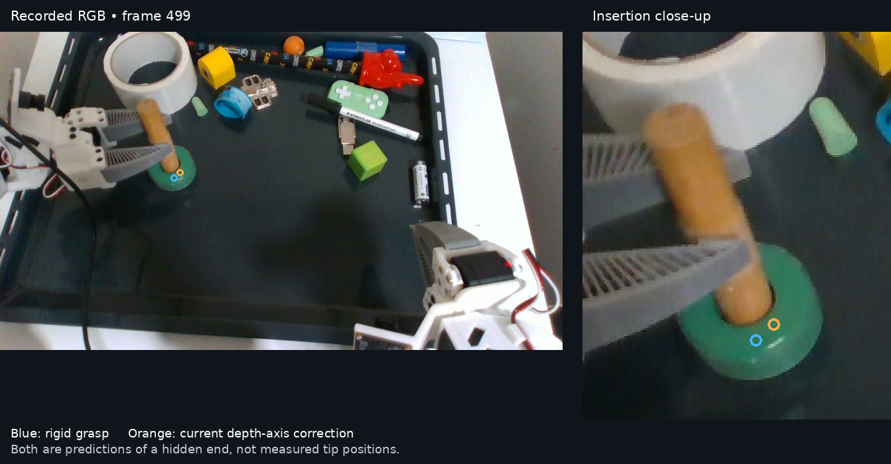

### Why the dowel pose stays wrong after gripper release

The gripper opens at about demo frame 514. The dowel **really does tilt** as it settles in the ring, so a changing angle after release is not itself an estimator error. Point2Pose's candidate end had already jumped 16.2 mm at 497→498 and about 24 mm at each of 500→501 and 501→502. On the first jump, the arm did not translate and segmented median depth shifted only 2.6 mm. An exact rerun of the configured Point2Pose trace reproduced all 451 poses bit-for-bit and exposed the fitted points for this check.

The current depth **does** show useful cylindrical geometry once the dowel becomes clearer. A robust circle fit to the middle of its first clear shaft view (frame 100) gives a radius of **10.01 mm**. At frame 540, the segmented, depth-continuous middle shaft has 1,728 points and a 3D long-axis eigenvalue ratio of 11.57. Its axis differs from Point2Pose's by **17.2°**. Holding the learned radius fixed, fitting only the circle center on one checkerboard half of the pixels and scoring the other half gives **1.37 mm** radial p90 for the depth-derived axis versus **4.84 mm** for the Point2Pose axis. At frame 550 the figures are 1.37 versus 4.06 mm. The visible 2D SAM3 mask axis independently disagrees with Point2Pose by about 11–13° in the late frames; Point2Pose’s own SAM2 mask yields 12.2° at frame 540 and 10.8° at frame 550, so this is not specific to the SAM3 mask. This is a wrong shaft **tilt**, not merely an unconstrained rotation about a round shaft. At frame 500, contact occlusion reduces the depth axial ratio to 1.84; its 3D PCA axis is not a reliable correction then.

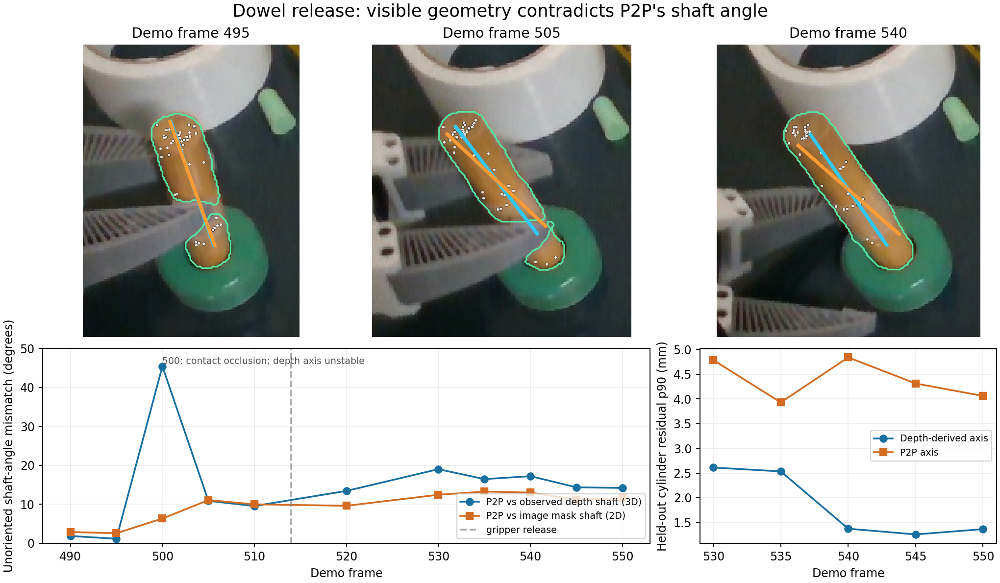

Cyan is the current depth-derived shaft axis, orange the Point2Pose shaft axis, green the SAM3 mask, and white dots the accepted Point2Pose correspondence pixels. The axes are centered together solely for comparing direction.

The configured Point2Pose estimates motion from sparse tracked 3D correspondences with cluster RANSAC/SVD. The recorded mask and depth checks establish that an individual correspondence lies on a currently segmented depth pixel; they do **not** establish that all the pixels form the same rigid material surface or that the final pose explains the full observed shaft. Point2Pose reports 36/82 fit inliers at frame 540 and 82/111 at frame 550; all sampled inlier pixels lie within the SAM3 dowel mask. Some tracked point IDs nevertheless switch depth surface during contact while retaining valid-looking 2D tracks. Its maintained valid point map is also much broader than the physical dowel, even though the current inlier subset is shaft-sized. The separate SDF inspection below identifies why the intended dense geometry checks did not correct this output. Moreover, when SDF refinement succeeds with `return_refined_pose: false`, the reported inlier flags are computed for the **refined candidate**, while the emitted pose remains the unrefined candidate; those counts are not a guarantee about the emitted pose.

The [diagnostic script](analyze_dowel_release_geometry.py) and [per-frame numbers](dowel_release_geometry.csv) preserve the geometric test. Held-out pixels are adjacent RGB-D samples, not an independent ground-truth scan, so this establishes same-frame geometric inconsistency, not the true hidden-tip pose. A controlled correction should keep the gripper/point-motion prediction through low-observability contact, retain competing hypotheses, then test them against the current segmented depth and silhouette once the shaft reappears. The shaft shape can be inferred from clear demo views; FLASH should use a general learned/reference-surface consistency test instead of a hardcoded dowel rule. This correction is not yet integrated into the live estimator or validated in a physical run.

### What the Point2Pose SDF actually contains, and why its guard did not stop the tilt

I reran the **same configured Point2Pose pipeline** through the sealed bridge and captured its TSDF after keyframe fusion, plus the registration diagnostics. The 451 emitted poses and lost flags are bit-for-bit equal to the control trace. The builder fuses mask-filtered RGB-D from selected keyframes into an object-frame grid using the **estimated keyframe pose**. The grid has 5 mm voxels and 200 mm of padding around the first observation. That padding defines allocation bounds, not a scanned solid object.

The weighted near-zero TSDF voxels initially form a narrow rod: at frame 100, all **125** near-surface voxels are within 20 mm of the first-view shaft axis. The first off-axis voxels appear when the keyframe **recorded at 249** is fused at frame **252**. They accumulate with later keyframes: **55/190** are more than 40 mm from the shaft by frame 340, and **85/319** are more than 40 mm away at frame 540. Some are 80–110 mm away. At frame 540 the largest 26-connected surface component has **214** voxels; the other **105** are scattered among smaller components. The TSDF at 540 is exactly the same array as at 505; it had received no new keyframe in between. This is a rod **plus disconnected ghost surfaces**, not one slightly tilted cylinder. The [raw TSDF and weight snapshots](p2p_dowel_sdf_release_snapshots.npz), [progress counts](p2p_dowel_sdf_progress.csv), and [plot source](plot_p2p_release_sdf.py) preserve the check. The plot shows only voxels that have been observed and lie near the TSDF zero level set; red means farther than 40 mm from the initial shaft.

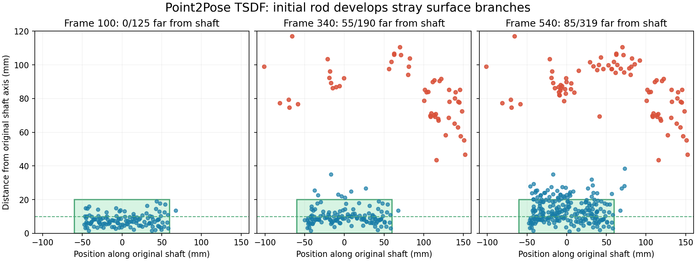

Capturing the **exact masked depth, pose and intrinsics fed to each SDF keyframe** isolates how those false surfaces entered. The second input has **1,429** valid depth pixels inside Point2Pose's positive SAM2 mask. Its main **1,164-pixel** depth layer maps to a median **8.6 mm** from the first-view dowel axis in object coordinates. A **265-pixel** foreground layer near the gripper–dowel boundary is roughly **10 cm closer to the camera** and maps to a median **97 mm** from that axis. The mask looks broadly aligned with the visible dowel in RGB, but depth _inside_ it mixes distinct surfaces. Pixel alignment between RGB and depth does not guarantee that an RGB-labeled pixel and its depth return describe the same physical surface at an occlusion edge. In the next keyframe, **425/2,158** masked-depth pixels map over 40 mm from the shaft. Every later fused keyframe has another **6–20%** of masked pixels beyond 40 mm even though its median pixel remains shaft-sized. This directly implicates mixed object/occluder/background or boundary-depth pixels in the fused observations; a bad whole-keyframe pose is not needed to explain the first ghost branch.

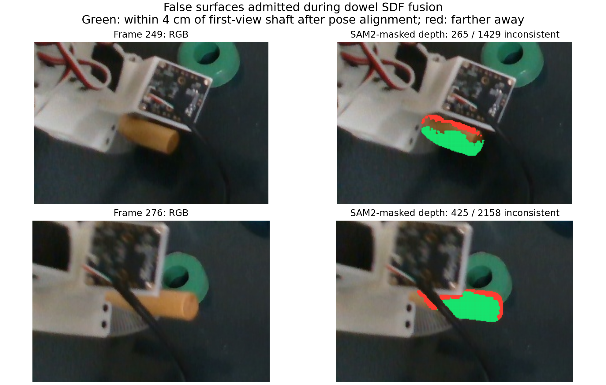

An offline CPU replay using the [saved masked keyframe depths and poses](p2p_dowel_sdf_keyframe_depths.npz) reproduces the GPU volume's **weights exactly**, its TSDF values to within **4 × 10⁻⁶**, and the same **85** off-axis near-surface voxels at frame 540. Removing just the 265 foreground-depth pixels from the second input eliminates **all five** off-axis voxels that input introduced. Removing all input pixels that map more than 40 mm from the original shaft leaves **zero** off-axis near-surface voxels at frame 540. The [ablation code](analyze_p2p_sdf_keyframes.py) reproduces this check. The 40 mm shaft test is an **oracle diagnostic** using this object's known first-view geometry, not a proposed hardcoded runtime filter. It shows that outlying masked observations, rather than TSDF arithmetic, created the extra surfaces. It does not resolve whether each pixel came from an occluder, a depth-edge artifact, or a segmentation error.

I then tested **non-oracle** filtering methods on the ten later SDF inputs, scoring them against the generous 40 mm shaft check above. The [filter comparison](compare_p2p_sdf_input_filters.py) and saved SAM2 logits in the keyframe file reproduce these totals:

| Diagnostic input filter                             | Plausible dowel depth retained | Off-axis depth rejected |
| --------------------------------------------------- | -----------------------------: | ----------------------: |
| Require SAM2 logit > 10                             |                          71.9% |                   59.5% |
| Erode the mask by 3 × 3 pixels                      |                          87.5% |                   47.9% |
| Keep largest depth-connected component (5 mm edge)  |                          95.0% |                  100.0% |
| Match the clean first-view surface (median + 7 MAD) |                          98.9% |                  100.0% |

Mask confidence and erosion do **not** solve this case: bad depth lies inside a reasonably confident object silhouette. Depth helps by revealing separate 3D layers. The 5 mm connected-component choice removes every scored outlier here and produces no far SDF surface at frame 540, but discards **21.5%** of plausible pixels in one keyframe. Raising that edge threshold to 10 mm joins an occluding surface in frame 366 and retains **404** bad pixels. The first-view surface comparison also produces no far SDF surface, with less pixel loss on this recording; it cannot by itself bless a genuinely new side of an object absent from that first view. These thresholds were chosen for an **offline ablation**, not validated as general defaults. A generic estimator should use calibrated depth uncertainty, a trusted surface and pose uncertainty to mark points as supported, contradictory or novel; novel regions should remain provisional until repeated co-motion or another view supports them. Fusing a whole keyframe because most pixels fit is insufficient when its remaining pixels describe another surface. Both `sdf_kf_gate` and `pending_kf_sdf_gate` were disabled in this configured replay, but a single whole-keyframe gate would not itself remove the minority contaminants.

A [causal keyframe-support check](compare_p2p_temporal_support.py) provides a first test of the proposed multi-view confirmation. Before fusing each later keyframe, retaining only its 10 mm object-frame voxels also present in the preceding **three fused keyframes** keeps **88.2%** of the points within the generous shaft check and rejects **99.2%** of off-axis points. A 5 mm voxel test keeps **72.8%** and rejects **100%**, respectively. This is a diagnostic on irregularly spaced keyframes using Point2Pose's saved poses, not a consecutive-camera-frame test or a validated live filter. A hard recurrence rule would discard newly visible legitimate surfaces. It may also eventually admit a gripper surface that repeatedly co-moves with a held object, so temporal support must be combined with depth separation, model provenance, known-occluder evidence when available, and uncertainty-aware pose checks.

The source code explains why the existing checks did not rescue the pose. The mask and depth checks validate **individual tracked correspondences**. They cannot verify that a collection of tracked points still represents one unchanged rigid body. The SDF selector is also not a hard final-pose test. At frame 540, its chosen candidate scores **0.88 normalized TSDF units** and only **0.20%** of sampled current-depth points meet its 0.01 near-surface criterion, below the configured **5%** eligibility minimum. The score therefore sets this candidate's SDF distance to unavailable (`3d_dist = -1`) and falls back to previous-frame geometry, motion and RANSAC terms. Its reported SDF “support = 1.0” means the points fall inside the **padded volume bounds**, not that they lie on reconstructed dowel surface. At frame 540 there were two pose candidates, so this fallback did select between them.

There is a second, independent limitation: the configuration sets `enable_sdf_refine: true` but `return_refined_pose: false`. The refinement ran and lowered its own cost at frame 540, yet the emitted pose stayed on the unrefined branch. Enabling the refined result without fixing the model would not solve this example: that refined candidate's shaft is still about **14.8°** from the current depth axis, versus **17.0°** for the emitted pose, and its held-out cylinder residual remains about **4.8 mm p90** versus **1.37 mm** for the depth-derived axis. The [saved registration stats](p2p_dowel_sdf_release_stats.json) show the score and refinement status at each sampled frame.

FLASH does compute a separate free-space contradiction from its reference points and current depth, but `_record_direct_free_space` records that result **without changing pose ownership**. Its group and point-motion comparison can reject a direct pose only when a supported alternative exists at that frame. The [full-demo evidence video](visualize_full_demo_fusion.py) deliberately shows **unfused** sources, so its orange Point2Pose outline is a raw proposal, not proof that the controller accepted it. At frame 540, the recorded raw-proposal check marks **146 of 289** valid-depth projected reference points as free-space contradictions; this is evidence the geometric disagreement was detectable, not evidence that a guard acted on it.

This settles the apparent contradiction: the observed depth is cylinder-like, but masked keyframe depth contained other surfaces, the maintained SDF absorbed them, and the pipeline's SDF terms did not enforce the visible shaft on the emitted pose. The exact label of each offending pixel and the sparse match that produced the later tilt still need separate analysis. The next controlled fix is to validate each keyframe **before** adding it to the object model, represent observed SDF support separately from allocation bounds, and require a final pose proposal to agree with current reliable segmented surface geometry or remain a disputed hypothesis. Simply lowering the SDF threshold or turning on the currently discarded refinement would force an unreliable model onto the pose.

### Replay-only trial: three-keyframe support versus depth-layer separation

I tried both filters **before SDF fusion** in a full Point2Pose replay of demo frames 100–550. This used the pinned Point2Pose fork, exact sealed bridge/configuration, original RGB-D and SAM2 segmentation, and no change to correspondence tracking or registration. The first SDF keyframe was unchanged. The [replay-only bridge](p2p_temporal_sdf_bridge.py) changes only the depth passed to `SDFBuilder.integrate_keyframe`, then restores the frame depth for the rest of the tracker. These are diagnostic branches; neither is a FLASH runtime default, and no robot moved. The [fixed-pose map ablation](replay_p2p_temporal_sdf.py) preceded the full replay.

The temporal branch retained a later keyframe pixel when its 10 mm object-frame voxel appeared in any of the preceding three _fused keyframes_. The depth branch retained the largest within-mask depth-connected component, with a 5 mm adjacent-pixel depth cutoff. Both are causal, but these numbers are trial settings, **not validated general thresholds**. In particular, a 10 mm depth cutoff reconnects a wrong surface in this recording; a repeated but false surface could also pass the temporal test. The [pixel-retention logs](p2p_sdf_window_filter.jsonl), [dowel depth-filter log](p2p_sdf_depth_filter.jsonl), and [ring depth-filter log](p2p_ring_sdf_depth_filter.jsonl) record which fusion inputs changed. The unfiltered trace is bit-reproduced by the sealed configuration, and the filtered traces agree with it before the first changed fusion output. A second complete depth-filter replay after cleaning up the diagnostic code reproduced every saved pose, lost flag, mask count, fit count and inlier count exactly; only wall-clock timing differed.

At frame 540, the depth-filtered SDF has **199** observed near-zero voxels, **none** more than 40 mm from the original shaft axis; the unfiltered SDF has **319**, including **85** off-axis voxels ([filtered snapshot](p2p_dowel_sdf_depth_component_540.npz), [original snapshot](p2p_dowel_sdf_release_snapshots.npz)). The fixed-pose temporal-map ablation also eliminates off-axis voxels, but removes some legitimate new-view surface. The decisive test is the _emitted pose_, not just the map:

Here is the **stored SDF surface itself**, shown as a 3D view and a side projection at the same frame. Each dot is an observed 5 mm volume cell close to the SDF zero level, not a separately fitted mesh. Color marks distance from the first-view shaft: blue within 20 mm, orange from 20–40 mm, and red beyond 40 mm. This coloring is diagnostic only; the filter did not use the known shaft. The original map contains a rod plus distant false patches; the depth-separated map removes those patches but still has **12 cells** beyond 20 mm, including **3** beyond 25 mm (maximum **27.4 mm**). The first clean map had no cell beyond 20 mm, though its 5 mm cells and finite SDF surface band extend its apparent radius to 19.1 mm. [Plot source](plot_p2p_sdf_before_after.py).

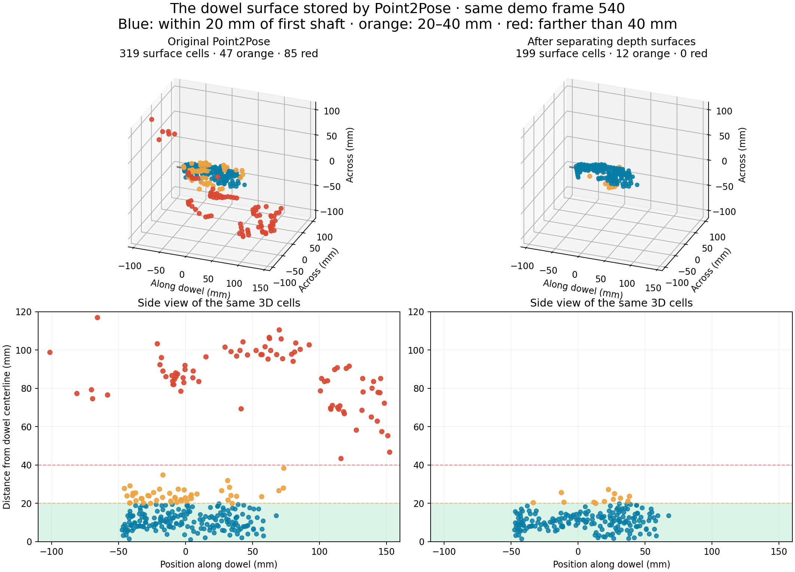

The remaining cells are not random plotting noise. Capturing the SDF after each filtered fusion shows cells beyond 20 mm first appear after a view recorded at demo frame 361 (**2** cells), rise after frame 390 (**6**), and rise again after frame 497 (**14**); after the final view at 517, **12** remain. At frame 497, the connected-depth filter admitted **252 of 2,561** masked pixels that, when transformed with that keyframe's estimated pose, lie more than 20 mm from the first-view shaft. They cluster at the gripper–dowel and ring–dowel boundaries. The filter only separates _disconnected_ depth patches; a boundary patch that connects to the main dowel patch can pass. These data do not distinguish a wrong depth return from an imperfect keyframe pose for every pixel, so the filtered SDF is cleaner but still not a verified dowel surface. The replay-only bridge can save the per-keyframe volumes and selected depth with `FLASH_P2P_SDF_KEYFRAME_SNAPSHOT_DIR` for this check.

| Dowel, frames 514–550 after release; median per-frame metric | Original P2P | Three-keyframe window | Depth component |
| ------------------------------------------------------------ | -----------: | --------------------: | --------------: |
| Angle to current depth-derived visible shaft                 |       14.26° |                17.73° |           6.19° |
| Held-out visible-shaft circle residual, p90                  |      3.91 mm |               5.39 mm |         2.11 mm |
| Current depth to transported first-view surface, p90         |      9.05 mm |              10.93 mm |         7.63 mm |
| Transported surface inside current SAM3 mask                 |        0.662 |                 0.620 |           0.836 |
| Transported surface contradicted by closer current depth     |        0.436 |                 0.586 |           0.088 |

The [shaft-angle and held-out-circle rows](p2p_sdf_filter_shaft_evidence.csv) come from [this diagnostic](compare_p2p_sdf_filter_shaft.py), which learns the radius from frame 100 and fits only a circle center to one checkerboard half of current depth pixels. The [generic per-frame dowel scores](p2p_sdf_filter_dowel_evidence.csv) come from [the existing pose-evidence scorer](analyze_pose_hypothesis_bank.py). These measures use the same recording and current SAM3 mask; they are **visible-surface consistency**, not an independently measured 6D pose or hidden-tip error. The picture shows the same current pixels against each branch's emitted shaft, including the bad temporal result.

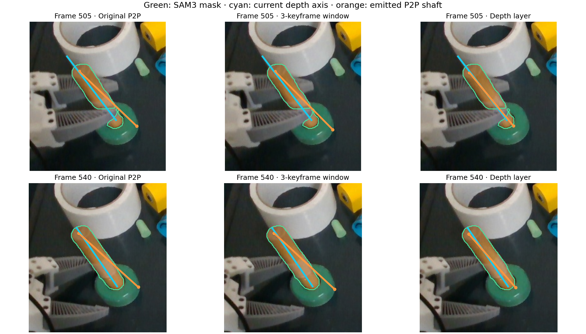

The benefit is **not uniform**. During insertion frames 400–500, the depth branch changes median observed-surface p90 from **7.50 to 7.82 mm** (worse), mask coverage from **0.706 to 0.712** (slightly better), and free-space contradiction from **0.173 to 0.155** (better). As a control, the same depth filter on the ring changes median frames-400–550 surface p90 **3.267 to 3.302 mm**, mask coverage **0.657 to 0.656**, and contradiction **0.066 to 0.067** ([ring scores](p2p_sdf_filter_ring_evidence.csv)). Both ring traces emit all poses. The saved [dowel window](p2p_dowel_sdf_window_100_550.npz), [dowel depth](p2p_dowel_sdf_depth_component_100_550.npz), and [ring depth](p2p_ring_sdf_depth_component_100_550.npz) traces let the visual and numeric comparisons be repeated against the original trace. [Plot source](plot_p2p_sdf_filter_trial.py).

**Conclusion for this trial:** a rigid three-keyframe recurrence rule cleans the map but worsens the pose; it is not a sufficient fix. Separating depth layers before fusion substantially improves the dowel's post-release visible-shaft fit on this recording without a large ring regression, but does not prove better insertion or generality. The next design must decide how to separate surfaces using measured depth uncertainty, how to admit genuinely new object surfaces, and how to arbitrate the final emitted pose against current observations. This replay-only threshold should not be promoted to the runtime unchanged.
