# FLASH restart: postmortem and research

2026-10-31. Code audit and literature review, not a replacement implementation.
The two preserved experiments are `proto/show-and-servo` at `80d90b783` and
`docs/flash-redesign` at `c72e1e1c3` (tag `flash-redesign-sealed-20261031`).
The latter's [handover](../../../src/lerobot/policies/flash/docs/SEALED_20261031.md)
records what was saved and verified. This research continues separately on
`research/flash-tracker-restart`.

Current design: [FLASH tracking pipeline](../../../src/lerobot/policies/flash/docs/tracking_pipeline.md).
That is the maintained proposal; this file preserves dated research and results.

Current checkpoint, 2026-11-05: rejected fits can no longer publish an unchecked
fallback pose or leave a rolled-back Kalman correction marked accepted. Caching
measured geometry and fitting independent objects concurrently preserve every pose,
status and surface update across four complete replays (1,590 frames). The two
robot demos take **269 and 223 ms/frame (3.7 and 4.5 fps)** with saved masks,
excluding live SAM, camera capture and display. [Baseline and verification](runtime-baseline-20261104/publication-fix.json).

**Overall tracking correctness is not solved.** Seven recorded recovery checks
still fail, and the cube's segmentation identity drift remains a separate issue.
Our own demos have no independent full-sequence pose labels. The fresh focused
suite passes 195 tests, with one optional Open3D test skipped in the inference
environment; the four Open3D experiment/adapter tests also passed in isolation.
Passing these guards does not establish that every wrong alignment is rejected.

The faster coarse-to-fine and shortened-solve variants remain benchmark-only:
they have accuracy/availability trade-offs and do not replace defaults. Newer
scene-depth checks, recovery starts and Kalman-reset changes remain opt-in;
velocity experiments remain benchmark-only. The running server and its saved
playback results have not been replaced by these timing experiments. The dated
sections below preserve the measurements and remaining failures.

## Did the redesign become worse?

There is no matched end-to-end comparison that establishes a global ranking.
There are confirmed regressions, and the user's worse experience must not be
dismissed because the newer system records more diagnostics. The main failure
of the workstream was replacing a demonstrably useful path without first
preserving its behavior as a comparison baseline.

Show-and-servo adapted recorded gripper motion using the target object's motion
and a held-object/gripper correction. Point2Pose linked the demo to the scene;
point groups updated motion within the recording. This could execute an action
without freshly verifying the held object's whole pose every frame. Its
[sealed report](https://github.com/TheWisp/lerobot/blob/80d90b783/docs/showservo/sealed/LESSONS.md)
records five stacks among five clean completed acts on October 12, but also one
insertion and two misses in the later October 18–19 examples. Aborted starts are
excluded from that stacking count. These are useful outcomes, not a controlled
success-rate estimate. The same report found serious held/contact pose errors.

| What changed or went wrong                                        | Evidence                                                                                                                                                                                                                                                                                                                                                                                  | Consequence                                                                                                                                                                                                  |
| ----------------------------------------------------------------- | ----------------------------------------------------------------------------------------------------------------------------------------------------------------------------------------------------------------------------------------------------------------------------------------------------------------------------------------------------------------------------------------- | ------------------------------------------------------------------------------------------------------------------------------------------------------------------------------------------------------------ |
| We changed the estimator while rebuilding the product.            | The new surface path uses UFM motion followed by fitting a fixed partial reference; Point2Pose is not part of that path. [Implementation](../../../src/lerobot/policies/flash/docs/surface_tracking.md).                                                                                                                                                                                  | A successful old rollout cannot establish the new path works; changing several layers obscures the cause of a regression.                                                                                    |
| Surface correction can make an initially better pose worse.       | On the labelled cracker turn, final source-point displacement was 13.8 mm for the raw UFM chain, 31.2 mm after motion-constrained fixed-reference fitting, and 25.2 mm with the experimental growing map. [Recorded ablation](../flash-surface-multiview/README.md).                                                                                                                      | This is a concrete fitting failure on that clip, not just stricter rejection or display latency. It is not a whole-system comparison.                                                                        |
| The map and fitting objective were mismatched.                    | The model normally contains the first observed side, but the objective also asks new visible points to match it. Removing that reverse term alone worsened some labelled cases. [Ablations](../flash-surface-multiview/README.md).                                                                                                                                                        | New sides can pull the fit incorrectly; simply loosening the fit or adding points is not an established fix.                                                                                                 |
| Useful evidence does not stay together throughout estimation.     | UFM correspondences initialize fitting but are absent from its final objective. Group/object-point disagreements are handled later in `CausalPoseService`.                                                                                                                                                                                                                                | Geometry can discard a useful motion answer before a later gate rejects it. The benefit of one joint fit remains to be measured.                                                                             |
| Shared processing and event timing arrived incrementally.         | Shared demo/live scene estimation: [5d04bf37a](https://github.com/TheWisp/lerobot/commit/5d04bf37a). Shared vision processing: [8a394de5a](https://github.com/TheWisp/lerobot/commit/8a394de5a). Recorded RGB-D timing: [8916e1eda](https://github.com/TheWisp/lerobot/commit/8916e1eda). Motor-time attachment events: [3c58e4fb2](https://github.com/TheWisp/lerobot/commit/3c58e4fb2). | A good debugger result did not initially imply the same demo or Test result. Timing defects also affected physical pose interpretation. These links identify fixes; they do not say those exact bugs remain. |
| Acceptance and UI work outpaced an independent accuracy baseline. | Local demos have no independent pose labels; the frozen external baseline supplies masks and some saved traces use older configurations. [Benchmark limits](../../../benchmarks/FLASH_TRACKING.md).                                                                                                                                                                                       | Better residuals, fewer rejected poses, passing tests and smoother overlays can each coexist with worse physical tracking. The editor exposed implementation details without settling the tracker.           |

Some failures became more visible because rejection increased; some examples
also became harder as testing expanded to external objects. Those explain why
aggregate impressions are hard to compare. They do not excuse the confirmed
fitting and integration problems. The available evidence supports preserving
the old end-to-end behavior for comparison, not declaring Point2Pose universally
best: the [pose benchmark](../flash-full-pose-benchmark/README.md) contains both
wins and failures for it.

## How motion and surface evidence currently cooperate

```text
Current mask + sensor depth → measured partial surface ──────┐
Two images + measured depth → point matches → pose seed ─────┤
Fixed reference surface ────────────────────────────────────┤
                                                          ↓
                                                   surface-only fit
                                                          ↓
Object/group motion → separate comparison / prediction → selected pose
```

Previously tracked or predicted points do not fill the current depth image.
Points measured on the object constrain its motion under a rigidity assumption.
Points on a tray or another support constrain the object's motion only if their
relationship holds. Robot encoders measure the gripper; whether an object stays
fixed to it is likewise a hypothesis. These three statements have different
evidence even if each can produce a proposed rigid motion.

### Did groups include the object's own points?

**Yes, in both sealed implementations.** The current UFM comparison does not
run those persistent point trackers. Audit of the exact sealed commits:

| Implementation                 | Points on the object                                                                                                                                                                        | Points outside the object                                                                                                                                                        |
| ------------------------------ | ------------------------------------------------------------------------------------------------------------------------------------------------------------------------------------------- | -------------------------------------------------------------------------------------------------------------------------------------------------------------------------------- |
| Show-and-servo, `80d90b783`    | TAPIR tracks points selected inside the object mask. `TrackedObject.model` stores their positions in a fixed object frame; `_place_objects` fits that frame to surviving visible point IDs. | The same grouping system can carry the object using other members of its group, provided their relative motion remains consistent.                                               |
| Redesign, `c72e1e1c3`          | `CausalRigidPointTracker` tracks image corners seeded inside the mask, uses measured depth, and fits their initial 3D positions to their current positions.                                 | `scene_groups.py` deliberately selects surrounding points outside object masks; `CausalPoseService` combines their relationship predictions with the separate object-point path. |
| Current offline UFM comparison | Each image pair's matches are already fitted to **one rigid motion**, but no persistent point-ID map is maintained across the clip.                                                         | No surrounding-group or gripper input in these ablations.                                                                                                                        |

The redesign also contains a growing-point experiment:
[`VisibleRigidTracker`](../../../src/lerobot/policies/flash/visible_rigid_tracking.py).
It stores each accepted point in a fixed object frame, estimates motion from
visible known points, and adds newly visible points only after estimating that
motion. Hidden landmarks move with the same frame. This is used by the
TrackEverything pose/visible-tracking experiments, not the current UFM baseline
or the live `CausalRigidPointTracker`. We should reuse it as a comparison rather
than rediscovering the mechanism.

There were integration limits: the redesign's fast service calls
`tracker.update(frame)` without a fresh mask; slow visual estimates are checked
later. Its live object-point tracker loses points and is reseeded by accepted
visual estimates, rather than continuously growing its own point map. Surface
fitting and those tracks are reconciled later, not fitted jointly. In the older
system, the held-object mode could bypass the own-point update in favor of an
externally supplied gripper pose. These are code findings, not proof that any
one caused every observed failure.

**Expected benefit to test:** with only part of a rigid object visible, correctly
identified, sufficiently spread points can determine its motion and carry its
hidden points with it. This could preserve identity and reduce frame-to-frame
drift as visibility changes. Outside groups or a firmly attached gripper can
also help when no object points remain visible. They require an additional
relationship assumption that the object's own rigidity does not.

**Limit:** many matches can slide together across a smooth surface while still
passing a rigid fit and remaining inside the mask. A small or nearly straight
set of points may also leave some rotations uncertain. Rigidity cannot supply
missing point identity or unseen independent motion. Own-point tracking is
visual evidence, not an independent vote merely because it is called a group.

Next comparison: retain the current baseline, add persistent own-object tracks
with the same masks/depth, then add surrounding co-motion separately. Measure
partial occlusion, reappearance, smooth visible surfaces and broken support
relationships separately. Test joint surface/point fitting as another change;
do not silently replace the baseline with several changes at once. Predictions
must never be inserted as fresh sensor measurements.

Audit sources: [old grouping](https://github.com/TheWisp/lerobot/blob/80d90b783/src/lerobot/showservo/groups.py),
[old tracker frontend](https://github.com/TheWisp/lerobot/blob/80d90b783/benchmarks/group_live.py),
[redesign own points](https://github.com/TheWisp/lerobot/blob/c72e1e1c3/src/lerobot/policies/flash/causal_points.py),
[redesign surrounding groups](https://github.com/TheWisp/lerobot/blob/c72e1e1c3/src/lerobot/policies/flash/scene_groups.py).

## Initial research direction, 2026-10-31

The updated design is maintained in [Tracking pipeline](../../../src/lerobot/policies/flash/docs/tracking_pipeline.md).
The initial proposal below is retained as research history. The updated design
makes automatic surface growth part of the core and keeps source contributions
so corrected registrations can revise the bounded map. This bookkeeping does
not imply automatic detection or rollback of every past error.

The agreed scope is rigid-object tracking from partial observations. Surface
measurements and optional motion constraints contribute to one estimate:

```text
SAM mask + RGB-D → cleanup → measured visible surface ───┐
Previously observed object surface ─────────────────────┤
RGB-D point correspondences → measured motion ──────────┤
Optional relationships → predicted motion ──────────────┤
                                                       ↓
                                      surface and motion estimation
                                                       ↓
                                     pose + uncertainty + source time
                                                       ↓
                                  update surface with supported observations
```

The object frame stays attached to the accumulated geometry; it is not
recentered on each visible fragment. Newly exposed surfaces extend the model.
How to accept those additions without letting wrong alignment corrupt it is an
experimental question, not a solved property of this diagram.

Each contributor identifies what it constrains, the frames/times it relates,
its uncertainty, and the condition under which it applies. Object point tracks
assume rigidity; surrounding groups assume a continuing relationship to the
object; gripper motion assumes a firm grasp. These can constrain the same fit
without pretending to be new depth measurements. The estimator must also work
when any optional source is absent. Deformable objects need a different motion
model later; rigid fitting must not silently label their deformation as motion.

Mask and depth cleanup are replaceable helpers whose effects are measured
separately. Our [depth-model pilot](../flash-contact-observation/temporal-depth-pilot/README.md)
found mixed results: LingBot helped the dish's withheld-depth test, while simple
nearest filling beat both tested models on several other examples. This tested
agreement with withheld sensor values, not true depth in holes or transparent
objects. Model-completed depth must remain labelled as inferred; it cannot
independently confirm a pose fitted using that same completion.

Later experiment: [Amodal SAM](https://arxiv.org/html/2604.20748v1) predicts
the complete 2D object outline, including hidden regions. The paper adapts
original SAM for images and SAM2 for video; it is not based on SAM3. Treat
its completed outline as an optional hypothesis input, kept separate from
the visible mask and measured depth. Depth at an occluded pixel belongs to
the covering surface and must not become an object point. Compare with and
without completion on controlled occlusions and labelled pose clips, measuring
hidden-outline accuracy, pose error, recovery and latency before adopting it.

**Deferred, not implemented:** reuse SAM3's visible masks, image features and
recent frames in a separately trained outline-completion component. There is
precedent in [HyperDAM](https://arxiv.org/abs/2609.34396), which uses frozen SAM3
features to predict a full bounding box, not a detailed hidden outline, and was
evaluated on hyperspectral video. **Outline completion is not pose estimation:**
it does not establish 3D depth or which physical surface points correspond
across frames. It could supply an additional image constraint; its value must
be measured by improved pose accuracy and recovery, not outline appearance
alone. Keep this separate from the immediate motion-and-surface fitting work.

## Research relevant to the restart

Primary sources were read on 2026-10-31. The lessons below are recommendations
for experiments, not claims that their reported accuracy transfers to our rig.

| Source                                                                                                                                     | Relevant mechanism                                                                                                                                                                            | What it does not establish for us                                                                                                                                                                                                                           |
| ------------------------------------------------------------------------------------------------------------------------------------------ | --------------------------------------------------------------------------------------------------------------------------------------------------------------------------------------------- | ----------------------------------------------------------------------------------------------------------------------------------------------------------------------------------------------------------------------------------------------------------- |
| [Co-Fusion](https://github.com/martinruenz/co-fusion), [MaskFusion](https://github.com/martinruenz/maskfusion)                             | Segment independently moving objects, track them against evolving surface models, and fuse their labelled RGB-D observations. Model growth is part of tracking.                               | Their older segmentation and motion assumptions are not a validated solution to our smooth toys, grip occlusion or SAM errors.                                                                                                                              |
| [BundleTrack](https://arxiv.org/abs/2108.00516), [BundleSDF](https://bundlesdf.github.io/)                                                 | Use temporal feature matching and automatically maintained memory frames; jointly refine related poses. BundleSDF additionally learns object geometry in a separate thread.                   | A memory frame is an internal computational choice, not a manually chosen canonical view. Neural reconstruction and historical pose revision add cost; neither is required before comparing simpler fits.                                                   |
| [NVIDIA 3DObjectReconstruction](https://github.com/NVIDIA/3DObjectReconstruction#configuration)                                            | Its BundleTrack optimization exposes both 3D correspondence and point-to-plane terms, with robust loss. Useful implementation reference for retaining correspondence evidence during fitting. | It is a reconstruction workflow, not a demonstrated drop-in real-time tracker; its documentation also reports optimizer speed and memory problems.                                                                                                          |
| [ROFT](https://arxiv.org/abs/2111.03821)                                                                                                   | Combines fast optical-flow motion with slower segmentation/pose outputs through filtering and explicit delay handling.                                                                        | It does not solve unknown-object model construction; smoothing cannot recover an unobserved motion or fix a systematically wrong shape.                                                                                                                     |
| [Temporally Consistent Object 6D Pose Estimation](https://data.ciirc.cvut.cz/public/projects/2024TemporalPose/)                            | Combines pose observations, motion models and estimated uncertainty in an online factor graph.                                                                                                | This is evidence for a fusion approach, not proof that our confidence estimates or partial surfaces are sufficient.                                                                                                                                         |
| [Visuo-tactile estimation, 2025](https://arxiv.org/html/2503.19893v1), [VICON, October 2026 preprint](https://arxiv.org/html/2610.05180v1) | Combine visual and hand/contact evidence as separate constraints. VICON explicitly tests rendered geometry against depth and changes the motion relation with contact evidence.               | The former uses object meshes and tactile sensors; VICON uses reconstructed meshes, an instrumented glove and offline bidirectional refinement with many gates. Their results do not validate a causal RGB-D-only core or justify copying their thresholds. |
| [Switchable constraints](https://nikosuenderhauf.github.io/assets/papers/IROS12-switchableConstraints.pdf)                                 | Allows an optimizer to reduce or reject inconsistent relationship constraints.                                                                                                                | Robust optimization cannot guarantee detection of a wrong relationship when all independent visual evidence is absent. It need not be our first implementation.                                                                                             |

The useful distinction is between **a measured surface**, **measured point
correspondences**, and **an assumed motion relationship**. Keep those inputs
separate even if one estimator uses all of them. Do not average poses solely
because their producers output a confidence number, or count the same RGB-D
pixels twice as independent evidence.

An external-information interface can initially describe a proposed motion or
relationship, the objects and timestamps it concerns, its error/unsupported
directions, and the assumption that permits using it. A gripper integration
would supply such a relationship; external RGB-D recordings simply omit it.
Whether to implement this with a filter, a per-frame joint fit, or a short
window of poses remains an experimental choice. No rollback system or new
editor is implied.

## What certainty should mean

A single score is insufficient as the internal representation: position may be
well constrained while rotation is not. The proposed output contains the best
pose, its timestamp, whether it is observed or predicted, and uncertainty about
translation and rotation. A local covariance can describe one plausible answer;
separate plausible answers require multiple hypotheses or a distribution.
[PoseRBPF](https://arxiv.org/abs/1905.09304) and
[SpyroPose](https://arxiv.org/abs/2303.05308) demonstrate pose distributions,
including rotational ambiguity. They are research references, not validated
drop-in components for our unknown-object tracker.

For a simple UI score, define a checkable meaning: probability that pose error
is within a stated tolerance. Calibrate it on held-out labelled sequences;
do not convert a fitting residual into a percentage. Research on
[conformal pose uncertainty](https://github.com/NVlabs/ConformalKeypoint)
supports calibrating uncertainty sets, but its keypoint setting and statistical
assumptions do not automatically transfer here. Prediction can keep a pose
available during occlusion while uncertainty grows. No information source can
guarantee accuracy when the object moves unseen and every motion assumption fails.

## Minimal experiment infrastructure

The existing suite contains two rig demos, nine labelled YCBInEOAT clips and ten
Caryx clips. All 21 source directories were present in the local inventory on
2026-10-31. At the sealed revision, the runner could freshly process the external
cases, but the rig rows only scored saved preparations. A common fresh rerun of
both was the first missing boundary; scoring old files after an algorithm edit
does not test that edit. The local experiment below addresses this boundary.

The proposed harness needs only a sequence list, a causal frame reader, a
replaceable tracker call, and a result writer/scorer. Reuse existing dataset
readers, evidence formats and scoring where they fit. Identical recorded frames,
calibration, initialization, configuration and optional source inputs allow
controlled comparisons. Evaluation labels remain outside the tracker. Publish
one comparison report and frame-aligned videos with the same persistent pose
axes; save per-frame timings separately from startup and file encoding.

Expand with whole sequences and different cameras, objects and motions, keeping
splits by recording rather than adjacent frames. The two local demos remain
diagnostic because they lack independent pose labels. External supplied masks
isolate fitting; separate SAM runs test the full perception path. Candidate
datasets include [DexYCB](https://arxiv.org/abs/2104.04631) and
[HO-3D](https://arxiv.org/abs/1907.01481) for labelled RGB-D hand/object motion.
Their annotations are evaluation references, not permission to give the tracker
an object mesh or contact state unavailable in normal use. Existing cases are
development data; genuinely unseen sequences are reserved before tuning.

Algorithm changes belong first in this offline loop. An editor, policy rewrite
or hardware rollout is unnecessary to answer whether tracking improved.

## Comparisons that would settle the choices

Use identical RGB-D, masks, frame schedule and initialization. Compare raw
point-motion propagation, the archived surface-correction path, and a joint
fit retaining point correspondences plus depth/outline evidence. Separately
toggle fixed versus accumulated geometry and optional support-motion input;
otherwise several simultaneous changes would again prevent diagnosis.

Include visible turns, newly exposed sides, partial/full occlusion, a moved
support, an object moving independently of that support, and deliberately
incorrect motion assumptions. Test boundary filtering separately with supplied
masks and SAM output. Keep raw observations separate from predicted geometry.
An automatic map-growth test must catch wrong accepted alignments, not merely
show that it added points. No manual canonical-view selection is required.

Score pose error against labels (translation, rotation and carried-point error),
error distributions alongside published/lost coverage, confidently wrong poses,
recovery delay, map corruption, and processing latency/resource use. Fix the
evaluation definition before tuning; the current 21 cases are development data,
so a new holdout is necessary. Replay can compare perception on fixed input;
it cannot prove how a changed controller would perform physically.

The first inspection tool needs object naming/clicking, playback and optional
evidence overlays. Task keyframes and adaptation editing belong to the later
policy workflow.

## Local experiment: UFM motion versus surface correction

User direction after review: continue UFM, park Point2Pose, and iterate locally
without per-step commits or product work. The new runner is
[`benchmarks/flash_tracker_experiment.py`](../../../benchmarks/flash_tracker_experiment.py).
It uses the archived core's actual UFM preparation and surface fit. Input
adapters read current RGB-D and saved masks; they do not consume saved object
poses. External masks are supplied annotations and the rig masks are cached SAM
outputs, so this first experiment isolates motion and fitting, not segmentation.

Both candidates share the same UFM matches. One chains only the measured motion;
the other applies the archived surface correction. Neither includes group or
gripper fallback, nor the product's acceptance gates. A returned pose is a
candidate, not a claim of correctness. The comparison preserves failed frames.
The surface reference is the first usable observation, held fixed for this
baseline; this does not implement the proposed gradual model refinement.

All 21 existing source sequences passed image-size, count and timestamp checks.
The first fresh pass processed both full rig demos (713 and 628 frames), the
labelled cracker turn and stationary sugar box (181 frames each), and moving-camera
Caryx-032 (174 frames). On the 115 post-initialization cracker frames where both
methods returned a pose, median transported-point error was **1.88 mm with UFM**
and **8.62 mm after surface correction**. UFM then lost its connection; the
surface fitter kept returning candidates. On the stationary sugar box, all 180
post-initialization frames had poses: medians were **0.59 and 0.91 mm** respectively.
These are development cases scored against supplied pose annotations, not a
general ranking or proof of accurate held-object tracking.

The follow-on pass in `~/.cache/flash-tracker-restart/labelled-expansion-001/`
completed the other seven labelled clips with unchanged settings. There are now
fresh results for 12 sequences: both rig demos, all nine labelled clips, and
Caryx-032. The other nine Caryx sources have passed input checks only.

| Labelled clip        | Paired frames / 180 | UFM median error, mm | After surface correction, mm |
| -------------------- | ------------------: | -------------------: | ---------------------------: |
| Cracker turn         |                 115 |                 1.88 |                         8.62 |
| Stationary sugar box |                 180 |                 0.59 |                         0.91 |
| Bleach 0             |                 180 |                13.87 |                        28.34 |
| Bleach hard          |                 180 |                 8.53 |                        20.87 |
| Cracker, Yale hand   |                   0 |              No pose |         No paired comparison |
| Mustard 0            |                 180 |                 2.59 |                         9.21 |
| Mustard easy         |                 180 |                10.76 |                         5.90 |
| Sugar box, Yale hand |                 180 |                 4.40 |                        12.28 |
| Soup can, Yale hand  |                 180 |                 7.16 |                         8.68 |

Surface correction worsened median error on seven of eight comparable clips,
but improved one: removing it universally is not established. On the remaining
cracker clip UFM failed on the first pair; surface fitting nevertheless returned
all 180 poses, with a 533.48 mm median error. The results retain that failure.
The retry experiment recovered no additional frames on these labelled clips.
Per-frame traces and p90 errors are in the result files; this table alone is
not an uncertainty or availability metric.

Local results: `~/.cache/flash-tracker-restart/baseline-001/`. Each run saves its
configuration, exact input digest, per-frame outputs/timings and a copy of the
uncommitted core/runner source. Startup and inference timings are separate;
video rendering is a separate pass. Serial comparison time is not live-loop
frame rate. Inference runs do not modify source recordings, prepared demo skills
or robot control state. The suite is at
`~/.cache/flash-tracker-restart/suite-20261031.json`.

```bash
PYTHONPATH=src:. uv run --no-project --active python -m benchmarks.flash_tracker_experiment \
  --suite ~/.cache/flash-tracker-restart/suite-20261031.json \
  --case ycb-cracker_box_reorient --output /path/to/new-result-directory
PYTHONPATH=src:. uv run --no-project --active python -m benchmarks.flash_experiment_video \
  /path/to/new-result-directory/ycb-cracker_box_reorient
```

Use the existing FLASH inference environment (`~/.cache/flash-live-tracking/.venv`).

The local GUI at `http://127.0.0.1:9102/#/run/flash` now opens a small experiment
browser: recording list, video, pose-calculation selector, and independent
mask, reference-surface and 2D-match controls.
The mask is the shared input, not a different segmentation produced by either
pose method. Missing estimates remain missing. Export completed runs with
`python -m benchmarks.flash_experiment_browser /path/to/result/case`; the default
output is `~/.cache/flash-tracker-restart/browser/`. Export verifies the original
RGB-D/mask digest and preserves camera timestamps in video and overlays.
Playback performs no inference and does not modify prepared skills or source
datasets. The first browser export mixed five original two-method runs with seven
later runs that also contained recovery retry. This was an incomplete experiment
rollout, not a decision to enable recovery only for particular object types.
The five original entries now use their completed retry runs; the input digests
and every original UFM/surface-fit pose were verified identical before replacing
those playback exports. The older exports remain archived locally.

| Viewer option                    | How UFM affects the displayed pose                                                                                       |
| -------------------------------- | ------------------------------------------------------------------------------------------------------------------------ |
| Pose from UFM matches            | Match RGB pixels, read depth at both endpoints, fit one 3D motion, accumulate it.                                        |
| Pose after surface correction    | Apply that same motion to the previous corrected pose, then fit the initial reference surface to current depth and mask. |
| Pose with earlier-frame recovery | Like the first option; after a broken link, retry matching from the last successfully linked image.                      |

The white cloud and coloured axes depict the **initial measured surface moved
by the selected estimated pose**, including predicted hidden parts. They are
neither current depth measurements nor raw UFM matches. This uses the old live
surface debugger's white-cloud convention, projected into the camera image.
`--record-correspondences` separately saves sampled UFM pixel pairs before pose
estimation, their filtering stages, and their exact source/target frame IDs.
The coloured 2D layer can show raw predictions or those agreeing with the fitted
rigid motion; agreement is not ground-truth correctness. Display sampling does
not affect inference. Normally the source is the previous usable image; missing
mask/depth can skip images, and recovery can compare much older images. The
viewer keeps that frame pair and time gap in the trail control’s hover text. The local
`match-display-001` rerun records this evidence using unchanged tracker settings;
older runs without correspondence evidence cannot display raw matches.
**UFM point trails** use TrackEverything-style coloured heads, constant colour
per point, thin fading paths and a dimmed RGB background. Mask and pose layers
remain opt-in. The previous overlay faded unrelated pairwise segments; it did
not follow the same points. `benchmarks/flash_flow_paths.py` now composes saved
UFM flow into display particles. New recordings sample the full network output
at each particle before saving its path. Older recordings without those paths
fall back to interpolation of the saved grid. Unsupported paths end; uncovered
areas get new IDs. These are composed UFM predictions, **not TrackEverything
inference or verified material-point identities**. Raw paths preserve predictions
outside the current mask. Hollow heads denote low UFM co-visibility; filtering
labels conservatively use the contributing saved samples. Display changes do
not change pose estimation. The four recordings named in the drift audit below
have been rebuilt using the full output, with their historical poses preserved.
Colours and trails follow the [TrackEverything visualizer](https://github.com/ayushjain1144/trackeverything/blob/main/utils/vis_utils.py).
Unlike its model-based static/dynamic classification, ours only dims subpixel
image motion for display; camera motion is not removed. Trail length is Off or
5/10/20/30 frames (10 by default). Rebuilding trails from recorded IDs on each
seek/method selection prevents stale ghosts and invented links across missing
frames. Display density is bounded to 96 particles per object per frame.
Surface correction can shift/rotate the saved cloud away from UFM's proposed
motion: its second optimization scores geometry, not the original RGB pixel
pairings. Earlier-frame recovery instead retries the first method from an older
successfully linked image; it does not combine the two pose methods.
All 32 current exports now contain it. Across their 7,567 frames, all three pose
streams and their availability were exactly unchanged from the earlier runs.
The exporter checks every match's frame ownership; the GUI regression checks
that rejected raw endpoints remain distinct from the fitted pose. Nineteen tests
pass, and deliberately replacing recorded target pixels with source pixels
makes the correspondence test fail. The actual viewer passed 576 seek/layer/method
checks across the 32 recordings with no JavaScript errors. Evidence and the
actual-dowel pipeline illustration are under the local cache's
`pipeline-explanation-20261031/` directory.
The inline overlay also checks that recovery draws its recorded older-image
pair and that switching methods clears it without seeking the player. Gamepad UI frame 207's source mask appears to include
the gripper circuit-board edge; its 32 sampled predictions into frame 210 all
fall outside the current object mask. This demonstrates that wrong source
segmentation must be distinguished from wrong correspondence predictions.

The follow-up `external-expansion-001` freshly processes the remaining nine Caryx
clips with all three candidates. `earlier-examples-001` adds the three earlier
lid/jar, bottle/plate and device/dish recordings (Caryx episodes 31, 50 and 110).
The expanded local suite is `suite-extended-20261031.json`, under the same cache
root, with 24 recordings. These runs use unchanged tracker settings and input
masks; this fills the missing comparisons rather than improving the tracker.
Caryx-000 and Caryx-015 remain deformable negative controls, outside the rigid
tracking accuracy claim. The Caryx clips lack independent pose annotations;
their returned-pose counts must not be called tracking accuracy.

The first recovery experiment (`--retain-motion-reference`) retries from the
last successfully connected image after a failed pair. In
`~/.cache/flash-tracker-restart/retained-reference-001/`, it restored ring
candidates from 290 to 695 of 712 frames, but did not recover the dowel or the
labelled cracker turn. The original two candidates and input hashes were
identical to the baseline in all five cases. Each extra UFM attempt cost about
35 ms; repeatedly retrying a poor saved view is therefore not a sufficient
recovery strategy. The ring has no independent pose labels, so its increased
availability is not evidence of increased accuracy. This is not a new default.

Uncertainty remains an experiment, not a calibrated percentage. We save match
counts, disagreement with measured depth, visible extent, and which directions
the surface constrains. On cracker frame 130, the final surface residual was
only 2.59 mm while the annotated transported-point error was 22.75 mm: a small
surface residual alone cannot certify the pose. Here, point error measures the
distance between the same initial surface points moved by the estimated pose
and by the annotated pose; it is not error at an annotated interaction tip.

The initial proposed next experiment was to retain UFM correspondences as
constraints during surface fitting. The occlusion review below changes that
priority: neither source is a reliable reference under weak visibility. A joint
fit remains an experiment, but forcing agreement with UFM cannot be the remedy
when UFM is also wrong.

### Playback and occlusion audit, 2026-10-31

The bleach-hard source has adjacent stored RGB filenames separated by 5.0203,
2.8927 and 2.3595 seconds. The exported video preserves those exact gaps; playback
holds the preceding image. These are absent source images, not inference stalls.
The files alone do not establish whether capture or dataset packaging omitted
them. Playback now shows the recorded interval to the next image.

On the gamepad at 7.50 s (frame index 170), the saved mask covers a narrow rim.
All 181 accepted UFM point pairs pass the rigid fit, with a 1.81 mm median
residual, yet that fit proposes a 15.16-degree turn in one frame. On the ring
at 9.67 s (index 290), 20/20 pairs agree to 1.26 mm and propose 16.55 degrees.
These are proposed changes, not independently measured pose errors. The narrow
visible support and the user's observed drift show why point count, inlier
fraction and residual alone are insufficient. The gamepad then has no saved
mask at indices 173–196. The raw UFM chain cannot reconnect after a failed link;
surface fitting continues returning candidates from the initial partial model.
Neither comparison includes group or gripper motion. Crops and trace values are
saved locally in `~/.cache/flash-tracker-restart/occlusion-audit-20261031/`.

**Proposed experiments, not fixes already implemented:** first separate bad or
incomplete masks, wrong point correspondences, unreliable depth and insufficient
visible geometry. Use labelled occlusion clips and manually checked rig windows;
compare corrected visible masks against the unchanged saved masks. A useful
estimator should update the position/rotation directions the visible evidence
supports, retaining uncertainty in the others. Then test optional group and
gripper motion separately, including deliberately broken co-motion assumptions,
and test reconnection to earlier clear observations after reappearance. A hidden
object's prediction must remain distinguishable from a fresh visual measurement.
Success means lower labelled error and fewer confidently wrong poses, alongside
availability and recovery time; simply producing more poses is insufficient.

### Evidence priority and coverage review, 2026-10-31

The viewer loads all saved methods before playback. Switching methods selects
another result for the same decoded video frame; it neither runs inference nor
initializes that method from the previously displayed pose. Twelve switches
during active Caryx-053 playback preserved time/frame and caused no video reload
or seek. Different methods can still visibly disagree at the instant of switching.

**Working design, not an implemented fusion rule:** reliable measured depth and
the visible mask constrain the pose. UFM matches and group/gripper motion are
fallible additional evidence. There is no established universal ranking between
them: a firm grasp can outlast textureless visual matching, while slip invalidates
the grasp assumption. Groups derived from the same images are not independent
votes. A low surface-fitting cost is not the same thing as reliable measurement.
For example, a visible patch of a flat unmarked plate constrains depth and tilt,
but without edges or markings it cannot establish sliding along the plane or
rotation within it. Distinctive corners can constrain much more, even in a small
patch. Do not force hidden model points into the visible mask. Research on
[ICP uncertainty](https://arxiv.org/abs/1909.05722) separates sensor noise,
insufficient geometric constraints and convergence to the wrong solution; our
current diagnostic strengths are not calibrated probabilities.

Caryx-053 is a camera placed onto a white plate, with camera viewpoint change.
The experiment input is only 192×256 pixels. At frame 60 the plate has 447
accepted point pairs and a 1.65 mm median rigid-fit residual; those numbers do
not certify material-point identity. At frame 138 the accumulated UFM surface
extends beyond the plate's outer rim; surface fitting brings it visibly closer.
This confirms drift, not its full 3D magnitude or a single root cause. The mask
excludes the finger in the inspected frame 120; an initial reading of the small
preview as finger contamination was incorrect. Points drawn over the black
camera can represent the plate hidden underneath and are not by themselves
evidence of error. Keep this case for testing textureless tracking and partial
occlusion separately. Figures and browser checks: local cache
`flash-tracker-restart/review-20261031/`.

The Laval clock was omitted from the imported subset, not deleted. It has now
been processed with the same unchanged three candidates in `clock-restored-002`
and exported to the browser (25 recordings). `suite-with-clock-20261031.json`
adds it to the suite. Its RGB-D and saved SAM masks are inputs, not its older
estimated poses. Playback is explicitly nominal 30 fps; source timestamps are
absent. Laval has pose labels, but this fresh export has not yet been scored by
the harness's YCB-only scorer. At that stage, earlier DexYCB, synthetic-plane and
additional local-object experiments remained outside this pose viewer. In
particular, the cached DexYCB pilot has only an initial mask and intentionally
empty later masks; importing it unchanged would test missing masks, not the
tracking question. The viewer must not be described as all historical benchmarks.

Prioritize a small diverse panel before expanding the corpus:

| Source                                                                                 | Question it tests                                                            | Important distinction                                                                                                                          |
| -------------------------------------------------------------------------------------- | ---------------------------------------------------------------------------- | ---------------------------------------------------------------------------------------------------------------------------------------------- |
| Own demonstrations, Caryx plate/device, Laval clock                                    | Robot occlusion; smooth surface; front/back rotation and reappearance        | Rig/Caryx have no independent pose labels; Laval does                                                                                          |
| [DexYCB](https://dex-ycb.github.io/) / [HO-3D](https://github.com/shreyashampali/ho3d) | Grasping and sustained hand occlusion with RGB-D and object-pose annotations | Use complete temporal sequences; many objects overlap the YCB family                                                                           |
| [WildRGB-D](https://wildrgbd.github.io/)                                               | Unfamiliar objects, camera motion, newly exposed surfaces                    | Primarily camera orbit around objects, including static-hand captures; camera poses are not independently measured dynamic-object trajectories |
| [T-LESS](https://arxiv.org/abs/1701.05498)                                             | Textureless geometry, similar shapes and symmetry                            | Sampled viewpoints; useful for registration, not automatically a continuous motion benchmark                                                   |
| [ClearPose](https://github.com/opipari/ClearPose)                                      | Transparent objects, bad/missing sensor depth                                | Raw sensor depth is input; rendered completed depth and pose labels are evaluation references                                                  |

ScanNet/ScanNet++ and ARKitScenes are useful camera-motion/depth controls, not the
first choice for hand-manipulated object motion. CA-1M, FunGraph3D and RoboSpatial
primarily address detection, functional structure and spatial relationships.
[HOT3D](https://facebookresearch.github.io/hot3d/) lacks a native aligned sensor
depth stream; [Aria Digital Twin](https://facebookresearch.github.io/projectaria_tools/docs/open_datasets/aria_digital_twin_dataset)
offers rendered ground-truth depth, which must not be mixed with real sensor
depth when measuring sensor failure robustness. Keep synthetic cases separate.

Next controlled comparisons: visible-surface fitting alone, plus UFM, plus group
motion, plus both; add gripper motion separately on the rig with a stated grasp
assumption. Include clear/partly occluded/reappeared windows, corrected-mask
controls and known-broken co-motion. Keep some objects/recordings held out and
report per-case pose error, missing estimates, recovery time and compute cost.
Do not weight a family more heavily merely because it contributes more frames.

SAM supplies useful evidence beyond a binary mask: per-pixel mask scores,
predicted mask quality, and a video-tracker object-visibility score. Visibility
means whether the object appears, not what fraction is hidden or where its
hidden surface lies. SAM3's text-detection presence score is a different signal.
Neither is depth or pose confidence. Our existing overlay adapter already uses
`object_score_logits` for lost-track recovery, but the current experiment reads
binary masks only. Preserve these signals separately in a future SAM pass and
measure their relation to actual errors before using them to weight fitting.
Sources: [SAM2 paper](https://arxiv.org/html/2408.00714v2),
[SAM3 tracker outputs](https://github.com/facebookresearch/sam3/blob/main/sam3/model/video_tracking_multiplex.py),
[SAM3 image outputs](https://github.com/facebookresearch/sam3/blob/main/sam3/model/sam3_image_processor.py).

### Additional samples, 2026-10-31

The viewer now has **32 entries**, including seven additions processed with the
same three methods and unchanged tracker settings:

| Added entry                                                |  Frames | What it adds / mask input                                                                                |
| ---------------------------------------------------------- | ------: | -------------------------------------------------------------------------------------------------------- |
| DexYCB blue mug                                            |      72 | Hand occlusion; fresh causal SAM3 masks from one initial click, replacing the pilot's empty later masks. |
| Rig yellow block                                           |      75 | An object pushed during the robot run; existing recorded masks.                                          |
| WildRGB-D car, scene 000                                   |     361 | Complete camera orbit clip, different sensor and background; dataset masks.                              |
| WildRGB-D car, scene 002                                   |     300 | Complete camera orbit clip with surrounding objects; dataset masks.                                      |
| Synthetic plane, smooth tilt / textured tilt / translation | 31 each | Controlled inputs, explicitly labelled synthetic; existing masks.                                        |

These are four real clips plus three controls, not seven new independent real
scenes. The two WildRGB-D clips show the same toy-car type. Their calibration
follows the [official reader](https://github.com/wildrgbd/wildrgbd): transpose the
stored intrinsics and convert millimetres to metres. All native frames are
retained. Their time comes from the metadata frame rate; the mug's playback is
nominal 30 fps. Neither has original per-image capture timestamps in this import.
Only the selected WildRGB-D scenes were downloaded, not the full archive.

Local suite: `~/.cache/flash-tracker-restart/suite-diversity-20261031.json`.
Results: `diversity-001` and `diversity-wild-001` under that cache root.
Preparation scripts, source metadata, mask previews and the sealed-code audit
are in `expansion-20261031/`. No source recordings were overwritten.

These new entries are visual diagnostics, not newly scored pose benchmarks.
The imported mug and synthetic controls are not connected to pose scorers;
WildRGB-D camera poses are not independent labels for dynamic object motion.
Both car clips return poses on every frame, which establishes availability,
not accuracy. Their mask provenance is displayed correctly as dataset annotation.
Persistent object-point tracking and surrounding-group inputs have **not** been
added to these runs; that remains the controlled comparison described above.
Verification: decoded every added video and checked its frame count/timestamps
against the saved overlays; exercised all three methods at the beginning,
middle and end of all seven entries (63 browser checks, no JavaScript errors).
The relevant 11 harness/API tests and exporter lint/format checks passed.

### UFM drift audit (2026-10-31)

Two integration issues were separated from model error:

- The crop uses `warpAffine`, but the inverse used a resize-style half-pixel
  adjustment. Fixed the inverse; an image encoding its own x/y coordinates
  reproduces the failure before the fix. Historical pose results remain as
  originally calculated; the correction applies to subsequent experiments.
- Composing flow from a grid sampled every four network pixels can exaggerate
  drift. New diagnostic recordings save particle paths sampled directly from
  the full network output. Rebuilt both FLASH demos, DexYCB blue mug and
  Caryx-007 using that full output, without changing their poses or masks.

For 50-pair windows, the distance between sparse-grid and full-output paths
(median / 90th percentile, original image pixels) was 0.057 / 0.153 for dowel,
0.094 / 0.222 for gamepad, 0.007 / 0.486 for mug, and 0.050 / 2.272 for Caryx-007.
The largest Caryx discrepancy was 18.94 pixels. **This measures display-induced
error, not accuracy against physical point labels.**

Identical-image controls have known zero motion. Repeatedly applying the full
UFM output 60 times still moved points by median 0.13, 0.20, 0.25 and 0.97 pixels
respectively. Thus model bias can accumulate even without scene motion or
occlusion. Synthetic image translations were recovered to median 0.03–0.08 px.
The RGB order, uint8 normalization, flow direction/units and checkpoint API
agree with the upstream implementation. No upstream model-code bug established.
These controls do not establish the accuracy of tracks through real occlusion,
nor prove that crop resolution and segmentation inputs are optimal.

UI: neutral trail label, no duplicate video badge, detailed pair statistics on
hover. Evidence/scripts: local `drift-audit-20261031/` cache. Regression coverage
includes crop/image round-trip, full-output motion missed by the sparse grid,
recording/export preservation, and seeking/switching in the browser.

### Rebuilding examples from the viewer (2026-10-31)

“Rebuild all examples” reruns the listed cases with current code and each case’s
recorded configuration, using the saved RGB-D and masks. A separate process
reports frame progress, prevents concurrent rebuilds and survives a GUI restart.
Each complete playback replaces its list entry; old files remain available and
failed cases keep their previous playback. The same selection is retained when
its replacement is published. Recording, tracking, fitting and export use the
existing experiment pipeline, including full-output UFM trails.

Verified through the actual button with two 12-frame labelled YCB clips and real
UFM inference. Automated checks cover partial failure, immutable old results,
process-lock ownership, page reload and form replacement during requests.

For objective UFM assessment, measure raw pixel correspondence error against
independent labels, accumulated error for the same point over time, and errors
among accepted points alongside retained coverage. Mask/depth agreement and
forward/backward consistency are diagnostics, not material-point ground truth.
The current catalogue has nine YCB clips with pose labels; the FLASH demos have
no independent point-track labels. [TAP-Vid](https://tapvid.github.io/) supplies
labelled real/synthetic tracks for direct evaluation. Keep final 3D pose error
separate so fitting errors are not attributed to UFM.

### Benchmark reporting and design review (2026-11-01)

The same action is now labelled **Run all benchmarks**. Each job writes an HTML
results table and JSON report, reachable from the experiment sidebar. Reports
retain failed/not-completed cases, pose availability, labelled pose errors and
shared preparation/fitting times. Unlabelled accuracy is explicitly unmeasured.
The job reuses saved masks and case configurations; it does not rerun SAM or
implement the proposed growing-surface tracker.

Verification: 32 experiment/browser/sampling tests passed, including real
loading/fitting/scoring/export with substituted neural outputs, report HTTP
delivery and browser button/progress/result links. Another 91 JavaScript and
asset-version checks passed. The latter exposed an editor fingerprint mismatch
already present at HEAD; its cache version was corrected without editing that
editor. Lint and the GUI async check passed. No new full-catalogue inference
result is claimed by these reporting checks.

The maintained design now distinguishes session state from frame updates and
describes revisable surface additions. Automatic identification of a wrong
addition and calibrated pose uncertainty remain explicitly unresolved. These
are design proposals, not functionality exercised by the current benchmarks.

### Reversible surface growth experiment (2026-11-01)

This experiment follows pushed checkpoint `3b42021a1`.
The maintained design was shortened, with a sequence diagram replacing the
second flowchart. It describes pose estimation, not robot commands.

The first causal implementation is
[`experimental_surface_session.py`](../../../src/lerobot/policies/flash/experimental_surface_session.py).
It reuses the baseline's mask/depth cleaning and surface objective, adds image
correspondences to the fitting objective, and compares fixed versus growing
surfaces. Patches retain sampled camera measurements and placement separately.
A later aligned observation must support a pending patch before it affects
fitting. Exclusion/repositioning rebuilds the surface; the coordinate origin is
unchanged. This is repeatability evidence, not calibrated confidence.

An initial age-based memory limit discarded the broad first view after 32 newer
patches, even when they did not cover that surface. The corrected memory policy
evicts the patch losing the fewest uniquely covered voxels. A regression test
preserves an old broad view against redundant recent additions. This policy can
still retain wrongly aligned geometry; it is not an accuracy test.

Artifacts and exact inference source/config snapshots:
`~/.cache/flash-tracker-restart/growing-surface-003/`. The two earlier interrupted
runs and the smoke run are retained locally as implementation-debugging evidence.
All thresholds and memory budgets are in
[`flash_surface_experiment.json`](../../../benchmarks/flash_surface_experiment.json).

On the eight labelled clips with comparable returned poses, growth improved
median point displacement in four and worsened it in four. Comparisons use only
frames where both variants return a pose. For example, mustard-easy improved
from 6.1 to 2.9 mm; tomato-soup worsened from 9.0 to 16.9 mm. These are errors of
the same initial surface points against annotated object motion, not nearest
surface residuals. Rotation scoring does not remove symmetry-equivalent rotations.
The remaining labelled clip has no post-initialization pose from either variant.

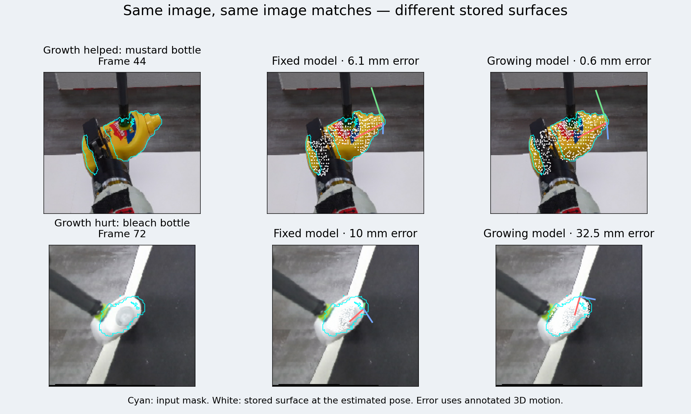

The figure deliberately includes improvement and regression. At bleach clip
frame 72, 99.4% of current measured points were within the configured 5 mm of the
growing surface, yet pose error was 32.5 mm. Local surface agreement therefore
does not establish correct coordinates for the accumulated model. Detecting and
repairing such errors automatically remains unresolved.

The session accepts an external timestamped pose prediction. Synthetic tests
cover prediction with an empty mask, no hidden-shape growth, and return to visual
tracking without resetting the reference. **These real-video comparisons do not
include group or gripper predictions.** Direction-specific evidence fusion,
calibrated covariance and automatic patch repair are not implemented; covariance
is explicitly absent, with conditional surface sensitivity recorded separately.
The local demos have no independent pose labels, so availability is not accuracy.

Browser playback displays each frame's actual model version, while its axes keep
the original reference. If recovery used another source image whose raw matches
were not recorded, it does not substitute unrelated previous-frame trails.

The completed sweep contains 32 examples and 7,567 frames. All were published
into the existing FLASH list; its **View results** control opens the comparison,
with a separate JSON download. The largest combined cloud contained 8,188 points, within the configured
8,192 limit; retained patches stayed within the 32 active + 8 pending budget.
Original sampled patches and model versions remain in the local run archive.

Verification: 136 focused tests passed, including baseline equivalence, bounded
storage, patch correction, prediction/recovery and playback provenance. The
report test also passed after correcting its per-method timing labels. Repository
checks passed. Headless playback against the actual port 9102 server opened both
local demos at 10 seconds with the new growing model, found all 32 examples and
the completed report, and reported no JavaScript errors. This verifies the
experiment and display plumbing; it does not establish accurate tracking under
occlusion. Live defaults remain unchanged.

### Benchmark review UI (2026-11-01)

FLASH now shows whole-clip scores beside the selected method's playback and
per-scene comparison bars for accuracy, median/p90 error, availability and
additional processing time. Accuracy percentages use the saved 10 mm / 10° or
20 mm / 20° counts; missing poses fail, initialization is excluded, and unlabelled
clips remain unscored. Clicking a bar opens that method's playback. Existing
exports load only their own matching score file; reruns publish replacements as
each example completes. Cancellation retains completed exports and earlier
results. The user's active benchmark survived the port 9102 server update.

The sidebar's **View results** opens this overview, including during reruns;
selecting a recording returns to playback. All 32 scenes now have five-method
results. Initially only nine had reference poses loaded for accuracy measurement.
The remaining scenes explicitly show that limitation instead of empty accuracy bars;
availability and timing remain accessible. This does not mean the original
datasets necessarily lack pose annotations—only that this benchmark has not
loaded them.

113 GUI, JavaScript and asset checks passed, including real scoring through the
browser and cancellation of a verified test worker while protecting an unrelated
process. Headless review of the actual server found all 32 scenes, displayed the
new panels/charts and reported no JavaScript errors. Inference is unchanged:
“UFM-assisted” describes the current combined fit, not a guaranteed priority of
depth over UFM.

The scorer now also reads the Laval clock's supplied object poses and the three
synthetic clips' exact 3D point trajectories: **13 of 32 scenes have accuracy
scores**. All 203 imported clock images match resized source frames exactly;
its label coordinates are converted from OpenGL to the RGB-D camera convention.
Synthetic label motion agrees with the renderer's known transforms. Labels are
evaluation-only and never reach the tracker. The nine YCB scores are unchanged.

Saved predictions were rescored using `benchmarks.flash_rescore_experiment`;
video, overlays and prediction files were verified unchanged. Previous summaries
and scoring code are archived locally. The GUI and downloadable report now show
the new scores, and future reruns retain the label configuration. The clock is
still difficult: UFM returns only 3 of 202 post-initialization poses; surface
correction meets 10 mm / 10° on 21 frames, and the growing fit on 10. The synthetic
cases are controls, not evidence of robustness to real occlusion.

130 targeted tests passed, covering camera conventions, delayed initialization,
missing poses, role-specific labels, invalid frame/time mappings, saved-result
rescoring and browser results.

### Shared 3D inspection (2026-11-02)

Benchmark playback and the demo/rollout scene now share calibrated RGB-D
projection and orbit/pan/zoom controls. PR #266's GPU pixel-grid approach keeps
RGB and depth aligned without rebuilding the background cloud on the CPU.
Every displayed packet contains one frame's RGB, depth and saved poses.

Orange shows the tracker estimate; green shows the independently labelled pose.
Without a supplied object model, green uses the initial measured partial surface.
Only Growing surface offers a drawing choice: **Starting surface** or **Expanded
surface**. This changes the orange geometry, never the estimated pose or score.
The same initial points are used by scoring throughout, so added geometry cannot
hide their motion error. Optional dataset meshes remain evaluation-only.

All 32 examples decoded at a middle frame with network access forbidden.
Tests cover RGB/depth projection, missing depth, label coordinate conversion,
frame/method switching during a request, growing geometry and local-only dataset
loading. 107 dataset/GUI/asset checks passed, plus eight existing scene/editor
checks. Tracking and scoring algorithms are unchanged by this viewer work.

DexYCB's blue object is a **pitcher**, not a mug. The preview is now matched to
BOP scene 006011 / original camera 841412060263: all 72 depth frames agree pixel
for pixel; RGB differs slightly in encoding. BOP and raw DexYCB labels use a
constant different model origin, but their relative motion agrees within
1.5e-7. Local provenance records these checks. The supplied BOP model is available
as the green 3D reference. There are now **14/32 scenes with accuracy labels**;
rescoring changed no predictions, masks or videos. For this clip, growing surface
meets 10 mm / 10° on 33/71 frames; surface correction on 41/71. UFM meets it on
23/71 and returns no pose for the remainder, so its low median error alone is
not evidence of better whole-clip tracking.

### More labelled clips and repeatable reruns (2026-11-02)

Added seven DexYCB hand/object clips (tomato can, tuna can, banana, bowl, mug,
drill, marker) and three BOP YCB-Video clips (clamp, mustard, bleach). They retain
consecutive 640×480 RGB-D frames, source calibration and original depth units.
Pose labels are evaluation-only. These ten clips use **dataset masks**, so they
test tracking given those masks, not SAM's segmentation quality. Their timing is
nominal 30 fps; source capture timestamps were not supplied. H2O remains pending
approved access to its official download. Local input provenance and source
hashes are under `~/.cache/flash-tracker-restart/labelled-expansion-20261102/`.

The catalogue now contains 42 scenes, with pose labels for 24. The expanded
five-method rerun is recorded in
`browser/.rebuild/rebuild-20261102-002523-c7e32c1a/` under the same cache root.
Its progress and completed results remain available in Run → FLASH.

**Rerun all benchmarks** now reuses a completed clip only when decoded RGB,
depth, masks, calibration, timing, labels, settings, tracker source, UFM/DINO
source, checkpoint contents and execution environment match. Changed or corrupt
results rerun. **Ignore cache** forces fresh computation, including fresh timing
measurements; cached timing numbers describe the original run. Reuse is at clip
level, not individual frames. A real unchanged-clip probe completed in 4.04 s
without loading UFM or rerunning tracking/export. This first expanded run still
recomputes older results because they lack a verified cache record.

### Do the labels themselves match the observation? (2026-11-02)

DexYCB supplies a previously scanned YCB object model. Its per-frame poses are
fitted to real multi-camera depth and human-marked image points; they are not
exact simulator states. See the [DexYCB annotation method, §2.3](https://dex-ycb.github.io/assets/chao_cvpr2021.pdf)
and [YCB scanning description](https://registry.opendata.aws/ycb-benchmarks/).
The paper's reported fingertip annotation errors concern hands, not object poses.

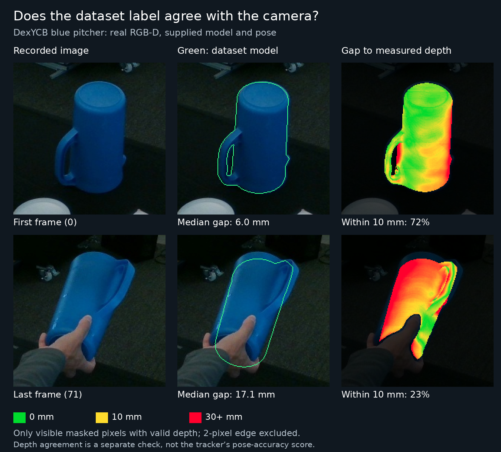

For the existing blue pitcher clip, the green viewer geometry agrees with the
source model/pose to 0.00006 mm: the visible discrepancy is not introduced by
that display transform. A separate triangle rendering check compares the
model's nearest surface with the depth at the **same image pixel**. It uses the
benchmark's visible-object mask, excludes missing depth, and does not refit the
label or discard points based on their disagreement.

Across all 72 frames, with a two-pixel mask edge excluded, the median absolute
depth gap is **8.38 mm**, p90 **26.17 mm**, and **56.66%** of compared pixels are
within 10 mm. Without excluding the edge: 8.69 mm, 29.31 mm and 55.22%.
First-frame median: 6.01 mm; last-frame median: 17.05 mm. The dataset's own mask
sometimes covers an unmodelled sleeve in front of the pitcher; using that mask
would wrongly score the sleeve's depth as the object's surface.

These numbers measure **depth agreement, not the percentage of correct poses**.
They combine model-shape error, pose-label error, calibration, mask error and
sensor error; this audit does not separate them. Our usual 10 mm / 10° score
measures agreement with labelled _motion_, and labels compared with themselves
necessarily score 100%. Constant model/pose offsets can cancel in relative
motion, so this audit neither invalidates every tracking score nor proves the
tracker is right when it disagrees. It establishes disagreement between the
supplied model/poses and recorded measurements, not which one is wrong.

`benchmarks.flash_label_depth_audit` reproduces the depth check from a case file,
mesh and explicit metres-per-mesh-unit scale. Local reports and comparison
rendering are in `~/.cache/flash-tracker-restart/label-quality-pitcher-20261102/`.
Tests check an analytically known tilted plane, front/back surface selection,
missing depth, and a deliberately incorrect pose through the real input readers.

The three new BOP clips provide a useful comparison. Over **all projected model
pixels with valid depth**, without using the supplied masks, clamp/mustard have
median gaps of 1.36/1.48 mm and 96.30%/95.84% within 10 mm. Bleach has 74.39%
within 10 mm; most remaining pixels have a nearer observed surface, consistent
with occlusion, not automatically a wrong label. Its supplied visible-mask
interior has a 2.29 mm median gap. These masks are not independent validation:
[BOP generates them from the model, labelled pose and observed depth](https://github.com/thodan/bop_toolkit/blob/master/scripts/calc_gt_masks.py).
Local reports, original meshes and download provenance are in
`~/.cache/flash-tracker-restart/label-quality-bop-20261102/`.

**Import audit, same pitcher clip.** All 72 imported RGB frames match their
same-index original more closely than any other original frame. All unsaturated
depth pixels are unchanged. The PNG adapter clears 53 pixels at the uint16
maximum (65.535 m) to missing depth across three frames, all outside the object
mask; these do not enter the reported comparisons. The 640×480 color intrinsics
and millimetre depth units agree with the official loader. Already-aligned depth
receives no second alignment.

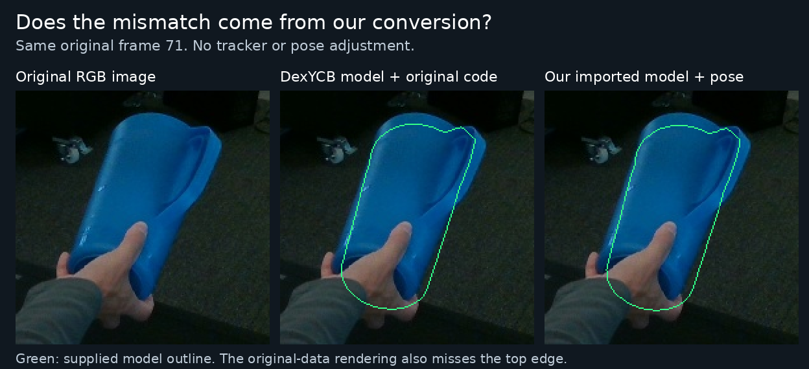

An independent check downloads the original `textured_simple.obj` and executes
the object-rendering portion of [DexYCB's example](https://github.com/NVlabs/dex-ycb-toolkit/blob/64551b001d360ad83bc383157a559ec248fb9100/examples/visualize_pose.py)
with raw `pose_y`, bypassing FLASH and BOP conversion. It reproduces the visible
offset: last-frame median depth gap **16.28 mm**, versus **17.05 mm** in our
earlier rendering. The original/BOP surfaces, rendered with the same rasterizer,
differ by a median **0.18 mm** in depth. The two rasterizers differ by about
1.17 mm median on the same mesh; the last decimal is not meaningful accuracy.

Testing pose offsets from −5 to +5 frames on identical measurement pixels finds
that −2 reduces the moving-frame depth gap (frames 45–66) from 11.38 to 5.60 mm.
However, the unshifted pose covers more of the visible blue object in RGB; this
does **not** establish a timestamp correction. The source recording guide uses
approximate synchronization, but hardware timestamps are unavailable here.
No frames, poses or benchmark scores were shifted. **No import/convention bug
was found for this clip; pose annotation, calibration, model shape, depth and
capture timing remain possible contributors. Calling the labels themselves
wrong was too strong.** Scripts, raw model provenance and per-frame comparisons
are in `~/.cache/flash-tracker-restart/dexycb-alignment-audit/`.

### Point groups: two controlled comparisons (2026-11-02)

**Historical first implementation.** The measurements below describe the
initial integration, before stationary support, dedicated object points and
proposal comparison were added. See the completion entry below for the
current behavior; these results must not be attributed to the updated code.

Run → FLASH adds **Depth + mask fit, UFM + groups**, with fixed and growing
surfaces. Both reuse the existing scene point tracker: optical flow follows
pixel identities, depth supplies their 3D positions, and a rigid fit estimates
their shared motion. Points inside the object support its motion directly.
Surrounding points are associated only after they have moved with the visibly
tracked object. Proximity alone does not establish that relationship.

The group pose initializes the same surface fit used by the two corresponding
baselines. If the surface fit cannot produce a pose, an available group pose
is returned as **predicted**; it cannot extend the surface. These experiments
do **not** yet compare conflicting surface/group proposals before accepting a
visible fit. Group association thresholds are recorded in `GroupConfig`, using
the earlier tracker's defaults. There are no object-specific rules or gripper inputs.

Purple points in both 2D and 3D are the actual measured points used by the group
prediction. The short 2D trails join persistent point IDs. They are separate
from the fitted object surface and from UFM matches. Missing support is shown
as zero group points; historical results without this evidence say to rerun.

The 42-scene, seven-method run is
`browser/.rebuild/rebuild-20261102-011645-c96e7bb4/` under the cache root.
It preserves source/config snapshots, raw group proposals, supporting points,
final poses, and processing times. Side-by-side full videos of both FLASH demos
and analysis scripts are in `~/.cache/flash-tracker-restart/group-experiment-20261102/`.

**Completed: 42/42 scenes, seven methods, no execution errors.** Of these,
21 real clips have pose labels; three additional labelled clips are synthetic
controls. On the 21 real clips, the mean per-clip fraction within **20 mm and
20° of the labels** is:

| Surface | Without groups | With groups |
| ------- | -------------: | ----------: |
| Fixed   |         68.87% |      69.16% |
| Growing |         59.37% |      59.34% |

Missing poses count as failures; clips receive equal weight. These are label
agreement scores, with the label-quality limitations described above. On
common returned frames, the median point-error change is below 1 mm in 19/20
fixed-surface comparisons and all 20 growing-surface comparisons. The remaining
fixed-surface comparison improves by 1.12 mm. One labelled cracker-box clip has
no returned poses in either variant and is included as zero in the table.

The fixed-surface variant returns 191 group-only predictions over the real
recordings. Only 34 have pose labels, and **12/34** meet the 20 mm / 20° limits.
The growing variant returns two group-only predictions, both unlabelled.
Groups can fill gaps, but these results do not justify treating their output
as reliable or promoting either variant as an accuracy improvement.

Scene point tracking takes a median **1.71 ms/frame** across real-clip medians
(range 1.10–2.78 ms). Per-object fit-stage medians increase by 1.85 ms for fixed
surfaces and 2.34 ms for growing surfaces, including association work and any
change in fitting iterations. The scene tracker is shared across objects.
This is offline batch timing, not a robot-loop frame-rate measurement.

Both FLASH demos still drift visibly. With the growing surface, missing poses
change from 28 to 26 for the dowel (712 evaluated frames), remain 31 for the
gamepad and 117 for the cube (627 each). Neither demo produces a group-only
fallback pose: support is absent in the missing frames. At gamepad frames
265–266 (11.71–11.77 s), the group-enabled estimate rotates 106° while the image
changes little; no group prediction exists there. The saved cube mask also
ends up on the tape roll, an unchanged segmentation error in both versions.

**Why this is not the old debugger's full behavior:** that service additionally
seeds points specifically on each object and permits hypotheses based on
stationary nearby support. Its point/group-versus-surface comparison code also
requires a reference cloud; the debugger's constructor does not supply that
cloud, so those two comparisons are inactive there. Its separate depth
contradiction check does use an automatically saved first surface. This small comparison uses a subset of the
global scene points and requires observed co-motion for surrounding support.
The old debugger's saved logs contain group predictions, but they are often
from different camera frames than its slow recorded RGB-D samples; they are
not an aligned accuracy benchmark for the new methods.

At dowel frame 263 (8.77 s), 49 surrounding points provide a prediction, but
the surface fit moves the reference surface a median 24.8 mm away from it.
Only 25 cleaned surface measurements and no UFM image pairs enter that fit.
Applying the old debugger's comparison rule to these two recorded proposals
returns **ambiguous**, rather than favoring the surface fit. Frame 350 returns
**insufficient evidence**. This is a diagnostic on recorded proposals, not a
closed-loop rerun of the old service, and does not establish that the group
pose was correct. Both its anchor and the accumulated surface may already be
wrong. The next comparison should test when a partial observation can justify
replacing the point-motion prediction, together with seeding points on each
object's mask; simply adding the scene tracker has not reproduced debugger stability.

Another inherited limitation is the association rule's centre-displacement
test. A controlled 30° rotation about the object's centre moved its surface
points a median 24.2 mm, with surrounding points following the same rigid
motion, but established no surrounding relationship. Existing associations
can predict rotation; learning one from rotation alone is the missing case.
This rule was kept unchanged during the benchmark, rather than tuning a
threshold mid-run. Testing a measure of whole-surface movement is a separate
follow-up; this probe does not establish the cause of any particular video failure.

### Why the dowel still disappears: debugger comparison (2026-11-02)

This audit concerns the initial group integration above. It did not reproduce either sealed system. This is an
integration gap, not evidence that grouping cannot bridge this occlusion.

- At frame 150 (5.00 s), the current scene-wide pool contains **11** points
  inside the dowel mask, below its configured 12-point minimum. Running the
  debugger's object-specific seeding on the same image/mask yields **52**
  points. This is a seeding comparison, not 52 proven persistent tracks.
- At frame 180 (6.00 s), the saved dowel mask is empty. No own visible points
  can help then. The new adapter has no surrounding relationship because its
  association requires object motion first. The debugger permits stationary
  support and retains a surrounding-point prediction.
- Replaying all **713 frames**, feeding the same saved `conditioned_growing`
  proposals to the unchanged debugger service, supplies a current-frame pose
  in **all 26 frames** missing from `group_growing`. Five use a verified group;
  21 use a proximity-based, unconfirmed support hypothesis. No gripper input
  or stationary-hold timer was enabled. These counts measure availability,
  not correctness.
- Passing the reference cloud to that same service enables its existing
  group/point disagreement checks. This diagnostic also fills all 26 gaps,
  now using a verified group. Neither version fixes the whole trajectory:
  at frame 350 (11.67 s), both the benchmark and debugger-call comparison
  accept a badly oriented saved surface fit. The dowel is upright; the
  reference surface is drawn sideways. Reusing a group service alone is
  therefore insufficient to repair erroneous direct observations.

The replay isolates group integration: identical RGB-D, masks and saved surface
proposals, processed in source order. It does **not** rerun the debugger's
different vision frontend or reproduce asynchronous scheduling. The debugger's
four tracking modules are unchanged from sealed `c72e1e1c3`.

The first sealed system (`80d90b783`) uses causal BootsTAPIR rather than LK
optical flow, seeds object and surrounding points explicitly, and maintains
object-to-group membership through occlusion. Its own report also documents
incorrect attachment to stationary background during slow insertion; retaining
a pose is not proof of accurate motion. Source: `showservo/groups.py`,
`benchmarks/group_live.py`, and sealed lesson 7 at that revision.

Evidence, reproducible scripts, full-length comparison video, source-point
counts and screenshots: local directory
`~/.cache/flash-tracker-restart/group-experiment-20261102/debugger-audit-dowel/`.
The governing verification rule is **Prove the refactor equivalent** in
`.agents/skills/verifying-changes/SKILL.md`: borrowing the tracker class did not
establish parity with its surrounding association and pose-selection logic.

### Completed group integration (2026-11-02)

**This run predates the sustained-agreement rule below.**

The same two group options now use these components from the sealed debugger:

- Dedicated optical-flow points inside each object's mask, plus shared scene
  points outside it. Another tracked object can supply surrounding points.
- Surrounding points become support after agreeing with two observed object
  poses, including when both are stationary. That agreement is evidence for
  shared motion, not proof of attachment. A later accepted observation that
  separates from the group removes the association.
- Before changing the pose or growing the surface, compare the proposed
  surface fit with the point-motion prediction against the current mask and
  depth. Keep the prediction when the observation cannot distinguish them;
  allow a better-supported observation to correct it. Predictions never add
  measured surface points or establish a new surrounding association.

The comparison had an inherited bug: valid depth contradicting a proposed pose
could be counted as missing evidence. It now distinguishes a contradictory
measurement inside the object mask from unavailable depth or an occluder.
This permits a clearly supported observation to correct a wrong prediction.

Purple points in 2D and 3D show the measured own-object and surrounding support,
even when only one source currently supplies the prediction. Persistent IDs
join the trails; reseeding starts new IDs. Recorded evidence distinguishes
the selected source, both point sets and the surface-versus-group comparison.

The five existing no-group options are unchanged. Group parameters are saved
in `GroupConfig`; there are no object names, task phases or gripper inputs in
this integration. This completes the experiment's missing components, not
tracking accuracy or exact equivalence with every heuristic in the old service.

Regression coverage includes stationary occlusion, moving support, separation,
support on another tracked object, real optical-flow tracking without any
global scene points, rejection before surface mutation, and correction from
contradictory depth. Reintroducing each of five defects fails its named test.
The closed-loop rerun of both FLASH demos and one labelled bleach clip is
`browser/.rebuild/rebuild-20261102-080126-66fb2b03/`; outputs use the same recorded
RGB-D and masks as the first comparison. Availability and accuracy must be
reported separately.

That three-clip run completed without execution errors. All five no-group
methods reproduced their previous saved poses exactly. For the growing
variant, adding groups reduced missing poses from 28 to 5 for the dowel,
31 to 24 for the gamepad and 117 to 2 for the cube. The remaining five dowel
gaps are frames 265–269: neither object points nor surrounding support supply
a prediction, and the proposed surface fit does not overlap the observation.
Both object poses and their group associations still have errors.

The bleach clip demonstrates why a whole-clip score is insufficient: at
10 mm / 10°, both group variants pass 63/180 frames, all in the first 12 s,
versus 1/180 for their no-group counterparts. The fixed-surface group variant
still loses its pose at 26.42–27.20 s and ends 117.8° from the label. The growing
variant's median labelled point error worsens from 19.76 to 21.31 mm. Improved
early scores do not establish success during the later rotation.

### Sustained agreement before joining; prompt separation (2026-11-02)

The user identified a real weakness in the two-observation association rule.
At dowel frame 350, 17 of its 399 surrounding support points projected inside
the ring mask. The combined purple overlay also showed the ring's own points,
but the problematic association was not merely a display misunderstanding.

The revised experiment stores each nearby tracked point's first measured
position relative to the observed object. It must remain within the configured
distance tolerance for `support_confirmation_s` before becoming support
(initial experiment setting: 1 s). A contradiction removes it immediately;
the distance tolerance remains configurable through `fit_threshold_m` (5 mm).
Comparing with the first relative position prevents many small deviations
from accumulating unnoticed. New point identities start their own histories.

An occlusion interrupts confirmation of pending points; it does not count as
contradiction of established support. Current object-point motion can break
an existing surrounding relationship before a surface fit is accepted. The
viewer can isolate one object's group support while retaining both poses.

The duration and tolerance are experiment settings, not calibrated confidence.
An erroneous accepted object pose can still corrupt the association; this is
not a solution to all pose errors. The updated closed-loop comparison is
`browser/.rebuild/rebuild-20261102-082912-f5cd72ff/`. Earlier scores above belong
to the earlier implementation, not this revised rule.

The three-clip rerun finished without execution errors; the five no-group
methods again reproduced their saved poses exactly. The stricter association
rule is **not an accuracy improvement established by this test**. Compared
with the preceding two-observation implementation, missing poses increased:

| Growing-surface method | Previous groups | Sustained-agreement groups | No groups |
| ---------------------- | --------------: | -------------------------: | --------: |
| Dowel                  |               5 |                         32 |        28 |
| Gamepad                |              24 |                         31 |        31 |
| Cube                   |               2 |                        113 |       117 |

The bleach growing result is unchanged: its higher early score still does not
solve the later rotation. The fixed variant has 16 missing poses, previously 14.

A concrete failure of the stricter rule is recorded at dowel frames 100–150.
Of 175 previously admitted surrounding points still tracked, 90% moved less
than 2.02 mm in the fixed camera frame. The accepted object pose rotated
14.95°, making those points appear to move by a median 33.30 mm relative to
that estimated object frame. Thus pose instability can remove useful support;
this is not evidence that the whole group physically separated. Comparing
raw own-object motion with surrounding motion, independently of changes to
the fitted pose anchor, needs investigation before treating the rule as a fix.
The 5 mm tolerance is configurable, but increasing it would not resolve this
source-of-evidence problem. Joining and separation also currently share this
parameter with point fitting and pose comparison; they are not independently
tuned confidence estimates.

Measurements and the reproducible probe are in
`~/.cache/flash-tracker-restart/group-experiment-20261102/`:
`support-confirmed-drift-probe.json`,
`support-confirmed-drift-measurements.npz`, and
`support-confirmed-drift-probe.py`. The probe selects previously admitted IDs,
not arbitrary points elsewhere in the scene. Tolerance, source-time joining,
slow separation, and occlusion behavior have regression tests; restoring each
of five defects makes its targeted test fail. These tests establish the rule's
implementation, not the quality of its input pose estimates.

Playback now uses the original show-and-servo triangle/quad wireframe renderer
from `80d90b783`, copied unchanged into `gui/group_wireframe.py`. The adapter
uses recorded measured support and stable track IDs. These display links do
not add tracking constraints. Group visibility has an independent checkbox
in 2D and 3D; the object selector limits only the support overlay. Existing
42 exports received display-only updates with the recorded poses preserved.
“Rerun this scene” sends only the selected published recording to the existing
cancellable worker. The actual UI rerun `rebuild-20261102-091650-50b8e378`
recomputed the 181-frame bleach clip, exactly reproduced all seven pose traces,
and left the other 41 recording entries unchanged. The dowel's support loss
reported above remains unresolved; this UI work makes it easier to inspect.

### Why the accepted pose corrupted its own group reference (2026-11-02)

The 14.95° change at dowel frames 100–150 accumulated over 50 updates; it was
not one jump. Almost all of it was roll: the long direction changed only 0.36°.
The surrounding points independently imply 0.086° rotation (166 of 175
previously admitted, still-tracked points agree within the existing 5 mm fit
tolerance). These are measured-motion diagnostics, not independent pose labels.

The implementation does not jointly constrain the fit with those points:

1. `GroupHints.predict` selects object-point motion whenever available, even
   when surrounding support is also available. The selected pose initializes
   the depth/mask/UFM fit; group measurements are absent from its objective.
2. All 50 updates pass `compare_pose_proposals` as `agree`: each correction is
   small relative to that frame's prediction. Twelve pass even though both
   mask coverage and depth p90 worsen under that check's own measurements.
3. `GroupHints.observe` overwrites both object and surrounding pose anchors
   with each accepted fit. The next prediction consequently includes the
   preceding fitting error. This is not independent confirmation of its pose.
4. Association history still uses the earlier object-relative coordinates.
   Accumulating roll changes those coordinates for distant tray points, and
   their admitted support falls from 187 points at frame 100 to zero at 144.

Removing the anchor corrections algebraically from the saved object-point
motion gives 3.31° across this interval, versus the accepted 14.95°. This
isolates the feedback contribution; it is not a rerun with a corrected fusion
algorithm. Surface information is recorded after acceptance but does not
control which pose corrections are trusted. Thus a small accepted update
currently means neither high confidence nor an improvement over all evidence.

Next experiment: preserve an independent measured group-motion history and
test how it constrains the surface fit, including real separation and later
visual corrections. Simply freezing the object or enlarging the separation
tolerance would not test that requirement. No tracker behavior was changed
for this diagnosis.

Reproducible probes, per-update measurements and the two-frame/curve figure:
`~/.cache/flash-tracker-restart/group-experiment-20261102/pose-feedback-*`.

Sealed-branch code comparison: in `80d90b783`, `showservo/groups.py` fits scene
groups from visible TAPIR tracks lifted through depth, before placing objects.
Hidden members retain predicted positions but do not vote as visible measured
points. An object's own fit changes its group-relative placement only after
the visible-support check and a significant disagreement; small fit changes
leave that relationship unchanged. The code explicitly cites noisy small-object
rotations as the reason. The downstream `SeenThrough` depth test does not refit
the upstream group's points.

In `c72e1e1c`, `causal_service.py` checks direct fits against object-point and
surrounding predictions, then rebases their object-pose anchors on accepted
vision. `_observe_environment` likewise refreshes the relationship. Thus the
reference-update feedback pattern predates this experiment; its previous
presence is not evidence of correctness. That branch's live surface debugger
used this service only with optional `group_fallback` enabled (default off).
In the current experiment the fitted pose changes the point-to-object
relationship and support membership, **not** the raw optical-flow pixels or
their measured depth. This distinction is essential to interpreting the drift.

### Joint fit from independent point evidence (2026-11-02; local experiment)

The two group variants now fit measured depth/mask, UFM correspondences and
independent group point pairs together. A source supplies fixed object
coordinates and current camera coordinates, marked **measured** (tracked object
pixels plus depth) or **predicted** (object points carried by surrounding
measured motion). Each source has a configurable, point-count-normalized Huber
residual. The default weight of 1 and the existing 5 mm residual scale are
experimental settings, not calibrated uncertainty. Correlated sources can
still agree on a wrong answer.

The final fitted pose no longer rebases ongoing point tracks or determines
whether their surrounding associations survive. Group learning uses measured
object-point motion even if the downstream surface fit is rejected. Conversely,
a surrounding prediction alone cannot establish its own co-movement relationship.
Initialization, or recovery after all independent object motion is lost, still
needs a coordinate reference from an accepted surface observation; these events
are recorded as `point_reference_reset`. This is not a guarantee that a newly
established reference is correct.

Predicted points enter the motion objective only. They never become measured
surface patches. A clear new depth observation can correct a wrong prediction;
the existing post-fit observation check remains in place. The five methods
without groups are unchanged. No gripper source is injected in this experiment.

Verification covers actual LK tracking, synthetic measured co-movement and
separation, missing masks, the real surface optimizer, normalized source weights,
and scalar/batched residual parity. Restoring pose feedback, removing the joint
point residual, or making group learning wait for final pose acceptance each
fails its targeted regression test. The first partial rerun was cancelled when
the acceptance dependency was found; the complete rerun is
`rebuild-20261102-122643-joint-points`.

Complete-demo result (same recordings and masks; no independent pose labels):

| Object              | Missing frames before | Missing frames after |
| ------------------- | --------------------: | -------------------: |
| Dowel, 713 frames   |                    32 |                   30 |
| Ring, 713 frames    |                     0 |                    0 |
| Gamepad, 628 frames |                    31 |                   31 |
| Cube, 628 frames    |                   113 |                    0 |

These counts measure availability, **not accuracy**. The new cube trace has
275 predicted frames; inspection shows that it stays under the gamepad instead
of following the late erroneous mask to the tape roll. Dowel rotation during
the stationary frame-100–150 interval falls from 14.95° to 3.47°, with 69
surrounding points still available at frame 150 (previously zero).

This is not a general quality improvement yet: held-dowel estimates and the
growing surface are visibly worse in part of the carry. At frame 350 there are
15 own-object tracked points and no surrounding support. The fit falls back to
that own-point prediction after an ambiguous comparison; both proposed poses
already disagree strongly with depth (about 128 mm p90 in that comparison).
Keeping a point source independent does not repair its initially wrong reference
or later drift. The observation check and reference recovery still need work;
this experiment does not justify treating returned poses as correct.

All five non-group methods exactly reproduce their previous pose matrices
across both demos. The 74 focused tests pass. Both exports were published back
into the existing FLASH list; the server and source recordings were unchanged.
Uncommitted code was copied into the run's provenance archive. Local comparison,
rendering scripts, screenshots and mutation-test logs are under
`~/.cache/flash-tracker-restart/group-experiment-20261102/joint-points/`.
The [52-second before/after video](https://github.com/TheWisp/lerobot/releases/download/flash-visible-tracking-20261023/FLASH_independent_groups_20261102.mp4)
contains both full demos at source speed, including the failures. Only this
video was uploaded; experimental source changes remain uncommitted.

### Persistent predictions and safer surface additions (2026-11-02; local experiment)

A tracked background group already measures the effect of camera motion. If an
object has stayed fixed relative to those points, the group can carry its hidden
points without a separately supplied camera pose. The relationship must end on
observed separation, not merely because the object disappears. A paired test now
checks the same hidden-object prediction with and without known camera motion.

Two extrapolation errors discarded surrounding support prematurely. We compared
a noisy pose fitted from a small visible fragment over the entire hidden object,
and used that pose to re-express distant surrounding points. Separation now
compares the group's prediction at the **measured object points** with their
actual positions. An established, agreeing group supplies the coordinate
reference for maintaining its surrounding membership. The final surface pose
still does not update those point tracks. Real measured separation still breaks
the relationship using the configured tolerance. Raw point drift can nevertheless
produce a false contradiction; this change does not solve that uncertainty.

Both group methods now retain an output after initialization when all measured
support is lost. Such frames are labelled `last_world_pose`, distinct from a
measured group prediction, and record the time since support was available.
Known camera poses transform that retained state into the current camera view.
If neither camera motion nor background motion can be measured, retaining it is
only a stationary assumption, not recovered tracking. There is no invented pose
before initialization and no calibrated confidence estimate yet.

The sprawling surface had a separate cause: real depth points were inserted at
wrong object coordinates after a bad fit. A similar fit in the next frame then
confirmed them. New additions are now projected into retained earlier views:
points in observed empty space, or outside the earlier mask without a nearer
occluder, are rejected. Points behind earlier measured depth remain possible
hidden surfaces. The existing mask/depth tolerances apply; no dowel-specific rule
is used. Retained views are bounded by the surface patch budget.

Point-by-point rejection alone was insufficient in the first trial: a mostly
contradicted extension left a small unexplained tail in previously hidden space.
We now defer that whole extension unless the existing configurable
`patch_overlap` fraction is consistent with retained views (default 0.5). This
is an experimental consistency threshold, not a probability. It can reject valid
growth when an earlier mask, depth or alignment was wrong; it does not implement
automatic repair of already accepted bad patches. Tests include an actual newly
visible back surface that must remain admissible.

The first trial, `rebuild-20261102-132342-joint-points`, completed the dowel but was
cancelled during gamepad processing after the unexplained-tail failure. The final
full rerun is `rebuild-20261102-133839-joint-points`, using the same recordings and
masks. It changes both growing methods as well as the group methods. No gripper
motion is supplied. These demos have no independent pose labels, so availability
and visual improvement must not be reported as measured pose accuracy.

The 82 focused tests pass. Restoring either group extrapolation error, removing
historical surface checks, bypassing the whole-extension check, or removing
persistent output makes its regression test fail. Evidence, code snapshots,
comparisons and render scripts remain under
`~/.cache/flash-tracker-restart/group-experiment-20261102/persistent-pose/` and the
rerun directory. Experimental code remains uncommitted.

Both full recordings completed and were verified in the running FLASH browser
without page errors. Both group methods output a pose on every frame after
initialization. For the growing variant:

| Object  | Frames | Missing before → after | New prediction sources when direct fitting is rejected |
| ------- | -----: | ---------------------: | ------------------------------------------------------ |
| Dowel   |    713 |                 30 → 0 | 20 own-point, 32 last-known-pose                       |
| Ring    |    713 |                  0 → 0 | None                                                   |
| Gamepad |    628 |                 31 → 0 | 13 own-point, 31 last-known-pose                       |
| Cube    |    628 |                  0 → 0 | 276 surrounding-group                                  |

The unsupported 32 dowel and 31 gamepad frames are **not successful group
tracking**. The cube is the clearest example of surrounding points maintaining a
hidden object's prediction. Qualitatively, the dowel's carry/release surface is
much less distorted; the gamepad still has visible alignment errors during
carry. Final stored point counts fall from 1171 to 435 for the dowel, 817 to 520
for the ring, 909 to 457 for the gamepad and 280 to 235 for the cube. No final map
points violate the initial retained view's ray check; that is internal
consistency with one observation, not independent shape or pose accuracy.

The [full before/after video](https://github.com/TheWisp/lerobot/releases/download/flash-visible-tracking-20261023/FLASH_persistent_pose_and_surface_20261102.mp4)
shows previous above and current below, at source speed. It includes both full
recordings and labels last-known-pose intervals separately from measured group
predictions. The gamepad section displays the cube's surrounding support.

### Gamepad jump before lifting: rejected observation-check experiment (2026-11-02)

Inspection of the previous full rerun locates the first major break at frames
168–170 (7.41–7.50 s). The dedicated object point tracker loses its fit; a scene
point fit supplies a shifted reference for reseeding. The next own-point
prediction differs from the surrounding group by 7.92 mm, which removes 186
surrounding tracks. The reported orientation then reaches 21.2° from its starting
orientation at frame 170, while the gripper is covering the object.

This was not an unavoidable lack of evidence. At frame 169, the surrounding
prediction explains the initial measured surface better than the own-point
prediction: mask/depth support 65.1% versus 58.2%, and depth residual p90
2.32 mm versus 4.51 mm. These are internal observation checks, not labelled pose
accuracy. The existing comparison returns `prior_favored`, but was not consulted
before destroying the relationship. The point tracks' mutual agreement alone
had been treated as proof of real separation.

The tested change ran the same depth/mask comparison at that upstream decision when measured
point disagreement exceeds the configured tolerance. Only when it favored the
surrounding proposal did it reject the own-point proposal and retain support;
other verdicts retained the previous separation behavior. Rejected points did not
enter the downstream joint fit or define its reseeded reference. This comparison
used independently predicted transforms and the initial measured surface, never
the downstream fitted pose. It adds no threshold. It does **not** solve ambiguous
comparisons, sparse observations that admit many rotations, or reliable
attachment acquisition during the lift. No gripper encoder prediction is supplied.

Paired regression cases give the same coherent point displacement with either
stationary or genuinely moved RGB-D geometry. Only the first keeps the group;
the second must separate. Removing this check makes the stationary case fail
while the genuine-movement case still passes. The 84 focused tests pass.
The full rerun is `rebuild-20261102-141801-group-observation-check`; evidence and
scripts are under `~/.cache/flash-tracker-restart/group-experiment-20261102/gamepad-diagnosis/`.

The prior dowel display contains 296 sampled surface points initially and 435
at the end, joined only by short nearest-neighbor lines. It is a partial measured
surface, not a watertight mesh. Its incomplete display is not proof of a wrong
pose, but neither do the retained-view checks establish a correct complete shape.

**Full-sequence result: rejected and reverted.** Both demos completed. Dowel and
ring counts and final surfaces are unchanged. For the gamepad, the check reduces
the early orientation change at frame 170 from 21.2° to 4.7°, and preserves the
tray support through the covering interval. However, after the gamepad lifts,
the estimate stays on the tray: the retained surrounding prediction wins while
object points are unavailable, and the correct new observation fails to recover
its connection to the original surface. Availability is not correctness. The
change and its two synthetic tests are preserved in the local evidence directory
(`rejected-guard.patch`, `groups-rejected-guard.py`, `tests-with-rejected-guard.py`),
but removed from the active algorithm. Complete output remains under the job;
its browser exports are archived in `rejected_exports` so they do not replace
the previous examples. The synthetic pair did not cover loss followed by genuine
separation and reappearance; that temporal case is necessary before another
acceptance-rule change. No new threshold or gripper-specific rule was added.

### LK versus UFM near the gamepad occluder (2026-11-02)

`compare_lk_ufm.py` seeds the same image corners at frame 150 and advances both
methods through every frame to 172, without pose fitting affecting their image
positions. UFM uses the deployed DINOv2-L checkpoint and existing 320-pixel crop;
LK uses the existing 21-pixel patch and forward/backward check. Both endpoints
are checked against the same raw SAM mask and depth-support test for this
comparison; production UFM pose fitting additionally uses cleaned/trimmed depth.
No robot action, geometry fitting, or predicted hidden point is an image match.

At frame 168, 11 common accepted points also have their original position inside
the current mask with valid depth. Their displacement from frame 150 has median
4.25 px / p90 8.07 px for LK, versus 1.26 px / p90 1.70 px for UFM. This is a
stationary-object diagnostic, **not labelled flow accuracy**. The common set
shrinks to two at frame 169, so later aggregate comparisons are not meaningful.
UFM is better on this visible subset, but still accepts covered features: the
illustrated point B moves 24.1 px onto another visible location, with UFM's
current pair co-visibility output 0.993. That output is not the probability that
its accumulated point identity is correct. Both methods can keep the endpoint
inside SAM while switching which physical spot they follow.

The matching-patch experiment tried 7, 11, 15 and 21 pixels with identical initial
seeds, depth checks and pyramid settings. Smaller windows reduce aggregate drift
but discard different points; on identical surviving IDs the improvement is
mixed. Therefore changing the window alone is not a validated fix. The raw mask
captures also rule out the suspected circuit-board segmentation contamination
at frames 150 and 168: white markers over the board in the comparison are earlier
point positions that have since become covered, not new points seeded there.

**Current implementation, audited rather than inferred:**

| Stage                               | Matcher/input                                                  | Where SAM/depth filtering happens                                                                                     |
| ----------------------------------- | -------------------------------------------------------------- | --------------------------------------------------------------------------------------------------------------------- |
| Surface + UFM pose proposal         | UFM on unmasked RGB crops                                      | Accept matching pixel pairs only when both endpoints pass the cleaned object mask/depth; default mask margin is 2 px. |
| Dedicated object points for groups  | LK on full-resolution grayscale, 21×21 window, pyramid level 3 | Seed/accept point centers in the raw mask; depth support and forward/backward test. No 2-pixel mask erosion here.     |
| Surrounding scene points for groups | Separate LK on half-resolution grayscale                       | Track scene corners; depth support; current raw object mask determines ownership.                                     |

Even applying the same 2-pixel margin to LK would not contain a 21×21 matching
patch within the object; at half resolution it spans roughly 42×42 sensor pixels.
Coarser pyramid levels also use wider context. The linked picture shows a center
9.6 px inside SAM while 6% of its finest-level matching patch is outside. This
establishes the implementation's exposure to mixed motion, not the sole cause
of every slipped point. UFM also sees surrounding RGB; segmentation is currently
an endpoint/geometry check, not an input attention constraint.

Sources: [OpenCV's LK description](https://docs.opencv.org/4.12.0/d4/dee/tutorial_optical_flow.html),
[UFM model and usage](https://github.com/UniFlowMatch/UFM). The consolidation
proposal is maintained in the pipeline design; it is not implemented by this
comparison. Local evidence includes raw RGB/masks, per-point coordinates and
visibility, the window ablation, complete before/after recordings, and scripts.

Phone-accessible evidence:
[LK patch crossing the mask](https://github.com/TheWisp/lerobot/releases/download/flash-visible-tracking-20261023/FLASH_LK_mask_patch_20261102.jpg),
[same-point LK/UFM comparison](https://github.com/TheWisp/lerobot/releases/download/flash-visible-tracking-20261023/FLASH_LK_UFM_occlusion_20261102.jpg),
[short point-tracking video](https://github.com/TheWisp/lerobot/releases/download/flash-visible-tracking-20261023/FLASH_LK_UFM_occlusion_20261102.mp4),
[full gamepad before/after showing the rejected guard's later failure](https://github.com/TheWisp/lerobot/releases/download/flash-visible-tracking-20261023/FLASH_rejected_group_guard_20261102.mp4).
The short video repeats the same source interval three times and holds its final
frame briefly; the full recording uses original timestamps. After reverting,
the existing 26 group tests pass. No physical trial or robot control was run.

The user's abstraction clarification makes the consolidation backend-neutral:
LK and UFM are selectable providers of 2D matches behind the same contract.
Persistent point identities, SAM/depth filtering, grouping and surface fitting
belong downstream. This is a design revision, not a claim that the active
experimental code has already replaced its two separate tracking paths.

### 2026-11-02 — Matching adapters, before sharing inference

Extracted the duplicated LK forward/backward calls and the UFM field query into
`image_matching.py`. Both return query-ordered source/target image pixels,
acceptance and backend-native diagnostics. Explicit settings select LK or UFM;
UFM inference is reusable across point queries. SAM ownership, depth cleaning,
point IDs, group association and pose fitting remain downstream.

This step deliberately preserves the current full-resolution object LK,
half-resolution scene LK and cropped UFM paths. It does **not** yet make them
consume one shared inference result, change the mask margins, or fix slipping.
The implementation status is marked in the existing pipeline design.

**Equivalence:** compared frozen pre-refactor source with the new implementation
on every frame of both FLASH demos and the external bleach-bottle clip:

| Recording                       | Frames | Depth-lifted pairs | Outcome       |
| ------------------------------- | -----: | -----------------: | ------------- |
| Gamepad / cube                  |    628 |            320,288 | Exactly equal |
| Dowel / ring                    |    713 |            440,289 | Exactly equal |
| YCB bleach hard 00 03 chaitanya |    181 |             29,876 | Exactly equal |

The comparison checks raw correspondences and rejection stages, 3D motion,
scene point identities, group membership/state, reseeding and predicted poses.
It includes 113 empty object masks and 61 failed UFM rigid fits in the two demos.
Both implementations receive the same real UFM network output after verifying
that their requested input images are identical. Group feedback uses the same
recorded final-fit results. The unchanged final surface optimizer was not rerun;
its geometric and group inputs were compared instead. This establishes refactor
equivalence on these recordings, not that their tracking is accurate.

150 targeted tests pass. Two recorded-frame fixtures retain the original
implementation's outputs for permanent, hardware-free regression tests. Injecting
a one-pixel endpoint error into either backend makes the real-consumer fixture
test fail. A float32 threshold-comparison test also guards a subtle conversion
regression. Existing benchmark source hashing automatically includes the new file.

No extra model inference was introduced. With captured UFM output, CPU
postprocessing rises from about 0.55 to 0.69 ms per image pair (+0.13 ms); this
small allocation/contract cost is recorded rather than claimed as zero overhead.
Paired LK measurements show no slowdown; their second-call cache advantage is
not evidence of a speedup. No hardware run, server restart or commit was made.

[Machine-readable evidence](image-matching-refactor-20261102.json) includes source
hashes, counts, timing distributions and environment versions. The full original
source snapshot, runnable `audit.py`, logs and measurements are retained locally
under `~/.cache/flash-tracker-restart/image-matcher-refactor-20261102/`.

### 2026-11-02 — One matching pass for objects and surrounding groups

Implemented an opt-in shared LK or UFM pass. Both consumers use the same persistent
point IDs and mask/depth checks; object pose cannot move those points. Shared
object matches contribute once to fitting, not once as image evidence and again
as an independent group measurement. Matching continues with empty object masks.
Point budgets, image resolution and history length are configurable and recorded.
GUI reruns preserve these settings and cache them separately.

Ran both choices through the complete gamepad (628 frames), dowel (713) and
labelled bleach-bottle (181) clips: exactly one matching call per consecutive
frame pair, regardless of object count. This is a new algorithm configuration;
the adapter-equivalence result above does not guarantee equal quality here.

**Not ready to replace the baseline.** For the bottle, using surface growth and
groups on the same 180 evaluated frames:

| Matching                          | Median point error | p90 point error | Median rotation error |
| --------------------------------- | -----------------: | --------------: | --------------------: |
| Existing UFM + separate LK groups |             4.0 mm |          7.8 mm |                  2.7° |
| Shared UFM                        |             7.3 mm |         22.8 mm |                  2.0° |
| Shared LK                         |             4.6 mm |          9.8 mm |                  3.6° |

These compare identical reference points placed by estimated versus labelled
poses. The control was rerun with current group logic: the earlier 21.3 mm result
used older group code and is **not** the valid baseline for this comparison.

Both demos retain poses throughout, but neither has independent pose labels.
Shared UFM visibly fails during dowel rotation: at frame 350 the real dowel is
upright while its estimate is sideways. Projecting the unchanged initial surface
confirms a pose error, not merely bad surface growth. Shared LK is better in that
frame, but also drifts; availability is not correctness.

Shared matching, seeding and depth processing take median 35–37 ms with UFM and
12–13 ms with LK across these clips. This excludes subsequent surface fitting;
it is not end-to-end tracker FPS. The experiment changes image crop/scale,
sampling and group inputs together. The next useful experiment isolates these
changes on the failing rotation interval, rather than changing acceptance limits.

203 targeted tests and an additional browser test pass; four deliberate defects
(pixel scaling, second tracker, exhausted point budget and double-counting) each
fail their regression test. Rerun/cache and browser-label tests also pass after
export changes. The existing default stays unchanged; new recordings are named
“shared LK” and “shared UFM” in FLASH. Changes remain local and uncommitted.

[Full demo comparison video](https://github.com/TheWisp/lerobot/releases/download/flash-visible-tracking-20261023/FLASH_shared_UFM_comparison_20261102.mp4)
shows the existing path above shared UFM, at recorded timestamps.
[Machine-readable measurements](shared-matching-comparison-20261102.json) identify
the inputs, settings and preserved source snapshots. Complete runs and drivers
are under `~/.cache/flash-tracker-restart/shared-matching-20261102/`.

**Follow-up: the gamepad also fails before pickup.** At frame 100 (4.37 s),
44 accepted points surviving from initialization have median accumulated UFM
displacement 3.89 px. A visible 30×30 button patch independently matches its
original position with zero-pixel displacement (normalized correlation 0.985),
and the mask bounds stay within one pixel. Thus the image tracks already drift
while the gamepad is stationary. At frame 144 (6.34 s), the object points disagree
with the environment prediction by 5.09 mm; the 5 mm separation rule removes the
surrounding group. At frame 160 (7.04 s), the final estimate has rotated 23.3° from
initialization while the object remains on the tray. The surface fit still accepts
it. This is not limited to complete occlusion or to the dowel rotation. The origin
of the image drift (sampling/scale versus model behavior) remains unisolated;
increasing a group tolerance is not a demonstrated fix. The local
`gamepad_pregrasp_audit.py` and `gamepad-pregrasp-160.jpg` preserve the diagnostic.

### 2026-11-02 — Recorded stationary-gamepad regression

Added a real RGB-D → pinned UFM → shared groups → growing-surface integration
test. The visually annotated stationary interval is frames 0–164 (0–7.24 s),
including gripper occlusion. **Correction from later review:** the original
claim that frames 165–170 showed pickup beginning was unsupported; the user
places grasp around 9 ± 0.5 s. The results below cover only 0–7.24 s. Inference runs
through frame 280; the annotation is used only afterward. Inputs are hashed.

| Maximum false motion before pickup |  Before |   After | Test limit |
| ---------------------------------- | ------: | ------: | ---------: |
| Surface-center displacement        | 9.22 mm | 1.15 mm |       5 mm |
| Rotation from initialization       |  24.49° |   3.98° |         5° |

The limits were fixed before changing the algorithm. The estimate subsequently
moves 59 mm by frame 280; this prevents freezing from passing, but is not proof
of accurate held-object tracking. There are no independent gamepad pose labels.

The fixes are geometric, not timed or object-specific:

- Keep the existing 2 px boundary exclusion at **both** match endpoints. Tests
  verify it, but interior matches can still slide to wrong material points.
- Use the measured-surface objective consistently when fitting and deciding
  whether object matches contradict a surrounding group. A drifting image
  hypothesis cannot win merely by outweighing better geometric agreement.
- Do not pull hidden reference points toward the visible fragment. Nearer or
  unknown depth outside the visible mask is not evidence of an empty ray.
- Do not force an incomplete reference to cover the whole current outline.
  That assumption initially regressed the bottle: an excluded bottom surface
  pulled the correctly aligned reference down. Removing the assumption fixed
  the regression; the complete-reference option remains explicit.

Cross-check on the full 181-frame labelled bleach-bottle clip: median point
error 7.34 → 4.42 mm, p90 22.81 → 8.33 mm, and frames within 10 mm / 10°
136/180 → 170/180. **Tradeoff:** median rotation error 2.00° → 3.90°; not every
metric improved. On the full 713-frame dowel demo, the previous sideways estimate
at frame 350 becomes upright. That is visual evidence, not full-clip accuracy.

169 checks pass, including the two recorded tests and generic stationary/moving/
rotating shapes at three scales. Deliberately reinstating wrong image weighting,
unknown-depth penalties, complete-outline assumptions, or removing boundary
filtering makes the relevant tests fail. Freezing every output pose passes the
stationary check but fails the pickup check. Changes remain local and uncommitted;
the running server and historical benchmark playbacks were not replaced.

[Before/after video, including pickup](https://github.com/TheWisp/lerobot/releases/download/flash-visible-tracking-20261023/FLASH_gamepad_stationary_regression_20261102.mp4).
[Inputs, settings, measurements and source hashes](gamepad-stationary-regression-20261102.json).
The test and replay command are documented in
[`tests/policies/flash/fixtures/README.md`](../../../tests/policies/flash/fixtures/README.md).

### 2026-11-02 — Full-suite validation after the geometry fixes

Ran all seven methods on **42 clips / 8,611 source frames**: 21 real labelled
scenes, three synthetic controls, and 18 unlabelled scenes (including both FLASH
demos and two deformable negative controls). All completed. RGB, depth, masks,
intrinsics, timestamps, labels and initial surface samples match the saved
baselines. Tracker sources stayed unchanged throughout. SAM masks were reused;
this tests downstream tracking, not segmentation changes.

For depth/mask fitting with shared UFM, groups and growing surface:

| Real labelled frames     |              Before |               After |
| ------------------------ | ------------------: | ------------------: |
| Within 10 mm **and** 10° | 1,229/2,927 (42.0%) | 1,622/2,927 (55.4%) |
| Within 20 mm **and** 20° | 1,720/2,927 (58.8%) | 2,154/2,927 (73.6%) |
| Returned a pose          |         2,702/2,927 |         2,927/2,927 |

**Better overall, but not regression-free.** At 10 mm/10°, 12 scenes improve,
five worsen, four tie. The regressions are DexYCB marker, banana, drill, tomato
can and bowl. At 20 mm/20°, eight improve, eight worsen, five tie. On the same
2,702 frames with poses in both versions, median point error improves
10.42 → 4.78 mm and median angle 9.46 → 4.66°. These are annotation-relative
motion errors; neither absolute initialization nor reconstructed-shape accuracy
is measured. Labels remain imperfect and scoring is not symmetry-minimized.

All seven methods improve in aggregate. Groups versus the current otherwise
identical growing-surface method add 70 available poses but produce one fewer
passing frame at 10 mm/10°; availability alone is not an accuracy improvement.
Historical versus current selected-path timing is about **83 → 195 ms/frame**
(median across the 21 real labelled scenes), excluding SAM/display. Those cases
ran sequentially; later concurrent unlabelled runs are excluded from timing.

The full runner exactly reproduces the earlier post-fix integration outputs:
gamepad frames 0–280 and all 713 dowel frames. Gamepad false motion over the
original 0–7.24 s test window remains 1.15 mm/3.98°; motion by frame 280 is
59.19 mm. This does not cover the whole pre-grasp interval. Both complete demos retain
poses throughout, but have no independent full-motion accuracy labels.

This compares accumulated changes, including separate LK/UFM → shared UFM,
against saved baselines. It does not isolate the last fix. The three prior
shared-UFM comparisons are also preserved separately. No tracker tuning or
product changes were made during this sweep. The code and evidence are preserved
together as a research milestone, with the limitations above.

Visual review distinguishes two failures: the tomato can clearly gets worse;
the selected marker frame shows two inaccurate estimates, so it does not show
a previously successful frame becoming a failure. The marker's aggregate score
still decreases. Neither example identifies the cause yet.

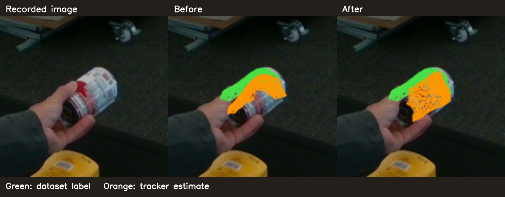

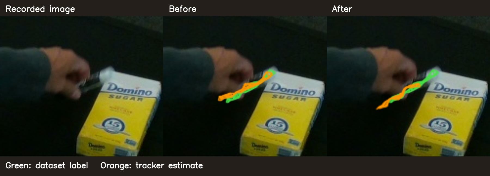

The benchmark uses **shared UFM**, not LK. FLASH also retains explicitly named
"shared LK" comparison recordings; their method labels follow the recording's
actual backend. The main playback catalogue still contains historical results;
the full-suite report is a separate snapshot. A historical playback is not the
new result merely because the server runs the new code.

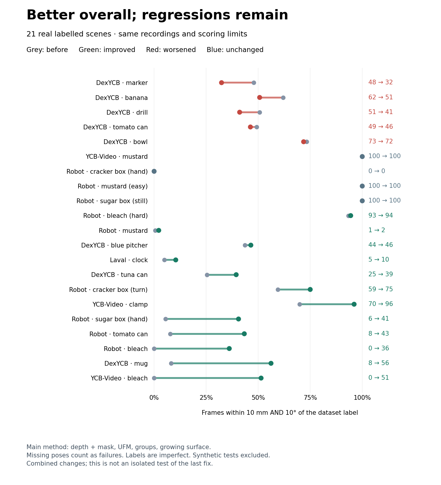

[Inputs, settings, hashes, per-scene scores and integration checks](full-suite-validation-20261102.json).
Full traces, baseline summaries, paired-frame checks and the HTML report are in
`~/.cache/flash-tracker-restart/full-validation-20261102/`.

### 2026-11-02 — Gamepad test missed the later pre-grasp interval

The user reports grasp at about 9 ± 0.5 s. The old test stopped its stationary
check at 7.24 s, then only required movement by frame 280. That second check
catches a frozen tracker, but also passes an incorrectly moving one. The old
pass therefore did **not** establish stable tracking through grasp.

Extended the stationary annotation through frame 192 (8.47149 s), just before
the earliest reported grasp at 8.5 s. This uses human timing evidence in the
heavily occluded interval, not independent 6D pose labels. The unchanged 5 mm /
5° limits now produce a real UFM integration **failure: 2.11 mm / 9.56°** maximum
false motion; the rotation maximum is at frame 171 (7.54 s). No runtime code or
runtime grasp-time rule changed. Post-grasp accuracy remains untested by these
two assertions.

Two implementation gaps remain. UFM discards surrounding support at frame 144
after comparing uncorrected image-derived poses; its final depth/mask fit is
nearly stationary. But losing that support is not the entire cause: a fresh LK
run keeps roughly 200 surrounding points and still wobbles. Both paths allow
a small improvement in fitting a tiny visible fragment to override a much
steadier prediction. The estimator records which pose directions the fragment
constrains, but does not use that information to restrict the accepted change.
These are diagnosis results, **not a new fix**.

Replaced the shared UFM/LK playback entries with current-code results, retaining
their historical exports. Full traces, the separation audit, test log and fresh
LK run are local under `~/.cache/flash-tracker-restart/gamepad-review-20261102/`;
the extended test's raw output is
`/tmp/flash-gamepad-grasp-window-20261102/gamepad-integration0/result.json`.

### 2026-11-02 — Isolating the false turn before grasp

Replayed current LK and UFM with read-only instrumentation. At frame 171
(7.54 s), LK still has 201 surrounding supports: their prediction rotates only
0.49°. Fitting with that support included gives 1.97°, but
`ImageConditionedFit.correct_surface_first` selects a geometry-only result at
9.07°. Its geometry cost is 0.08375 versus 0.10421. Image/group evidence only
breaks ties within **solver tolerance (1e-5)**, not measurement uncertainty.
`GroupHints.compare_candidate` then accepts the same lower geometry cost.
The recorded surface-information diagnostic does not constrain this update.

To separate that failure from image drift or accumulated map errors, fit the
original measured surface to this frame starting at identity, with **no image
matches, groups or grown geometry**. It still turns 8.27°. Repeat with the
**same 310 target pixels, same mask and same reference**, replacing their depth
with frame-0 readings: the turn falls to 0.12°. Current readings differ by at
most 4 mm; 90% are within 2 mm. Similar paired checks at frames 164/168/170
give 3.64°/8.96°/6.96° with current depth versus 0.27°/0.30°/0.13° with initial
depth (see exact measurements below). The inference does not receive frame-0
depth in these locations; replacement is an offline diagnostic only.

This establishes that small depth changes in the remaining fragment can drive
the false turn, and that the ranking discards useful group constraints to fit
them. It does **not** establish the physical origin of every depth change:
sensor effects, RGB/depth edge alignment and small true motion are not fully
separated. The stationary claim uses the user's timing annotation. RGB at
frames 164/168 correlates best with zero shift; the nearly hidden later patch
is inconclusive. No independent full-object 6D label is available.

UFM also loses its group at frame 144: comparing the **uncorrected** object
and surrounding proposals favors the drifting image proposal (costs 0.32086
versus 0.34851). Subsequent surface fitting returns nearly the original pose,
but the support has already been discarded. LK retains its support, so this
additional fault cannot explain the common false turn by itself.

**No tracker fix applied.** Retaining group constraints in directions poorly
determined by current geometry needs testing with real object movement as well
as stationary occlusion; making the entire pose stick would be a false fix.

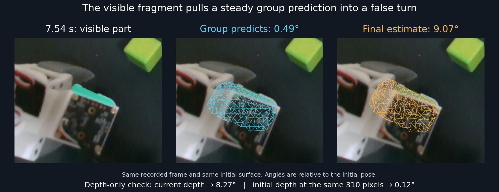

[Paired experiments, measurements, caveats and source hashes](gamepad-depth-selection-audit-20261102.json).

## 2026-11-02 — Local pose covariance on the gamepad occlusion

**Result: useful evidence, not a deployable fix.** The design's proposed 6 × 6
covariance is now tested in an isolated offline ablation. The current defaults
are unchanged. This is a local Gaussian update, not a temporal Kalman filter.

`benchmarks/flash_pose_covariance.py` calculates point-to-plane information from
the current measured surface, then combines the existing geometric candidate
with image/group evidence in six pose directions. It tests independent depth
error versus spatially correlated error. All variants retain the same masks,
depth cleaning, LK/UFM matching, group relationships, map growth and acceptance
checks. No scene name, stationary interval or grasp time enters the estimator.

The noise settings are **assumptions, not calibrated sensor specifications**:
1 mm independent standard deviation, plus 0 / 2 / 5 mm correlated error with a
10 mm correlation length. The point-evidence scale is provisionally interpreted
as uncertainty per source. Normal uncertainty, bad correspondences, changing
group validity and errors in the stored surface are not represented adequately.
The returned covariance must not be shown as an accuracy probability.

Actual causal runs: 281 frames, 0–12.374 s, including pickup. Score the human-
annotated stationary interval through frame 192 / 8.471 s. Every run has the same
input hash `c66268f6cf9eff2d7786b0b1c14243edad15a5f057d8f445b229c66dd31c71d3`.
These are false rotations relative to the first estimate, not labelled 6D errors.

| Depth uncertainty assumption | LK + groups: worst false turn | UFM + groups: worst false turn |
| ---------------------------- | ----------------------------: | -----------------------------: |
| Current estimator            |                         9.07° |                          9.56° |
| Independent 1 mm errors      |                         8.66° |                          8.14° |
| Add 2 mm correlated error    |                         7.28° |                          6.93° |
| Add 5 mm correlated error    |                         5.30° |                     **38.38°** |

**No variant passes the unchanged 5° stationary limit.** The stronger LK setting
also fails the movement control: only 24.1 mm estimated travel by frame 280,
versus the required >30 mm. Its surrounding tray group remains active after
pickup when object image tracks are unavailable. A separate 99% Gaussian
consistency-check ablation rejects strongly contradicted support and restores
61.2 mm travel, but does not improve the pre-grasp numbers or repair UFM's severe
regression. Movement-control success does not establish accurate pickup pose.

This exposes why merely reducing trust in depth is insufficient: the alternatives
can also be wrong, and a locally derived covariance does not validate their
identity or co-movement relationship. Measure/calibrate uncertainty for both
sources and address contradictory support before treating this as a solution.

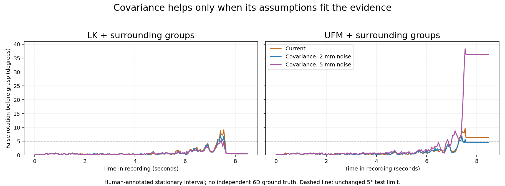

[All twelve runs, settings, hashes and checks](gamepad-covariance-comparison-20261102.json).
Local causal traces and a timestamp-correct six-panel comparison video are under
`~/.cache/flash-tracker-restart/pose-covariance-20261102/` (`runs/*.json.gz`,
`comparison.mp4`). The video includes the severe regression, not only improvements.
Reproduce with `python -m benchmarks.flash_pose_covariance_run --backend lk
--output /tmp/covariance --frames 281` (also `--backend ufm`); add
`--variants gated2 gated5` for the consistency-check ablations.

Verification: six numerical controls cover unobservable directions, correlated
samples, coordinate origins and normal signs, actual motion overriding wrong
support, and rejection of contradicted predictions. Together with existing
surface-session/group tests: 54 passed. Real recorded stationary checks remain
failing as reported above. No new model training or SAM inference was performed.

Prior art: [ICP covariance and correspondence caveats](https://arxiv.org/abs/1410.7632),
[noise-aware degeneracy detection](https://arxiv.org/abs/2410.10784).
This experiment does **not** implement DRPM's normal-noise model or claim its
results; those papers motivate checking the assumptions of a covariance estimate.

## 2026-11-02 — Covariance for candidate selection, with direct contradiction checks

**Experimental, off by default.** First reject poses that contradict visible
depth/mask geometry, independently of uncertainty. Then use local covariance to
identify candidates the visible surface cannot distinguish. Prefer compatible
point predictions, otherwise the candidate changing the stored surface least.
This selects an existing pose; it does not average poses or run a Kalman filter.
The same checks decide whether surrounding support contradicts the observation.

Same 281 recorded frames and input hash as above, same 5 mm / 5° stationary limits,
same 1 mm independent + 2 mm correlated noise assumptions. No object name,
grasp time or stationary annotation enters estimation. The disabled LK path
matches the previous baseline exactly across all 281 pose matrices.

| Matcher + groups | Worst stationary turn, before → after | Worst stationary displacement, before → after | Frames without a pose after pickup, before → after |
| ---------------- | ------------------------------------: | --------------------------------------------: | -------------------------------------------------: |
| LK               |                     9.07° → **1.11°** |                                2.15 → 2.87 mm |                                              0 → 6 |
| UFM              |                     9.56° → **5.80°** |                                2.11 → 3.99 mm |                                              0 → 5 |

LK passes the stationary check; UFM still fails 5°. At UFM frame 145, surrounding
support passes the direct geometry check, but the covariance test rejects it
(20.51 versus 12.59 limit), selecting a tilted fit. The assumed noise and fixed
surface normals/correspondences remain an imperfect uncertainty model.

**The pickup portion is not fixed.** Both new runs move after pickup, but their
poses still jump and become visibly wrong; LK frame 280 is substantially worse
than its baseline. Passing a >30 mm movement check cannot certify carried pose
accuracy. The new mode must remain experimental, not replace the default based
on its improved stationary score. The comparison video includes these failures.

LK runtime: 35.94 → 39.02 s for 281 frames (about 11 ms/frame extra in this paired
run). This is offline wall time, not a live frame-rate measurement.

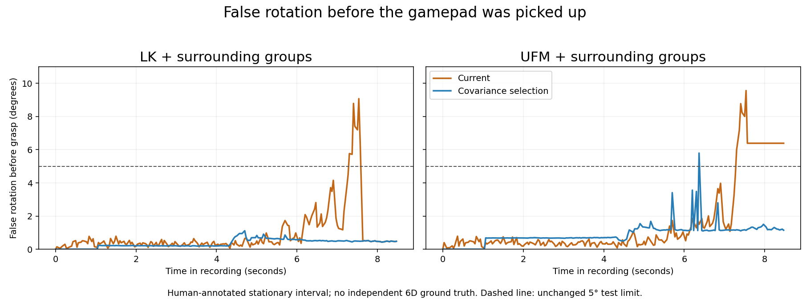

[Measurements](gamepad-covariance-selection-20261102.json). Full traces, settings,
source snapshots and `visuals/comparison.mp4` are preserved locally under
`~/.cache/flash-tracker-restart/pose-selection-20261102/`. Reproduce with
`python -m benchmarks.flash_pose_selection_run --backend lk --mode covariance
--output <directory>`; also test `--backend ufm` and `--mode baseline`.

Verification: 101 focused tests passed, including real fitter checks for large
contradictions, weak directions, actual motion, empty observations, map growth
and the HTTP settings-to-worker path. The GUI exposes a selected-scene rerun with
settings and a generated overview of all 95 restart-pipeline options. This does
not imply the recorded UFM case or the broader benchmark now passes.

## 2026-11-02 — Temporal Kalman filter on recorded occlusion and pickup

The optional `surface_experiment.uncertainty.mode="kalman"` now carries a pose
and 6×6 covariance between frames. Consecutive measured group point pairs predict
motion; a direct-valid depth/mask surface fit corrects it. The gain uses both
prediction covariance and surface information. The older `selection` experiment
only chose a candidate. Both remain configurable; the default is still disabled.

Same 281 recorded gamepad frames (0–12.37 s), identical input hash, both real
image matchers, no timing/object rules or robot commands. The human annotation
marks frames 0–192 (through 8.47 s) stationary and is used only for scoring.
The existing stationary check stays at 5 mm / 5°. There is no independent 6D
truth during pickup.

| Matcher / method         | Worst false position | Worst false rotation | Frames without a pose, entire 281-frame clip | Processing time |
| ------------------------ | -------------------: | -------------------: | -------------------------------------------: | --------------: |
| LK baseline              |              2.15 mm |                9.07° |                                            0 |         35.94 s |
| LK covariance selection  |              2.87 mm |                1.11° |                                            6 |         39.02 s |
| LK Kalman                |              1.23 mm |                3.66° |                                            6 |         37.64 s |
| UFM baseline             |              2.11 mm |                9.56° |                                            0 |         42.35 s |
| UFM covariance selection |              3.99 mm |                5.80° |                                            5 |         48.43 s |
| UFM Kalman               |              1.61 mm |                3.54° |                                           11 |         45.58 s |

**Verdict:** Kalman passes the stationary check with both matchers, but is not a
complete tracking fix. LK selection had less false rotation than LK Kalman;
Kalman had less false translation. Visual inspection after pickup still shows
wrong alignment, and Kalman rejects frames 275–280 with both matchers (plus
261–265 with UFM). Every candidate fails the current observation check there.
The baseline's uninterrupted output is not evidence of correct pickup tracking.
Keep this experimental; no claim of improvement across all scenes. Timings are
single runs, exclude mask generation and model startup, and are not a controlled
throughput benchmark.

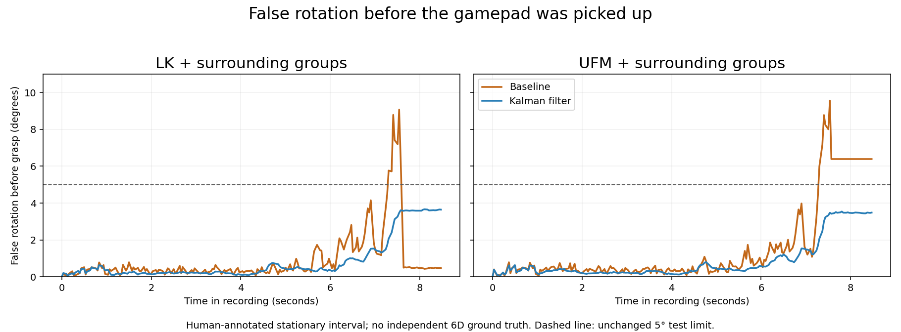

[Machine-readable measurements](gamepad-kalman-20261102.json). Full traces,
source snapshots, settings and 1× comparison video are local under
`~/.cache/flash-tracker-restart/kalman-20261102/` (`visuals/comparison.mp4`).
Reproduce with `python -m benchmarks.flash_pose_selection_run --backend lk
--mode kalman --output /tmp/kalman-lk`, and again with `--backend ufm`.
The figure/video compare baseline against Kalman, not the earlier selector.

115 focused tests pass, including analytic covariance-weighting controls,
partial observability, elapsed-time uncertainty growth, camera changes, measured
group rotation, fixed-origin invariance, empty observation/reappearance, and the
HTTP-settings → benchmark-worker → actual-fitter path. Replacing the gain by
zero fails both analytic weighting controls. With uncertainty disabled, all 281
LK poses exactly match the earlier saved baseline. No scene-specific constants
were added. Initial/process/measurement noise and compatibility checks are exposed
in Pipeline settings and its generated options reference. Their calibration,
temporal/shared-source correlations and wrong surface normals remain unresolved.

### Full recordings: gamepad–cube and dowel–ring

Completed both recordings with shared UFM, surrounding groups and growing
surfaces: gamepad 628 frames / 27.82 s; dowel 713 frames / 23.75 s. Compare the
current default with optional Kalman mode, including its observation rejection
checks. This is not a gain-only ablation. Both sides use the same RGB-D, saved
masks and initial surface; no gripper motion input or robot commands are used.
The dowel comparison reruns both sides on current code, sharing each UFM result.
The gamepad comparison uses the validated current baseline and a complete run
launched through the GUI. These demos have no independent 6D pose labels.

**Result: mixed, insufficient to change the default.** Before gamepad pickup
(annotated frames 0–192), worst false rotation falls from 9.56° to 3.62°, and
center displacement from 2.11 to 1.24 mm. During placement, however, the Kalman
estimate still has a visibly wrong tilt around 17.3 s. It omits 16 gamepad poses.
Late in the recording the saved cube mask jumps to the white container: the
baseline follows that wrong region, whereas the new mode rejects it. Therefore
its 129 missing cube poses must not be read simply as 129 accuracy regressions.

The dowel comparison shows no clear overall alignment improvement in the
inspected carrying, insertion and released views. Kalman adds nine frames with
no dowel pose during rotation, at approximately 8.67–9.03 s; the baseline returns
a pose throughout. Both retain all ring poses. Returning a pose is not proof
that it is accurate. Covariance fusion has not resolved the remaining geometry,
segmentation and correspondence errors.

[Measurements and evidence paths](kalman-two-demos-20261102.json). Full side-by-side
videos at original timing, traces, configurations and source snapshots are local
under `~/.cache/flash-tracker-restart/kalman-two-demos-20261102/`:
`gamepad-video/comparison.mp4` and `dowel-video/comparison.mp4`. Both show the same
initial surface transformed by each estimate, axes and the observed mask, with
explicit labels where no pose is returned. Keep this optional and disabled by
default; the full recordings do not establish a general tracking improvement.

**Viewer/surface audit after user review:** the comparison videos above draw the
initial surface at each estimated pose, whereas the GUI's growing methods draw
the accumulated surface. The dowel entry still pointed to an older UFM run; the
gamepad entry had been updated. This made the two presentations incomparable for
surface quality. Replayed every map update of the latest paired dowel experiment
from its recorded poses and original RGB-D; all 713 map versions, point counts
and patch events match. At frame 400, the older GUI's stored dowel has a large
false branch (77 mm extent along the initial surface's thinnest axis, versus
13 mm initially). The latest Kalman shape is 17 mm along that same axis, and the
latest filter-off shape also avoids the large branch. This improvement predates
Kalman and must not be attributed to it.

The old branch is formed by measurements from frames 291, 337 and 347, confirmed
at 298, 347 and 348. Their image locations lie on the dowel, but the old poses
place them far from the initial surface; the latest poses move those same stored
measurements by median 41, 68 and 70 mm in object coordinates. Confirmation by a
later frame did not prevent repeated misplacement. Source-point images, aligned
shape comparisons and exact map-replay checks are saved under the same local
evidence root in `surface-audit/`. These are consistency checks, not independent
shape labels. Separately, the latest gamepad at 17.31 s has no usable group-motion
source: Kalman rejects the proposed observation as incompatible with its prior
and retains an already wrong pose. Its remaining failure is not just map growth.

The full GUI dowel rerun `rebuild-20261102-235536-ce24cd05` completed and replaced
the stale shared-UFM entry on 9102. Verified its actual growing-surface display
at 13.34 s; the large branch is absent. This rerun omits 10 dowel poses around
8.67–9.03 s and retains all ring poses. It is a fresh worker run, separate from
the paired experiment above. The wider Kalman sweep was not started: the user's
condition of promising results on both demos is not yet met during gamepad
placement. No algorithm parameters were changed during this display audit.

## 2026-11-03 — Separate tracking and surface-growth acceptance

An accepted pose previously permitted adding/confirming geometry using the same
5 mm agreement distance as tracking. Growth now requires 75% overlap within 3 mm,
versus tracking's 25% within 5 mm. Both are configurable. Pending additions cannot
be confirmed by a frame that fails the growth overlap check. New additions need
95% consistency with retained depth/masks; later confirmation requires 80% of the
patch within 3 mm. The 3 mm default matches storage spacing; the fractions are
conservative experimental choices, not calibrated certainty. Large newly visible
areas can therefore be deferred. No object names, grasp times or phase rules enter
these checks.

Growth-only replay used all 713 dowel/ring and 628 gamepad/cube frames with their
recorded Kalman poses fixed. The previous map's point counts, versions and events
were reproduced exactly before comparison. Stricter growth deferred 17/659 eligible
dowel frames, 0/711 ring frames, 187/554 gamepad frames and 12/391 cube frames.
It still confirmed 82, 156, 69 and 42 additions respectively. This demonstrates
separation without disabling all growth; it does **not** establish pose improvement.
The gamepad's placement pose remains wrong in the fixed-pose comparison.

121 focused tests passed, including HTTP settings → worker → actual growth
diagnostics. Bypassing the new overlap gate makes both the store and complete
session regression tests fail. A configuration-only test was updated to construct
a real ShapeConfig rather than passing None.

**Remaining limitation:** overlap, repeatability and retained-view consistency can
all pass a correlated wrong alignment. A gate that bounds the placement uncertainty
of proposed new points is not implemented. Kalman covariance is not currently that
gate. [Recorded evidence](growth-thresholds-20261103.json); local comparison images
and the reproducer are under `~/.cache/flash-tracker-restart/growth-thresholds-20261103/`.

## 2026-11-03 — Kalman off/on across all examples

Completed **48/48 entries, zero execution failures**: 42 unique recordings,
11,655 input frames processed twice. Both sides use identical current code,
RGB-D, saved masks and stricter growth settings. Shared UFM is used except for
explicit LK variants. No gripper input, robot movement or parameter tuning.
This compares the current Kalman mode **including its rejection checks**, not
the filter equations alone. All 48 input/label/initial-surface/timing checks
pass; the three unaffected matching baselines remain numerically identical.

Primary results count each of the 21 real labelled recordings once, excluding
initialization and treating missing poses as failures. For depth/mask fitting
with UFM, groups and growing surface:

| Measurement                   | Kalman off | Kalman on |
| ----------------------------- | ---------: | --------: |
| Frames within 10 mm and 10°   |      53.4% |     51.2% |
| Frames within 20 mm and 20°   |      75.9% |     61.6% |
| Poses returned / 2,927 frames |      2,927 |     1,870 |

At 20 mm/20°, three recordings improve, twelve worsen and six tie. Of the 1,057
newly missing estimates, 437 previously passed that criterion. On the same
1,870 frames where both return poses, median point error is 2.05 → 2.16 mm and
rotation error 2.40 → 2.20°. These measure agreement with dataset-labelled
motion from initialization, not absolute initial alignment or shape accuracy.
Label errors and unadjusted symmetry remain limitations.

Two failures were traced concretely:

- **Rejection before fusion:** drill frame 37 loses a previously usable pose.
  The check requires 90% of observed points to lie within 5 mm of the incomplete
  stored surface. Even the labelled pose fails it, with 28.2% outside that
  distance. New visible surface is not necessarily contradictory geometry.
- **Missing outline information in covariance:** on the synthetic translating
  plane, the fitted observation is 6.1 mm from truth, but the filtered result is
  25.8 mm off. Point-to-plane depth residuals give almost no confidence to the
  sideways correction, although the outline helps locate it. The filter
  therefore preserves an incorrect prediction.

The gamepad stationary interval still improves: maximum false movement
1.98 → 1.20 mm and rotation 8.33 → 3.93°, with all 193 poses present. Placement
remains visibly wrong. Both own demos have full new playbacks but no independent
full-clip accuracy labels. The old dowel surface branch is absent with Kalman
both off and on; that improvement predates this comparison.

**Conclusion:** keep Kalman optional; this implementation is not a general
improvement yet. Separate the acceptance-check problem from covariance fusion
before judging or tuning the filter. No estimator changes were made in this sweep.

[Scores and provenance](kalman-all-examples-20261103.json) ·
[Per-scene chart](kalman-all-examples-20261103.png) ·
[Drill rejection](kalman-dexycb-drill-20201002_111923-frame-37.jpg) ·
[Translation failure](kalman-synthetic-plane-translation-frame-29.jpg) ·
[Clock improvement](kalman-laval-clock-interaction-hard-frame-26.jpg).
The full comparison is served by job `rebuild-20261103-064305-f2be40a5` on 9102;
paired traces, code snapshot, configurations and diagnostic scripts remain under
`~/.cache/flash-tracker-restart/kalman-all-20261103/` and the job's `.rebuild/`
directory. Batch timings are not live FPS measurements.

### Configuration ablation on the strongest gains and losses

Tested acceptance allowances of 25%, 30% and 50%, versus the current 10%;
separately increased process standard deviations fivefold (2 → 10 mm/√s,
2 → 10°/√s), with and without the 25% allowance. The 25% and 50% settings were
tested on mustard, bleach, tomato can and clock. The 30% and process-noise tests
used mustard and tomato can. Both full own demos were also run with 25%.
Code, inputs, measurement noise and strict surface-growth settings stayed fixed.
These selected-case results are tuning evidence, not validation on unseen scenes.

Each table entry is **within 10 mm/10° / within 20 mm/20°**; missing poses fail:

| Recording    |           Off | Current Kalman | 25% allowance | 30% allowance |
| ------------ | ------------: | -------------: | ------------: | ------------: |
| Mustard easy | 20.0 / 100.0% |   11.7 / 11.7% |  64.4 / 97.2% | 30.0 / 100.0% |
| Tomato can   | 38.9 / 100.0% |  53.3 / 100.0% | 53.3 / 100.0% | 53.3 / 100.0% |
| Bleach hard  |  81.1 / 86.1% |   36.1 / 36.1% |  81.1 / 85.6% |    Not tested |
| Clock        |    3.5 / 3.5% |   10.4 / 10.4% |  10.9 / 12.4% |    Not tested |

**Acceptance caused the main mustard regression:** all 159 missing poses were
rejected before fusion. Raising process noise alone leaves its score at 11.7%.
Allowing 25% unmatched observations returns 175/180 poses; the remaining five
have best candidate outlier fractions of 25.6–26.5%. At 30%, all 180 poses return
and pass 20 mm/20°, while tomato retains its tighter-threshold gain.

Looser is not uniformly better: at 50%, mustard's tighter score drops to 21.7%.
The acceptance parameter also controls rejection of the prior and fused pose;
it is not an isolated coverage filter. At 25%, mustard reinitializes from vision
20 times; at 50% it never does. Higher process noise reduces tomato's tighter
score to 45.6%, or 46.1% with the 25% allowance. This supports testing acceptance
separately rather than inflating all covariance values. The covariance model's
missing outline constraints remain a separate unresolved issue.

The 25% gamepad run retains the same pre-grasp maxima (1.20 mm, 3.93°, all 193
poses), but placement still looks wrong. Dowel estimates differ by 178.2° at
13.34 s despite similar surface alignment; both traces have large orientation
jumps near occlusion. There is no independent full-demo pose truth to decide
which end assignment is correct. More available poses are not proof of accuracy.

No default or existing GUI playback was replaced. The next broad comparison can
test these candidates, but these results do not justify calling them a universal
fix. [Configurations, scores and checks](kalman-config-ablation-20261103.json) ·
[Labelled scene comparison](kalman-config-ablation-20261103.jpg) ·
[Own demo comparison](kalman-config-own-demos-20261103.jpg).
Reproducers, full traces and source snapshot remain under
`~/.cache/flash-tracker-restart/kalman-config-20261103/`.

### 2026-11-03 — Full 25% validation and experimental default

Completed all 48 entries (42 unique recordings), reusing six exact selected-case
runs and computing the other 42. Source hashes stayed unchanged throughout the
sweep. All 48 checks confirm identical inputs, labels, initial surfaces and frame
times; the three unaffected baseline methods remain numerically identical.
Only `uncertainty.max_visible_outlier_fraction` changed from 0.10 to 0.25.

For groups + growing surface, count each of the 21 real labelled recordings once:

| Measurement                   | Filter off | Kalman 10% | Kalman 25% |
| ----------------------------- | ---------: | ---------: | ---------: |
| Frames within 10 mm and 10°   |      53.4% |      51.2% |  **59.7%** |
| Frames within 20 mm and 20°   |      75.9% |      61.6% |  **74.2%** |
| Poses returned / 2,927 frames |      2,927 |      1,870 |  **2,345** |

Missing poses fail both accuracy measures; initialization is excluded. Compared
with 10%, the 25% setting improves twelve recordings and ties nine at 20 mm/20°.
At 10 mm/10°, eight improve, one worsens (mustard0: 32.2% → 26.1%) and twelve tie.
Against filter-off, the tighter measure improves eight, worsens five and ties
eight. This is a compromise, not universal dominance. On the same 1,862 frames
returned by all three, median point errors are 2.04 / 2.14 / 2.07 mm and median
rotation errors 2.38 / 2.18 / 2.04°. Much of the improvement over 10% is recovered
availability, not a large change in errors of already accepted estimates.

The synthetic sideways plane is a clear regression: 20 mm/20° success falls
100% → 73.3% → 50%. Its depth-normal information does not constrain translation
along the plane, even though the outline helps the fitter locate it. The looser
geometry check delays the reset that otherwise corrects this lag. In real data,
DexYCB pitcher and cracker-box reorientation still regress against filter-off.
Our own gamepad retains the improved pre-grasp stability but has a wrong placement
pose; dowel end assignment remains unstable near occlusion. Whole-demo accuracy
is not independently labelled. Surface-growth settings stayed unchanged.

**Decision:** use Kalman with 25% allowance as the default for **new surface
experiments**, preserving filter-off and candidate selection for comparisons.
Saved configurations remain authoritative; recordings predating uncertainty load
with filtering disabled. This is an empirical research baseline. It does not
configure the robot controller or certify held-object tracking. Previously
reported recommendations to leave the filter off describe the earlier 10% result.

Two measured limitations remain distinct: the geometry gate can reject newly
visible surface merely because the stored surface is incomplete; and covariance
omits outline/image information used by the fitter. Increasing the allowance
cannot fix the latter. The plane control isolates that missing information
without segmentation, group-identity or label ambiguity.

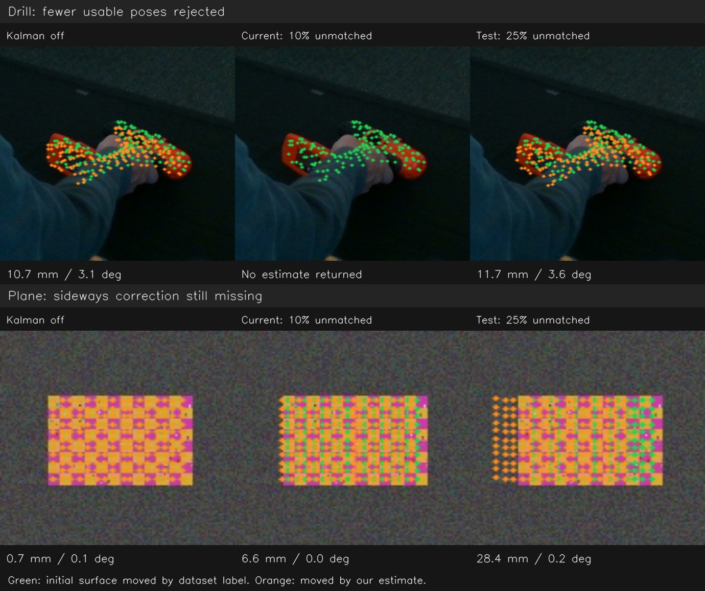

[All scores, source hashes, common-frame errors and validation](kalman-default-validation-20261103.json).
Full local traces and report: `~/.cache/flash-tracker-restart/kalman-accept25-all-20261103/`;
GUI report `rebuild-20261103-093519-e69e3059`. These use saved masks and include the
recordings used for tuning; they are not fresh segmentation or held-out evaluation.
Concurrent processing times must not be interpreted as live FPS.

Promotion checks: 123 focused tests pass, including the default settings → HTTP
worker → nonzero Kalman correction path and historical-setting preservation.
The two recorded integration checks also pass with the new defaults: gamepad
false motion is at most 1.20 mm / 3.93° through frame 192, and it subsequently
moves. Frame 277 has no pose; the movement control now checks its two endpoints
rather than incorrectly requiring availability on every intervening frame. The
strict pre-grasp availability assertion is unchanged. This does not certify the
post-grasp pose. Python lint/format, GUI async lint and JavaScript syntax pass.

The completed trace audit finds all 582 missing real-labelled estimates rejected
before fusion (`no_observation_compatible_candidate`); 76 other updates reject
innovation but retain a pose. This distinguishes pre-filter acceptance loss from
Kalman's weighting. The synthetic plane separately exposes missing directional
information even with continuous pose availability. The default promotion changes
configuration only; neither remaining algorithmic limitation is claimed fixed.

## 2026-11-03 — Isolate depth-fitting errors with unchanged masks

**Correction to the drill explanation:** the fitter uses all cleaned depth
patches, while the stored surface and acceptance check use the largest connected
patch. The displayed red points measured distance to the stored surface; they
did not establish incorrect depth or a falsely rejected correct pose. Of the 82
unmatched points in frame 42's largest patch, 27 conflict with the first depth
view under that candidate alignment; the other 55 are not ruled out by it.
Neither category certifies point ownership or pose accuracy.

Simply disabling connected-patch removal regresses the full drill and mug clips.
At unchanged Kalman settings, returned poses fall 64→34 and 46→35 of 73 frames;
10 mm/10° successes fall 31→24 and 41→35. RGB-D, masks, times and labels match.
The depth-selection change also affects image-pair filtering, so these are
pipeline ablations, not isolated changes to the fitting objective.

A separate noiseless box control establishes an actual fitting flaw. The fitter
receives only the first measured face, then the box turns and exposes a new side.
Starting from the exact pose at a 40° turn, fitting introduces 7.79 mm / 9.04°
error: the unconditional current-to-stored distance tries to match the new side
to a surface that never measured it. The existing gate also rejects the exact
pose. This conflicts with the [partial-observation design](../../../src/lerobot/policies/flash/docs/tracking_pipeline.md#core-loop).

**Local prototype, not integrated:** apply the existing depth-visibility logic
in both frame directions, using the earlier depth image to identify which
current points had a visible counterpart. Error becomes 0.25 mm / 0.20° on that
control. It improves all three tested turns (20/40/60°) from both exact and
perturbed initial poses, but does not resolve the real drill frame. Neither the
acceptance rule, growing-map implementation nor production defaults changed.

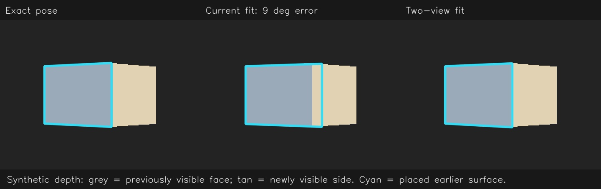

[Measurements and provenance](depth-fitting-audit-20261103.json).
Reproduction scripts and full traces remain local in
`~/.cache/flash-tracker-restart/depth-fit-audit-20261103/`.

**Controlled fix implemented next:** the shared `WholeSurfaceFit` now accepts
the actual earlier depth/mask and camera intrinsics. It checks visibility in
both images; the acceptance check likewise excludes genuinely unobserved surface
from correspondence failures. No visible overlap is insufficient to validate a
pose. This does not lower the existing depth or outlier tolerances.

The [reproducible control](../../../benchmarks/flash_partial_surface_control.py)
passes all 20/40/60° turns, starting both at the exact pose and 5° away. Exact-seed
rotation errors fall from 6.79/9.04/9.96° to 0.15/0.20/0.15°; point errors are
0.34/0.25/0.92 mm. Perturbed seeds finish within 0.58° and 3.39 mm. Deliberate
position errors are rejected. Regression tests cover disappearing/new surfaces,
different camera intrinsics, image-assisted selection, and compiled/batched
parity. Restoring the old objective or the old acceptance check independently
makes its regression test fail.

**Scope at the controlled milestone:** only the two-measurement path was tested.
The following experiment extends it to the benchmark's growing-map sessions;
the server default remains unchanged.

### Apply the partial-surface correction to real recordings

`GrowingSurfaceConfig.partial_surface_matching` enables the same correction in
fitting, candidate acceptance and group comparisons. It retains the original
depth, mask, measured points and camera transform for active surface patches,
plus the last accepted observation. The existing patch limit bounds retention.
An earlier observation can contain a newly visible side even if that side has
not passed the stricter surface-growth checks. Reverse matching must use those
actual measured points, not replace them with the incomplete stored model.

A regression test caught precisely that integration error: the stored model has
only a box's first face, an accepted later view sees its side, and a further turn
must still match. The test failed before the correction and passes after it.
Duplicate source views do not multiply their contribution. Rejected candidates
do not become retained source views. No mask, depth-selection, Kalman or
acceptance thresholds change in the paired experiment.

Results and exact source snapshots are kept locally under
`~/.cache/flash-tracker-restart/depth-fit-audit-20261103/partial-measurements/`.
The interrupted `partial-views` and `partial-views-complete` runs are marked
invalid development comparisons and must not be used as results of this fix.

**Completed result: keep disabled.** Both full DexYCB clips were rerun with
identical recorded inputs and settings except the new flag. All three unchanged
UFM control methods reproduce their previous poses and availability exactly.
For group tracking with a growing surface, counts out of 73 scored frames are:

| Clip  | Poses returned, before → after | Within 10 mm / 10°, before → after | Within 20 mm / 20°, before → after |
| ----- | -----------------------------: | ---------------------------------: | ---------------------------------: |
| Drill |                        64 → 33 |                            31 → 33 |                            56 → 33 |
| Mug   |                        46 → 61 |                            41 → 37 |                            42 → 37 |

The drill loses previously usable poses. The mug returns more poses but also
accepts a wrong alignment after loss: frame 49 is 83.2 mm / 153.8° from the
label, passes the direct checks, and reinitializes Kalman. Later predictions
continue from that incorrect alignment. This is not an overall tracking gain.
Disabling growth does not rescue the result: the mug's group-assisted fixed
surface falls from 42 to 37 accurate frames at the tighter threshold.

The remaining drill rejection is not explained by optimizer initialization
alone: even the labelled pose fails the checks at frame 42. At labelled motion,
adjacent measurements 41→42 agree to a median 1.88 mm among visible source
samples, while 0→42 disagrees by 16.61 mm. Many projected old points land in
regions excluded by depth cleanup; the visibility check still reads the raw
depth image. These measurements identify an evidence-consistency problem to
investigate, not proof that the dataset labels or depth sensor are wrong.

Retaining many measured views is also expensive: median group/growing method
time rises from 167 to 814 ms on the drill and 192 to 5,480 ms on the mug;
the mug's 90th percentile reaches 34.2 seconds. These are offline method timings,
not end-to-end live FPS. No full-suite rollout or server/default change follows
this experiment. The perfect-depth control and 156 focused tests pass; neither
substitutes for this failed real-data evaluation.

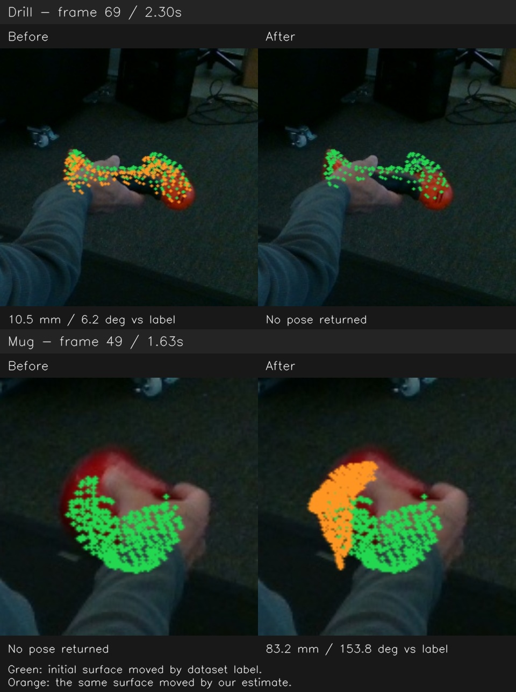

[Full before/after scores, common-frame errors, timings, hashes and diagnostic checks](partial-surface-real-clips-20261103.json).

#### Why the mug's recovered pose is wrong

Reconstructed the exact retained measurements and transforms at frame 49 from
the saved patch events. The recomputed fitting cost matches the recorded cost
(0.3391051442). This is an acceptance failure, not a replay display discrepancy.

- The old surface can fit another visible patch of the mug. Of 842 stored
  samples, 539 receive zero current-image correspondence weight because the
  proposed pose places them behind measured depth or outside usable visibility.
  The two-direction check reports 16.6% visible correspondence conflicts and
  1.1% empty-space conflicts, passing the existing 25% allowance. There are no
  usable image pairs or group point constraints at this frame. A compatible
  partial patch does not establish that its identity/orientation is correct.
- The preceding estimate is contradicted by the new image. The Kalman recovery
  branch therefore resets to the selected fit, bypassing its jump rejection.
  Replaying the saved correction with that branch disabled rejects the jump:
  squared innovation 2314.3 versus limit 12.59. Enabling the branch reproduces
  the reset. This establishes why the wrong candidate becomes the output; simply
  disabling recovery would leave the tracker lost rather than recover its pose.
- Surface growth does **not** cause this particular jump: the map remains at
  version 18 / 842 points and rejects the frame's proposed additions. The
  limitation is consistent with `surface_uncertainty.py`'s stated contract:
  local covariance assumes the selected surface correspondences are correct;
  it does not measure uncertainty between different surface assignments.

The initial loss is not fully explained yet. At frame 38 the UFM estimate is
rejected by the new empty-space check (37.3%); at frame 49 even the dataset pose
fails reverse correspondence checks (97.2%). Masking out same-object depth
pixels already excluded by cleanup does not resolve either rejection and still
accepts the bad frame-49 pose. Replacing retained estimated camera transforms
with label transforms also leaves the large reverse mismatch. These rule out
two simple explanations, but do not establish whether the remaining mismatch
comes from depth/label inconsistency or the visibility test. No production
change or acceptance-threshold tuning was made during this audit.

Local reproducible probes: `audit_mug_failure.py`, `audit_mug_views.py`,
`audit_mug_cleanup.py`, and `render_mug_audit.py` in the depth-fit audit directory;
their outputs are in its `partial-measurements/` subdirectory.

#### Does recovery require skipping Kalman's check?

**Controlled experiment, not a runtime change.** Rendered a rigid box moving
40 mm behind a screen for 0.4 seconds, then reappearing. The actual observation
builder, surface fitter and Kalman filter receive depth, an exact visible mask
and intrinsics. True pose is used only to render and evaluate. Image/group
motion, depth noise and surface growth are disabled to isolate recovery.

| Filter setting                       | First visible frame after hiding                |
| ------------------------------------ | ----------------------------------------------- |
| Current automatic reset              | Accepts; 1.97 mm surface error                  |
| No reset, current uncertainty        | Rejects the same accurate fit; no pose returned |
| No reset, broader motion uncertainty | Accepts normally; 1.97 mm surface error         |

The strict filter's squared innovation is 593.34 against a 12.59 limit.
Changing position process uncertainty from 2 to 30 mm/√s reduces it to 3.73,
without disabling the rejection. This setting was specified before the run;
it is an ablation, not a calibrated or recommended default. Larger uncertainty
can also admit wrong matches. The real mug failure above remains the negative
example where the current reset accepts a wrong match.

**This does not demonstrate that a bypass is necessary.** It demonstrates that
the current uncertainty can reject real movement. Removing the bypass alone
also fails the visible-motion control: with no image/group motion, the strict
filter falls behind and the fitter eventually finds no acceptable candidate.
A smaller 3 mm hidden movement is accepted normally, ending at 2.40 mm error.
These controls prevent interpreting a frozen estimate as successful tracking.

The old prediction's depth/mask check remains useful: it tests whether that
prediction can still explain what is visible. Its failure does not establish
that the replacement fit is correct. A fully hidden object supplies no such
test. The current automatic reset conflates distrust of the old prediction
with approval of the replacement; recovery without that shortcut is still
experimental, not deployed.

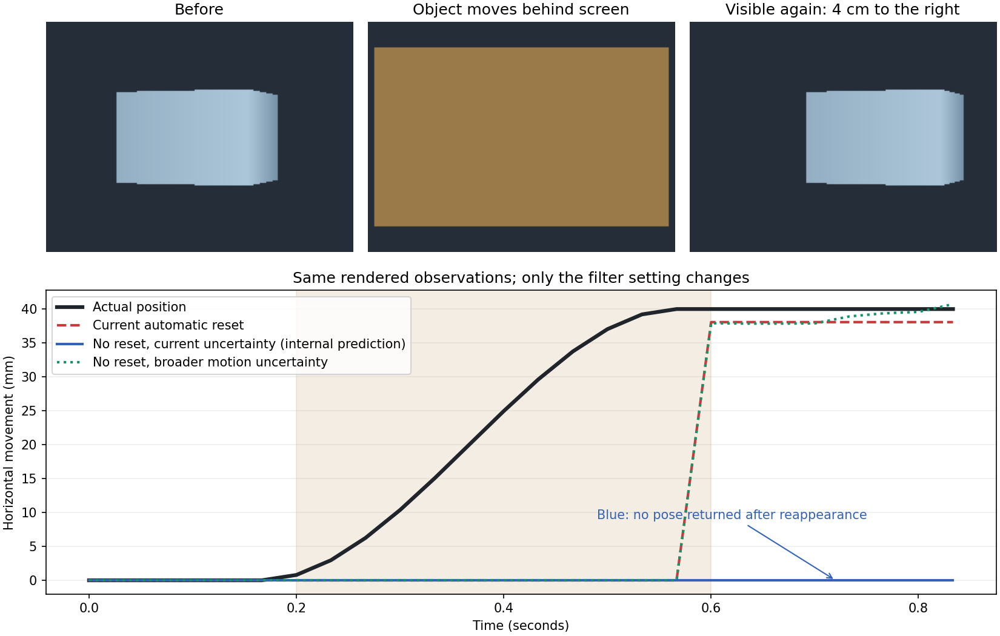

Blue shows the internal prediction; after reappearance it is withheld from
the output. [Results and controls](kalman-recovery-control-20261103.json).
Reproduce with `python -m benchmarks.flash_kalman_recovery_control --output DIR`;
`tests/policies/flash/test_kalman_recovery_control.py` runs the real rendered
comparison and checks that recovery moves the estimate while the map stays fixed.

#### Recovery acceptance tests, before changing runtime behavior

The checkpoint at `8a4f8ef4b` preserves the experiments above. The new
[integration tests](../../../tests/policies/flash/test_recovery_acceptance_integration.py)
exercise the real RGB-D observation builder, surface fitter, Kalman update and
surface-growth checks. They cover a stationary hidden object, motion while
visible or hidden, a 12-pixel visible strip, simultaneous camera and supporting
group motion, and corrupted depth followed by clear observations. A saved
DexYCB mug checkpoint reproduces the wrong recovery without downloading a
dataset or loading a neural model. Its original mask and depth are retained;
labelled poses only evaluate the output.
All comparisons enable the experimental partial-surface objective; its runtime
default remains disabled.

The rendered controls keep the pre-existing 5 mm median surface-point error /
1° rotation-error requirement.
Tests also check bounded fitting work, one filter correction per frame, no
surface changes after rejected measurements, and bounded retained memory for
one and three objects over 300 hidden frames. Known failures are strict expected
failures: removing the marker exposes the actual failing assertion, and an
unexpected pass requires review.

**Experimental comparison, not a new default:** the same three filter settings
run on every case. The broader setting changes only position process uncertainty
from 2 to 30 mm/√s and uses the normal Kalman rejection. On the real mug
checkpoint it adds the corresponding uncertainty since the last accepted
observation; it does not replay the earlier clip with that setting.

| Case                                                   | Current automatic reset      | No reset, current uncertainty | No reset, broader uncertainty |
| ------------------------------------------------------ | ---------------------------- | ----------------------------- | ----------------------------- |
| Visible motion, 26 frames                              | 11 within accuracy limits    | 8 within limits, then lost    | All 26 within limits          |
| Reappearance after 40 mm hidden motion                 | Recovers immediately         | Does not recover              | Recovers immediately          |
| Wrong mug recovery                                     | Publishes the wrong pose     | Rejects it                    | Rejects it                    |
| Stationary object, narrow strip, camera + group motion | Pass                         | Pass                          | Pass                          |
| Corrupted depth, then clear again                      | Rejects bad frames; recovers | Same                          | Same                          |

The broader setting is a candidate for the next fix, not evidence that its
uncertainty is calibrated or that it will improve every recording. The real mug
remains lost when its bad fit is rejected. These tests do not solve that initial
loss or test segmentation and 2D matching. Supporting markers in the camera
control are exact synthetic inputs; group membership and point drift are outside
that control's scope.

Both fresh passes produced identical poses and availability. The visible-motion
control ends at 5.21 mm error with the current reset and 1.89 mm with broader
uncertainty. The mug's wrong recovery remains 83.25 mm / 153.79° from its label;
both no-reset variants withhold it, and none of the three changes its stored
surface at that frame.

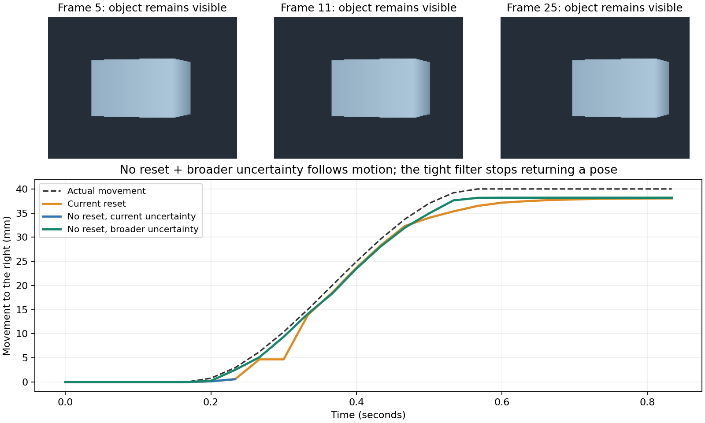

The graph shows the horizontal movement of a fixed point at the centre of the
first measured surface. Scoring uses all three spatial directions and rotation.
A line ends when that method stops returning an estimate.

Performance is dominated by fitting: the real mug update takes 22–23 seconds,
of which Kalman correction takes about 0.3–0.4 ms. This expensive multi-view
experiment is not suitable for live use yet. With already prepared empty masks,
600 frames of prediction take median 0.054 ms for one object and 0.160 ms for
three; no fitting or map growth occurs. Process RSS increases by 64 KiB and
92 KiB respectively. This bounds the hidden-object path only, not memory during
surface reconstruction or neural inference.

[Repeated results, timings, environment and input hashes](recovery-acceptance-20261103.json).

Verification: 81 related tests pass; the new integration suite has 15 passes
and three strict expected failures (wrong mug reset, current-reset motion error,
and no-reset tracking loss with tight uncertainty). Production code is unchanged.

Reproduce fresh timing with `python -m benchmarks.flash_recovery_matrix --output
DIR --repeats 2`. Use `--hidden-objects 1` or `--hidden-objects 3` in separate
processes for prediction-only memory and latency. Stage times overlap and must
not be added; total frame time is observation preparation plus session update.

## Recovery experiments parked — 2026-11-04

The original problem was recovering the object's pose when it becomes visible
again. Two failures became mixed together: surface matching can reject a newly
visible side, and the filter can either reject a useful fit or reset to a wrong
one. The user chose to set the additional filter experiments aside and focus on
finding an alignment from the visible measurements.

The completed comparisons average the same 21 real labelled UFM clips equally.
Missing poses count as failures; these scores include occluded frames and do
not separately measure recovery after reappearance.

| Configuration                                    | Within 10 mm / 10° | Within 20 mm / 20° |
| ------------------------------------------------ | -----------------: | -----------------: |
| Committed default                                |             58.01% |             71.10% |
| Broader position uncertainty, no automatic reset |             57.85% |             69.99% |
| Pose plus velocity, no automatic reset           |             58.54% |             69.18% |
| Pose plus velocity, existing reset retained      |             58.97% |             70.94% |

Velocity with the existing reset improves six clips, regresses two, trades one
accuracy limit for the other in two, and leaves eleven unchanged. It retains
the known wrong-mug reset. Velocity improves continuous turning in the rendered
control, but overshoots when the object moves while hidden and then stops.
Broader position uncertainty alone does not address uncertain rotation.

The final experiment combined velocity without reset and partial-surface
matching. **Only seven of 25 configurations completed before cancellation at
the user's request.** Of those seven, five regress at the two accuracy limits,
one improves at one limit but regresses at the other, and one is unchanged. The pitcher
still fails to recover; the mug ends approximately 80 mm / 171° wrong. This is
an incomplete sweep, not a result for all scenes. Fitting is also expensive:
median pitcher/drill/mug times are approximately 0.67/0.98/6.72 seconds, versus
0.24/0.20/0.19 seconds for the default. Concurrent workload varied, so these
timing ratios are approximate.

Recorded diagnostics distinguish two causes. Some pitcher frames produce no
observation-compatible candidate before Kalman correction. Other frames produce
a candidate within the looser accuracy limits that Kalman rejects. Trying all
four geometry-derived starting orientations finds reasonable alignments on two
missed pitcher frames; that is a single-frame diagnostic, not a validated
sequence recovery fix. Segmentation drift and depth cleanup discarding real
object parts remain separate known issues; neither is established here as the
cause of this pitcher failure.

The focused final tests passed 54 checks with four strict expected failures;
the failures remain limitations, not successful acceptance tests. Complete
filter-state rollback was tested with partial-surface matching both on and off.

All uncommitted experiment code, tests, full research notes and figures are
preserved in stash `ce3923207a64f950314403f03160f9f7f9be1bd6`.
Restore with `git stash apply ce3923207a64f950314403f03160f9f7f9be1bd6` after
preserving any newer work; this research file may need a merge.
A second local backup, manifest, patch and untracked-file archive are under
`~/.cache/flash-tracker-restart/parked-recovery-experiments-20261104/`.
Raw runs remain under `kalman-motion-wide-20261103`, `velocity-*-20261103`, and
`velocity-partial-*-20261104` in that same cache root. The final partial report
and videos are in `velocity-partial-report-20261104/`.

At that checkpoint code returned to `bcaf3ad39`: the committed Kalman default remained, and the
previously committed partial-surface option remains experimental and disabled
by default. No experimental setting was promoted and no robot trial was run.

## Five reviewed recovery failures — 2026-11-04

**Not solved; no experimental setting promoted.** The gamepad's wrong pose at
11.97 s occurs in both the UI's older 10% run and the committed 25% run. It is
not explained by stale playback alone.

Added six portable RGB-D checkpoints covering gamepad, mustard, yellow block,
clock (two frames), and drill. Fourteen acceptance checks initially give seven
failures. They run real preparation → fitting → Kalman → growth, with frozen
upstream state. They do not rerun UFM or segmentation. Separate checks read the
raw pose output of full causal replays, independently of the benchmark's score.
[Fixture scope and commands](../../../tests/policies/flash/fixtures/recorded_recovery/README.md).

The experiments use the same settings for every scene:

- Keep disconnected depth regions near the dominant measured depth, using
  median absolute deviation; do not keep only the largest 3D component.
- Remove rejected depth readings from fitting checks too, preserving the mask.
- Use mutually visible surface for both fitting and its later overlap check.
- Try additional coarse orientations when the normal starting guesses all fail;
  retain valid intermediate optimizer results instead of only its final iterate.
- Compare all retained source views versus just the most recent accepted view,
  while keeping the accumulated surface in either case.

The best small-checkpoint variants have **11 passes / 3 failures**. A complete
replay with shared UFM, groups, partial matching, filtered depth, four extra
starts and one recent source view gives:

| Scene        | Accurate frames, baseline → experiment | What remains wrong                                                |
| ------------ | -------------------------------------- | ----------------------------------------------------------------- |
| Mustard      | 175/180 → **180/180**                  | None at the existing 20 mm / 20° limit                            |
| Clock        | 25/202 → 31/202                        | 198 poses returned, but most have wrong orientation               |
| Drill        | 56/73 → **43/73**                      | More poses returned, worse positional accuracy                    |
| Yellow block | No pose labels                         | Availability 62/74 → 74/74; alignment remains imperfect           |
| Gamepad      | No pose labels                         | Availability 613/627 → 627/627; wrong orientation at 12 s remains |

Initial frames are excluded; missing poses count as failures. Mustard's stricter
10 mm / 10° count improves 116 → 166. The full-sequence acceptance checks pass
mustard, yellow's position-only check and the early clock frame. They fail the
gamepad's visible-face direction check, later clock (124.5 mm / 136°), and drill
(26.9 mm / 2.3°). Unlabelled checks do not establish full 6D accuracy.
[Complete counts and stage timings](recovery-20261104/sequence-comparison.json).

**Comparison limitation:** the experiment above retained the known automatic
Kalman-reset defect. At gamepad frame 271 the consistency test failed, but the
reset accepted the new pose anyway. It was therefore incorrect to attribute
all remaining failures to alignment before combining the parked filter fix.

There is also evidence of weak alignment scoring, independently of availability.
Searching all 24 coarse orientations on the gamepad finds extremely low-cost
fits with only about 2–5 visible source points and a wrong face direction.
Much of the surface is treated as hidden/unknown, so a small residual is not
strong evidence of correctness. Local covariance is conditional on those
chosen correspondences; it does not certify their identity. Increasing the
depth tolerance to 10–15 mm also admits a clock pose over 120 mm wrong. These
experiments must not be described as fixes merely because they return a pose.

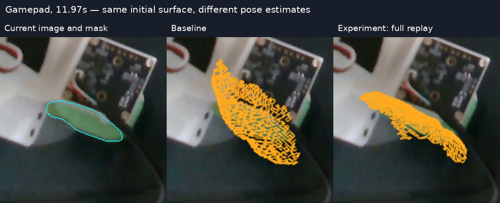
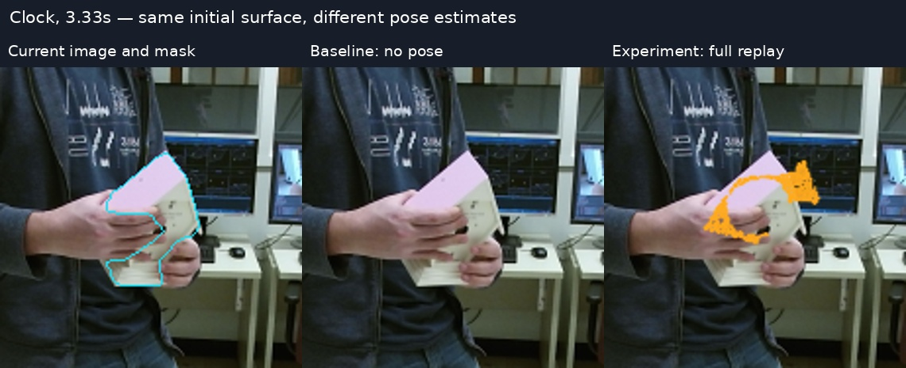

A separate confirmed drill problem is depth selection: the largest connected
patch is at 2.94–2.99 m, while most object readings are near 1 m. Robust range
cleanup retains the near portions, but does not by itself recover the pose.
It can also remove legitimate minority surfaces at different depths, so it is
still experimental. This does not establish whether the original bad readings
come from sensor failure or imperfect object masks.

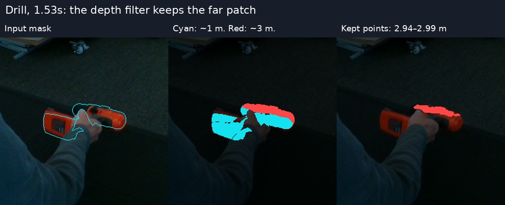

New opt-in controls are `observation.depth_outlier_sigma` (default `None`),
`observation.filtered_depth_for_fitting` (`False`), `recovery_starts` (`0`, max
24), and `fit_view_limit` (`None`, all retained views). Partial matching remains
off by default. Surface growth keeps its separate stricter checks. Reducing
source views loses older empty-space evidence; expanding search can introduce
false fits. No object names, case timings, label poses or handcrafted axes enter
the runtime algorithm. The filter's rejection reason is now preserved when no
correction occurred, rather than being overwritten as a fused-pose failure.

Verification: 155 existing/control tests pass with three unchanged expected
failures; the two later view-budget/diagnostic tests also pass. The depth-check
test fails when rejected raw depth is deliberately reintroduced. Baseline and
experimental recovery failures remain ordinary failing assertions, not xfails.
Full replays used actual UFM and recorded masks; no robot moved and 9102's saved
results were not replaced. Median fitting times in the recent-view experiment
are roughly 0.30–0.55 s/object versus 0.13–0.34 s before; concurrent workloads
differed, so these are diagnostic timings, not a controlled speed benchmark.

All raw traces, input/code snapshots, cancelled all-view experiments (explicitly
marked incomplete), images and test logs are local under
`~/.cache/flash-tracker-restart/recovery-audit-20261104/`. The completed run is
`sequential-filtered-depth-last-view`. Changes remain uncommitted.

### Combine recovery with the parked Kalman fix

The previous comparison omitted the no-reset fix. Restored the strict filter,
the pose-plus-velocity experiment, and full filter-state rollback from stash
`ce3923207a64f950314403f03160f9f7f9be1bd6`. These remain experiments; the reset
variant is an explicitly named baseline. No default or 9102 result changed.

`benchmarks.flash_recovery_combinations` records both fitting and filtering
choices and replays each recording from frame zero. The same settings apply
across all five reviewed scenes. The labelled results are:

| Setting                                                                      | Mustard / 180 | Clock / 202 | Drill / 73 |
| ---------------------------------------------------------------------------- | ------------: | ----------: | ---------: |
| Committed baseline                                                           |           175 |          25 |         56 |
| New fitting, old reset retained                                              |           180 |          31 |         43 |
| New fitting + no reset + broader position uncertainty                        |           180 |          21 |         42 |
| New fitting + no reset + velocity                                            |           180 |          17 |         39 |
| Partial matching only + no reset + broader position uncertainty              |           180 |          10 |         34 |
| Partial matching only + no reset + broader position and rotation uncertainty |           180 |          11 |         33 |

Counts use the existing 20 mm / 20° label comparison; missing poses fail.
Both new-fitting combinations completed all five recordings. The two minimal
partial-matching combinations completed the three labelled scenes and yellow;
their remaining gamepad replays were stopped once the labelled regressions
disqualified them. Those partial outputs are explicitly marked incomplete.
[Paired scores, input digests, completion status and proposal audit](recovery-20261104/combined-comparison.json).
None is a Pareto improvement. Broader position uncertainty is the parked
30 mm/√s setting; broader rotation is its previously tested 30°/√s setting.
The minimal partial variants retain the original depth extraction and all
source views. Thus these regressions cannot all be attributed to the newer
depth cleanup or reduced view history. Unlabelled gamepad and yellow-block
results require the separate consistency checks and visual review.

At gamepad frame 271, the real frozen proposal exceeds the Kalman limit with
both old and new fitting. The reset baseline accepts it; no-reset rejects it.
In the full combined run, rejection is preserved but the pose is still missing
at 12 s. This is a fixed rejection defect, **not successful recovery**.

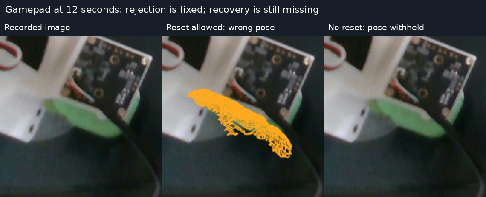

The completed new-fitting/broader-position clock run proposes 148 wrong poses:
Kalman rejects 124 and accepts 24. It also rejects two proposals within the
accuracy limits. For drill, 28 wrong proposals pass the ordinary filter test.
These are measured remaining failures with the bypass removed. No claim is
made that the candidate search has exhausted every possible correct pose.

`test_combined_recovery.py` pins the reset bug across both fitters; deliberately
restoring the reset makes its rejection assertion fail. Full-sequence checks
separately require recovered poses and verify that no accepted correction
exceeded the Kalman limit. A passing rejection check cannot substitute for a
passing recovery check. The broader-position and velocity runs each still
fail gamepad, both clock checkpoints, and drill; mustard and yellow's limited
position check pass. The restored controls pass 100 checks with four known
expected failures, including the velocity model's hidden-stop overshoot.

Raw runs and source snapshots are under `recovery-audit-20261104/combined-*` in
the local FLASH cache. `combined-proposal-audit.json` separates proposed-pose
quality from the filter decision. Changes are uncommitted.

### Scene depth and gamepad recovery: rejection works, recovery remains incomplete

Missing depth is unknown. A nearer measured surface can occlude the object.
Only a farther, reliable reading can contradict a proposed object surface in
front of it. Earlier red-dot illustrations showed disagreement with recorded
depth, **not proven physical conflict**: a thin wire can be missed by the sensor.

Opt-in `shape.scene_depth_constraints` preserves scene depth separately from
the trimmed points used for matching. It takes the nearest depth within the
existing 2 px alignment tolerance; a hole makes that neighborhood unknown.
It adds metric depth disagreement to fitting and checks contradictions against
exposed points rather than diluting them over hidden points. This cannot fix
a sensor that misses an occluder entirely. The option defaults to false.

At frame 271 (11.97 s), the recorded wrong gamepad pose previously passed:
7.45% of all sampled surface points contradicted the old check. With the new
scene check, 74.2% of the exposed weighted samples disagree; it is rejected.
The frozen real-frame replay returns no corrected pose and adds no surface.
Missing-depth and foreground-occluder controls still pass, as do real motion
in either direction and native/Python residual parity. Disabling the scene
check deliberately makes the recorded regression test fail.

Recovery is separate. `benchmarks.flash_scene_depth_recovery` tries 24 generic
initial alignments plus the old result, using the first measured surface and
current RGB-D/mask. These are independent frame searches, **not a causal UFM,
group and Kalman replay**. A geometry-only search can still prefer almost-zero
overlap because unseen points incur almost-zero error. Its research-only
`--overlap-objective` instead rewards positive measured agreement without
calling unknown points contradictions. It finds no accepted candidate at
11.97 s, still gives poor poses at 13.98 and 19.98 s, and finds a visually
plausible alignment at 27.82 s. There is no independent pose label here.

At 19.98 s only 1,102 of 3,126 mask pixels have depth. Separate patches report
266–278 mm and 385–429 mm. The experimental range filter retains the dominant
far band; retaining all depth bands also fails. Which readings actually belong
to the gamepad remains unresolved. This is not evidence that more search alone
solves recovery. Searches take roughly 6–35 s/frame with 25 initializations.

155 focused checks pass. Defaults, GUI results and 9102 are unchanged. Small
reports and illustrations are in `recovery-20261104/scene-depth-summary.json`
and `scene-depth-recovery.jpg`; all candidates and settings remain under
`recovery-audit-20261104/scene-depth-*` in the local cache.

**Outline coverage follow-up.** Missing depth does not erase mask occupancy.
The reference's projected surface was allowed to leave visible object pixels
uncovered: `require_full_mask_coverage` was disabled to allow genuinely new
surface, but that also removed useful constraints when the same face returned.
The controlled `--visible-outline` experiment constrains the current outline
while leaving the reverse view partial. At 19.98 s the uncovered mask area,
after the existing 2 px allowance, falls from 1,231/3,126 pixels (39.4%) to
40/3,126 (1.3%). At 27.82 s it falls from 318/5,994 (5.3%) to 220/5,994 (3.7%).
The stored source itself misses 110/6,028 mask pixels after that same allowance
at identity: filtered and sampled 3D points do not retain the entire outline.
Thus pose offset and incomplete edge geometry both contribute. The 13.98 s
pose remains poor. This is not a full recovery fix or a default promotion.

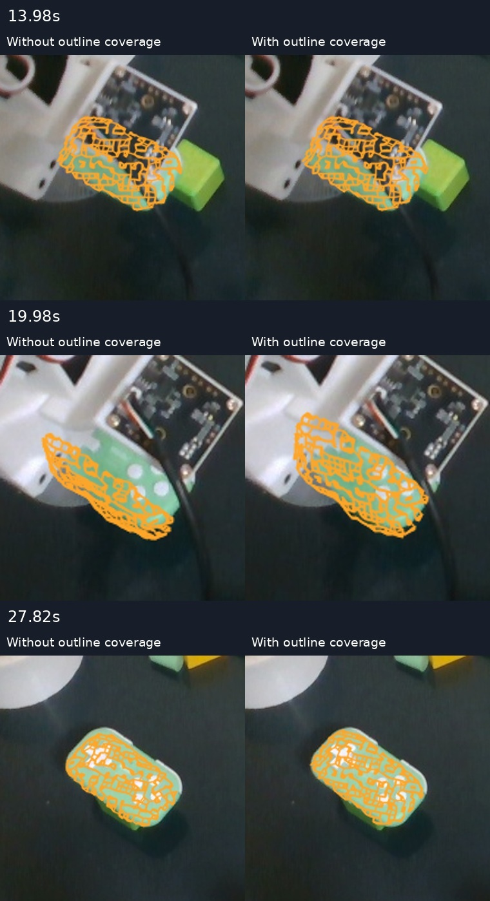

The known-face assumption matters: an uncovered pixel proves an object exists
there, but a genuinely partial stored model may simply lack that newly exposed
surface. A general solution must retain mask evidence with its depth uncertainty
rather than treat all uncovered pixels as either empty space or a wrong pose.
The additional controlled test verifies that missing boundary depth does not
disable outline constraints when the stored surface contains the visible face.

**Full gamepad replay with those checks.** The overlap objective is now a shared
opt-in setting, `shape.prefer_observed_overlap`; parity tests compare it with the
earlier standalone experiment. The sequential run enables scene-depth checks,
forward outline coverage and overlap preference, using the same no-reset Kalman
and recovery configuration for both objects. All 628 frames were replayed from
frame zero with UFM, surrounding groups and surface growth; the input digest
matches the baseline. It took 934.5 seconds. Neither defaults nor 9102 changed.

The pose initially looks aligned. **Review correction:** the earlier claim of
proven drift at 7–9 s was too strong. The 2D drawing shifts during occlusion,
but it draws the predicted surface over the gripper even when that surface
would be hidden. This alone cannot establish a pose error; the gamepad has no
independent pose labels. It is mostly missing from 9.24–12.84 s, briefly returns,
and is continuously missing from
13.98–21.85 s. It recovers at 21.85 s and looks aligned through the final frame
at 27.82 s. These are visual observations, not ground-truth accuracy scores.
The recovery test at 11.97 s still fails; the no-Kalman-bypass test passes.
The 160 compatibility checks pass, but this is **not a tracking acceptance pass**.

The complete video, timestamped stills and availability intervals are in local
cache `recovery-audit-20261104/sequential-scene-outline-review`; raw outputs and
source snapshots are beside it in `sequential-scene-outline`. The video renders
the fixed initial measured surface at each returned pose and explicitly labels
missing poses, so changes to the accumulated surface cannot hide pose errors.
The completed result is now published to 9102 in the existing shared-UFM gamepad
scene slot, labelled `Scene depth + outline · no-reset Kalman · Nov 4`. Its 3D
viewer uses the corresponding recorded RGB-D, returned poses and grown surface;
the earlier result remains on disk. Publication does not change tracker defaults.

### Wider check of geometry rejection and Kalman, November 4

The same gamepad configuration was replayed from frame zero on eight additional
clips. Seven have pose labels; the yellow block does not. UFM, surrounding groups
and surface growth ran causally; recorded masks were reused. Input hashes,
timestamps and initialization frames match the baseline. Labels were used only
after inference. Each variant uses identical settings across scenes.

Counts below are **within 20 mm / 20°, outside those limits, missing**, excluding
initialization. The same initial measured points score every variant. These are
label-agreement counts, not confidence probabilities.

| Clip    | Previous baseline | New geometry, no reset | Same new geometry, legacy reset | No reset, wider rotation uncertainty |
| ------- | ----------------: | ---------------------: | ------------------------------: | -----------------------------------: |
| Tomato  |       32 / 31 / 4 |            31 / 36 / 0 |                     31 / 36 / 0 |                          31 / 36 / 0 |
| Tuna    |      28 / 22 / 21 |            28 / 0 / 43 |                    28 / 25 / 18 |                          28 / 0 / 43 |
| Banana  |      39 / 20 / 12 |            44 / 2 / 25 |                     44 / 22 / 5 |                          43 / 2 / 26 |
| Drill   |        56 / 8 / 9 |            37 / 0 / 36 |                     55 / 11 / 7 |                          53 / 11 / 9 |
| Mustard |       175 / 0 / 5 |            180 / 0 / 0 |                     180 / 0 / 0 |                          180 / 0 / 0 |
| Clock   |      25 / 2 / 175 |           23 / 6 / 173 |                    39 / 82 / 81 |                        37 / 50 / 115 |
| Cracker |      0 / 32 / 148 |            2 / 0 / 178 |                    2 / 144 / 34 |                              Not run |

The yellow block returns 62, 64 and 74 poses respectively out of 74 evaluated
frames, but availability alone cannot establish accuracy. The combined change
reduces outside-limit outputs **115 → 44**, while within-limit outputs decrease
**355 → 345** and missing outputs increase **374 → 455**. This is not a Pareto
improvement or a default promotion. The previous baseline also differs in depth
cleanup and recovery search; only the middle two columns isolate the reset rule.

**The no-reset filter still matters.** On tuna and banana it prevents 25 and 20
outside-limit outputs without losing within-limit outputs relative to the matched
legacy-reset run. But drill and clock also lose good candidates. Raising rotation
process noise from 2 to 30 degrees/√s recovers some, while reintroducing wrong
outputs. All these arms retain position process noise of 0.03 m/√s. No no-reset
arm accepted an innovation above its configured limit.

**Why geometry still admits errors:**

- Outline coverage steers the optimizer, but `check_surface_contradiction` does
  not directly reject uncovered outline. Making that a hard rule is not yet
  justified for genuinely unseen surface. At the wrong tomato output, the worst
  uncovered hull vertex is still 3.57 px beyond the existing 2 px allowance.
- Tomato frame 67 passes the depth checks despite 47.8 mm / 94.8° label error;
  the initial surface's principal long axis differs by 25.5°, so this is not
  solely spin about that axis. Its small frame-to-frame updates pass Kalman.
  An evaluation-only probe changes the previous view's estimated alignment to
  the labelled alignment: the labelled current pose then passes the scene check,
  instead of failing with 74% disagreement. This demonstrates dependence on an
  already-wrong history, not a deployable label-based fix. Initial-only geometry
  also fails here, so corrupted surface growth is not established as the sole cause.
- At the final tuna and late banana frames, the labelled pose has no measured
  overlap with the retained side of the surface; it has no depth contradiction.
  Wrong candidates do find overlap and pass geometry, then are stopped by
  Kalman. Looser Kalman cannot supply the missing correct alignment.
- Clock sometimes proposes a within-limit pose, rejects it through Kalman and
  returns an outside-limit prior that still passes geometry. Drill has both
  rejected good candidates and frames with no admissible candidate.

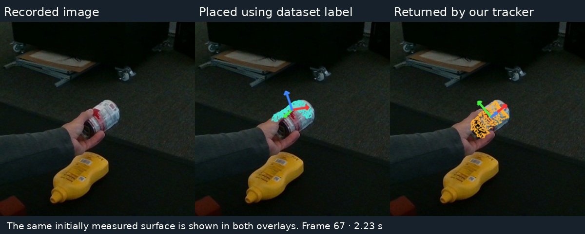

Cracker is also an **input/initialization failure**: its supplied `gt_mask` is
fragmented. Boundary trimming removes 3,449 of 3,483 pixels; the baseline starts
with only ten measured points covering about 6 × 6 mm. The new run has twenty
points spread more widely. It is not evidence of successful recovery. Without
this clip, outside-limit outputs fall 83 → 44 and within-limit outputs 355 → 343.

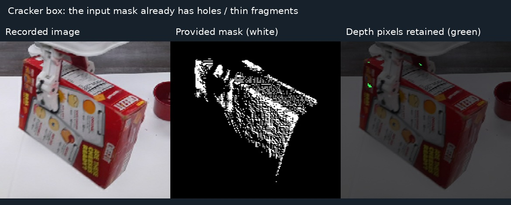

Six focused combination/scorer checks pass. Full-sequence acceptance still fails
clock frames 39/100 and drill frame 46 because poses are missing (six other checks
pass, gamepad checks excluded from this eight-scene suite). Ruff passes. An initial
test invocation accidentally resolved system pytest; rerunning `python -m pytest`
inside the experiment environment passed. These are research results, not a
tracking acceptance pass. No tracker defaults or GUI slots were changed here.

Compact evidence: [counts, diagnostics and protocol](recovery-20261104/geometry-matrix-summary.json)
and [per-scene comparison](recovery-20261104/quality-comparison.png). Full traces,
source snapshots and probe scripts remain in local cache
`recovery-audit-20261104/geometry-matrix-*`. Runs overlapped on the host, so their
timings are diagnostic only. `benchmarks.flash_recovery_matrix_report` reproduces
the scores and distinguishes wrong, correct and missing outputs.

**Closer diagnosis of the tomato sequence.** The outline penalty is active;
"not enforced" means it is not a separate acceptance condition, not that it is
ignored. At frame 32 both the labelled pose and returned pose pass the current
depth checks. The labelled pose has total cost 2.79 (outline 1.48); the returned
pose, 23.8° from the label, costs 1.21 (outline 0.29). Supplying the labelled pose
for this diagnostic therefore does not improve the score. This is a ranking
problem as well as an acceptance problem: fitting the partial stored surface to
cover newly visible object pixels can reward a wrong alignment. The initial
surface alone, checked against a label-aligned previous view, also gives the
wrong candidate a lower cost (1.63 versus 2.79); surface growth is not necessary
for this effect. Removing the outline term alone is not established as a fix.

The model stays at version 22 from frame 29 through 67: it does **not** keep
growing during the large drift. Meanwhile accepted observations keep replacing
the previous view. Frame 67 uses frame 66, with frame 66's estimated pose attached.
Thus the data are fresh but their alignment can remain wrong. Reprojecting the
same current points using a labelled current pose and the saved previous pose
reports 74% scene-depth contradiction; changing only the previous pose to its
label removes that contradiction. Labels are diagnostic only. The code supports
repositioning stored patches, but the sequential loop does not automatically
correct their old alignments when a new observation arrives.

The previous three-point explanation should be read as linked mechanisms, not
three independently isolated causes. [Measurements](recovery-20261104/rejection-diagnostics.json)
and actual-data illustrations show [the outline penalty](recovery-20261104/rejection-outline.jpg),
[partial-surface ranking](recovery-20261104/rejection-partial-ranking.jpg), and
[fresh observations with an incorrect alignment](recovery-20261104/rejection-fresh-observation.jpg).
No tracking behavior changed during this diagnostic.

### Outline preference strength, November 4

The uncovered-outline cost is now configurable as `shape.mask_coverage_weight`.
It multiplies the squared cost: 0 disables the preference; 1 preserves its
previous strength. This is separate from the 25% visible-outlier limit and from
Kalman uncertainty. Both scalar and compiled fitting paths use it. Depth and
empty-space rejection are unchanged. The legacy `require_full_mask_coverage`
flag enables this soft preference; it never was a hard coverage gate.
Defaults and the 9102 result selection remain unchanged.

**Paired sweep.** Six strengths (0, 0.1, 0.25, 0.5, 1, 2) were replayed from
frame zero on tomato. Five (all except 0.1) were compared on tuna, banana, drill,
mustard and the unlabelled yellow block. Same UFM, groups, growth, recovery and
no-reset Kalman settings in every arm; input hashes match. Labels are used only
by the evaluator. A fresh weight-one tomato run reproduces every old pose exactly.

The five labelled clips share 462 evaluated frames. Counts are within
20 mm / 20 degrees, outside either limit, and missing; initialization is excluded.

| Outline cost weight   | Within limits | Outside limits | Missing |
| --------------------- | ------------: | -------------: | ------: |
| 0                     |           321 |             64 |      77 |
| 0.25                  |           327 |             48 |      87 |
| 0.5                   |           340 |             42 |      80 |
| 1, comparison control |           320 |             38 |     104 |
| 2                     |           334 |             41 |      87 |

**Half strength is a candidate compromise, not a uniform improvement.** It adds
22 within-limit drill outputs and two outside-limit outputs, while losing two
within-limit banana outputs. The two drill errors are 20.7 and 21.1 mm with
under 2 degrees rotation error. The additional banana errors are 21.0 and
20.6 degrees. Smaller errors on several other frames do not cancel these
regressions. Refining the search at 0.4 and 0.75 on banana/drill did not remove
the trade-off: their within/outside/missing counts were 45/1/25 and 50/9/14 at
0.4, versus 39/7/25 and 59/1/13 at 0.75. No tested new strength improves both
counts on every compared labelled scene. At this point half strength had not been tested on the clock or full gamepad
replay. The clock follow-up below closes the former gap; the full gamepad
replay at half strength remains untested.

**Additional quarter-strength checks.** Clock changes from 23/6/173 to
26/27/149: more returned poses, many more outside the label limits. Cracker is
unchanged at 2/0/178; its fragmented input-mask limitation still applies. The
full 628-frame gamepad replay returns 372 poses at either strength, with almost
the same missing intervals and the same final recovery at 21.85 seconds. It is
still missing at the reviewed 11.97-second frame. The selected stills look
similar, not a demonstrated improvement. Its user-observed stationary interval
through 8 seconds has no missing output in either arm; 95th-percentile point
displacement changes from 10.57 to 11.21 mm. The yellow block returns more poses
(64 to 73 at half strength), but has no independent pose labels.

**Half-strength clock follow-up.** A complete 203-frame replay with the same
inputs and settings changes within/outside/missing counts from 23/6/173 at
weight one to **23/7/172 at half strength**. The only classification change is
frame 64: previously missing, now 21.8 mm / 13.5 degrees from the label. This is
not the large regression observed at quarter strength, but it does not recover
the clock through its rotation. At frame 180 (6 seconds), a substantial part of
the clock is visible and both strengths still return no pose. Across the six
labelled clips now tested at both strengths, half strength adds 20 within-limit
outputs and five just-outside-limit outputs, while withholding 25 fewer poses.
This supports half strength as a provisional compromise, not a universal fix;
no defaults or GUI results were changed.

An evaluation-only full-model distance check also qualifies the clock's rotation
scores: the same 558 initial measured points have a 1.14 mm median distance to
the supplied full mesh at initialization. Across returned poses, the worst
per-frame median is 3.90 mm at weight one, 3.85 mm at half strength, and 8.02 mm
at quarter strength. Those are nearest-triangle distances without refitting,
not proof of correct point identity or of a correct front/back assignment.
The half-strength gain on drill and remaining clock loss are shown in the
[actual-image comparison](recovery-20261104/outline-half-review.jpg).
[Clock label results](recovery-20261104/outline-clock-half-report.json) and
[full-model distances](recovery-20261104/outline-clock-full-model-metrics.json)
retain per-frame measurements.

**Tomato ranking diagnostic, qualified by the surface comparison below.** All
six tomato runs diverge from the labelled full pose; that includes axial spin
of the nearly cylindrical can and is not itself proof of bad geometry. In the
same frozen frame-32 fit, the labelled pose has cost `1.311 + 1.477 * weight`,
while the recorded output has cost `0.926 + 0.287 * weight`. Both pass the
current direct geometry checks. No nonnegative outline weight can reverse that
pair's ranking with those inputs and history. Disabling the separate overlap
preference narrows, but does not reverse, the zero-outline ranking (0.274 versus
0.244). This is a diagnostic comparison, not a tested alternative sequential
pipeline. The outline term amplifies preference for the non-labelled alignment;
whether that is physically worse needs a symmetry-tolerant surface comparison.

**Full-model check prompted by review.** The previous green overlay was the
initial measured partial cloud moved by dataset labels, not the supplied full
mesh. An evaluation-only check now uses BOP YCBV model 4 with the official
[DexYCB origin conversion](https://github.com/NVlabs/dex-ycb-toolkit/blob/master/dex_ycb_toolkit/bop_eval.py).
It measures each of the same 2,405 estimated points to the nearest full-model
triangle, without refitting either surface or requiring point identities.
At frame 67, half strength gives median distance **5.4 mm**, 90th percentile
**12.4 mm**, and **82.3% within 10 mm**, versus 5.7 mm / 12.5 mm / 83.4% at
weight one. The initial partial measurement itself has a 2.6 mm median gap;
spinning it 90 degrees about the model's long axis changes this to only 2.7 mm.
This confirms that the earlier roughly 83-degree pose error overstates the
geometric discrepancy. However, the labelled full mesh also differs from
same-frame sensor depth by median 13.8 mm inside the mask after a 2 px trim;
that mixes model/pose, sensor and possible occluder errors, not proven label
error. The comparison does not establish physical correctness or a winning
weight. No tracker defaults or GUI results changed.
[Measurements](recovery-20261104/tomato-full-model-metrics.json),
[fitting-step explanation](recovery-20261104/outline-weight-flow.jpg),
[full-model view](recovery-20261104/tomato-full-model-comparison.jpg).

**Controlled partial observations.** A noiseless rendered box reveals a new
side at 20, 40 and 60 degrees. The true pose remains admissible at every weight,
even with over 10 pixels of uncovered outline. Increasing the preference can
pull the raw fitted proposal away from that pose or cause its rejection; this
control measures proposals, not full filtered tracker output.

Verification: 94 focused configuration, scalar/compiled parity, geometry,
recorded-gamepad and existing recovery tests pass. Making the actual residual
ignore the weight causes the new configuration-effect test to fail. These checks
do not claim that the known full-sequence recovery failures are solved.

[Full measured results](recovery-20261104/outline-strength-results.json),
[tomato at all six strengths](recovery-20261104/outline-tomato-comparison.jpg),
[drill recovery and offset](recovery-20261104/outline-drill-comparison.jpg),
[gamepad comparison](recovery-20261104/outline-gamepad-comparison.jpg).
Reproduce recorded runs with `benchmarks.flash_recovery_combinations`, the
`geometry-matrix-manifest.json` in the recorded cache root, and
`--filter strict_broader --fitting recovery --scene-depth --prefer-observed-overlap
--visible-outline --outline-weight W --cases ...`. Raw poses, per-run source
snapshots, configurations and input hashes remain in that cache.

### Full-outline preference on partial RGB-D maps (November 4)

The later 48-scene half-strength sweep exposed a mistake in the objective, not
just a bad choice of weight. A saved RGB-D surface covers only observed sides.
Penalizing every current mask pixel left outside its projected envelope treats
that partial surface as a complete object. It can pull the fit away from measured
depth. In a controlled rerun with the same inputs and all other settings held
fixed, disabling only that full-outline cost changed the group-growing result
from **2 to 173/179** within 10 mm / 10° on BOP bleach and from **58 to 179/179**
on BOP large clamp. The bleach direct surface result changed from 50 to 134/179.
**Correction after review:** the original response added a `reference_complete`
flag, but no real caller could enable it. Only tests did. That disabled the
requested soft preference rather than solving its trade-off. The flag has been
removed: partial RGB-D fitting again honors the configured outline preference.
The measured regressions above still argue against enabling it by default;
they do not justify a test-only complete-model API. Projection outside the
visible mask and disagreement with measured depth remain active evidence.

The global 25% outlier allowance also let a connected strip of predicted surface
protrude into measured background. It now remains tolerant of isolated depth
disagreements but rejects a connected patch beyond the existing mask and depth
tolerances when it spans more than one projected surface-sample neighborhood.
The formerly expected-failing seven-pixel strip test now passes; controls keep
the correct pose, real translation, foreground occlusion, missing depth and one
stray saved point acceptable. In a read-only audit of the four focused labelled
sequences, this check rejected none of their 721 existing direct-fit poses and
added about 0.2–0.3 ms per check. This is not a guarantee against all protrusions:
small or poorly sampled conflicts can remain unresolved. The full half-strength
sweep was cancelled after the outline cause was established. Wider comparisons
are still needed before replacing hosted results.

### Local consolidation audit (November 4)

Recovery comparisons now save and consume `reset_on_geometry_conflict` directly.
Previously the `strict` class override disabled resets while its saved surface
settings still said `true`; a normal rerun of those settings could execute a
different policy. The older override remains an independent comparison oracle.
The overlap-search CLI likewise uses the shared `prefer_observed_overlap` option;
its older implementation remains only for equivalence tests. Velocity prediction
and broader recovery settings remain experiments; this cleanup promotes no defaults.

The settings reference is regenerated from the real configuration catalogue and
checked for missing or stale option rows. In isolated test processes, restoring
each of three defects made its regression test fail on behavior: the connected
protrusion was accepted, the partial surface paid a full-outline cost (this test encoded the wrong
requirement and is superseded by the correction above), and the
recorded wrong gamepad pose bypassed the saved no-reset policy. All three pass
with the fixes present. Hosted recordings and historical benchmark outputs were
not regenerated by this audit.

The changed test files plus the earlier recovery acceptance controls produced
226 passes, the same seven baseline recovery failures, eleven full-sequence skips,
and four known expected failures in filter controls. Lint and formatting checks
passed for all 33 changed/new Python files. This verifies the consolidation and
the targeted rejection fixes, not successful recovery across all recordings.

### Surface sampling and coverage correction (November 4)

The hosted 3D comparison used the original dense observation for “Starting
surface” and the sampled stored map for “Expanded surface”. The viewer now
loads the selected method's first stored map for the former, while keeping the
original observation for axes and accuracy scoring. Historical poses/maps are
not rewritten by this display correction.

Initialization and additions now use the same fixed grid in object coordinates.
Grid sampling precedes the per-patch point cap, so repeated measurements cannot
crowd out unique cells. Growth fills unoccupied cells instead of excluding a
sphere around each old point, which left adjacent cells empty. Confirmation,
geometry checks, grid spacing and memory budgets remain unchanged. New sampling
requires rerunning a recording; old saved maps retain their original sampling.

The unused complete-reference API was removed. The existing coverage option
again controls the real partial-surface fitter, with zero weight equivalent to
disabling it. Uncovered outline contributes a search preference, never a hard
rejection. This restores configurability; it does not claim that a positive
weight is uniformly beneficial. The option remains off by default after the
recorded regressions. No extra model-input path or new tracking default was added.

Tests cover initial sampling, confirmed expansion under translation/rotation,
non-growth on repeated overlap, bounded storage, configured coverage in the
image-assisted partial fitter, newly revealed surfaces, and rejection of measured
protrusions. A browser test follows the selected cloud into the actual renderer.
Restoring each defect separately makes its regression fail on point coverage or
fitting cost, rather than a metadata flag.

On frame 1 of both own demos, median local-fit times before/after sampling were
41.4/26.6 ms (dowel), 17.8/19.9 ms (ring), 22.5/22.6 ms (gamepad), and
11.4/17.4 ms (cube), across nine alternating rounds after warmup. Initial stored
point counts changed from 296/352/340/196 to 400/392/407/209 respectively. These
are one-frame fitting costs, not end-to-end frame rates or full-run accuracy.
[Timing measurements](recovery-20261104/sampling-density-cost.json).

Verification for this checkpoint: the changed-file suite plus partial-surface
controls produced 236 passes, the same seven recorded recovery failures, eleven
full-sequence skips, and one expected velocity-filter failure. Additional motion,
sampling and ROI controls produced 48 passes and three documented expected
Kalman-control failures. The tightened initial-density regression is included
in that second batch. Lint/format and the async-handler check passed. The existing
9102 tab was refreshed and both initial/expanded views were inspected at frame
481; the HTTP packet retains the original scoring cloud separately. No full
benchmark rerun or robot trial is claimed by this checkpoint.

### Correctness and runtime cost (November 4)

Performance is an acceptance criterion alongside pose quality. The GUI rerun
executes seven comparison methods; its wall time is not one tracker's frame
time. `benchmarks.flash_runtime_benchmark` now runs just one existing method,
using the saved scene configuration and the same processing code. It records
median, slow-frame and worst-frame time, and can compare every pose, status and
surface-growth event with an earlier run on identical inputs.

Saved masks isolate fitting cost. `--sam-prompts` instead runs the shared SAM3
source, with segmentation included in frame time. Missing detections stay empty;
they are never replaced by saved masks. Model warmup, first-frame initialization,
disk I/O, accuracy scoring and rendering are kept separate. This is sequential
recorded-stream processing, not a camera-to-controller latency measurement.

The camera debugger is not this full experimental loop. It uses
`SurfaceTrackingSession` through `PerceptionRunner`, with parallel object fits
and one frame of overlapping preparation; camera acquisition selects the latest
frame. Its optional group estimator runs separately. This experiment uses
`GrowingSurfaceSession`, with accumulated surfaces, multiple fitting attempts,
group evidence and Kalman checks, serially through the benchmark driver. They
share low-level fitting code, not the complete estimator or scheduler. Earlier
live measurements around four updates/s for three objects therefore cannot be
treated as the before value for the timings below. A direct comparison needs
the same recorded inputs through both paths.

Profiling found that additional geometry fitters omitted the existing nearest-
point search pool. Forwarding that pool removes repeated thread creation without
changing fitting equations, point density, tolerances or candidate counts.
Recorded-fixture tests check exact results and bounded thread creation; restoring
the omission makes those tests fail. The related suite has 112 passes. This does
not fix the seven previously documented recovery failures or establish absolute
accuracy on the two unlabelled own demos.

One full pass before/after, both objects processed serially, saved masks:

| Scene          | Frames | Median ms, before → after | 90th percentile ms |    Worst ms |
| -------------- | -----: | ------------------------: | -----------------: | ----------: |
| Dowel / ring   |    713 |                 373 → 355 |          461 → 435 |   635 → 706 |
| Gamepad / cube |    628 |               1263 → 1217 |        2696 → 2828 | 4515 → 4838 |

Every pose, status and surface-growth event was unchanged. Gamepad's mean time
was slightly worse (1471 → 1489 ms); this is not a demonstrated overall speedup.
Both methods missed every source-frame interval. Neither is ready for real-time
use at the recorded frame rate. Dowel's configuration has no extra recovery
starts; gamepad's has four and enables partial-surface matching. These are each
scene's current settings, held fixed across its comparison, not a comparison of
object complexity with identical settings.

Before the change, pose/group/map updates consumed 85% of dowel's processing time
and 97% of gamepad's; shared image tracking took about 38 ms/frame. The main
remaining work is reducing the cost of fitting and recovery while preserving
their geometric checks. Reducing quality settings is not an equivalent speedup.

A separate 90-frame opening segment with freshly computed SAM3 masks took
317 ms/frame on dowel/ring and 1119 ms/frame on gamepad/cube (medians, excluding
initialization). Segmentation itself took about 25 ms/frame. Both roles
initialized in both clips. These changed inputs and short segments cannot
establish full-clip quality or recovery latency. [Measured timings and settings](runtime-cost-20261104.json).
Raw runs and source snapshots are retained locally under
`~/.cache/flash-tracker-restart/runtime-20261104/`.

### Fixed runtime baseline and cost attribution (November 4)

The runtime harness now also replays the **actual camera-debugger backend and
runner**, using the same recorded RGB-D and masks. It scores published estimates;
a rejected candidate retained for display does not count as a usable pose.
Every source frame is processed, so a faster result cannot come from skipping
frames. `--serial` isolates object/frame scheduling from the debugger's estimator.
The debugger's optional asynchronous group fallback is excluded from this
comparison; the experimental group method includes its own group calculation.

`--settings` supplies one complete existing pipeline configuration to every
scene, instead of inheriting different historical settings per scene. The fixed
default recipe is a measurement anchor, **not a change to tracking defaults or a
claim that default tracking is correct**. The two own demos plus labelled tomato
and mustard clips form the initial small suite; the earlier full benchmark and
recorded recovery tests remain the wider correctness checks.

One full pass, median milliseconds between completed updates, saved masks:

| Scene                      | Debugger, parallel | Same debugger, serial | Experimental loop, serial |
| -------------------------- | -----------------: | --------------------: | ------------------------: |
| Dowel / ring, 713 frames   |                 84 |                   161 |                       342 |
| Gamepad / cube, 628 frames |                 86 |                   168 |                       271 |
| DexYCB tomato, 68 frames   |                 59 |                    96 |                       254 |
| YCB mustard, 181 frames    |                 41 |                    69 |                       135 |

All 1,590 frames have identical input hashes across variants. Every debugger
pose and missing-pose decision is identical with/without parallel scheduling.
Parallel debugger frame latency is still 159 ms (dowel) and 177 ms (gamepad):
throughput is not latency. These are single-pass baselines, not repeated-trial
speed guarantees. The earlier 1,217 ms gamepad result used its heavier hosted
configuration; the 271 ms result uses the common default recipe. Neither
measurement replaces the other, and neither changes the hosted configuration.

Quality is mixed. At the existing 20 mm / 20 degree label budget:

| Scene / estimator    | Within budget | Outside budget | Missing |
| -------------------- | ------------: | -------------: | ------: |
| Tomato / debugger    |            31 |              5 |      31 |
| Tomato / experiment  |            32 |             28 |       7 |
| Mustard / debugger   |            21 |              0 |     159 |
| Mustard / experiment |           169 |              0 |      11 |

These are comparisons with dataset labels, with the previously documented label
and symmetry limitations. Our demos have no full pose labels. During gamepad's
existing human-annotated stationary interval, the experimental recipe kept all
193 poses within the existing 5 mm / 5 degree budgets (maximum 1.49 mm / 4.93
degrees). The debugger missed 30 poses and reached 8.82 degrees. This supports
that limited interval, not post-grasp correctness.

[Frozen settings](runtime-baseline-20261104/settings.json),
[inputs, hardware and model revision](runtime-baseline-20261104/manifest.json),
[full timing and quality results](runtime-baseline-20261104/results.json), and
[stationary-interval check](runtime-baseline-20261104/gamepad-stationary.json).

On the opening 12 frames of the hosted demos, profiling found 66 local solves
for 22 object updates: three solves per object/frame, before additional recovery.
For gamepad/cube, those solves consumed about 8.1 of 10.1 seconds. Calculating
covariance and updating Kalman together took about 29 milliseconds. The costly
work is repeated surface-distance, visibility and outline evaluation. Forward
finite-difference queries are batched, but comparisons against retained earlier
views call the scalar evaluator separately for each candidate/view. This is a
target for equivalent computation, not a reason to remove geometry checks.
Further instrumentation of the same short gamepad segment counted 12,010
visibility evaluations and 11,878 scene-depth evaluations, consuming 1.49 and
1.34 seconds respectively. About 3.45 seconds remained in surface-distance
query/residual assembly outside those nested evaluations. [Profile and exact
settings](runtime-baseline-20261104/profile.json).

Limiting numerical libraries to one thread reduced the short instrumented
gamepad median from 913 to 823 ms, and dowel from 269 to 258 ms. It also changed
solver results (maximum differences 0.85 mm / 0.12 degrees over these short
segments, plus one surface event). It is **not** an established equivalent
optimization. The new baseline pins this environment for all its variants;
the hosted server remains unchanged. Profiling runs are separate from timing
runs because instrumentation adds overhead.

Acceptance for the next change:

- Fix inputs, model revision, settings and thread counts; preserve their hashes
  and the source snapshot. Run one tracker, with no comparison render/export.
- For an execution-only optimization, compare every pose, missing-pose decision
  and surface update. Investigate numerical differences before accepting them.
- For algorithm changes, report correct, wrong and missing frames per labelled
  scene at both existing accuracy budgets, plus median errors. Keep reviewed
  recovery cases and both own demos; do not hide regressions in an average.
- Report processing throughput **and** frame latency, median and slow frames.
  Repeat paired runs before claiming a speedup. Saved-mask measurements exclude
  SAM, capture and display; separately measure the complete live path before
  claiming real-time readiness.

No new fitting algorithm, threshold, point density or recovery policy was
changed during this audit. Known recovery failures remain failures. The first
optimization to test should preserve the fitting equations and batch/cache
their repeated calculations, rather than weaken the estimator to meet a timer.

Verification: 122 related tests pass. Both benchmark publication tests fail when
deliberately changed to score rejected display candidates as published poses.
The recorded recovery suite still has the same seven failures (mustard, clock
at two checkpoints, drill recovery and depth preparation, yellow block, gamepad)
and seven passes. These restored-state checkpoints are distinct from the full
sequential baseline above. No recovery fix is claimed. Raw runs, snapshots and
verification logs are in `~/.cache/flash-tracker-restart/baseline-audit-20261104/`.

### Publication checks before further optimization (November 4)

The audit separates **publishing a contradicted fallback** from **finding a good
fit**. A failed alignment was treated like an empty observation in two paths:
insufficient overlap and a downstream source declining the fitted candidate.
Both could return a group prediction without checking it against the observation
that was still present. A rolled-back Kalman correction could also remain marked
`accepted: true` in the diagnostics.

The fallback now passes the same geometry check as other poses before publication.
Empty observations still permit prediction. Rejection leaves the measured map and
last accepted image connection unchanged; rolled-back corrections are reported as
rejected. No fitting equation, threshold, growth setting or recovery policy changed.

Twenty controlled RGB-D tests cover compatible/contradicted support, partial-view
matching and background-depth checks on/off, Kalman on/off, overlap rejection,
unchanged surface/covariance after rejection, and recovery in the next clear frame.
Restoring unchecked fallback produces ten failures; restoring the misleading
accepted flag produces twelve. These test the real fitter/filter with deliberately
conflicting support, not a claimed reproduction of every recorded failure.

All 1,590 frames across the complete dowel/ring, gamepad/cube, tomato and mustard
replays preserve every pose, availability decision and surface-growth event under
the frozen default recipe. The related suite has 232 passing checks, one skip and
three pre-existing expected failures. One runtime test initially lacked
`threadpoolctl` in the test environment; it and all twenty new cases pass in the
inference environment. [Results and verification](runtime-baseline-20261104/publication-fix.json).
CPU tests ran alongside this correctness replay, so its timings are not a fair
speed comparison. The running server and its saved playback results were not replaced.

The six recorded checkpoints still contain seven failing checks: five missing
recoveries, drill depth cleanup selecting a far patch, and the gamepad's wrong
orientation. This is the same failure set as before. They restore historical state
and settings, unlike a complete causal replay. The default recipe also leaves the
newer partial-view/background-depth checks opt-in. Passing publication tests does
not establish that the geometry checks themselves reject every wrong alignment.

External implementations reviewed for the later performance experiment:

- [Open3D RGB-D odometry](https://www.open3d.org/docs/release/tutorial/pipelines/rgbd_odometry.html)
  combines image and geometry residuals in a multiscale local solve. It is a useful
  small comparison for consecutive-frame fitting, not a complete object tracker.
- [BundleTrack](https://github.com/wenbowen123/BundleTrack) uses retained views and
  GPU pose-graph optimization without a supplied object model. Its bounded view
  selection is relevant; adopting it would change the estimator, not just speed it up.
- [FoundationPose's GPU runtime](https://github.com/nvidia-isaac/foundation-pose-inference-library/blob/main/doc/ARCHITECTURE.md)
  separates one-pose tracking from batched recovery search and reuses GPU resources.
  Its tracking score is fixed at 1.0, so it cannot replace our acceptance checks.
  Its model/reference preparation also needs separate evaluation for growing partial surfaces.
- [KV-Tracker](https://github.com/Marwan99/kv_tracker) caches learned multi-view
  features and has an object mode. It is RGB-based; retaining our measured-depth
  constraints would be additional integration, not behavior supplied by that model.

These are investigated alternatives, not installed replacements or measured speedups
on our data. The immediate lower-risk experiment remains reusing/batching repeated
visibility and surface calculations while keeping the current acceptance checks.

### Exact runtime experiment (November 5)

Caching the measured target/reference geometry and preparing each frame once,
then fitting independent objects concurrently, preserved **every pose, status,
and surface update** across the same four full replays. Median processing time
changed from 342→269 ms/frame (dowel/ring), 271→223 (gamepad/cube), 254→248
(tomato), and 135→135 (mustard). This is saved-mask processing, not live camera
or SAM latency; the two-object method is still about 4 fps, short of 10 fps.
The local solver dominates: on the first 120 dowel/ring frames it made 714
refinements and spent most measured time in nearest-surface queries and depth
residuals. Batching retained-view queries and disabling the reusable query
pool each slowed the paired short replay, so neither change was retained.

A one-start local-search trial was faster, but its earlier reported **89 mm
"divergence" was an invalid accuracy measure**: that compares the transform's
camera-origin translation. At frame 177 the transformed dowel surfaces differ
by 3.0 mm median nearest-point distance, 8.5 mm at their centroids, and 12.4°
in the long-axis direction. The object is only 163 mask pixels there. This is
not pure axial symmetry, but neither the pose-translation number nor that small
partial view establishes which result is correct. The one-start trial was
reverted pending an observation-grounded comparison over the whole sequence.

### Coarse-to-fine fitting, isolated experiment (November 5)

The earlier trials used PCA orientation guesses or lowered one point limit
from 2,048 to 1,024; neither was a multiscale solve. The new isolated harness,
`benchmarks.flash_coarse_to_fine`, tested sparse-point fitting and Open3D
point-to-plane ICP at two voxel sizes before the existing detailed fit.
The server, saved masks, full-resolution geometry checks, Kalman and surface
growth rules were unchanged. These are experiments, not new defaults.

**Simply thinning the points did not help.** A 256-point, four-evaluation
coarse pass followed by the ordinary detailed fit was 3–10% slower across all
four full clips. Its stationary-gamepad rotation reached 5.05° versus the
existing 5° acceptance budget (baseline 4.93°). Coarser nearest-point geometry
changed the objective without consistently reducing the detailed work.

**Shortening the detailed solve was faster; the coarse stage added little.**
The second trial used 12 mm then 6 mm voxel surfaces, up to 12 point-to-plane
iterations at each level, followed by up to eight detailed evaluations instead
of 50. It retained the original starting pose whenever the coarse proposal
scored worse against the full objective. Only 43 of 8,703 coarse proposals
were used. A separate full replay with just the eight-evaluation limit was
slightly faster and had the same headline quality results:

| Full clip    | Existing detailed fit | Coarse + short detailed fit | Short detailed fit alone |
| ------------ | --------------------: | --------------------------: | -----------------------: |
| Dowel/ring   |                269 ms |                      169 ms |                   165 ms |
| Gamepad/cube |                223 ms |                      148 ms |                   146 ms |
| Tomato can   |                248 ms |                      157 ms |                   155 ms |
| Mustard      |                135 ms |                      106 ms |                   102 ms |

Median processing time per frame, all objects together, with recorded masks;
camera capture, SAM, display and disk I/O are excluded. Each full-clip variant
ran once, sequentially on identical input hashes. Small timing differences
need repetitions; none establishes 10 fps end-to-end.

The shorter variants passed the unchanged stationary-gamepad budget
(1.19 mm / 4.69°, all 193 frames available). Tomato median labelled point
error improved from 7.26 to 5.74 mm, but its large late label discrepancy remained
(this metric does not resolve the can's rotational symmetry).
Mustard's median changed only 5.67→5.79 mm, yet frames within the existing
10 mm / 10° limits fell from 121 to 107 out of 180. Dowel missing poses rose
from five to nine frames. No full-demo pose truth exists for our own demos.
These trade-offs prevent adopting either faster configuration as a proven
non-regressing optimization.

Controlled box rotations (three repetitions each) showed that a coarse plane
initializer can help: with the short detailed pass it took 37–41 ms versus
45–55 ms for the short pass alone. However, on the recorded thin ring the
unguarded plane fit wandered to an invalid alignment; its apparent speed gain
was a failed fit. Checking proposals against the full objective prevented that
failure. A coarse surface objective lacks our outline/depth constraints and
can leave some motions poorly constrained; a fast solve alone is insufficient.

Verification: all four adapter tests and 20 existing publication/fallback
guardrail tests passed (24 total); Ruff and `git diff --check` passed. Open3D
0.20 was isolated from the server environment; NumPy 2.2.6 and SciPy 1.17.1
were retained. Pytest used its timeout plugin explicitly because unrelated
plugin entry points in the isolated dependency set conflicted during startup.

[Measured results, settings and local artifact paths](runtime-baseline-20261104/coarse-to-fine.json).
[Open3D's multiscale ICP reference](https://www.open3d.org/docs/latest/tutorial/t_pipelines/t_icp_registration.html).
