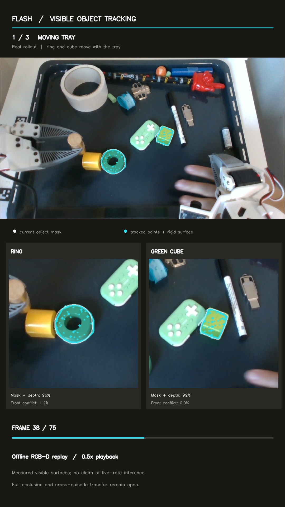

# Visible-object tracking across three recordings — 2026-10-23

[Watch the phone-friendly MP4](https://github.com/TheWisp/lerobot/releases/download/flash-visible-tracking-20261023/FLASH_visible_tracking_examples.mp4) · 11.1 s, 1080 × 1920, H.264, 2.8 MB.

The video shows a real moving-tray rollout, a separate pick-and-place rollout,
and an independently recorded pick-and-place demo. White is the current object
mask; cyan is the first frame's measured RGB-D surface projected through
the rigid fit, plus a sparse sample of depth-supported point tracks. The video
plays each recorded frame twice at 30 fps (0.5× source playback). It does not
interpolate missing camera frames. Each zoom follows its object's current mask
for visibility; the full camera view above it shows the actual image motion.

| Source and objects                                | Measured source interval                             | Poses available | Median projected surface agreeing with mask **and** depth | Median surface implausibly in front of depth |    Mask-centroid movement |
| ------------------------------------------------- | ---------------------------------------------------- | --------------: | --------------------------------------------------------: | -------------------------------------------: | ------------------------: |
| Insertion rollout `20261016_112149`: ring         | 75 available camera frames, original indices 331–422 |           75/75 |                                                     96.7% |                                         0.1% |                   39.6 px |
| Same rollout: green cube                          | Same                                                 |           75/75 |                                                     99.2% |                                         0.0% |                   45.7 px |
| Pick-and-place rollout `20261013_194049`: gamepad | First 46 camera frames; video shows 0–35             |           46/46 |                                                    100.0% |                                         0.0% | 7.7 px over all 46 frames |
| Same rollout: green cube                          | Same                                                 |           46/46 |                                                     99.2% |                                         0.1% | 0.2 px over all 46 frames |
| Pick-and-place demo, episode 0: gamepad           | Source frames 500–560; video shows 500–530           |           61/61 |                                                    100.0% |                                         0.0% | 0.3 px over all 61 frames |
| Same demo: blue ring                              | Same                                                 |           61/61 |                                                     99.4% |                                         0.0% | 0.6 px over all 61 frames |

For each object, a fresh TrackEverything pass used 64 initial queries, a
128-query cap with up to 32 new queries per view, and the same 5 mm rigid fit
and 10 mm visible-surface support bands used in the preceding visible-tracking
check. The selected fit adds new point IDs to the original object frame only
when the current depth-backed tracks support a rigid pose. A local RGB-D
correction is accepted only when it improves measured surface support without
increasing foreground-depth contradiction or breaking tracked-point consensus.
The procedure is object-agnostic; names specify the SAM3 prompts and the video
labels, not separate fitting code.

The SAM3 prompts were `green circular ring`, `green block`, `green game
controller`, and `blue hollow ring`. The first moving-ring mask was manually
localized by color and region for this benchmark; its later masks and the
other objects' masks came from SAM3. The mask is a separate observation used
to validate projected pose and measured point membership.

The yellow block in the moving-tray recording was also tracked but **excluded**
from the success montage: although it had 75/75 fitted poses, its median
foreground-depth contradiction was 6.3% (22.8% worst frame). Its partly hidden
surface and depth behavior warrant a separate failure analysis rather than a
clean-tracking claim.

These are aligned RGB-D consistency checks, not independently measured 6D pose
errors. TrackEverything uses future frames within its inference window; fitting
its output in frame order does **not** make the whole pipeline causal or prove a
live frame rate. The video does not establish tracking through complete
occlusion or cross-episode object-frame transfer.
