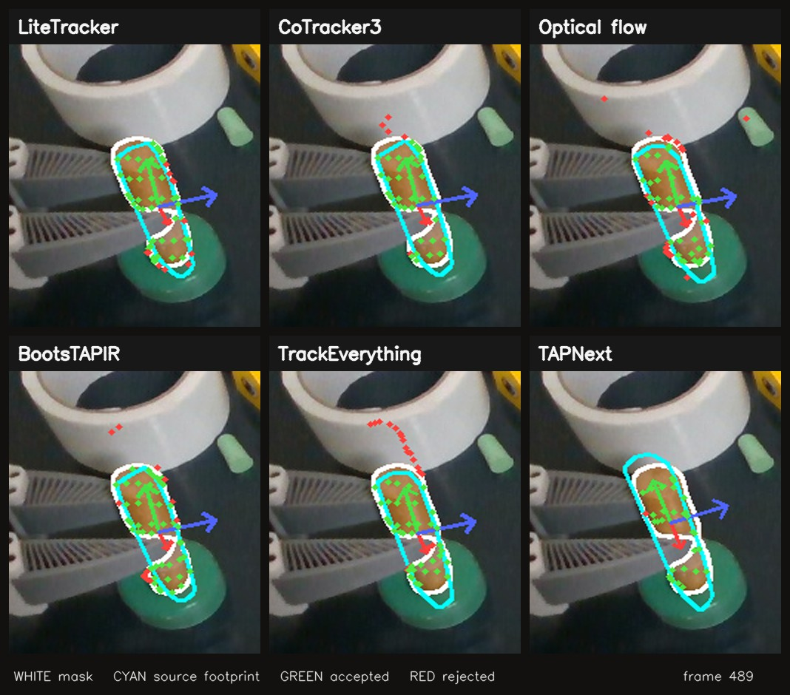

# Dowel tracking with a common RGB-D and mask-grounded fitter

The [nine-second side-by-side video](dowel_trackers_side_by_side.mp4) plays
the three-second source interval at one-third speed. The white line is the
current SAM3 mask. Cyan is the projected convex footprint of the depth surface
observed in frame 400 under each fitted pose; it can bridge the part later
hidden by the gripper. Green points pass the current mask/depth gate; red
points are predicted visible by a tracker but rejected by that gate. The
three arrows show the fitted frame orientation; their starting directions come
from the first visible cloud, not a labelled insertion axis. A red point can be genuinely
occluded rather than a false track, so it is not by itself an error label.

At the end, LiteTracker, CoTracker3, optical flow and BootsTAPIR keep the cyan
footprint close to the white visible outline. Optical flow, CoTracker3 and
TrackEverything send some points onto neighboring surfaces, but the common
gate excludes them. TrackEverything's fitted footprint remains fairly close
after correction despite its conspicuous arc of rejected tracks. TAPNext's
footprint shifts above the visible upper end, which matches its larger depth
contradiction. These are visible-frame checks; a good-looking footprint still
does not establish the hidden tip's exact position.

This offline comparison uses the same 90 aligned RGB-D frames (insertion demo
400–489), saved SAM3 dowel masks, and 64 depth-backed points sampled in frame
400 for every point tracker. Each tracker's predicted image points are lifted
through the _same measured depth_. A point participates only when its predicted
visibility, current instance mask and valid depth agree. A 3-point rigid
consensus fits the pose (5 mm residual, at least 12 inliers, 100 trials).
Finally, the identical local masked-surface ICP proposal is accepted only if
it improves visible support without breaking point consensus or worsening
foreground-depth contradiction. The [benchmark](../../../benchmarks/flash_dowel_grounded_comparison.py)
exposes all these settings as parameters.

| Point frontend                  | Pose frames | Median projected source surface supported by mask **and** depth | Median projected surface impossibly in front of measured depth | Median discrepancy from recorded gripper _motion_ |
| ------------------------------- | ----------: | --------------------------------------------------------------: | -------------------------------------------------------------: | ------------------------------------------------: |
| LiteTracker                     |       90/90 |                                                           92.5% |                                                           1.6% |                                            2.9 mm |
| CoTracker3 offline              |       90/90 |                                                           92.1% |                                                           1.8% |                                            3.0 mm |
| Lucas–Kanade optical flow       |       90/90 |                                                           91.5% |                                                           1.4% |                                            3.0 mm |
| BootsTAPIR, Point2Pose frontend |       90/90 |                                                           91.1% |                                                           1.6% |                                            3.0 mm |
| TrackEverything, full clip      |       90/90 |                                                           89.7% |                                                           2.3% |                                            2.9 mm |
| TAPNext                         |       88/90 |                                                           84.9% |                                                           5.7% |                                            5.5 mm |

These values are for **mask/depth surface correction selected after the same
point fit**. The correction changed TrackEverything's median supported surface
from 87.1% to 89.7%, and median foreground conflict from 3.8% to 2.3%. It
changed the stronger frontends by at most about half a percentage point on
these medians. At the final frame, TAPNext still projected 17.4% of the source
surface in front of measured depth and differed from the gripper-motion proxy
by 12.1 mm; the other five had at most 1.0% foreground conflict and 2.4–3.1
mm gripper-motion discrepancy. Thus grounding rejects some bad point tracks
and repairs local shape alignment, but it cannot always rescue a wrong motion
hypothesis without violating its surviving correspondences.

The result is not an artifact of only one tolerance choice. Tightening the
rigid/surface bands to 3/5 mm still gave all 90 poses for the other five
frontends, while TAPNext dropped to 63/90. Relaxing them to 10/15 mm gave
90/90 for all six, but TAPNext and TrackEverything still had lower visible
surface support than the best four. The support percentages across these
settings are not directly comparable because the definition of "supported"
changes with the surface band. The 12-inlier requirement is an overdetermined
consensus choice for this 64-point experiment, not a universal object rule.

The gripper column compares _change since frame 400_, with each predicted pose
anchored at the same starting surface. It does not rely on Point2Pose's absolute
pose at that frame, but it assumes a rigid grasp and is not independent
six-degree-of-freedom ground truth. A real slip or arm-calibration error could
contribute to the difference. Likewise, agreement with the same camera's mask
and depth cannot determine the hidden inserted end or spin around a nearly
cylindrical shaft. All fits here use only the original 64 IDs, without adding
newly revealed surface points. Earlier [growing-point checks](../flash-cross-episode/visible-rigid-tracking/EVIDENCE.md)
showed larger benefit from surface correction for a different TrackEverything
trace; the two experiments must not be conflated.

Point-frontend inference plus RGB-D decode, **excluding SAM3 and the common
rigid/surface fit**, ran at about 223, 86, 46, and 66 source frames/s for
Lucas–Kanade, LiteTracker, BootsTAPIR, and TAPNext respectively on the local
RTX 5090. The full-clip offline CoTracker3 and TrackEverything passes
processed about 104 and 19 source frames/s respectively; this throughput is
not an online publication rate because their clips may use future frames.
The current TrackEverything full-clip API therefore does not establish a
30 Hz causal perception loop. The 30 Hz robot control loop remains separate.

Input manifest and complete row-level result are kept locally under
`/home/feit/.cache/flash-visible-dowel-grounded-400-489/`. The manifest records
frame and seed hashes. No human point labels or independent object-pose ground
truth are available for this interval, so the table ranks **visible-surface and
gripper-motion consistency**, not exact contact-tip accuracy.
The [small result summary](dowel_grounded_summary.json) is kept in git.
