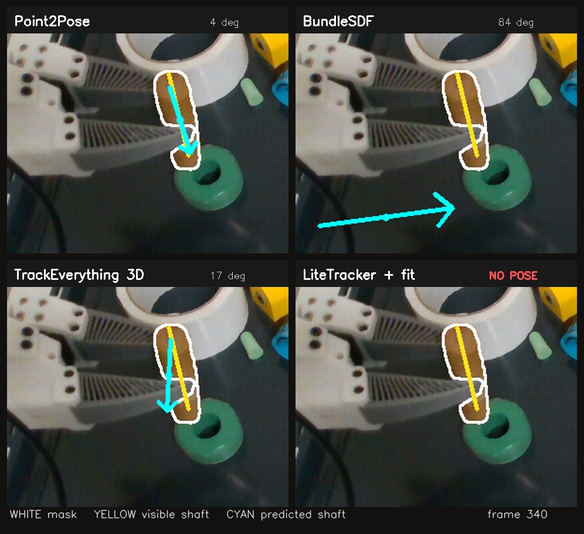
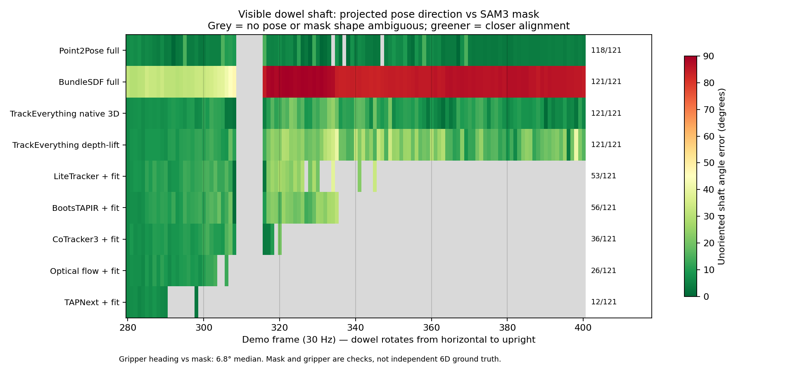

# Dowel pose during the turn

The earlier [held-dowel comparison](DOWEL_GROUNDED.md) used demo frames
**400–489**, after the difficult turn. This check uses **280–400**, when the
held dowel moves from horizontal to upright. It is the interval needed to
answer whether a tracker retains the dowel's **pose**, not merely points on a
mostly stable visible surface.

[Watch the four-way pose video](dowel_rotation_pose_comparison.mp4). It plays
the four-second source interval at one-third speed. White is the current SAM3
outline; yellow is its _measured 2D long direction_; cyan is each method's
projected shaft. The yellow line has no end identity or 3D depth. The cyan
arrow is drawn from a consistent source-object axis and retains its proposed
center and end direction. `NO POSE` means the method did not have enough
accepted rigid correspondence to provide a pose.

The chart shows the **unoriented projected shaft-angle difference** to the
SAM3 mask's 2D long direction. Grey means no pose or a mask whose long axis is
ambiguous (covariance elongation below the stated 3:1 diagnostic cutoff).
This is a visible-shaft check, not full 6D ground truth. The mask long axis was
usable on 114/121 frames. Independently propagating the frame-280 shaft with
the recorded gripper motion gives a 6.8° median difference to the mask over
those elongated frames; this supports it as a motion reference, conditional
on the grasp staying rigid.

| Pose method                                                              | Poses / 121 frames | Median shaft-to-mask angle, when elongated | Median proposed-center distance to mask center |
| ------------------------------------------------------------------------ | -----------------: | -----------------------------------------: | ---------------------------------------------: |
| Full Point2Pose                                                          |                118 |                                       4.4° |                                           8 px |
| Full BundleSDF                                                           |                121 |                                      85.1° |                                         140 px |
| TrackEverything, native 3D points + common fit                           |                121 |                                       9.5° |                                          13 px |
| TrackEverything, image points lifted through measured depth + common fit |                121 |                                      17.8° |                                          19 px |
| LiteTracker + common fit                                                 |                 53 |                    12.9° _while available_ |                                          20 px |
| BootsTAPIR + common fit                                                  |                 56 |                    13.9° _while available_ |                                          22 px |
| CoTracker3 + common fit                                                  |                 36 |                     9.8° _while available_ |                                          19 px |
| Optical flow + common fit                                                |                 26 |                     9.3° _while available_ |                                          19 px |
| TAPNext + common fit                                                     |                 12 |                     7.0° _while available_ |                                          31 px |

At **frame 340**, the projected-shaft difference is 4.1° for full Point2Pose,
83.7° for BundleSDF and 16.9° for TrackEverything's native 3D track fit;
LiteTracker has no accepted pose. BundleSDF's proposed center is 139 px from
the mask center, while Point2Pose's is 6 px away. BundleSDF therefore fails
in both translation and shaft orientation, not just in an irrelevant spin
around a symmetric dowel. By frame 400, TrackEverything's visible shaft has
come back to within 5.8° of the mask, although its path through the turn was
less consistent than Point2Pose's. This does not certify the hidden insertion
end for either method.

The six point frontends use the **same 64 frame-280 seeds**, aligned RGB-D and
SAM3 masks. The common fitter rejects points that fail current mask/depth
support and requires a rigid consensus. As the cylinder turns, the visible
material changes: some trackers have too few supported initial IDs, and
others still have enough image points but no consistent rigid correspondence.
Their grey chart cells represent an explicit _lost pose_, not a secretly
accurate pose. TrackEverything's own 3D coordinates are materially better
than forcing its predicted image points onto measured depth in this turn;
the latter was the fair frontend-only comparison in the earlier result but
discarded a part of TrackEverything's model output.

Full Point2Pose and BundleSDF are their saved **causal complete pose
pipelines**, so they are not identical to the common point-fit rows. The
earlier [causal tracker investigation](../flash-tracker-comparison/EVIDENCE.md)
already identified BundleSDF's failed post-grasp branch and found that merely
changing its input masks to SAM3 did not restore the pose. This visual makes
that failure visible at the actual turn. Point2Pose's shaft follows the
visible mask here, but prior checks still found uncertainty in the held
attachment and hidden tip; this result does not erase those limits.

The [audit script](../../../benchmarks/flash_dowel_rotation_audit.py) uses the
saved complete-pose traces and the common point-fit result from
`/home/feit/.cache/flash-visible-dowel-rotation-280-400/`. The frozen seed
hash, settings and key-frame values are in the [small JSON summary](dowel_rotation_summary.json);
full per-frame rows stay beside the local recording. No independent 6D
object-pose labels were available for this demo.
