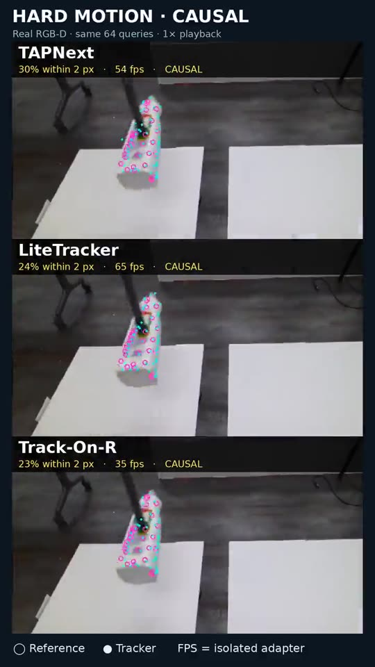

# Visible-surface benchmark: first implementation

This is a **development pilot**, not a decision to replace FLASH's tracker. The benchmark compares point identity before any SAM/depth/rigid-fit correction. Six 31-frame YCBInEOAT development clips and six frozen same-dataset holdout clips use pose-derived material-point references; the local 91-frame dowel rotation has no independent point labels and is visual/diagnostic evidence only. All adapters receive the same source image frames and query pixels for a clip. RGB-D candidates also receive the same aligned depth and intrinsics; RGB-only Point4D predicts its own geometry.

[Labelled mustard comparison](mustard_cotracker3_labeled.mp4) shows model points in cyan and independent pose-derived reference points in magenta. [Dowel rotation comparison](dowel_cotracker3_comparison.mp4) shows the complete 91-frame interval, including lost and drifting points. The [earlier point-frontends comparison](dowel_comparison.mp4) retains BootsTAPIR and optical flow. The thin white outline is the segmentation mask; staying inside it does **not** prove point identity.

The [phone-sized comparison video](visible_surface_phone_comparison.mp4) shows all ten point-tracker families across the moving YCBInEOAT sugar box, cracker box and hard bleach clips, followed by the local held dowel, moving yellow block and held gamepad. Three methods share each image time and query set. Magenta rings are independently labelled material-point locations on YCBInEOAT; cyan dots are raw tracker predictions. The local robot clips have no independent point labels and are explicitly visual diagnostics. The closing chart summarizes causal 2-pixel coverage on the two synthetic LSFOdyssey clips without redistributing their source imagery. Per-panel FPS is isolated adapter throughput, not FLASH's fresh-pose or motor-loop rate; full-clip methods may use future frames. The 27-second portrait MP4 is H.264/yuv420p with fast-start metadata for mobile playback.

The [labelled results](PILOT.md) include missing visible points in coverage denominators. Three [exact-motion controls](SYNTHETIC.md) check translation, rotation and smooth versus textured surfaces. The [growing-point study](GROWTH.md) seeds two additional cohorts, measures their later accuracy and checks whether adding them harms the original points or frame time. The [paced replay](PACED.md) releases frames at recorded timestamps and probes a separate 30 Hz consumer. CoTracker3, TrackEverything and TAPIP3D run as full-clip models, possibly using future frames, so their offline FPS is not a causal publication rate. The other point frontends run frame by frame. All GPU measurements used the rig's RTX 5090 and locally cached checkpoints. The initial point-frontend timings exclude SAM, FLASH fitting, robot IO and recording; model load and first-frame warmup are recorded separately.

A separate [integrated timing probe](INTEGRATED.md) runs TAPNext with no mask, with cached masks and the shared rigid fit, and with live point-seeded SAM3 masks and that fit. All three modes used the same checkpoint and 64 queries in three paced process runs. The 30 Hz consumer missed no ticks, but fresh frames fell from 86/91 without live SAM3 to 60–61/91 with it; p90 estimate age rose from about 33 ms to 99 ms. At 504-pixel SAM3 resolution, a processed frame spent roughly 30 ms on the mask and 9 ms on tracking. This is a serialized perception path with a simulated consumer, not the full robot runtime or a test of point/mask accuracy. The [stage and age chart](integrated_stage_breakdown.png) shows why tracker-only FPS cannot stand in for fresh-pose rate.

The [nested point-budget sweep](NESTED_BUDGET.md) keeps the same initial 64 material points while tracking 64, 256 or 1,024 points on a labelled moving sugar-box clip. TAPNext's adapter rate falls from 56 to 45 fps, LiteTracker's from 64 to 53 fps, and Track-On-R's from 34 to 20 fps at 1,024 points. This is isolated all-frame inference, not the full perception rate. The first-64 accuracy columns prevent newly sampled, easier points from being mistaken for an improvement to old identities; the result is one visible object, not a point-budget recommendation.

Three unused YCBInEOAT sequences have a [frozen midpoint holdout](HOLDOUT_MIDPOINT.md) and a separately frozen [motion-stratified holdout](HOLDOUT_MOTION.md); [the selection rule and source/query hashes](HOLDOUT_SPEC.md) were committed before motion-clip model scoring. The midpoint intervals contain little motion on two sequences, so their high scores are not strong evidence for moving-surface identity. On the motion intervals, mean 2-pixel coverage across the three sequences ranges from 0.104 to 0.526 across the final adapters; Point4D is the 0.104 RGB-only case. The [quality versus isolated throughput plot](motion_quality_vs_rate.png) separates causal from full-clip methods. The [moving bleach](holdout_bleach_motion.mp4), [moving cracker box](holdout_cracker_motion.mp4) and [Point4D comparison](holdout_bleach_point4d.mp4) videos show full intervals and reference points. These are internal holdouts from the same dataset, with only 29–64% of point-frames independently eligible on each moving clip. SpaTrackerV2's adapter was corrected using a source-frame contract check on this holdout, so its result is exploratory, not an untouched confirmation.

A [second RGB-D source](DEXYCB.md) uses TAPIP3D's bundled 72-frame DexYCB sample with the same manually supplied first-frame mug seeds for all adapters. The [full unlabelled mug video](dexycb_mug_unlabelled.mp4) includes its heavy hand occlusion; a [second view](dexycb_mug_new_candidates.mp4) includes Point4D and SpaTrackerV2. This sample has no material-point labels or source timestamps, so it contributes visual evidence and adapter cost only. On it, TrackEverything's full-clip adapter measured 2.6 fps; LiteTracker and Track-On-R causal adapters measured 87.8 and 40.6 fps; SpaTrackerV2 and Point4D's full-clip adapters measured 7.9 and 18.4 fps. The declared 30 fps playback rate is not a measured camera rate.

Two [LSFOdyssey labelled RGB-D clips](LSFODYSSEY.md) add independent point-identity references from a second public dataset. Each has 40 frames and the same 128 spatially selected first-frame queries across its adapters. All ten frontend families ran on one clip; seven ran on the second. Among causal methods, TAPNext reached 0.702 and 0.736 coverage within 2 pixels at 54.6 and 53.3 isolated adapter fps. These are synthetic, distant scenes containing people and room surfaces, not validation on small smooth rigid objects. Source depth differs from labelled point depth by 33–35 mm median, so the report deliberately compares 2D identities rather than presenting misleading 5-mm metric scores. The original RGB-D media remain in the local cache.

Two other local moving-object clips were [preserved from the previous audit](LOCAL_SOURCES.md): a yellow block while the tray and hand move, and a partly held gamepad. The [local report](LOCAL_MOVING.md) records initial query error, mask/depth diagnostics and cost across all candidate frontends; [yellow block](local_yellow_visible.mp4) and [gamepad](local_gamepad_visible.mp4) comparisons show the full intervals. These masks are _not_ independent point identities. For example, optical flow and LiteTracker both keep about 68–69% of the visible gamepad queries inside the saved mask, but that alone cannot tell whether the points stayed on the same material spots.

A separate common 3D rigid fit turns each model's raw points into the same kind of transform, without a mask or reference pose as fit input. The [moving-holdout fit report](FIT_MOTION.md), [development fit report](FIT_DEVELOPMENT.md) and [midpoint fit report](FIT_MIDPOINT.md) count a pose as successful only when it transports the first-frame cloud near annotated object motion. The initial eight frontend families all emitted fits on every later moving-holdout frame, yet only 40–56% of those frames were within 5 mm. The fit itself took about 2 ms median. Sweeps at [5 mm](FIT_MOTION_5MM.md) and [20 mm](FIT_MOTION_20MM.md) RANSAC residuals show that a single inlier setting must not silently define a winner. These are object-motion consistency checks, not contact accuracy or a live-loop measurement.

SpaTrackerV2's upstream RGB-D predictor was added as another full-clip candidate. Its default `full_point=False` silently replaced some supplied seed points at depth edges with random copies, producing a 43.8 px median first-frame query error on moving bleach. Using its `full_point=True` option retained the specified identities and reduced that contract error to 0.11 px. With this valid input, it reached 0.422 mean 2-px coverage and about 6 adapter fps on the three motion clips. Its native 3D output had only 0.054 mean 5-mm point coverage; lifting the **same** predicted pixels with measured depth raised that to 0.379, and the common fit's 5-mm motion coverage rose from 0.067 to 0.489. This isolates a major geometry-output problem in this setup without mistaking the depth-lift ablation for improved correspondence.

Point4D was run with its official long-video API and full 5.4 GiB checkpoint. The adapter projects its predicted frame-0 3D tracks through its own per-frame camera estimates, then scores 2D material-point positions; its unaligned predicted scale is not compared to metric RGB-D. On the three moving holdout clips its mean 2-px coverage is 0.104 at 20.1 adapter fps and 13.5 GiB peak GPU allocation. It offers neither an RGB-D input in this API nor a causal publication rate. In-view projection is not an occlusion classifier, so this result only says how its projected tracks matched the eligible visible reference points.

The first visual comparison exposed an adapter error: BootsTAPIR scaled queries using its default 640-pixel width before its `initialize` call learned the 848-pixel dowel camera width. Its initial median offset was 72.9 pixels. Passing the actual image dimensions before query creation reduced that offset to 1.2 pixels. All reported BootsTAPIR runs were regenerated after this correction. This is why an input/output contract check and a source-frame image review are required before comparing model quality.

Reference limitations remain material. YCBInEOAT's annotated object pose transports a point seeded from the _measured_ first-frame depth; the reference point often differs from later measured depth by several millimetres. Its mask/depth visibility gate excludes unsupported points, but it does not make those labels submillimetre truth. The six development clips were chosen while adapters were built; the three midpoint and three motion intervals were frozen later from unused sequences in the **same** dataset. The one-third-second startup in the paced neural runs mostly reflects first-frame model warmup; after that they keep up with the 30 Hz local source in this short probe. These observations do not establish full-loop performance or reliability through occlusion.

TAPIP3D's upstream depth-edge filter cost a median 6.45 seconds per 31-frame public clip. Across those six clips, removing it changed mean 2-pixel coverage by less than 0.001 and mean 5-mm coverage by 0.002, while median adapter throughput rose from 4.1 to 30.8 fps. On the 91-frame local dowel, filtering took 19.47 seconds and changed the mask-and-depth diagnostic by about 0.002; that diagnostic cannot prove material-point accuracy. This is a strong reason to keep the filter optional in the experiment, not yet proof that it is unnecessary on unseen sensor defects.

The exact-motion controls show the benchmark can detect texture dependence without label uncertainty: the smooth rotating plane sharply reduced optical-flow coverage. On the textured translation, CoTracker3 reached 91% 2-pixel coverage and each other tested method exceeded 97%. These controls cannot stand in for real object surfaces.

In the growth study, new queries are supplied from labelled masks rather than discovered autonomously. The first 64 points' mean 2-pixel coverage stays within 0.007 when later cohorts are added across the six development clips. The later cohorts have different visible surfaces and shorter lives, so their higher scores do not prove recovery of old identities. BootsTAPIR's median steady tracker time rises from about 15 to 27 ms after growth, while LiteTracker stays near 5 ms, TAPNext near 8 ms and Track-On-R below 19 ms. TAPIP3D's unfiltered full-clip adapter drops from about 31 to 20 fps with the larger query set. This identifies a point-budget cost, not a complete live perception rate.

Run the tools from the repo root. `prepare-local` freezes source indices, queries, intrinsics and first-frame hashes; `flash_surface_ycbineoat` adds pose-derived labels. Adapters save the same `prediction.npz` fields (`frames`, `queries`, `xy`, `xyz`, `visible`, source type), per-stage timing and optional paced publication traces. `flash_surface_benchmark evaluate` checks the recorded mask/depth as a **diagnostic**, and scores accuracy only when independent labels exist. `flash_surface_report` produces equal-clip summaries; `flash_surface_render` renders the full interval with source-time pacing. Model-specific Python environments and checkpoints remain outside git. Do not mix depth lifted from the predicted pixel with native model 3D depth as though their depth residuals were comparable.

The [candidate status](CANDIDATES.md) separates measured point frontends from complete pose systems and unmeasured RGB-D challengers. The full [protocol](../../../src/lerobot/policies/flash/docs/visible_surface_benchmark.md) still calls for independently labelled moving clips from a second **real sensor**, longer low-texture intervals, autonomous query growth and retirement, full-system candidate comparison, and integrated segmentation/robot-loop load. The current scores cannot choose a production tracker.
