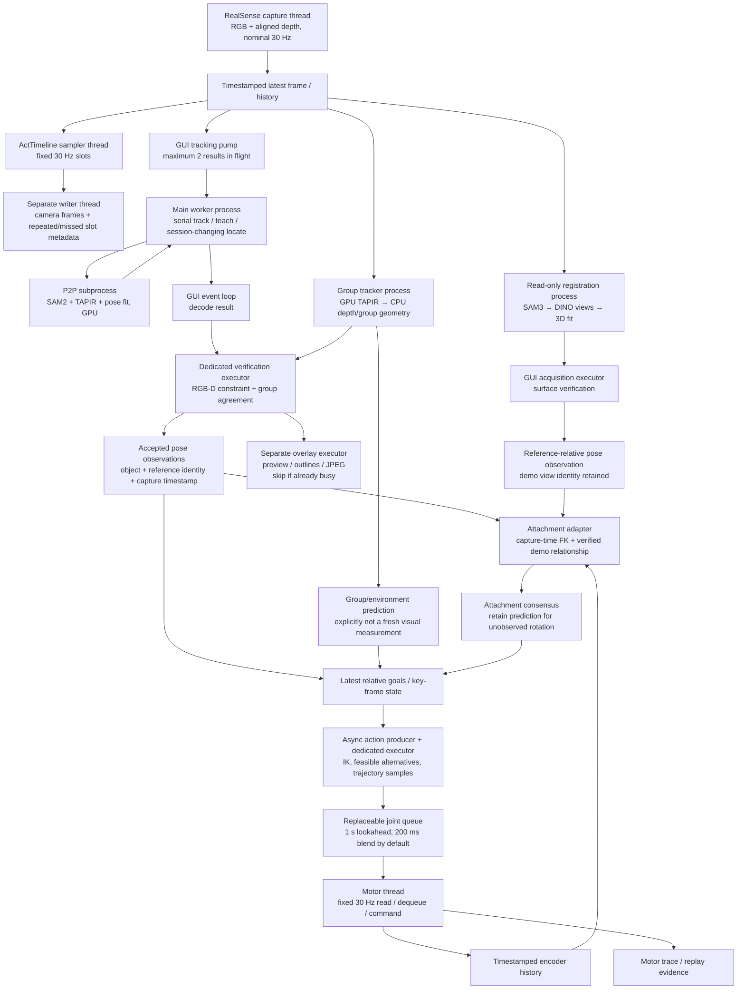
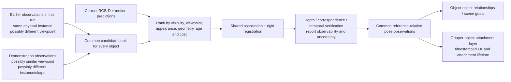

# Frame processing, pose observations, and control

This describes the implementation on 2026-10-16. The fixed-rate timeline is
**not a serial camera → inference → action loop**. Camera publication, replay
sampling, and motor playback have separate clocks. Inference and planning
consume timestamped snapshots asynchronously. A 30 Hz setting is a deadline,
not proof that every tick ran on time.

## Current execution graph

GPU boxes share one device. Processes isolate Python execution and job queues,
not GPU capacity. Executors in the GUI still share its Python GIL, CPU and
state locks. CPU elapsed durations include descheduling and lock waits; thread
CPU counters measure a different quantity and must not be added to elapsed
stages. Parallel branches must not be summed to infer a frame rate.

The tracking pump starts another inference after result receipt rather than
waiting for the overlay. Pose verification stays ordered; its two-slot bound
provides backpressure. The action producer does not wait for every new camera
frame or P2P result: it reads the latest goal, keeps the old checked queue
moving while solving replacements, and blends into the replacement. The
motor thread dequeues at 30 Hz independently. Neither cadence is synchronized
to a particular image exposure; attachment measurements explicitly associate
encoder history with the frame's publication timestamp. Exposure-to-publication
latency remains an uncertainty.

## What changed in worker scheduling

Previously **all** worker jobs used one FIFO and one serial consumer. Calling
recovery asynchronously did not create a second worker: each 0.5–0.7 s
registration blocked the next tracking inference. A sequence of reference
views repeated that delay. GPU P2P itself was already in a subprocess, but its
parent was busy doing registration and did not issue the next tracking call.

The main lane now retains every stateful operation: track, teach, find, and
`locate(track=True)` that changes the P2P session. A second process owns
independent SAM3/DINO models and consumes only `locate(track=False)`. The same
registration algorithm serves any object; this lane is not specific to held
objects. Shared GPU competition is measured rather than assumed absent.
`worker/start` with `parallel_recovery=false` restores the single-lane path.
If the recovery process exits, pending read-only jobs can be served by the main
lane; the worker status exposes recovery liveness separately.

Immutable demo cards are cached per appearance model, bounded to 16 entries.
The key includes RGB/depth file timestamps and sizes, segmentation content,
and camera intrinsics. This caches features, never a live pose or an acceptance
decision. `LEROBOT_REFERENCE_CACHE=0` restores recomputation.

## Measurements and their scope

Physical act `20261016_100628`, **before** lane separation:

| Measurement                     |    Median |       p95 |
| ------------------------------- | --------: | --------: |
| P2P worker computation          |  82.75 ms | 104.28 ms |
| Worker queue                    |   0.65 ms | 660.22 ms |
| Worker round trip               | 100.65 ms | 759.00 ms |
| Verification work, elapsed      |  32.94 ms | 122.05 ms |
| Verification thread CPU, subset |  18.32 ms |  36.70 ms |
| Overlay elapsed                 |  75.25 ms | 180.26 ms |
| Overlay thread CPU, subset      |  39.55 ms |  53.52 ms |
| Overlay path preview, subset    |  41.25 ms |  95.99 ms |

Queue mean was 210.44 ms and accounted for 66.4% of aggregate worker round-trip
time. The act completed, but recorded nine empty-motor-queue episodes over
100 ms and a maximum motor tick gap of 342 ms. Success is not evidence of
smoothness or accurate held-pose correction. The camera timeline saved 871
unique images across 990 nominal 30 Hz slots; repeats and missed ticks remain
explicit. These are not 990 distinct sensor frames.

A stationary **live camera/GPU** A/B with 12 read-only registrations per mode,
arm disconnected, same scene and cache enabled in both modes:

| Measurement                 | Serial lane | Separate lane |
| --------------------------- | ----------: | ------------: |
| Tracking queue median       |   438.39 ms |       0.46 ms |
| Tracking queue p95          |   495.95 ms |       2.84 ms |
| Tracking round-trip median  |   532.20 ms |     124.65 ms |
| Tracking compute median     |    86.80 ms |     104.10 ms |
| Registration request median |   548.10 ms |     553.93 ms |

Registration did not become faster through parallelism; tracking stopped
waiting for it. Shared GPU/CPU contention increased individual computation
cost. Initial separate-lane stage profiling measured 77 ms segmentation,
14 ms reference preparation, 345 ms appearance search, and 38 ms surface
refinement (medians). Cached reference preparation then measured 0.3 ms.
Stage medians need not sum to request median; HTTP, post-verification, polling,
and initial reference segmentation are additional work. Most remaining job
cost is appearance search over multiple rotations.

Reproduce using `benchmarks/recovery_lane.py --object <name> --click x,y --out
<file.json>` after starting continuous tracking. It refuses a connected arm
and refuses to call a run with fewer than three fresh tracking results a
concurrency measurement. Recovery stage timings are saved with find records.
The live comparison measures scheduling under registration load, not physical
manipulation accuracy or motor smoothness.

## Common pose interface and the attachment layer

`pose_updates.PoseObservation` names the object and reference view, provides
its reference-to-current-camera transform, source, and capture timestamp.
Regular verified tracking and reference registration use the same attachment
adapter. A stored last pose, group-carried pose, and grasp prediction are not
relabeled as fresh observations.

For regular tracking, the attachment consumer requires a verified demo
attachment in the same reference coordinate system and capture-time encoder
samples. It uses a rolling consensus and preserves predicted rotation when
one reference cannot resolve it. Fresh accepted normal updates suppress the
expensive reference matching; absent, stale, or contradictory evidence leaves
the existing reference-view fallback available. Older results cannot overwrite
a newer accepted attachment. `LEROBOT_TRACKED_HOLD_UPDATES=0` restores the
reference-only moving observer. When no trustworthy demo-to-reference
attachment exists, the normal pose is still useful for scene tracking but
cannot safely be converted into a demo-relative grasp correction.

This is an incremental unification. **The general reference-selection policy
below is a design follow-up, not fully implemented.** The current fallback
reference bank is still chosen from demo held views. The common observation
interface and downstream gripper adapter are implemented; a universal bank
and automatic re-detection policy for every object are not.

## Intended common reference-selection policy

A held object is not a different perception problem. Its gripper relationship
is a downstream constraint and prediction source. The common estimator should
use current-run references when instance identity helps and demo references
when viewpoint coverage helps. It must not assume semantic identity proves
identical geometry. Cross-instance shape differences require validated
material correspondence or a task-relevant alignment; unsupported geometry
must retain ambiguity rather than invent a full rigid pose.

Reference frames cannot be freely averaged. Every candidate needs provenance,
a validated mapping to the task reference where available, and explicitly
observed degrees of freedom. Appearance symmetry, action-side invariance,
and partial visibility must survive this mapping. Group motion and gripper
kinematics can predict where to search, but an object predicted from the
hand cannot be used as independent evidence that it did not slip.

## Code ownership

- Capture publication: `cameras/realsense/camera_realsense.py`.
- Fixed replay sampler/writer: `gui/api/manipulation/act_timeline.py`.
- Worker lanes and transport: `gui/api/manipulation/worker.py` and
  `benchmarks/manipulation_worker.py`.
- Point groups: `benchmarks/group_live.py` and `gui/api/manipulation/groups.py`.
- Acceptance and common observations: `tracking.py`, `pose_updates.py`.
- Reference evidence and attachment adapter: `held_views.py`.
- Relative goals, asynchronous planning, and queue replacement:
  `execution.py`, `live_execution.py`, `reactive.py`.
- Motor playback and encoder history: `gui/api/jog.py`.

## Recorded quality comparison (16 October)

`benchmarks/recovery_quality.py` compares the previous worker at `938e81429`
with the cached worker on all saved held-view registration attempts in three
acts. Each pair receives identical saved RGB-D, a shared freshly segmented mask,
reference view, intrinsics and random seed. Both cold and warm cache calls are
included. This isolates registration/cache changes; it does not reproduce the
live scheduler, segmentation variability or counterfactual robot motion.

| Act             | Paired recovery attempts | Successful registrations, both paths | Historically accepted surface-verified samples | Held-phase regular tracking accepted |
| --------------- | -----------------------: | -----------------------------------: | ---------------------------------------------: | -----------------------------------: |
| 20261016_022104 |                       14 |                                   12 |                                              2 |                               0 / 38 |
| 20261016_075037 |                       10 |                                    9 |                                              2 |                               0 / 35 |
| 20261016_100628 |                       26 |                                   22 |                                              7 |                               0 / 48 |

All 50 attempts agreed on registration success and inlier counts. All 43
successful registration pose matrices were exactly equal between the old and
warm-cache paths (zero translation and matrix-element difference). The 11
historically accepted samples also passed through the new common observation /
attachment adapter: maximum difference from the previous algebra was
3.34e-16, including rotation matrix entries. Registration success alone does
not imply acceptance by the downstream depth checks or attachment consensus.

**Coverage limitation:** ordinary tracking supplied zero accepted held-object
observations in these three held phases. Consequently the new fast attachment
path would contribute no correction here; the fallback remains necessary.
These recordings establish fallback computational equivalence, not the accuracy
of the new fast path, and contain no independent ground-truth object poses.
The fast path requires a measured material-patch reference point; it must not
extrapolate an ambiguous orientation to a hidden object centroid. Missing patch
points retain fallback behavior.
