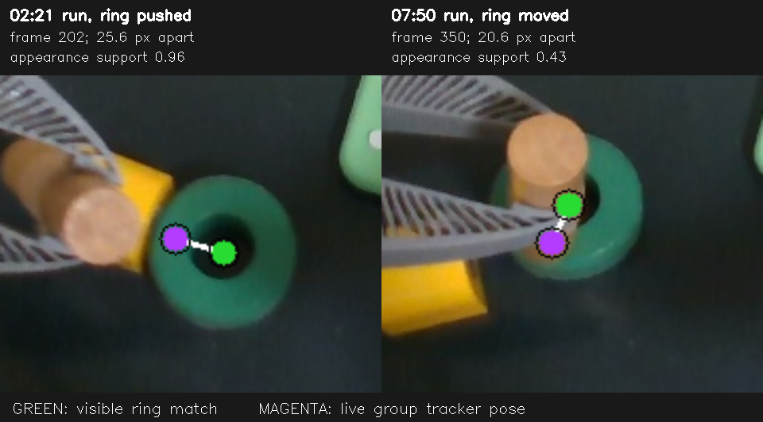

# Offline tracking check, 2026-10-16

The two successful insertion acts do **not** establish that the target tracker
always followed the ring. The live group pose lagged a clearly visible push in
`20261016_022104`, then missed a second, partly occluded ring move for several
seconds in `20261016_075037`. A cheap appearance check can detect these
contradictions without another neural-network inference. It has not yet been
connected to live control, so no live frame-rate or insertion improvement is
claimed.



The green mark is a local RGB appearance match to the ring's initial SAM mask;
the magenta mark is the **recorded live** group pose projected into the same
camera frame. These are images from the acts, not a new physical test.

| Act and camera frame         | Appearance support |        Live-group discrepancy | Observation                                                                                                                                          |
| ---------------------------- | -----------------: | ----------------------------: | ---------------------------------------------------------------------------------------------------------------------------------------------------- |
| `022104`, frame 202, +7.33 s |               0.96 | 25.6 px, about 17 mm at 0.4 m | The ring is almost fully visible while moving; the group is still at the old position. It catches up around frame 204.                               |
| `075037`, frame 350, +14.2 s |               0.43 | 20.6 px, about 14 mm at 0.4 m | The gripper covers part of the ring; the visible green rim and aligned depth put it above the group estimate. The disagreement persists for seconds. |

The appearance match measures image translation, not full 6D pose. The second
measurement is weaker because the ring is partly hidden. Its local color
template, learned from the SAM mask, matches 43% of the original colored
pixels, or roughly 1,600 pixels, at frame 350. The measured depth of those
pixels is about 407 mm. The visible outer rim also ends near the expected
radius from the proposed center. Artificially hiding a contiguous strip of
40–60% of the ring in clear frames gave a 95th-percentile center error of
about 2.2 px over 4,000 samples across both acts; real occlusion and changed
viewpoint may be harder. The late 20.6 px discrepancy is therefore compelling
evidence of a missed move, but not a calibrated ground-truth error bound.

Before occlusion in `075037`, the live group and appearance check agree within
1.0 px median and 2.0 px at the 95th percentile on frames with at least 90%
appearance support. The ring's original color is distinctive: 83–85% of its
SAM mask passes the learned color filter, compared with 1.5–2.1% of the
surrounding pixels. That is why this cue is useful here. It would not be a
universal tracker for a grey object on a grey support, or for a held object
whose viewpoint and visible shape change substantially.

The current point-group rule requires 97% of an object's modelled points to
be seen before its own tracks can replace the group-carried pose. This is why
the target stayed attached to the tray after the hand partly covered it. An
offline replay with 50% instead of 97% followed this ring better and cost no
extra tracker time. But a synthetic gripper-occlusion case already in
`tests/showservo/test_groups.py` then falsely carried a stationary gamepad
176 mm with the wrist; the 97% setting kept it within 0.3 mm. Lowering the
global gate is therefore not a safe fix.

A second performance experiment reduced TAPIR's PIPS refinement from two
iterations to one. Median GPU tracking work fell from about 12.4 to 8.5 ms
per sampled group frame. The ring poses then diverged by roughly 3–4 mm for
long stretches after motion, and by up to 15 mm during the earlier group
split. With no independent reference under occlusion, that speed change has
not earned a default switch.

`benchmarks/group_appearance.py` reproduces the RGB/depth comparison directly
from each act's fixed 30 Hz camera recording and its live group poses. The
local match itself takes 0.11 ms median and 0.12–0.14 ms at the 95th
percentile per camera frame on this host, excluding shared RGB decode and the
one-time SAM mask. The candidate can therefore be scheduled beside the
existing group tracker with little expected computation cost, but a real
concurrent A/B run is still needed to establish unchanged end-to-end FPS.

For example:

```bash
PYTHONPATH=src /home/feit/.cache/point2pose/venv/bin/python benchmarks/group_appearance.py \
  --act ~/.cache/huggingface/lerobot/demos/insertion/acts/20261016_022104 \
  --click 368,340 --object ring --duration 20 --out /tmp/ring-022104.json
```

The controlled next change is a _separate, conditional measurement_: retain
the 97% point-track gate, use the initial SAM mask to learn whether an object
has appearance distinct from its local background, and compare a small
search region only while point/group evidence is missing or contradictory.
A highly supported match can correct translation with aligned depth. A
partly supported match should first require temporal consistency and depth
agreement; it must not silently override the group's orientation or claim a
full pose. Objects without a distinctive cue continue to use the existing
point/group/P2P evidence. Validate this against other object shapes, colors,
occlusions, and distractors before connecting it to control. The held dowel's
pose remains unresolved by this ring translation experiment.

The earlier claim that the `075037` success showed the controller tracking the
final target movement was too strong. It followed the tray's earlier motion,
but missed the later independent ring movement. The physical insertion
succeeded, yet this act cannot prove that its final alignment was due to an
accurate updated ring pose.

## Worker gaps and overlay cost

The `075037` act's elapsed worker round trip averages 217.75 ms, while
reported fetch and computation average 6.42 and 87.88 ms. The remaining
123.45 ms is **not measured GPU computation**. `manipulation_worker.run`
executes jobs serially, and held-view recovery submits `locate` jobs to that
same worker. There are 15 held-view locate results during this act. In the
slow interval, track frame 34 takes 768.1 ms round trip but reports just
4.3 ms fetch and 86.1 ms compute; a held-view locate completes at
07:50:45.128 before that tracking result arrives at 07:50:45.205. Repeated
locates coincide with the subsequent long tracking intervals. This establishes
a blocking shared-worker path and explains the pattern, but old telemetry
cannot assign every residual millisecond to queueing versus HTTP/event-loop
scheduling.

New `timing_ms` fields separate `queue` (creation to worker dispatch),
`dispatch_and_result_io` (remaining transport/scheduling outside fetch and
compute), `apply_wait` (decoded result to ordered apply),
`verify_executor_wait`, `verify_work`, and `verify_resume_wait`.
`verify_thread_cpu` is CPU consumption inside `verify_work`, not another
additive duration. These diagnostics require a restarted server and a new
capture; no new physical rollout was performed for this change.

The live overlay has its own executor and drops drawing opportunities while
busy: control does not await it. It still shares CPU/GIL/locks with the server.
Its new `thread_cpu` measurement distinguishes CPU work from elapsed duration;
`preview` is a subset of `held_and_path`. An isolated reconstruction of five
recorded frames took about 5–11 ms after warming imports, but does not recreate
all live state or concurrent load. It cannot establish a new live FPS.

OpenCV is already the drawing backend. Batch projection now inverts the
camera transform once per path, then draws one native polyline instead of
projecting and drawing each segment in Python. A 200-point path measured
1.34 → 0.32 ms median (200 repetitions, identical pixels); regression coverage
checks empty, single-point, dense, and partly behind-camera paths. Planner
semantics and object tracking are unchanged. A separate recovery worker or
incremental recovery scheduler remains necessary to prevent expensive locate
jobs from blocking continuous P2P; merely prioritizing queued track jobs
cannot preempt a locate already in progress.

### Deployed retest: 20261016_100628

Deployed `65ad01477` to port 9100 and ran the physical insertion at speed 2,
1 s queue horizon and 200 ms blend, with grasp prediction allowed. Initial
attempt stopped before motion because the saved ring find failed; clicking
its observed current position produced a strong find (167/400 matches).
The next act completed successfully and the camera showed the dowel standing
in the ring. The arm then parked and disconnected. This demonstrates the
rollout completed, not that held-pose correction or smoothness is solved.

The saved act has 104 P2P frames, about 3.06 results/s over their arrival span.
Measured elapsed timing (milliseconds):

| Stage                                    |   Mean | Median |    p95 |
| ---------------------------------------- | -----: | -----: | -----: |
| Worker round trip                        | 317.11 | 100.65 | 759.00 |
| Worker queue                             | 210.44 |   0.65 | 660.22 |
| Worker compute                           |  85.00 |  82.75 | 104.28 |
| Fetch                                    |   5.99 |   5.10 |  12.38 |
| Dispatch/result I/O and scheduling       |  15.69 |   4.77 |  15.89 |
| Verification work, elapsed               |  56.64 |  32.94 | 122.05 |
| Verification thread CPU (subset of work) |  19.22 |  18.32 |  36.70 |
| Overlay elapsed                          |  96.41 |  75.25 | 180.26 |
| Overlay thread CPU (subset of elapsed)   |  41.94 |  39.55 |  53.52 |
| Overlay preview (subset of drawing)      |  52.13 |  41.25 |  95.99 |

Queueing accounts for 66.4% of aggregate worker round-trip time; 37 frames
waited over 100 ms in the queue. One observed frame spent 664.54 ms queued,
88 ms computing and 3.35 ms in dispatch/result I/O. Tracking recovered to
about 10 FPS after repeated recovery jobs ended. The shared-worker bottleneck
is now measured directly, not inferred from the residual.

There is also a separate startup outlier: frame 1 spent 845.33 ms in
dispatch/result I/O and scheduling despite only 0.25 ms queued and 91.5 ms
compute. Its precise blocking source is not yet established. Verification
elapsed time also substantially exceeds thread CPU time, consistent with
waiting or contention, but these counters alone cannot identify which lock,
GIL holder, or scheduler caused it.

The controller reported no abort/freeze, but smoothness remains imperfect:
9 empty-queue episodes over 100 ms, 3.31 s total empty-queue time, a longest
empty-queue interval of 674 ms, and a maximum motor tick gap of 342 ms.
These are separate metrics from perception FPS. The deployed change is
instrumentation plus a drawing optimization, not a fix for recovery queue
blocking or these controller gaps. The captured act and camera frames are at
`~/.cache/huggingface/lerobot/demos/insertion/acts/20261016_100628`.
