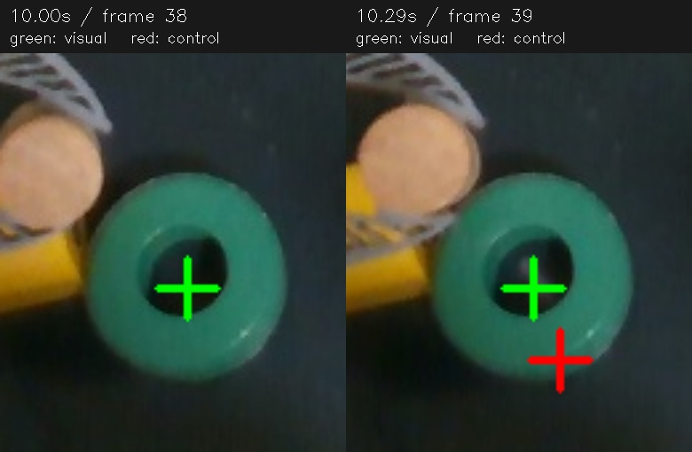

# Review of 11:02:27 and 11:03:10 runs

Both records report `done`, but the 11:02 run visibly dropped the dowel beside
the ring. Completion of the motion program is not verification of task success.
The 11:03 run visibly left the dowel in the ring.

## Performance

Tracking-frame cadence from saved capture timestamps was **4.88 Hz and 4.47 Hz**.
The earlier approximately 10 Hz idle measurement did not predict performance
under active control. These rates describe processed tracking observations,
not the nominal 30 Hz camera/replay or motor schedules.

| Metric                                |         11:02 |         11:03 |
| ------------------------------------- | ------------: | ------------: |
| Worker queue median / p95, ms         |  0.54 / 16.34 |  0.40 / 16.00 |
| P2P compute median / p95, ms          | 100.8 / 185.2 | 106.9 / 220.5 |
| Verification work median / p95, ms    |  76.7 / 315.3 | 138.0 / 392.4 |
| Verification thread CPU median, ms    |          21.6 |          40.9 |
| Overlay elapsed median / p95, ms      | 104.5 / 364.6 | 123.6 / 304.6 |
| Longest motor tick gap, ms            |         499.8 |         679.8 |
| Empty-queue episodes over 100 ms      |            15 |            10 |
| Time in those empty-queue episodes, s |          5.37 |          3.09 |

Stages overlap; their medians must not be summed into frame latency. The
recovery-lane separation still removes the previous serial-worker queue delay.
It does not isolate server-side Python execution, rendering, planning or GPU
compute. Verification elapsed time greatly exceeds its thread CPU time, showing
waiting/contention in addition to numerical work. This does not by itself
identify the GIL, OS scheduling or a specific lock as the entire cause.

An offline cProfile of recorded ring checks identifies repeated Python plane
RANSAC as a numerical hotspot. On frame 39, the same ring verification takes
about 23 ms isolated under profiling versus 128 ms recorded live. The overlay
also rebuilds the preview path while running asynchronously in the same process.
These are real costs, but no captured live stack profile attributes all the
remaining waits: attaching py-spy was denied by the host's ptrace policy and
noninteractive sudo was unavailable.

Batched plane trials preserve RNG draws and first-best tie handling while
reducing Python/NumPy call overhead. Across all 251 recorded ring frames, old
and batched paths produce identical surface decisions and pose matrices. For
frames with a pose to check, isolated median surface-verification time changes
from 15.05 to 11.70 ms and 13.70 to 10.43 ms respectively. Thirty seeded mixed
point clouds also produce equal normals. This is a modest measured optimization,
not evidence that live tracking now exceeds 10 Hz.

## Ring movement was counted twice

At frames 37–39, P2P and depth already place the moved ring correctly. At frame
38, the accepted pose projects the same reference centre to approximately
(330, 373) pixels. At frame 39 it remains approximately (330, 373). However,
the control pose after group transport jumps to (340, 401): an extra **18.9 mm**
relative to the preceding control pose. The visible ring is effectively still
between those two images. An independent colour/ellipse check of its unobscured
outer edge places the centre near (331, 369) in both; this diagnostic uses the
ring's known colour only for this investigation, not in the runtime policy.

The group prediction still represented the older location. The recorded group
context says `own=false`: only 91% of points were seen against the existing 97%
requirement. The accepted surface pose explicitly overrode group disagreement
(about 20.5 mm). Nevertheless, `groups._carried(name, accepted_stamp)` subsequently
multiplied the accepted visual pose by the group's catch-up motion. The same
physical movement was therefore applied twice. Near frame 39, the group sample
used in verification was only 3.95 ms from the frame timestamp: timestamp
proximity alone does not prove that two estimators have incorporated the same
physical movement.

After occlusion, the erroneous control pose persisted until frame 100 accepted
another visual pose and corrected it by approximately 18 mm—too late for the
placement. The raw/accepted visual estimator was not the source of the extra
movement in this event.

## Correction and limits

An accepted visual pose that overrides conflicting group motion now blocks group
transport for that visual anchor. A subsequent accepted observation must agree
with group motion before transport resumes. Missing evidence keeps the accepted
visual pose; it does not certify that the conflict has resolved. The same rule
applies to all object names and all consumers of `_carried`, including control,
overlay and recording. Each accepted check records `group_transport` status.

A regression exercises delayed 20 mm group catch-up, no double application,
unavailable evidence, independent behavior of another object, and resumption
on a new consistent observation. This deliberately sacrifices group-only
responsiveness during an unresolved conflict instead of silently combining
incompatible estimates. A physical retest is still required; offline equivalence
and the fusion regression do not prove task success.
