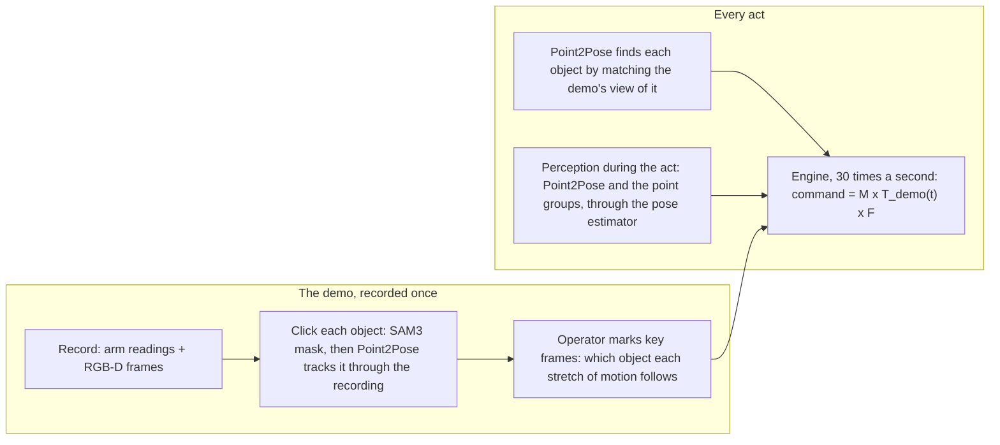
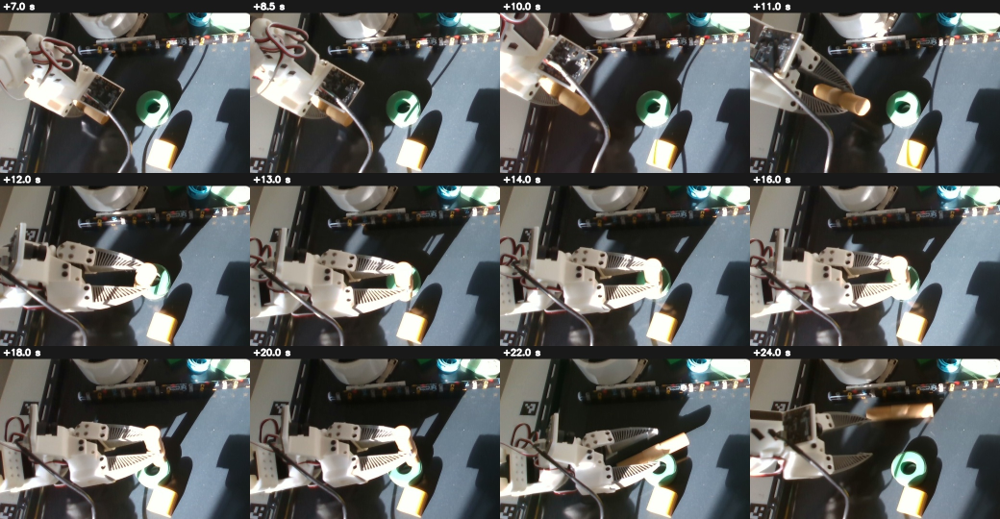
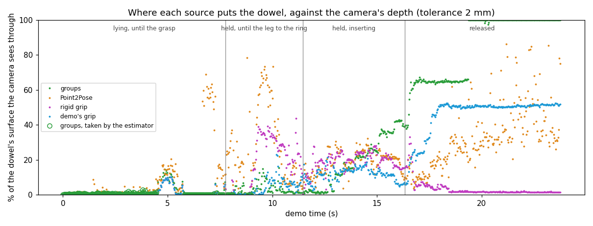
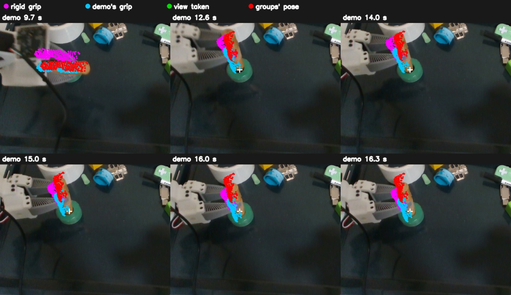

# Show-and-Servo prototype: what it did and what it taught

**Sealed on 2026-10-19.** The branch `proto/show-and-servo` (PR #78) stops here and is not for merge. A redesign
starts from `main`, on LeRobot's own framework. This page is what that redesign should know: what the prototype
does, what it achieved on the rig, and what it learned, each lesson with its evidence.

## The task and its rules

One demonstration, recorded with the leader arm and an overhead RGB-D camera (RealSense D435). The follower arm
(SO-107, the left one) then does the same interaction with objects that have moved: pick up a block and stack it,
or grasp a dowel and insert it into a ring (⌀48 mm outside, ⌀23 mm hole). No policy is trained.

The rules the user set, and that every lesson below is judged against:

| Rule                                               | Meaning                                                                                       |
| -------------------------------------------------- | --------------------------------------------------------------------------------------------- |
| Generic                                            | Nothing written for one object, scene or task: no "if dowel", no tray, plane or table rules   |
| No hand-set thresholds                             | A tolerance comes from noise measured in the same run, or is an operator's setting            |
| The demo is read by the same rules as the live run | If the act's perception changes, the demo's object poses are rebuilt with it                  |
| Never pause the act to compute                     | Work runs beside the arm; the act takes the demo's time at any frame rate or speed            |
| Grasp and release are processes, not moments       | Objects slide, fall and roll; nothing waits for a settled state; a check may say "can't tell" |

## How the prototype works, as sealed

The one formula that transfers the demo to a new scene (`engine.py`, `Engine._compose`):

| Term        | What it is                                                                          | Where it comes from                                                   |
| ----------- | ----------------------------------------------------------------------------------- | --------------------------------------------------------------------- |
| `T_demo(t)` | Where the demo's fingertip was at demo time `t`                                     | The demo's arm readings                                               |
| `M`         | How the object this stretch follows has moved, from where it was in the demo to now | Point2Pose at the act's start; the point groups update it after       |
| `F`         | While holding something: how it sits in this gripper against the demo's             | How it sat at the grasp; corrected by views of it, when any are taken |

So the fingertip stays where it was relative to the object. Point2Pose is the only thing that links an act to its
demo: it matches the object's appearance in the demo to the live image. The point groups measure motion within
one recording only.

## What it achieved on the rig

| When      | Task                             | Result                                                                                                                                    |
| --------- | -------------------------------- | ----------------------------------------------------------------------------------------------------------------------------------------- |
| 10-05..07 | Grasp a cube, a dowel, a gamepad | Cube lifted in 11 of 11 completed acts; dowel 5 of 6; gamepad 5 of 5 once its first pre-grasp was marked where it is in full view         |
| 10-08..12 | Stack the gamepad on the cube    | First stack 10-08 (5.6 mm off the cube's centre); 10-12, 5 of 5 acts that ran clean stacked, 1.4 to 13.6 mm off                           |
| 10-18..19 | Insert the dowel into the ring   | One insertion (act `20261019_005211`). Misses: `095417` (1-2 cm off, the dowel fell), `124410` (on the ring's rim, the ring pushed 39 mm) |

Most stopped acts before 10-18 were the arm or the code, not the task: freezes, overloads, a cable in the tray
(lessons 12-14).

## What it learned

Each lesson: what was observed, with its evidence, then what it means for the redesign. Evidence ids (E1..E35,
O1..O10, Q1..Q3) are entries of [act_execution.md](../../../src/lerobot/showservo/docs/act_execution.md).

### The representation

1. **The demo transfers as the fingertip's path relative to the object it acts on.** Grasps and stacks worked
   wherever `M` was right; every miss traced to a wrong `M` or `F`, never to the composition. Keep it, and state it
   in one place: here it is spread over `engine.py`, `planning.py` and `holds.py`.
2. **Only Point2Pose links two recordings.** Tracking (TAPIR, the point groups) follows an object within one video.
   Where the act's object is relative to the demo's comes from one appearance match at the act's start. That match
   deserves its own interface and its own accuracy measurement; here it has neither.
3. **A demo, an act and the live camera are one kind of recording** (frames, depth, arm, calibration; a demo adds
   annotations). This arrived last, as `recordings.Recording` with a versioned perception cache. In LeRobot it is a
   dataset episode with annotations.
4. **The same rule is not enough; the act needs the same information** (E35, Q3). With the rigid grip on both
   sides the dowel went in (`005211`). With the demo's grip corrected by its views and the act's own grip
   uncorrected (none of its views was taken), the engine matched two beliefs built from different evidence, and the
   dowel came down on the rim. A belief the act is matched against must be built from evidence the act also has, or
   the act must assume its object behaves as the demo's did between its own views.

### Perception, the bottleneck

5. **Lying still, every source is right; held and inserting, none is.** Measured on the insertion demo against the
   camera's own depth: the share of the dowel's surface the camera sees through where each source puts it (0% is
   consistent).

   | Phase of the demo      | Point groups                | Point2Pose | Rigid grip             | The demo's grip |
   | ---------------------- | --------------------------- | ---------- | ---------------------- | --------------- |
   | Lying, until the grasp | 0%                          | 1%         | 0%                     | 0%              |
   | Carried lying          | 2% (15 of 110 frames taken) | 18%        | 19%                    | 3%              |
   | Inserting              | 18% (none taken)            | 19%        | 20%                    | 12%             |
   | After the release      | 100% (lost)                 | 30%        | 2%, but under the tray | 51%             |

   The pose the insertion depends on, the held object in the fingers, was never measured right by any tracker
   tried. A low share is necessary, not sufficient: nothing here measures millimetres against ground truth.

   

6. **Point2Pose misreads held and covered objects, confidently.** With the dowel in the ring, its ring tilted
   45-70° while the ring lay flat (E30); an upright dowel read as lying diagonally (E32). Its own verdict passes
   both.
7. **The point groups know what moves together, while it moves.** They carried covered objects and followed fast
   motion. Slow motion fuses an object with the background: in the slow insertion the dowel's group stood still
   while depth shows the dowel going down 25 mm; after the release it was lost. Their parameters (leave 10 mm,
   join 6 mm, merge 4 mm over 15 frames, among others) are written in `groups.py`.
8. **A depth check tells wrong poses without labels, if its tolerance is measured in the condition it judges**
   (E33). Placing the object's surface at a pose and asking whether the camera sees through it rejected every bad
   view in four acts. Its cut-off, measured on the object lying still (0.3%), then refused 95 of 110 carried poses
   that were only 2% seen through.
9. **The grasp moves the object before the gripper closes.** In the 0.3 s before the demo's gripper closed, its
   views put the dowel 9-10 mm across its axis from where it lay, then back within 0.4 mm once closed. Whatever
   reads "the pose at the grasp" reads a moment inside that.

   

10. **From the geometric servo of August:**
    - Binding every frame beat track-and-coast in simulation (16/16 against 8/16 poses on a realistic texture).
    - SAM3 masks fail by absence, never by drifting; colour-and-shape prompts ("blue box") designate where object
      names ("tissue pack") find nothing.
    - The rotation of uniform or symmetric objects is not observable from appearance: the ring's yaw is arbitrary,
      a plug's rotation read at half its truth. Position is reliable.
    - A stand-in for the thing under test (a centre box for a SAM3 mask) is a different experiment, not a
      conservative one: it inverted results in both directions.

### Control and the act

11. **The key-frame runner is gone; the engine works mechanically.** The old runner stopped at every key frame,
    planned again with the arm standing, only moved forward, and checked nothing (O1, O2). The engine plays the
    demo on its own clock, so an act takes the demo's time at any frame rate or speed; it solves IK a few ticks
    ahead, follows its commands within about 3° of lag, records every belief per frame, and can back out after a
    failed check. Its limits are perception's.
12. **Most "hardware" failures were our own code.**
    - A hold in the jog stopped the playback for a joint 5° behind, so the arm never broke away under load (E22).
    - An inverted up-sign aimed every clear-the-tray waypoint into the tray (August).
    - A settle loop overheated the shoulder (10-08).
    - Load replies read as positions drove the arm (10-10).

    Before blaming the robot, replay the record.

13. **The arm:** an SO-107 under position control sags under load (33 mm on the plain follower). Gravity
    feed-forward fixed it, as the robot type `so107_follower_gravity`. Only the left arm holds its bus on this rig.
    IK reaches within 0.5 mm of what it is asked.
14. **Nothing heavy in the arm's process.** A reach preview polled every 3 s stalled the 30 Hz motor loop for about
    a second each time; RealSense filters hold the GIL. Work runs beside the arm, never in its thread.

### Hardcoding

15. **About 400 numbers are written into the decisions:** 124 module constants, 84 parameter defaults, 14 field
    defaults and 174 numbers compared against inline, across `showservo`, the GUI's manipulation API and the two
    worker scripts. The densest:

    | Module                                       | Written-in numbers              | Examples                                                                                         |
    | -------------------------------------------- | ------------------------------- | ------------------------------------------------------------------------------------------------ |
    | `showservo/motion.py`                        | 30 constants, 20 inline         | a find is strong from a 15% share of 20 inliers; reach within 3 mm and 3°; depth agrees in 20 mm |
    | `benchmarks/manipulation_worker.py`          | 29 constants, 10 inline         | face fit inlier 2.5 mm; descriptor match from similarity 0.6; lost after 8 frames                |
    | `gui/api/manipulation/runtime.py`            | 25 constants                    | trust share 0.97; jaw half-width 25 mm; approach 30 mm; a groups view stale after 5 s            |
    | `showservo/groups.py`                        | 21 parameter defaults, 7 inline | leave 10 mm; join 6 mm; merge 4 mm over 15 frames; a group needs 16 points                       |
    | `showservo/pose.py`, `surface_constraint.py` | 39 inline                       | RANSAC inlier 6 mm; plane tolerance 1.5 mm                                                       |

    The few tolerances measured in the run (the estimator's, the world's noise) were the ones that carried across
    objects, and even those failed when measured in the wrong condition (lesson 8).

### Practice

16. **An act's record must hold every input and every belief, per frame.** With that, an offline replay
    reproduces the live act's commands within 0.1-2.2 mm, and most diagnoses here came from replays. E32 could not
    be explained until the record held what the engine believed.
17. **Measure against the camera's depth, not against another tracker,** and look at the demo and the act side by
    side under one renderer. Two trackers agreeing proves nothing when both misread the same occlusion.

## For the redesign

Directions with a reason, not a plan:

| Prototype piece                        | In LeRobot                                                                                  |
| -------------------------------------- | ------------------------------------------------------------------------------------------- |
| Demo and act folders (`recordings.py`) | Dataset episodes; a demo is an episode with annotations (lesson 3)                          |
| Perception cache per pipeline version  | Features or a sidecar beside the episode, rebuilt when the pipeline changes                 |
| Pose estimator layer (`estimation.py`) | Processor steps behind one interface, each estimate carrying its evidence                   |
| The engine, driven from the GUI's jog  | A policy-shaped object (`select_action` from object poses and arm state) on the robot layer |
| The GUI's act replay and compare page  | The dataset viewer, with each perception layer as a toggle                                  |

The deciding questions, in order:

1. **How does the act know where the held object is during contact?** Vision from one overhead camera did not
   (lesson 5). Candidates: a wrist camera, gripper or tactile signals, or a design where it need not know because
   the act and the demo see the same things (lesson 4).
2. **What does an act assume between its own views?** (Q3)
3. **How accurate is the link between the demo and the act** (lesson 2), and what measures it?

## Where things are

- **Code:** `src/lerobot/showservo/` (`engine/`, `estimation.py`, `groups.py`, `recordings.py`, `perception.py`,
  `perception_view.py`); `src/lerobot/gui/api/manipulation/` (`engine_act.py`, `compare.py`);
  `benchmarks/group_live.py`; `benchmarks/manipulation_worker.py`.
- **Design and evidence:** [act_execution.md](../../../src/lerobot/showservo/docs/act_execution.md) (observations,
  evidence E1-E35, open questions), [act_loop.md](../../../src/lerobot/showservo/docs/act_loop.md),
  [stage1_approach.md](../../../src/lerobot/showservo/docs/stage1_approach.md) (the removed runner's design),
  [rigid_tracker_architecture.md](../../../src/lerobot/showservo/docs/rigid_tracker_architecture.md),
  [tapir_retirement.md](../tapir_retirement.md), [the act-loop proofs](../../proofs/act-loop/EVIDENCE.md).
- **Data, on the rig host, not in git:** the insertion demo and its acts under
  `~/.cache/huggingface/lerobot/demos/insertion/`; each act is `acts/<stamp>/` with `act.json` (commands, beliefs,
  checks), `arm.npz`, `camera/` and `perception/<version>/`.
- **Tools:** `python -m lerobot.showservo.perception <recording>` builds a recording's perception cache;
  `/api/pregrasp/compare?demo=<name>&act=<stamp>` shows a demo beside an act; the Act panel's replay plays an act's
  record.
