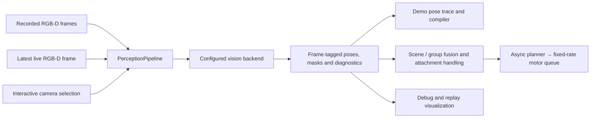

# FLASH implementation status

For the live camera tracker, read [RGB-D surface tracking](docs/surface_tracking.md):
its frame-by-frame mechanism, fixed reference, acceptance rules, shared consumers,
configuration and debugging views.

FLASH lives at **Run → FLASH**. The Run panel inspects a regular local LeRobot
dataset episode and discovers spatial skill annotations and prepared references
under that dataset's `flash/v1` extension. A source episode can have multiple
skills. With a prepared skill and calibrated local trial configuration, the
panel can launch a bounded live trial and record another ordinary LeRobot
dataset. Startup requires each needed object to register into the _same stable
object frame_ used by the demonstration before robot motion begins.

Run → FLASH lists a sealed-format SO-107 recording with `showservo_demo.npz`
even before it has a `flash/v1` extension. Open the raw demo, choose **Prepare
demo**, and use the playback editor to name the held object and target, enter
segmentation prompts and calibration, mark grasp/release and key frames, and
review symmetry and matching settings. The editor writes versioned preparation
inputs and runs the existing offline importer; object names come from these
inputs, not from object-specific code. This adapter currently supports one held
object and one target in episode 0 of the sealed format. It does not yet prepare
arbitrary LeRobot recordings or infer camera-to-arm calibration from RGB-D.

The equivalent command-line path remains available:

```bash
python benchmarks/flash_prepare_legacy.py <dataset_root> <annotation.json> --output-name <new-name>
```

That command is a compatibility entry point; the importer is
[`sealed_demo_import.py`](sealed_demo_import.py). The current sealed-demo path is:

1. An editor annotation identifies the object roles, one reference RGB-D frame,
   grasp/release events, keyframes, calibration and explicit tolerances.
2. SAM3 masks the reference objects. Aligned depth gives metric surface points;
   DINOv2 features attached to those points form the prepared reference bank.
3. Demo extraction, the live inference worker and the camera debugger call
   [`PerceptionPipeline.process`](perception_step.py). It owns the estimator
   lifecycle and checks that poses, masks and diagnostics refer to the same
   image and registered object frame. [`build_vision_backend`](vision_pipeline.py)
   constructs either the existing appearance estimator or the temporal surface
   estimator. The latter proposes motion with UFM and corrects it against the
   current segmented depth surface. The selected `vision_pipeline` configuration
   is saved in the prepared bundle and preparation cache identity; live execution
   uses that saved configuration. The editor's **Preparation and matching
   parameters → Vision pipeline (demo and run)** selects the backend.
   An annotation without this field retains appearance matching; an old bundle
   without the field retains the legacy live appearance/shape configuration.
   Previously, preparation disabled shape fallback while execution enabled it
   implicitly. New bundles carry one explicit choice for both consumers.
   When `causal_tracking` is configured, recorded frames and direct proposals
   also pass through the same [`CausalPoseService`](causal_service.py) as live
   execution. Existing bundles and pose traces are not rewritten automatically.
4. The recorded arm poses and gripper commands become dense demonstrated
   intervals or generated connections according to the keyframe annotation.
   After grasp, the held-object demo pose is a **prediction** from the selected
   pregrasp estimate and recorded gripper motion, not a new observation.

New regular LeRobot episodes have a separate, model-neutral skill compiler in
[`compiler.py`](compiler.py): it takes dataset frames, role-indexed pose
sidecars and explicit interval annotations. The sealed importer is an adapter
for the historical SO-107 recording layout and its one-held/one-target
annotation. It should not become the general demo schema; the Run → FLASH
editor currently prepares that sealed layout only.

The live trial constructs the configured vision backend through
[`VisionBackendFactory`](vision_pipeline.py). When `causal_tracking` is configured, the
scene estimator also uses frame-to-frame object and environment point motion;
a verified environment relationship can predict a partly hidden target pose.
An attached object instead has a gripper-relative prediction. These paths
publish provenance and do not turn an occluded pose into a direct measurement.
The robot's fixed-rate command loop consumes the latest accepted belief; its
30 Hz tick does not imply a fresh 30 Hz direct pose.
Demo extraction uses that estimator synchronously, while the live run keeps
perception asynchronous and may receive delayed proposals. Demo and live
still have distinct gripper attachment handling: the importer predicts held
motion from recorded gripper poses, and the run updates its attachment from
live observations.

The surface backend first registers the current observation into the prepared
object frame using the reference matcher. It then transports that same frame
with the temporally tracked surface; it does not recompute the object's origin
from the current visible points. Failed initial registration remains `LOST`.
The camera-only debugger has no demo to register against, so it explicitly
creates a local reference at the initial A landmark. This initialization
choice does not change surface filtering, motion estimation or fitting.



Offline extraction feeds every recorded frame; the live worker and debugger
consume the newest available frame. This scheduling difference is outside the
estimator. Inference and model loading stay outside the motor loop. Group motion
and gripper attachment remain contextual evidence above vision; a camera-only
session has no robot attachment observations. The historical importer still
constructs held demo motion from recorded gripper poses, as described above;
this refactor does not claim to unify that task annotation with live grasp
verification.

The debugger can display a proposed surface fit that execution rejects. Its
`accepted` field uses the same policy as the live backend: a continued pose
needs a converged surface fit, enough RGB-D inliers and surface agreement within
the configured registration distance. A shape-only fit remains inspectable but
yields `LOST` to the planner. These checks do **not** measure calibrated confidence
or resolve symmetry. They do not establish that a locally plausible fit is the
correct cross-episode correspondence. Both the accepted result and the raw
candidate retain the source frame identity.

In the camera debugger, **3D object view** removes the estimated scene motion
from both clouds and keeps the initial reference's framing. **Follow scene
pose** restores that motion; orbit and zoom remain independent. A stationary
white reference in object view is a display choice, not evidence of correct
tracking. The cyan measured cloud and the source-image overlay reveal disagreement.

**Surface sampling** exposes the shared configuration before camera launch:

| Parameter                           | Default | Meaning                                                                               |
| ----------------------------------- | ------- | ------------------------------------------------------------------------------------- |
| `observation.min_surface_spacing_m` | 0.001   | Finest voxel spacing; never creates missing depth samples.                            |
| `observation.surface_spacing_m`     | 0.003   | Coarsest measurement spacing.                                                         |
| `observation.samples_across_object` | 64      | Visible longest extent divided by this count sets spacing, clamped to the two limits. |
| `shape.max_fit_points`              | 2048    | Maximum residual queries per surface, chosen spatially.                               |

These are configurable compute/detail tradeoffs, not sensor accuracy claims.
The full voxel clouds remain nearest-neighbour lookup geometry; their complete
convex envelope still grounds outline coverage. Only the residual queries are
reduced for large objects. The RGB matcher always processes a fixed-size image,
but its crop includes the entire object even when it exceeds the context limit.
Finer geometry cannot by itself distinguish visually/geometrically ambiguous
ends. Per-update RGB rotation, surface correction and final rotation diagnostics
separate those stages when investigating a flip.

The debugger exports the same `vision_pipeline` configuration used by preparation
and execution. `LEROBOT_FLASH_TRACKING_PYTHON` selects their common inference
Python environment; without it they use the GUI's environment. This environment
must provide the optional UFM dependencies for the surface backend. The original
`AppearanceBackendFactory` remains a compatibility wrapper around the shared
factory; it no longer has independent construction logic.

Point2Pose, BundleSDF, TrackEverything and other offline runners are
**review candidates** in [`demo_tracker_candidates.py`](demo_tracker_candidates.py).
Applying one creates a new prepared skill with changed pose samples at its
covered frames; it does not change the live backend or the original RGB-D
episode. The [tracker review](TRACKER_REVIEW.md) explains the UI and the
candidate format. The [tracking evidence map](docs/tracking_evidence.md) links
the full-pose, visible-surface, rotation, cross-episode and local-trial results
with their limits. They found no generally best
tracker: Point2Pose held the visible dowel rotation well but failed on some
other objects; mask/depth agreement cannot prove that a point retained its
identity or that a hidden contact point is accurately placed. Those results
support keeping alternate proposals behind the pose interface, not silently
replacing the live estimator.

An unused output name creates a new bundle and forces the importer to run SAM3,
DINO and RGB-D pose extraction again; the pose cache includes the output name.
It does not overwrite a previous bundle. New bundles retain `annotation.json`,
`keypoints.json` and `preparation-report.json` with cache provenance. This
importer saves reference-frame masks only, so demo playback cannot display
historical per-frame masks or rejected fits. The per-frame evidence recording
specified in the [architecture](docs/architecture.md) is not implemented yet.
A legacy bundle modified after import cannot be assumed reproducible from the
dataset's top-level annotation file alone.

The rig JSON is the single place to tune live execution and tracking limits;
[the example configuration](docs/trial_config.example.json) lists every active
parameter. The [attachment policy](docs/attachment_policy.md) explains the
grasp-specific gates. Values in the example are experimental settings for the
current SO-107 trial, not universal object-size or safety constants.

The executable core already separates:

- demonstrated contact intervals, sampled on their own 1× local clock;
- sample-bound semantic events that survive replanning, with an optional
  milestone gate before the associated gripper change;
- generated connections, timed from live path length and configured speed;
- required and preferred connection endpoints: a preferred waypoint may end at
  the checked continuous-IK prefix when its exact goal is unreachable, with
  that shortfall recorded in the attempt trace; this does not claim collision
  avoidance or relax a demonstrated contact event;
- explicit pose-relation milestone tolerances, observed true/false/unknown
  verdicts from the perception collector (including expiry when frames stop),
  and bounded recovery transitions;
- metric RGB-D and pose evidence with source and availability times;
- one aligned RGB-D frameset from LeRobot's RealSense camera with an atomic
  host capture-time estimate and capture-time camera calibration;
- held-object world pose from the gripper-to-object attachment;
- capture-time interpolation of measured end-effector poses before accepting
  delayed held-object evidence into that attachment; a held attachment updater
  can seed a pregrasp fallback, marks whether it has a postgrasp observation,
  and withdraws the attachment on a large observed disagreement;
- demonstrated gripper events can declare an attach or detach transition with
  an object role and frame version. A lifecycle adapter applies those only
  after the motor accepts the event, seeds a recent observed pregrasp pose as
  an assumption, and retires that assumption on release. Release success still
  requires independent milestone evidence;
- skill compilation from ordinary LeRobot state/action/timestamp columns plus
  versioned object-pose annotations;
- metric cross-episode object-frame registration from RGB-D correspondences,
  with a checked binding from a live tracker's frame to the demo frame;
- a matcher-neutral RGB-D pose backend that fits visible matched points from
  any number of annotated demo views and reports loss when depth or geometry
  cannot support a pose;
- an initial SAM3-mask/DINOv2-patch matcher that constructs a metric object
  point-and-appearance bank from annotated RGB-D demo views, then submits
  live correspondences to the common pose backend;
- a versioned prepared-skill extension that saves the spatial skill, stable
  multi-view object references and derived metric point/descriptors beside
  the regular dataset. Run → FLASH discovers either a raw skill annotation
  under `flash/v1/skills/*.json` or a prepared reference under
  `flash/v1/prepared/*/bundle.json`, and reports what an episode still lacks;
- a spawn-isolated perception process that loads GPU models in the child and
  accepts the latest aligned camera snapshot. With causal tracking enabled it
  submits timestamped source-frame proposals to the scene estimator; otherwise
  the legacy path publishes its pose results to a short-lock store outside the
  motor loop;
- a live perception service that owns camera capture and result collection,
  waits for actual seeded object observations before motion, and exposes
  camera/estimator failures instead of reusing stale poses; its latest aligned
  RGB-D frame is retained separately for a nonblocking motor-tick recorder;
- kinematics-neutral short IK chunks and atomic future-queue replacement;
- an asynchronous IK producer that supersedes pending replan requests while
  the motor owner keeps consuming the already accepted queue; a solve made
  stale by a newer request is discarded before publication. The producer
  can snapshot the committed prefix and seed IK at a future splice tick;
- a planning coordinator that fills that queue ahead of the motor, retains a
  generated connection's clock across ordinary refills, retargets from the
  committed joint prefix when a reference changes, and interrupts if a pose
  is lost or moves beyond explicit replanning limits;
- a synchronous attempt host that composes those services outside the GUI
  event loop: it waits for an observed first object pose in the demonstrated
  frame before resetting the motor epoch, passes pose changes and milestone
  verdicts to the session, runs bounded steps, and saves an explicit outcome.
  Finishing motion without an independent verifier remains `unknown`;
- a selected-joint adapter that runs the SO-107's seven-joint FK/IK model
  while the planner controls six arm joints and the gripper separately;
- a camera-independent motor read/dispatch tick through `Robot`;
- the separately configured SO-107 gravity-compensated robot controller used
  in the sealed rig measurements, with its measured gains and URDF inertias;
- a session state machine that consumes asynchronous evidence before each tick
  and gates semantic actions on current milestone verdicts;
- standard LeRobot episode frames, with a `flash/v1` trace joined by episode
  and frame index. Every executed motor tick is retained, including waits; the trace
  distinguishes a new command, the servo's held goal and an observed hold.
  The regular dataset stores replayable robot-API actions; the trace also
  records the accepted actuator target, which may include gravity compensation
  or a robot-side limit. The pose layer and candidate/prior disagreements can
  be read back by episode and frame index for replay and skill compilation.
  Missed motor deadlines are explicit in the trace; such an episode has
  `timing_regular=false` because LeRobot's ordinary dataset timestamp remains
  based on its nominal FPS and must not be treated as exact physical timing.
  Motor observations also retain their actual read time for capture-time
  gripper interpolation.
  A tick assembler joins the latest available RGB-D frame and pose evidence
  before the recorder worker performs disk/video encoding.

The annotation points to a source LeRobot dataset episode. Dense transform
samples are derived geometry; the original RGB-D, robot observations and
actions remain in the regular episode. Each interval identifies its object
role and reference-frame version. A held-to-target interval also declares the
held object's reference-frame version. Missing versions are shown in skill
inspection and rejected by the joint planner. A pose-relation milestone can
select an observed demo frame to define its target object relationship, while
the task tolerances and maximum evidence age are supplied explicitly.
Held-to-target intervals also name the held role; skill inspection reports a
missing role or a missing matching attach event before live integration. It
also counts observed and predicted demo poses and warns when a held interval
has no independently observed held pose, rather than presenting predicted
contact geometry as a measurement.

The first matcher is measured on a recorded insertion scene in
[the RGB-D replay note](docs/rgbd_replay.md). It follows a static target well,
but the single tray view loses the dowel after lift and turn. Neither this
measurement nor a fit to matched points establishes independent pose accuracy
under occlusion. Multi-view reference preparation, evidence/observability
gates and asynchronous publication to the controller remain necessary.
Other milestone types, such as grasp verification, still need independent
evidence. The SO-107 trial launcher accepts a prepared skill, calibrated rig
configuration and ordinary LeRobot source dataset. It records each rollout as
an ordinary LeRobot episode with a FLASH decision trace. Startup waits for the
first action's observed object and a usable pose for every later referenced
object before the motor epoch begins; a poor instance seed must fail before
the arm moves.

The compatible appearance estimator uses SAM3 masks, DINO appearance matches
and aligned RGB-D. When explicitly configured, a geometry-only shape fit can
propose a pose when appearance matches are sparse. The 2026-10-20 live trial showed that a low surface residual
can still place the dowel's object frame centimetres away from its previous
pose; the recorded fixture and consistency rejection cover that failure, but
do not establish accurate pose under occlusion. The optional causal service
receives every captured camera frame, tracks object and shared scene points,
and can predict group motion after observed co-motion verifies a relationship.
When causal tracking is enabled, the heavy pose process submits
source-frame proposals to the causal service, which alone publishes accepted
poses and catches delayed proposals up to its retained frame history. That is
the first part of the [single scene-estimator contract](docs/architecture.md#one-scene-estimator-several-evidence-sources), not the complete arbitration:
partial observability, alternative poses, and calibrated uncertainty are still
missing. Consequently the group path remains experimental. One redesign
attempt visibly placed the dowel upright in the ring before an interrupted
retreat; another completed the command sequence but the dowel fell after
release. Neither recording independently verifies insertion or hidden
contact-pose accuracy.
The [recorded-evidence audit](docs/evidence_status.md) separates demo extraction,
offline pose checks, visually successful sealed-prototype runs and the
interrupted physical trials of this redesign.

The next architecture milestone is the [scene-estimator contract](docs/architecture.md#one-scene-estimator-several-evidence-sources), independent of which tracker is best on a particular view. The current code has one publisher when causal tracking is enabled, but it still treats a backend's candidate `PoseEstimate` as an accepted six-axis observation. In particular, the RGB-D backend keeps its own previous candidate for shape-continuity checks, and the scene service has no general rule for comparing a new candidate with visible depth, point motion, a group prediction and unresolved symmetry at the same source time. The accepted pose trace does not yet retain each raw candidate and its rejection reason.

Implementation should proceed in this order:

1. Introduce typed source-frame evidence for identity, visible geometry, relative motion and relationship hypotheses. Allow a producer to abstain or constrain only an observable subspace; retain source/calibration/reference versions and raw support.
2. Move candidate acceptance and event-time replay into the scene-estimator owner. Keep a bounded event history, compare proposals to the state at their original frame, replay later measurements as well as motion, publish one versioned belief, and record each decision. The interim service conservatively discards a late proposal older than a newer direct observation; that guard is not a substitute for full replay. Backends must not maintain a private notion of what the scene accepted.
3. Make the policy check the accepted belief at its contact points against the active interval's requirements. Unknown or conflicting dimensions must lead to a declared observation/recovery choice, not a fabricated pose or a model-name-specific override.
4. Run the same recorded disagreement, occlusion, moved-support and held-slip cases against alternate backends before another physical insertion claim. Report both pose error and source-to-decision age; a better mask alone is insufficient.
