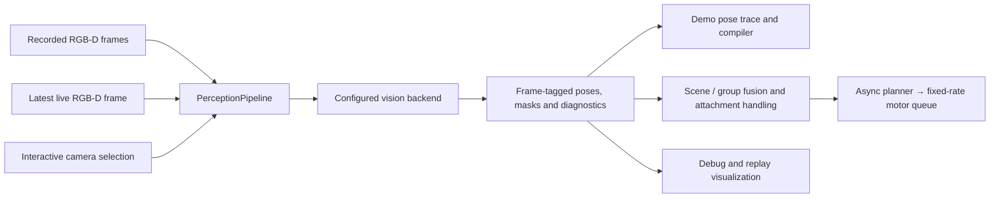

# FLASH: current implementation

This is the implementation map. The [architecture](docs/architecture.md) is
the current proposed design; it does not claim every feature is built.
[Surface tracking](docs/surface_tracking.md), [pose flow](docs/pose_flow.md)
and [attachment policy](docs/attachment_policy.md) explain implemented paths.
The [benchmark](../../../../benchmarks/FLASH_TRACKING.md) and
[dated proofs](../../../../docs/proofs/flash-contact-observation/README.md)
record measurements. Older [rollout evidence](docs/evidence_status.md),
[tracker research](docs/tracker_research.md) and
[editor mockups](docs/surface_relations.md) are historical material.

When a new experiment changes our conclusion, append its measurements to the
relevant proof and revise the architecture or this implementation map only where
the conclusion changes. Do not create another summary document for each round.

## Perception at a glance

The following is a code audit through the current FLASH work (2026-10-31). It describes the
surface-backend route; a prepared bundle can instead select the older appearance
backend. Replay displays recorded results rather than silently rerunning a new
tracker.

```text
Aligned RGB-D frame → SAM3 mask → measured 3D surface
                               ↘ neighboring-image matches propose motion
Saved object surface + proposed motion → fit to current depth and outline
                                      → accepted/rejected visual pose
                                      → optional scene-group point prediction
                                      → optional gripper attachment prediction
                                      → one timestamped pose decision
                                      → keyframe policy and separate robot loop
```

The GUI data overlay and FLASH use the same SAM3 adapter. Detection seeds a
text-named object and retries after the tracker reports loss; the periodic
memory reset copies the current mask. A confident wrong mask can therefore
persist. An optional detector check can re-seed a confidently overlapping
text-named mask from the same frame; demo processing checks more often than
Test, whose perception process is separate from robot control. It is off by
default until pose quality is established, because improved mask overlap alone
does not establish a better manipulation pose. A clicked object's name cannot
independently re-detect it. The surface backend keeps the first partial
reference fixed: image matches propose motion, while depth and projected
outline choose the final fit. Good overlap
does not certify the hidden side or the object's full orientation. Scene-group
and gripper estimates are predictions with separate provenance; they do not
turn missing image evidence into an observation. Demo extraction and Test share
the perception components, but may run on different frame schedules; neither
model inference nor an evidence wait belongs in the fixed-rate robot loop.

FLASH lives at **Run → FLASH**. The Run panel inspects a regular local LeRobot
dataset episode and discovers spatial skill annotations and prepared references
under that dataset's `flash/v1` extension. A source episode can have multiple
skills. With a prepared skill and calibrated local trial configuration, the
panel can launch a bounded live trial and record another ordinary LeRobot
dataset. Startup requires each needed object to register into the _same stable
object frame_ used by the demonstration before robot motion begins.

The demo editor keeps the current key frame and grasp/release timing beside
playback. Raw demo setup also shows object naming. Object corrections, tracker
experiments and numeric settings are optional.
In **Objects → Clear views**, **Check this view** compares a selected frame
against the saved first reference across other observed demo frames. It shows
how well measured points fit the saved surface and separates projected surface
that falls in front of measured depth from surface behind it. The latter may
simply be hidden; neither score alone establishes a correct pose. The check
uses the prepared pose trace to place and check the candidate, so it cannot
independently prove its accuracy. It does not modify the skill or include
unsaved edits. Older sealed
preparations can rebuild their first surface from the saved reference mask.
The same signed depth gaps are recorded with live surface evidence and shown in
the camera-only debugger. Live acceptance still uses the absolute gap: a large
behind-surface gap can represent either occlusion or a bad pose, as the recorded
gamepad example demonstrates. It is not silently treated as support.
The review also fits the first saved surface to the selected frame from its
measured mask and depth alone. Its four geometry placements can be previewed
on that camera frame. They remain unverified alternatives: similar surface
fit does not identify which physical end or contact point corresponds across
views, and none is added to the active reference by previewing it.
The path shown at each key frame is the path the importer uses. Older prepared
skills that implicitly replayed a grasp interval open with that interval
labelled “Follow recording”; saving the edited recipe makes the choice explicit
without changing the original skill.
Demo, live Test and recorded rollout review use the same 3D scene renderer.
The live view reads display-only RGB-D copies from the telemetry writer; its
pose overlay and pixels share a camera frame ID. New rollouts also record each
perception mask and the scene group's measured support under their source camera
frame IDs. Replay can show the measured RGB-D object surface and scene support
when that exact frame was saved by the dataset recorder. Snapshots from a
different camera frame never borrow either measurement. Older rollouts without
these sidecars show the recorded pose without claiming a measured object
surface or group support. Replay marks a source-frame measurement that arrived
after the displayed snapshot; the mark does not imply the controller had used
that measurement. Replay skips snapshots captured before recording began; older
traces without frame IDs can only use a marked approximate time match. The live
scene route has GUI and writer tests but still needs a physical timing check.
Each causal pose candidate has a source-frame decision with its raw pose,
accepted pose when applicable, and rejection reason. The live and replay Pose
details panel shows the latest decision; a separate decision journal retains
every event even when display snapshots are coalesced. The episode manifest
names both the tracker snapshots and decision journal. The writer backlog is
bounded by retained frame count and tracked role count; if disk I/O cannot keep
up, the estimator reports an error instead of silently losing decisions or
growing memory without limit. An accepted source-frame candidate may still be
rebased through later point motion before becoming the planner's current pose.
The perception result now also carries a typed source-frame proposal with the
backend's raw fit, including one the backend rejected, and measured visible
surface support. The live camera shows a rejected raw fit only on its exact
source frame. This makes rejection inspectable; it does not yet move acceptance
out of the backend. A late older proposal now replays retained camera frames,
point motion, group arbitration and later direct proposals in source order for
the affected unattached object. It commits a new pose version only after
catching up, and records revised direct decisions. Replay steps yield to new
camera events. If the required frame or earlier accepted anchor has expired,
the newer belief is preserved and the reason is recorded. A delayed object
result crossing a grasp or release replays the retained camera frames with the
motor-time attachment events; if that history is incomplete, the result is
rejected. Other objects can still update from the same image. This revises
only the independent scene estimate, never past motor commands or the gripper
attachment assumption. The first camera frame after an attachment
change withdraws the object's older scene pose and environment group relation.
Independent point motion or a new visual observation may establish a pose on
that frame; otherwise the scene reports it unknown while the separate gripper
relationship can still predict a held object for control. If a motor event
arrives just after the worker processed an image captured at or after that
event, the worker invalidates the affected scene pose and track rather than
publishing a result interpreted under the old relationship. The trial records
how often this happens as `late_attachment_invalidations`.

Run → FLASH lists a sealed-format SO-107 recording with `showservo_demo.npz`
even before it has a `flash/v1` extension. Open the raw demo, choose **Prepare
demo**, and use the playback editor to name the objects to track, choose the
held object and target for this imported action, enter segmentation prompts and
calibration, mark grasp/release and key frames, and
review symmetry and matching settings. The editor writes versioned preparation
inputs and runs the existing offline importer; object names come from these
inputs, not from object-specific code. Each object may use a different clear
reference frame; the additional objects are tracked but do not automatically
become action targets. This adapter still supports one held-object/target action
pair in episode 0 of the sealed format. It does not infer camera-to-arm
calibration from RGB-D.

The equivalent command-line path remains available:

```bash
python benchmarks/flash_prepare_legacy.py <dataset_root> <annotation.json> --output-name <new-name>
```

That command is a compatibility entry point; the importer is
[`sealed_demo_import.py`](sealed_demo_import.py). The current sealed-demo path is:

1. An editor annotation identifies the object roles, a clear reference RGB-D frame per object,
   grasp/release events, keyframes, calibration and explicit tolerances.
2. SAM3 masks the reference objects. Aligned depth gives metric surface points;
   DINOv2 features attached to those points form the prepared appearance bank.
   New preparations also save the filtered dense depth surface separately for
   each declared registered view, in the same object frame. The surface budget
   per view is set by `vision_pipeline.surface_reference_max_points_per_view`.
3. Demo extraction, the live inference worker and the camera debugger call
   [`PerceptionPipeline.process`](perception_step.py). It owns the estimator
   lifecycle and checks that poses, masks and diagnostics refer to the same
   image and registered object frame. [`build_vision_backend`](vision_pipeline.py)
   constructs either the existing appearance estimator or the temporal surface
   estimator. The latter proposes motion with UFM and corrects it against the
   current segmented depth surface. The selected `vision_pipeline` configuration
   is saved in the prepared bundle and preparation cache identity; live execution
   uses that saved configuration. The demo editor exposes the backend in **Tracking**.
   An annotation without this field retains appearance matching; an old bundle
   without the field retains the legacy live appearance/shape configuration.
   Previously, preparation disabled shape fallback while execution enabled it
   implicitly. New bundles carry one explicit choice for both consumers.
   When `causal_tracking` is configured, recorded frames and direct proposals
   also pass through the same [`CausalPoseService`](causal_service.py) as live
   execution. Only its accepted pose or current-frame prediction enters the
   compiled demo trace; a rejected direct fit is recorded as lost, while the
   raw proposal remains available for review. The pose-trace cache version
   separates this rule from earlier cached traces. Existing bundles are not
   rewritten automatically. In **Source**, the editor can read the same trial
   JSON used for the robot and snapshot its scene-tracking settings into the
   prepared bundle. A live trial checks this snapshot before connecting to the
   arm. A prepared demo without it remains explicitly direct-only.
4. The recorded arm poses and gripper commands become dense demonstrated
   intervals or generated connections according to the keyframe annotation.
   After grasp, the held-object demo pose starts as a **prediction** from the
   selected pregrasp estimate and recorded gripper motion. When preparation
   has same-frame aligned RGB-D, a supported visual pose and a measured arm
   pose at that image's capture time, it can correct the saved gripper-to-object
   relation. Small corrections apply only when the visible reference surface
   meets the configured clean-depth support requirement. Larger ones require
   two agreeing visual observations whose fixed-reference surface fits the
   image better than the gripper prediction. Unresolved disagreements retain
   the previous relation but are labeled `conflicted_prediction` in the
   prepared skill and camera replay.

The preparation report compares the source-time prediction with later directly
observed held poses. It reports each uninterrupted visible run separately,
using the fixed reference-cloud center so an arbitrary object-frame origin
cannot inflate translation error. It also reports how far the gripper actually
moved during each observed run: a stable object-to-gripper offset while both
are still is not evidence of a rigid grasp. A conflict is diagnostic and does
not authorize an automatic pose switch. The current importer still saves the
last accepted predicted relation across conflicted intervals. The live
launcher requires an explicit experimental override before executing such a
bundle. Those intervals are **not verified contact geometry**; inspect the
`held_evidence` trace before testing.

The sealed importer now extracts pose and scene evidence through the final
recorded camera frame. Authored keyframes still determine where executable
skill motion ends; later camera frames remain available to inspect release,
retreat and the outcome in demo playback. A preparation cache records the
full camera-frame count so an older keyframe-truncated trace cannot be reused.

New regular LeRobot episodes have a separate, model-neutral skill compiler in
[`compiler.py`](compiler.py): it takes dataset frames, role-indexed pose
sidecars and explicit interval annotations. Start-relative intervals need no
object pose; generated connections use their endpoint poses and estimate speed
from the recorded path, while demonstrated intervals preserve every frame.
Intervals must form a continuous timeline, and a push can compile without a
grasp or attachment event. Compilation reads only timestamp, robot state and
action columns from a regular dataset; RGB-D decoding remains in perception.
New trials copy their prepared object models and reference masks into the
recorded dataset. [`prepare_recorded_episode`](recorded_demo.py) can then compile
an annotated trial and its frame-indexed pose trace into another prepared
skill, rejecting a mismatched object-frame version. Copied symmetry rules
require a chosen directly observed baseline frame in the new episode rather
than inheriting the old demo's placement.

In **Run → FLASH → Rollouts**,
**Mark motion** adds consecutive sections directly on the replay timeline.
The selected motion can start and end anywhere in the episode; setup and
parking footage do not become mandatory skill motion.
Each section states whether to follow its recorded motion or plan a route,
which object relationship must be preserved, and whether a gripper attachment
changes at its end. A section may also check the measured relation between
two selected objects at its end against their demonstrated relative position,
using a task tolerance supplied in the editor.
The check waits for new observations of both objects after the final motor
command; a pose seen earlier cannot certify the result. **Prepare candidate**
checks the selected clip and saves
a new skill version under the same dataset; **Demos** replays that version on
the original trial frames with the saved skill poses beside tracker evidence.
The editor currently uses the recorded SO-107 calibration adapter. Older
trials lacking a saved reference snapshot remain viewable but cannot be
prepared from this editor; no object model is inferred from their names.
The sealed importer remains an adapter for the historical SO-107 recording
layout and its one-held/one-target annotation; it is not the general demo
schema. Other milestone types and recovery editing for regular recordings are
still pending. The relation verifier can use a directly measured object centre
for a position-only check even if irrelevant rotation was predicted. It does
not use that translation to certify an orientation-dependent contact. The
current insertion recording directly measures the ring centre near contact,
but its ring orientation and carried dowel tip are not independently verified.

The camera-only debugger now has an optional scene/group fallback using the
same `CausalPoseService` as demo extraction and Test. When enabled, it forwards
every captured frame to the scene worker and submits each slower surface result
with its source frame, just as Test does. It displays direct fits and the
scene-selected estimate with separate provenance. The group view shows its own
camera frame, so a later scene prediction never borrows the direct fit's older
image. The debugger has no motor/gripper attachment
and starts from a local clicked/named surface, not a prepared multi-view model.
Its shared causal defaults come from `default_causal_tracking_config`, and the
resolved setting is saved in a diagnostic trace. The fallback is off by default
so a raw surface fit remains inspectable.

The live trial constructs the configured vision backend through
[`VisionBackendFactory`](vision_pipeline.py). When `causal_tracking` is configured, the
scene estimator also uses frame-to-frame object and environment point motion;
a verified environment relationship can predict a partly hidden target pose.
An attached object instead has a gripper-relative prediction. These paths
publish provenance and do not turn an occluded pose into a direct measurement.
The robot's fixed-rate command loop consumes the latest accepted belief; its
30 Hz tick does not imply a fresh 30 Hz direct pose.
Demo extraction uses that estimator synchronously, while the live run keeps
perception asynchronous and may receive delayed proposals. The sealed demo
adapter feeds grasp and release at their recorded arm times, not the nearest
RGB-D frame; the extraction cache key includes those event times. Demo and live
still have distinct gripper attachment handling: the importer predicts held
motion from recorded gripper poses, and the run updates its attachment from
live observations.

The surface backend first registers the current observation into the prepared
object frame using the reference matcher. It then transports that same frame
with the temporally tracked surface; it does not recompute the object's origin
from the current visible points. Failed initial registration remains `LOST`.
Its fit still uses the first live observed surface. For newly prepared bundles,
the source-frame proposal also records how the saved demo surface agrees with
the current masked depth, using the first registered view and all registered
views separately. It measures both visible depth points to the saved surface
and the saved surface back to reliable depth pixels. A low one-way distance can
hide a wrong pose; these numbers are diagnostics, not confidence probabilities.
The sealed-demo importer currently registers one view per object, so its two
readouts coincide. The saved surfaces do not yet alter pose acceptance or
control; registering additional views and validating their effect on fitting
remain necessary before that switch.
The 3D demo viewer draws every registered snippet in the saved object frame,
with separate triangles for each measured view. This is display geometry;
showing several views does not establish that their registration is correct.
The review viewer shows the current mask and depth as its primary 3D layer;
the saved reference projected by a fitted pose is an optional comparison.
Missing triangles do not erase measured depth points. The scene-depth layer
includes the tracked objects as well as their surroundings. For robot recordings
that reuse a camera capture across motor ticks, replay uses the original dataset
row for both RGB and depth while keeping the distinct-camera index for saved
pose evidence.
The camera-only debugger has no demo to register against, so it explicitly
creates a local reference at the initial A landmark. This initialization
choice does not change surface filtering, motion estimation or fitting.



Offline extraction feeds every recorded frame; the live worker and debugger
consume the newest available frame. This scheduling difference is outside the
estimator. Inference and model loading stay outside the motor loop. Group motion
and gripper attachment remain contextual evidence above vision; a camera-only
session has no robot attachment observations. The historical importer still
constructs held demo motion from recorded gripper poses, as described above;
this refactor does not claim to unify that task annotation with live grasp
verification.

The debugger can display a proposed surface fit that execution rejects. Its
`accepted` field uses the same policy as the live backend: a continued pose
needs a converged surface fit, enough RGB-D inliers and surface agreement within
the configured registration distance. A shape-only fit remains inspectable but
yields `LOST` to the planner. These checks do **not** measure calibrated confidence
or resolve symmetry. They do not establish that a locally plausible fit is the
correct cross-episode correspondence. Both the accepted result and the raw
candidate retain the source frame identity.

In the camera debugger, **3D object view** removes the estimated scene motion
from both clouds and keeps the initial reference's framing. **Follow scene
pose** restores that motion; orbit and zoom remain independent. A stationary
white reference in object view is a display choice, not evidence of correct
tracking. The cyan measured cloud and the source-image overlay reveal disagreement.

**Surface sampling** exposes the shared configuration before camera launch:

| Parameter                           | Default | Meaning                                                                               |
| ----------------------------------- | ------- | ------------------------------------------------------------------------------------- |
| `observation.min_surface_spacing_m` | 0.001   | Finest voxel spacing; never creates missing depth samples.                            |
| `observation.surface_spacing_m`     | 0.003   | Coarsest measurement spacing.                                                         |
| `observation.samples_across_object` | 64      | Visible longest extent divided by this count sets spacing, clamped to the two limits. |
| `shape.max_fit_points`              | 2048    | Maximum residual queries per surface, chosen spatially.                               |

These are configurable compute/detail tradeoffs, not sensor accuracy claims.
The full voxel clouds remain nearest-neighbour lookup geometry; their complete
convex envelope still grounds outline coverage. Only the residual queries are
reduced for large objects. The RGB matcher always processes a fixed-size image,
but its crop includes the entire object even when it exceeds the context limit.
Finer geometry cannot by itself distinguish visually/geometrically ambiguous
ends. Per-update RGB rotation, surface correction and final rotation diagnostics
separate those stages when investigating a flip.

The debugger exports the same `vision_pipeline` configuration used by preparation
and execution. `LEROBOT_FLASH_TRACKING_PYTHON` selects their common inference
Python environment; without it they use the GUI's environment. This environment
must provide the optional UFM dependencies for the surface backend. The original
`AppearanceBackendFactory` remains a compatibility wrapper around the shared
factory; it no longer has independent construction logic.

Point2Pose, BundleSDF, TrackEverything and other offline runners are
**review candidates** in [`demo_tracker_candidates.py`](demo_tracker_candidates.py).
Applying one creates a new prepared skill with changed pose samples at its
covered frames; it does not change the live backend or the original RGB-D
episode. The [tracker review](TRACKER_REVIEW.md) explains the UI and the
candidate format. The [tracking evidence map](docs/tracking_evidence.md) links
the full-pose, visible-surface, rotation, cross-episode and local-trial results
with their limits. They found no generally best
tracker: Point2Pose held the visible dowel rotation well but failed on some
other objects; mask/depth agreement cannot prove that a point retained its
identity or that a hidden contact point is accurately placed. Those results
support keeping alternate proposals behind the pose interface, not silently
replacing the live estimator.

An unused output name creates a new bundle and forces the importer to run SAM3,
DINO and RGB-D pose extraction again; the pose cache includes the output name.
It does not overwrite a previous bundle. New bundles retain `annotation.json`,
`keypoints.json` and `preparation-report.json` with cache provenance. This
importer now streams per-frame masks, group support, accepted estimates and
rejected raw pose proposals during the same extraction pass. Demo playback reads
that versioned evidence beside the skill. A separate scene-evidence rebuild is
still available for older bundles; it does not alter their saved skill. The
symmetry wrapper preserves a rejected fit and its measured partial surface
support through the shared perception interface instead of reducing it to
`lost` before recording.
A legacy bundle modified after import cannot be assumed reproducible from the
dataset's top-level annotation file alone.

The rig JSON is the single place to tune live execution and tracking limits;
[the example configuration](docs/trial_config.example.json) lists every active
parameter. The [attachment policy](docs/attachment_policy.md) explains the
grasp-specific gates. Values in the example are experimental settings for the
current SO-107 trial, not universal object-size or safety constants.

The executable core already separates:

- demonstrated contact intervals, sampled on their own 1× local clock;
- sample-bound semantic events that survive replanning, with an optional
  milestone gate before the associated gripper change;
- generated connections, timed from live path length and configured speed;
- required and preferred connection endpoints: a preferred waypoint may end at
  the checked continuous-IK prefix when its exact goal is unreachable, with
  that shortfall recorded in the attempt trace; this does not claim collision
  avoidance or relax a demonstrated contact event;
- explicit pose-relation milestone tolerances, observed true/false/unknown
  verdicts from the perception collector (including expiry when frames stop),
  and bounded recovery transitions;
- metric RGB-D and pose evidence with source and availability times;
- one aligned RGB-D frameset from LeRobot's RealSense camera with an atomic
  host capture-time estimate and capture-time camera calibration;
- held-object world pose from the gripper-to-object attachment;
- capture-time interpolation of measured end-effector poses before accepting
  delayed held-object evidence into that attachment; a held attachment updater
  can seed a pregrasp fallback, marks whether it has a postgrasp observation,
  and withdraws the attachment on a large observed disagreement;
- demonstrated gripper events can declare an attach or detach transition with
  an object role and frame version. A lifecycle adapter applies those only
  after the motor accepts the event, seeds a recent observed pregrasp pose as
  an assumption, and retires that assumption on release. Release success still
  requires independent milestone evidence;
- skill compilation from ordinary LeRobot state/action/timestamp columns plus
  versioned object-pose annotations;
- metric cross-episode object-frame registration from RGB-D correspondences,
  with a checked binding from a live tracker's frame to the demo frame;
- a matcher-neutral RGB-D pose backend that fits visible matched points from
  any number of annotated demo views and reports loss when depth or geometry
  cannot support a pose;
- an initial SAM3-mask/DINOv2-patch matcher that constructs a metric object
  point-and-appearance bank from annotated RGB-D demo views, then submits
  live correspondences to the common pose backend;
- a versioned prepared-skill extension that saves the spatial skill, stable
  multi-view object references and derived metric point/descriptors beside
  the regular dataset. Run → FLASH discovers either a raw skill annotation
  under `flash/v1/skills/*.json` or a prepared reference under
  `flash/v1/prepared/*/bundle.json`, and reports what an episode still lacks;
- a spawn-isolated perception process that loads GPU models in the child and
  accepts the latest aligned camera snapshot. With causal tracking enabled it
  submits timestamped source-frame proposals to the scene estimator; otherwise
  the legacy path publishes its pose results to a short-lock store outside the
  motor loop;
- a live perception service that owns camera capture and result collection,
  waits for actual seeded object observations before motion, and exposes
  camera/estimator failures instead of reusing stale poses; its latest aligned
  RGB-D frame is retained separately for a nonblocking motor-tick recorder;
- kinematics-neutral short IK chunks and atomic future-queue replacement;
- an asynchronous IK producer that supersedes pending replan requests while
  the motor owner keeps consuming the already accepted queue; a solve made
  stale by a newer request is discarded before publication. The producer
  can snapshot the committed prefix and seed IK at a future splice tick. The
  SO-107 Test launcher builds a second kinematics workspace in a spawned
  planner process; the parent still validates and publishes its returned
  chunks. This isolates long IK searches from camera and scene tracking;
- a planning coordinator that fills that queue ahead of the motor, retains a
  generated connection's clock across ordinary refills, retargets from the
  committed joint prefix when a reference changes, and interrupts if a pose
  is lost or moves beyond explicit replanning limits;
- a synchronous attempt host that composes those services outside the GUI
  event loop: it waits for an observed first object pose in the demonstrated
  frame before resetting the motor epoch, passes pose changes and milestone
  verdicts to the session, runs bounded steps, and saves an explicit outcome.
  An optional `outcome_milestone` in the skill names an independent check that
  must use evidence captured after the final motor command. While it waits,
  the host records fixed-rate hold ticks until the attempt deadline. A fresh
  true or false verdict becomes success or failure; absent or partial evidence
  leaves the outcome `unknown`, including camera loss after motion. A skill
  without this check still reports `unknown` on motion completion. The
  recorded-episode editor exposes this for a final relation check; historical
  sealed-demo imports do not gain an outcome annotation automatically;
- a selected-joint adapter that runs the SO-107's seven-joint FK/IK model
  while the planner controls six arm joints and the gripper separately;
- a camera-independent motor read/dispatch tick through `Robot`;
- the separately configured SO-107 gravity-compensated robot controller used
  in the sealed rig measurements, with its measured gains and URDF inertias;
- a session state machine that consumes asynchronous evidence before each tick
  and gates semantic actions on current milestone verdicts;
- standard LeRobot episode frames, with a `flash/v1` trace joined by episode
  and frame index. Every executed motor tick is retained, including waits; the trace
  distinguishes a new command, the servo's held goal and an observed hold.
  The regular dataset stores replayable robot-API actions; the trace also
  records the accepted actuator target, which may include gravity compensation
  or a robot-side limit. The pose layer and candidate/prior disagreements can
  be read back by episode and frame index for replay and skill compilation.
  Missed motor deadlines are explicit in the trace; such an episode has
  `timing_regular=false` because LeRobot's ordinary dataset timestamp remains
  based on its nominal FPS and must not be treated as exact physical timing.
  Motor observations also retain their actual read time for capture-time
  gripper interpolation.
  Each command keeps the pose revision, source camera frame and availability
  time used by IK, plus the held-object estimate version and time when used.
  The tick's `pose_version` is the newer snapshot at recording time and may
  differ from that command evidence; a held goal retains its last command's
  provenance. Test and Replay show this distinction in the tracker panel.
  A tick assembler joins the latest available RGB-D frame and pose evidence
  before the recorder worker performs disk/video encoding.
  The GUI trial subprocess also saves its final camera, perception, planner
  and outcome diagnostics in the dataset's `flash/v1/trial_report.json`, so a
  failed attempt can be investigated after its console output disappears.

The annotation points to a source LeRobot dataset episode. Dense transform
samples are derived geometry; the original RGB-D, robot observations and
actions remain in the regular episode. Each interval identifies its object
role and reference-frame version. A held-to-target interval also declares the
held object's reference-frame version. Missing versions are shown in skill
inspection and rejected by the joint planner. A pose-relation milestone can
select an observed demo frame to define its target object relationship, while
the task tolerances and maximum evidence age are supplied explicitly.
It can check a local functional point and a local direction instead of the
moving object's frame origin and full orientation. Rotation about that
direction is then irrelevant to the milestone, while a displaced point or
tilted direction fails. This is a task constraint, not evidence that an
unobserved pose component has become known. The compiler and verifier require
only orientation axes that can change the selected feature. The current planner still uses
the full pose to generate its motion; this check alone does not adapt a path.

A recorded robot episode with a FLASH pose trace can be edited without a
trial-specific launch config. Its dataset-local
`flash/v1/recorded-sources/episode_000000.json` names the episode and repo ID,
a prepared reference snapshot under `flash/v1/reference_bundles/`, the SO-107
arm and a calibration copy under `flash/v1/robot/`, plus a maximum pose age for
result checks. Run → FLASH lists it with demos, opens its existing recording
and 3D scene views, and compiles marked motion through the same
`prepare_recorded_episode` path as a FLASH rollout. The sealed demo importer
remains available for older `showservo_demo.npz` recordings. An ordinary
LeRobot recording without pose evidence and registered object references still
needs those inputs prepared before it can become an executable spatial skill.

Held-to-target intervals also name the held role; skill inspection reports a
missing role or a missing matching attach event before live integration. It
also counts observed and predicted demo poses and warns when a held interval
has no independently observed held pose, rather than presenting predicted
contact geometry as a measurement.

The first matcher is measured on a recorded insertion scene in
[the RGB-D replay note](docs/rgbd_replay.md). It follows a static target well,
but the single tray view loses the dowel after lift and turn. Neither this
measurement nor a fit to matched points establishes independent pose accuracy
under occlusion. Multi-view reference preparation, evidence/observability
gates and asynchronous publication to the controller remain necessary.
Other milestone types, such as grasp verification, still need independent
evidence. The SO-107 trial launcher accepts a prepared skill, calibrated rig
configuration and ordinary LeRobot source dataset. It records each rollout as
an ordinary LeRobot episode with a FLASH decision trace. Startup waits for the
first action's observed object and a usable pose for every later referenced
object before the motor epoch begins; a poor instance seed must fail before
the arm moves.

The compatible appearance estimator uses SAM3 masks, DINO appearance matches
and aligned RGB-D. When explicitly configured, a geometry-only shape fit can
propose a pose when appearance matches are sparse. The 2026-10-20 live trial showed that a low surface residual
can still place the dowel's object frame centimetres away from its previous
pose; the recorded fixture and consistency rejection cover that failure, but
do not establish accurate pose under occlusion. The optional causal service
receives every captured camera frame, tracks object and shared scene points,
and can predict group motion after observed co-motion verifies a relationship.
Grasp and release events carry their motor dispatch time into this service;
queued camera frames captured before an event retain the earlier relationship.
The gripper-backed held pose supplies a prediction to the causal scene store
when camera point motion is unavailable. It uses the measured motor state at
or before that camera frame and keeps the last independent observation time;
the prediction never claims to be a new visual measurement. A direct visual
pose at the same frame takes priority. Release stops gripper predictions and
withdraws the old scene pose. The controller still keeps its separate
gripper-to-object relationship for motion planning. Demo extraction currently
replays that relationship after its scene-pose pass, so source-time gripper
fusion there remains to be integrated.
When causal tracking is enabled, the heavy pose process submits
source-frame proposals to the causal service, which alone publishes accepted
poses and catches delayed proposals up to its retained frame history. That is
the first part of the [single scene-estimator contract](docs/architecture.md#one-scene-estimator-several-evidence-sources), not the complete arbitration:
partial observability, alternative poses, and calibrated uncertainty are still
missing. Consequently the group path remains experimental. One redesign
attempt visibly placed the dowel upright in the ring before an interrupted
retreat; another completed the command sequence but the dowel fell after
release. Neither recording independently verifies insertion or hidden
contact-pose accuracy.
The [recorded-evidence audit](docs/evidence_status.md) separates demo extraction,
offline pose checks, visually successful sealed-prototype runs and the
interrupted physical trials of this redesign.

The 2026-10-31 insertion trial lifted the dowel, then stopped at the next
connection. The ring group still had measured support, but the last processed
ring pose was nearly three seconds old. A turn search took seconds and made a
concurrent scene-tracking call pause for up to 1.1 seconds in the same process.
Running that search in another process kept the scene call below 3.4 ms in the
recorded replay. An initial offline reachability check incorrectly derived the
gripper attachment from an old scene pose of the held dowel and reported no
feasible turn. Approximately reconstructing the attachment from the recorded
gripper-backed held pose instead found a feasible connection at the demonstrated
angle. The exact attachment used by the interrupted live planner was not
recorded, so a new trial must verify both reachability and fresh ring tracking.
Future trial traces include the exact reference and attachment transforms used by each
published plan, plus slow camera and anchor stages in
`flash/v1/causal_timing_episode_000000.json`. A later trial recorded one
1.35-second environment-group update, but the old timing did not distinguish
fitting from scheduling or telemetry delay. New slow-work records separate
thread CPU time from elapsed time and split group prediction, fitting,
seeding, observation recording and support publication for the next diagnosis.

The [scene-estimator contract](docs/architecture.md#one-scene-estimator-several-evidence-sources) is not fully implemented. The current code has one publisher when causal tracking is enabled, but it still treats a backend's candidate `PoseEstimate` as an accepted six-axis observation. In particular, the RGB-D backend keeps its own previous candidate for shape-continuity checks, and the scene service has no general rule for comparing a new candidate with visible depth, point motion, a group prediction and unresolved symmetry at the same source time. Candidate dispositions are recorded. Delayed direct poses within retained history are replayed in source order in a bounded shadow calculation. That replay reads the source-time gripper prediction and sends its accepted held-object observations to the attachment updater in source order; a revoked observation withdraws its gripper correction from retained motor samples. The planner reads a published scene-and-attachment snapshot. The collector waits for the scene worker to complete each direct or replay event, then applies its held-object correction before publishing that pair. If the required image or motor history has expired, the runtime reports an error rather than keeping a stale correction. Scene matching still reads the gripper relation available before its own replay and does not rerun after that relation changes. The scene estimator also does not yet replay every evidence type.

One narrow exception now rejects a full direct pose if the saved object surface
projects into reliably measured empty space in that same RGB-D frame. This
retains the existing group or point-motion prediction; it does not establish
that the retained prediction is accurate. A translation measured with predicted
orientation remains usable because that orientation can cause the projected
surface conflict. The first accepted RGB-D view supplies this check for
objects without a prepared surface; it cannot validate its own initialization.

The [architecture](docs/architecture.md) defines the intended scene-estimator
contract. This implementation map describes the present gap without defining
a second roadmap.

The [tracking benchmark](../../../../benchmarks/FLASH_TRACKING.md) scores saved
scene evidence without changing the perception path. Its external baseline uses
supplied masks. It also includes the rig's insertion and stacking demonstrations
as diagnostic cases; those recordings lack independent pose and outcome labels,
so their coverage counts cannot measure task success or pose accuracy.
