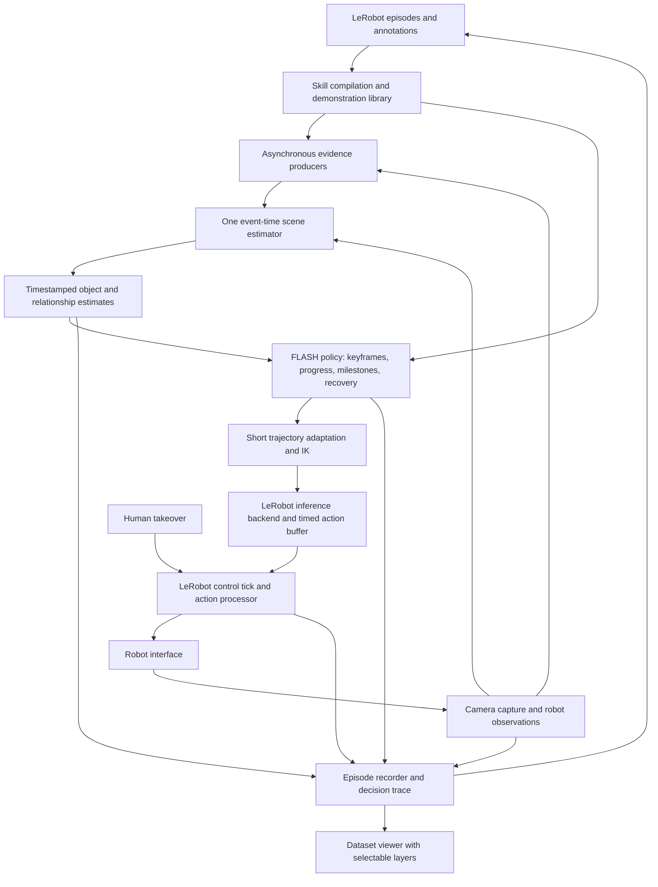
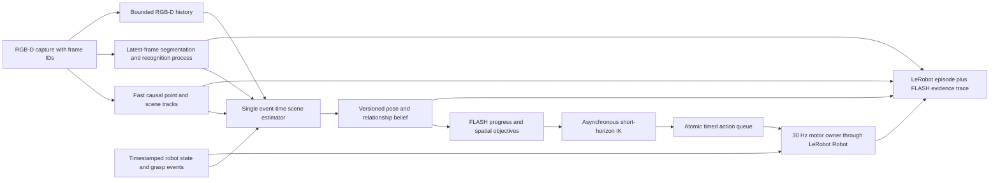

# FLASH: spatial action model

Status: proposed

The [implementation reference](../README.md) describes what currently runs;
this document defines the intended contracts. The first recorded RGB-D matcher
result and its limits are in [the replay note](rgbd_replay.md).

FLASH is imitation learning with an explicit 3D representation of objects, relationships and actions. Its initial form performs direct imitation: retain how a demonstration accomplishes an interaction, and adapt the motion to the live scene. Teaching, testing and collecting robot data should be one workflow: record an interaction, try it in a changed scene, intervene when needed, and retain the whole experience. The sealed prototype demonstrated useful spatial adaptation, but its uncertain object estimates, execution rules and recording paths became entangled. More demonstrations need to improve what the robot can do, while producing ordinary LeRobot data augmented with 3D information for future learned models.

**Proposal.** Represent a skill with keyframes that specify important spatial relationships, intervals that specify how to move between them, and milestones that check the result. Grasp and placement intervals preserve the demonstrated local motion and timing; transport intervals interpolate or plan between adapted keyframes at a comparable speed, taking longer when the path is longer. A shared perception service estimates objects and their relationships; the FLASH policy continuously adapts future motion and manages progress, exceptions and recovery. LeRobot owns hardware, action scheduling, recording and human takeover. Additional demonstrations enrich reference views, execution alternatives and estimates of task variation. Each of these contributions is evaluated separately.

## Scope

The initial capability is manipulation of rigid objects using calibrated RGB-D, robot state, and human annotations of object roles and interaction intervals. Objects need no supplied CAD model or prior scan. Partial surfaces and local coordinate frames can be built from observations. Appearance and geometry must provide enough information for the particular interaction; arbitrary identity does not imply arbitrary observability.

Direct imitation uses frozen perception models and requires no task-specific policy-network training. Optional tracker training and a future learned action module can benefit from the same data: metric geometry, relative object and hand poses, demonstrated actions and outcomes. The learned action module is a separate research direction behind the policy interface; it does not need to be solved to support direct imitation. Non-rigid objects require local features or deformation state rather than one rigid pose; they are a separate estimator and controller capability, not a promise inherited from tracking visible points.

The supported robot targets are SO-107 and OpenArm2 through LeRobot's robot and kinematics interfaces. SO-107 is the initial physical integration; the policy contract must also accommodate OpenArm2's joints, grippers and capabilities. Each robot may use its own recorded demonstration and calibration. Supporting both robots does not require transferring a demonstration unchanged between their different embodiments.

Force-controlled contact, tactile sensing and multiple cameras fit the interfaces but are not prerequisites. Position-only hardware cannot guarantee successful tight contact through an unobserved slip. General task discovery from one unannotated video, arbitrary changes of embodiment, and unrestricted planning through unseen geometry are outside the initial capability.

## Requirements

Correct interpretation of evidence, timing and collected data takes priority over breadth of autonomous behavior. Performance targets below are proposed acceptance criteria, not measurements of the redesign.

The **rig workload** initially means the available SO-107, one overhead RGB-D camera, two task objects, background motion groups, recording and an open viewer, on the same host. **OpenArm2** is a second supported workload using its own robot configuration, calibration and demonstration; timing and motion results must be measured separately on that hardware. The **comparison workload** adds another set of object identities and layouts withheld from tuning. Hardware calibration, camera settings and compute versions must accompany each result.

| ID                | Priority | Requirement                                                               | Target and reason                                                                                                                                                                                        | Verification                                                                                                                                           |
| ----------------- | -------- | ------------------------------------------------------------------------- | -------------------------------------------------------------------------------------------------------------------------------------------------------------------------------------------------------- | ------------------------------------------------------------------------------------------------------------------------------------------------------ |
| <a id="r1"></a>R1 | P0       | Use LeRobot integration points on SO-107 and OpenArm2                     | One hardware owner and command route through Robot; robot-specific kinematics, limits and compensation stay in the hardware layer; regular LeRobot datasets                                              | Start physically on SO-107; exercise the same policy contracts with both robot configurations and validate OpenArm2 physically before claiming support |
| <a id="r2"></a>R2 | P0       | Preserve what was known when an action was chosen                         | Every decision references source frames, estimate versions and availability times; future frames cannot enter a causal replay                                                                            | Deterministic event replay with delayed and reordered observations                                                                                     |
| <a id="r3"></a>R3 | P0       | Keep physical motion independent of compute completion                    | Schedule 30 Hz on the rig workload, with no deliberate per-sample waits; no computation-caused command gap exceeding two periods (66.7 ms) in the agreed stress run                                      | Hardware timestamps, deadline misses, queue starvation and cause-tagged stationary intervals; the gap limit detects a lost control tick                |
| <a id="r4"></a>R4 | P0       | Express keyframe and interval constraints independently of pose certainty | Required, preferred and free dimensions declare their reference entities and task tolerance; unobserved dimensions never become certain by fallback                                                      | Adapt keyframes under symmetry and occlusion; verify strict interaction relations and flexible transport                                               |
| <a id="r5"></a>R5 | P0       | Track progress, verify milestones and handle exceptions                   | Explicit interval progress and milestone state; completion, failure, unknown and interruption differ; invalid prerequisites trigger recovery or a reasoned termination; takeover invalidates queued work | Missed grasp, target movement before release, obstructed insertion, delayed evidence, retry exhaustion and takeover                                    |
| <a id="r6"></a>R6 | P0       | Use one pose interface across objects, backends and recordings            | One scene-estimator owner fuses source-frame proposals into metric pose beliefs in declared frames; reference snippets share identity and coordinates; no object-name branches or scene-specific offsets | Swap backends through the same consumer; delay/reorder proposals; test partial/full occlusion and references from different episodes                   |
| <a id="r7"></a>R7 | P0       | Preserve interaction timing and adapt transport duration                  | Grasp/placement default to 1x local demo timing; generated transport follows adapted distance at a comparable speed; pose updates affect future commands without restarting progress                     | Increase separation at fixed speed: transport takes longer while grasp/placement durations and event order remain the same; perturb each interval      |
| <a id="r8"></a>R8 | P1       | Make more data useful and measurable                                      | Use multiple reference snippets and temporal live evidence; report held-out benefit from reference retrieval, optional tracker training, execution selection and constraint fitting separately           | Learning curves over nested reference/training sets, compared with a single-reference frozen-model baseline on held-out episodes                       |
| <a id="r9"></a>R9 | P1       | Explain decisions in the dataset viewer                                   | Show raw evidence, pose proposals, accepted state, active keyframe/interval, progress, milestone verdicts, recovery transitions and commanded/measured motion                                            | Diagnose a known pose or progress failure from the dataset without consulting worker stdout                                                            |

## Observations

<a id="o1"></a>**O1. Relative motion is the reusable part.** The [sealed lessons, 1–3](https://github.com/TheWisp/lerobot/blob/80d90b7836031c6e53d665a541200b5d8d2f23fd/docs/showservo/sealed/LESSONS.md) attribute successful transfer to expressing fingertip motion relative to the manipulated object. They distinguish matching an object across recordings from tracking it within a recording. These should be separate interfaces, even when one model implements both.

<a id="o2"></a>**O2. During the recorded insertion, the estimated dowel poses disagreed with camera depth.** The check places the dowel's reconstructed surface at each estimated pose, then compares it with the observed depth. If the camera sees a farther surface where the estimated dowel should block its view, that part of the estimate is contradicted. During insertion, the reported contradicted shares were approximately 18% for groups, 19% for Point2Pose and 20% for prediction from a rigid grasp. These percentages are surface-consistency scores; they do not mean that position was wrong by those percentages, or that this fraction of runs failed. The evidence does not establish which source gave an accurate full pose throughout insertion. A low score also cannot verify hidden surfaces or ambiguous rotations. Therefore the estimator must expose supported and unresolved dimensions, and validation still needs independently measured pose error. [Evidence and limitations](https://github.com/TheWisp/lerobot/blob/80d90b7836031c6e53d665a541200b5d8d2f23fd/docs/showservo/sealed/LESSONS.md#perception-the-bottleneck).

<a id="o3"></a>**O3. Demo/live estimate mismatch matters, but equal observations are not a general requirement.** In [E34–E35](https://github.com/TheWisp/lerobot/blob/80d90b7836031c6e53d665a541200b5d8d2f23fd/src/lerobot/showservo/docs/act_execution.md#e35), rigid attachment on both sides coincided with an insertion, while a corrected demo attachment and uncorrected live attachment coincided with a miss. The reports also describe grasp-time pose corruption and later rejected observations. This is evidence for accounting for uncertainty and estimator provenance, not a controlled proof that better demo measurements should be discarded. Matching two biased estimates can cancel error in one run without making either estimate correct.

<a id="o4"></a>**O4. Frozen motion was often a software failure.** The sealed lessons document a hold that prevented a loaded joint from breaking away, an inverted waypoint direction, and heavy processing blocking motor updates. Therefore hardware blame, extra settle loops and unconditional stop-on-lag rules need evidence; compute and motor scheduling need separate ownership. [Lessons 11–14](https://github.com/TheWisp/lerobot/blob/80d90b7836031c6e53d665a541200b5d8d2f23fd/docs/showservo/sealed/LESSONS.md#control-and-the-act).

<a id="o5"></a>**O5. The fork already supplies much of the runtime.** At `main` revision `13f05f36f60567817a19d757bdd70f8ca30e28dc`, it has [inference lifecycle hooks](https://github.com/TheWisp/lerobot/blob/13f05f36f60567817a19d757bdd70f8ca30e28dc/src/lerobot/rollout/inference/base.py), [delayed chunk replacement](https://github.com/TheWisp/lerobot/blob/13f05f36f60567817a19d757bdd70f8ca30e28dc/src/lerobot/policies/rtc/action_queue.py), [takeover and intervention recording](https://github.com/TheWisp/lerobot/blob/13f05f36f60567817a19d757bdd70f8ca30e28dc/src/lerobot/rollout/strategies/dagger.py), and robot/action processor interfaces. Reuse these boundaries. Their existence does not establish that the current loops meet FLASH's timing contract.

<a id="o6"></a>**O6. Integration needs specific extensions.** The same revision's `InferenceEngine` returns an action or `None`, with no task-outcome contract. `ThreadSafeRobot` serializes reads and writes with a lock. The [shared dispatch helper](https://github.com/TheWisp/lerobot/blob/13f05f36f60567817a19d757bdd70f8ca30e28dc/src/lerobot/rollout/strategies/core.py) returns the policy action after sending a processed action, whereas [recording](https://github.com/TheWisp/lerobot/blob/13f05f36f60567817a19d757bdd70f8ca30e28dc/src/lerobot/scripts/lerobot_record.py) preserves the robot's returned action for ordinary commands. These contracts need an explicit action receipt and status events before recordings can serve as an execution audit. The sealed `so107_follower_gravity` type is also absent from this `main`; its reuse requires a hardware-layer change, not copying the old runner.

The initial physical integration can use the available SO-107 with a new regular dataset demonstration. An older demonstration may be carried over when observations, calibration, action semantics and annotations can be mapped into the dataset contract. Importing every historical recording and completing OpenArm2 integration are not prerequisites for the first SO-107 trial. Hardware compensation remains in the robot layer, and the policy retains the common capability contract. ([R1](#r1).)

<a id="o7"></a>**O7. Tracking is not the only way more demonstrations can help.** [DINOBot](https://arxiv.org/abs/2402.13181) provides a precedent for demonstration retrieval and visual alignment. [Task-parameterized movement models](https://calinon.ch/paper3036.htm) provide a precedent for estimating which reference frames matter from multiple demonstrations. These motivate experiments here; they do not establish the performance of this proposal.

<a id="o8"></a>**O8. The first live redesign trials exposed a pose-fusion boundary failure.** On 2026-10-20, two aligned RGB-D images of a stationary, fully visible dowel produced nearest-surface fits below the configured 5 mm residual but object-frame origins more than 20 mm apart. The image masks covered nearly the same span. The later fit slid on a shape whose surface did not sufficiently constrain its object-frame orientation. A subsequent partial view produced a roughly 90 mm pose jump. The [recorded two-frame fixture](../../../../../tests/policies/flash/fixtures/README.md) preserves the former case. The direct pose worker and causal point worker also published to the same latest-value store independently. A lost visual fit could therefore replace a still-useful prediction, while a delayed direct fit could conflict with motion evidence without a common arbitration decision. One scene estimator must own the accepted state and evaluate what each source actually constrains. ([R2](#r2), [R4](#r4), [R6](#r6).)

## Constraints and freedoms

<a id="c1"></a>**C1. Evidence and task tolerance are different quantities.** Sensor uncertainty describes what can be measured. Task tolerance describes what still works. A noisy sensor cannot justify a wider insertion tolerance. Numerical solver tolerances, hardware limits, statistical decision policies and operator requirements must also remain distinct. Every tunable value has a source and units; not every constant is a defect. ([R4](#r4), [R6](#r6), [O2](#o2).)

<a id="c2"></a>**C2. One demonstration underdetermines intent.** A path shows one successful choice, not which positions, rotations or timings can vary. The operator supplies the missing interaction constraints initially. Multiple varied demonstrations may support suggestions; variance alone does not establish physical tolerance or causality. ([R7](#r7), [R8](#r8).)

<a id="c3"></a>**C3. Visibility determines available information.** More points can improve an observable estimate, but cannot reveal an occluded slip or a symmetric object's invisible rotation. Active observation must change the view, and only helps if the changed view exposes a task-relevant dimension. ([O2](#o2), [R4](#r4).)

<a id="c4"></a>**C4. A moving camera needs a frame relationship.** RGB-depth pixel alignment does not determine the camera-to-robot transform. Different fixed viewpoints require calibration; a moving camera requires a time-varying transform or an equivalent visual-servo formulation. Shared apparent motion alone cannot distinguish camera motion from whole-scene motion. ([R2](#r2), [R6](#r6).)

<a id="c5"></a>**C5. Smoothness cannot make an invalid plan valid.** The current queue remains usable while a replacement is computed only while its assumptions remain valid. If a changed scene invalidates it, a recorded controlled stop or recovery supersedes it. Hidden continuation into a known obstacle is not a performance improvement. ([R3](#r3), [R5](#r5).)

## Architecture



### Episodes and skill representation

A demonstration, an autonomous attempt and a human correction are all ordinary `LeRobotDataset` episodes. A saved rollout inspected as a replay is the same dataset, with additional recorded evidence. Standard camera, robot-state, action, timestamp and episode metadata use the existing dataset writer and schemas; FLASH does not introduce a parallel recording format. Standard loading, replay and training operate on these features without interpreting the FLASH additions. ([R1](#r1), [R2](#r2), [R8](#r8).)

Stable numeric additions can use normal dataset features. Variable-size geometry, object associations, annotations and execution events use versioned extension artifacts joined by dataset, episode and frame identifiers, with source timestamps for asynchronous observations. A dataset-level manifest identifies these artifacts and their schema/model/calibration versions; paths are relative and included when the dataset is copied or uploaded. An extension cannot be the only copy of observations or actions required by standard replay. A record-load-replay round trip through the ordinary LeRobot consumers verifies this boundary, with FLASH additions both present and ignored. ([R1](#r1), [R2](#r2).)

| Record              | Required contents                                                                                                                                                                                              |
| ------------------- | -------------------------------------------------------------------------------------------------------------------------------------------------------------------------------------------------------------- |
| Sensor sample       | Capture timestamp, host receipt timestamp, frame ID, camera intrinsics, depth units/validity, calibration version; synchronized RGB-D pair                                                                     |
| Control sample      | Observed joints, intended action, processor output, robot-accepted action, dispatch time, action semantics/units, controller configuration, human/autonomous source                                            |
| Perception evidence | Source/reference IDs, source frame time, availability time, correspondences or fit summary, pose proposals, uncertainty/observability, contradiction results                                                   |
| Decision            | Estimate version consumed, keyframe/interval and timing mode, issued versus planned progress, milestone verdicts, recovery transitions, selected demonstration/symmetry alternative, queue revision and reason |
| Outcome             | Success/failure/unknown/interrupted, evidence and author, intervention intervals, termination reason; separate from motion completion                                                                          |

The canonical dataset `action` follows a documented LeRobot robot-action contract, including any clipping the robot reports. Policy intent and raw motor compensation are separate fields; training must not silently mix desired joint targets and compensated bus commands. A training manifest selects compatible action semantics, robot configurations and data quality. Requested goals are never relabelled as achieved states.

Record the exact RGB-D input consumed by perception or a reproducible equivalent. Preserve raw metric depth for the precision benchmark: the fork's [depth encoding](https://github.com/TheWisp/lerobot/blob/13f05f36f60567817a19d757bdd70f8ca30e28dc/src/lerobot/datasets/depth_utils.py) can quantize depth, so round-trip error must be measured against the task tolerance. Timestamp association also records reuse of an older image; a 30 Hz dataset does not imply 30 new camera or tracker results each second.

A skill refers to source episodes instead of copying their frames. It contains object **roles**, matched reference frames, demonstration-relative trajectories, gripper profiles and three distinct execution concepts:

| Concept         | What it specifies                                                                                                                                                | Example                                                                                  |
| --------------- | ---------------------------------------------------------------------------------------------------------------------------------------------------------------- | ---------------------------------------------------------------------------------------- |
| Keyframe        | An important spatial relationship at an annotated demo frame: reference entities, required/preferred/free dimensions, tolerances and valid symmetry alternatives | The held dowel aligned above the ring; a preferred waypoint during carry                 |
| Motion interval | How to travel between keyframes: replay a demonstrated interaction, interpolate a path, or plan a path; its timing, speed and continuous constraints             | Preserve the grasp's dense samples and timing; generate transport to the placement entry |
| Milestone       | An observable condition and where it gates progress, with true/false/unknown verdicts and exception handling                                                     | Object came with the gripper; alignment still holds before insertion; release succeeded  |

Keyframes encode what matters and relative to which entity. A keyframe may carry a milestone, but reaching its commanded pose alone does not establish the milestone. An annotated interaction interval retains its dense demo samples as a continuous trajectory; the selected frames outside it constrain a generated connection. This avoids requiring a stop at every keyframe while retaining the purpose of keyframes. ([R4](#r4), [R5](#r5), [R7](#r7).)

Each interval declares its motion source, timing mode, gripper behavior, continuous constraints, entry/completion milestones, unknown-evidence policy and permitted recovery transitions. The default grasp and placement intervals use the demonstration's local timing and style. Transport uses a distance-dependent duration with a reference speed derived from the demonstrated transport or explicitly selected by the operator. The skill stores the source of that speed. Human annotation selects interval boundaries and modes; physical contact need not be inferred perfectly to begin.

For example, transporting an object may require an upright orientation while permitting translation to change. Insertion may require relative axis alignment and lateral position while leaving axial rotation free. An intermediate waypoint can be a soft preference. Calling it a clearance waypoint does not establish collision avoidance. No behavior depends on an object's name. ([C1](#c1), [C2](#c2).)

Human annotation uses frame/interval selection and structured options for object identity, reference masks, roles, symmetry, keyframe constraints, interval modes, milestones and recovery choices. A future language or vision-language annotator produces the same schema. Record the annotator, evidence frames and review status; changing the author does not change the skill format. Human input supplies intent that a single trajectory cannot uniquely establish. ([C2](#c2), [R6](#r6).)

### Common object estimation and relationships

The perception service has three replaceable functions: associate objects across observations/episodes, estimate motion within a recording, and check/refine geometry against RGB-D. Point2Pose, segmentation and motion groups are candidate implementations rather than authorities baked into the controller. Cached demo results include pipeline, calibration and reference versions. ([O1](#o1), [O2](#o2), [R6](#r6).)

The [tracker research and selection proposal](tracker_research.md) compares complete pose trackers with SAM, causal point tracking and VGGT-family components. Model choices remain replaceable behind these functions; their evaluation includes contact accuracy and result age, not segmentation quality alone.

#### One scene estimator, several evidence sources

The expensive recognizer and the causal point tracker are **evidence producers**, not independent writers of a final pose. One scene estimator owns object identity hypotheses, metric poses, object/group point membership, relationship hypotheses and the published state. The planner reads only a versioned snapshot from that owner. This prevents the arrival order of asynchronous workers from acting as a hidden ranking of their outputs. ([O1](#o1), [O8](#o8), [R2](#r2), [R6](#r6).)

| Input to the scene estimator                     | Meaning                                                                                        | What it cannot establish alone                                                                            |
| ------------------------------------------------ | ---------------------------------------------------------------------------------------------- | --------------------------------------------------------------------------------------------------------- |
| Cross-recording recognition                      | A proposed link between a live instance and an object frame built from annotated demo snippets | A continuously correct pose after the source image, or identity from a category name alone                |
| Aligned RGB-D surface, mask and matched features | Visible points, free space, occluders and candidate metric constraints at one camera time      | Hidden geometry or rotation about an unobservable symmetry axis                                           |
| Causal point motion                              | Correspondence and relative motion within one recording, over explicit frame IDs               | Cross-recording identity, or continued motion after all supporting points vanish                          |
| Scene group motion                               | Motion shared by tracked surfaces, with reversible point membership                            | That a nearby object is attached to the group without observed co-motion or another declared relationship |
| Gripper state and contact event                  | A kinematic prediction under an explicitly recorded grasp assumption                           | That the object did not slip, or that the grasp succeeded                                                 |

Each proposal names its source frame ID and capture time, availability time, object-frame version, coordinate frame, supporting pixels/points, fitting residuals, observable dimensions, symmetry alternatives and producer version. It records which underlying RGB-D observations it uses, so two fits on the same pixels are not counted as independent confirmation. A producer can report no measurement; that report does not overwrite the scene estimate with a new pose. The scene estimator emits an accepted pose or an explicit unknown/lost state, the evidence that supports it, its last direct observation time and any unresolved alternatives. ([R2](#r2), [R4](#r4), [R6](#r6), [C1](#c1).)

The producer interface carries **constraints**, not a mandatory six-axis pose. A backend that sees a cylindrical side surface may constrain its axis and visible surface while leaving rotation around that axis unresolved. A point tracker may report only motion between two frames. A recognizer may propose identity without metric geometry. The scene estimator's public interface still supplies a metric object pose when supported, together with the dimensions or task points it cannot certify; when no pose is defensible it supplies an explicit unknown state. This distinction prevents a model's output format from fabricating observability.

| Message            | Required fields                                                                                                                                                                   | Meaning                                                                               |
| ------------------ | --------------------------------------------------------------------------------------------------------------------------------------------------------------------------------- | ------------------------------------------------------------------------------------- |
| `FrameEvent`       | Monotonic frame ID; capture and availability times; calibration version; aligned RGB-D                                                                                            | Event-time anchor for every measurement and visibility test                           |
| `EvidenceProposal` | Source frame IDs; producer/reference versions; candidate identity; constraint and coordinate frame; support IDs; observable subspace or alternatives; fit diagnostics             | A fallible claim about the source frames, including an explicit no-measurement result |
| `RelationProposal` | Subject and support/gripper IDs; source interval; measured relative motion or declared grasp event; validity conditions                                                           | A fallible claim that one motion model can predict another object                     |
| `SceneBelief`      | Revision; state time and publication time; stable object-frame IDs; pose hypotheses and task-point bounds; active relations; last direct-support time; evidence and rejection IDs | The only state read by planning, milestones and replay                                |

The observable subspace is defined in the object's local six-dimensional motion space; it need not align with world XYZ or roll/pitch/yaw. For a task, transform that subspace and its empirical or calibrated error bound to the relevant contact points and axes. Unsupported directions remain unresolved. A numeric bound must have a stated calibration or conservative geometric derivation. A backend's scalar confidence, low ICP residual, or agreement with another fit using the same pixels is not such a bound. Quality changes with viewpoint, occlusion, texture, visible point layout and reference coverage, so there is no permanent global score or source priority.

The camera stream is the event-time spine. A bounded history retains each aligned RGB-D frame, the fast point-motion increments derived from consecutive frames, and proposals already decided on those frames. A slow producer may receive only the newest frame, but its result remains tied to the **exact** older frame it analyzed. On arrival, the scene estimator checks that the frame and calibration version are retained, inserts the proposal at its source time, then recomputes from the preceding checkpoint through **all** later motion and measurement events before atomically publishing one new state version. Replaying only motion would erase a newer direct observation; applying the late result only to today's pose would give it a false timestamp. If the source frame has expired, the result is rejected with that reason; it is never transplanted onto the current image. A temporal gap invalidates the affected point tracks and calls for reassociation. Neither a slow recognizer nor this replay holds the 30 Hz motor owner. ([R2](#r2), [R3](#r3), [O8](#o8).)

Prediction is a state transition with a named motion model and a widening uncertainty bound, not a refreshed observation. A world-stationary prior may bridge a short occlusion before contact; verified environment motion may carry an object with its support; a declared grasp may predict motion from the gripper. Each carries the time of its last direct support and a condition that ends or contradicts it. The allowed uncertainty is assessed at the **task point** against the active keyframe's requirements. A fixed timeout alone is insufficient: a long occlusion with stable surrounding geometry can be safer than a short one during contact, and unseen slip can remain unobservable at any duration. If neither measurement nor defensible prediction supports a required dimension, the estimator returns unknown and the policy chooses the declared recovery or stop. ([O2](#o2), [C1](#c1), [C3](#c3), [R4](#r4).)

Geometry checks test a proposed pose against visible depth and free space, accounting for which model surfaces were actually visible. Nearest-surface residual alone is not a full-pose certificate: a uniform dowel can slide or rotate in object-frame coordinates while retaining a good residual ([O8](#o8)). The estimator compares plausible alternatives and motion evidence at the same timestamp. It retains a supported position/axis with unresolved rotation when that is all the image constrains; it does not force a six-degree-of-freedom answer because the output type contains a transform. Independent later views may resolve an alternative. A geometry-only relocalization after total track loss must re-establish identity and object-frame alignment rather than inherit confidence from the last accepted result. ([R4](#r4), [R6](#r6).)

Each object has one state estimate, with source time, prediction time, provenance, visible support and uncertainty in the dimensions that can be measured. Competing symmetry or identity hypotheses remain alternatives instead of being averaged into an impossible pose. A covariance is useful only where its assumptions have been evaluated; otherwise report an unresolved dimension or an empirical bound, not a fabricated confidence percentage.

The public result is a pose estimate rather than a backend-specific mask, point set or mesh. Its primary value is a metric rigid transform from a stable object frame into a declared reference frame. It also identifies the object, reference-artifact version, estimate time, last supporting observation time, availability time, observation/prediction/loss status and supported dimensions. Partial observations can update the primary transform without resolving every dimension. During full occlusion, a supported motion relationship can predict it; after loss, retain the last estimate at its actual time and mark it lost. Before initialization, the transform is unavailable. Uniform output must not require inventing a current pose. ([R2](#r2), [R4](#r4), [R6](#r6).)

Reference preparation consumes multiple annotated snippets from one or more episodes and produces a reusable object artifact: verified partial geometry, appearance references, coordinate alignments and provenance. The same physical object's views across angle, lighting and occlusion are registered to one object frame, retaining unresolved symmetry alternatives. A reference change must not silently change the object's origin or axes. Different instances remain separate geometries unless an explicit instance correspondence supports transfer. Reference membership and held-out evaluation membership are recorded independently. ([R6](#r6), [R8](#r8).)

Live inference maintains temporal state over a bounded frame history and longer-lived verified references. An episode reset clears live motion and attachment state while preserving the selected reference artifact. Additional data can improve retrieval and map coverage without weight updates. Optional offline training on one or multiple datasets produces a versioned checkpoint behind the same input/output interface; a frozen-model path remains available. Training must account for calibration, depth units, instance identity and label provenance, and must not train on its evaluation episodes or silently treat tracker predictions as ground truth. ([R2](#r2), [R8](#r8).)

Environment groups contribute relative-motion evidence and candidate relationships. An object that moves with a tray can be predicted with it while occluded. Gripper attachment is another relationship, with robot kinematics as a motion source. Co-motion does not prove attachment, and a slowly moving object must not become fixed to the background merely because displacement is small. Support, rigid attachment and temporary contact have different motion implications.

All objects use the same measurement-update path, including held objects. References can come from earlier live views or demonstrations, selected for visibility and viewpoint compatibility. An object-specific recovery worker is unnecessary; expensive reassociation is a shared asynchronous job. Updating the gripper-to-object relationship is a separate consequence of accepted object evidence.

Source arbitration follows evidence:

1. Interpret proposals in the same frame at the same source time. Account for processing delay before predicting forward.
2. Reject invalid correspondences and geometric contradictions; distinguish invalid depth, foreground occlusion, and a predicted surface in observed free space.
3. Update only supported dimensions using robust estimation. Treat sources using the same RGB-D points as correlated; agreement is not independent confirmation.
4. Compare the remaining task-space uncertainty with the phase's requirements. Retain prediction, seek a useful new view, choose a supported alternative, or report insufficient information.

There is no permanent ranking of “depth over groups over P2P.” Depth constrains visible geometry; visual correspondences constrain identity and motion; relationship models predict through missing observations. Each can be wrong. Missing observations do not tighten uncertainty, and rejecting every measurement does not constitute good tracking. ([R4](#r4), [C1](#c1), [C3](#c3).)

When two valid proposals disagree, first test whether either contradicts measured visible surface or observed free space at its own timestamp. If neither is disproved, preserve alternatives or mark the disputed dimensions unknown; arrival order cannot decide. A new observation can resolve the ambiguity. The policy evaluates the resulting belief against the current interval's required relation and tolerance. It may proceed for a loose transport goal while refusing an insertion that depends on the disputed axis. Model selection and quality tuning therefore improve estimates without changing the meaning of a milestone or the motor schedule.

Demo processing preserves both a causal estimate stream and, optionally, an offline refined reference. The latter may use later views to describe the demonstrated interaction more accurately, but it carries uncertainty and cannot masquerade as information available during a live rollout. Evaluation compares both modes. If live attachment is uncertain, the policy uses that uncertainty; it does not deliberately corrupt the demo to recreate coincidental cancellation. ([O3](#o3), [R2](#r2).)

### Spatial objective and task progress

Use one transform convention: `T_A_B` maps coordinates in frame B into frame A. Object coordinate frames are arbitrary but fixed within a skill; cross-episode registration establishes their correspondence. Let E be the end effector, H the held object, B the target and W the robot base. At a keyframe, or local demo time `tau` within a replayed interaction interval:

```text
desired_relation(tau) = inverse(T_W_B_demo(tau)) * T_W_H_demo(tau)
live_attachment       = inverse(T_W_E_live) * T_W_H_live
T_W_E_goal(tau)        = T_W_B_live * desired_relation(tau) * inverse(live_attachment)
```

This expresses the desired object-object relationship and then derives the required gripper pose. Before grasping, use the demonstrated end-effector-to-object relationship directly. Unsupported dimensions are handled by task constraints and admissible alternatives. The equation defines spatial goals; it does not map the whole demo onto one global playback clock. When two objects move farther apart, transport connects their independently adapted keyframes. One rigid transformation of the entire demonstration cannot express that change. ([O1](#o1), [R4](#r4), [R7](#r7).)

Object symmetry and task freedom are distinct inputs to the same optimization. Object symmetry describes indistinguishable or geometrically equivalent states, including an axis and optional end exchange. Task freedom states which changes preserve the interaction. A cylindrical object's two ends need not be interchangeable for every task. The policy evaluates allowed combinations for reachability, continuity, collision constraints and observation quality; a changed coordinate-frame hypothesis must transform the whole relation consistently.

#### Interval timing

The execution graph has a continuous progress variable inside each motion interval, with two timing modes:

| Mode                     | Path and pace                                                                                                                                                             | Consequence of a changed scene                                                                                                               |
| ------------------------ | ------------------------------------------------------------------------------------------------------------------------------------------------------------------------- | -------------------------------------------------------------------------------------------------------------------------------------------- |
| Demonstrated interaction | Resample the dense relative trajectory at the motor rate, preserving local demo time, gripper timing and motion profile at 1x by default                                  | Grasp and placement retain their durations and style when transformed to a feasible new pose; a later start shifts the interval's start time |
| Generated connection     | Interpolate or plan between adapted keyframes, respecting hard and preferred constraints, and time the new path using translational/angular speed and acceleration limits | A longer carry takes longer at the same nominal speed; different geometry can require a different path                                       |

For a demonstrated interval, `tau = t - interval_start` at 1x during normal execution. Ten demo frames do not require ten issued commands: frame timestamps define duration, and the 30 Hz motor schedule samples that continuous motion. Neither a new tracker result nor a chunk replacement restarts `tau`. A moving reference changes the goal in the world while preserving the demonstrated local motion, provided the resulting motion is feasible. If hardware or geometry prevents that timing, the engine reports the constraint and follows an explicitly permitted timing change or recovery. It does not silently stretch a contact sample to hide computation delay.

For a generated connection of translational path length `L` at reference speed `v`, `L / v` is the constant-speed travel time. Angular travel, acceleration, joint limits and any detour also constrain duration. As an illustrative straight-line case, 10 cm at 5 cm/s takes 2 s and 30 cm takes 6 s before acceleration effects; surrounding grasp and placement intervals keep their own demo durations. The operator can specify a different speed, but separation alone changes duration, not the reference speed.

When a target moves during transport, regenerate the remaining connection from the current execution boundary and recompute its remaining duration. The robot does not accelerate to meet the original demo's absolute arrival time. Once the entry relation and required milestone permit an interaction, its own local clock starts. A soft waypoint can be passed without stopping; a strict entry relation must be met before the dependent contact motion begins. Smoothing at an interval boundary must preserve contact samples and events; any needed approach or braking belongs to the generated connection. ([R3](#r3), [R4](#r4), [R7](#r7).)

#### Progress, milestones and exceptions

Progress records the active interval, local trajectory position/time, attempt number, issued-command boundary and milestone states. Planned progress and issued motion are distinct from physically verified completion. The motor loop advances issued progress from action receipts; robot observations and new perception evidence update milestone verdicts. Processing the same observation twice cannot count as two confirmations. The sealed act engine's [progress and milestone concepts](https://github.com/TheWisp/lerobot/blob/80d90b7836031c6e53d665a541200b5d8d2f23fd/src/lerobot/showservo/engine/engine.py) are retained in the LeRobot integration. ([R2](#r2), [R5](#r5).)

A milestone defines the relationship or event to verify, evidence needed, activation interval, deadline or observation opportunity, dependent motion and allowed responses. Verdicts are true, false or unknown. Grasp and release are intervals during which attachment can change; sending a gripper command does not prove that the object was grasped or released. Checks accumulate evidence during compatible motion. Only motion that requires an unsatisfied condition is gated; there is no universal wait at every keyframe or until the next camera frame.

Some evidence requires motion: whether an object follows the gripper may only become visible after lifting. Such a milestone permits the specified lift or other observation-producing motion before gating later motion. Waiting at gripper closure for evidence that only a lift can supply would be an execution deadlock.

| Situation                                                        | Required behavior                                                                                                                                                                              |
| ---------------------------------------------------------------- | ---------------------------------------------------------------------------------------------------------------------------------------------------------------------------------------------- |
| Grasp milestone is false                                         | Do not start the dependent carry; select an allowed re-approach/regrasp from the current state, or report failure                                                                              |
| Evidence is unknown                                              | Apply the skill's declared policy: continue supported motion under a logged assumption, obtain a useful view, or request intervention; bound unresolved attempts rather than wait indefinitely |
| Target moves during carry                                        | Revise the remaining path and arrival time while preserving transport speed and any held-object constraints                                                                                    |
| Target moves during insertion                                    | Correct within the interaction's allowed motion if feasible; otherwise use a permitted withdrawal and realignment before re-entering                                                           |
| Alignment is no longer satisfied before release                  | Re-evaluate the release prerequisite against current evidence; an earlier satisfied milestone cannot authorize release after its required relation changes                                     |
| Recovery is infeasible, attempts are exhausted or a worker fails | Report failure/interruption with evidence and execute the configured bounded stop or takeover behavior                                                                                         |

Recovery is an explicit transition with prerequisites and a path from the current state. It can return to an earlier keyframe or restart an interaction when that transition is valid. It does not blindly reverse contact or repeat an already completed release. Each attempt and semantic gripper event has an identity, so replacement chunks or delayed verdicts cannot execute it twice. Historical verdicts remain in the trace while current prerequisites are re-evaluated when their dependencies change. ([R5](#r5), [C5](#c5).)

### Short trajectory adaptation

The policy selects a demonstrated execution and produces a bounded future reference using the active interval's mode. For demonstrated interactions, adaptation preserves the dense relative trajectory and local timing. For generated connections, it chooses a path and duration between the adapted keyframes. A trajectory adapter solves IK from the current measured state and the committed trajectory, maintains a consistent joint branch, and optimizes soft preferences while enforcing declared hard constraints. This is a small receding-horizon adaptation problem; a general symbolic task planner is not required. ([R7](#r7), [C2](#c2).)

The robot model supplies joint and dynamic limits and, where available, collision geometry. Online observed scene geometry can constrain free-space travel without requiring object CAD. Unobserved space remains unknown. Contact pairs and allowed contact phases must be represented explicitly; otherwise a collision checker would reject the intended insertion itself. Endpoint reachability alone does not verify an approach path. A collision feature is a separate capability with its own evidence, never implied by a label such as “best effort.”

Between replans, the adapter preserves position and velocity continuity, and acceleration continuity where the command representation permits it. Generated connections accommodate the entry/exit motion of preserved interaction intervals. Smoothing must be checked against task and path constraints and cannot silently reshape a grasp or insertion. Joint interpolation and Cartesian interpolation followed by IK are different trajectories. A feasible endpoint does not justify smoothing through an obstacle or changing an insertion's contact sequence.

Active observation is another constrained motion proposal: choose a short movement expected to reveal a currently unresolved task dimension, within reachability and scene limits. Its cost includes time and the risk of changing the grasp. Repeating the same obscured view supplies no new geometric information. It is optional when prediction already supports the task; useful-view tests must demonstrate an improvement before this becomes a default recovery. ([C3](#c3).)

### Runtime and LeRobot boundaries

The sealed [act engine's separation of perception and control](https://github.com/TheWisp/lerobot/blob/80d90b7836031c6e53d665a541200b5d8d2f23fd/src/lerobot/showservo/docs/act_execution.md#the-loops-and-who-writes-what) is a retained design requirement. Live perception runs asynchronously at its attainable rate, which may be below 30 Hz; the robot loop runs on a fixed 30 Hz schedule independently. Reference preparation, training and offline demo refinement have no per-frame real-time deadline. Their cost must not enter a live motor tick. ([R1](#r1), [R3](#r3).)

| Responsibility                                               | Integration point                            | Contract                                                                                                       |
| ------------------------------------------------------------ | -------------------------------------------- | -------------------------------------------------------------------------------------------------------------- |
| Skill selection, progress, milestones and spatial objectives | `policies/flash/`                            | Policy has no hardware handle; reset is episode-scoped; compiled skill artifact references datasets and config |
| Perception transformations and state                         | `processor/` adapters with a worker service  | Demo/live share implementations; heavy operations execute outside the motor process                            |
| Asynchronous production and buffer exchange                  | `rollout/inference/`                         | Extend the existing backend/queue mechanisms with timestamps, revisions and outcome events                     |
| Dispatch, takeover and recording                             | Shared rollout machinery and DAgger strategy | One owner of motor access; use the same dispatch contract for FLASH and other policies                         |
| Calibration, servo compensation and hardware limits          | `robots/`, `motors/`, existing kinematics    | SO-107 and OpenArm2 capability/configuration adapters; no fixed joint count or robot-name branch in the policy |
| Episode annotations and inspection                           | Dataset and GUI facilities                   | GUI starts sessions and renders recorded state; it does not plan or command motion                             |

The existing policy base includes training methods as well as action methods. A nonparametric FLASH adapter can implement the inference interface, serialize a skill artifact, and reject unsupported training calls explicitly. Avoid inventing another policy hierarchy for one controller. The existing rollout factory is the registration boundary. ([O5](#o5), [O6](#o6), [R1](#r1).)

Use separate processes for heavy perception and, if needed, trajectory production. Camera filtering/capture must not contend with the motor process through a GIL-holding call. Keep existing camera/robot APIs as the public abstractions and pass timestamped snapshots through bounded buffers. GPU job scheduling favors recent useful evidence; dropping superseded work must be compatible with the tracker's temporal state, rather than silently skipping required frames.



The fast point frontend must either consume every camera frame needed for identity continuity or report a gap and reset that track. Its own throughput, queue age and published belief age are separate metrics. The slower recognizer can skip superseded frames, because it returns source-frame proposals to the scene estimator rather than pretending to have tracked the intervening motion. The action loop takes the most recent **accepted** belief and never waits for either worker. ([R2](#r2), [R3](#r3), [O8](#o8).)

The motor owner runs an absolute-deadline tick: obtain bounded-cost hardware state and the latest available camera reference without waiting for a new image, consume the action due at that time, apply the lightweight action processor, call `Robot.send_action`, and publish an action receipt. Recording, encoding and visualization consume those records asynchronously. Heavy processors never execute inside this tick. Slow reads, lock contention and disk backpressure remain explicit measured failure modes, even with separate workers.

The estimator publishes timestamped snapshots through a bounded nonblocking handoff. Between publications, control consumes the latest state, any supported prediction and the valid queued motion; it never waits for a fresh perception result or treats the repeated snapshot as a new measurement. Trajectory production likewise runs ahead of motor dispatch. Excessive source age or invalidated motion triggers an explicit control policy while the motor scheduler remains active. Measure perception throughput, source-to-output age, source-to-command age and motor cadence separately. Stress evaluation injects delayed perception/IK and concurrent recording to verify this separation. ([R2](#r2), [R3](#r3), [C5](#c5).)

The action buffer contains execution times, interval identity/mode/progress, attempt and event identities, plan revision and the state assumptions under which it is valid. A longer generated connection shifts downstream start times; a demonstrated interaction begins on its own local clock when entry is permitted. Buffer replacement respects these interval semantics rather than treating the whole demo as one fixed schedule:

1. The producer snapshots observations and the unexecuted prefix at planning time. Already committed commands constrain the new solution.
2. While planning, the valid old buffer continues executing.
3. When the replacement arrives, discard samples whose execution deadlines have passed, validate continuity at the current boundary and atomically replace the uncommitted suffix.
4. A stale revision, missed required contact event, unsatisfied milestone gate or discontinuous replacement is rejected or recovered explicitly. Do not skip a required gripper event merely because its deadline passed, or dispatch a dependent interval before its entry is permitted.
5. Queue starvation and invalidation have distinct events and a robot-appropriate bounded stop/recovery policy. They are never counted as successful completion.

For example, if a producer plans against a 30 Hz motor schedule starting at tick 100 and finishes after ticks 100–102 have executed, it replaces the still-future suffix beginning at tick 103, subject to its continuity/validity checks. It does not start its old tick-100 command now, and it does not turn one demo sample into six repeats. Use actual execution timestamps rather than assuming every scheduled tick occurred.

Prediction horizon and committed prefix are separate settings. A longer buffer covers computation delay, while a short commitment preserves responsiveness. Horizon selection uses measured tail latency and motion constraints; more queued actions do not by themselves mean more delay. The deterministic adapter can condition its boundary on the prior trajectory, borrowing the continuity principle of [RTC](https://huggingface.co/docs/lerobot/main/rtc) without pretending to implement flow-model guidance. ([R3](#r3), [C5](#c5).)

### Learning from more data

| Additional experience                            | What it can improve                                               | What demonstrates generalization                                             |
| ------------------------------------------------ | ----------------------------------------------------------------- | ---------------------------------------------------------------------------- |
| New views of the same object                     | Association, partial-view matching and reference geometry         | Better estimates on held-out views without increased false acceptance        |
| Different successful starts or grasps            | Retrieval of a reachable demonstrated execution                   | Success in new arrangements, compared with the best single-demo baseline     |
| Varied successful paths for the same interaction | Which frame, dimensions and timing matter                         | Constraint estimates improve outcomes in arrangements absent from every demo |
| Human corrections and failed attempts            | Failure recognition, valid recoveries and future learned policies | Fewer interventions and fewer false success claims on a fixed test set       |

Begin with retrieval and geometric adaptation of individual demonstrations. Keep incompatible approaches as separate alternatives; averaging grasps from opposite sides can produce an unusable grasp. Align phases and object roles before any statistical fitting. Candidate task-parameterized models can suggest invariant relations and flexible directions, but observation noise must be separated from genuine execution variation. Controlled perturbations and failures help distinguish a physical boundary from a demonstrator's habit. ([O7](#o7), [C2](#c2), [R8](#r8).)

Composition across demonstrations is permitted only when exit and entry conditions, attachment state and reference frames are compatible. Adding a better reference view is not permission to switch manipulation strategy during contact. For different object instances, geometric/functional correspondence is an additional requirement: semantic similarity alone does not establish interchangeable contact geometry.

Autonomous data can train VLA or world/action models, but a saved failure is not automatically an expert behavior-cloning target. Preserve successes, failures, interventions, action source and observed consequences. Training recipes choose their supervision: verified autonomous successes, human corrections, mixed-quality trajectories or outcome-conditioned objectives. Future RL needs its own reward and termination semantics; tracker confidence is not a substitute for task reward. Learned replacements can consume the same observations and issue the same action chunks. ([R1](#r1), [R5](#r5), [R8](#r8).)

A future learned spatial action module can consume the explicit 3D data directly: relative object/hand poses, partial geometry, visibility and uncertainty, keyframe relations, progress and outcomes. It may learn reference selection, trajectory adaptation or action prediction while keeping the same estimator and LeRobot execution interfaces. Compare it with direct imitation on identical held-out tasks; represent missing or predicted geometry explicitly rather than training on it as measured truth. This research does not gate the direct-imitation capability. ([R2](#r2), [R8](#r8).)

### Inspection and evaluation

The viewer shows raw RGB/depth, segmentation, correspondences, per-source pose proposals, the accepted estimate, predicted versus observed dimensions, relationship assumptions, active constraints, planned trajectory and commanded/measured motion. Selecting a rejected update shows its input timestamp and the rejection reason. Demo and attempt use the same renderer. This is part of the data workflow, not a parallel debug application. ([R9](#r9).)

Validation separates questions that the prototype conflated:

| Question                                                   | Experiment and measurements                                                                                                                                                                                                                                          |
| ---------------------------------------------------------- | -------------------------------------------------------------------------------------------------------------------------------------------------------------------------------------------------------------------------------------------------------------------- |
| Does the estimator preserve evidence under disagreement?   | Replay stationary-object shape drift, delayed loss, verified group co-motion, independent object motion and held slip; compare each raw proposal, accepted belief, last direct-support time and rejection reason                                                     |
| Is perception accurate enough?                             | Fully visible, carried, contact and released phases; independently measured pose/relative alignment where possible, symmetry-aware error, task-point error, false acceptance, rejection and unknown rates                                                            |
| Does more evidence help?                                   | Fixed replays with controlled reference sets, then physical grasp/perturbation trials; report accuracy and end-to-end result age together                                                                                                                            |
| Does the controller do the right thing with correct state? | Simulated producer and known object trajectories: missed grasp, late target jumps, changing attachment, IK alternatives, delayed evidence, recovery/retry exhaustion, takeover and stale release prerequisites                                                       |
| Does the contact behavior transfer?                        | Repeated real grasps and insertions with varied placement and grasp offset; preserve local interaction pace/style; independently judged outcomes; include every attempted start                                                                                      |
| Does timing adapt to geometry?                             | Fixed-speed trials with different source-target distances: generated carry duration follows path length; grasp/placement retain demo duration and gripper order. Vary camera, demo and motor rates independently; retarget without restarting local interaction time |
| Does the same policy contract support both robots?         | Use SO-107 and OpenArm2 configurations and kinematics, with their own demonstrations; exercise capability checks and measure cadence/physical execution separately                                                                                                   |
| Does more data improve generalization?                     | Nested demo sets with held-out layouts, viewpoints and object instances separately; ablate reference retrieval, execution selection and constraint fitting                                                                                                           |
| Is motion responsive and smooth?                           | Actual dispatch intervals, source-to-command age, command/measured velocity and acceleration discontinuities, jerk under a fixed differentiation/filter method, stationary time and its cause                                                                        |

Replay can establish causal software behavior and perception changes on fixed inputs. It cannot establish what a different physical command would have caused. Physical evaluation must follow software evaluation; successful video completion is not a contact-accuracy metric. Temporary evaluator-only markers or another calibrated measurement can supply ground truth without becoming an input requirement of the policy.

The timing trace covers camera exposure/receipt, each worker's wait and compute, CPU/GPU synchronization, estimate publication, trajectory generation/IK, buffer commit, robot read/write, action receipt, recording and viewer consumption. Report p50/p95/p99 plus worst gaps under the named workload. A 30 Hz motor tick, a 10 Hz tracker and a delayed camera can coexist; none should be reported as the other's frame rate. Smoothness comparisons use the same path, speed and scene. ([R2](#r2), [R3](#r3).)

## Alternatives and costs

Continuing the sealed engine would preserve a working experiment but also preserve its private recording and GUI integration assumptions. Reuse algorithms and regression evidence selectively; the sealed branch remains a reference rather than the implementation base.

A pure motion planner can choose feasible geometric paths but still needs the demonstrated contact strategy, gripper behavior and task constraints. Conversely, replaying a single transformed path cannot express flexible transport or conditional recovery. The proposed division retains demonstrated interactions and gives a bounded planner explicitly permitted freedom.

A learned spatial action module could use the explicit 3D representation, while an end-to-end policy could eventually learn perception and control together. Both remain research directions and downstream consumers of the same datasets; direct imitation supplies the initial capability and comparison baseline. Replacing the tracker alone is a smaller experiment worth benchmarking; it does not define outcomes, timing, intervention data or how multiple demonstrations combine.

Full probabilistic scene reconstruction and general task planning would add substantial complexity before the first contact result. The initial estimator can use robust registration and a small set of relationship hypotheses; the initial policy can use annotated phases and one retrieved execution. Interfaces permit richer implementations when experiments justify them.

The design's costs are explicit annotation of intent, reference/version management, additional process boundaries, uncertainty calibration, and geometry checks for newly chosen paths. It may correctly return unknown where the prototype appeared confident. It also requires shared LeRobot changes to action receipts, scheduling/status and recording; merely placing old code in a policy directory would not satisfy [R1](#r1).

## Open questions

**Q1. What should happen when contact cannot be verified?** Continuing under a declared attachment assumption allows more trials; requiring task-relevant evidence prevents unsupported precision claims but may need an observation movement or human help ([C3](#c3)). The recommendation is an explicit per-skill experimental policy with logged assumptions and an unknown outcome when evidence is insufficient. The tracker reports evidence independently of this controller choice, so this question does not block implementing the tracker contract. It must not silently turn uncertainty into success or disable hardware limits.

**To measure:** whether a partial single-view observation constrains the insertion-relevant dimensions tightly enough; whether active observation improves that bound; attainable hardware cadence with the shared LeRobot path; and whether multi-demo constraint fitting improves held-out execution beyond retrieval. These are experiments, not architecture choices that can be settled by terminology.

## Appendix evidence and source boundaries

- The sealed prototype is [`80d90b783`](https://github.com/TheWisp/lerobot/pull/78), reported through 2026-10-19. Its [seventeen lessons](https://github.com/TheWisp/lerobot/blob/80d90b7836031c6e53d665a541200b5d8d2f23fd/docs/showservo/sealed/LESSONS.md) and [execution evidence](https://github.com/TheWisp/lerobot/blob/80d90b7836031c6e53d665a541200b5d8d2f23fd/src/lerobot/showservo/docs/act_execution.md) supply historical results, not measurements of this design. The contact comparison evaluates consistency with the same camera's depth, with the limitations in [O2](#o2).
- Integration references were inspected in the fork's `main` at `13f05f36f60567817a19d757bdd70f8ca30e28dc` on 2026-10-19. Upstream online documentation can describe a different revision; the fork's code determines the starting interfaces.
- [DINOBot](https://arxiv.org/abs/2402.13181), [task-parameterized movement models](https://calinon.ch/paper3036.htm), and [LeRobot RTC documentation](https://huggingface.co/docs/lerobot/main/rtc) support the cited mechanisms. They supply no FLASH performance guarantee.
