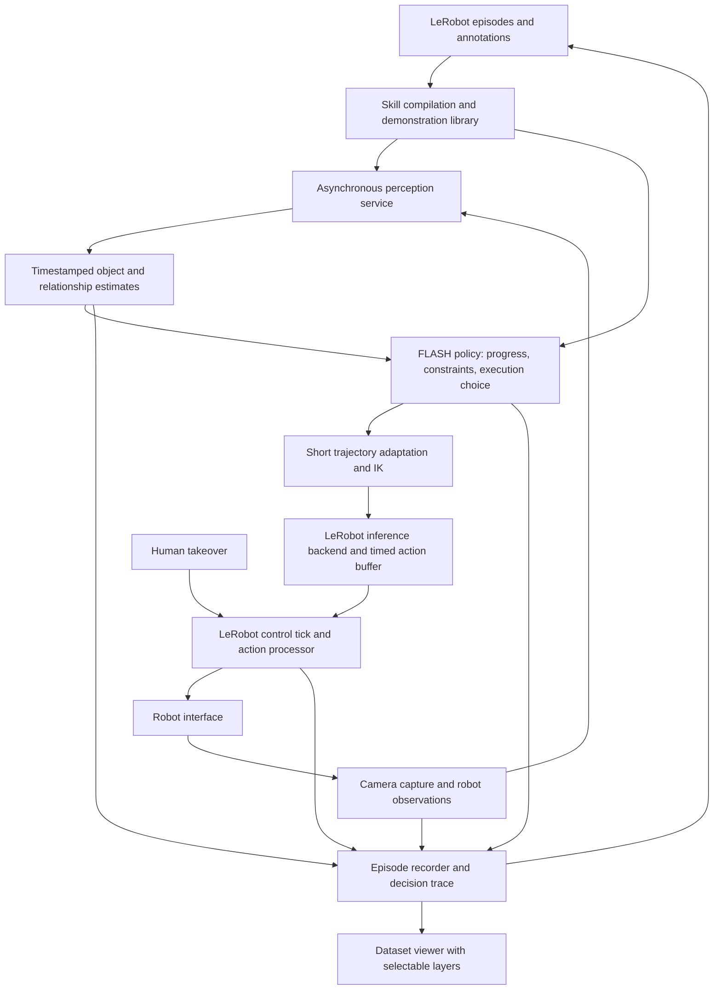

# FLASH demonstration driven manipulation in LeRobot

Status: proposed. The architecture below is not implemented; existing fork capabilities and prototype results are identified separately as observations.

Teaching, testing and collecting robot data should be one workflow: record an interaction, try it in a changed scene, intervene when needed, and retain the whole experience. The sealed prototype demonstrated useful spatial adaptation, but its uncertain object estimates, execution rules and recording paths became entangled. More demonstrations need to improve what the robot can do, while producing ordinary LeRobot data for VLA or world/action model training.

**Proposal.** Represent a skill as demonstrated relative motion plus explicit interaction constraints and outcome checks. A shared perception service estimates objects and their relationships; a FLASH policy uses those estimates to choose a demonstrated execution and continuously adapt a short future trajectory. LeRobot owns hardware, action scheduling, recording and human takeover. Additional demonstrations enrich reference views, execution alternatives and estimates of task variation. Each of these contributions is evaluated separately.

## Scope

The initial capability is manipulation of rigid objects using calibrated RGB-D, robot state, and human annotations of object roles and interaction intervals. Objects need no supplied CAD model or prior scan. Partial surfaces and local coordinate frames can be built from observations. Appearance and geometry must provide enough information for the particular interaction; arbitrary identity does not imply arbitrary observability.

Single-demo operation uses frozen perception models and requires no task-specific network training. Lightweight fitting across demonstrations and later learned components are supported, but are learning and should be described as such. Non-rigid objects require local features or deformation state rather than one rigid pose; they are a separate estimator and controller capability, not a promise inherited from tracking visible points.

Force-controlled contact, tactile sensing and multiple cameras fit the interfaces but are not prerequisites. Position-only hardware cannot guarantee successful tight contact through an unobserved slip. General task discovery from one unannotated video, arbitrary changes of embodiment, and unrestricted planning through unseen geometry are outside the initial capability.

## Requirements

Correct interpretation of evidence, timing and collected data takes priority over breadth of autonomous behavior. Performance targets below are proposed acceptance criteria, not measurements of the redesign.

The **rig workload** means the sealed experiments' SO-107, one overhead RGB-D camera, two task objects, background motion groups, recording and an open viewer, on the same host. The **comparison workload** adds another set of object identities and layouts withheld from tuning. Hardware calibration, camera settings and compute versions must accompany each result.

| ID                | Priority | Requirement                                               | Target and reason                                                                                                                                                        | Verification                                                                                                                            |
| ----------------- | -------- | --------------------------------------------------------- | ------------------------------------------------------------------------------------------------------------------------------------------------------------------------ | --------------------------------------------------------------------------------------------------------------------------------------- |
| <a id="r1"></a>R1 | P0       | Use LeRobot integration points                            | One hardware owner and command route through `Robot`; no FLASH motor driver, GUI control loop or separate episode format                                                 | Trace autonomous and takeover commands; load collected episodes through the standard dataset loader                                     |
| <a id="r2"></a>R2 | P0       | Preserve what was known when an action was chosen         | Every decision references source frames, estimate versions and availability times; future frames cannot enter a causal replay                                            | Deterministic event replay with delayed and reordered observations                                                                      |
| <a id="r3"></a>R3 | P0       | Keep physical motion independent of compute completion    | Schedule 30 Hz on the rig workload, with no deliberate per-sample waits; no computation-caused command gap exceeding two periods (66.7 ms) in the agreed stress run      | Hardware timestamps, deadline misses, queue starvation and cause-tagged stationary intervals; the gap limit detects a lost control tick |
| <a id="r4"></a>R4 | P0       | Express task requirements independently of pose certainty | Every required degree of freedom has a task tolerance and an evidence status; unobserved dimensions never become certain by fallback                                     | Symmetric and occluded objects, injected slip, and task-space error checks                                                              |
| <a id="r5"></a>R5 | P0       | Report outcomes and permit correction                     | Motion completion alone cannot report task success; success, failure, unknown and interruption are distinct; takeover is recorded and invalidates autonomous queued work | Failed grasp, target displacement, obstructed insertion, worker crash and takeover tests                                                |
| <a id="r6"></a>R6 | P0       | Use one spatial rule across objects and recordings        | No object-name branches or scene-specific offsets; thresholds declare units, source and applicable conditions                                                            | Comparison workload and configuration audit; sealed data remain regression fixtures                                                     |
| <a id="r7"></a>R7 | P1       | Adapt while retaining demonstrated interaction            | Changed target or attachment estimates affect the next feasible uncommitted commands; contact timing changes only by an explicit timing policy                           | Perturbations at approach, carry and contact; inspect timing and gripper events                                                         |
| <a id="r8"></a>R8 | P1       | Make more demonstrations useful and measurable            | Report coverage and held-out generalization separately for reference retrieval, execution selection and constraint fitting                                               | Learning curves over nested demonstration sets with fixed held-out scenes                                                               |
| <a id="r9"></a>R9 | P1       | Explain decisions in the dataset viewer                   | The selected frame exposes raw evidence, source proposals, accepted state, uncertainty, active constraint, intended motion and actual command                            | Diagnose a known wrong-pose failure without consulting worker stdout                                                                    |

## Observations

<a id="o1"></a>**O1. Relative motion is the reusable part.** The [sealed lessons, 1–3](https://github.com/TheWisp/lerobot/blob/80d90b7836031c6e53d665a541200b5d8d2f23fd/docs/showservo/sealed/LESSONS.md) attribute successful transfer to expressing fingertip motion relative to the manipulated object. They distinguish matching an object across recordings from tracking it within a recording. These should be separate interfaces, even when one model implements both.

<a id="o2"></a>**O2. Contact pose remains unresolved on the evaluated recordings.** In the insertion demo, the reported surface contradiction rates during insertion were approximately 18% for groups, 19% for Point2Pose and 20% for rigid attachment. These are depth-consistency scores, not millimetre pose errors or general tracker success rates. A low score cannot rule out a pose hidden behind measured surfaces or an ambiguous rotation. The estimator must retain partial information and unknown dimensions. [Evidence and limitations](https://github.com/TheWisp/lerobot/blob/80d90b7836031c6e53d665a541200b5d8d2f23fd/docs/showservo/sealed/LESSONS.md#perception-the-bottleneck).

<a id="o3"></a>**O3. Demo/live estimate mismatch matters, but equal observations are not a general requirement.** In [E34–E35](https://github.com/TheWisp/lerobot/blob/80d90b7836031c6e53d665a541200b5d8d2f23fd/src/lerobot/showservo/docs/act_execution.md#e35), rigid attachment on both sides coincided with an insertion, while a corrected demo attachment and uncorrected live attachment coincided with a miss. The reports also describe grasp-time pose corruption and later rejected observations. This is evidence for accounting for uncertainty and estimator provenance, not a controlled proof that better demo measurements should be discarded. Matching two biased estimates can cancel error in one run without making either estimate correct.

<a id="o4"></a>**O4. Frozen motion was often a software failure.** The sealed lessons document a hold that prevented a loaded joint from breaking away, an inverted waypoint direction, and heavy processing blocking motor updates. Therefore hardware blame, extra settle loops and unconditional stop-on-lag rules need evidence; compute and motor scheduling need separate ownership. [Lessons 11–14](https://github.com/TheWisp/lerobot/blob/80d90b7836031c6e53d665a541200b5d8d2f23fd/docs/showservo/sealed/LESSONS.md#control-and-the-act).

<a id="o5"></a>**O5. The fork already supplies much of the runtime.** At `main` revision `13f05f36f60567817a19d757bdd70f8ca30e28dc`, it has [inference lifecycle hooks](https://github.com/TheWisp/lerobot/blob/13f05f36f60567817a19d757bdd70f8ca30e28dc/src/lerobot/rollout/inference/base.py), [delayed chunk replacement](https://github.com/TheWisp/lerobot/blob/13f05f36f60567817a19d757bdd70f8ca30e28dc/src/lerobot/policies/rtc/action_queue.py), [takeover and intervention recording](https://github.com/TheWisp/lerobot/blob/13f05f36f60567817a19d757bdd70f8ca30e28dc/src/lerobot/rollout/strategies/dagger.py), and robot/action processor interfaces. Reuse these boundaries. Their existence does not establish that the current loops meet FLASH's timing contract.

<a id="o6"></a>**O6. Integration needs specific extensions.** The same revision's `InferenceEngine` returns an action or `None`, with no task-outcome contract. `ThreadSafeRobot` serializes reads and writes with a lock. The [shared dispatch helper](https://github.com/TheWisp/lerobot/blob/13f05f36f60567817a19d757bdd70f8ca30e28dc/src/lerobot/rollout/strategies/core.py) returns the policy action after sending a processed action, whereas [recording](https://github.com/TheWisp/lerobot/blob/13f05f36f60567817a19d757bdd70f8ca30e28dc/src/lerobot/scripts/lerobot_record.py) preserves the robot's returned action for ordinary commands. These contracts need an explicit action receipt and status events before recordings can serve as an execution audit. The sealed `so107_follower_gravity` type is also absent from this `main`; its reuse requires a hardware-layer change, not copying the old runner.

<a id="o7"></a>**O7. Tracking is not the only way more demonstrations can help.** [DINOBot](https://arxiv.org/abs/2402.13181) provides a precedent for demonstration retrieval and visual alignment. [Task-parameterized movement models](https://calinon.ch/paper3036.htm) provide a precedent for estimating which reference frames matter from multiple demonstrations. These motivate experiments here; they do not establish the performance of this proposal.

## Constraints and freedoms

<a id="c1"></a>**C1. Evidence and task tolerance are different quantities.** Sensor uncertainty describes what can be measured. Task tolerance describes what still works. A noisy sensor cannot justify a wider insertion tolerance. Numerical solver tolerances, hardware limits, statistical decision policies and operator requirements must also remain distinct. Every tunable value has a source and units; not every constant is a defect. ([R4](#r4), [R6](#r6), [O2](#o2).)

<a id="c2"></a>**C2. One demonstration underdetermines intent.** A path shows one successful choice, not which positions, rotations or timings can vary. The operator supplies the missing interaction constraints initially. Multiple varied demonstrations may support suggestions; variance alone does not establish physical tolerance or causality. ([R7](#r7), [R8](#r8).)

<a id="c3"></a>**C3. Visibility determines available information.** More points can improve an observable estimate, but cannot reveal an occluded slip or a symmetric object's invisible rotation. Active observation must change the view, and only helps if the changed view exposes a task-relevant dimension. ([O2](#o2), [R4](#r4).)

<a id="c4"></a>**C4. A moving camera needs a frame relationship.** RGB-depth pixel alignment does not determine the camera-to-robot transform. Different fixed viewpoints require calibration; a moving camera requires a time-varying transform or an equivalent visual-servo formulation. Shared apparent motion alone cannot distinguish camera motion from whole-scene motion. ([R2](#r2), [R6](#r6).)

<a id="c5"></a>**C5. Smoothness cannot make an invalid plan valid.** The current queue remains usable while a replacement is computed only while its assumptions remain valid. If a changed scene invalidates it, a recorded controlled stop or recovery supersedes it. Hidden continuation into a known obstacle is not a performance improvement. ([R3](#r3), [R5](#r5).)

## Architecture



### Episodes and skill representation

A demonstration, an autonomous attempt and a human correction are all dataset episodes. Raw observation/action data remain usable without FLASH. Variable-size geometry, object associations and execution events live in versioned sidecars joined by episode and frame identifiers; stable numeric features may also be exposed through normal dataset features. ([R1](#r1), [R2](#r2), [R8](#r8).)

| Record              | Required contents                                                                                                                                                   |
| ------------------- | ------------------------------------------------------------------------------------------------------------------------------------------------------------------- |
| Sensor sample       | Capture timestamp, host receipt timestamp, frame ID, camera intrinsics, depth units/validity, calibration version; synchronized RGB-D pair                          |
| Control sample      | Observed joints, intended action, processor output, robot-accepted action, dispatch time, action semantics/units, controller configuration, human/autonomous source |
| Perception evidence | Source/reference IDs, source frame time, availability time, correspondences or fit summary, pose proposals, uncertainty/observability, contradiction results        |
| Decision            | Estimate version consumed, active phase and progress, selected demonstration/symmetry alternative, objective, queue revision, acceptance/rejection reason           |
| Outcome             | Success/failure/unknown/interrupted, evidence and author, intervention intervals, termination reason; separate from motion completion                               |

The canonical dataset `action` follows a documented LeRobot robot-action contract, including any clipping the robot reports. Policy intent and raw motor compensation are separate fields; training must not silently mix desired joint targets and compensated bus commands. A training manifest selects compatible action semantics, robot configurations and data quality. Requested goals are never relabelled as achieved states.

Record the exact RGB-D input consumed by perception or a reproducible equivalent. Preserve raw metric depth for the precision benchmark: the fork's [depth encoding](https://github.com/TheWisp/lerobot/blob/13f05f36f60567817a19d757bdd70f8ca30e28dc/src/lerobot/datasets/depth_utils.py) can quantize depth, so round-trip error must be measured against the task tolerance. Timestamp association also records reuse of an older image; a 30 Hz dataset does not imply 30 new camera or tracker results each second.

A skill refers to source episodes instead of copying their frames. It contains object **roles**, matched reference frames, demonstration-relative trajectories, gripper profiles, phase boundaries, task constraints, valid alternatives and evidence for success. Each phase specifies:

- The entities whose relationship matters, and the demonstrated motion between them.
- Required dimensions and tolerances, preferred dimensions, and dimensions free to change.
- Timing policy: preserve demonstrated timing, or explicitly permit retiming within validated limits.
- Conditions for entry, completion and failure; what unknown evidence permits.
- Permitted recovery transitions and their own motion constraints.

For example, transporting an object may require an upright orientation while permitting translation to change. Insertion may require relative axis alignment and lateral position while leaving axial rotation free. An intermediate waypoint can be a soft preference. Calling it a clearance waypoint does not establish collision avoidance. No behavior depends on an object's name. ([C1](#c1), [C2](#c2).)

### Common object estimation and relationships

The perception service has three replaceable functions: associate objects across observations/episodes, estimate motion within a recording, and check/refine geometry against RGB-D. Point2Pose, segmentation and motion groups are candidate implementations rather than authorities baked into the controller. Cached demo results include pipeline, calibration and reference versions. ([O1](#o1), [O2](#o2), [R6](#r6).)

The [tracker research and selection proposal](tracker_research.md) compares complete pose trackers with SAM, causal point tracking and VGGT-family components. Model choices remain replaceable behind these functions; their evaluation includes contact accuracy and result age, not segmentation quality alone.

Each object has one state estimate, with source time, prediction time, provenance, visible support and uncertainty in the dimensions that can be measured. Competing symmetry or identity hypotheses remain alternatives instead of being averaged into an impossible pose. A covariance is useful only where its assumptions have been evaluated; otherwise report an unresolved dimension or an empirical bound, not a fabricated confidence percentage.

Environment groups contribute relative-motion evidence and candidate relationships. An object that moves with a tray can be predicted with it while occluded. Gripper attachment is another relationship, with robot kinematics as a motion source. Co-motion does not prove attachment, and a slowly moving object must not become fixed to the background merely because displacement is small. Support, rigid attachment and temporary contact have different motion implications.

All objects use the same measurement-update path, including held objects. References can come from earlier live views or demonstrations, selected for visibility and viewpoint compatibility. An object-specific recovery worker is unnecessary; expensive reassociation is a shared asynchronous job. Updating the gripper-to-object relationship is a separate consequence of accepted object evidence.

Source arbitration follows evidence:

1. Interpret proposals in the same frame at the same source time. Account for processing delay before predicting forward.
2. Reject invalid correspondences and geometric contradictions; distinguish invalid depth, foreground occlusion, and a predicted surface in observed free space.
3. Update only supported dimensions using robust estimation. Treat sources using the same RGB-D points as correlated; agreement is not independent confirmation.
4. Compare the remaining task-space uncertainty with the phase's requirements. Retain prediction, seek a useful new view, choose a supported alternative, or report insufficient information.

There is no permanent ranking of “depth over groups over P2P.” Depth constrains visible geometry; visual correspondences constrain identity and motion; relationship models predict through missing observations. Each can be wrong. Missing observations do not tighten uncertainty, and rejecting every measurement does not constitute good tracking. ([R4](#r4), [C1](#c1), [C3](#c3).)

Demo processing preserves both a causal estimate stream and, optionally, an offline refined reference. The latter may use later views to describe the demonstrated interaction more accurately, but it carries uncertainty and cannot masquerade as information available during a live rollout. Evaluation compares both modes. If live attachment is uncertain, the policy uses that uncertainty; it does not deliberately corrupt the demo to recreate coincidental cancellation. ([O3](#o3), [R2](#r2).)

### Spatial objective and task progress

Use one transform convention: `T_A_B` maps coordinates in frame B into frame A. Object coordinate frames are arbitrary but fixed within a skill; cross-episode registration establishes their correspondence. Let E be the end effector, H the held object, B the target and W the robot base. At demonstrated progress `s`:

```text
desired_relation(s) = inverse(T_W_B_demo(s)) * T_W_H_demo(s)
live_attachment     = inverse(T_W_E_live) * T_W_H_live
T_W_E_goal(s)       = T_W_B_live * desired_relation(s) * inverse(live_attachment)
```

This expresses the desired object-object relationship and then derives the required gripper pose. Before grasping, use the demonstrated end-effector-to-object relationship directly. Unsupported dimensions are handled by task constraints and admissible alternatives, not filled with an arbitrary “correct” angle. ([O1](#o1), [R4](#r4), [R7](#r7).)

Object symmetry and task freedom are distinct inputs to the same optimization. Object symmetry describes indistinguishable or geometrically equivalent states, including an axis and optional end exchange. Task freedom states which changes preserve the interaction. A cylindrical object's two ends need not be interchangeable for every task. The policy evaluates allowed combinations for reachability, continuity, collision constraints and observation quality; a changed coordinate-frame hypothesis must transform the whole relation consistently.

Task progress is a phase graph with a continuous progress variable inside each phase. Dense demonstrated frames specify a path and its timing; they are not hundreds of independent reach-and-wait goals. The phase clock normally follows demonstrated elapsed time. A retarget changes future spatial goals without extending time implicitly. If a new motion needs more time, it must satisfy the phase's explicit retiming policy or enter a recovery/failure transition.

Checks return true, false or unknown. Grasp and release are intervals during which attachment hypotheses can change, rather than instantaneous assertions derived from the gripper command. End-of-trajectory does not prove insertion or release. Checks can accumulate evidence during motion; they do not require a universal settle pause.

If a target moves late in insertion, the policy first determines whether remaining allowed motion can satisfy the relation. If not, it may take an explicitly valid transition to withdraw and realign, retaining the grasp if supported. It does not run the demonstrated trajectory backward or replay a release event. An unavailable recovery produces a reasoned failure or a request for intervention. Merely adding a retry counter cannot make an irreversible contact reversible. ([R5](#r5), [C5](#c5).)

### Short trajectory adaptation

The policy selects a demonstrated execution and produces a bounded future reference. A trajectory adapter solves IK from the current measured state and the committed trajectory, maintains a consistent joint branch, and optimizes soft preferences while enforcing declared hard constraints. This is a small receding-horizon adaptation problem; a general symbolic task planner is not required. ([R7](#r7), [C2](#c2).)

The robot model supplies joint and dynamic limits and, where available, collision geometry. Online observed scene geometry can constrain free-space travel without requiring object CAD. Unobserved space remains unknown. Contact pairs and allowed contact phases must be represented explicitly; otherwise a collision checker would reject the intended insertion itself. Endpoint reachability alone does not verify an approach path. A collision feature is a separate capability with its own evidence, never implied by a label such as “best effort.”

Between replans, the adapter preserves position and velocity continuity, and acceleration continuity where the command representation permits it. Smoothing must be checked against task and path constraints. Joint interpolation and Cartesian interpolation followed by IK are different trajectories. A feasible endpoint does not justify smoothing through an obstacle or changing an insertion's contact sequence.

Active observation is another constrained motion proposal: choose a short movement expected to reveal a currently unresolved task dimension, within reachability and scene limits. Its cost includes time and the risk of changing the grasp. Repeating the same obscured view supplies no new geometric information. It is optional when prediction already supports the task; useful-view tests must demonstrate an improvement before this becomes a default recovery. ([C3](#c3).)

### Runtime and LeRobot boundaries

| Responsibility                                      | Integration point                            | Contract                                                                                                       |
| --------------------------------------------------- | -------------------------------------------- | -------------------------------------------------------------------------------------------------------------- |
| Skill selection, progress and spatial objectives    | `policies/flash/`                            | Policy has no hardware handle; reset is episode-scoped; compiled skill artifact references datasets and config |
| Perception transformations and state                | `processor/` adapters with a worker service  | Demo/live share implementations; heavy operations execute outside the motor process                            |
| Asynchronous production and buffer exchange         | `rollout/inference/`                         | Extend the existing backend/queue mechanisms with timestamps, revisions and outcome events                     |
| Dispatch, takeover and recording                    | Shared rollout machinery and DAgger strategy | One owner of motor access; use the same dispatch contract for FLASH and other policies                         |
| Calibration, servo compensation and hardware limits | `robots/`, `motors/`, existing kinematics    | Hardware capability checks instead of a policy restriction to one robot type                                   |
| Episode annotations and inspection                  | Dataset and GUI facilities                   | GUI starts sessions and renders recorded state; it does not plan or command motion                             |

The existing policy base includes training methods as well as action methods. A nonparametric FLASH adapter can implement the inference interface, serialize a skill artifact, and reject unsupported training calls explicitly. Avoid inventing another policy hierarchy for one controller. The existing rollout factory is the registration boundary. ([O5](#o5), [O6](#o6), [R1](#r1).)

Use separate processes for heavy perception and, if needed, trajectory production. Camera filtering/capture must not contend with the motor process through a GIL-holding call. Keep existing camera/robot APIs as the public abstractions and pass timestamped snapshots through bounded buffers. GPU job scheduling favors recent useful evidence; dropping superseded work must be compatible with the tracker's temporal state, rather than silently skipping required frames.

The motor owner runs an absolute-deadline tick: obtain bounded-cost hardware state and the latest camera reference, consume the action due at that time, apply the lightweight action processor, call `Robot.send_action`, and publish an action receipt. Recording, encoding and visualization consume those records asynchronously. Heavy processors never execute inside this tick. Slow reads, lock contention and disk backpressure remain explicit measured failure modes, even with separate workers.

The action buffer contains execution times, phase progress, plan revision and the state assumptions under which it is valid:

1. The producer snapshots observations and the unexecuted prefix at planning time. Already committed commands constrain the new solution.
2. While planning, the valid old buffer continues executing.
3. When the replacement arrives, discard samples whose execution deadlines have passed, validate continuity at the current boundary and atomically replace the uncommitted suffix.
4. A stale revision, missed required contact event or discontinuous replacement is rejected or recovered explicitly. Do not skip a required gripper event merely because its deadline passed.
5. Queue starvation and invalidation have distinct events and a robot-appropriate bounded stop/recovery policy. They are never counted as successful completion.

For example, if a 30 Hz producer starts at tick 100 and finishes after ticks 100–102 have executed, it replaces the still-future suffix beginning at tick 103, subject to its continuity/validity checks. It does not start its old tick-100 command now, and it does not turn one demo sample into six repeats. Use actual execution timestamps rather than assuming every scheduled tick occurred.

Prediction horizon and committed prefix are separate settings. A longer buffer covers computation delay, while a short commitment preserves responsiveness. Horizon selection uses measured tail latency and motion constraints; more queued actions do not by themselves mean more delay. The deterministic adapter can condition its boundary on the prior trajectory, borrowing the continuity principle of [RTC](https://huggingface.co/docs/lerobot/main/rtc) without pretending to implement flow-model guidance. ([R3](#r3), [C5](#c5).)

### Learning from more data

| Additional experience                            | What it can improve                                               | What demonstrates generalization                                             |
| ------------------------------------------------ | ----------------------------------------------------------------- | ---------------------------------------------------------------------------- |
| New views of the same object                     | Association, partial-view matching and reference geometry         | Better estimates on held-out views without increased false acceptance        |
| Different successful starts or grasps            | Retrieval of a reachable demonstrated execution                   | Success in new arrangements, compared with the best single-demo baseline     |
| Varied successful paths for the same interaction | Which frame, dimensions and timing matter                         | Constraint estimates improve outcomes in arrangements absent from every demo |
| Human corrections and failed attempts            | Failure recognition, valid recoveries and future learned policies | Fewer interventions and fewer false success claims on a fixed test set       |

Begin with retrieval and geometric adaptation of individual demonstrations. Keep incompatible approaches as separate alternatives; averaging grasps from opposite sides can produce an unusable grasp. Align phases and object roles before any statistical fitting. Candidate task-parameterized models can suggest invariant relations and flexible directions, but observation noise must be separated from genuine execution variation. Controlled perturbations and failures help distinguish a physical boundary from a demonstrator's habit. ([O7](#o7), [C2](#c2), [R8](#r8).)

Composition across demonstrations is permitted only when exit and entry conditions, attachment state and reference frames are compatible. Adding a better reference view is not permission to switch manipulation strategy during contact. For different object instances, geometric/functional correspondence is an additional requirement: semantic similarity alone does not establish interchangeable contact geometry.

Autonomous data can train VLA or world/action models, but a saved failure is not automatically an expert behavior-cloning target. Preserve successes, failures, interventions, action source and observed consequences. Training recipes choose their supervision: verified autonomous successes, human corrections, mixed-quality trajectories or outcome-conditioned objectives. Future RL needs its own reward and termination semantics; tracker confidence is not a substitute for task reward. Learned replacements can consume the same observations and issue the same action chunks. ([R1](#r1), [R5](#r5), [R8](#r8).)

### Inspection and evaluation

The viewer shows raw RGB/depth, segmentation, correspondences, per-source pose proposals, the accepted estimate, predicted versus observed dimensions, relationship assumptions, active constraints, planned trajectory and commanded/measured motion. Selecting a rejected update shows its input timestamp and the rejection reason. Demo and attempt use the same renderer. This is part of the data workflow, not a parallel debug application. ([R9](#r9).)

Validation separates questions that the prototype conflated:

| Question                                                   | Experiment and measurements                                                                                                                                                                               |
| ---------------------------------------------------------- | --------------------------------------------------------------------------------------------------------------------------------------------------------------------------------------------------------- |
| Is perception accurate enough?                             | Fully visible, carried, contact and released phases; independently measured pose/relative alignment where possible, symmetry-aware error, task-point error, false acceptance, rejection and unknown rates |
| Does more evidence help?                                   | Fixed replays with controlled reference sets, then physical grasp/perturbation trials; report accuracy and end-to-end result age together                                                                 |
| Does the controller do the right thing with correct state? | Simulated producer and known object trajectories, including target jumps, changing attachment, IK branch alternatives, delayed workers and human takeover                                                 |
| Does the contact behavior transfer?                        | Repeated real grasps and insertions with varied placement and grasp offset, independently judged outcomes; include every attempted start                                                                  |
| Does more data improve generalization?                     | Nested demo sets with held-out layouts, viewpoints and object instances separately; ablate reference retrieval, execution selection and constraint fitting                                                |
| Is motion responsive and smooth?                           | Actual dispatch intervals, source-to-command age, command/measured velocity and acceleration discontinuities, jerk under a fixed differentiation/filter method, stationary time and its cause             |

Replay can establish causal software behavior and perception changes on fixed inputs. It cannot establish what a different physical command would have caused. Physical evaluation must follow software evaluation; successful video completion is not a contact-accuracy metric. Temporary evaluator-only markers or another calibrated measurement can supply ground truth without becoming an input requirement of the policy.

The timing trace covers camera exposure/receipt, each worker's wait and compute, CPU/GPU synchronization, estimate publication, trajectory generation/IK, buffer commit, robot read/write, action receipt, recording and viewer consumption. Report p50/p95/p99 plus worst gaps under the named workload. A 30 Hz motor tick, a 10 Hz tracker and a delayed camera can coexist; none should be reported as the other's frame rate. Smoothness comparisons use the same path, speed and scene. ([R2](#r2), [R3](#r3).)

## Alternatives and costs

Continuing the sealed engine would preserve a working experiment but also preserve its private recording and GUI integration assumptions. Reuse algorithms and regression evidence selectively; the sealed branch remains a reference rather than the implementation base.

A pure motion planner can choose feasible geometric paths but still needs the demonstrated contact strategy, gripper behavior and task constraints. Conversely, replaying a single transformed path cannot express flexible transport or conditional recovery. The proposed division retains demonstrated interactions and gives a bounded planner explicitly permitted freedom.

A new end-to-end policy could eventually learn perception and control together, but would change the initial data and compute requirements. It remains a downstream consumer and a comparison baseline. Replacing the tracker alone is a smaller experiment worth benchmarking; it does not define outcomes, timing, intervention data or how multiple demonstrations combine.

Full probabilistic scene reconstruction and general task planning would add substantial complexity before the first contact result. The initial estimator can use robust registration and a small set of relationship hypotheses; the initial policy can use annotated phases and one retrieved execution. Interfaces permit richer implementations when experiments justify them.

The design's costs are explicit annotation of intent, reference/version management, additional process boundaries, uncertainty calibration, and geometry checks for newly chosen paths. It may correctly return unknown where the prototype appeared confident. It also requires shared LeRobot changes to action receipts, scheduling/status and recording; merely placing old code in a policy directory would not satisfy [R1](#r1).

## Open questions

**Q1. How much task annotation is acceptable?** Fully automatic intent discovery reduces authoring but is underdetermined from one example ([C2](#c2)). The recommendation is to ask for object roles, interaction intervals and a small set of meaningful freedoms/outcome conditions, with automatic suggestions for review. Exposing tracker thresholds is not a substitute for this task authoring.

**Q2. What should happen when contact cannot be verified?** Continuing under a declared attachment assumption allows more trials; requiring task-relevant evidence prevents unsupported precision claims but may need an observation movement or human help ([C3](#c3)). The recommendation is an explicit per-skill experimental policy with logged assumptions and an unknown outcome when evidence is insufficient. It must not silently turn uncertainty into success or disable hardware limits.

**To measure:** whether a partial single-view observation constrains the insertion-relevant dimensions tightly enough; whether active observation improves that bound; attainable hardware cadence with the shared LeRobot path; and whether multi-demo constraint fitting improves held-out execution beyond retrieval. These are experiments, not architecture choices that can be settled by terminology.

## Appendix evidence and source boundaries

- The sealed prototype is [`80d90b783`](https://github.com/TheWisp/lerobot/pull/78), reported through 2026-10-19. Its [seventeen lessons](https://github.com/TheWisp/lerobot/blob/80d90b7836031c6e53d665a541200b5d8d2f23fd/docs/showservo/sealed/LESSONS.md) and [execution evidence](https://github.com/TheWisp/lerobot/blob/80d90b7836031c6e53d665a541200b5d8d2f23fd/src/lerobot/showservo/docs/act_execution.md) supply historical results, not measurements of this design. The contact comparison evaluates consistency with the same camera's depth, with the limitations in [O2](#o2).
- Integration references were inspected in the fork's `main` at `13f05f36f60567817a19d757bdd70f8ca30e28dc` on 2026-10-19. Upstream online documentation can describe a different revision; the fork's code determines the starting interfaces.
- [DINOBot](https://arxiv.org/abs/2402.13181), [task-parameterized movement models](https://calinon.ch/paper3036.htm), and [LeRobot RTC documentation](https://huggingface.co/docs/lerobot/main/rtc) support the cited mechanisms. They supply no FLASH performance guarantee.
