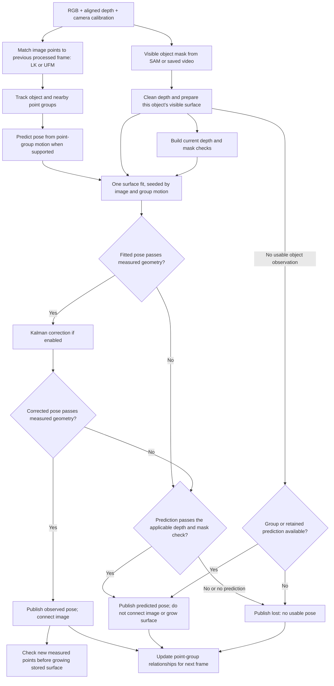

# FLASH perception: current frame path

This is the code architecture for **one tracked object**. Video examples and
the live camera both call [`SurfaceFrameSession.step`](../surface_frame_session.py).
Video examples can run comparison variants; the live camera runs only
`group_growing` ([`LiveSurfaceSession`](../live_surface_session.py)). Each object
has its own pose, stored surface, and group relationship. The image matcher can
be LK or UFM; the numerical surface matcher can be changed independently.
Recorded comparison variants can omit groups or surface growth; the diagram
shows the live path.

The **stored surface** is made from accepted, measured depth points in fixed
object coordinates. A predicted pose moves that surface for display but does
not add points. The **point group** tracks 3D motion of image points, including
nearby support points; it supplies a pose prediction, not a second surface.
When a visible-frame fit fails, the prediction is checked against depth and
mask before it can be shown. A view with too little surface overlap checks for
contradictions; a failed local fit with usable geometry requires overlap too.
`lost` means no pose was published for that frame; the object may still be
visible.

Code ownership: [`SharedFrameTracker`](../shared_image_tracking.py) tracks image
points; [`GroupHints`](../surface_group_hints.py) forms and updates group evidence;
[`GrowingSurfaceSession.update`](../experimental_surface_session.py) fits,
checks, predicts, and grows the surface. Acquisition and segmentation live in
the [live worker](../live_surface_worker.py) or recorded-video adapter; robot
control is outside this path.
