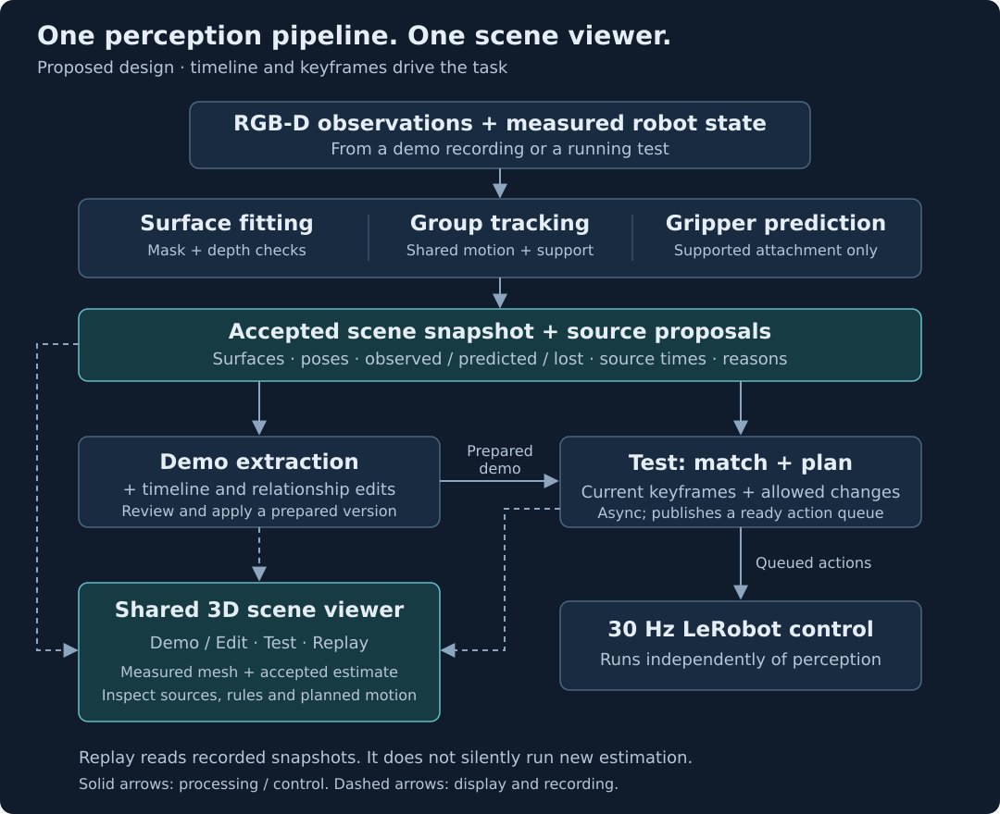
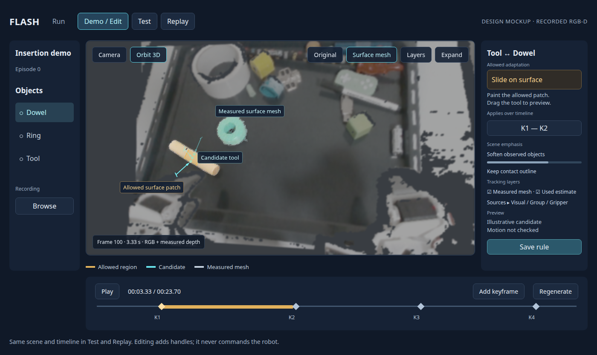
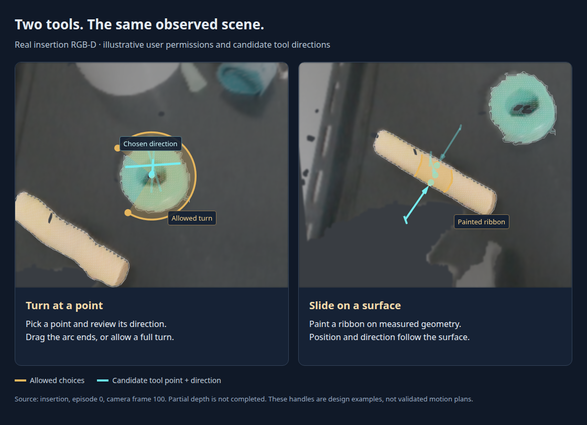

# FLASH: demo extraction and interaction editing

Status: proposed

**Teach through a timeline of keyframes and editable surface relationships.**
Review the extracted demonstration and test its adaptations in the same 3D scene.

## Principles

- **Timeline drives behavior.** Keyframes select participants and required relationships. Each interval preserves demonstrated motion/timing or generates a connection. No built-in grasp, push or placement stages.
- **People permit; geometry checks.** Similarity alone does not authorize adaptation.
- **Choices have consequences.** An adaptation persists through its relationship's lifetime. Later keyframes constrain it; they cannot silently reset physical contact.
- **Evidence stays visible.** Reliable vision corrects tracking. Supported gripper or group relationships predict through lost observations; pushing never implies rigid attachment.
- **One pipeline.** Demo extraction, Test and debugging share tracking and normal LeRobot datasets.

## Components

[Editable diagram](assets/surface_relations/components.svg).

## What extraction saves

| Data      | Contents                                                                                                               |
| --------- | ---------------------------------------------------------------------------------------------------------------------- |
| Objects   | Observed surfaces, masks, supported alignments, source frames and uncertainty.                                         |
| Keyframes | Participants, relative surface arrangement, required relationship and allowed adaptation.                              |
| Intervals | Demonstrated relative motion/actions/timing, or connecting goals with speed/constraints; rule lifetime and milestones. |

**Regenerate → inspect → apply a version.** Cache geometry; retain source data.
Predictions and unlinked views remain explicit. A complete mesh is unnecessary.

## One view: Demo/Edit · Test · Replay

_Actual insertion RGB-D, frame 100. Proposed controls and hypothetical handles; not a policy result._

**Show the tracked object surface as a shaded 3D mesh, with optional wireframe.**
Keep it sharp above the softened RGB-D surroundings. Separate the current measured
patch from the accumulated surface at its estimated pose; unseen areas remain open.
Orbit/pan/zoom follows the
URDF viewer; **Camera** restores the capture viewpoint. Keep playback below
the scene. Collapse the recording/object lists and contextual inspector for space.

- **Demo/Edit:** edit keyframes and rules directly on the scene and timeline.
- **Test:** show matched surfaces, active rules, progress and available plans.
- **Replay:** exactly Test with recorded snapshots. Future “Use as demo” preserves the recording.

### Tracking layers — same meaning in all three modes

| Layer                  | What appears in the scene                                                                                                                                                                       |
| ---------------------- | ----------------------------------------------------------------------------------------------------------------------------------------------------------------------------------------------- |
| **Measured surface**   | Solid, textured mesh of this frame's valid masked depth.                                                                                                                                        |
| **Used estimate**      | Accumulated surface and a small direction gizmo at the accepted pose. Badge: **Visual**, **Group predicted**, **Gripper predicted**, or **Lost**. Predictions use dashed outlines.              |
| **Group tracker**      | Tracked supporting points, group membership outlines and a motion arrow. Selecting a predicted object reveals the supporting group and its link to that object.                                 |
| **Gripper prediction** | Tool point/direction, attachment link and dashed object surface carried by the measured gripper pose. Show when the attachment was established or updated; contact alone does not establish it. |

Default to measured surface + used estimate. Expand **Sources** to compare vision,
group and gripper proposals, including rejected ones and the reason. Hover isolates
a source. Show observation time, age and available confidence evidence; do not invent
a confidence percentage. Reliable vision corrects supported predictions; **Lost**
fades the last estimate and labels its time.

**Demo:** compute these layers during extraction and review the selected version.
Robot-based predictions require recorded robot state and calibration.
**Test:** show the snapshots used by the engine, with image/estimate times when they
differ. **Replay:** display those recorded snapshots. Missing historical layers say
**Not recorded**; a fresh extraction is separately labelled **Recomputed**.

## Editing a relationship

1. Scrub to a keyframe; select two participants and their contact regions.
2. Select a tool below. Drag its handles in 3D; the inspector mirrors the values.
3. Drag the rule's timeline span; scrub forward to inspect consequences.
4. Preview feasibility/unknowns, then save. Previewing never moves the robot.

| Tool                   | Gesture and meaning                                                                                                                     |
| ---------------------- | --------------------------------------------------------------------------------------------------------------------------------------- |
| **Turn at a point**    | Pick a pivot; review the suggested surface-normal direction. Drag arc endpoints or allow a full turn.                                   |
| **Slide on a surface** | Paint a permitted ribbon. Drag a ghost contact along it; orientation follows compatible measured geometry. No cylinder axis is assumed. |

Both edit relationships between any participants; sliding does not imply grasping.

## Make the proposed change stand out

- **Scene:** soften/desaturate the background; keep tracked meshes and contact patches sharp. Adjust **Scene emphasis**; hold **Original** to compare. Missing geometry fades to a neutral background.
- **Allowed choices:** a sharp translucent amber arc or ribbon with draggable endpoints. This is permission, not a path.
- **Candidate:** sharp cyan object surface or tool point + approach arrow; a crossbar shows closing direction. Alternatives are faint ghosts.
- **Motion:** show a labelled path only when computed; mark unchecked/occluded portions. Permission, prediction and measured motion stay distinct. Display effects never change checking geometry.

**Layers** stays clear of **Expand** and playback. Hover to highlight, click to
pin. Visibility affects neither control nor recording. Every layer carries its source
timestamp; replay preserves the snapshot and its delays.
