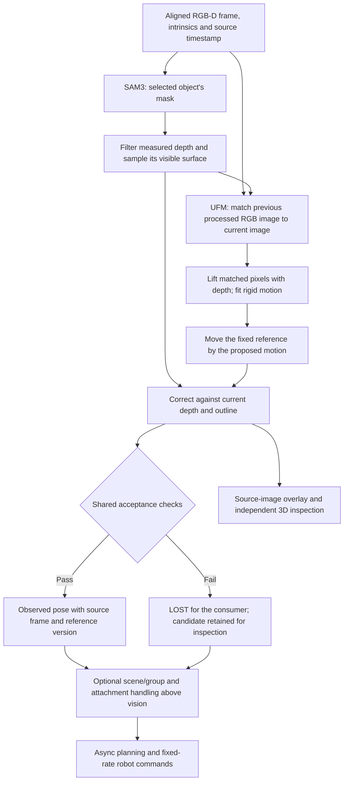

# RGB-D surface tracking in FLASH

This is the implementation reference for `vision_pipeline.backend = "surface"`,
including the **Run → FLASH → Live tracking** camera debugger. The mechanism is
verified against revision `68db02b2d`. The broader
[FLASH architecture](architecture.md) describes capabilities beyond this backend.

**The tracker uses RGB matching to propose how an object moved, then corrects
that proposal by fitting its initial visible surface to the current depth and
SAM outline.** It carries a fixed object coordinate frame with that surface.
It needs no supplied mesh, object-specific shape formula or tracker finetuning.
SAM3 and UFM are pretrained neural models; the metric fitting is geometric.

## What flows through one update



The camera debugger uses the same vision step, without the robot, group or
attachment layer. Within one inference worker, segmentation, RGB matching and
surface correction run in sequence. They are asynchronous relative to capture
and robot control, not mutually parallel GPU jobs.

### 1. Select the object and measure its visible surface

A text prompt or click selects an instance through the SAM3 adapter. The mask
is an estimate of object membership, not a certificate that every enclosed
pixel belongs to that object. Selection in the debugger starts a new reference;
clicks are bound to the exact frozen image, not a later preview frame.

For a pixel `(u, v)` with measured depth `z`, calibrated intrinsics give:

```text
x = (u - cx) * z / fx
y = (v - cy) * z / fy
point_in_camera_metres = [x, y, z]
```

Here `fx, fy` are focal lengths and `cx, cy` are the image's principal point.
Depth is converted to metres using the frame's scale. RGB, depth and mask must
share the same pixel grid. Alignment does not eliminate sensor noise or errors
at depth boundaries.

[Surface observation](../surface_observation.py) withholds pixels with missing
or invalid depth, pixels too near the mask boundary, and neighborhoods with
missing depth or excessive depth variation. A bilateral-smoothed copy supplies
local surface normals and rejects degenerate neighborhoods. **Fitted XYZ stays
at the measured depth.** The fitter does not use those smoothed depths as new
geometry, and its objective is not point-to-plane normal alignment.

XYZ and normal arrays are computed only within the current SAM mask's bounding
rectangle, with one extra pixel for central-difference gradients. Unprojection
retains original image coordinates; returned pixel indices, validation tiles
and validity images still use the full image grid. Cheap image filters remain
full-frame: the floating-point bilateral filter depends on the image-wide depth
range, and research consumers use depth reliability outside the object mask.
This optimization changes the amount of work, not sampling or rejection rules.

One measured point is retained per occupied voxel. Spacing adapts to the visible
extent, so small objects keep more detail. Sampling never creates extra depth
measurements. The largest spatially connected patch supplies the initial
reference and restricts pixels eligible for RGB-D motion matching. Separately,
all depth-filtered mask points remain available for surface correction, including
patches excluded by that connected-component choice. A gap can therefore remove
legitimate motion support without erasing those observations from the fit check.

### 2. Establish one reference and coordinate frame

The first usable surface needs at least three non-collinear measured points.
The session saves this partial cloud once. It does **not** append newly visible
surfaces to the reference, construct an SDF, or build a complete mesh.
When an asymmetric object turns over, fitting this old partial cloud to its
newly visible side can yield a plausible-looking but incorrect orientation.
The [multiview investigation](../../../../../docs/proofs/flash-surface-multiview/README.md)
records this failure and the limits of a provisional growing-map alternative.

The debugger chooses three display landmarks from the initial cloud:

- **A:** the sample farthest from the cloud's mean.
- **B:** the sample farthest from A.
- **C:** the sample farthest from the line through A and B.

The display axes come from the initial cloud's principal directions. A is the
origin; the initial mean only helps choose A. Neither is a center of mass or a
claim about the center of the complete object. The three landmarks and axes
are chosen once, then transformed rigidly with the reference. They are not
three independently tracked point identities and need not stay visible.

In prepared-demo/live use, an appearance-based initializer instead establishes
how the current observation corresponds to the demo's saved object frame.
DINO features supply proposed pixel correspondences; depth supplies metric
points for that registration. Missing registration stays `LOST`; a live local
frame cannot silently replace the demo's frame. Once registered, temporal
surface tracking transports that same frame.

### 3. Propose motion from consecutive processed observations

[UFM matching](../surface_correspondence.py) processes the previous usable
observation and the current one. In live operation these may be several camera
frames apart: the worker consumes the latest frame rather than building a queue
of old images.

A square crop covers both masks. The context-size limit cannot clip the object;
the network input remains a fixed size. UFM predicts pixel correspondences and
covisibility. A grid samples those predictions. Matches must land on usable
masked depth in both images. Both endpoints are lifted to 3D with their own
measured depth.

RANSAC selects a mutually consistent set of pairs, followed by a rigid
rotation-and-translation fit and repeated inlier refinement. OpenCV's affine
RANSAC is used to select support; the returned motion is subsequently fit as a
rigid transform, without scale or deformation. Applying this motion to the
previous reference pose gives the new proposal. If RGB-D motion is unavailable,
the old pose is used only to initialize a geometry-only candidate.

This is where appearance enters temporal tracking. **The final surface
optimizer does not retain RGB match identities as residual constraints.** RGB
starts the optimizer; geometry can subsequently change that answer.

### 4. Correct against the whole visible surface and outline

[WholeSurfaceFit](../surface_grounding.py) adjusts six rigid-motion variables.
It uses nearest points on the measured clouds, not a fitted cylinder or a mesh.
The objective has four normalized residual blocks:

| Check                            | What it asks                                                                                                     |
| -------------------------------- | ---------------------------------------------------------------------------------------------------------------- |
| Reference → current surface      | Where the reference should be visible, is measured object geometry nearby?                                       |
| Current surface → reference      | Does the transformed reference explain the visible object measurements?                                          |
| Reference → mask                 | Do projected reference samples lie outside the current object mask?                                              |
| Mask extent → reference envelope | Does the projected reference cover the observed outer extent, rather than fitting only a small convenient patch? |

These are **soft optimization penalties**, with configurable tolerances and
clipped surface distances. They do not force every sample to fit exactly. The
outer-extent check uses a convex envelope: it preserves extremities but does not
express holes, concavities or semantic labels such as “head” and “feet.”

A nearer depth observation can hide a reference point. The fitter reduces that
point's reference-to-current distance and mask penalties accordingly. It checks
four neighboring depth rays and blends their visibility evidence, not their
depths; blending foreground and background depths would invent a surface.
Current observed points still contribute the reverse distance term. This
handles some occlusion in the fit, but does not determine the hidden pose by
itself or establish that an occluding pixel belongs to the selected object.

The optimizer refines the RGB proposal locally. It also constructs coarse
alignments from the principal directions of the two clouds, chooses the one
closest to the proposed motion, and refines it only if its initial geometric
score beats the local result. The lower-cost result wins. This provides another
starting point; principal directions are not authoritative pose measurements.
A geometrically plausible end exchange is still possible.

Per-side fitting samples are bounded and distributed across space. Nearest-point
lookup still uses the full voxel clouds, and the complete reference envelope
still supplies outline coverage. Thus reducing the fitting budget does not
replace the target with a sparse cloud whose sampling gaps look like errors.
It does change which residuals are evaluated and can change the fitted pose.

## What the pose means

Let `reference_points` be the first cloud in its initial camera coordinates.
The session estimates `camera_from_reference`, a rigid transform from those
fixed coordinates to the current camera:

```text
current_reference_points = camera_from_reference * reference_points
current_landmarks        = camera_from_reference * initial_landmarks
```

A changing visible subset does not redefine the origin or axes. In a prepared
run the published pose is:

```text
base_from_object = base_from_camera_now
                 * camera_from_reference
                 * reference_camera_from_object
```

`reference_camera_from_object` is fixed at registration. This is how an object
frame learned from a demo survives live surface tracking. It does not require
estimating the object's mass center. The debugger's `camera_from_object` uses
its local A/axes frame; `base_from_object` is the registered consumer pose.

The returned matrix describes a rigid pose hypothesis. It does not prove every
rotation and translation is observable. Uniform or nearly symmetric surfaces
can support several poses with similar geometry scores.

The shared surface backend also records **conditional surface information** for
each proposed fit. It measures how much the currently matched RGB-D surface
would move along each of six rigid-motion directions. Weak directions expose
pose components the current view cannot check; the count of matched reference
points shows how much of the saved surface contributes. This is retained even
when the full pose is rejected, in demo and trial evidence. It is conditional
on the proposed correspondence and the first-view reference: a wrong fit can
still look well constrained. It is diagnostic evidence, not a calibrated
confidence score or an automatic override of vision, group or gripper motion.
In Run → FLASH, expand **Visible geometry** in the source comparison to see
the matched-surface count and the six scores for that camera frame. The same
readout is available in Test and recorded Replay when their source proposals
contain this evidence; older recordings cannot reconstruct it from a pose alone.

## Acceptance, loss and occlusion fallback

[SurfacePoseBackend](../vision_pipeline.py) makes one shared publication decision:

| Situation                                                                                                                                                           | Consumer result                                                                             |
| ------------------------------------------------------------------------------------------------------------------------------------------------------------------- | ------------------------------------------------------------------------------------------- |
| Usable initial reference, with required demo registration established                                                                                               | `OBSERVED`; initialization defines coordinates rather than independently validating motion. |
| Later RGB-D proposal, converged surface fit, enough RGB-D inliers, acceptable surface p90 gap, and a clean visible patch wider than its fit error in two directions | `OBSERVED`.                                                                                 |
| Geometry-only fit, failed convergence, insufficient inliers, excessive gap, or a narrower patch                                                                     | `LOST`, with the candidate available to the debugger.                                       |
| Missing mask/depth or missing initial demo registration                                                                                                             | `LOST`; no old pose is relabeled as a new observation.                                      |

The raw surface tracker and the published pose have different jobs. The raw
tracker may continue fitting after a frame is rejected so that it can recover
when the object becomes visible again; rejection still publishes `LOST`.
Alongside it, the shared pipeline records a **motion-only prior** transported
from the last accepted RGB-D pose through consecutive measured frame-motion
steps. A failed motion step makes that prior unavailable until another pose is
accepted. Both hypotheses are saved with the same camera frame in demo and
trial evidence. The motion-only prior is diagnostic, not a second accepted pose
or proof of a rigid grasp. Future fusion must compare them with fresh image
evidence and preserve unresolved disagreement.

At the documented defaults, motion fitting needs six supporting RGB-D pairs;
publication needs at least twelve inliers and a surface p90 gap no larger than
5 mm. These counts are **pairs of matched pixels lifted to 3D**, not the number
of pixels in SAM's mask or the total cloud size. The configurable thresholds
are engineering checks, not mathematical minima or calibrated probabilities.

The visible-patch check compares the smaller of the two independent spatial
spreads of clean measured points with that frame's own p90 surface mismatch.
If the patch is narrower than the mismatch, its image cannot support a claimed
full rigid pose. This does not prove a wider patch has the right pose; it only
rejects an especially weak observation. The same check applies to any object.
Prepared-demo extraction uses the camera's recorded timestamp for every frame,
including cache reload and replay evidence. Frame number divided by nominal
FPS is not a valid substitute when the camera has irregular intervals.
In the recorded gamepad-on-cube demo, frame 290 is at 12.84 s, not the
9.67 s implied by 290/30. The old clock made replay report a fresh pose
and a last direct observation 3.18 s ago on the same frame.

The prepared held-pose comparison now reports gripper motion alongside
object-to-gripper scatter. In the recorded gamepad demo, the longest observed
held stretch has 17 frames and only 9.5 mm / 3.3° of gripper excursion; in the
recorded dowel demo, the longest stretch has nine frames and only 0.7 mm /
0.2°. Low relative scatter in these stretches does not establish a rigid
grasp on its own; modest gripper excursion makes co-motion assessment
sensitive to pose noise. The report remains diagnostic; the saved skill and runtime
attachment policy are unchanged. A future attachment correction must evaluate
source-frame visual support and hold evidence separately, without treating
agreement with the grasp prediction as a confidence score.

The displayed median/p90 gap is the current depth-filtered cloud's nearest-point
distance to the transformed reference. A p90 of 5 mm means 90% of those samples
have a nearest reference sample within 5 mm. It does not mean 90% of identities
or orientations are correct. The current wrapper flags all pose dimensions
supported when accepted; it does not compute per-axis covariance or resolve
geometric ambiguity.

Rejection protects the consumer, but **does not rewind the internal fitting
state**. A computed candidate and its observation can seed the next update even
if publication rejected it. A missing-mask/depth update preserves the prior
reference and previous usable observation. Automatic reliable relocalization
after a large view change is not provided by this fixed-reference mechanism.

Group motion and gripper attachment are handled above vision when configured.
They can supply predictions when direct evidence is lost; the camera debugger
has neither. See [attachment policy](attachment_policy.md) and
[the shared pipeline contract](../README.md). The sealed-demo importer still has
its own recorded-gripper construction for held motion; sharing vision does not
make all demo/live attachment handling identical.

## Shared implementation and scheduling

| Layer                          | Code and responsibility                                                                                                                                                |
| ------------------------------ | ---------------------------------------------------------------------------------------------------------------------------------------------------------------------- |
| Construction and acceptance    | [`vision_pipeline.py`](../vision_pipeline.py): `VisionPipelineConfig`, shared backend factory, mask cache, registered frame transport and publication.                 |
| One frame's contract           | [`perception_step.py`](../perception_step.py): `PerceptionPipeline`; validates object roles, reference versions, mask alignment and source time.                       |
| Temporal surface state         | [`surface_tracking.py`](../surface_tracking.py): fixed reference, motion proposal, correction and diagnostics.                                                         |
| Measurement, matching, fitting | [`surface_observation.py`](../surface_observation.py), [`surface_correspondence.py`](../surface_correspondence.py), [`surface_grounding.py`](../surface_grounding.py). |
| Recorded extraction            | [`offline_perception.py`](../offline_perception.py): synchronous steps over recorded frames, with optional causal scene tracking.                                      |
| Live vision                    | [`perception_worker.py`](../perception_worker.py): separate inference process and latest-frame exchange.                                                               |
| Camera debugging               | [`tracking_debug_worker.py`](../tracking_debug_worker.py): same backend in local-reference mode, independent capture and aligned snapshots, no robot control.          |

Prepared bundles save their `vision_pipeline` configuration. Live launch reuses
it and rejects a conflicting explicit pipeline configuration. Existing bundles
without this field retain the appearance-backend compatibility path. Choosing
a research tracker candidate for a demo is not the same as configuring this
shared surface backend. Point2Pose, TrackEverything and BundleSDF are not steps
in this surface tracker.

The live motor loop consumes available estimates on its own fixed schedule.
Camera FPS, inference FPS, source-image age and motor command rate are different
quantities. The live debugger reports processing time, publication interval and source-image age separately;
model loading and all vision computation remain outside robot control.

For multiple surface objects, the backend requests SAM masks once and converts
and filters the aligned depth frame once. Each object keeps its own fixed
reference and fit. Preparation and fitting use separate bounded CPU pools;
UFM calls on the shared GPU model remain serialized. Fixed reference search
geometry is built once per object.

The shared `PerceptionRunner` prepares at most one subsequent frame while the
current frame is fitted. Preparation computes masks, usable depth and a rigid
motion between images; it never reads the mutable fitted pose. Completion
composes that motion with the preceding completed pose and then fits it.
Masks, source timestamps and registration versions travel with the prepared
frame. Completions remain ordered, including lost observations. Reference
registration finishes before overlap begins. Freeze, add-object and clear
commands drain the pending frame before changing segmentation or references.
Offline extraction supplies every frame; live callers supply the latest
available frame when preparation starts. This bounds memory and waiting work,
but a prepared frame can still wait behind a slower fit. Throughput and result
age must be measured separately.

The CPU fitter batches the six exact finite-difference candidate queries into
two larger nearest-neighbour calls. The scalar and batched paths share all
mask/depth/outline residual arithmetic; SciPy still chooses the steps, stopping
criteria and coarse branch. SciPy versions without the public solver `workers`
callback retain scalar derivatives. The acceptance rule and geometric sampling
do not change. Scheduling is shared by extraction, the inference subprocess and
the camera debugger; the robot's fixed-rate motor loop is independent.

## Configuration and inspection

The authoritative defaults and validation are in
[`VisionPipelineConfig`](../vision_pipeline.py). The main controls are:

| Setting                                                  | Documented default | Purpose and tradeoff                                                                                                                          |
| -------------------------------------------------------- | ------------------ | --------------------------------------------------------------------------------------------------------------------------------------------- |
| `observation.mask_margin_px`                             | 2 px               | Withhold boundary bleed; may remove much of a tiny or thin object.                                                                            |
| `observation.depth_neighborhood_px`, `depth_span_m`      | 3 px, 0.01 m       | Withhold missing/jumping depth neighborhoods; may also withhold real sharp edges.                                                             |
| `observation.component_gap_m`                            | 0.01 m             | Separate detached surface patches; legitimate visible pieces can be discarded.                                                                |
| `observation.min_surface_spacing_m`, `surface_spacing_m` | 0.001–0.003 m      | Fine/coarse limits for measured voxel spacing.                                                                                                |
| `observation.samples_across_object`                      | 64                 | Longest visible camera-axis extent divided by this count gives spacing, clamped to the limits. More samples cost work and retain more detail. |
| `shape.max_fit_points`                                   | 2048 per side      | Bound residual queries; dense lookup and full envelope remain.                                                                                |
| `shape.depth_tolerance_m`, `mask_boundary_tolerance_px`  | 0.005 m, 2 px      | Scale geometric penalties; these are not sensor calibration.                                                                                  |
| `shape.max_evaluations`, `solver_tolerance`              | 50, 1e-5           | Solver effort and convergence; finite-difference Jacobians require additional residual calls.                                                 |
| `shape.nn_queries_per_worker`                            | 512 queries        | Start another CPU worker only for a sufficiently large exact nearest-neighbour query; worker startup can outweigh a small query.              |
| `shape.batch_jacobian`                                   | true               | Batch exact derivative queries; false retains scalar evaluation for comparison.                                                               |
| `shape.batch_query_workers`                              | 8                  | CPU search-worker cap for a batch; measured on the local 16-core CPU, capped by available CPUs.                                               |
| `surface_object_workers`                                 | 2                  | Bound simultaneous per-object preparation/fitting jobs; measured CPU scaling rather than one worker per logical core.                         |
| `pipeline_surface_frames`                                | true               | Prepare at most one next frame during fitting; false keeps serial frame scheduling.                                                           |
| `parallel_surface_objects`                               | true               | Overlap independent object updates; UFM inference remains serialized on the shared model.                                                     |
| `motion.input_size_px`, `grid_step_px`                   | 320, 4             | RGB matching resolution and query spacing, separate from metric cloud spacing.                                                                |
| `motion.covisibility_min`, `ransac_distance_m`           | 0.5, 0.006 m       | Match filtering; passing does not prove physical point identity.                                                                              |
| `registration_min_inliers`, `registration_threshold_m`   | 12, 0.005 m        | Shared registration/publication checks described above.                                                                                       |

**Surface sampling** exposes density and fitting-budget controls in the camera
UI. The full configuration remains under **Camera & tracking parameters**.
Apply changes by closing and reopening the camera. Object names come from
selection/annotations; none of these rules depend on a particular toy's name.

The source-image panel shows the image used for that estimate, while **Live
camera** can already be newer. Cyan shows the current mask/measured cloud;
white shows the fixed reference at the proposed pose. A/B/C and axes belong to
that reference. A rejected candidate remains visible with an unverified label.
The **Object close-up** enlarges the observed mask region from that same source
image. If the current mask is missing, it frames the projected reference and
labels that fallback. The crop changes only the display, not the pose
computation.

The debugger can keep several clicked objects in one camera session. **Freeze
image & add by click** pauses updates, conditions the new SAM mask on that
source frame, and adds a separate fixed surface reference without resetting the
existing ones. **Start new set by name** deliberately replaces the set. The
vertical object list chooses which close-up, 3D cloud and detailed diagnostics
to inspect; the full fitted-source image shows every object's mask, fitted
reference and pose axes at once, independently of the focus choice. Focus
changes only the display. The selection is tied to a frozen frame; live camera
frames may already be newer. This local inspection uses no robot or group-motion
fallback.

**3D object view** removes estimated scene motion from both clouds and preserves
initial framing. White geometry therefore stays still by construction; inspect
cyan-to-white disagreement and the source image to assess the fit. **Follow
scene pose** restores scene motion. Orbit, zoom and reset control inspection,
not estimation or reseeding.

Rotation diagnostics separate the RGB proposal, the additional surface
correction and the final change. This distinguishes a bad correspondence
proposal from a later geometry-induced change without assuming either is
correct. **Save diagnostic snapshot** exports the current packet, configuration
and source image; it is not a recording of the preceding motion sequence.

## Evidence and limits

### Memory use

The camera-only worker retains one fixed reference cloud per object, the previous
matching observation, the latest captured RGB-D frame, the current fit and at
most one prepared subsequent frame. Completed work is not accumulated. It does not
append every processed surface to the reference. The SAM3 adapter retains a
short video memory and replaces its tracking session every 150 processed frames
when a mask can be re-seeded. A lost object with no valid seed now drops the old
session at that limit too; otherwise its video memory could keep growing. The
regression check in
[`test_overlays.py`](../../../../../tests/gui/test_overlays.py) covers that
missing-seed path.

The fit limits residual _queries_ to 2048 samples per direction, but keeps full
observed and reference clouds for distance checks. These clouds and their
connected-neighbor graph scale with the selected image area and sampling
density, so this is not a hard RAM cap for very large masks. GPU model memory
depends mainly on the fixed inference resolutions and number of tracked
objects; it is not proportional to the object's mask area. A measured steady
state does not establish a worst-case peak or prove that arbitrary selections
cannot exhaust memory.

[A camera-only sample with at least 380 processed frames](../../../../../docs/proofs/flash-rgbd-registration/surface_memory_soak.json)
spanned more than two configured SAM3 history intervals on the selected green ring. After
model loading, the worker used about 5.1 GiB resident RAM and 6.0 GiB reported
GPU memory. GPU memory was 6194 MiB throughout the second 190-frame window;
resident RAM rose by about 1.4 MiB. These are one-second samples, so shorter
peaks could have been missed, and this scene does not prove an arbitrary-length
or arbitrary-mask memory bound. The pose candidates in this memory test were
not necessarily accepted for action.

[The original multi-object timing check](../../../../../docs/proofs/flash-rgbd-registration/multi_object_debug_timing.json)
added a green ring, mini gamepad and yellow block in sequence. The median
compute time rose from 231 ms with one object to 407 ms with two and 557 ms
with three, or about 4.3, 2.5 and 1.8 processed updates/s. SAM mask time grew
only from 24 to 34 ms; at that time each object's RGB matching and surface fit
ran in sequence. [After sharing depth work, caching reference geometry and
overlapping independent fits](../../../../../docs/proofs/flash-rgbd-registration/multi_object_optimized_timing.json),
24 distinct processed frames in the same stationary tray scene took a median
277 ms, or 3.6 processed updates/s. The old and new samples were taken in
different sessions, so this is an observed throughput change, not a paired
per-frame speedup. The yellow block's pose failed RGB-D acceptance in the new
sample, so these numbers do not establish three-object tracking quality.

The remaining serial cost was about 34 ms for SAM masks and roughly 36 ms per
object for UFM inference, plus the slowest overlapping surface fit. Lowering
the UFM input from 320 to 280 or 224 pixels did not improve measured
three-object throughput and reduced usable matches in the tested selection.
Reducing the fit-point budget to 512 made one reference fail acceptance;
loosening solver convergence changed a recorded ring pose by about 18 mm and
9°. CUDA brute-force nearest distances were slower in the full multi-object
pipeline despite faster isolated distance queries. An earlier experiment that reused finite-difference neighbours changed
recorded fits and was rejected. This is superseded by exact candidate-query
batching, which recomputes each candidate's neighbours and preserves the
original derivative arithmetic. The paired measurements and their scope are
in [CPU batching and pipelining](../../../../../docs/proofs/flash-cpu-pipeline/README.md). These are scene-specific
ablation results, not general accuracy rankings. The original three-object
worker snapshot was about 5.2 GiB RAM and 6.1 GiB VRAM, without a measured
peak; the new worker's peak memory was not measured.

[The measurement archive](../../../../../docs/proofs/flash-rgbd-registration/README.md)
preserves earlier alternatives and the dated experiments. The
[scale comparison](../../../../../docs/proofs/flash-rgbd-registration/surface_sampling_scaling.json)
records the tray change from roughly 1.7 s to 0.32 s per processed update, with
about 30 fps capture. Those are stationary camera-only measurements, not a
universal rate or proof of successful manipulation. A later tray candidate
failed the depth-agreement check. The reported figurine head/feet flip has not
been reproduced or attributed; finer sampling is not a proven cure.

The main remaining limits follow from the mechanism:

- The initial partial surface can become a poor reference after a large turn,
  prolonged occlusion or segmentation change. Newly observed geometry is not
  merged into a growing model.
- Boundary filtering and nearer-surface visibility tests reduce contamination
  but cannot certify ownership. Connected wrong geometry can survive.
- A small geometry gap can coexist with a wrong correspondence, end choice or
  axial rotation. More samples of indistinguishable geometry cannot resolve it.
- The fixed reference reduces dependence on accumulated pairwise motion, but
  poor RGB initialization, local minima and carried rejected candidates can
  still cause drift.
- The surface backend assumes rigidity. Tracking deformable objects requires
  a different representation even if SAM can segment them.

Regression coverage is linked to the actual consumers:

- [`test_surface_observation_roi.py`](../../../../../tests/policies/flash/test_surface_observation_roi.py): exact cropped/full-frame equivalence on recorded depth, image boundaries, holes and disconnected masks; geometry allocations scale with the object region.
- [`test_surface_sampling.py`](../../../../../tests/policies/flash/test_surface_sampling.py): measured-point preservation, density, bounded fitting with dense grounding, known motion and complete crop coverage.
- [`test_vision_pipeline.py`](../../../../../tests/policies/flash/test_vision_pipeline.py): shared extraction/worker/debug results, registered coordinates, failed registration and explicit loss.
- [`test_surface_debug.py`](../../../../../tests/policies/flash/test_surface_debug.py): missing observations and frame-bound selection.
- [`test_flash_tracking_debug.py`](../../../../../tests/gui/test_flash_tracking_debug.py): browser rendering, scene-pose toggle and configuration reaching its real parser.
