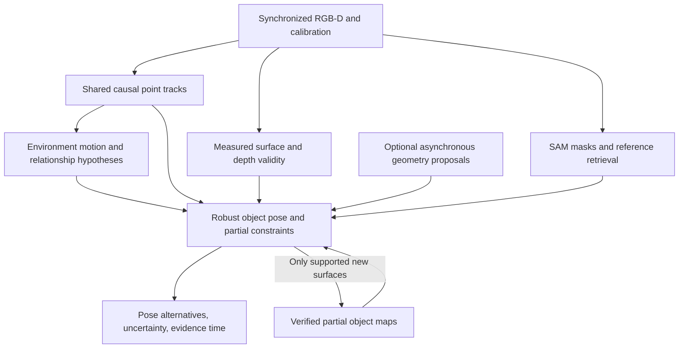

# Model free tracking for FLASH

Research reviewed on 2026-10-19. This is a component selection proposal, not a new tracker benchmark. The local host reports an RTX 5090 with 32 GB of GPU memory; published results on other hardware are not local performance estimates.

**Recommendation:** retain current upstream Point2Pose and the sealed local configuration as distinct complete-system baselines. Compare BundleSDF for geometric tracking accuracy. For a new tracker, evaluate a shared causal point frontend, beginning with TAPNext++, together with measured RGB-D, persistent partial object maps and explicit object/environment relationships. Compare SAM2.1 against SAM3.1 for segmentation and recovery. Treat VGGT-family inference and generated shape as optional supporting evidence until their incremental benefit is measured.

Point2Pose is the closest released starting point to the full operating contract found in this review. That does not make it the most accurate method on every benchmark, or establish that it meets our contact requirements. “Best” here is a measured tradeoff between usable pose information, erroneous acceptance, recovery and observation age.

## The operating contract

An object is designated in an RGB-D view without requiring a supplied mesh, scan, category model or object-specific network training. Geometry accumulated from the demonstration or live observations is allowed. The tracker must support multiple rigid objects and environment motion, partial visibility, changing grasp attachment, recovery after occlusion, and causal outputs suitable for feedback. The controller needs metric object-object and object-gripper relations, with uncertainty and source timestamps.

Every backend is wrapped by the same pose-estimation interface. The result contains a metric 3D position and orientation in declared coordinates, a stable object identity, timestamps, supported dimensions and evidence status. The primary pose can combine partial observations and prediction. Occlusion retains identity and permits prediction; loss preserves the last estimate with its original time and an explicit lost status. Initialization may be unavailable. The interface does not present masks or point tracks as substitutes for pose, nor present a lost historical pose as a current observation.

Inference consumes multiple live frames and benefits from a persistent reference library built from multiple snippets of the same object, across viewpoints and lighting. Snippets can belong to one dataset or multiple datasets, with annotated identity and registered object frames. Temporal state resets between episodes; verified reference data can persist. Different physical instances need explicit correspondence and must not be fused merely because they share a category name.

Optional learning from one or multiple datasets is supported through versioned model artifacts behind the same inference contract. Frozen-model retrieval and geometric accumulation provide a baseline that requires no task-specific network training. Compare reference-only improvement and weight-training improvement independently, on held-out episodes. Human frame/option annotations and future automated annotations use the same schema and retain their provenance. The [system design](architecture.md#common-object-estimation-and-relationships) defines these boundaries.

Live inference must support responsive asynchronous publication, independently of the fixed 30 Hz robot loop. The motor loop never waits for a tracker result; lower-rate perception updates timestamped state consumed by the controller. Backend evaluation must include result age and resource contention, not require that every model itself run at 30 Hz. Reference building and training can run offline without that live deadline. The [runtime contract](architecture.md#runtime-and-lerobot-boundaries) retains this separation from the sealed act engine.

Demonstrations and recorded rollouts are regular `LeRobotDataset` episodes. Pose estimates, reference associations and annotations are additional features or versioned dataset extensions linked to the standard frames. Tracker training and evaluation consume these datasets; standard replay and downstream policy training can ignore the extensions. See the [dataset contract](architecture.md#episodes-and-skill-representation).

This differs from three related problems: maintaining an object's segmentation mask, tracking arbitrary pixels through a completed video, and estimating pose with a known CAD mesh. Those methods can provide components, but their benchmark scores are not interchangeable.

## Findings from the earlier research

The [earlier architecture](https://github.com/TheWisp/lerobot/blob/80d90b7836031c6e53d665a541200b5d8d2f23fd/src/lerobot/showservo/docs/rigid_tracker_architecture.md) already proposed shared point tracks, persistent maps, group relationships, geometric checks and bounded background work. It explicitly recorded that this integrated tracker was not implemented. The redesign should consolidate that proposal instead of treating the full design as a failed experiment.

Its local evidence remains relevant:

- Wrong visible-face orientation involved depth near an occluding wrist and the fitting/history path, not only segmentation. A mask-model swap is therefore an experiment, not an established fix.
- More points do not correct a shared depth bias. Point distribution, depth validity and which motion dimensions they constrain matter.
- A surface check can reject a wrong pose without supplying a replacement. It also cannot verify arbitrary hidden dimensions.
- Group propagation sometimes worked through occlusion, but slow-motion merging and foreground tracks could carry objects incorrectly. Semantic identity must survive temporary co-motion and physical contact.
- Predictions during occlusion are useful assumptions. They are not measurements of slip.

These findings motivate the interfaces in the [system design](architecture.md#common-object-estimation-and-relationships). They do not identify one universally superior visual model.

## Complete pose trackers and challengers

| Method             | What it provides                                                                                                             | Fit for this project                                                                                                                                                                                                                                                                                                                   |
| ------------------ | ---------------------------------------------------------------------------------------------------------------------------- | -------------------------------------------------------------------------------------------------------------------------------------------------------------------------------------------------------------------------------------------------------------------------------------------------------------------------------------- |
| **Point2Pose**     | Causal multi-object RGB-D pose tracking and online geometry without supplied CAD; official project reports 30 Hz on RTX 4090 | Closest complete baseline. Its contact failures on our rig remain part of the evaluation, even if another dataset score is strong. [Project](https://point2pose.github.io/), [code](https://github.com/tzuyuan/point-to-pose)                                                                                                          |
| **BundleSDF**      | RGB-D tracking with concurrent neural object reconstruction, initialized with a mask                                         | Important geometry/accuracy baseline; measure per-object scaling and recovery rather than infer them from single-object tests. [Official implementation](https://github.com/NVlabs/BundleSDF)                                                                                                                                          |
| **FoundationPose** | Novel-object pose estimation and tracking using supplied geometry or a reconstructed object field                            | Useful once enough reference geometry exists. Its model-free setup explicitly fits an object field from reference views, unlike immediate tracking from one observed partial surface. [Official workflow](https://github.com/NVlabs/FoundationPose/blob/main/readme.md)                                                                |
| **STORM**          | Reference-conditioned segmentation, SAM3D reconstruction, FoundationPose tracking and a learned drift verifier               | A relevant newer challenger for “no supplied CAD.” Test generated-shape accuracy and whole-pipeline initialization/recovery latency. The reported SOM/TOM component timings alone are not total pose latency. [ICML 2026 paper](https://proceedings.mlr.press/v306/deng26a.html), [implementation](https://github.com/YuDeng321/STORM) |
| **RRTrack**        | Segmentation/pose consistency and recovery using offline templates and online anchors                                        | Useful memory-protection/recovery ideas, but its pose path uses CAD geometry, so it is not a direct baseline under identical inputs. [Paper](https://arxiv.org/html/2607.23669v1)                                                                                                                                                      |
| **ProxyPose**      | Video diffusion converts a marked region's motion into a synthetic proxy whose pose can be solved                            | Interesting for offline demonstrations and difficult materials. The video-to-video formulation does not establish causal per-frame feedback at our required latency. [Paper](https://arxiv.org/abs/2607.06555)                                                                                                                         |

Point2Pose's [published comparison](https://arxiv.org/html/2604.10415v2) reports higher mean ADD-S AUC than BundleSDF on HO3D, but lower mean ADD and ADD-S AUC on YCBInEOAT. Its recovery/multi-object strengths do not establish the best single-object precision. Those AUCs integrate errors up to 10 cm; they do not certify insertion-scale accuracy. Its FoundationPose comparison uses supplied CAD, an explicitly different input condition.

The latest upstream Point2Pose commit returned by GitHub on the review date was [`5185622`](https://github.com/tzuyuan/point-to-pose/commit/51856226610df75e5c06e8de545bd27f7c4ba99c), dated September 24, 2026, introducing the real-time path. It should be pinned for the upstream baseline. Local wrapper changes, masks, reference construction and estimator policies must be recorded separately from that revision.

## Segmentation and correspondence models

**SAM2.1 remains a necessary baseline.** Its released predictors support video object segmentation and compilation. Our experiment must compare initialization, masks and pose quality under an equal budget, not assume that a larger newer model wins. [Official repository](https://github.com/facebookresearch/sam2).

**SAM3.1 is the preferred SAM3 candidate.** The March 27, 2026 update adds joint multi-object processing. Its roughly sevenfold speedup is reported at 128 objects on H100 against the initial SAM3 release; that says little about two objects on this rig. SAM3 also offers text/exemplar-based detection and recovery. Segmentation still gives object support, not persistent metric material-point correspondences or a full rigid pose. [Release notes](https://github.com/facebookresearch/sam3/blob/main/RELEASE_SAM3p1.md), [SAM3 capabilities](https://ai.meta.com/sam3/).

Compare complete input masks where supported. The old wrapper's reduction of a mask to sparse clicks changes the initialization problem. Compare masks at finger contact, thin boundaries, object-object overlap and reappearance. Preserve an object's identity even when its visible mask vanishes, and never promote an inferred hidden silhouette to measured depth.

**TAPNext++ is the first new point frontend to evaluate.** It is recurrent and causal, and the released VOTSp2026 adapter exposes frame-by-frame inference. The paper reports about 5.2 ms latency for its per-frame configurations on H100; that is a point-model measurement, not an RGB-D pose pipeline measurement on the RTX 5090. The higher-resolution challenge adapter also adds local support queries, changing its workload. Validate persistent state, new query insertion, retirement and long-sequence memory before substituting it. [Paper](https://arxiv.org/html/2604.10582v1), [released adapter](https://github.com/google-deepmind/tapnet/blob/main/tapnet/tapnextpp/votsp2026/README.md).

BootsTAPIR remains the controlled reference. CoTracker3 and other online/windowed trackers are useful comparison frontends, but “online” does not necessarily mean no frame-buffer delay. The TAPNext++ paper's speed table explicitly separates throughput from result latency. These frontends must be compared through the same pose fitter as well as independently, so a change in geometric fitting is not credited to the point model.

That separation now has a [local measured result](../../../../../docs/proofs/flash-tracker-comparison/EVIDENCE.md#tapnext-tests-separate-correspondence-quality-from-pose-pipeline-behavior). Swapping only Point2Pose's frontend to TAPNext++ worsened its insertion visible-surface fit on both objects, yet a strictly causal fixed-seed TAPNext++ frontend plus the existing FLASH RGB-D fitter made a strong ring pose candidate (2.25 mm median visible-surface p90, compared with 3.76 mm for Point2Pose's BootsTAPIR branch). The fixed-seed dowel candidate remained weaker than BootsTAPIR at insertion (9.25 versus 7.50 mm), and neither has independent hidden-end labels. Point2Pose's TAPNext adapter also committed newly admitted source-frame pixels on the next frame. Correcting that location by one-frame optical flow helped the dowel pipeline but hurt the ring pipeline, so the integration mismatch is real while that particular remedy is not reliable. Retain BootsTAPIR as the complete-pipeline control; test source-time-consistent point admission, reversible map updates and task-point uncertainty before changing live pose ownership.

The [official TAPNext++ local-support query pattern](../../../../../docs/proofs/flash-tracker-comparison/EVIDENCE.md#local-point-supports-do-not-help-this-rigid-object-replay) was tested separately at 512-pixel input with the same real query corners and rigid fitter. Eight supports per real dowel query worsened insertion surface fit and removed two pose frames; 64 removed every insertion pose while increasing point inference from 25.9 to 62.7 ms median. On the ring, neither dose improved availability, and the visible-surface score changed by only hundredths of a millimetre. Thus the wrapper's extra local points are not a useful drop-in for this multi-query rigid-object tracker. This does not evaluate its intended single-point VOT performance or an adaptive support scheme.

A [matched CoTracker3 online replay](../../../../../docs/proofs/flash-tracker-comparison/EVIDENCE.md#cotracker3-online-needs-a-trustworthy-recent-anchor-for-the-held-dowel) adds another backend with a different failure pattern. Keeping only the last frame of each completed 16-frame window makes its sampled outputs causal, but they arrive at eight-frame intervals, not at every camera frame. Seeded before the grasp, it returns valid RGB-D ring poses at all 13 insertion endpoints, with a 2.49 mm median visible-surface p90 versus 2.33–2.34 mm for the strongest TAPNext++/BundleSDF ring branches at those same times. Its many mask-inside dowel pixels do **not** form a consistent 5 mm rigid fit on any insertion endpoint; accepting 10 mm fits makes most proposed poses contradict measured free space. A shared two-object model call cuts the measured model work from roughly 115 to 63 ms per eight-frame update without restoring that dowel fit. Reseeding both objects from visible frame 380, however, gives 13/13 insertion poses each and a 7.57 mm median visible dowel residual, close to direct Point2Pose on the same sparse frames. This late branch inherits Point2Pose's dowel pose at frame 380, so it validates a useful relative-motion correction, **not** independent absolute recovery or hidden-tip accuracy. A runtime estimator needs verified re-anchoring, separate uncertainty for the hidden contact end, and per-frame prediction between CoTracker3 updates.

The [causal reseed sweep](../../../../../docs/proofs/flash-tracker-comparison/EVIDENCE.md#cotracker3-online-needs-a-trustworthy-recent-anchor-for-the-held-dowel) makes the re-anchoring decision nontrivial. Seeds at frames 340 and 380 both fit all insertion endpoints, but their predicted contact ends differ by **9.45 mm median**. The frame-340 branch wins visible-surface and free-space checks, whereas the frame-380 branch fits a current-depth _inferred_ end better. Neither has an independent hidden-tip label. A scalar visible-fit ranking would erase task-relevant uncertainty; keep both lineages until end-specific evidence or a safe interaction resolves them. The number of seeded corners alone is not a trust score: frame 280 starts with more dowel queries than frame 340 but loses insertion fits and has much worse visible agreement.

A [late Point2Pose restart ablation](../../../../../docs/proofs/flash-tracker-comparison/EVIDENCE.md#late-point2pose-restarts-expose-mask-ownership-and-anchor-error) identifies two distinct failure modes. At seed frame 380, Point2Pose's internal SAM2 first mask expands into the nearby ring, placing 11 of 18 next-frame fit pixels on the ring; its continuous pose output then has a 16.63 mm median insertion visible-surface residual. Supplying causal SAM3 masks afterward removes those ring pixels, and honoring the supplied mask at initialization prevents the contaminated point map, but neither choice dominates the original track on all visible and inferred-end checks. At frame 340 the exact mask seeds only two persistent P2P points, while SAM2's modest expansion seeds eight, so exact masking loses every insertion pose. The independent CoTracker3 corner frontend still fits that later interval. Tracker interchange therefore needs explicit per-seed object ownership, spatial point support, anchor provenance and task-end uncertainty. A higher mask IoU or inlier count is not a universal upgrade criterion.

Suppressing new points in the same pipeline removes every accepted dowel insertion pose and 33 of 101 ring insertion poses. Thus a fixed initial correspondence set is not a general substitute for a persistent, carefully verified map. Future point admission should be judged by its effect on held-out current RGB-D and task features, not just by a larger count of tracker matches or registration inliers.

For the round ring, the fixed-seed TAPNext++ and BundleSDF pose candidates disagree on surface/ray scoring in many frames but transport the same first-view plane center to within **0.94 mm median** and its unoriented normal to **3.02° median** during insertion. These are first-view geometric proxies, not independently labeled hole features. The example shows why task-relevant pose equivalence and uncertainty belong in the estimator output: a full 6D rotation conflict can be irrelevant under symmetry, while a small center or normal error at the interaction can matter.

The [512-pixel fine-tuned TAPNext++ ablation](../../../../../docs/proofs/flash-tracker-comparison/EVIDENCE.md#tapnext-tests-separate-correspondence-quality-from-pose-pipeline-behavior) did not improve this complete causal replay. Using the identical first-frame query pixels and the authors' 512-pixel checkpoint increased point inference from about 8.3 to 25.9 ms median, while worsening insertion visible-surface fit on both objects. A late dowel reseed improved only marginally. Retain 256 pixels as the cheaper tested component candidate; revisit higher resolution only if a new failure analysis shows that image-space localization, rather than pose anchoring and point admission, dominates. The authors' VOT wrapper adds local support queries that this matched-point ablation did not exercise.

## VGGT and dense 3D tracking

**VGGT and VGGT-Omega are geometry backbones, not direct replacements for the full tracker.** They estimate camera/scene geometry from views. With calibrated RealSense depth available, the first use should be a proposal for missing geometry, camera-motion initialization or offline reference improvement. Learned geometry must be metrically aligned and checked against sensor observations. Dynamic objects must be separated from camera motion; reconstructing a whole moving scene as though it were static can corrupt both. These are proposed uses, not measured improvements. [VGGT](https://github.com/facebookresearch/vggt), [VGGT-Omega](https://github.com/facebookresearch/vggt-omega).

Omega has released checkpoints and training code. Its maintainers distinguish the September 2026 reproduction checkpoint for benchmark comparisons from the earlier checkpoint recommended for general use. Pin the intended checkpoint when reporting results; “VGGT” alone is not an adequate experiment identity. Do not put a repeated multi-view reconstruction into the motor-critical path merely because a batch has high average FPS.

**SpatialTrackerV2 and TAPIP3D** are useful 3D correspondence baselines, especially for demo processing and camera-motion separation. SpatialTrackerV2's repository still marks its online release as pending and documents an offline path, including RGB-D plus camera-pose inputs. TAPIP3D explicitly uses geometry and camera motion to track in persistent 3D coordinates. Streaming delay and object-pose fitting still need separate treatment. [SpatialTrackerV2 code](https://github.com/henry123-boy/SpaTrackerV2), [TAPIP3D paper](https://arxiv.org/abs/2504.14717).

**TrackEverything** is especially relevant to the group-tracker idea: persistent 3D scene tracks avoid repeatedly representing the same surfaces. Its code and inference API are now released. The API accepts recorded depth, intrinsics and camera poses, bypassing its optional learned geometry backend. It produces 3D point trajectories, not object poses; FLASH would still need mask-based identity, rigid fitting, symmetry handling and metric validation. Its paper uses 16-frame windows and reports 23.1 FPS for tracking alone versus 7.2 FPS including its geometry estimator in the cited average. At 30 Hz capture, the first-to-last frame of a 16-frame window spans 500 ms, before processing; throughput is therefore not per-frame response time. The authors report that four-frame windows can work, while one-frame windows collapse the memory representation; their growing-buffer workaround is experimental and slower. A measured causal integration must account for this delay. [Paper](https://arxiv.org/html/2609.30222v1), [repository and inference API](https://github.com/ayushjain1144/trackeverything), [streaming FAQ](https://github.com/ayushjain1144/trackeverything/blob/main/docs/faq.md).

Its memory and compute ideas are worth adapting. For manipulation, preserve reversible object associations when nearby surfaces touch; spatial co-location alone is insufficient to merge identities. A low-speed object also needs retained motion sensitivity. A custom causal adaptation of those ideas would require its own validation rather than inheriting the published scores.

**D4RT, Any4D and fast visual-geometry tracking** broaden the research comparison. They offer joint geometry/motion or efficient trajectory prediction, but video-wide inference speed is not evidence of causal metric pose updates. D4RT's official project did not link released model weights/code in the inspected material. Any4D and the CVPR 2026 fast spatial tracker are worth assessing for offline references or a future causal frontend. They are not reasons to replace reliable measured depth with an unverified prediction. [D4RT](https://d4rt-paper.github.io/), [Any4D](https://any-4d.github.io/), [fast spatial tracking paper](https://openaccess.thecvf.com/content/CVPR2026/html/Huang_Fast_Spatial_Tracking_with_Visual_Geometry_Transformer_CVPR_2026_paper.html).

## A tracker we could build

The proposed tracker specializes in causal rigid-object estimation under contact and partial visibility. The full tracker is **not implemented**. An experimental shared RGB-D point frontend now tracks scene points and can carry an object with nearby group motion **after observed co-motion establishes and verifies the relationship**. A separate object-point path needs an absolute pose and aligned mask to start. Neither path establishes cross-recording identity or recovers it after all supporting points disappear. The current code still lacks the single scene-estimator arbitration boundary described in the [system design](architecture.md#one-scene-estimator-several-evidence-sources). These paths use pretrained components and geometry before considering new network training.

In the [recorded insertion comparison](../../../../../docs/proofs/flash-tracker-comparison/EVIDENCE.md), SAM3 and the sealed masks largely agreed once the dowel reappeared, yet BundleSDF's dowel pose stayed far from measured depth after grasp occlusion while Point2Pose reacquired it. Both trackers followed the moving ring closely. This makes recovered-pose validation and the gripper/object relationship more consequential for this case than swapping those two mask streams; a partial observation should constrain only the pose dimensions it actually measures.

A controlled [mask-swap ablation](../../../../../docs/proofs/flash-tracker-comparison/EVIDENCE.md#swapping-masks-inside-point2pose-can-change-the-pose-branch) sharpens that finding. With the same Point2Pose fitter, RGB-D and initial mask, causal SAM3 masks led to a dowel pose that disagreed with the visible shaft by 20.6° median during insertion, versus 3.3° using Point2Pose's SAM2 masks. The propagated candidate ends differed by roughly 28–33 mm there, despite high mask overlap. Refeeding the exact saved SAM2 masks through the swap adapter reproduced all 451 original poses exactly. SAM3 itself is not thereby a worse segmenter: a small mask-history difference can make a downstream registration/recovery process settle on a different branch. More fit inliers and a four-frame earlier reacquisition did not identify the correct branch. The estimator should preserve and score competing poses against current RGB-D and silhouette evidence, rather than equating a backend's inlier count with pose certainty.
A second [controlled initialization ablation](../../../../../docs/proofs/flash-tracker-comparison/EVIDENCE.md#swapping-masks-inside-point2pose-can-change-the-pose-branch) changed only Point2Pose's first mask. The sealed and SAM3 initial masks overlap at 0.917 IoU, but the resulting insertion pose branches disagree by 131 mm at the candidate end on median. The SAM3-initialized branch has 75.7 mm median visible-surface p90 versus 7.5 mm for the sealed initializer, with measured free space contradicting most of its projection. The ring also degrades from 3.76 to 7.42 mm visible-surface p90 after a 0.912-IoU initial mask change. Exact sealed-config controls and a repeated dowel SAM3 run reproduced their outputs. Initialization and reacquisition therefore need source-independent geometric validation; a good segmentation overlap or tracker fit count cannot promote a single pose to fact. The current projected-model-to-depth comparison marks 98/100 dowel insertion frames ambiguous despite the visible contradiction, because the bad pose fits a small projected subset. The next candidate check needs reverse observed-depth-to-model coverage and one-sided free-space evidence, with explicit validity and uncertainty.
A threshold-free, two-criterion diagnostic favors the SAM2-fed candidate on all 100 insertion frames where both poses exist: it has both a lower depth-surface residual and a better projected shaft alignment. During earlier reacquisition, those criteria sometimes conflict, so the same rule correctly returns ambiguity instead of pretending the hidden tip is measured. This has not yet been integrated into live pose acceptance, and the replay still lacks independently labeled contact-tip error.
The [existing FLASH surface diagnostic](../../../../../docs/proofs/flash-tracker-comparison/EVIDENCE.md#swapping-masks-inside-point2pose-can-change-the-pose-branch) independently reproduces the insertion preference: projected mask coverage and aligned-depth residual both favor that candidate on every shared insertion frame. It does not require a new per-object rule. The causal service now also invokes it for a direct pose versus a supported point-motion prediction at the direct pose's source frame. Multiple candidate histories and a calibrated hidden-tip uncertainty model are still missing; the diagnostic alone cannot resolve the hidden tip during early reacquisition.

A [causal free-space check](../../../../../docs/proofs/flash-tracker-comparison/EVIDENCE.md#a-lone-reported-pose-can-be-contradicted-by-free-space) makes the importance of absolute candidate validation concrete. BundleSDF is the only dowel source returning a pose at some reacquisition frames, but 90.8% of its projected model pixels with reliable depth are in measured free space at frame 263. BundleSDF is simultaneously the strongest ring candidate on this replay's insertion surface and free-space diagnostics. Thus the policy cannot rank backends globally or treat availability as validity. Free-space contradiction by itself also cannot choose between partially visible Point2Pose dowel branches; the visibly worse branch sometimes projects less model into the observed surface. Candidate evaluation must retain mask coverage, depth quality, visible task features and uncertainty together.

For this insertion, comparing task features is more informative than comparing all six pose coordinates: the dowel's candidate insertion end and unoriented shaft axis differ sharply between the two trackers after occlusion, whereas axial roll is geometrically irrelevant. A full pose hypothesis remains necessary internally because the insertion end may be hidden; the planner should consume the induced belief over the selected end, shaft and target opening rather than requiring confidence in an arbitrary full object frame. The current `SpatialSample` and `PoseRelationCriterion` still use full rigid transforms, so this task-feature constraint is **not implemented** by the present planner.

The [same replay evidence](../../../../../docs/proofs/flash-tracker-comparison/EVIDENCE.md#what-the-visible-shaft-still-measures) shows a narrower opportunity: the insertion end is partly hidden, but the opposite end and central shaft remain visible. During insertion, Point2Pose's shaft differs by a median 2.5° from a central-shaft depth fit and 3.3° from the SAM3 mask's image axis; a reconstructed rigid-grasp prior differs by 10.4° from that image axis. The exposed end also supports the Point2Pose track along the shaft more strongly than the grasp prior. A tracker can therefore update observable pose components and propagate a hidden contact point through learned rigid geometry. The lateral centerline and hidden-tip error are not independently measured, so this is evidence for a partial-update path, not proof of insertion accuracy.

The [causal multiview ablation](../../../../../docs/proofs/flash-tracker-comparison/EVIDENCE.md#earlier-views-and-contact-depth-quality) confirms another route to useful pose evidence without a supplied mesh: transform earlier segmented RGB-D views into a persistent object frame, and admit newly exposed surfaces only when another view supports them. A checked four-view map cut Point2Pose's insertion surface residual from 8.5 to 5.0 mm median; rejecting depth discontinuities at occlusion edges cut the measured residual to 3.8 mm. These are **score improvements**, not a pose-refinement result. The views were registered by Point2Pose itself, and the hidden tip still lacks independent ground truth. BundleSDF continued to fit the dowel poorly but fit the ring slightly better, supporting evidence-based arbitration instead of a permanent backend ranking. For the actual estimator, map admission, depth validity, reference selection and candidate comparison should all be explicit, timestamped evidence; no fitted surface or generated backside should validate itself.

[Reacquisition frames](../../../../../docs/proofs/flash-tracker-comparison/EVIDENCE.md#reacquisition-is-evidence-not-an-instant-full-pose-reset) show why backend status cannot be the scene belief. Point2Pose first returns a dowel pose after an 88-frame loss, yet subsequent frames have visible RGB masks with missing or contaminated depth; both its candidate and the gripper prior then have unreliable surface scores. Once metric depth returns at frame 276, it strongly favors Point2Pose over the grasp-time attachment, which differs by about 29 mm at the reference-surface centre. The scene estimator should carry the pose as a prediction through occlusion, condition corrections on measured support, and distinguish a direct track from a verified contact-tip state. This is a general evidence lifecycle, not a dowel-specific timeout.

A naive local ICP refit of the visible middle shaft did not pass a withheld-end check: it improved the middle fit in 59/100 insertion frames, but the withheld ends in only 48/100, while sometimes moving the predicted insertion end by 13 mm. Improving a partial surface residual is not enough to revise the hidden contact point. The next fitting attempt should explicitly model which pose dimensions the current view observes and validate task-point uncertainty, rather than optimizing an unrestricted six-axis fit against any currently visible pixels.

The fast path shares point tracking across task objects and environment groups, lifts reliable visible tracks with current metric depth, and estimates rigid motion against persistent object maps. Background segmentation refresh, reference retrieval and map refinement have bounded budgets. Sharing points across objects is feasible without retraining; sharing the internal encoders of independently trained SAM and point models is a separate research project.

The [causal point replay](../../../../../docs/proofs/flash-tracker-comparison/EVIDENCE.md#full-resolution-point-seeding-restores-the-fast-motion-path-with-limits) found a concrete frontend bottleneck: downsampling before detecting object seed corners left just 7–15 points on the ring or dowel in tested views. Detecting at camera resolution and then tracking at the chosen scale restored many rigid fits; full-resolution tracking stayed near **8.4 ms median per object update** on the recorded rig. A dowel track reanchored from Point2Pose at frame 380 stayed close to that candidate through insertion, and a ring track reanchored from BundleSDF at frame 340 stayed close to the best visible-surface branch. But a ring track seeded from a poorly fitted frame-300 absolute pose remained wrong while returning fits on every frame, and the late dowel point trace disagreed with the visible opposite end. The fast path is useful motion evidence, not an independent pose oracle. Pose-anchor validation, periodic correction, source-frame timestamps and uncertainty at the hidden task point remain necessary.
On the full demo, the point path seeded from the first dowel view loses its rigid fit at frame 160, before pickup. Reseeding from the latest prepared observed dowel view at frame 249 carries only through frame 259. The prepared SAM3+DINO backend has no direct dowel observation after frame 249. Thus this combination cannot measure the carried object during the remaining demo; a gripper attachment can predict but cannot correct a slip. A later independently validated absolute observation is necessary before the current system can claim reliable held-pose correction.

The [hidden-end depth check](../../../../../docs/proofs/flash-tracker-comparison/EVIDENCE.md#a-visible-shaft-constrains-a-hidden-end-but-does-not-replace-pose) reinforces that the pose state cannot be replaced by an image-space target point: during insertion, current RGB-D often constrains the visible shaft axis, while the contact end is hidden. Extending from the exposed end using first-view length gave a plausible second hypothesis for most frames, but it became grossly unstable when the visible shape lost a distinct long axis. Even its exposed 3D end is biased toward the observed front surface. Future candidate fusion should use such geometric features as **partial measurements** with observability and uncertainty, keeping object pose, end identity and gripper attachment as separate hypotheses through occlusion.

The [causal reanchor replay](../../../../../docs/proofs/flash-tracker-comparison/EVIDENCE.md#how-long-the-fast-motion-path-can-carry-a-pose) shows that the fast point track can carry dowel and ring pose anchors across several frames at a much lower update cost than a fresh model fit, but should never be called ground truth. It exposed a late Point2Pose branch jump: at frame 498, the point-motion candidate better explains the current depth surface, visible shaft and measured free space, while Point2Pose reports more fit inliers. Blindly accepting the newest direct pose therefore loses useful temporal evidence. The existing source-neutral direct/group surface rule, replayed as a direct/point arbitration, accepts 65 of 66 stable dowel corrections, holds the disputed contact updates, and still accepts all 74 tested ring corrections. A strict three-score dominance rule drifts by withholding too many good anchors. The rule has now been wired into the actual causal service at each **source-time reanchor**, retaining a conflicting proposal as unresolved instead of resetting the fast path on backend authority alone. On frames 430–504, the service accepted 67/74 available dowel direct poses and retained point motion through seven disputed late poses; the ring kept all 75 available direct poses and its verified group relation. A second pass delayed every other proposal by three camera frames and produced the same type of late conflict decision. This is causal replay with recorded Point2Pose/BundleSDF candidates, not a live-robot or independently labeled hidden-tip validation.

The [full-sequence replay](../../../../../docs/proofs/flash-tracker-comparison/EVIDENCE.md#the-full-demo-exposes-a-correlated-pose-failure) limits that result. The supporting point track is absent at the disputed frame 498 when tracking starts at frame 100, so the same direct jump is accepted. Worse, a Point2Pose branch induced by changing only its first mask is visibly wrong through insertion, and the point path can agree because it inherited that anchor. A one-sided signed-depth check now records a contradiction for every alternative insertion proposal in this case, while leaving accepted poses unchanged. This is useful independent image evidence, not a complete verifier or a corrected estimate: another wrong branch mostly projects behind measured surfaces and escapes that check. The scene belief must retain alternative hypothesis lineages and invalidate descendants of a contradicted anchor, then use current silhouette, reliable depth, temporal motion and relationships to recover or report uncertainty. Two correlated tracks cannot certify each other.

The [causal candidate-bank replay](../../../../../docs/proofs/flash-tracker-comparison/EVIDENCE.md#same-frame-evidence-across-a-causal-pose-bank) makes the source choice more concrete. On the 100 shared insertion frames, observed-surface distance plus projected mask coverage jointly favor the sealed Point2Pose dowel pose over each of three alternative complete-pose branches. For the ring, BundleSDF's visible-surface fit is best and a ray-support/contradiction comparison favors it over sealed Point2Pose in 88/101 insertion frames, while retaining eight tradeoffs and five contrary decisions. At the dowel's late frame-498 jump, a [reference-model sensitivity check](../../../../../docs/proofs/flash-tracker-comparison/EVIDENCE.md#same-frame-evidence-across-a-causal-pose-bank) shows that a tiny change in the first-view cloud reverses the surface-score ranking; a confirmed multi-view map favors point motion on surface distance but favors the direct pose on free-space contradiction. Pure mask overlap favors the direct update throughout. These are correlated same-RGB-D checks, not independent hidden-tip labels. A single source priority or a single surface metric is inadequate; a versioned hypothesis bank must preserve the conflicting dimensions, model uncertainty and candidates' common ancestry.

A further [silhouette and map comparison](../../../../../docs/proofs/flash-tracker-comparison/EVIDENCE.md#current-silhouette-and-self-built-maps-are-different-kinds-of-evidence) favors the Point2Pose dowel branch in an independent current-image dimension: its projected first-view shaft lies 1.40 pixels from the center of the visible mask, versus 8.25 and 8.84 pixels for fixed-seed TAPNext++ 256 and 512, on the insertion frames. Yet BundleSDF's badly oriented dowel can score as well as Point2Pose against a map built from its own earlier poses; that map has a 173 mm bounding-box dimension for the roughly 96 mm dowel. Surface fit against a candidate's own map can self-validate a wrong pose. Map lineage and shape checks are necessary before using such a score to revise a hidden contact end. The silhouette result is a visible 2D constraint, not independent 3D tip ground truth.

Current RGB-D extrapolation, with a first-view length and gripper-based end-identity prior, also favors Point2Pose's insertion-end hypothesis while the shaft has a clear axis (96/96 shared high-anisotropy frames), but that geometric proxy becomes unstable at final contact. Its sign prior uses Point2Pose before grasp, so the check does not independently validate end identity. It cannot replace a carried pose state or certify a hidden tip. The estimator should update only the pose dimensions supported by the current view and retain uncertainty in the contact end and its identity when the view weakens.

Use 2D correspondence residuals and 3D surface residuals where supported. When depth is missing, visible 2D observations of established 3D map points can still constrain pose through reprojection; they must pass conditioning and ambiguity checks. Local depth-edge mixtures should not be treated as a single precise 3D sample. Use spatially spread support and assess observability near the actual interaction point, where orientation error may create a large displacement.

Relationship hypotheses let a tray, gripper or another moving group predict an occluded object's motion. Direct object evidence can revise or break the relationship. The same update applies to held and unheld objects. Gripper motion is not evidence that a hidden object did not slip, and group identity is not semantic object identity.

Persistent maps accumulate measured geometry under well-supported poses. Provisional surfaces remain reversible until verified; an incorrect pose must not permanently teach the map a distorted object. Predictions and generated geometry retain their own provenance. A generated backside may help propose a view or candidate pose, but it must not count as a sensor observation that verifies itself.

The output should expose the best estimate plus unresolved alternatives and per-dimension evidence. A flat patch can constrain some motion while leaving in-plane motion ambiguous. A ring can have reliable position and axis while yaw is irrelevant or unobservable. The planner consumes the information it actually needs rather than treating every frame as either a perfect 6D pose or total blindness. The [spatial objective](architecture.md#spatial-objective-and-task-progress) projects that uncertainty into the demonstrated interaction.

For an insertion task, the estimated object pose transports the learned object-frame end point into the world even when that point is hidden. Maintain the end-identity hypothesis and the held-object/gripper attachment separately from the pose. Observed shaft geometry may constrain translation and direction without observing axial roll or the contact end. The planner needs the inferred end position **and shaft axis**, with uncertainty projected from the pose hypotheses; a directly tracked tip-only point would become unavailable under occlusion and would not describe insertion orientation. Symmetry should remove irrelevant axial roll from the task error without deleting the pose state needed to propagate hidden features.

The plausible research contribution is making these partial constraints, reversible relationships and map updates reliable under manipulation while maintaining low latency. SAM3 plus VGGT alone is not a novelty claim. State-of-the-art performance would require an implemented method and matched comparisons on public data and held-out physical trials.

## Comparison protocol

Use the same recordings, timestamps, depth preprocessing, object initialization and compute allocation across comparable systems. Distinguish a complete-system comparison from a component ablation. A method using CAD or extra reference views is reported in a separate input category. Causal evaluation must withhold future frames and account for output availability, rather than score an offline estimate as if it had been available live.

| Comparison                                                                | Question it answers                                                                 |
| ------------------------------------------------------------------------- | ----------------------------------------------------------------------------------- |
| Sealed configuration versus pinned upstream Point2Pose                    | Which changes come from our wrapper/estimator rather than upstream?                 |
| SAM2.1 versus SAM3.1, otherwise unchanged                                 | Do better masks improve pose during contact and recovery at an acceptable cost?     |
| BootsTAPIR versus TAPNext++, same geometry path                           | Do better causal correspondences reduce loss and response delay?                    |
| Current fitting versus visible-surface/partial-constraint fitting         | Is the main error geometric bias or insufficient point tracking?                    |
| Relationship prediction on/off, including slow motion and deliberate slip | Does environmental context help without hiding independent object movement?         |
| Measured depth alone versus additional learned geometry                   | Does VGGT/SAM3D provide useful information beyond what the sensor already supplies? |
| Single reference versus verified multi-demo references                    | Does additional data improve held-out matching and relocalization?                  |

Score relative task-point position, axis/orientation error modulo valid symmetry, wrong-pose acceptance, unknown/rejection rates, recovery delay, identity switches, map contamination and long-run memory. Report source-to-output p50/p95/p99 latency and total resource use, alongside pose accuracy. A tracker that rejects everything cannot win by having no accepted wrong poses.

Use YCBInEOAT/HO3D and appropriate point-tracking benchmarks with their stated assumptions, plus held-out local trials covering grasp, carry, slow insertion, release, tray movement, occlusion and perturbation. Public benchmark meshes or evaluator-only markers may be used for ground truth without being supplied to a CAD-free tracker. Threshold calibration and reference selection use training/calibration episodes, never the held-out test labels.

The first useful result is a causal comparison harness and a viewer that exposes the failure mechanisms. It can establish whether segmentation, correspondences or geometric estimation is the best next investment. The runtime controller remains independently testable with known object state. Physical trials then determine whether improved estimation changes task outcomes rather than merely making the outline look steadier.
