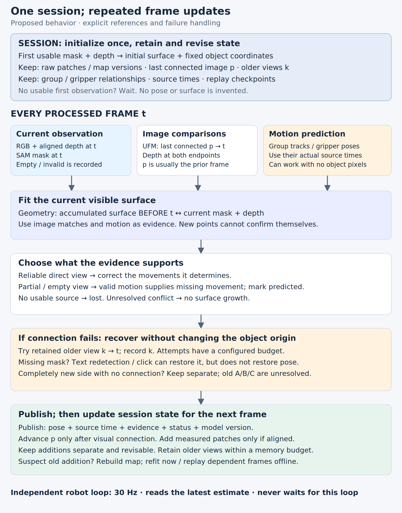

# FLASH tracking pipeline

Status: proposed

Keep an object's position and orientation through changing views, without treating
a drifting image match or an imperfect stored surface as truth. Fit a growing
surface to SAM masks and RGB-D; use image matches to resolve shape ambiguity and
valid group/gripper motion to bridge missing observations.

## Scope

Rigid objects, without a supplied mesh. Recover across occlusion when a new view
connects to **any previously observed surface**, recognizable features, or a valid
motion relationship. With a completely new side and no such connection, recovery
of the old landmarks is unsupported: report unknown alignment instead of
inventing one. Keep this case in evaluation. [Illustration](#e2-a-new-side-after-occlusion).

Deformation and inferred hidden geometry are separate research directions.
Transparent objects and unreliable masks/depth remain measurement limitations.

## Required behavior

1. **R1 — Prefer reliable visible evidence.** Correct the movements that partial
   geometry and image features determine; use prediction for what remains
   uncertain. A small fragment need not determine all six movements.
   [Example](#e1-partial-observation).
2. **R2 — Predict through complete occlusion.** Group/gripper evidence works with
   no visible object pixels. Report its source and age. Without a valid
   relationship, report lost. [Example](#e2-a-new-side-after-occlusion).
3. **R3 — Add shape only from camera measurements.** When a new side becomes
   visible, place its measured points into the existing object model. While the
   object is hidden, move the existing model using prediction; add no new surface
   points. Keep additions separately so they can be corrected or removed.
4. **R4 — Expose uncertainty.** Separate measurement quality, alignment ambiguity
   and time without observation. A fit score is not an accuracy probability.
   [Example](#e3-surface-and-pose-uncertainty).
5. **R5 — One causal update.** Demo, benchmark and debugger share the same core.
   Async perception supplies timestamped estimates to the independent 30 Hz robot
   loop. [Evaluation](#evaluation).

## Core loop

For each RGB-D frame: clean the mask/depth; fit the stored surface using image
matches and available motion predictions; publish the estimate and its evidence;
add newly observed surface only when its alignment is supported. Hidden frames
use motion prediction and leave the surface unchanged. This implements R1–R5.

**Keep the first version small:** one working surface, one pose, evidence/source
records and observed/predicted/lost status. Record unresolved directions where
detectable. Uncertainty and correction are part of the core design, but **how to
calibrate uncertainty and automatically identify a wrong addition remains an
open research question**. A Kalman filter does not answer those questions.
[Concrete approach and limits](#uncertainty-and-correction).

## What we store

- **Measured surface patches:** points, colour, measurement quality, source frame
  and the estimated transform placing each patch in object coordinates. Keep the
  original measurements separate from the combined surface used for fitting.
  Both the measurements and their alignment can be wrong.
- **Current pose and evidence:** position/orientation, timestamp, contributing
  sources, fit diagnostics and unresolved alignment. Adding a new side never
  recentres the coordinate origin or A/B/C.
- **Optional pose covariance:** uncertainty about nearby whole-object positions
  and orientations together, including correlations between them. It may be
  unavailable; never substitute a zero matrix.

This is one _working estimate_, not a certain surface. Surface and pose errors
are related: a wrongly aligned patch can bias the next pose. Full joint
probabilities for shape and pose cost much more state and computation.
[Picture and prior art](#e3-surface-and-pose-uncertainty).

## Image evidence and motion evidence

A pairwise image match proposes the same physical spot in two frames. A
persistent point track remembers that spot over more frames. Both are image
evidence; shared pixels must not count as independent confirmation twice.

A group/gripper relationship adds the claim “these things move together.” It can
predict the object while invisible. When reliable direct observation returns,
correct the prediction and update the relationship. Plain Kalman averaging does
not enforce this priority by itself.

## Session state and frame updates

This is the **proposed loop**, not a claim that the existing three benchmark
methods already implement it. Each estimate records the exact source frame IDs.

**Once per session/object:** select by text or click. Until usable mask and depth
exist, wait without inventing a pose. The first usable cloud defines the initial
surface and a fixed coordinate origin; no earlier image is needed. Retain raw
patches, map versions, the last visually connected frame, a bounded set of older
views, and any group/gripper relationships. New points never recalculate the
origin. Initialization can itself be wrong and must remain revisable.

**For each processed frame `t`:**

1. **Observe:** align RGB, depth and SAM mask to this frame and timestamp. SAM's
   causal state advances over processed images, even if object pose fitting
   fails. Empty mask and invalid depth are distinct reasons for missing evidence.
2. **Compare:** UFM compares image `t` with the last visually connected image `p`
   and uses measured depth at both ends. Normally `p` is the previous processed
   frame; after a gap it is older. Surface fitting compares the current measured
   cloud with the accumulated surface **as it stood before frame `t`**, restricted
   to potentially overlapping visible parts. It does not force every new side to
   match the first side. Image matches remain evidence during fitting, rather than
   only supplying its initial guess.
3. **Predict separately:** group point tracks and gripper measurements supply
   motion from their recorded source times to `t`, with the object relationship
   they assume. No object pixels are required, but that relationship can fail.
4. **Decide:** reliable visible geometry/features override conflicting prediction
   only for the movements they determine. Use a valid prediction for remaining
   directions or complete occlusion. Image matches and motion sources are not
   assigned a universal ranking; their support must be tested. If nothing is
   usable, report lost. If evidence conflicts and cannot be resolved, report that
   uncertainty and stop surface growth rather than averaging incompatible fits.
5. **Recover when necessary:** try retained older views when the recent image
   cannot reconnect. Record which view worked; bound attempts by configuration.
   If segmentation is lost, text redetection or a new click may restore the mask.
   A new mask does not establish the old pose. Reinitialize point tracks only
   after connection to the existing model; a disjoint view stays separate as in E2.
6. **Publish and retain:** publish pose, source time, evidence, model version and
   status. Advance `p` only after a visual connection succeeds; prediction alone
   does not advance it. Keep a candidate surface addition separate until its
   alignment is supported; it cannot validate its own placement by immediately
   becoming part of the fitting target. The next frame reads the resulting state.

The robot consumes the latest result independently. Recorded evidence and
checkpoints permit offline reprocessing; later information must not silently
rewrite what the live controller actually used.

## Uncertainty and correction

**We have an approach to test, not a solved confidence estimator.** Keep three
distinct kinds of information:

- **Measurement diagnostics:** usable depth, mask support and rejected pixels.
  These can reveal bad input, but do not prove the remaining points are correct.
- **Pose diagnostics:** geometry/image disagreements, spatial coverage and how
  much each movement changes the fit. Small perturbations of the six pose
  directions can expose weak constraints; this is not yet a calibrated covariance.
  Record motion-source validity and age when prediction supplies missing evidence.
- **History:** which observations and model version contributed to each pose and
  each surface addition. A patch and the pose used to place it have related errors;
  they are not independent confirmations.

For the minimal experiment, save these values and compare them with actual errors
on labelled clips. Rules for accepting pose updates, adding surface and declaring
recovery must be explicit configuration and evaluated together with availability.
We still need to establish which diagnostics predict errors, how to combine them,
and when disagreement justifies rejecting an old patch rather than the new image.
Calibrated 6D covariance and a Kalman update are candidates to compare afterward.

### How an incorrect addition could be undone

**Proposed storage mechanism:** retain each patch's original camera-space points,
source mask/depth, estimated placement, active/pending/excluded state and the model
version used to estimate that placement. The combined point cloud is a derived
cache. To remove a patch, exclude it and rebuild that cache from the remaining
patches. To correct its placement, change its transform and rebuild.

That alone does **not** repair later poses fitted against the bad patch. For an
offline demo, restart from a checkpoint before the suspect addition and replay
the following frames, with the correction applied. In a live session, create a
new model version and refit the current observation; if reconnection fails,
report predicted/lost. Past robot actions cannot be undone by editing a map.

**Detecting the mistake is unresolved.** A later disagreement could be a bad old
addition, a bad current pose, a wrong mask or bad depth. Test correction first
with deliberately corrupted additions and independently verified corrections.
Then evaluate automatic detection using later overlapping observations. Never
delete an old surface solely because a closer occluder hides it.

**Memory limit:** retain a configured number/size of patches in RAM; recordings
and original depth/masks stay on disk for offline reconstruction. Unbounded undo
requires retained history. If that history is discarded, report the correction
limit rather than promising reversibility. This costs storage and reprocessing;
it avoids the irreversible averaging that would hide where a bad point came from.

## Illustrated examples

### E1 Partial observation

**Actual baseline examples, 2026-10-31:** ring at 9.67 s above; gamepad at 7.50 s
below. Cyan is the supplied visible mask. Orange is the initial measured surface
moved by each estimate, **not raw image matches**. Both methods can drift. These
pictures motivate the design; they do not demonstrate the proposed fix.

Reliable visible ends of a dowel can determine tilt, while a smooth side may leave
spin unresolved. An occluder's depth must not become the object's surface. SAM
and depth can themselves be wrong.

### E2 A new side after occlusion

Overlap with an older view, identifiable features, or valid motion can connect
the new side. A motion-only connection remains predicted; new depth does not
independently confirm that connection.

Without a connection, recognizing the same object does **not generally determine
the transform** between old and new surfaces. Keep the old model; retain the new
observation separately within the memory budget; report its placement in the old
coordinates as unknown. Resume the old landmark trajectory only after connecting
evidence appears. A new local track may continue, but it is not yet the old
A/B/C track. Never force the back onto the front or silently reset A/B/C.

### E3 Surface and pose uncertainty

Surface uncertainty includes noisy depth and incorrectly joined patches. **Position
and orientation together are one 6D pose.** The two panels below separate them
only to make the illustration readable; the estimator must keep their correlations.
Uncertainty can differ along any translation or rotation direction. For example, position
may be uncertain by 10 mm sideways but 2 mm vertically, with 8 degrees of tilt
uncertainty. These are illustrative standard deviations, not measured accuracy.

A **6 × 6 pose covariance** stores variances and correlations of three small
translations and three small rotations. Specify coordinates, rotation convention,
pivot, metres and radians. An ellipse shows only the position part. One local
Gaussian cannot represent two separate end assignments or completely unknown
spin. Report such ambiguity instead of pretending it is precise.

**Prior art:** [ROFT](https://arxiv.org/abs/2111.03821) uses Kalman filtering for
RGB-D object pose/velocity tracking with optical flow and delayed visual
estimates. [Brossard et al.](https://arxiv.org/abs/1909.05722) study covariance of
point-cloud alignment, including poor initialization, weak geometric constraints
and sensor bias. [PoseRBPF](https://arxiv.org/abs/1905.09304) represents multiple
rotational possibilities. These are useful precedents, not validation of our
model-free growing surface.

## Evaluation

Provide **Run all benchmarks** in the experiment browser: snapshot the listed
cases, code and configuration, process them in a background worker, and preserve
old results. Show progress, per-case failures, playback and a downloadable results
report. Cases without pose labels must show accuracy as unmeasured. Supplied masks
must be identified; this action does not silently imply SAM was evaluated.

Run the same causal loop on **every registered example**, including both local
demos and external datasets; show failures and unsupported recoveries too.
Separate supplied-mask controls from SAM runs. Ground-truth poses are for scoring
only; unlabelled videos provide visual evidence, not proven accuracy.

Compare pose/landmark error, availability, recovery, surface corruption,
median/p95 processing time and peak memory. Check overlays against the exact
source frame, stable A/B/C, timestamps, bounded state, no surface growth while
hidden and no silent coordinate reset. Check R1–R5 on these cases.

Change one thing at a time: fixed versus growing surface, image evidence,
group/gripper evidence, then uncertainty estimation/filtering. Validate covariance
against error coverage on labelled clips before interpreting it as a probability.

## Glossary

- **Object coordinates:** fixed coordinates attached to the object; a pose places
  them in the camera or scene. They do not require the centre of mass.
- **Surface patch:** depth measurements from one visible portion of the object.
- **Alignment:** rotation and translation putting observations into shared
  coordinates. Similar shape alone may permit several alignments.
- **Correspondence:** locations proposed to be the same physical point. Tracking
  preserves this proposed identity over time.
- **Motion prediction:** movement inferred from history or a valid relationship.
- **Pose covariance:** local position/orientation uncertainty; see
  [E3](#e3-surface-and-pose-uncertainty).

## Earlier evidence

The [sealed debugger](surface_tracking.md) kept the first surface and used UFM to
initialize fitting. [Growth experiments](../../../../../docs/proofs/flash-surface-multiview/README.md)
showed that more surface and lower fitting error do not alone prove better pose.
This proposal supersedes the perception design in the
[sealed architecture](architecture.md); historical results remain in the
[research record](../../../../../docs/proofs/flash-tracker-restart/RESEARCH.md).
