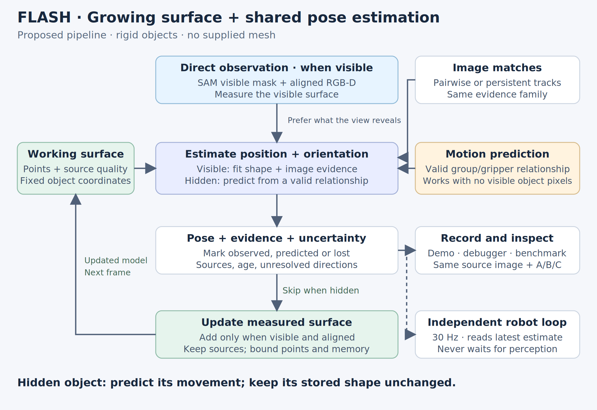
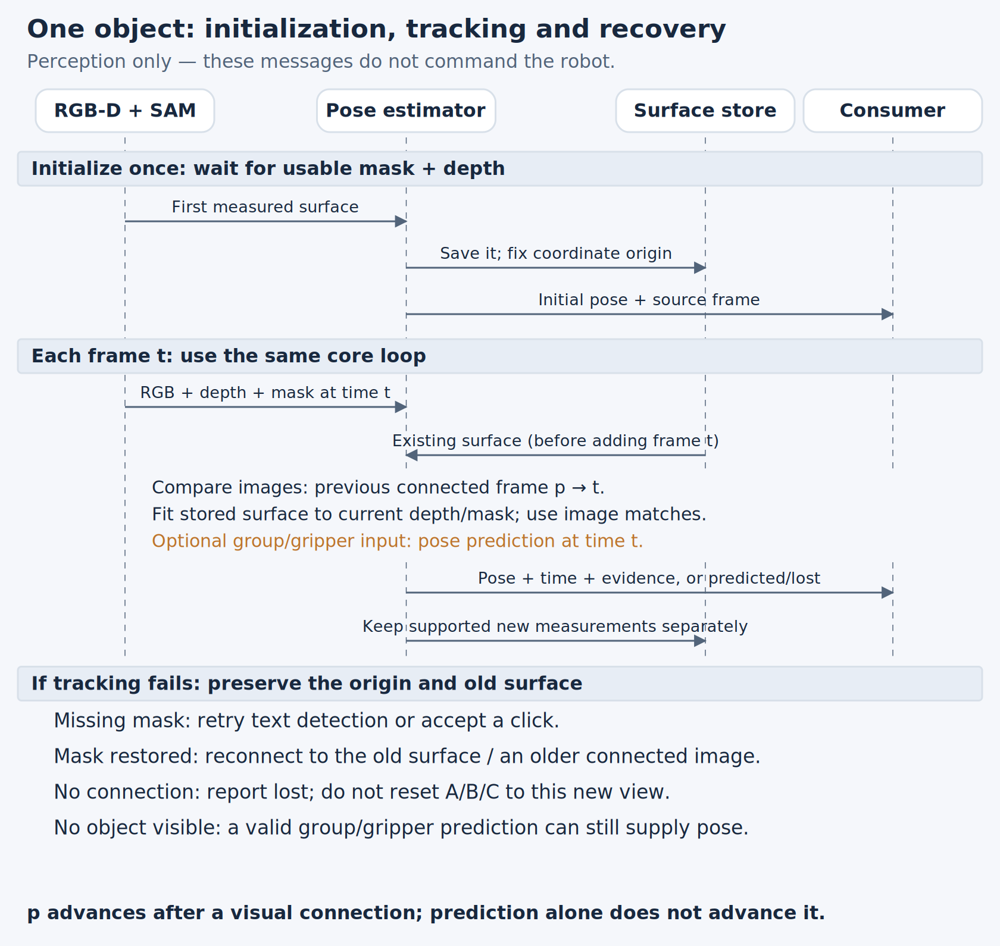
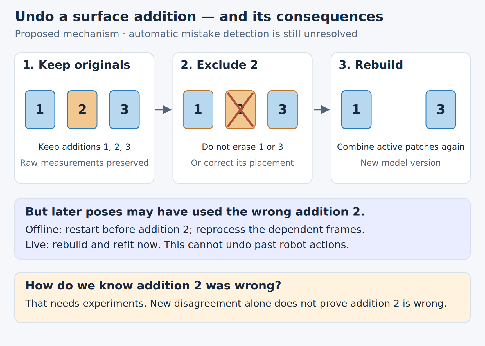
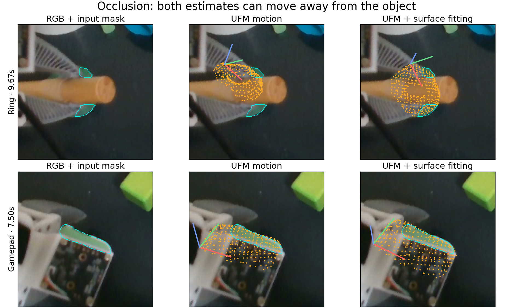
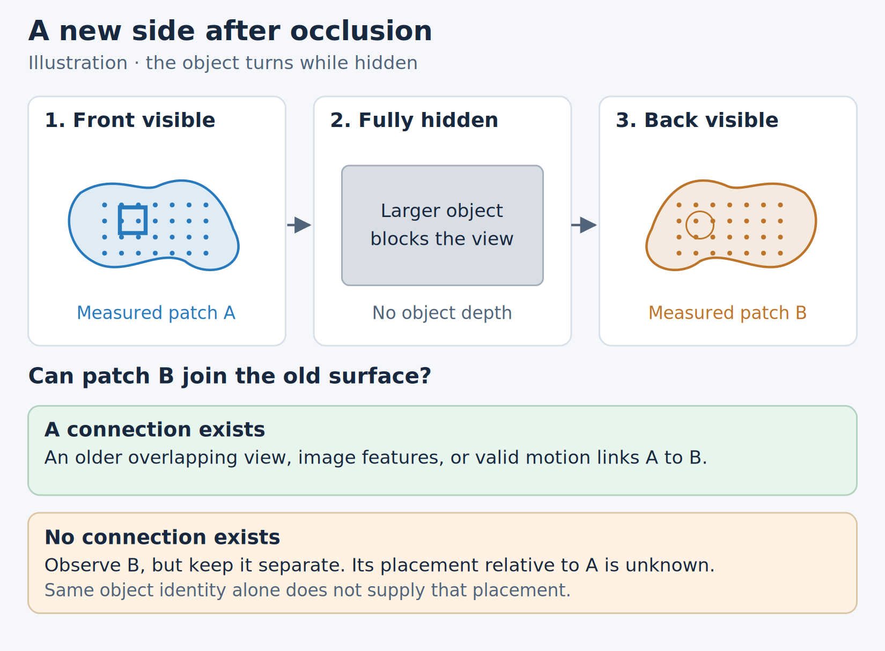
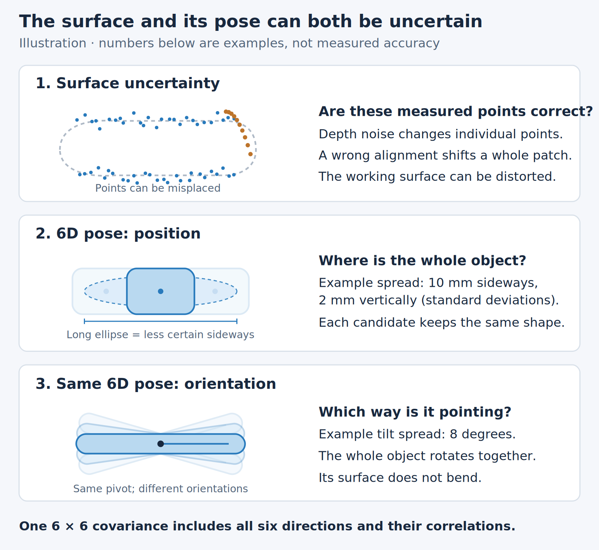

# FLASH tracking pipeline

**Current code path:** [rendered architecture diagram](../../../gui/static/flash_architecture.html).
Update that diagram when changing the per-frame data flow or publication rules.

Status: experimental implementation; accuracy and runtime remain limited.

## Shared execution and outputs

**Implemented, 2026-11-06:** recorded experiments and **Live camera** both call
`SurfaceFrameSession.step`. Only acquisition, segmentation and output storage
differ. The live adapter uses aligned camera RGB-D and the same SAM3 adapter as
the Data tab; recorded experiments use saved RGB-D/masks. Identical inputs and
settings produce identical poses, surfaces, groups and covariance in parity tests.
Fresh sessions use shared **LK**, the single-loop **Surface fit**, groups, growing surface and Kalman
with the current geometry checks. UFM and the library solvers remain selectable.
Saved experiments retain their actual settings; playback never reruns inference.

The output is a timestamped 4×4 transform from fixed initial surface coordinates
to the current camera, its evidence/uncertainty, and versioned measured surface
patches. The initial origin never moves when the surface grows. Image and 3D views
now use the same fixed display axes. Full labelled models, when available, add a
secondary nearest-surface distance score; labelled pose error remains primary.
Every new benchmark report includes surface median/p90 distance, the fraction of
points within 10 mm, and scored-frame coverage alongside pose availability and
pose error. Runtime replays retain the actual grown surface for this evaluation;
scoring and archival are outside inference timing. Without a full labelled model
or pose labels, the surface metric is explicitly unscored. Differences of a few
millimetres alone do not establish a meaningful regression: inspect the error
tail, availability, geometry conflicts and label quality too.

**Robot execution is not connected to this new session yet.** The older demo
compiler/run engine still uses its earlier representation. This live view is a
camera-only perception debugger, not a robot controller.

**Estimate a rigid object's pose from its visible surface.** Use aligned RGB-D
and SAM masks, image matches, and optional group/gripper predictions. Grow the
surface as new sides are observed. This is perception, not robot control.

## Core loop

**Priority: usable mask + measured depth first; 2D tracking second.** When
they disagree about position or orientation that the visible geometry constrains,
the geometry wins. More image matches or higher matching confidence cannot
override that evidence. This applies to UFM, LK and future 2D trackers alike.



- Fit the stored surface to this frame's visible mask and measured depth. Image
  matches supply starting guesses and distinguish poses compatible with that
  geometry; they do not replace the geometric checks.
- A partial view may leave some position or rotation uncertain. Image matches
  and group/gripper predictions help estimate those unresolved parts. When no
  usable object observation remains, a valid group or gripper relationship can
  still supply a **predicted** pose; otherwise report lost.
- Apply the same mask/depth quality checks to every hypothesis. Bad or missing
  depth is unknown. Once cleanup excludes a reading, fitting, pose rejection
  and retained views all leave that reading out. The full segmentation outline
  and reliable background depth remain available. Pixel validity is recorded
  before point subsampling, so sampling fewer points does not create holes.
  Mask and depth are not infallible; deciding their reliability remains part of the
  [uncertainty problem](#uncertainty-and-correction).
- Add **measured** new surface only after checking its alignment. Hidden frames
  can update pose through prediction, but provide no new object surface.

## Initialization and frame sequence



The sequence expands the same loop above. It is the target behavior, not a claim
that every branch is implemented yet. Inputs are synchronized RGB, depth, camera
intrinsics and a visible-object mask. SAM maintains its own causal segmentation
state; missing segmentation and missing usable depth are recorded separately.

**Image source:** usually the previous processed frame. After a tracking failure,
try the last image successfully aligned to the stored surface (a **connected
observation**) and, within a configured budget, older stored views.
**Geometry source:** the accumulated surface before processing this frame.
**Prediction source:** a timestamped pose inferred from a known co-movement
relationship; it works even without object pixels. These sources record their
frame IDs. A new mask does not by itself recover the old pose.

## Shared image matching

**Implemented foundation (2026-11-02):** `image_matching.py` gives LK and UFM
one prepared-pair/query interface, explicit backend settings, and separate native
diagnostics. Existing callers retain their original image coordinates, frame
selection and filtering. The refactor is checked against the previous code.

**Experimental implementation (2026-11-02):** `shared_image_tracking.py` runs
one LK or UFM pass on consecutive full-scene images. The benchmark can opt in
through `--shared-matching-config`; its existing paths remain comparison controls.
This changes sampling and group evidence, so adapter equivalence does **not**
establish equal tracking quality for this next step.
The first full-clip comparison found regressions, including a sideways dowel
estimate during rotation. Subsequent geometry fixes improved aggregate accuracy
across 21 labelled scenes, with individual regressions and higher processing cost.
Those were historical ablations; fresh shared sessions now use LK. See the
[full-suite measurements](../../../../../docs/proofs/flash-tracker-restart/RESEARCH.md#2026-11-02--full-suite-validation-after-the-geometry-fixes).

Select one configurable 2D matching backend, initially LK or UFM, for an experiment.
Object tracking and surrounding-group tracking consume its same results. Group
tracking maintains identities and co-movement relationships; it does not choose
or invoke a second image tracker. Two consumers of the same matches are one source
of evidence, not two independent votes.

```text
Consecutive RGB frames + requested points / image region
                          ↓
             Matching adapter: LK OR UFM
                          ↓
         Shared point identities + mask/depth checks
                 ↙                         ↘
        Object measurements          Surrounding groups
                 ↘                         ↙
                  Surface fit + pose estimate
```

The common result contains source/target frame IDs, source/target pixels in original
image coordinates, valid matches, image coverage, processing time and backend
reliability information. Dense UFM output can answer point queries by sampling its
flow field; sparse LK can match the requested points directly. Neither adapter
needs to invent a dense field, a 3D pose, or hidden-object observations. Native
visibility, forward/backward error and other scores retain their meaning; a UFM
visibility value is not interchangeable with an LK error or a probability of pose
accuracy. Acceptance settings are explicit per backend.

SAM identifies visible object pixels. Shared depth-cleaning and boundary-margin
settings govern which pixels supply object geometry. Ownership remains separate
from depth quality: a discarded boundary pixel does not become background. A point
center inside SAM does not imply all image context used for matching is inside.
Mask-aware matching is an experiment, including possible loss of useful context
and artificial boundaries created by zeroing masked pixels.

Matching continues over surrounding RGB when the object's mask is empty. Crop
coverage and image scale are explicit; points outside coverage or without a valid
match cannot be reported as observed. Matching the same pair/region is shared or
batched across consumers. Older-frame recovery is explicitly separate from
consecutive-frame identity tracking. Backend changes preserve point IDs only
when correspondence continuity is retained; otherwise reseeding starts new IDs.

Configuration selects the backend, image scale/resolution, point budget and its
acceptance settings. The same configuration is recorded by the benchmark and used
by the consumer. Compare LK and UFM on identical recordings and masks, including
visible-point drift, mistaken retention through occlusion, pose quality and cost.
The shared experiment does not run a second backend or silently retry image
inference. Older observations can reconnect through surviving point IDs in a
bounded history (default 64 frames); beyond it, no image correspondence is
claimed. Other surface/group evidence may still provide a pose. New seeds have
new IDs. Backend, resolution, point budgets and history length are saved with
the result and preserved by GUI reruns and cache keys.

**Current experiment, 2026-11-02:** both endpoints of object matches must pass
the configured mask erosion (2 px by default) and depth checks. A match can
still drift inside a valid surface. With `GrowingSurfaceConfig.surface_priority`,
image and group motion provide one starting pose to the surface fitter. The
weighted objective is retained as an ablation.
This is not a calibrated confidence model.

Within a frame:

```text
One start → bounded correspondence/pose iterations → check visited poses → Kalman
                                                                    ↓
                                             check resulting pose → publish
                                                                    ↓
                                                  stricter growth checks
```

`WholeSurfaceFit.fit_once` invokes one numerical solve. The poses visited by
that solve are proposals, not separate restarts. An invalid lower-cost step
cannot replace an earlier valid step. No valid step means no
measured pose. Insufficient overlap can still leave a prediction available if
it does not contradict the measurements; it cannot update the surface.
`check_pose` reads measured geometry directly, independently of solver weights,
residual-array layout and the uncertainty switch. Rechecking a Kalman-adjusted
pose is necessary because fusion changes its position/orientation.

**Acceptance and optimization have different jobs.** A returned measured pose
must pass the geometry checks: no supported protrusion into measured empty space,
and agreement where the two measured surfaces are mutually visible, within the
configured depth/boundary uncertainty. The retained depth view vetoes only
current surface that lies beyond the saved surface under the tested pose: a
current sample on the saved surface was measured there by every view that
built it, so one older frame reading farther at that pixel (rim depth of
uncertain ownership, read millimetres farther in a single frame) is the odd
measurement out. The current image's own empty space keeps its full veto.
Texture similarity and outline coverage
rank poses that pass; neither can compensate for a failed geometry check.
Uncovered outline is a preference, because the saved surface may be incomplete.
Missing depth and occluded surface provide no direct contradiction. If no tested
pose passes, return no measured pose. These rules are exercised with real RGB-D
checks in [matching criteria tests](../../../../../tests/policies/flash/test_matching_criteria.py),
including a better texture score attached to an impossible pose.

**Surface fitting:** fresh live and video sessions use `small_gicp` with shared
LK image matching. Each configured resolution uses a point-to-point warm start
followed by GICP. `shape.max_evaluations` caps the total iterations, including
the warm start; `registration.iterations_per_level` bounds each resolution.
Translation and rotation convergence tolerances can stop a solve earlier.
The selectable `visible_icp` solver instead applies one weighted rigid update
per iteration. There is no outer restart search.

The surface fitter starts from the image/group motion proposal and does not
restart the fit from the previous pose or coarse orientations. It keeps the
best geometry-compatible pose visited during that fit. Kalman fusion and the
final geometry check remain downstream; surface growth has its own stricter
checks. Recorded comparisons show faster fitting but less pose availability;
the single-fit path is retained as the only production path while its quality
is improved.

FLASH offers **Video examples** and **Live camera**, each with image and 3D modes.
Both use `SurfaceFrameSession`; the retired editor and separate camera tracker
are no longer GUI entry points. The robot compiler/execution APIs are retained
for research, not exposed as a third inspector.

Pipeline settings also retain Surface fit and Open3D as explicit comparison
solvers. They use the same geometry checks, but different numerical objectives.
Open3D still misses the 5 mm limit in recorded gamepad placement tests; it is not
the default. Hidden surface points must not be paired with a visible front face.
Measured image colours help rank geometrically valid poses and cannot override
depth rejection.

Old playback keeps the solver name actually recorded. When rerunning an old
SciPy configuration, the loader selects `visible_icp`, drops the removed
Jacobian/correction-budget options, and saves the normalized configuration.
It does not relabel or change the previous result. Historical comparisons live
in the research log; reproducing the retired solver requires its old revision.

Only the visible part of the saved surface must match the current measured
surface. Outside the visible mask, nearer or unknown depth can hide a point;
farther depth can contradict it. A partial saved surface is **not** required to
cover the entire current outline. Despite its legacy name,
`ShapeConfig.require_full_mask_coverage` enables a soft outer-extent penalty
for partial measured surfaces when explicitly enabled. `mask_coverage_weight`
scales that preference; it is not a rejection threshold. Fresh shared sessions use 0.5:
a strong preference can pull an incomplete surface away from the measured fit. An uncovered
region may be newly visible surface absent from the stored model; coverage
alone cannot establish a pose or a contradiction. The configurable
`prefer_observed_overlap` cost favors alignment with measured surface over
hiding the reference; it does not require unseen surface to exist.
Projected saved surface outside measured object pixels remains subject to depth
and mask checks. A broad connected protrusion or `free_space_min_supports`
separate small patches in measured empty space rejects even below the global
outlier allowance, including inside the mask. The default is three patches.
Each hard-veto sample requires its entire interpolated depth footprint to
contradict the pose beyond `depth_tolerance_m`. The conservative depth minimum
protects holes, withheld boundary readings and nearer occluders. Nearby samples
are grouped using the existing projected surface-spacing/boundary footprint;
densifying one small erroneous patch cannot turn it into several independent
contradictions. A single patch wider than twice that footprint rejects on its
own. `scene_depth_constraints` controls an additional search cost; rejection
always runs, before and after Kalman. Small isolated contradictions below the
configured support requirement remain tolerable; unrepresented surface cannot
be checked. This rule does not prove a pose correct.
No scene name or grasp timing selects these rules.
The recorded gamepad regression checks approach occlusion and subsequent
pickup; it does not establish accuracy throughout manipulation.

## Scene groups and object association

Group membership belongs to the scene, independent of which objects are selected.
The group state machine consumes only timestamped point IDs and measured 3D
positions. The shared image matcher currently reserves extra sample points
inside selected masks; these improve small-object coverage but make the _input
sampling_ selection-dependent. They do not supply labels, ownership, object
poses, or feedback to group updates. This distinction matters when comparing
group results across different object selections.

```text
Shared image matches + reliable depth → measured 3D point IDs
                                           ↓
                              Scene groups (once per frame)
                              fit / separate / merge / retain hidden IDs
                                           ↓
                              Read-only group snapshot G[t]
                                           ↓ queried by the main tracker
Object mask + fixed reference → object association → motion evidence
                                                       ↓
Current mask + depth + stored surface → surface fit + Kalman → pose
```

- Each group stores point IDs, fixed group-local positions and its current rigid
  transform. Visible measured members update that transform; hidden members keep
  predicted positions. Predictions never become measurements.
- A measured departure beyond the configured tolerance separates after the
  configured short confirmation time. One departing point does not need a
  quorum of other departing points. Forming a new group requires the larger
  new-group consensus; updating an existing group needs fewer visible members.
  Groups merge after sustained relative agreement, not proximity or object labels.
- The object association identifies which groups contain its measured points.
  It can initialize/reseed object coordinates from an accepted observation. It
  cannot modify group membership, motion, or point history. Later fitted poses
  can identify new points but do not move the existing point anchors. A new
  association requires enough currently measured object point IDs in that
  group. A valid existing association can carry through full occlusion; once
  measured separation breaks it, old IDs alone cannot recreate it.
- The fitter consumes the generic `PoseHint` / `PointEvidence` interface. Its
  geometry checks can withhold a pose, but cannot delete groups. Group predictions
  contain no new measurements for surface growth.
- Point memory, group count, unseen duration and consensus work are bounded.
  Missing group measurements produce no new motion evidence. When a group splits
  with members hidden, their assignment can remain uncertain; the current
  implementation retains them with the surviving parent group. It cannot infer
  an unseen grasp or independent motion from nothing.

The group core is `motion_groups.py`; the main frame session queries its
read-only snapshot through `object_group_association.py`. Future motion sources,
such as a confirmed gripper attachment, use the pose-evidence interface rather
than changing scene groups.

## What persists between frames

1. **Surface patches:** retain sampled camera measurements, source frame and the
   transform placing each patch in fixed object coordinates. The combined surface
   is a rebuildable cache, with explicit point/patch budgets. Initial and added
   points use the same fixed object-coordinate grid. A new measurement fills an
   unoccupied cell; nearby occupied cells do not prevent it. Sampling precedes
   the per-patch memory cap. The viewer compares the initial stored map with
   its expansion, while the original observation remains separate for scoring.
2. **Pose and evidence:** estimated rotation/translation, source time, model
   version, observed/predicted/lost status, fit diagnostics and source frame IDs.
   Adding a side never changes the coordinate origin or the A/B/C landmarks.
3. **Connected observations:** the last connected image and bounded older views
   for recovery. A prediction alone is not a newly connected image.

Check a new patch against observations that were not used to create it **before
letting that patch influence fitting**. Otherwise, a badly placed patch could
make the next fit look good simply because it matches its own wrong placement.
This check reduces one source of circular evidence; it does not prove correctness.

Tracking and surface growth have separate thresholds. Tracking requires 25% of
the observed points within 5 mm of the stored surface. Default growth requires
75% within 3 mm **before either adding a patch or confirming an earlier pending
patch**. At least 95% of a proposed addition must avoid contradicting retained
depth images and masks; 80% of its points must then be measured again within
3 mm in a later frame. These thresholds are assumptions, not measured confidence.
They can defer legitimate growth when the newly visible area is large.

The opt-in `local_growth_enabled` experiment allows a part of the current
measurement to grow when broad overlap fails. A candidate must have at least
three agreeing current points in a four-voxel neighborhood, at least 50% of
that neighborhood must agree with the active map, and the candidate must lie
beyond both the 3 mm map agreement range and a one-voxel projected image
footprint. Retained views veto conflicting cells individually. The surviving
patch still needs later confirmation. This admitted 30 additional candidate
points on the saved cube replay, but also produced a later 206 mm / 35° pose
jump in one run; it is not enabled by default. Initializing the first partial
surface has no older surface to compare with.

The retained-view check projects a proposed addition into earlier camera views.
It rejects points in space that their depth/masks showed was empty. Points behind
an observed foreground surface, or at missing depth, remain unknown. Geometry is
also used in the current-frame fit; this extra check uses earlier observations.
**A fit with high overlap can still have ambiguous rotation.** A separate gate
that bounds the placement uncertainty of new points is not implemented; stricter
overlap and repeatability alone do not establish that certainty.

## Uncertainty and correction

**We have not solved confidence estimation.** Initially record mask/depth quality,
geometric and image disagreement, visible coverage, pose sensitivity in all six
directions, and time without observation. Test whether those quantities predict
actual error on labelled clips. Do not call a fit score an accuracy probability.

Position and orientation are one 6D pose. The optional Kalman filter carries a
6 × 6 covariance between frames, including correlations between directions.
It describes uncertainty around one estimate; it cannot represent several
symmetric answers or prove that an object/group association is correct.
[Illustration and prior art](#e3-surface-and-pose-uncertainty).

**New surface experiments default to `kalman` with a 25% geometry rejection
allowance.** This empirical setting balances measured pose availability and error;
it does not relax surface growth. `selection` preserves the earlier candidate
selector, and `enabled=false` preserves the filter-off comparison. Saved recordings
retain their settings, including filter-off for recordings predating uncertainty.
The earlier selector did not implement temporal fusion.

```text
Previous corrected pose + covariance
    → compensate for camera movement
    → advance using consecutive measured group-point pairs, when available
    → add group-motion uncertainty and elapsed-time process noise
    → correct using the current surface fit and its directional uncertainty
    → retain corrected pose + covariance for the next frame
```

The observation is a surface fit against the current cleaned depth and mask.
Its information matrix comes from point-to-plane residuals, including an assumed
spatial correlation between nearby depth samples. A narrow visible strip can
therefore correct well-constrained directions without equally constraining all
six. All calculations use one fixed object point as the coordinate origin;
growing the surface or changing visibility does not move that origin.

Group motion uses actual 3D point pairs in consecutive frames. Their spread,
residuals and configured measurement noise determine motion covariance. A group
prediction advances the previous **corrected** estimate; it does not restore an
older absolute group pose. With no observation, only prediction runs and its
covariance grows. No measured motion means a stationary-world prediction,
compensated for known camera motion, with increasing uncertainty.

`unmeasured_rotation_std_deg_sqrt_s` sets a larger rotation process-noise
floor when no usable measured group motion advanced the filter, including a
rank-deficient group-motion estimate. This uncertainty is added before fitting,
in proportion to elapsed time; it does not depend on the candidate or whether
the prior fails geometry. Measured group motion retains the ordinary process
noise. Fresh shared sessions use 10°/√s; explicit `null` in recorded settings
preserves the ordinary setting. This models
unobserved movement, not observation confidence: a weak surface still supplies
weak information, and innovation rejection and final geometry checks still run.
The floor represents a motion assumption, not calibrated sensor uncertainty.
Increasing it lets observations correct more readily but also gives a plausible
wrong alignment more influence. Reliable empty-space rejection therefore applies
to both the fitted and fused pose; neither can be published solely because the
innovation test passed.

The correction uses inverse covariance as directional weight. Its compatibility
test uses the sum of prediction and observation covariance. If current depth and
mask clearly contradict the prediction, the compatibility option
`reset_on_geometry_conflict` can restart at a valid observed fit. Fresh shared
sessions disable this option and retain the normal innovation test. The final
fused pose is checked against depth and mask again. When no fitted pose or
independent prediction passes the applicable geometry checks, the output is
lost rather than presenting a contradicted pose as valid. Predictions and
rejected corrections never add surface measurements.

**Limitations:** the information matrix describes depth-normal constraints only.
Outline/image constraints used by the fitter are not yet represented, so the filter
can underweight real sideways motion even when the outline locates it.
Visibility-aware matching now separates missing/newly visible surface from
known empty-space conflicts, but imperfect masks, depth and stored geometry can
still make that distinction wrong. The 25% aggregate allowance is not a pose
accuracy guarantee.
Noise settings are assumptions, not calibration. Shared evidence
between group motion and fitting, and errors correlated across time, are not
fully modeled. Wrong normals, a wrong reconstructed surface, a local optimizer
minimum or a wrong group relationship can still produce an overconfident estimate.
A well-tracked tray does not prove that an object remains on it. There is no
conversion from a group's scalar score to a calibrated pose probability.

[Recorded Kalman comparison, including remaining pickup failures](../../../../../docs/proofs/flash-tracker-restart/RESEARCH.md#2026-11-02--temporal-kalman-filter-on-recorded-occlusion-and-pickup).
[Earlier candidate-selection experiment](../../../../../docs/proofs/flash-tracker-restart/RESEARCH.md#2026-11-02--covariance-for-candidate-selection-with-direct-contradiction-checks).

[All pipeline options, defaults and where they apply](pipeline_settings.md).

To undo an addition, exclude its patch and rebuild the surface. To reposition it,
change that patch's transform and rebuild. Retained raw patches make this possible;
a permanently averaged cloud would not. **Automatically deciding which patch is
wrong is still unresolved.** Rebuilding also does not repair later pose estimates:
reprocess dependent frames offline, or refit the current live observation.



## Scope and first experiment

Rigid objects without a supplied mesh. With a completely new side and no overlap,
recognizable features or valid motion connection, the old pose cannot be recovered
reliably. Keep the new observation separate; do not silently reset the landmarks.
[Example](#e2-a-new-side-after-occlusion). Deformation, transparent objects and
unreliable segmentation/depth remain explicit limitations.

The core is now shared by the experiment harness and camera debugger. Compare fixed and growing
surfaces on the same recordings, masks and image matches. Test removal/repositioning
with deliberate bad additions before trusting automatic repair. Keep the live
defaults unchanged until benchmark and visual evidence justify moving them.

**Run all benchmarks** processes listed examples in a background worker and
preserves a code/config snapshot, prior results and a downloadable report. Evaluate
pose error separately from availability; unlabelled videos have no proven accuracy.
Supplied-mask tests do not measure SAM accuracy. Recorded experiments and the live debugger use the same causal estimator.
Connecting those outputs to the robot loop remains separate work.

## Examples and references

### E1 Partial observation



**Actual baseline examples, 2026-10-31:** ring at 9.67 s above; gamepad at 7.50 s
below. Cyan is the supplied visible mask. Orange is the initial measured surface
moved by each estimate, **not raw image matches**. Both methods can drift. These
pictures motivate the design; they do not demonstrate the proposed fix.

Reliable visible ends of a dowel can determine tilt, while a smooth side may leave
spin unresolved. An occluder's depth must not become the object's surface. SAM
and depth can themselves be wrong.

### E2 A new side after occlusion



Overlap with an older view, identifiable features, or valid motion can connect
the new side. A motion-only connection remains predicted; new depth does not
independently confirm that connection.

Without a connection, recognizing the same object does **not generally determine
the transform** between old and new surfaces. Keep the old model; retain the new
observation separately within the memory budget; report its placement in the old
coordinates as unknown. Resume the old landmark trajectory only after connecting
evidence appears. A new local track may continue, but it is not yet the old
A/B/C track. Never force the back onto the front or silently reset A/B/C.

### E3 Surface and pose uncertainty



Surface uncertainty includes noisy depth and incorrectly joined patches. **Position
and orientation together are one 6D pose.** The two panels below separate them
only to make the illustration readable; the estimator must keep their correlations.
Uncertainty can differ along any translation or rotation direction. For example, position
may be uncertain by 10 mm sideways but 2 mm vertically, with 8 degrees of tilt
uncertainty. These are illustrative standard deviations, not measured accuracy.

A **6 × 6 pose covariance** stores variances and correlations of three small
translations and three small rotations. Specify coordinates, rotation convention,
pivot, metres and radians. An ellipse shows only the position part. One local
Gaussian cannot represent two separate end assignments or completely unknown
spin. Report such ambiguity instead of pretending it is precise.

**Prior art:** [ROFT](https://arxiv.org/abs/2111.03821) uses Kalman filtering for
RGB-D object pose/velocity tracking with optical flow and delayed visual
estimates. [Brossard et al.](https://arxiv.org/abs/1909.05722) study covariance of
point-cloud alignment, including poor initialization, weak geometric constraints
and sensor bias. [PoseRBPF](https://arxiv.org/abs/1905.09304) represents multiple
rotational possibilities. These are useful precedents, not validation of our
model-free growing surface.

## Terms

- **Object coordinates:** fixed coordinates attached to the object, without needing
  its centre of mass. A pose places these coordinates in the camera or scene.
- **Surface patch:** sampled depth measurements from one visible part of an object.
- **Alignment:** rotation and translation putting two observations into the same coordinates.
- **Image match:** two image locations proposed to represent the same physical spot.
  Persistent point tracks remember such matches across more frames, not a new sensor.

This is the current design. Dated experiments stay in the
[research record](../../../../../docs/proofs/flash-tracker-restart/RESEARCH.md).
The [sealed debugger](surface_tracking.md) and
[earlier growth experiments](../../../../../docs/proofs/flash-surface-multiview/README.md)
remain historical evidence, not competing specifications.
