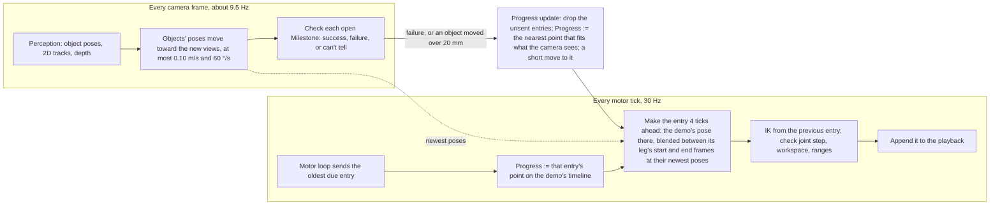
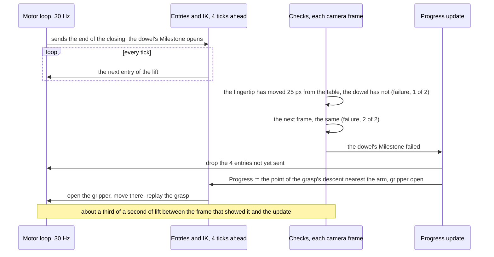

# Act execution: Progress, Milestones and the state checks

Status: proposed
State of the work: no tracking issue yet

An act replays a demo on objects that have moved. Today it is a string of separate motions: each key frame is
planned, streamed and waited on, and the rest is planned again with the arm standing whenever a stage ends. At
speed 1.0 an act takes 1.4 times the demo's time and stands still 12 to 16 times. It only moves forward and checks
nothing: a missed grasp is followed by a carry, an object moved during an insertion by the next action, and a
placed object that falls over is reported as placed. The same runner is meant to drive the OpenArm 2.

**Proposal.** A new act engine, beside the current runner and chosen per act, plays the act as one continuous
replay. [Progress](#glossary) is a position on the demo's timeline. Every motor tick gets one pose entry, made from
Progress four ticks ahead with the objects' newest poses, so a moved object bends the motion still to come instead
of stopping it. Wherever the demo shows an object start or stop moving with something — gripped, let go, or a key
frame the operator marks — a [Milestone](#glossary) checks, on every camera frame, that the act got the demo's
result. The act never waits for the check: on a failure, Progress goes back (or, when an object moved, ahead) to the
nearest point of the demo that fits what the camera sees.

## Scope

In: one act on one arm, first key frame to last: legs, Progress, the queue, the checks, the Progress update,
candidates (symmetry and landing turns), speed, the act's record, and how the engine sits beside the current runner.

Out, and why: estimating object poses ([act_loop.md](act_loop.md) designs it; this design consumes it); the motor
loop (`gui/api/jog.py`), which already sends the newest due command each tick; two arms at once, whose Progress would
need coupling; failures that need a model of cause ("knocked something over") or a law fitted to the demo (a screw's
advance per turn); what is pinched in a cloth grasp, which takes touch
([state_check_research.md](state_check_research.md)). Non-goals: collision checking beyond the workspace box and
floor; choosing what to do after the act fails, which belongs to the agent above it.

## Requirements

Safety first: the act must not act on a state that is not there. Then the motion should look like the demo's.

| #   | Pri | Requirement                                                                                                | Target                                                                                                            | Why                                                                                               | Checked by                                      |
| --- | --- | ---------------------------------------------------------------------------------------------------------- | ----------------------------------------------------------------------------------------------------------------- | ------------------------------------------------------------------------------------------------- | ----------------------------------------------- |
| R1  | P0  | Progress never passes a failed Milestone, nor a _final_ one before every Milestone before it has succeeded | 0 crossings                                                                                                       | A missed grasp followed by a carry ([O2](#o2)); what cannot be undone must not be done on a guess | Unit tests; every act's record                  |
| R2  | P0  | A failure sends Progress back, and a moved object back or ahead, to the nearest point that fits the scene  | The cases in [What a failure does](#what-a-failure-does)                                                          | The user's cases of 2026-10-17; detecting a failure and readjusting are one mechanism             | A simulated act per case                        |
| R3  | P0  | A check reports success only on evidence that tells success from failure                                   | 0 successes on recorded misses and on misses made by substitution                                                 | A false success is R1's carry, approved                                                           | Unit tests; a replay of the act records         |
| R4  | P0  | Only views the pose rule accepts move an object, or Progress                                               | 0 updates from views it turns away                                                                                | Views 7.6 to 29.8 mm off were accepted by the tracker ([act_loop.md](act_loop.md) O3)             | A test feeding such views                       |
| R5  | P0  | No check, object update or turn choice delays a command                                                    | No standstill over one tick from any of them                                                                      | The arm stood 0.06 to 2.5 s while the act re-planned ([O1](#o1))                                  | Simulated acts with moving objects; the rig     |
| R6  | P1  | At speed 1.0, an undisturbed act takes the demo's time, whatever the demo's frame rate                     | At most 1.15 × the demo's, for demos at 15 to 60 frames/s                                                         | 1.38 × today ([E7](#e7)); the arm trails its commands by about 0.1 s ([O4](#o4))                  | A simulated act per frame rate; the rig         |
| R7  | P1  | The arm stands still only where the demo did, at a final Milestone, or while the gripper opens to go back  | No other standstill over 100 ms                                                                                   | 12 to 16 per act today, most at key frames ([O1](#o1))                                            | The act's command record                        |
| R8  | P1  | A failure is acted on soon after the camera can show it                                                    | The check decides within 1.0 s of the references moving 30 mm apart; Progress goes back within two frames of that | The demo's lift moves 35 mm in 0.57 s ([E16](#e16)); frames come at 9.5/s ([E8](#e8))             | A replay of the act records; simulated acts     |
| R9  | P1  | One engine drives the SO-107 and the OpenArm 2                                                             | The same arm interface                                                                                            | The runner names the SO-107's motors ([O10](#o10))                                                | The engine's tests on both arms' kinematics     |
| R10 | P1  | The engine runs beside the current runner, chosen per act, and leaves it unchanged                         | Either from the same page and API; the current runner's tests pass unchanged                                      | Acts with both on the same scene decide the switch                                                | The existing tests; the record names its runner |
| R11 | P2  | Joint speed is bounded by the arm and the motor loop, not the ready/park ramp                              | 90 °/s on the SO-107; the timeline slows where a step would exceed it                                             | The cap is 30 °/s; the demo reached 158 °/s ([O4](#o4))                                           | A simulated act faster than the bound           |
| R12 | P2  | Every check result and Progress update is in the act's record, with its evidence                           | One record per decision                                                                                           | Failures are diagnosed from the act's own record ([E7](#e7))                                      | A test of the record                            |

Conditions: the SO-107 (left arm) and its RealSense on this desktop; the insertion demo of 2026-10-17 and the acts of
2026-10-15 to 17 with saved frames.

## Observations

**O1. Every key frame is a stop, and every stage end a re-plan.** Each key frame is streamed and waited
on until the arm is within 2° of it (`_act_key_frames_task`, `live_execution.stream`); lines brake at the key frame
they end on: 26 °/s down to 3 and back up ([E3](#e3)). The arm stood 0.06 to 0.8 s at stage ends and 2.5 s after a
grasp while the carry was planned twice ([E4](#e4)). So the stops come from how the act is cut, and retargeting must
not depend on planning again.

**O2. Progress only moves forward.** The phase a stream aims at only increases, and the runner walks the
key frames in order: an object moved during a grasp is followed by a closing gripper, a missed grasp by a carry.

**O3. IK is cheap; choosing among candidates is not.** A solve to 0.5 mm takes 0.3 to 2.6 ms on both arms;
under the rig's load, 1.7 ms at the median, 21 ms at the 95th percentile, 75 ms at most ([E1](#e1)). Ranking the allowed
turns solves every sample of every turn and sat inside the 2.5 s stand of [O1](#o1). So IK can run per tick, a few
ticks ahead; ranking must run beside the motion.

**O4. The arm can go several times faster than the act lets it, and trails its commands.** The demo
moved joints at up to 158 °/s with about 3 ticks of lag; the act caps them at the ready/park ramp's 30 °/s ([E2](#e2),
[E5](#e5)). The jog's live playback moves each command at most 3° a tick from the one before, sends the newest due
sample each tick, and never skips a gripper start, stop or reversal (`jog._advance_playback`). So the bound is 90 °/s,
and queued commands can always be replaced.

**O5. The grasp never lands where it was aimed:** 4.6 to 7.4 mm and 1.2 to 1.8° from the demo's in
every act of 2026-10-16/17 ([E6](#e6)). So what follows a grasp is composed with the hold measured there.

**O6. Object poses come at 9.5/s and spread 15 to 20 mm at rest** (95th percentile per act; [E8](#e8),
[E14](#e14)). So "the object moved" needs a margin above that, and a pose comparison is no finer than it.

**O7. The camera tells which reference an object moves with once the references separate, and often
cannot tell before.** Once the fingertip's projection has moved 25 px, the object's tracks have moved 0.84 to 1.0 of
it when held and 0.01 to 0.03 of it at rest ([E15](#e15)); the resting place reads empty once the arm uncovers it
([E12](#e12)). In 20 of 49 acts the gripper covered the tracks; the held object's 3D pose was wrong in every carry
frame; the placed object's reference view placed it in 0 of 33 frames ([E13](#e13), [E17](#e17)). So a check is a
choice between two references that is undecidable until they separate, and "can't tell" is a normal answer.

**O8. The gripper's readings say that something stopped the fingers, not what, nor where it is
later.** Width and load separate a hold from a miss 0.25 s after the closing, and the load is servo effort while the
gripper moves ([E9](#e9) to [E11](#e11)). So they can join a check as evidence, not carry it.

**O9. Games and simulators need few predicates, and none of them needs "can't tell".** Held, in a
place, on, part moved, at rest; the VR grab-break rule declares a grab broken when the object drifts past a threshold
from hand times grab offset, with no rigidity assumed; ManiSkill and robosuite count a placement only once the
effector has left it ([state_check_research.md](state_check_research.md#how-games-and-simulators-define-the-same-predicates)).
The demo is the only statement of success here, and the camera is calibrated to the arm's base, which moves on a
mobile robot. So the checks compare an object against references perception tracks — the gripper, other objects, the
base — as the demo had them.

**O10. The two arms differ in kinematics, gripper and motor only.** The SO-107 runs Pink, the OpenArm
2 the vendor's mink solver (a Pink build of its URDF exists); the OpenArm 2 has 7 arm joints. The runner takes the
SO-107's motor names (`joint_alignment.MOTOR_NAMES`). So the engine needs kinematics, joint ranges, the per-tick bound
and the gripper's column and closing direction, nothing else.

## Architecture

### The update loop

Two loops at two rates, drawn as an engine draws its threads: the motor tick makes and sends the motion, the camera
frame checks the result. Neither waits for the other; a failure reaches the motion through the Progress update.

A missed grasp, across the threads:

### Legs: the blend, and a moved target

A leg is the demo between two key frames. Its start frame is the frame of the key frame it starts at (an object, or
the base), or for a line where the arm was when the line began; its end frame is the frame of the key frame it ends
at. The entry at fraction `s` of a leg is

    pose(s) = blend( start frame's pose now × demo pose(s),  end frame's pose now × demo pose(s),  weight s )

with rotation slerped and position interpolated, and "now" the moment the entry is made, four ticks before it is
sent. For a line, the demo poses are its two ends: where the arm was, and the key frame. With nothing moved, both
terms are the demo's pose. When the target moves, every entry made after the view that shows it composes with the new
pose, so the rest of the leg bends toward it and the arm keeps moving; the part already made, at most four ticks, keeps
the old pose. A pose correction reaches the composition at most 0.10 m/s and 60 °/s, so the pose rule's own 20 mm of
spread ([O6](#o6)) spreads over six ticks. While an object is held, the composition includes the hold measured at the
grasp ([O5](#o5)), so the held object, not the fingertip, goes where the demo's went. ([R5](#requirements),
[O1](#o1))

**The clock.** Each entry advances the timeline by one tick times the act's speed: a follow takes the demo's time,
interpolated between its samples, so any demo frame rate plays in its own wall-clock time; a line takes its length at
the demo's pace between its key frames. A line eases in only where the arm starts from standing and out only where the
demo stood still, so the arm passes key frames at speed. IK is seeded from the previous entry plus the demo's joint
change; a step over the joint bound is shortened by advancing the timeline less on that tick, so the arm slows on its
path. ([R6](#requirements), [R7](#requirements), [R11](#requirements), [O3](#o3), [O4](#o4))

### Milestones: where, which object, when

**Where.** Wherever the demo shows an object change what it moves with, and nowhere else. At a firm grip, the object
the fingers close on starts moving with the gripper (the demo's gripper reading stopped short of its command on it:
`core.demo_holdings`). At the release of a held object, it stops, and stays with the end frame of the leg it was let
go in. Opening or closing the gripper on nothing changes nothing and makes no Milestone. The operator can mark more on
a key frame: an object, and what it moves with from there (a pushed block, a handle turning with the toy's body).

**Which object.** Each Milestone names one object: the one gripped, let go, or marked. It is open from its event until
that object's next event, or the act's end. Only open Milestones are checked, usually one at a time; every other
object matters only as a frame its legs are composed with.

**When.** On every camera frame, for each open Milestone: 0.06 to 0.18 ms each ([E19](#e19)), beside the motion.
Every frame, rather than at key frames, because the answer appears when the two references move apart, which no key
frame marks ([O7](#o7)). ([R5](#requirements), [R8](#requirements))

### What a check answers

- **Success:** the demo's result is there. The object moves with its new reference (the gripper, after a grip; what
  it was let go on, after a release) and sits relative to it as it did in the demo.
- **Failure:** the opposite is there. It moves with its old reference — it stayed on the table, or came away in the
  gripper — or it sits somewhere other than where the demo's relation puts it.
- **Can't tell:** the camera cannot see it, or the new and old references have not yet moved 25 px (30 mm) apart, so
  both would look the same. A grasp's check can't tell until the lift; a release's until the gripper has moved off.

A failure counts once it shows on two frames in a row. When the clues disagree (the tracks say the object came along,
the depth image still shows it lying there), the check can't tell, and a later frame decides.

**What counts as the demo's result.** Without these the check would never pass:

- _Tolerance._ 20 mm and 10° for a pose, the pose rule's own spread at rest ([E14](#e14)); half the object's
  thickness, at least 4 mm, for its surface in the depth image. Moving with the gripper allows the grip to shift: the
  object's motion between 0.5 and 2.0 of the gripper's, the grab-break rule of [O9](#o9) ([E15](#e15)).
- _Equivalents._ The object's declared symmetry (its discrete turns, a continuous axis, swapped ends) and the leg's
  landing freedom (exact, the target's symmetric turns, any turn about its axis): the object passes at any of them.
- _Alignment, not one exact pose._ The surface test aligns the object's surface to the depth near the expected pose
  and passes when an alignment within the tolerance fits. A test at one exact pose would fail on the hold's own error
  of 4.6 to 7.4 mm ([O5](#o5)).

**What it does to Progress.** A failure sends Progress back. A success or a can't tell lets it keep going, and the
check keeps running while its Milestone is open, so a drop in the carry or a fall after the release is still caught.
Only a Milestone the operator marks _final_, for an effect that cannot be undone, waits: Progress does not pass it
until every Milestone before it has succeeded, and the act fails up after 2 s without. ([R1](#requirements),
[R3](#requirements))

### What a failure does

Progress goes to the nearest point of the demo that fits what the camera shows: no further ahead than the next
Milestone that has not succeeded, never back across a final one. Nearest means closest to where the arm holds things
now, measured in each point's own frames, with a cost for moving far along the demo. A Milestone gone back across must
succeed again; one that fails twice fails the act up ([Q1](#open-questions)). The arm gets there by a short move at
the walk's pace, the gripper opened before it if it must open and closed after it if it must close. The same rule
runs when a view moves an object more than 20 mm or 5° ([O6](#o6)), or an entry cannot be reached.
([R2](#requirements), [R4](#requirements))

| What happened                              | Progress goes                                         |
| ------------------------------------------ | ----------------------------------------------------- |
| The grasp missed                           | back, to just above the object: open, grasp again     |
| The object fell out in the carry           | back, to the approach of the object where it now lies |
| It was let go off the target, or came away | back, to the approach of the object where it now lies |
| It tipped or rolled after the release      | back, to the approach of the object where it now lies |
| The target moved nearer                    | ahead, past what the arm no longer needs to do        |
| The target moved away during an insertion  | back, up out of it, and in again                      |
| A final Milestone was crossed              | nowhere: the act fails up                             |

### What the engine keeps of the key frames

| Today                                                     | In the engine                                                                                                       |
| --------------------------------------------------------- | ------------------------------------------------------------------------------------------------------------------- |
| `frame`: an object, the taught object, the world          | the end frame of the leg arriving at it, the start frame of the leg leaving it                                      |
| `move`: line, follow, lift                                | line: from where the arm is to the key frame; follow: the demo's samples; lift: up by `up_mm` from where the arm is |
| `grip`: first, along                                      | a line's gripper moves before its motion, or with it                                                                |
| `constraint`: pose, orientation                           | the whole pose; or the rotation only, the position kept from the leg's start                                        |
| `constraint`: best_effort                                 | the key frame is a target: when the arm stops short, the leg ends where it stands and the next starts there         |
| a firm grip until the release (`core.demo_holdings`)      | the legs between compose with the hold measured at the grasp; the grip and the release are Milestones               |
| an object's symmetry: discrete, continuous, end swap      | the turns its frame may take, ranked beside the motion; the checks' equivalents                                     |
| the demo's landing: exact, symmetry, turn, about its axis | the turns of the legs framed on the object landed on, ranked beside the motion; the checks' equivalents             |
| point groups carrying objects between views               | another source of objects' poses                                                                                    |

Turns are ranked when their object moves — IK of the leg's key frames and a few samples, from the current joints, by
reach and by distance from the demo's joints — and a different turn is taken only before its leg begins and only when
it ranks better by a margin. ([O3](#o3), [R5](#requirements))

### The seams

The engine (`lerobot.showservo.engine`) holds no GUI state. It reads an arm (kinematics, joint names, the gripper's
column and closing direction, joint ranges, workspace, the per-tick bound), a playback (the jog's live queue: what was
sent, append, drop the unsent, its clock) and a scene log that perception writes into (views, tracks, depth frames, the
arm's fingertip, the camera). The GUI's adapter fills them, and the act request names the runner. The act's record
holds every check result with its evidence, every Progress update with its cause, and every entry sent; its end says
which Milestones succeeded, which failed and why, and which were passed while the check couldn't tell, apart from a
fault that aborted it. ([R9](#requirements), [R10](#requirements), [R12](#requirements), [O10](#o10))

## Alternatives, and what this costs

- **Keep the runner and plan ahead of the arm** (`a3e0cf48c`, `d8d36d606`): shorter stops at stage ends, but it still
  stops at key frames, re-plans on every move, never goes back and checks nothing.
- **Change the runner in place:** its stops and re-plans are its structure ([O1](#o1)), and without it there is
  nothing to compare acts against while the new one is unproven.
- **Check at key frames, or make every Milestone wait:** a key frame comes before or after the moment the references
  separate, and waiting stands the arm still where the check needs it moving ([O7](#o7)).
- **The gripper's readings as the check:** fast, but they say nothing of where the object is later ([O8](#o8)).
- **A learned success or stage detector (SARM, in this repository; a VLM judge):** seconds per answer, needs annotated
  demos, cannot say which fact failed; fits as a slow check that contradicts a Milestone late.
- **A model of supports and surfaces:** needs the table found and tracked, and reads a deliberate drop as a failure;
  the demo already says where the object ended, relative to what.
- **A state machine per task:** each task would carry its own recovery; interactions stay generic.

What it costs. Two runners exist until the switch. Running ahead of the checks spends motion that a failure then
undoes, about a third of a second plus the move back. A grasp whose tracks the gripper covers is passed on the
promise, and a miss is then caught only where the object turns out not to be: at the resting place once uncovered, or
at the release. Per-tick IK sees a change of configuration only when it comes. Every update depends on the views the
pose rule lets through, and every threshold is from one rig and one camera.

## Open questions

**Q1. How many times may a Milestone fail before the act gives up?** More tries recover more failures
and waste more time on a task that cannot succeed. Leaning: twice.

**Q2. After a failure, how does the arm get back to the earlier point?** Straight there, after opening
the gripper; or by playing the demo's motion backwards. Straight is shorter; backwards follows a path the demo showed
was clear of the object. Leaning: straight there.

To measure: the checks on the act records, misses and misses made by substitution included ([R3](#requirements),
[R8](#requirements)); the surface alignment's cost per frame; the OpenArm 2's following error and gripper readings;
the command stage's latency on the rig under load; the time to rank the ring's allowed turns.

## Glossary

- **Progress:** the point on the demo's timeline of the last entry sent: a leg, and how far into it.
- **Leg:** the demo between two key frames, with a start frame and an end frame.
- **Milestone:** a point where the demo shows an object change what it moves with, and the check that the act got
  the same; _final_ when it cannot be undone. Open from its event until the object's next.

## Appendix: evidence

Taken 2026-10-17 on `proto/show-and-servo` (`be2e1822e` to `d8d36d606`), from the insertion demo, the acts' own
records on the rig, and benchmarks on the same desktop.

**E1. IK timing.** Pink, 50 QP iterations a call, targets 1 to 100 mm and 0.5 to 30° from a working
pose. SO-107: one call 0.2–0.8 ms, a solve to 0.5 mm 0.6–2.6 ms (4 at most). OpenArm 2 (Pink, URDF): 0.2–0.9 ms and
0.3–1.6 ms (12 at most). On the rig during act `20261017_125408`: 1.7 ms median, 20.8 ms 95th percentile, 74.8 ms
at most (`stream_diagnostics.solve_ms`).

**E2. Joint speed.** The teleoperated insertion demo reached 119 °/s at the shoulder lift, 137 °/s at
the elbow, 116 °/s at the wrist flex; following error 1.9° at the median at 10 to 30 °/s, 6.3° at 60 to 100 °/s; the
reading trails the command by 2 to 4 ticks.

**E3. Stops.** Command standstills over 100 ms between the first and last key frame: 15 (3.1 s) in act
`125408`, 16 (5.1 s) in `130202`, 12 (2.6 s) in `150843`. Across the withdrawal-to-lift boundary of `150843`, by tick:
26, 25, 23, 20, 17, 13, 8, 3, 6, 10, 14, 18, 20, 22, 23 °/s.

**E4. Re-planning.** Between streams: 2.13 s in `125408` (1.09 s settling), 3.53 s in `130202` (2.52 s
after the grasp: the carry failed at the start's landing turn and every turn was ranked again), 1.41 s in `150843`.

**E5. The joint cap.** `jog.RAMP_DEG_S` = 30 °/s with a 1.5 easing margin: the lines of `150843` ran at
0.64 to 0.67° a tick; its lift away turned the shoulder 62° in 3.3 s, which the demo did in 1.2 s, faster than 30 °/s on
31 of 36 samples (158 °/s at most). Live playback: `jog.PLAYBACK_LAG_DEG` = 3° a tick from the previous command.

**E6. The hold at the grasp.** Against the demo's, in the eight acts of 2026-10-16 23:19 to 10-17 13:02:
4.6 to 7.4 mm, 1.2 to 1.8°.

**E7. Durations**, key frames 2 to 9 of the insertion: demo 13.66 s; act `125408` 19.77 s
(`be2e1822e`); `150843` 18.89 s (`a3e0cf48c`). The insertion's follow: demo 4.81 s; acts 6.20 s, then 5.37 s.

**E8. Tracker rate.** About 9.5 frames/s with Point2Pose, 2026-10-16
([action_queue_timing.md](../../gui/docs/action_queue_timing.md)).

**E9. Gripper width.** 264 act records, 77 with a grasp check: holds (75) stopped 0.85 to 2.40 units
short of the command, misses (`20261015_213310`, `_221031`) 0.69 and 0.41; the reading settles 0.10 s after the
closing command ends (0.40 at most, 95 acts). 1 unit = 14.9 encoder counts.

**E10. Gripper load at rest.** Median over 0.5 to 2 s after the closing: holds 144 to 232, misses 20 and
34, open at most 24. Hold evidence from vision came 9.9 to 21.8 s after the closing in 8 acts; 110 attempts failed
over 48 acts.

**E11. The release.** The reading follows the opening command within 0.03 s; the load falls from 200 to
28–44 at 0.4–0.5 s, then reads 210 to 264 while the reading trails the command by 4 to 5 units.

**E12. The resting place.** The object's mask and depth on the act's first frame; per later frame, the
share of those pixels reading the object (within half its height), the table, or nearer. Act `20261017_150843`: nearer
(the arm) until 4 s after the closing; empty from 4.45 s, then empty at 0.50 or more (10th percentile) and the object
at 0.00 (90th). Act `_125408`: empty from 4.50 s, then 0.83 and 0.02. The dowel lay 7 to 13 mm above the table.

**E13. The placed object.** Act `20261017_150843`: of 33 frames after the release, the dowel's view
against its reference accepted none; its tracks were visible on 179 of 323.

**E14. Pose spread at rest.** Trusted views of the ring, 41 acts: translation 15.2 mm at the 95th
percentile per act (raw tracker 19.8), rotation 2.0° (raw 2.6°); the pose the act aimed with drifted 13 mm over 2.3 s
with the ring untouched.

**E15. 2D co-motion.** 49 acts of 2026-10-15 to 17 with frames and a closing; reference 0.3 s after
the closing, verdict at the first frame with the fingertip's projection 25 px away. 22 verdicts (five or more tracks
in common): the tracks' median displacement over the fingertip's 0.29 to 2.38, median 0.91; 20 acts had 0 to 4 tracks
left. At rest over the approach of 39 acts: 33 at 0.006 to 0.034, no track over 8 px; 6 at 0.20 to 1.85, every track
shifted 7 to 50 px while the act's pose of the object moved 15 to 34 mm. Track ids are stable over an act.

**E16. The demo's lift.** After its closing command ended, the demo's fingertip had moved 20 mm in
0.27 s, 35 mm in 0.57 s, 50 mm in 0.63 s.

**E17. The pose in the hand.** Act `20261017_150843`: the tracker's pose of the held dowel existed in
all 86 carry frames, accepted in none, moving 413 mm against the fingertip's 136; perspective-n-point on the 6 to 13
model points still tracked scattered over 1.2 m. The demo's tracker saw the held dowel in 0 of 101 samples.

**E18. What each frame records.** `frames/NNNNNN.npz`: `track_idx`, `track_uv`, `track_vis`, `model_xyz`,
`model_valid`, `fit_uv`, `fit_inlier`, `delta`, the followed objects under `other_*`; the held object's pose relative
to the fingertip (`held_0`).

**E19. What a check costs.** On a rig-sized synthetic frame (848 × 480, the rig's intrinsics and camera
pose), mean of 200 calls on this desktop, idle: depth at 1,372 surface points 0.18 ms; 60 tracks against the gripper's
motion 0.06 ms (`lerobot.showservo.engine.predicates`, working tree on `eb29ecba7`).
