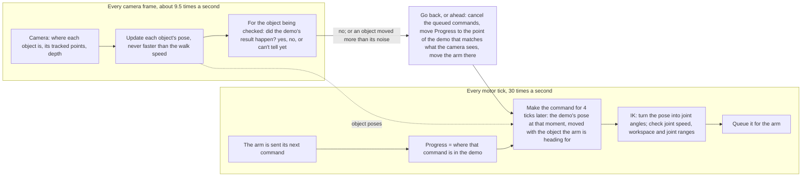
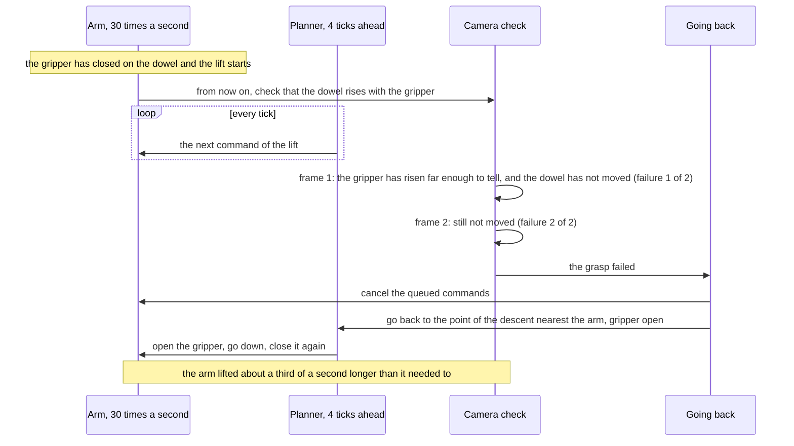

# Act execution: Progress, Milestones and the state checks

Status: proposed
State of the work: no tracking issue yet

An act replays a demo on objects that have moved. Today it does so as a string of separate motions: the arm goes to
each key frame, stops there, and while it stands the rest of the act is planned again. At speed 1.0 an act takes 1.4
times as long as the demo and stops 12 to 16 times. It only ever moves on, and it never looks at what happened: after
a missed grasp it carries nothing to the target, when the target is moved during an insertion it goes on with the
next step, and when a placed object falls over it reports success. The OpenArm 2 is meant to use the same runner.

**Proposal.** A new act engine, run beside the current one and chosen per act, plays the whole act as one motion.
[Progress](#glossary) marks how far through the demo the act is. For every motor tick the engine makes one
[command](#glossary) from the demo — the demo's pose at that moment, moved with the object the arm is heading for —
a few ticks before the tick, so when that object moves, the motion still to come bends toward it and the arm does not
stop. Where the demo shows an object being picked up or put down, or where the operator marks one, a
[Milestone](#glossary) checks with the camera that the same happened in the act. The arm never waits for a check:
when one fails, Progress jumps back to the nearest point of the demo that matches what the camera sees, and the act
goes on from there.

## Scope

In: one act on one arm, first key frame to last: legs, Progress, the command queue, the checks, going back or ahead,
the allowed turns (symmetry and landing), speed, the act's record, and how the engine sits beside the current runner.

Out, and why: working out object poses ([act_loop.md](act_loop.md) designs it; this design uses it); the motor loop
(`gui/api/jog.py`), which already sends the newest due command each tick; two arms at once, whose Progress would have
to be tied together; failures that need a model of cause ("the arm knocked something over") or a law fitted to the
demo (how far a screw goes in per turn); what is pinched in a cloth grasp, which takes touch
([state_check_research.md](state_check_research.md)). Not goals: collision checking beyond the workspace box and the
floor; deciding what to do after the act gives up, which belongs to whatever runs the act.

## Requirements

Safety first: the act must not act on a state that is not there. Then the motion should look like the demo's.

| #   | Pri | Requirement                                                                                                                                               | Target                                                                                                         | Why                                                                                                        | Checked by                                                                  |
| --- | --- | --------------------------------------------------------------------------------------------------------------------------------------------------------- | -------------------------------------------------------------------------------------------------------------- | ---------------------------------------------------------------------------------------------------------- | --------------------------------------------------------------------------- |
| R1  | P0  | The act never goes on past a failed Milestone, nor past a final one before every earlier Milestone has succeeded                                          | Never                                                                                                          | A missed grasp is followed by a carry today ([O2](#o2)); what cannot be undone must not be done on a guess | Unit tests; every act's record                                              |
| R2  | P0  | A failure sends Progress back, and a moved object back or ahead, to the nearest point of the demo that matches what the camera sees                       | The cases in [Going back, or ahead](#going-back-or-ahead)                                                      | The user's cases of 2026-10-17; finding a failure and recovering from it are one mechanism                 | A simulated act per case                                                    |
| R3  | P0  | A check reports success only when the camera can tell success from failure                                                                                | No success on the recorded misses, nor on made-up misses (a frame from before a lift paired with one after it) | A false success is R1's carry, approved                                                                    | Unit tests; a replay of the act records                                     |
| R4  | P0  | Only views the pose rule accepts move an object, or Progress                                                                                              | No update from a view it turns away                                                                            | The tracker accepted views 7.6 to 29.8 mm off ([act_loop.md](act_loop.md) O3)                              | A test that feeds such views                                                |
| R5  | P0  | No check, moved object or choice of turn holds up a command                                                                                               | No stop longer than one tick from any of them                                                                  | The arm stood 0.06 to 2.5 s while the act planned again ([O1](#o1))                                        | Simulated acts with moving objects; the rig                                 |
| R6  | P1  | An undisturbed act takes the demo's time divided by the speed, whatever rate the demo was recorded at                                                     | At most 1.15 × that, for demos at 15 to 60 frames/s, key frames one demo frame apart included                  | 1.38 × today ([E7](#e7)); the arm runs about 0.1 s behind its commands ([O4](#o4))                         | A simulated act per frame rate and speed; the rig                           |
| R7  | P1  | The arm stops only where the demo stopped, at a final Milestone, while the gripper opens before going back, or while the arm catches up with its commands | No other stop longer than 100 ms                                                                               | 12 to 16 stops per act today, most at key frames ([O1](#o1))                                               | The act's command record                                                    |
| R8  | P1  | A failed grasp is acted on soon after the camera can see it                                                                                               | Decided within 1 s of the lift making it visible; Progress moved within two camera frames of that              | The demo's lift rises 35 mm in 0.57 s ([E16](#e16)); the camera gives 9.5 frames/s ([E8](#e8))             | A replay of the act records; simulated acts                                 |
| R9  | P1  | Every threshold a check uses is measured during the act or set by the operator; none is a constant in the code                                            | Each threshold in the act's record, with the measurement or setting it came from                               | How far the rig's views of an object at rest wander is 15 mm in one act and 45 mm in another ([E14](#e14)) | A test: the same scene with noisier views reads "can't tell", not "failure" |
| R10 | P1  | One engine drives the SO-107 and the OpenArm 2                                                                                                            | The same arm interface                                                                                         | The runner names the SO-107's motors ([O10](#o10))                                                         | The engine's tests on both arms' kinematics                                 |
| R11 | P1  | The engine runs beside the current runner, chosen per act, and leaves it unchanged                                                                        | Either from the same page and API; the current runner's tests pass unchanged                                   | Acts with both on the same scene decide the switch                                                         | The existing tests; the record names its runner                             |
| R12 | P2  | Joint speed is limited by the arm and the motor loop, not by the slow ready/park speed                                                                    | 90 °/s on the SO-107; where a step would be faster, the act slows down there                                   | The limit is 30 °/s; the demo moved at up to 158 °/s ([O4](#o4))                                           | A simulated act faster than the limit                                       |
| R13 | P2  | Every check result and every jump of Progress is in the act's record, with what it was based on                                                           | One record per decision                                                                                        | Failures are diagnosed from the act's own record ([E7](#e7))                                               | A test of the record                                                        |

Conditions: the SO-107 (left arm) and its RealSense camera on this desktop; the insertion demo of 2026-10-17 and the
acts of 2026-10-15 to 17 with saved frames.

## Observations

**O1. The act stops at every key frame and plans again with the arm standing.** Each key frame is sent
and waited on until the arm is within 2° of it (`_act_key_frames_task`, `live_execution.stream`), and a line slows
into the key frame it ends on: from 26 °/s down to 3 and back up ([E3](#e3)). The arm stood 0.06 to 0.8 s at the end
of each stage, and 2.5 s after a grasp while the carry was planned twice ([E4](#e4)). So the stops come from how the
act is cut up, and following a moved object must not mean planning again.

**O2. The act only moves on.** The step a stream aims for only increases, and the runner takes the key
frames in order: an object moved during a grasp is followed by a closing gripper, a missed grasp by a carry.

**O3. IK is cheap; choosing between allowed turns is not.** Solving one pose to 0.5 mm takes 0.3 to
2.6 ms on both arms; under the rig's camera and tracker load, 1.7 ms typically, 21 ms at the 95th percentile and 75 ms
at the slowest ([E1](#e1)). Ranking the allowed turns solves every sample of every turn, and that was the 2.5 s stand
of [O1](#o1). So IK can run for every tick, a few ticks ahead, and ranking must run beside the motion.

**O4. The arm can move several times faster than the act lets it, and runs behind its commands.** The
demo moved joints at up to 158 °/s and the arm ran about 3 ticks behind; the act caps joints at 30 °/s, the speed
meant for ready and park ([E2](#e2), [E5](#e5)). The motor loop sends the newest due command each tick, never skips
one where the gripper starts, stops or turns back, and holds each goal within 12° of the joint's reading
(`jog._advance_playback`, `jog._clamped`); commands still queued can always be replaced. It once also moved each live
command at most 3° a tick from the one before (90 °/s) and held its playback for a joint 5° behind; neither is measured
against the arm, which turns its joints at up to 224 °/s and in end-to-end runs trails by 8 to 12° at the 95th
percentile ([E22](#e22)). Both are gone.

**O5. The grasp never lands exactly where it was aimed:** 4.6 to 7.4 mm and 1.2 to 1.8° from the demo's
in every act of 2026-10-16 and 17 ([E6](#e6)). So what follows a grasp must allow for how the object actually sits in
the gripper.

**O6. Object poses arrive 9.5 times a second, and how much they wander at rest differs between acts.**
Views of the ring standing untouched spread 15 mm in the median act and 45 mm in the worst (95th percentile within an
act; [E8](#e8), [E14](#e14)). So "the object moved" and "the object is where it should be" can only be judged against
the spread measured in the same act.

**O7. The camera can tell whether an object came along with the gripper only once the gripper has
moved away from where the object lay, and sometimes not even then.** Once the fingertip had moved 25 px in the image,
the object's tracked points had moved 0.84 to 1.0 as far when it was held and 0.01 to 0.03 as far when it was not
([E15](#e15)); where it lay reads empty once the arm stops covering it ([E12](#e12)). In 20 of 49 acts the gripper hid
the tracked points; the held object's 3D pose was wrong in every frame of the carry; after being put down, the object
was recognised from its reference view in 0 of 33 frames ([E13](#e13), [E17](#e17)). So a check chooses between two
outcomes that cannot be told apart until they would look different, and "can't tell" is a normal answer.

**O8. The gripper's readings say that something stopped the fingers, not what, nor where it is
later.** The gripper's position and load tell a hold from a miss 0.25 s after it closes, and the load measures the
servo's effort while the gripper moves ([E9](#e9) to [E11](#e11)). So they can add to a check but not make it.

**O9. Games and simulators need few checks, and never "can't tell".** Held, inside a place, on top of,
a part turned, at rest; a VR grab counts as broken when the object drifts too far from where the hand should be
holding it, with no assumption that the grip is rigid; ManiSkill and robosuite count a placement only once the robot
has let go and moved off
([state_check_research.md](state_check_research.md#how-games-and-simulators-define-the-same-predicates)). Here the demo
is the only statement of success, and the camera is calibrated to the arm's base, which moves on a mobile robot. So the
checks ask what an object moves with — the gripper, another object, the base — as the demo shows it.

**O10. The two arms differ only in kinematics, gripper and motors.** The SO-107 solves its IK with
Pink, the OpenArm 2 with the vendor's mink solver (a Pink build of its URDF exists); the OpenArm 2 has 7 arm joints.
The runner uses the SO-107's motor names (`joint_alignment.MOTOR_NAMES`). So the engine needs kinematics, joint ranges,
the joint speed limit, and which gripper column closes which way, nothing else.

## Design

### The two loops

The engine runs two loops at two rates, drawn the way game engines draw their threads. The motor loop makes and sends
the motion; the camera loop checks the result. Neither waits for the other: a failure reaches the motion by moving
Progress.

Commands are made 4 ticks ahead so each is ready before its tick even when IK is slow: the engine keeps as many ticks
queued as the slowest solve it has measured in this run needs, plus one — 4 on the rig, where the slowest took 75 ms
([O3](#o3)).

### Legs: the path between two key frames

A leg is the demo between two key frames. It starts from wherever the arm is when the leg begins and ends at its key
frame, which is held relative to an object or to the arm's base. Each command of the leg is

    pose(s) = blend( C₀ · D(0)⁻¹ · D(s),   M · D(s),   w(s) )

- `s`: how far through the leg the command is, 0 to 1;
- `D(s)`: the demo's pose at that point (for a line, the straight path between the demo's poses at its two key frames);
- `C₀`: the command the leg began from, frozen;
- `M`: how far the leg's end object has moved since the demo, read anew for every command;
- `w(s)`: rises smoothly from 0 to 1 over the leg.

What this does:

- The object the arm is leaving no longer matters once the leg has begun: going from above A to above B, A moving
  changes nothing.
- The object the arm is heading for is read for every command: when it moves, the rest of the leg bends toward it, a
  little at first and fully by the key frame, and the arm keeps moving.
- A leg that starts and ends at the same object — a grasp, an insertion — follows that object fully all the way
  (`w = 1`): inside a ring, the arm must move with the ring. Only if the arm starts away from the leg's start (after a
  best-effort stop) does `w` rise over the first part, to close the gap.
- With nothing moved, both sides are the demo's own pose.
- While an object is held, the pose is corrected for how it sits in the gripper, measured at the grasp ([O5](#o5)),
  so the held object, not the fingertip, goes where the demo's went.
- A new view of an object reaches the commands no faster than the walk speed the operator set, so a jumpy view cannot
  jerk the arm. Commands already queued, at most 4 ticks, keep the pose they were made with.

### The demo's clock

Commands are made from the demo's clock, not from its frames or its key frames. Each tick moves the clock on by the
speed times 1/30 s, and the command is the demo's pose at that time, interpolated between the two demo frames around
it. That is what keeps the act on the demo's time at any recording rate and any speed:

- A demo recorded at 60 frames/s, or played at 2×, gives about two demo frames per tick; one at 15 frames/s, about one
  every two ticks. Either way the act takes the demo's time divided by the speed.
- Key frames marked on every demo frame, as a grasp or a place may be, are legs a thirtieth of a second long, and one
  tick can cross several. Its leftover time carries into the next leg: no leg is rounded up to a whole tick, so no
  time is gained or lost per key frame.
- Where the demo kept moving through a key frame, the act does too: no slowing down, no gripper moving while the arm
  waits.
- A leg where the demo stood still (the gripper closing) stands for the demo's time; nothing is divided by its length.
- A line takes the demo's time between its key frames, scaled by how much longer or shorter the line is than the path
  the demo took there.
- The gripper's turning points — where the demo's gripper command starts, stops or turns back — are never smoothed
  away: the tick nearest each one gets its exact value, so a closing reaches its full command even when it falls
  between ticks. The motor loop never skips such a command when it catches up.
- Where a joint would move further in a tick than the motor loop's clamp (12°), the clock runs slower there, and the
  act's record says by how much. The bound guards against a solve that jumps; it is not a speed limit, and on the rig
  it has not slowed an act ([E22](#e22)).
- Nothing waits for an arm that trails its commands. A joint that sticks breaks away as its goal moves on, as in
  end-to-end runs; a goal held still stops the effort that frees it ([E22](#e22)). A joint 25° behind its command is
  blocked, and the motor loop freezes the arm. Only a gripper opening waits, at most 0.5 s, for every joint within 3°.

([R6](#requirements), [R7](#requirements), [R12](#requirements))

### Milestones: where, which object, when

**Where.** Only where the demo shows an object start or stop moving with something:

- at a grasp: the object starts moving with the gripper (in the demo, the gripper stopped closing before its command
  because the object held it open: `core.demo_holdings`);
- at the release of a held object: it stops moving with the gripper and stays where it was put, relative to the
  object the leg ends at, or to the base;
- at a key frame where the operator marks one: an object, and what it moves with from there (a block pushed by the
  gripper without a grasp; a handle turning with the toy's body).

Opening or closing the gripper with nothing in it makes no Milestone.

**Which object.** Each Milestone names one object: the one picked up, put down or marked. It is checked from that
moment until the object's next Milestone, or the end of the act: the dowel from the grasp until it is put down, then
from being put down to the end. Only those objects are checked, usually one at a time; the others matter only as
what legs are relative to.

**When.** On every camera frame, for each object being checked: 0.06 to 0.18 ms per check ([E19](#e19)), beside the
motion and never in its way. Every frame rather than at key frames, because the answer appears when the gripper has
moved far enough from where the object lay for the two outcomes to look different, and no key frame marks that
moment ([O7](#o7)).

### What a check answers, and how close counts

- **Success:** what the demo shows happened. After a grasp the object rises with the gripper; after a release it
  stays where it was put while the gripper moves off.
- **Failure:** the other outcome happened. After a grasp, the object stayed where it lay. After a release, it came
  away with the gripper, or it is not where it was put: it fell, rolled, or was put down off target.
- **Can't tell:** the camera cannot see the object, or the gripper has not moved far enough yet for the two outcomes
  to look different. A grasp can't be told until the lift; a release, until the gripper has moved off.

A failure counts once two camera frames in a row show it. If the clues disagree — the tracked points say the object
came along, the depth image says it is still lying there — the check can't tell, and a later frame decides.

**How close counts.** No threshold is a number written into the engine ([R9](#requirements)):

- _The noise is measured, per object, in this act._ For every object standing untouched — before the arm reaches it,
  and all act long for those it never touches — the engine records how far its views, its tracked points and the
  depth on its surface wander. On the rig the views wandered 15 mm in one act and 45 mm in another ([O6](#o6)).
- _A check compares two predictions, not a fixed ratio._ For a grasp it predicts where the object's tracked points and
  surface would be if it came along with the gripper, and where if it stayed, and takes the one the camera is nearer
  to, once the two are further apart than the measured noise; until then it can't tell.
- _Where the object should be is the demo's:_ relative to what it was put on, as the demo left it.
- _How far off the task allows is set by the operator,_ per Milestone in the demo editor, the way the landing freedom
  is set today: one demo cannot say whether a place needs a millimetre or a few centimetres. By default there is no
  allowance, so the check is as strict as the camera can see, and no stricter.
- _Equivalent poses pass:_ the object's declared symmetry (its repeating turns, a continuous axis, swapped ends) and
  the landing freedom of the leg (exact, the target's symmetric turns, any turn about its axis).
- _The depth check fits the object's surface to the depth near where it should be,_ and passes when a fit within the
  noise and the allowance exists. Testing one exact pose would fail on the grasp's own error of 4.6 to 7.4 mm
  ([O5](#o5)).
- _Two are choices, not measurements:_ "most of the object's visible surface points" for the depth check, and two
  frames in a row for a failure. Each is the least that ignores a single bad frame or a few bad pixels.

**What it does to Progress.** A failure sends Progress back. Success or can't tell lets the act go on, and the check
keeps running while the object is being checked, so a drop during the carry or a fall after the release is still
caught. Only at a Milestone the operator marks final — something that cannot be undone, such as a pour — does the arm
wait: it does not go past until every earlier Milestone has succeeded, and the act gives up if that does not come
within a time the operator sets. When the motion is over, an act whose every Milestone succeeded is done; one with a
Milestone the camera still cannot tell is "not confirmed", never a success ([E24](#e24)). ([R1](#requirements),
[R3](#requirements), [R8](#requirements))

### Going back, or ahead

**When a check fails**, or a command cannot be reached, Progress moves to the nearest point of the demo that matches
what the camera sees:

- not past the next Milestone that has not yet succeeded;
- never back past a final Milestone;
- nearest to where the arm is now, compared relative to each point's own object, with a cost for jumping far through
  the demo.

A Milestone that Progress goes back past must succeed again; one that fails a second time makes the act give up
([Q1](#open-questions)). The arm first waits for a new view of the object, which may have fallen somewhere new, then
gets to the new point by a short straight move at the walk speed, opening the gripper first if it has to open, closing
it last if it has to close. ([R2](#requirements), [R4](#requirements))

**When the object the arm is heading for moves** by more than its measured noise, on two views in a row:

- during a follow — in contact, or nearly, as in a grasp or an insertion — the arm backs out along the demo's own path
  relative to where the object was, to the start of that follow, and goes in again relative to where it is now. The
  nearest point is not enough here: after a sideways move every point of the descent is as far, so nothing would take
  the arm up out of the ring. Until the second view confirms the move, the arm keeps to where the object was rather
  than drifting sideways inside it.
- during a line, the line re-aims from where the arm is and keeps its speed: a target moved nearer is reached sooner,
  one moved away later.

A missed grasp, step by step:

| What happened                                             | Where Progress goes                                 |
| --------------------------------------------------------- | --------------------------------------------------- |
| The grasp missed                                          | back to just above the object: open, grasp again    |
| The object fell out during the carry                      | back to the approach to the object, where it now is |
| It was put down off target, or came away with the gripper | back to the approach to the object, where it now is |
| It fell over or rolled after being put down               | back to the approach to the object, where it now is |
| The target moved nearer                                   | ahead: the part the arm no longer needs is skipped  |
| The target moved away during an insertion                 | back up out of it, and in again                     |
| A final Milestone was passed                              | nowhere: the act gives up and says why              |

### What the engine keeps of the key frames

| Today                                                         | In the engine                                                                                                                   |
| ------------------------------------------------------------- | ------------------------------------------------------------------------------------------------------------------------------- |
| A key frame's object: an object, the taught object, the world | the object the leg arriving at it is heading for                                                                                |
| Its move: line, follow, lift                                  | line: straight from where the arm is; follow: the demo's own path; lift: straight up by `up_mm` from where it is                |
| Its gripper: first, along                                     | on a line, the gripper moves before the arm, or with it                                                                         |
| Its constraint: pose, orientation                             | the whole pose; or only the rotation, the position staying where the leg started                                                |
| Its constraint: best effort                                   | the key frame is a target: when the arm stops short, the leg ends where the arm is and the next starts from there ([E23](#e23)) |
| A held object, from the grasp to the release                  | the legs between allow for how it sits in the gripper; the grasp and the release are Milestones                                 |
| An object's symmetry: repeating turns, an axis, swapped ends  | turns its legs may take, chosen beside the motion; poses the checks count as the same                                           |
| The demo's landing: exact, symmetric turns, any turn          | turns the legs onto the target may take, chosen beside the motion; poses the checks count as the same                           |
| The point groups carrying objects between views               | another source of object poses                                                                                                  |

Allowed turns are ranked again when their object moves — IK of the leg's key frames and a few of its points, from the
arm's present joints, by whether the arm reaches them and how close its joints stay to the demo's — and a different
turn is taken only before its leg begins, and only when it is clearly better. ([O3](#o3), [R5](#requirements))

### What the engine connects to

The engine (`lerobot.showservo.engine`) holds no GUI state. It reads three things: the arm (kinematics, joint names,
which gripper column closes which way, joint ranges, workspace, joint speed limit), the motor loop's queue (what was
sent; add to it; cancel what is not sent; its clock), and a log that perception writes into (object views, tracked
points, depth frames, the fingertip from the arm's joints, the camera). The GUI fills them in, and the act request
says which runner to use. The act's record holds every check result with what it was based on, every move of
Progress with its cause, and every command sent; at the end it says which Milestones succeeded, which failed and why,
and which were passed while the camera couldn't tell, apart from a fault that stopped the act. ([R10](#requirements),
[R11](#requirements), [R13](#requirements), [O10](#o10))

## Alternatives, and what this costs

- **Keep the runner and plan ahead of the arm** (`a3e0cf48c`, `d8d36d606`): fewer stops at the end of each stage, but
  it still stops at key frames, plans again whenever something moves, never goes back, and checks nothing.
- **Change the runner in place:** its stops and its planning again are how it is built ([O1](#o1)), and without it
  there is nothing to compare acts against while the new one is unproven.
- **Check at key frames, or make every Milestone wait:** a key frame comes before or after the moment the outcomes
  look different, and waiting stops the arm where the check needs it moving ([O7](#o7)).
- **The gripper's readings as the check:** fast, but they say nothing about where the object is later ([O8](#o8)).
- **A learned success detector (SARM, in this repository; a vision-language model):** seconds per answer, needs
  labelled demos, cannot say which fact failed; it could come later as a slow second opinion.
- **A model of tables and supports:** the table would have to be found and tracked, and a deliberate drop would read as
  a failure; the demo already says where the object ended up, relative to what.
- **A state machine written per task:** every task would carry its own recovery; the engine stays the same for every
  task.

What it costs. Two runners exist until the switch. Running ahead of the checks spends motion that a failure undoes:
about a third of a second, plus the move back. A grasp whose tracked points the gripper hides goes on unconfirmed, and
a miss is then caught only where the object turns out not to be: where it lay, once the arm uncovers it, or at the
release. IK solved tick by tick notices a change of arm configuration only when it comes. Every update depends on the
views the pose rule lets through.

## Open questions

**Q1. How many times may a Milestone fail before the act gives up?** More tries recover more failures,
and waste more time on a task that cannot succeed. Leaning: twice.

**Q2. After a failure, how does the arm get back to the earlier point?** Straight there, after opening
the gripper; or by playing the demo's motion backwards. Straight is shorter; backwards follows a path the demo showed
was clear of the object. Leaning: straight there. In contact the question does not arise: a moved object
always backs the arm out along the demo's path (see [Going back, or ahead](#going-back-or-ahead)).

To measure: the checks on the act records, with real and made-up misses ([R3](#requirements), [R8](#requirements));
what the depth fit costs per frame; how much each object's views, tracked points and depth wander at rest on the rig,
per act; the OpenArm 2's following error and gripper readings; how long the command queue takes to fill on the rig
under load; how long ranking the ring's allowed turns takes.

## Glossary

- **Progress:** how far through the demo the act is: the leg, and how far into it, of the last command sent to the arm.
- **Command:** what the arm is told for one motor tick: a pose and a gripper value, turned into joint angles.
- **Leg:** the demo between two key frames.
- **Milestone:** a point where the demo shows an object picked up or put down, or where the operator marks one, with
  the check that the act did the same; _final_ when it cannot be undone.

## Appendix: evidence

Taken 2026-10-17 on `proto/show-and-servo` (`be2e1822e` to `d8d36d606`), from the insertion demo, the acts' own
records on the rig, and benchmarks on the same desktop.

**E1. IK timing.** Pink, 50 QP iterations a call, targets 1 to 100 mm and 0.5 to 30° from a working
pose. SO-107: one call 0.2–0.8 ms, a solve to 0.5 mm 0.6–2.6 ms (4 at most). OpenArm 2 (Pink, URDF): 0.2–0.9 ms and
0.3–1.6 ms (12 at most). On the rig during act `20261017_125408`: 1.7 ms median, 20.8 ms 95th percentile, 74.8 ms
at most (`stream_diagnostics.solve_ms`).

**E2. Joint speed.** The teleoperated insertion demo reached 119 °/s at the shoulder lift, 137 °/s at
the elbow, 116 °/s at the wrist flex; following error 1.9° at the median at 10 to 30 °/s, 6.3° at 60 to 100 °/s; the
reading trails the command by 2 to 4 ticks.

**E3. Stops.** Command standstills over 100 ms between the first and last key frame: 15 (3.1 s) in act
`125408`, 16 (5.1 s) in `130202`, 12 (2.6 s) in `150843`. Across the withdrawal-to-lift boundary of `150843`, by tick:
26, 25, 23, 20, 17, 13, 8, 3, 6, 10, 14, 18, 20, 22, 23 °/s.

**E4. Re-planning.** Between streams: 2.13 s in `125408` (1.09 s settling), 3.53 s in `130202` (2.52 s
after the grasp: the carry failed at the start's landing turn and every turn was ranked again), 1.41 s in `150843`.

**E5. The joint cap.** `jog.RAMP_DEG_S` = 30 °/s with a 1.5 easing margin: the lines of `150843` ran at
0.64 to 0.67° a tick; its lift away turned the shoulder 62° in 3.3 s, which the demo did in 1.2 s, faster than 30 °/s on
31 of 36 samples (158 °/s at most). Live playback, until 2026-10-18: 3° a tick from the previous command
(`jog.PLAYBACK_LAG_DEG`, [E22](#e22)).

**E6. The hold at the grasp.** Against the demo's, in the eight acts of 2026-10-16 23:19 to 10-17 13:02:
4.6 to 7.4 mm, 1.2 to 1.8°.

**E7. Durations**, key frames 2 to 9 of the insertion: demo 13.66 s; act `125408` 19.77 s
(`be2e1822e`); `150843` 18.89 s (`a3e0cf48c`). The insertion's follow: demo 4.81 s; acts 6.20 s, then 5.37 s.

**E8. Tracker rate.** About 9.5 frames/s with Point2Pose, 2026-10-16
([action_queue_timing.md](../../gui/docs/action_queue_timing.md)).

**E9. Gripper width.** 264 act records, 77 with a grasp check: holds (75) stopped 0.85 to 2.40 units
short of the command, misses (`20261015_213310`, `_221031`) 0.69 and 0.41; the reading settles 0.10 s after the
closing command ends (0.40 at most, 95 acts). 1 unit = 14.9 encoder counts.

**E10. Gripper load at rest.** Median over 0.5 to 2 s after the closing: holds 144 to 232, misses 20 and
34, open at most 24. Hold evidence from vision came 9.9 to 21.8 s after the closing in 8 acts; 110 attempts failed
over 48 acts.

**E11. The release.** The reading follows the opening command within 0.03 s; the load falls from 200 to
28–44 at 0.4–0.5 s, then reads 210 to 264 while the reading trails the command by 4 to 5 units.

**E12. The resting place.** The object's mask and depth on the act's first frame; per later frame, the
share of those pixels reading the object (within half its height), the table, or nearer. Act `20261017_150843`: nearer
(the arm) until 4 s after the closing; empty from 4.45 s, then empty at 0.50 or more (10th percentile) and the object
at 0.00 (90th). Act `_125408`: empty from 4.50 s, then 0.83 and 0.02. The dowel lay 7 to 13 mm above the table.

**E13. The placed object.** Act `20261017_150843`: of 33 frames after the release, the dowel's view
against its reference accepted none; its tracks were visible on 179 of 323.

**E14. Pose spread at rest.** Trusted views of the ring standing untouched, 41 acts, 14 views each at
the median: the spread of their translation, at the 95th percentile within an act, 15.2 mm in the median act and
44.9 mm in the worst (raw tracker 19.8 mm in the median act); rotation 2.0° (raw 2.6°); the pose the act aimed with drifted 13 mm over 2.3 s
with the ring untouched.

**E15. 2D co-motion.** 49 acts of 2026-10-15 to 17 with frames and a closing; reference 0.3 s after
the closing, verdict at the first frame with the fingertip's projection 25 px away. 22 verdicts (five or more tracks
in common): the tracks' median displacement over the fingertip's 0.29 to 2.38, median 0.91; 20 acts had 0 to 4 tracks
left. At rest over the approach of 39 acts: 33 at 0.006 to 0.034, no track over 8 px; 6 at 0.20 to 1.85, every track
shifted 7 to 50 px while the act's pose of the object moved 15 to 34 mm. Track ids are stable over an act.

**E16. The demo's lift.** After its closing command ended, the demo's fingertip had moved 20 mm in
0.27 s, 35 mm in 0.57 s, 50 mm in 0.63 s.

**E17. The pose in the hand.** Act `20261017_150843`: the tracker's pose of the held dowel existed in
all 86 carry frames, accepted in none, moving 413 mm against the fingertip's 136; perspective-n-point on the 6 to 13
model points still tracked scattered over 1.2 m. The demo's tracker saw the held dowel in 0 of 101 samples.

**E18. What each frame records.** `frames/NNNNNN.npz`: `track_idx`, `track_uv`, `track_vis`, `model_xyz`,
`model_valid`, `fit_uv`, `fit_inlier`, `delta`, the followed objects under `other_*`; the held object's pose relative
to the fingertip (`held_0`).

**E19. What a check costs.** On a rig-sized synthetic frame (848 × 480, the rig's intrinsics and camera
pose), mean of 200 calls on this desktop, idle: depth at 1,372 surface points 0.18 ms; 60 tracks against the gripper's
motion 0.06 ms (`lerobot.showservo.engine.predicates`, working tree on `eb29ecba7`).

**E20. The first engine act on the rig**, 2026-10-18, `d66681568`, the insertion demo at speed 0.5 (act
`20261018_005946`). The grasp's follow was sent over 0.93 s, the demo's time over the speed exactly; the two lines
before it over 1.13 s and 1.20 s against the demo's 1.67 s and 1.61 s, their straight share. Joints trailed their
commands by 1.5° at the median and 3.0° at most, at up to 40 °/s; the motor loop never held the playback. The grasp's
check said success from the tracked points: 3.1 px from "came along" against 21.1 px from "stayed". The straight line
the demo marks after the grasp then drove the held dowel's free end into the ring's side in this layout (the dowel
pointing at the ring); the shoulder's load rose to its maximum and the jog froze the arm. The demo's own path went up
before over; a lift key frame or a follow from the dowel's frame into the ring's would replay that.

**E21. The second engine act on the rig**, 2026-10-18, `271f1717b` with a lift marked after the grasp, speed
0.5 (act `20261018_052107`). The dowel lay about 6 cm further from the arm's base than in the acts of 2026-10-17.
The gripper held it throughout (reading 95.5 to 97.6 at a command of 100). Through the lift the shoulder moved in
steps — its reading stood still while its command went on, until the error broke it loose — at 24 to 31° with its
load at 400 to 624; in act `20261017_150843` the same lift kept the shoulder at 1.5 to 21°, its load at most 404 and
its lag at most 3.0°. The fingertip followed its commanded path across within 4 mm and fell behind it in height (47
against 71 mm after 3.2 s); the dowel's tracked points moving 40 px toward the image's edge are the lift's perspective,
not a move across. The shoulder then stood 5° behind a still goal at a load of 624, at the same 24 to 26° where the
morning's act (E20) had stopped, until the jog froze the arm. No contact shows in the frames. It stood there because
the motor loop's hold had stopped its goal 5° ahead of it ([E22](#e22)).

**E22. The motor loop's own hold stalled the shoulder**, 2026-10-18. Act `20261018_052107`'s commands
replayed with nothing held (`/api/jog/replay`, P 32, feed-forward 3.2): lifting, the shoulder stood still at 30.6°,
27.1° and 24.4° while its load rose to about 530, then moved on, each time. At 24.35° the replay's commands had ended
4.96° from it (6.8° with the feed-forward's −1.87°), where the act's hold had stopped them; its load settled at 624
and it stood for 4 s. Four end-to-end SO-107 datasets on this machine (`cylinder_ring_assembly`,
`cylinder_socket_merged_head`, `eval_cylinder_socket_feb_15`, `eval_act_pickup_socket_mar_01`; the last two from before
the follower's gains were configurable, so P 16 and no feed-forward), sent every frame with nothing held back: the
shoulder lift trailed its command by 1.5 to 1.9° at the median and 7.8 to 12.5° at the 95th percentile, more than 5°
behind on 17 to 29% of frames, and the arm followed. Its joints turned at 42 to 161 °/s at the 99.9th percentile; in
the jog's act records (2026-10-05 to 18, 106,545 ticks) at 56 to 136 °/s, 224 °/s at most. Neither act of 2026-10-18
was slowed by the engine's 3° joint bound (`stretched_s` 0.0).

**E23. A lift stopped short by a joint's range**, 2026-10-18, act `20261018_094848` (speed 0.5, P 16, no
hold): the grasp and the lift went through. The dowel lay near the arm's base, so lifting it straight up at the grasp's
turn folded the wrist: wrist flex reached its servo range (−93.3°) 58 mm into the 100 mm lift, with the forearm roll
at −2°. The lift is best effort, so it went on with its commands below their poses, 30.4 mm at the top (orientation
within 0.2°). The line after it started from the lift's planned top, no joint's reach: its first sample was 31.9 mm
out and the act gave up, though both its ends were reachable (0.2 to 0.4 mm, solved from the lift's last joints).
The demo itself had turned the forearm to 43° during its lift and to 76° before the pre-place. Fixed: a best-effort
command's pose is where its joints get, and the run after a best-effort leg starts there.

**E24. The hold taken from the command, and a fall reported as a success**, 2026-10-18, act
`20261018_111834` (`6facafcb7`, speed 0.5, `white_left`: P 32, feed-forward 3.2). The grasp, lift and carry ran; the
grasp's check said success (tracks 17-27 px from "came along", 123-132 px from "stayed"). The dowel hovered about 5 mm
off the ring's hole (seen by the operator; the camera above cannot tell inside from above), was let go, fell over and
rolled away, and the act ended "ok" with the release "could not tell" (no tracked point in two frames, the depth
wandering 24 mm). At the firm grip the fingertip read 6.3-7.5 mm and 1.7-2.1° from its command, the grasp's usual
miss (O5). The hold is measured from the fingertip at that moment, but the GUI's fingertip lookup interpolates
between two encoder reads and none comes after "now", so the engine took the commanded pose and held the dowel as the
demo did. The key-frame runner's acts that inserted (`20261017_130202`, `_150843`) read the fingertip after the
gripper settled: holds of 5.9 and 4.8 mm. Fixed: "now" is the latest read, at most two ticks old; the grasp's record
says where the fingertip came from and the hold it gave; an act whose checks cannot tell ends "not confirmed".
