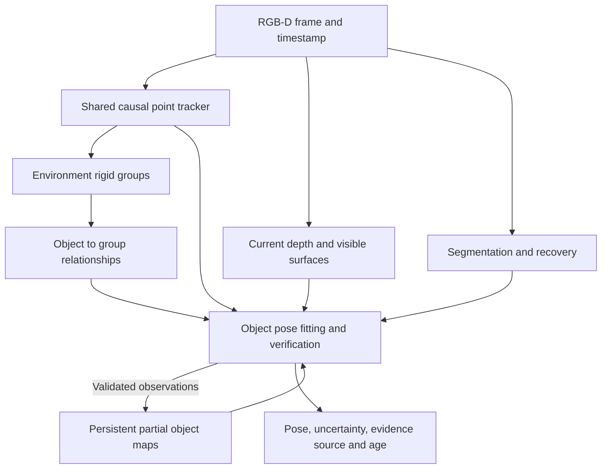

# Model free rigid object tracking architecture

Design discussion: [TheWisp/lerobot #265](https://github.com/TheWisp/lerobot/discussions/265).

The target is causal, real-time tracking of previously unseen rigid objects from
one calibrated RGB-D camera. A point or mask designates an object. No CAD model,
prepared reference views, object-specific training, known category, or wrist
camera is required. Generic pretrained networks and geometry accumulated online
are compatible with this requirement.

The central design decision is to combine persistent object identity, shared
point tracks, environmental rigid-motion groups, and current surface evidence.
Rigidity lets visible parts constrain hidden parts; it does not reveal arbitrary
motion of an entirely hidden object.

## Proposed architecture

**NOT IMPLEMENTED as an integrated tracker.** The following is the proposed design
direction, not a description of the current robot controller.

**NOT IMPLEMENTED: shared observations.** One point tracker would supply all
objects and motion groups. P2P already shares a point tracker and segmenter among
its own objects; the existing separate group path performs additional tracking.
Every observation and delayed result must retain its capture timestamp. A late
correction must be transported to the current frame, not overwrite current motion.

**NOT IMPLEMENTED: persistent object maps with controlled growth.** Initialize a
partial map from the visible RGB-D surface and keep its object coordinate frame
fixed as more geometry appears. Store surface positions, normals, appearance,
uncertainty and observation history. New geometry remains provisional until
repeated observations under adequately constrained poses support it. Never fuse
predicted hidden points or foreground occluders as measured object surfaces.

**NOT IMPLEMENTED: joint object and environment reasoning.** Keep object identity
separate from temporary motion-group identity. Background groups provide a scene
reference; supporting or carrying groups can propagate an object's last observed
relationship through occlusion. For example,
`T_camera_object = T_camera_tray @ T_tray_object`. The relationship has its own
uncertainty and can be broken by visible evidence of sliding or slip. Two objects
being stationary together does not prove attachment. Surrounding depth also
explains occlusion and identifies samples belonging to other surfaces.

**NOT IMPLEMENTED: pose updates by observable direction.** Fit persistent
correspondences and visible surface geometry, then determine which translations
and rotations the observations constrain. A textureless plane alone cannot
determine sliding or rotation within that plane. Preserve uncertainty or multiple
plausible orientations where necessary. Current object observations can contradict
a group or attachment prediction; shared point tracks are not independent votes.

**NOT IMPLEMENTED: bounded fast and maintenance loops.** The fast loop would
update points, rigid fits, depth consistency and uncertainty. Segmentation refresh,
recovery and map refinement would receive a separate bounded budget. Keep checks
for motion in apparently stationary groups. Measure end-to-end observation age
and tail latency as well as FPS; no future-frame window may masquerade as an
immediate robot-control estimate.

## Which evidence is authoritative

**PROPOSED POLICY, NOT IMPLEMENTED arbitration.** Authority belongs to supported
observations of the relevant motion component, not permanently to one tracker.

| Evidence                     | Legitimate authority                                                                 | Limitation                                                                                                            |
| ---------------------------- | ------------------------------------------------------------------------------------ | --------------------------------------------------------------------------------------------------------------------- |
| P2P correspondences          | Persistent appearance identity and candidate rigid pose                              | Bad correspondences, depth lookup or map history can bias a pose despite many inliers                                 |
| Current RGB-D surface        | Geometry and orientation components actually observable in that surface              | Local minima, symmetry, occlusion and shared sensor errors; a smaller residual does not establish a full correct pose |
| Group motion                 | Relative scene motion and propagation of an established object-to-group relationship | Cannot repair an incorrect reference pose or guarantee that a hidden object did not slip                              |
| Gripper or motion prediction | Conditional continuation while direct evidence is absent                             | Must remain labelled predicted; it cannot establish unseen object motion                                              |

A supported contradiction should first withdraw permission to use the disputed
pose. Replacing it requires a supported alternative on the same frame, object
reference and relevant degrees of freedom. When that is unavailable, preserve
uncertainty and reacquire. Do not automatically average conflicting poses or give
the full RGB-D refit unconditional priority. An inconclusive check is not agreement.

### Active inspection after consistent arbitration

**NOT IMPLEMENTED.** Once the evidence policy is validated, an uncertain held
pose should be able to request a short inspection motion. Choose the motion from
the ambiguity: reveal a second surface or persistent feature that constrains the
uncertain rotation or translation. Repeated samples of the same ambiguous face
can reduce noise without resolving the missing constraint. Adding arbitrary point
counts or executing the same fixed rotation for every object is not the policy.

Plan the arm and held object's swept volume through observed free space, using
the range of plausible held poses rather than just the current best estimate.
Use the existing single RGB-D camera; a wrist camera is not required. Rank feasible
small motions by expected visibility and information gain against motion time and
clearance. If the available geometry cannot support a safe informative motion,
keep the ambiguity explicit and request intervention.

After moving, verify the new observations before accepting a pose or extending
the object map. The commanded wrist motion is a prediction, not proof that the
object followed it without slipping. Stop once uncertainty is small enough for
the placement tolerance, or when the motion budget is exhausted or no useful
view is reachable. Record the original ambiguity, selected motion, acquired
evidence and resulting uncertainty so replay shows why inspection helped or failed.

## Current implementation and retest readiness

Audit of LeRobot `7c59def47`, P2P `95bd7a8`, October 13, 2026:

| Question                                                    | Implemented behavior and evidence                                                                                                                                                                                         |
| ----------------------------------------------------------- | ------------------------------------------------------------------------------------------------------------------------------------------------------------------------------------------------------------------------- |
| Is partial visibility available?                            | Some held-object frames have object points and depth. This does not establish accurate full 6D pose under occlusion.                                                                                                      |
| Is ambiguous held pose solved?                              | No. Visual hold estimation and refusal of blind encoder fallback exist, but consistent biased estimates can remain ambiguous.                                                                                             |
| Are disagreements visible?                                  | Yes. Live and replay panels, per-frame records, and disagreement events compare raw P2P with group motion and an RGB-D refit.                                                                                             |
| Do those disagreements override or reject the control pose? | No. Verification currently runs after acceptance and is diagnostic only.                                                                                                                                                  |
| Which pose currently wins?                                  | A P2P update passing existing visibility, depth and centre-support checks replaces the stored pose. Groups carry that accepted pose between updates. The RGB-D diagnostic never replaces it.                              |
| Is the hold path covered by those diagnostics?              | It reads raw P2P pose history and checks agreement across views; diagnostic contradictions do not veto that history. Repeated agreement is not a proof of geometric accuracy.                                             |
| Which P2P corrections are active?                           | Delayed-keyframe motion preservation is on. Consensus refit, refined-pose return and object-centred jump guard are locally off; depth lookup remains legacy because evaluated combinations worsened local pose agreement. |
| Is physical stacking ready?                                 | Not established. The current estimator retains the known failure, and the architecture above has not been built or validated.                                                                                             |

Current diagnostic checks use the planner's existing tolerances. They are not
calibrated six-dimensional confidence intervals. The recorded reference suite has
pose ground truth; the local stacking recordings do not. Keep surface agreement,
tracking availability and physical placement success distinct.

The immediate prerequisite for another stacking test is a validated decision
about conflicting or insufficient evidence, covering the target pose and the
held-object correction path. A diagnostic-only observation or replay can proceed
without connecting the robot and should establish whether fresh initialization
removes or merely restarts the failure. A veto can prevent using a questionable
pose; it does not itself solve pose estimation.

### Perception retest on October 13

The arm remained disconnected, follow was off, and no act ran. Before refreshing
the cube's visual initialization, 30 distinct tracked frames all accepted a cube
pose that conflicted with both checks: P2P-to-group rotation difference ranged
from 15.07 to 20.48 degrees; P2P-to-surface-refit difference from 14.25 to 19.95.

A fresh, successful cube locate was followed by 120 sampled tracker outputs.
One was a cached pre-initialization frame and is retained separately. Among the
119 new frames, 55 still accepted a pose with at least one disagreement: 52
surface disagreements and 30 group disagreements, with overlap. Maximum rotation
differences were 6.06 degrees to the surface refit and 4.97 degrees to groups.
Group reference changes and unavailable group comparisons are retained in the
record; none are relabelled as agreement. This is a live perception retest of the
stationary scene, not an in-hand trial or a ground-truth pose benchmark.

Fresh initialization reduced the accumulated discrepancy but did not establish
readiness for stacking. No physical retest followed this failed readiness check.
Evidence is archived as `20261013/tracker-readiness/143413` in the local experiment
archive, including the probe, all sampled states, image/geometry snapshots,
initialization reply, source identity and explicit cached-frame accounting.

An additional offline audit compares transformed demo-face normals with robust
plane fits to the current raw depth, using the saved cube locate mask rather than
each candidate pose's projected mask. All nine included geometry snapshots have
exactly matching pose timestamps; the cached pre-locate sample is again excluded
from the fresh results. With five-pixel mask erosion, normal disagreement is:

| Sample                     | P2P                         | Surface refit     | Group prediction  |
| -------------------------- | --------------------------- | ----------------- | ----------------- |
| Before locate, 3 snapshots | 22.63° median; 21.56–23.53° | 4.83°; 4.43–5.42° | 5.50°; 5.47–5.68° |
| Fresh, 6 snapshots         | 5.78° median; 5.02–7.31°    | 3.53°; 2.01–4.88° | 3.95°; 3.08–6.49° |

Thus the large disagreement included actual surface tilt, not merely ambiguous
rotation around the face normal. Neither alternative is exact or universally
better: one fresh snapshot favours P2P over groups, and changing erosion can
reverse a small P2P/refit difference. Erosions of 3, 7 and 11 pixels change the
reference normal by up to 2.38° and current normals by up to 1.82° relative to
five-pixel erosion. These are sensitivity checks, not confidence intervals. The
fits share the same depth sensor and measure only two orientation components,
not independent full-pose ground truth. Script and results are archived alongside
the probe as `normal_audit.py` and `normal_audit.json`.

### Why more points alone is not an established fix

The earlier clear-view replay traced a roughly 8 mm depth change at a persistent
edge track. A RANSAC refit could include that correspondence, reject it after the
fit, and return the already influenced pose without recomputing it. On common
clear-view frames, P2P's median visible-normal disagreement was 5.25°, compared
with 1.77° for groups and 1.60° for direct depth fitting. This is evidence of biased
inputs and fitting behavior, not just insufficient point count. See the linked
registration diagnosis for the controlled comparisons and their limits.

More reliable, spatially spread correspondences may help. More points with the
same depth bias need not help, and more samples of an uninformative surface cannot
resolve geometric ambiguity. No controlled point-count experiment has established
a cure. The consensus-refit correction alone also regressed later local pose
agreement, so correcting that code path did not resolve the whole estimator.

Implementation and evidence: [pose verification](pose_verification.md),
[P2P registration diagnosis](p2p_registration.md), and
[complete regression comparisons and rig selection](p2p_regression.md).

## Components to evaluate

- [TAPNext++](https://github.com/google-deepmind/tapnet/blob/main/tapnet/tapnextpp/votsp2026/README.md)
  is a causal point-tracking candidate alongside current BootsTAPIR. Validate
  newly added queries, historical reference semantics and recovery before swapping.
- [SAM3.1](https://github.com/facebookresearch/sam3/blob/main/RELEASE_SAM3p1.md)
  is a segmentation candidate alongside SAM2. Compare equivalent full-mask
  initialization; the current P2P wrapper reduces each initial mask to five clicks.
- [TrackEverything](https://trackeverything.github.io/) motivates persistent
  scene tracks and avoiding redundant work. Its published windowed throughput is
  not a measurement of our per-frame control latency; its code release is pending
  at the time of this design. Preserve reversible associations across object contact.

These are independently measurable substitutions. Better segmentation, more
accepted frames or passing code-contract tests alone do not establish better pose
tracking. The required outcome is fewer confidently wrong poses, useful partial
constraints and recovery, with equal or lower end-to-end latency on this rig.
